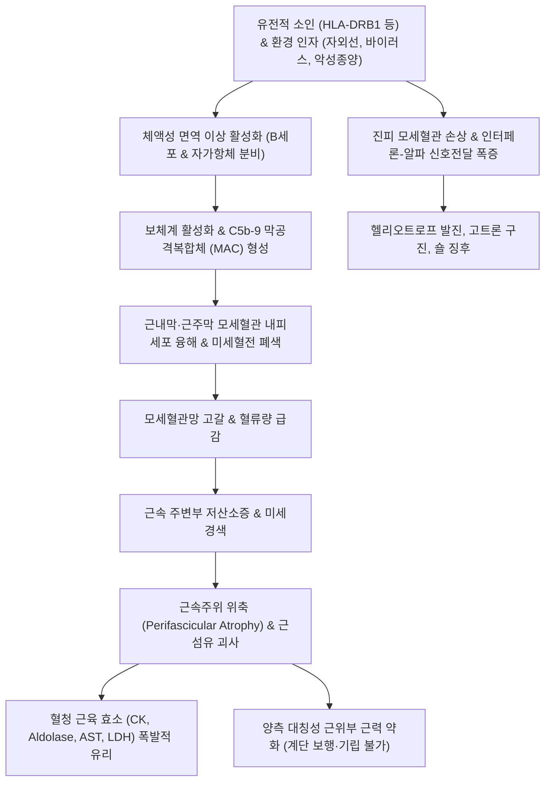

# 🩺 피부근염 (Dermatomyositis, DM)

> **핵심 3줄 요약 (Key Summary)**:
> - 📍 병소 부위 & 해부·병태생리: 보체 매개 미세혈관병증(C5b-9 막공격복합체 침착)으로 인한 근주막(Perimysium) 모세혈관 파괴, 근속주위 위축(Perifascicular atrophy), 그리고 특징적인 피부 병변을 동반하는 특발성 염증성 근병증(Idiopathic Inflammatory Myopathy).
> - 🚩 전형적 임상 양상: 상지 거상 및 계단 오르기가 힘든 대칭성 근위부 근력 약화, 헬리오트로프 발진(Heliotrope rash, 상안검 보라색 부종), 고트론 구진(Gottron's papules, 손가락 관절 신전부 보라색 각질 구진), 숄 징후(Shawl sign), V-징후.
> - 🛠️ 핵심 검사 & 치료 전략: 혈청 근육 효소(CK, Aldolase) 급상승, 근전도(EMG), 근육/피부 생검, 근염 특이 자가항체(Anti-Mi-2, Anti-MDA5, Anti-TIF1-γ); 양방 전신 고용량 코르티코스테로이드, 면역억제제(MTX, 아자티오프린), IVIG; 한의학적으로 비증(痺證)·위증(痿證)·열독치성(熱毒熾盛) 변증 하에 [[청온패독음]], [[보중익기탕]] 합 [[생맥산]], [[호잠환]] 투여 및 합곡·곡지·비관·족삼리 자침.
> - ⚠️ 응급 의뢰 레드플래그: 연하근 마비로 인한 흡인성 폐렴 위험, 호흡근 마비로 인한 급성 호흡부전, Anti-MDA5 양성 환자의 급속 진행성 간질성 폐질환(RP-ILD), 성인 환자에서 동반 악성 종양(위암, 난소암, 폐암 등) 강력 의심 시 즉각 상급병원 전원.

---

## 📌 목차
1. [질환 개요 & 해부학적 병태생리](#1-질환-개요--해부학적-병태생리)
2. [병태생리 메커니즘 & 생체역학적 악순환 네트워크](#2-병태생리-메커니즘--생체역학적-악순환-네트워크)
3. [임상 증상 & 이학적 검사(Physical Exam) 알고리즘](#3-임상-증상--이학적-검사physical-exam-알고리즘)
4. [감별 진단 매트릭스 (Differential Diagnosis)](#4-감별-진단-매트릭스--differential-diagnosis)
5. [한의 통합 치료 프로토콜 (침·약침·추나·한약)](#5-한의-통합-치료-프로토콜-침약침추나한약)
6. [양방 치료 & 병용·의뢰 기준 (Conventional Treatment & Referral)](#6-양방-치료--병용의뢰-기준-conventional-treatment--referral)
7. [재활 운동 & 생활습관 티칭 가이드](#7-재활-운동--생활습관-티칭-가이드)
8. [💡 사용자 진료실 핵심 필기 & 임상 노하우 (Melt-In 잔여 심화 집약)](#8--사용자-진료실-핵심-필기--임상-노하우--melt-in-잔여-심화-집약)
9. [출처 및 학술 참고 문헌 (References)](#9-출처-및-학술-참고-문헌--references)

---

## 1. 질환 개요 & 해부학적 병태생리

* **질환의 정의 및 임상적 특징**:
  * 피부근염(Dermatomyositis, DM)은 골격근의 만성 염증으로 인한 대칭성 근위부 근력 저하와 특징적인 피부 발진을 주소로 하는 전신성 자가면역 질환이다.
  * 소아형(소아기 피부근염, JDM, 5~15세)과 성인형(40~60세)으로 양봉형(Bimodal) 연령 분포를 보이며, 성인 환자의 약 15~30%에서 **악성 종양(Paraneoplastic syndrome)**이 동반되는 것이 중대한 임상적 특징이다.
  * 피부 증상만 있고 근력 약화가 없는 경우를 **무근병증성 피부근염 (Amyopathic Dermatomyositis, CADM)**이라 부르며, 이 경우 **Anti-MDA5 항체**와 연관되어 치명적인 급속 진행성 간질성 폐질환(RP-ILD)을 유발할 수 있다.

* **호발 해부학적 구조와 근조직학적 특징**:
  * **근골격계 침범 부위**: 경추 굴곡근, 견갑대 근육([[삼각근]], [[승모근]], [[극상근]]), 골반대 근육([[대둔근]], [[장요근]], [[대퇴직근]]) 등 체간에 가까운 **근위부 근육(Proximal muscles)**을 대칭적으로 침범한다. 원위부 근육(손, 발)은 질환 후기까지 보존된다.
  * **조직병리학적 특징 (다발근염과의 감별점)**:
    * 피부근염은 일차적으로 체액성 면역(B세포 및 보체)에 의해 근내막 및 근주막의 모세혈관 내피세포가 공격받는 **미세혈관병증(Microangiopathy)**이다.
    * 보체 C5b-9 막공격복합체(MAC)가 혈관벽에 침착되어 혈전성 폐색과 미세경색을 일으키며, 이로 인해 근속 주변부의 근섬유들이 허혈에 빠져 위축되는 **근속주위 위축(Perifascicular atrophy)**이 병리 진단의 핵심 기준이다.
    * 염증 세포 침윤은 주로 CD4+ T세포, B세포, 형질세포가 **근주막(Perimysium)**과 혈관 주위에 모여든다 (CD8+ T세포가 근내막을 직접 침범하는 다발근염과 명확히 구별됨).

---

## 2. 병태생리 메커니즘 & 생체역학적 악순환 네트워크

* **제1형 인터페론(IFN-I) 경로의 중심 역할**:
  * 최근 분자생물학적 연구에 따르면, 피부근염 환자의 근육과 피부 조직에서는 제1형 인터페론(IFN-α/β) 유도 유전자(ISG)가 극도로 과발현되어 있다.
  * 형질세포양 수지상세포(pDC)가 분비한 IFN-I은 혈관 내피세포의 기능부전을 유도하고 근섬유의 단백질 번역을 억제하여 근위축을 촉진한다.

---

## 3. 임상 증상 & 이학적 검사(Physical Exam) 알고리즘

* **특이적 피부 징후 (Pathognomonic Rashes, 진단적 가치 높음)**:
  1. **고트론 징후 및 구진 (Gottron's Papules/Sign)**:
     * 중수수지관절(MCP) 및 근위지관절(PIP), 팔꿈치, 무릎의 신전부 관절 표면에 발생하는 자색~홍반성의 인설성 구진.
  2. **헬리오트로프 발진 (Heliotrope Rash)**:
     * 상안검(윗눈꺼풀) 및 눈 주위에 발생하는 특징적인 보라색(자색) 홍반과 주위 부종.
  3. **숄 징후 (Shawl Sign) 및 V-징후 (V-Sign)**:
     * 숄 징후: 목 뒤쪽, 어깨, 등 상부에 숄을 걸친 듯한 형태로 나타나는 홍반.
     * V-징후: 앞목과 가슴 상부 V-넥 라인 부위에 나타나는 광과민성 홍반.
  4. **기술자의 손 (Mechanic's Hands)**:
     * 손가락 외측면과 손바닥 피부가 기름때가 낀 기술자의 손처럼 거칠어지고 갈라지는 과각화성 변화 (항합성효소 증후군에서 흔함).
  5. **피하 석회증 (Calcinosis cutis)**: 주로 소아형(JDM)에서 피부 아래 단단한 칼슘 덩어리가 침착되어 궤양을 형성.

* **근육 및 전신 증상**:
  * **근력 약화**: 통증 없이 서서히 진행되는 양측 대칭성 근위부 약화. 환자는 "머리를 빗거나 드라이기를 들기 힘들다", "낮은 의자나 쪼그려 앉은 자세에서 손을 짚지 않고 일어날 수 없다", "버스의 높은 계단을 오르기 벅차다"고 호소.
  * **연하곤란 (Dysphagia)**: 인두 및 상부 식도 횡문근 침범으로 음식물을 삼키기 어렵고 사레가 들림.
  * **호흡곤란**: 횡격막 및 늑간근 약화, 또는 급성 간질성 폐질환(ILD) 합병.

* **임상병리 및 영상 진단 알고리즘**:
  1. **혈청 근육 효소**:
     * **크레아틴 키나아제 (CK)**: 정상의 5~50배까지 급상승 (질환 활동성 지표).
     * 알돌라아제(Aldolase), AST, ALT, LDH 동반 상승.
  2. **근염 특이 자가항체 (Myositis-Specific Antibodies, MSA)**:
     * **Anti-Mi-2**: 고전적 피부근염, 피부 발진 현저, 스테로이드 반응 양호, 예후 우수.
     * **Anti-MDA5**: 무근병증성(CADM), 손바닥 혈관염 궤양, **급속 진행성 간질성 폐질환(RP-ILD) 고위험, 불량한 예후**.
     * **Anti-TIF1-γ / Anti-NXP2**: **악성 종양(암) 동반 강력 연관**.
     * **Anti-Jo-1 (항합성효소 항체)**: 근염, 간질성 폐질환, 관절염, 기술자의 손, 레이노 현상(항합성효소 증후군).
  3. **근전도 검사 (EMG)**: 근병증성 삼징후(다상성 짧은 지속시간 전위, 섬유성 연축, 고주파 반복 방전).
  4. **대퇴부 근육 MRI (T2/STIR)**: 활동성 근육 부종 및 염증 부위 확인 (생검 부위 선정에 필수).
  5. **근육 생검 (Muscle Biopsy, 확진)**: 근주막 염증 세포 침윤 및 근속주위 위축(Perifascicular atrophy).

---

## 4. 감별 진단 매트릭스 (Differential Diagnosis)

| 감별 질환 | 호발 연령 및 성별 | 특징적 피부 병변 | 근육 침범 양상 | 근육 생검 소견 | 자가항체 / 원인 |
| :--- | :--- | :--- | :--- | :--- | :--- |
| **피부근염 (DM)** | **소아 및 40~60세 성인** | **헬리오트로프 발진, 고트론 구진** | **대칭성 근위부 근력 약화** | **근속주위 위축, CD4+ T세포** | **Anti-Mi-2, Anti-MDA5** |
| **다발근염 (PM)** | 20세 이상 성인 (소아 드묾) | **피부 병변 전혀 없음** | 대칭성 근위부 근력 약화 | 근내막 침윤, CD8+ T세포 | Anti-Jo-1 (피부 병변 부재) |
| **봉입체근염 (IBM)** | 50세 이상 남성 호발 | 피부 병변 없음 | **비대칭적, 원위부(손가락 굴곡)+대퇴사두근** | 공포(Rimmed vacuoles) 관찰 | 치료 불응성, 만성 진행 |
| **약물유발성 근병증** | 스타틴, 스테로이드 복용자 | 없음 | 근육통 위주, 근력 저하 경미 | 괴사 있으나 염증 세포 없음 | 스타틴 중단 시 호전 (HMGCR 항체 감별) |
| **중증 근무력증 (MG)** | 20~40대 여성, 고령 남성 | 없음 | **일중 변동성(오후 악화), 안검하수/복시** | 정상 조직 | 아세틸콜린 수용체(AChR) 항체 |

---

## 5. 한의 통합 치료 프로토콜 (침·약침·추나·한약)

* **진료 원칙 및 한의 병기**:
  * 한의학에서 피부근염은 **비증(痺證)**, **피비(皮痺)**, **기비(肌痺)** 및 사지 근육이 마르고 힘이 빠지는 **위증(痿證)**의 범주에 속한다.
  * 발병 초기에는 풍열온독(風熱溫毒)이 기표(肌表)와 기육(肌肉)에 침범하여 열독이 치솟는 **열독치성(熱毒熾盛)**으로 발진과 근육통이 나타나며, 중기 이후에는 비위(脾胃) 기능 실조로 기육을 기르지 못하는 **비폐기허(脾肺氣虛)**, 말기에는 **간신휴손(肝腎虧損)**으로 근골이 위축된다.

* **침구 치료 프로토콜**:
  * **근위부 근육 긴장도 개선 및 기혈 순환 배혈**:
    * **상지 근위부**: [[견정]](GB21), [[견우]](LI15), [[곡지]](LI11), [[수삼리]](LI10), [[합곡]](LI4).
    * **하지 근위부 및 골반대**: [[비관]](ST31), [[복토]](ST32), [[양릉천]](GB34, 근회穴), [[족삼리]](ST36), [[삼음교]](SP6), [[환도]](GB30).
    * **배수혈(背兪穴)**: 폐수(BL13), 비수(BL20), 간수(BL18), 신수(BL23)에 평자하여 오장 기운을 보강.
  * **자침 기법**: 급성기 활동성 근염(CK 급상승기)에는 강한 전침이나 과도한 자극을 피하고 유침 위주의 평보평사를 적용하여 추가적인 근섬유 손상을 방지함.

* **약침 치료 프로토콜**:
  * 중성어혈 약침 또는 황련해독탕 약침을 양릉천, 족삼리, 견우에 소량 주입하여 근육 주변 미세혈류 순환을 촉진하고 염증 매개물질 배출을 유도.

* **변증별 한약 처방**:
  * **열독치성·풍열상락형 (熱毒熾盛 - 급성기 안면 홍반, 고트론 구진, 고열, 근육 압통, 설강태황, 맥삭)**:
    * 처방: **[[청온패독음]](淸瘟敗毒飲)** 합 사묘용안탕(四妙勇安湯).
    * 군약: 석고, 지황, 서각(우각), 황련, 금은화, 현삼, 적작약.
    * 작용: 혈분의 맹렬한 열독을 식히고(청열양혈) 미세혈관 내피세포 염증과 피부 발진을 신속히 가라앉힘.
  * **비폐기허·기육위약형 (脾肺氣虛 - 만성 근력 저하, 기립 불능, 피로, 숨참, 소화불량, 설담태백, 맥세약)**:
    * 처방: **[[보중익기탕]](補中益氣湯)** 합 **[[생맥산]](生脈散)** 가 백출, 황기(대용량), 의이인, 산약.
    * 작용: 건비익기(健脾益氣)하여 비주기육(脾主肌肉)의 기능을 회복시키고 근섬유의 재생과 근력을 회복.
  * **간신음허·근골위축형 (肝腎陰虛 - 장기 스테로이드 복용 환자, 골다공증, 하지 무력 위축, 설홍소태, 맥세수)**:
    * 처방: **[[호잠환]](虎潛丸)** 합 육미지황탕(六味地黃湯).
    * 군약: 숙지황, 구판, 황백, 지모, 쇄양, 당귀, 백작약, 우슬.
    * 작용: 자음강화(滋陰降火), 보간신(補肝腎), 강근골(强筋骨).

---

## 6. 양방 치료 & 병용·의뢰 기준 (Conventional Treatment & Referral)

* **양방 표준 치료 전략**:
  1. **1차 치료 (관해 유도)**:
     * **고용량 글루코코르티코이드**: 경구 프레드니솔론(Prednisolone) 1 mg/kg/일 (최대 60~80mg/일)을 4~6주간 투여하여 근력 호전 및 CK 수치 정상화를 유도한 후 수개월에 걸쳐 점진적 감량.
     * 연하곤란, 호흡근 마비, 급성 심근염 등 중증 시: 메틸프레드니솔론 정맥 펄스 요법(1g/일 3일간).
  2. **스테로이드 감량 및 병용 면역억제제**:
     * 메토트렉세이트(MTX 15~25mg/주) 또는 아자티오프린(AZA 2~3mg/kg/일).
  3. **난치성 및 급속 진행성 간질성 폐질환(Anti-MDA5 연관 RP-ILD) 초응급 요법**:
     * 고용량 스테로이드 + **칼시뉴린 억제제(타크로리무스 Tacrolimus)** + 정맥 사이클로포스파마이드(CYC) 또는 리툭시맙(Rituximab, 항-CD20) 조기 삼중 병용.
  4. **정맥 면역글로불린 (IVIG, 2g/kg)**: 중증 연하곤란, 임산부, 불응성 피부 병변 환자에 탁월한 효과.

* **한의 병용 치료 가이드**:
  * 장기간 고용량 스테로이드 복용으로 인해 발생하는 쿠싱 증후군, 중심성 비만, 골다공증, 스테로이드 유발성 근병증에 육미지황탕 및 보중익기탕을 병용하면 부신 피질 기능을 보존하고 근위축 부작용을 경감시킬 수 있음.
  * 급성기 염증이 잡힌 관해기 환자에서 침구 치료와 한약 요법을 병용하면 근섬유 재생과 보행 능력 회복 속도를 현저히 단축시킴.

* **양방·전문과 응급 의뢰 기준 (Referral Criteria)**:
  * 🚨 **즉각적인 대학병원 류마티스내과/응급실 전원 레드플래그**:
    1. **흡인 위험 및 연하곤란**: 물이나 침을 삼키지 못하고 사레가 들려 기침하는 경우(연하근 마비).
    2. **급성 호흡부전**: 누웠을 때 숨이 가빠지는 기좌호흡, 산소포화도 저하, Anti-MDA5 양성 환자의 호흡곤란(치명적 급속 진행성 폐섬유화).
    3. **성인 암 선별 검사(Cancer Screening) 필수**: 40세 이상 피부근염 확진 환자는 반드시 복부/흉부 CT, 위·대장 내시경, 부인과 초음파/유방촬영술을 통해 잠재 악성 종양을 전수 조사해야 함.

---

## 7. 재활 운동 & 생활습관 티칭 가이드

* **질환 활동성에 따른 단계적 운동 요법**:
  * **급성 활동기 (CK 수치 폭증, 근육통 극심기)**: 과도한 근력 운동은 횡문근융해를 조장하므로 엄금. 관절 구축을 막기 위한 부드러운 수동적 관절 가동 범위(ROM) 운동과 침상 내 체위 변경만 시행.
  * **만성 회복기 (CK 정상화 후)**: 등장성 근력 운동 및 점진적 저항 운동(가벼운 밴드 운동, 의자 앉았다 일어서기, 평지 걷기)을 시행하여 위축된 대퇴사두근과 삼각근을 재건.

* **철저한 자외선(UV) 차단 (광과민성 예방)**:
  * 자외선은 각질형성세포를 손상시키고 전신 자가항원 방출을 유도하여 피부 발진뿐만 아니라 전신 근염을 폭발적으로 악화시킴.
  * 외출 시 자외선 차단제(SPF 50+, PA++++) 도포, 챙 넓은 모자, 긴 소매 옷 필수 착용.

* **연하 장애 환자의 식이 관리**:
  * 사레들림을 방지하기 위해 액체류보다는 점도가 있는 연하보조제(토로미)를 섞은 부드러운 반고형식 섭취.
  * 식사 시 턱을 아래로 가볍게 당긴 자세(Chin-tuck)로 천천히 삼키도록 지도.

---

## 8. 💡 사용자 진료실 핵심 필기 & 임상 노하우 (Melt-In 잔여 심화 집약)

* **비오님 진료실 1초 진단 & 암 선별 노하우**:
  1. **"손가락 마디마디를 보라 (고트론 구진의 직관)"**: "손가락 관절이 아프다고 온 환자가 손등 쪽 중수관절(주먹 쥘 때 튀어나오는 뼈) 표면에 붉은 보라색 각질 구진이 덮여 있다면, 류마티스 관절염이 아니라 피부근염(고트론 구진)이다. 이때 눈꺼풀을 올려보아 보라색 부종(헬리오트로프 발진)이 있는지 1초 만에 확인해야 한다."
  2. **"성인 피부근염은 '암의 경고장'이다"**: "50대 이상 환자가 피부근염으로 진단되면, 류마티스 치료만 해서는 절대 안 된다. 성인 피부근염의 20~30%는 몸속 어딘가에 숨어 있는 위암, 난소암, 유방암, 폐암이 보낸 부종양성 면역 경고 신호이다. 진료실에서 즉시 전신 암 검진(PET-CT, 내시경)을 의뢰하지 않으면 암을 놓쳐 환자를 잃게 된다."
  3. **"급성기에 과도한 침과 운동은 독이다"**: "근육 효소(CK)가 수천 단위로 치솟아 있는 급성기에 침을 깊숙이 찌르거나 헬스장에서 무거운 역기를 들게 하면 근육 세포 파괴가 가속화되어 신부전(미오글로빈뇨증)이 올 수 있다. 급성기에는 청온패독음으로 열독을 끄고 안정을 취하게 한 뒤, CK가 안정되면 보중익기탕과 가벼운 보행 재활로 전환해야 한다."

---

## 9. 출처 및 학술 참고 문헌 (References)

- Nigro A et al. (2026). Prolonged remission of dermatomyositis and autoantibody negativization following SARS-CoV-2 infection in an elderly patient. *Autoimmunity*. 59(1):2596695. PMID: 41502404.

- Lippert V et al. (2026). Palmar involvement in adult dermatomyositis: A French multicenter cohort. *JAAD Int*. 29():76-78. PMID: 42935945.

- El Bqaq I et al. (2026). Extensive dystrophic calcinosis in dermatomyositis with concurrent breast carcinoma: an imaging pitfall. *Radiol Case Rep*. 21(12):6228-6232. PMID: 42823971.\n