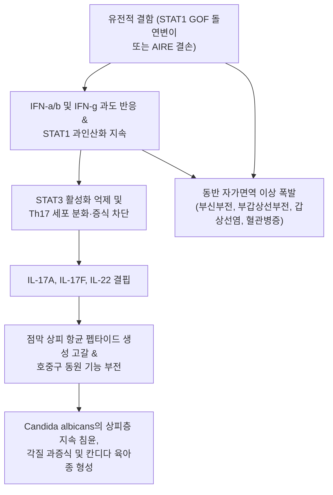
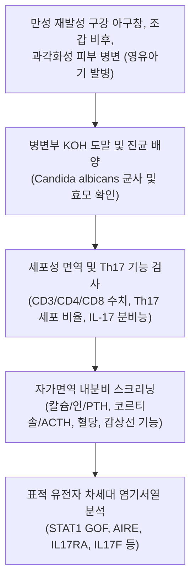

# 🩺 만성 피부점막 칸디다증

> **핵심 3줄 요약 (Key Summary)**:
> - 📍 병소 부위 & 해부·병태생리: 피부, 손발톱, 구강 및 생식기 점막에 발생하는 만성·재발성의 난치성 [[칸디다증]]으로, T세포 매개 면역계 결함(주로 IL-17 경로 이상, STAT1 기능 획득 돌연변이 등 선천성 면역 결핍)에 기인함.
> - 🚩 전형적 임상 양상: 영유아기부터 지속되는 구강 아구창, 과각화성 비후를 동반한 피부 칸디다 육아종, 조갑 비대 및 파괴, 전신 내분비계 자가면역 질환(부갑상선 기능 저하증, 부신 기능 저하증) 동반(APECED 증후군).
> - 🛠️ 핵심 검사 & 치료 전략: 병변부 KOH 도말 및 진균 배양, 면역글로불린 및 T세포 아형 분석, 유전자 검사(STAT1, AIRE, IL17RA 등); 전신 경구 항진균제(플루코나졸, 이트라코나졸, 포사코나졸) 장기 유지 및 내분비 호르몬 보충, JAK 억제제(Ruxolitinib) 표적 치료.
> - ⚠️ 응급 의뢰 레드플래그: 칸디다 식도염에 의한 극심한 연하곤란, 부신 기능 저하에 따른 부신 위기(급성 저혈압, 쇼크, 저혈당), 저칼슘혈증성 테타니(부갑상선 기능 저하), 흉부 통증 및 대동맥류/뇌동맥류 파열 의심 징후.

---

## 📌 목차
1. [질환 개요 & 해부학적 병태생리](#1-질환-개요--해부학적-병태생리)
2. [병태생리 메커니즘 & 생체역학적 악순환 네트워크](#2-병태생리-메커니즘--생체역학적-악순환-네트워크)
3. [임상 증상 & 이학적 검사(Physical Exam) 알고리즘](#3-임상-증상--이학적-검사physical-exam-알고리즘)
4. [감별 진단 매트릭스 (Differential Diagnosis)](#4-감별-진단-매트릭스--differential-diagnosis)
5. [한의 통합 치료 프로토콜 (침·약침·추나·한약)](#5-한의-통합-치료-프로토콜--침약침추나한약)
6. [양방 치료 & 병용·의뢰 기준 (Conventional Treatment & Referral)](#6-양방-치료--병용의뢰-기준-conventional-treatment--referral)
7. [재활 운동 & 생활습관 티칭 가이드](#7-재활-운동--생활습관-티칭-가이드)
8. [💡 사용자 진료실 핵심 필기 & 임상 노하우 (Melt-In 잔여 심화 집약)](#8--사용자-진료실-핵심-필기--임상-노하우--melt-in-잔여-심화-집약)
9. [출처 및 학술 참고 문헌 (References)](#9-출처-및-학술-참고-문헌--references)

---

## 1. 질환 개요 & 해부학적 병태생리

**만성 피부점막 칸디다증(Chronic Mucocutaneous Candidiasis, CMC)**은 *Candida albicans*를 비롯한 칸디다 진균에 대한 숙주의 세포 매개 면역 결핍으로 인해 피부, 조갑(손발톱), 구강 및 생식기 점막에 지속적이고 재발성의 비침습적 진균 감염이 발생하는 희귀 면역결핍 증후군이다. 일반적인 전신 침습성 칸디다증(칸디다혈증, 내부 장기 파종)과 달리, 감염이 피부와 점막 상피층에 국한되는 독특한 해부병태생리학적 특징을 보인다.

정상적인 피부 점막 방어에서 상피세포와 수지상세포는 칸디다 균사를 인식하여 IL-23을 분비하고, 이는 Th17 세포를 활성화하여 IL-17A, IL-17F, IL-22를 분비하도록 유도한다. 이들 사이토카인은 상피세포에서 항균 펩타이드(Defensins, Calprotectin)의 생성을 유도하고 호중구를 점막 표면으로 동원하여 진균 증식을 차단한다. 만성 피부점막 칸디다증 환자는 이러한 IL-17 면역 축(IL-17 pathway)의 선천적 결함에 기인한다. 가장 흔한 유전적 원인은 **STAT1 기능 획득 돌연변이(STAT1 Gain-of-Function, GOF)**이며, 그 외에도 AIRE 유전자 돌연변이에 의한 **자가면역 다발내분비병증-칸디다증-외배엽 이영양증(APECED/APS-1)** 등이 있다.

---

## 2. 병태생리 메커니즘 & 생체역학적 악순환 네트워크

STAT1 GOF 돌연변이 환자에서는 제1형 및 제2형 인터페론 신호 전달이 과도하게 증폭되어 탈인산화가 지연됨으로써, Th17 세포 분화에 필수적인 STAT3 경로를 역으로 억제한다. Th17 세포가 결핍되면 점막 표면에서 칸디다를 제거하는 호중구와 항균 펩타이드가 작동하지 않아 만성적인 표재성 감염이 지속된다. 동시에 역설적으로 자가면역 조절 T세포의 기능 장애와 과도한 인터페론 신호로 인해 다발성 내분비 장기에 대한 자가항체 생성이 촉진되어 자가면역 다발내분비병증이 병발한다.

---

## 3. 임상 증상 & 이학적 검사(Physical Exam) 알고리즘

### 주요 임상 증상
- **구강 점막 병변**: 출생 후 수개월 이내부터 시작되는 난치성 아구창(Oral thrush), 설염, 구각구순염, 백반증 양상의 후막 형성, 식도 침범 시 연하통 및 연하곤란.
- **조갑 병변 (칸디다성 조갑주위염 및 조갑진균증)**: 손발톱 주위가 붉게 붓고 동통이 있으며, 손발톱판이 비후되고 황갈색으로 변색되며 부서지고 박리됨.
- **피부 병변 (칸디다 육아종)**: 두피, 안면(코, 이마), 체간 및 사지에 발생하는 두꺼운 과각화성 가피와 각화성 판(Verrucous/horny plaques).
- **내분비계 자가면역 병발 증상 (APECED 등)**:
  - 부갑상선 기능 저하증: 저칼슘혈증에 의한 손발 저림, 근육 경련, 테타니(Tetany), Chvostek 및 Trousseau 징후 양성.
  - 원발성 부신 기능 저하증(에디슨병): 전신 쇠약, 피로, 저혈압, 피부 및 잇몸 색소 침착, 저나트륨혈증.
  - 제1형 당뇨병, 자가면역 갑상선염, 조기 난소 부전, 악성 빈혈.
- **비감염성 혈관 합병증**: STAT1 GOF 환자에서 뇌동맥류 및 흉부/복부 대동맥류의 발생 위험이 현저히 증가함.

### 진단 검사 알고리즘

---

## 4. 감별 진단 매트릭스 (Differential Diagnosis)

| 감별 질환 | 호발 연령 및 병태생리 | 칸디다 침범 부위 및 양상 | 면역학적 이상 및 동반 질환 | 전신 감염 위험성 |
| :--- | :--- | :--- | :--- | :--- |
| **만성 피부점막 칸디다증 (CMC)** | 영유아기~소아기 발병, IL-17/STAT1 결함 | 피부, 조갑, 구강·생식기 점막(비침습적), 과각화 육아종 | Th17 결핍, 자가면역 다발내분비병증, 뇌동맥류 | 전신 침습성 파종은 드묾 (국소 표재성 난치) |
| **후천성 면역결핍증 (HIV/AIDS)** | 성인 또는 주산기 감염, CD4+ T세포 고갈 | 구강 칸디다증, 식도 칸디다증 흔함 | CD4+ T세포 전반적 격감($<200/\mu\text{L}$), HIV 항체/RNA 양성 | 주폐포자충 폐렴, 거대세포바이러스 등 기회감염 빈발 |
| **중증 복합 면역결핍증 (SCID)** | 생후 수개월 이내 치명적 발병 | 구강 및 전신 점막 칸디다증 | T세포 및 B/NK세포의 완전 결손, 림프구 격감 | 세균, 바이러스, 진균 전신 패혈증으로 조기 사망 |
| **고-IgE 증후군 (Job 증후군)** | 영유아기, STAT3 결손 | 피부 점막 칸디다증 흔함 | 혈청 IgE 극초과($>2,000\text{ IU/mL}$), 호산구증다증, 한랭 농양, 특징적 안면 | 황색포도상구균 폐렴, 폐낭종 형성 |
| **단순 표재성 피부 진균증** | 전 연령, 국소 습윤 환경·당뇨 | 간찰부(서혜부, 유방 하부) 홍반성 침식, 위성 농포 | 정상 면역계, 국소 항진균제에 신속 반응 | 전신 면역 결핍 및 내분비 이상 없음 |

---

## 5. 한의 통합 치료 프로토콜 (침·약침·추나·한약)

> ⚠️ 만성 피부점막 칸디다증은 유전적 T세포 면역 결손 질환으로 항진균제 및 면역조절 치료가 필수적이다. 한의 치료는 장기 항진균제 복용에 따른 간독성 및 위장관 기능 장애를 완화하고, 점막 면역 환경 개선 및 피부 상피 재생을 보조하는 지지요법으로 활용한다.

### 1) 한약 처방 (변증별 지지요법)
- **비위습열 및 어독증 (脾胃濕熱 瘀毒證 - 구강 아구창, 구각염, 소화불량, 설태 황니)**:
  - 처방: [[황련해독탕]] 또는 청위산 가감 ([[황련]], [[황금]], [[황백]], [[치자]], [[생지황]], 목단피, 승마).
  - 약리 기전: 황련의 베르베린 성분 및 황백의 알칼로이드가 칸디다 진균의 세포막 투과성을 교란하고 생체막(Biofilm) 형성을 억제함.
- **비신양허 및 정혈부족증 (脾腎兩虛 精血不足證 - 만성 쇠약, 조갑 위축, 발육 부진, 오한)**:
  - 처방: [[팔미지황환]] 또는 [[보중익기탕]] 가감 ([[숙지황]], [[산약]], [[산수유]], 복령, [[황기]], [[백출]], [[당귀]]).
  - 목적: 선천성 정기 보강, 내분비 대사 균형 보조 및 상피 세포 재생 촉진.
- **간비불화 및 혈조증 (肝脾不和 血燥證 - 피부 각화성 육아종, 건조, 가려움)**:
  - 처방: 소풍산 합 [[사물탕]] 가감 ([[당귀]], [[생지황]], [[적작약]], [[천궁]], [[고삼]], 지골피).
  - 작용: 진피 미세순환 개선 및 과각화 병변의 각질 연화 지원.

### 2) 외용 한약 세정 요법
- **고삼황백탕 (苦蔘黃柏湯) 외용 습포**:
  - 구성: [[고삼]] $30\text{ g}$, [[황백]] $20\text{ g}$, [[금은화]] $20\text{ g}$, [[연교]] $15\text{ g}$.
  - 방법: 달인 액을 미온수로 식혀 멸균 거즈에 적신 후 조갑 및 피부 병변부에 1일 1~2회, 회당 15분간 냉습포 시행. 2차 세균 감염 예방 및 진균 증식 억제.

---

## 6. 양방 치료 & 병용·의뢰 기준 (Conventional Treatment & Referral)

### 양방 표준 치료 가이드라인
1. **항진균 요법**:
   - 1차 경구 항진균제: 플루코나졸(Fluconazole $100\sim 200\text{ mg/day}$). 만성화 시 내성균 발생 빈도가 높음.
   - 내성 시 2차 치료제: 이트라코나졸, 보리코나졸, 포사코나졸 경구 현탁액.
   - 불응성 중증 병변: 정맥용 에키노칸딘계(카스포펀진, 아니둘라펀진) 또는 암포테리신 B.
2. **분자 표적 및 면역조절 치료 (STAT1 GOF)**:
   - **JAK 억제제(Ruxolitinib, Tofacitinib)**: 과활성화된 JAK-STAT1 신호를 정상화하여 Th17 세포 비율을 회복시키고 칸디다 감염 및 동반 자가면역 질환을 동시 개선.
3. **동반 내분비 질환 호르몬 대체 요법**:
   - 부갑상선 기능 저하: 활성형 비타민 D(Calcitriol) 및 경구 칼슘 보충제.
   - 부신 기능 저하: 하이드로코르티손(Hydrocortisone) 및 플루드로코르티손.

### 긴급 응급 의뢰 레드플래그
- **급성 부신 위기 (Adrenal crisis)**: 오심, 구토, 복통과 함께 급격한 저혈압, 쇼크, 저혈당, 의식 저하 발생.
- **저칼슘혈증성 테타니**: 후두 연축으로 인한 급성 호흡곤란, 전신 경련, 심전도상 QT 연장.
- **칸디다 식도염 합병증**: 심한 연하통으로 인한 탈수 및 식도 천공 의심 징후.
- **뇌동맥류 의심**: 벼락 맞은 듯한 극심한 돌발 두통, 시야 장애, 신경학적 결손.

---

## 7. 재활 운동 & 생활습관 티칭 가이드

- **철저한 구강 위생 관리**: 식사 후 및 취침 전 부드러운 칫솔로 구강을 청결히 하고, 클로르헥시딘 구강 청결제로 가글링함. 칫솔은 진균 오염을 방지하기 위해 자주 교체함.
- **피부 및 손발톱 건조 유지**: 칸디다는 고온 다습한 환경에서 증식하므로, 샤워 후 발가락 사이와 손발톱 주변을 헤어드라이어 찬바람으로 완전히 건조시킴. 통풍이 잘되는 면양말과 가죽 신발을 착용함.
- **내분비 증상 자가 모니터링 교육**: 환자와 보호자에게 손발 저림, 입 주위 얼얼함(저칼슘혈증 전조), 어지러움, 기립성 저혈압, 피부 흑화(부신부전 전조) 징후를 교육하고 이상 시 즉시 병원 검사를 받도록 지도함.
- **정기 혈관 영상 스크리닝**: STAT1 돌연변이 환자는 무증상 대동맥류 및 뇌동맥류 발생 위험이 있으므로 성장기 이후 정기적인 뇌 MRA 및 흉복부 CT 검사를 받도록 권고함.

---

## 8. 💡 사용자 진료실 핵심 필기 & 임상 노하우 (Melt-In 잔여 심화 집약)

> 💡 **임상 핵심 진주 (Clinical Pearls)**:
> - **'단순 무좀'이 아닌 유전 질환의 단서**: 어린 소아나 청소년이 손발톱 전체가 두껍고 누렇게 변형되는 조갑진균증을 앓고 있으면서 구강 아구창이 반복된다면, 단순한 접촉성 감염이 아닌 Th17 면역 결핍 질환인 만성 피부점막 칸디다증을 강력히 의심해야 한다.
> - **내분비 질환의 시간차 폭탄**: APECED(APS-1)의 경우 유아기에 칸디다증이 먼저 나타나고, 수년 뒤 부갑상선 기능 저하증이 발생하며, 10~20대에 에디슨병(부신부전)이 순차적으로 발병하는 '3단계 시간차'를 보인다. 따라서 피부 칸디다증 환자를 진료할 때는 정기적인 전해질(칼슘, 나트륨) 및 호르몬 모니터링이 생명을 살리는 열쇠이다.
> - **항진균제 내성의 딜레마**: 이 질환 환자들은 평생 항진균제를 복용해야 하므로 플루코나졸 내성(Azole-resistance) 칸디다 균주가 매우 흔하게 발생한다. 약 복용 중에도 병변이 악화되면 약효 부족으로 판단하여 용량을 함부로 늘리지 말고 균 배양 및 항진균제 감수성 검사를 의뢰해야 한다.
> - **최신 표적 치료 JAK 억제제의 패러다임**: 과거에는 평생 항진균제 유지 요법 외에 근본적 치료가 없었으나, 최근 STAT1 GOF 환자에서 룩소리티닙(Ruxolitinib) 등 JAK 억제제를 사용하여 Th17 면역을 복원시키고 칸디다증과 자가면역 질환을 획기적으로 관해시키는 임상 연구가 활발히 진행되고 있음을 숙지하고 환자에게 최신 의학 정보를 안내해야 한다.

---

## 9. 출처 및 학술 참고 문헌 (References)

- Giannotti V, et al. (2025). Chronic Mucocutaneous Candidiasis in Inborn Errors of Immunity. *J Fungi (Basel)*. PMID: 42411595.

- Melgosa Ramos F, et al. (2026). Targeted Prevention and Management of Mucocutaneous Candidiasis During Bimekizumab Therapy in Hidradenitis Suppurativa: A Practical Clinical Perspective. *Int J Dermatol*. PMID: 42165325.

- Holden K, et al. (2026). Selective JAK1 inhibition with upadacitinib controls STAT1 gain-of-function-related hidradenitis suppurativa and chronic mucocutaneous candidiasis. *Intern Med J*. PMID: 41945459.
