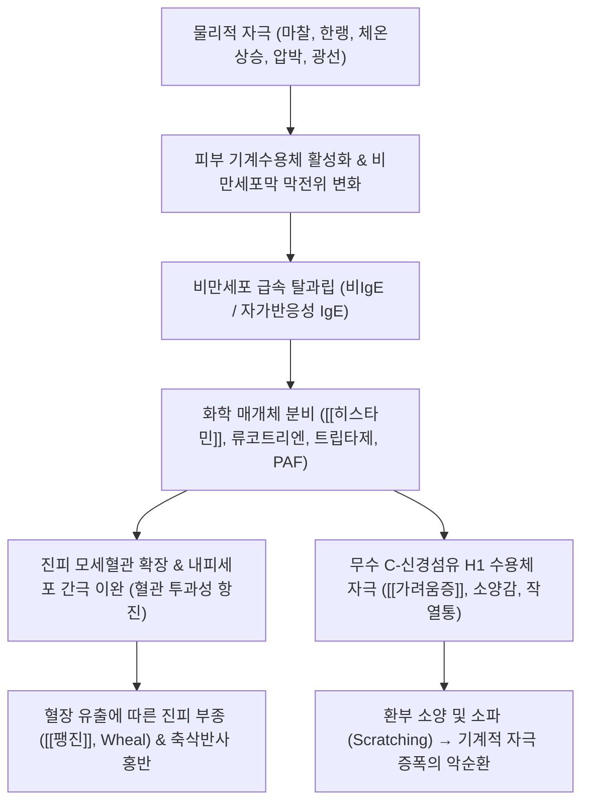

# 🩺 [[물리적 알레르기]] (Physical Urticaria / 만성 유발성 두드러기, ICD-10: L50.2~L50.8)

> **핵심 3줄 요약 (Key Summary)**:
> - 📍 병소 부위 & 해부·병태생리: 진피층 모세혈관 주위 비만세포(Mast cell)가 한랭, 열, 마찰, 압박, 진동, 일광 등 특정 물리적 자극에 노출되어 기계수용체 및 비IgE/IgE 경로를 통해 급격히 탈과립되며 히스타민을 분비하는 만성 유발성 두드러기(CIndU) 질환군.
> - 🚩 전형적 임상 양상 & 3대 징후: 물리적 자극 후 수분~수십 분 내 발생하는 경계가 뚜렷한 팽진(Wheal) 및 홍반성 발적(Flare), 심한 소양감과 작열통, 콜린성 두드러기에서 나타나는 1~3mm 크기의 작은 점상 구진과 발한 시 악화.
> - 🛠️ 핵심 감별 검사 & 한·양방 다각적 치료 전략: 자극별 유발 검사(FricTest 피부묘기증, Ice cube test 한랭 두드러기, 운동 부하 콜린성 두드러기), 2세대 비진정성 H1 항히스타민제 최대 4배 증량 및 오말리주맙([[오말리주맙]], Xolair), 풍한속표·위열혈열 변증 한약([[마황계지탕]], [[방풍통성산]], [[당귀음자]]) 및 체질 개선 통합 치료.
> - ⚠️ 응급 의뢰 레드플래그 & 악화 요인: 광범위한 찬물 수영 또는 전신 한랭 노출 시 발생하는 혈관 확장성 저혈압 쇼크(한랭 아나필락시스), 후두 부종에 따른 호흡곤란, 24시간 이상 지속되며 색소 침착을 남기는 두드러기성 혈관염 의심 시 즉각 응급 처치.

---

## 📌 목차
1. [질환 개요 & 해부학적 병태생리](#1-질환-개요--해부학적-병태생리)
2. [병태생리 메커니즘 & 생체역학적 악순환 네트워크](#2-병태생리-메커니즘--생체역학적-악순환-네트워크)
3. [임상 증상 & 이학적 검사(Physical Exam) 알고리즘](#3-임상-증상--이학적-검사physical-exam-알고리즘)
4. [감별 진단 매트릭스 (Differential Diagnosis)](#4-감별-진단-매트릭스-differential-diagnosis)
5. [한의 통합 치료 프로토콜 (침·약침·추나·한약)](#5-한의-통합-치료-프로토콜-침약침추나한약)
6. [양방 치료 & 병용·의뢰 기준 (Conventional Treatment & Referral)](#6-양방-치료--병용의뢰-기준-conventional-treatment--referral)
7. [재활 운동 & 생활습관 티칭 가이드](#7-재활-운동--생활습관-티칭-가이드)
8. [💡 사용자 진료실 핵심 필기 & 임상 노하우 (Melt-In 잔여 심화 집약)](#8--사용자-진료실-핵심-필기--임상-노하우-melt-in-잔여-심화-집약)
9. [출처 및 학술 참고 문헌 (References)](#9-출처-및-학술-참고-문헌-references)

---

## 1. 질환 개요 & 해부학적 병태생리

* **질환 정의 및 개요**:
  * [[물리적 알레르기]](Physical Urticaria)는 외부의 특정 물리적 자극(한랭, 온열, 마찰, 압박, 일광, 진동 등)에 의해 피부 비만세포가 비정상적으로 활성화되어 팽진(Wheal), 발적(Flare), 가려움증을 유발하는 만성 유발성 두드러기(Chronic Inducible Urticaria, CIndU)를 통칭합니다.
  * 자발적으로 발생하는 만성 자발성 두드러기(CSU)와 달리, 예측 가능하고 재현 가능한 물리적 유발 트리거가 존재하는 것이 결정적 감별점입니다.
  * 전체 만성 두드러기 환자의 약 20~30%를 차지하며, 청장년층에서 호발하고 평균 유병 기간이 수개월에서 수년에 달하여 삶의 질을 크게 저하시킵니다.
* **주요 6대 임상 아형**:
  * **[[피부묘기증]](인공두드러기, Symptomatic Dermographism)**: 피부를 긁거나 마찰 시 2~5분 내 선상 팽진 발생.
  * **[[한랭 두드러기]](Cold Urticaria)**: 찬 공기, 찬물, 얼음에 노출 후 피부가 재가온될 때 팽진 발생.
  * **[[콜린성 두드러기]](Cholinergic Urticaria)**: 운동, 목욕, 정서적 스트레스로 심부 체온이 1℃ 이상 상승할 때 1~3mm 미세 팽진 발생.
  * **지연성 압박 두드러기(Delayed Pressure Urticaria)**: 벨트, 가방 끈 등持속적인 압박 부위에 4~6시간 후 깊은 통증성 부종 형성.
  * **일광 두드러기(Solar Urticaria)**: 자외선(UVA/UVB) 또는 가시광선 노출 수분 내 팽진 발생.
  * **진동성 혈관부종(Vibratory Angioedema)**: 착암기, 오토바이 핸들 등 진동 자극 후 국소 혈관부종 발생.
* **관련 해부학적 구조물**:
  * **피부 진피층(Dermis)**: 모세혈관망, 모세혈관 후 세정맥, 혈관 주위 비만세포(Mast cells).
  * **자율신경계 및 한선**: 시상하부 체온조절중추, 교감신경 한선 지배 섬유(아세틸콜린 분비).
  * **피부 감각수용기**: C-신경섬유(소양감 전달), 기계수용체(Piezo1, MRGPRX2).

---

## 2. 병태생리 메커니즘 & 생체역학적 악순환 네트워크

### 1) 비만세포 탈과립과 신경-혈관 반사
* 물리적 힘이나 급격한 온도 변화가 진피 비만세포막의 수용체(MRGPRX2, 감각 신경 펩타이드 수용체 등)를 자극하여 세포 내 칼슘 농도를 급상승시킵니다.
* 저장 과립 내의 **[[히스타민]]**, 세로토닌, 트립타제가 세포 외로 쏟아져 나오며, 이어서 아라키돈산 대사를 통해 류코트리엔(LTC4)과 프로스타글란딘(PGD2)이 신생 합성됩니다.
* 히스타민은 진피 혈관 내피의 H1 수용체에 결합하여 세포 간극을 벌려 혈장 단백질과 수분을 유출시켜 팽진을 만들고, 무수 감각 C-섬유를 탈분극시켜 뇌로 격렬한 소양감 신호를 보냅니다.

### 2) 콜린성 두드러기의 독특한 신경면역 기전
* 운동, 매운 음식, 온욕, 불안 등으로 시상하부 체온 조절계가 흥분하면 교감신경 말단에서 아세틸콜린(ACh)이 방출됩니다.
* 환자의 한선 및 주위 비만세포는 아세틸콜린에 대해 과민 반응을 보이며, 자신의 땀에 포함된 항원성 단백질에 대한 자가면역성 IgE 매개 반응이 더해져 수많은 좁쌀 크기(1~3mm)의 팽진과 심한 따가움(Pricking sensation)을 폭발시킵니다.

---

## 3. 임상 증상 & 이학적 검사(Physical Exam) 알고리즘

### 1) 주요 임상 증상
* **팽진 및 홍반**:
  * 피부묘기증: 압박 선을 따라 굵은 띠 모양의 융기 발생(30분~2시간 내 자연 소실).
  * 한랭 두드러기: 냉각 후 재가온될 때 노출 부위 전체가 벌겋게 부풀어 오르고 화끈거림.
  * 콜린성 두드러기: 체간과 사지 상부에 1~3mm의 작은 구진성 팽진이 수십~수백 개 돋아나며, 주변으로 1~2cm의 넓은 홍반(Flare)이 둘러쌈. 극심한 따가움과 가려움 호소.
* **전신 증상**:
  * 두통, 복통, 설사, 오심, 현훈, 심계항진. 광범위 노출 시 혈관 허탈에 따른 어지럼증과 실신.

### 2) 필수 이학적 유발 검사 (Provocation Tests)
* **피부묘기증 유발 검사**:
  * 설압자 모서리 또는 FricTest 기구를 사용하여 전완 내측 피부를 36~60g/mm²의 압력으로 긁음.
  * 10분 후 너비 3mm 이상의 만져지는 선상 팽진과 가려움증이 나타나면 양성.
* **얼음조각 검사 (Ice Cube Test - 한랭 두드러기)**:
  * 비닐봉지에 담은 얼음조각을 환자의 전완 굴측에 5분간 올려놓음.
  * 얼음을 치우고 피부가 다시 따뜻해지는 10분 동안 관찰하여 얼음 모양 그대로 뚜렷한 팽진이 솟아오르면 양성.
* **운동 부하 검사 (콜린성 두드러기)**:
  * 실온(20~22℃)에서 실내 자전거나 러닝머신을 15~20분간 타서 땀이 날 때까지 심부 체온을 1℃ 올림(또는 42℃ 온수 족욕 15분).
  * 특징적인 1~3mm 미세 팽진 발생 시 양성.

---

## 4. 감별 진단 매트릭스 (Differential Diagnosis)

| 감별 질환 | 유발 원인 | 팽진 형태 및 지속시간 | 전신 징후 및 검사 소견 | 감별 핵심 포인트 |
| :--- | :--- | :--- | :--- | :--- |
| **[[물리적 알레르기]]** (본 질환) | 마찰, 한랭, 열, 압박 등 물리 자극 | 자극 형태에 부합, 1~2시간 내 소실 | 유발 검사 즉각 양성 | 명확한 물리적 트리거 존재 |
| **만성 자발성 두드러기** (CSU) | 특이 유발 인자 없음 (자발적 발생) | 크기 다양, 지도상 팽진, 24시간 내 소실 | 혈청 자가항체(Anti-FcεRI) 연관 | 물리적 자극 없이 매일 불규칙 발생 |
| **두드러기성 혈관염** | 면역복합체 매개 진피 혈관염 | 자반 동반, **24시간 이상 지속**, 색소 침착 | ESR/CRP 상승, 보체 저하, 피부생검 | 가려움보다 통증, 멍/자반 남김 |
| **한랭글로불린혈증** | B형/C형 간염, 림프구 증식 질환 | 한랭 노출 시 촉지성 자반, 피부 괴사 | 한랭글로불린 양성, 보체 C4 저하 | 단순 팽진이 아닌 허혈성 피부 궤양 |
| **혈관부종 (HAE)** | C1-INH 결핍 또는 ACEI 부약물 | 피부 심부 부종, 입술·인두 부종, 통증 | 팽진 및 소양감 없음, C4 저하 | 가려움증 없이 2~3일간 붓기 지속 |

---

## 5. 한의 통합 치료 프로토콜 (침·약침·추나·한약)

* **침구 치료 (Acupuncture)**:
  * **청열소풍(淸熱疏風) 및 식풍지양(熄風止痒) 배혈**: 곡지(LI11), 혈해(SP10), 삼음교(SP6), 합곡(LI4), 족삼리(ST36), 풍지(GB20), 대추(GV14).
  * **전침 자극**: 곡지-합곡 및 혈해-삼음교에 2Hz 저주파 전침을 20분간 적용하여 피부 미세혈류 안정화 및 자율신경계 교감 과흥분 진정.
* **약침 치료 (Pharmacopuncture)**:
  * **황련해독탕 약침**: 피부 열감, 발적, 급성 작열통이 심한 콜린성 두드러기 급성기에 대추혈 및 곡지혈 피하에 0.1~0.2cc 분주.
  * **자하거 약침**: 피부 장벽 기능 저하와 면역 불균형을 보이는 만성 피부묘기증 환자에게 삼음교, 신수(BL23)혈에 주입.
* **한약 치료 (Herbal Medicine)**:
  * **풍한속표형 (風寒束表型 — 한랭 두드러기)**:
    * [[마황계지탕]](麻黃桂枝湯), 계지마황각반탕(桂枝麻黃各半湯) 가감: 온경산한(溫經散寒), 조화영위(調和營衛)하여 체표의 한사를 몰아내고 피부 혈류 저하 개선.
  * **위열혈열형 (胃熱血熱型 — 콜린성 두드러기)**:
    * [[방풍통성산]](防風通聖散), [[형개연교탕]](荊芥連翹湯), 승마갈근탕(升麻葛根湯) 가감: 청열해독(淸熱解毒), 양혈소풍(凉血疏風)하여 심부 울열을 체외로 발산.
  * **혈허풍조형 (血虛風燥型 — 피부묘기증, 지연성 압박 두드러기)**:
    * [[당귀음자]](當歸飮子), [[사물탕]](四物湯) 가감: 양혈윤조(養血潤燥), 거풍지양(祛風止痒)으로 진피 결합조직과 비만세포 과민성을 안정화.

---

## 6. 양방 치료 & 병용·의뢰 기준 (Conventional Treatment & Referral)

* **약물 치료 (Medication)**:
  * **1차 치료 2세대 비진정성 H1 항히스타민제**:
    * 세티리진(Cetirizine 10mg), 레보세티리진(Levocetirizine 5mg), 펙소페나딘(Fexofenadine 180mg), 빌라스틴(Bilastine 20mg).
    * 졸림과 항콜린 부작용이 적어 일상생활에 지장이 없음.
  * **2차 치료 용량 증량 (Up-dosing)**:
    * 표준 용량으로 반응이 불충분할 경우, 국제 가이드라인(EAACI/GA²LEN)에 따라 2세대 항히스타민제를 **최대 4배까지 증량 투여**.
  * **3차 치료 생물학적 제제 오말리주맙 ([[오말리주맙]], Xolair)**:
    * 항-IgE 단클론항체로 300mg을 4주 간격으로 피하 주사. 고용량 항히스타민제에 불응하는 피부묘기증, 한랭 두드러기, 콜린성 두드러기에서 극적인 호전을 유도함.
  * **보조 약제**: H2 수용체 길항제(파모티딘 Famotidine), 류코트리엔 수용체 길항제(몬테루카스트 Montelukast).
* **비약물 시술 및 처치 (Procedures)**:
  * **내성 유도 요법 (Desensitization / Hardening)**: 한랭 두드러기 환자에게 점진적으로 찬물 노출 시간을 늘려 비만세포 탈과립 물질을 소진시키는 요법(쇼크 위험으로 입원하 감시 필수).
* **수술·시술 적응증 (Surgical Indication)**:
  * 해당 없음(내과적 질환). 단, 급성 후두부종으로 기도 폐쇄 시 응급 기관삽관 또는 윤상갑상막절개술.
* **한의 병용 판단 (Combination Therapy)**:
  * **병용 권장**: 항히스타민제 2~4배 복용 환자에게 방풍통성산, 당귀음자 등 변증 한약과 곡지·혈해 침 치료를 병용하면 약물 의존성을 낮추고 항히스타민제를 1알 수준으로 테이퍼링할 수 있음.
  * **주의**: 항히스타민제를 갑자기 중단하면 극심한 가려움증과 팽진이 반동(Rebound)하므로 2~4주에 걸쳐 서서히 감량 지도.
* **양방·전문과 의뢰 기준 (Referral Criteria)**:
  * **즉각 응급 의뢰 (119 이송)**: 찬물 수영, 찬 음료 섭취 후 인두 부종 및 호흡곤란, 어지럼증, 혈압 저하(한랭 아나필락시스 쇼크). 에피네프린 자가주사기(EpiPen) 긴급 투여 필요.
  * **피부과·알레르기내과 정밀 의뢰**: 2세대 항히스타민제 4배 증량에도 반응 없는 중증 환자(오말리주맙 주사 치료 대상), 24시간 이상 팽진이 지속되며 보라색 멍을 남기는 두드러기성 혈관염 의심 소견.

---

## 7. 재활 운동 & 생활습관 티칭 가이드

* **한랭 두드러기 자가관리 수칙**:
  * **찬물 입수 및 수영 절대 금지**: 바다, 수영장 찬물에 전신을 담그면 전신 혈관이 한꺼번에 확장되어 실신 및 익사 위험이 극도로 높음.
  * 겨울철 외출 시 방한 마스크, 목도리, 장갑 착용 필수.
  * 얼음물이나 빙과류를 급하게 마시거나 삼키지 말 것(후두 부종 유발 방지).
* **콜린성 두드러기 자가관리 수칙**:
  * 땀을 과도하게 흘리는 고강도 운동 대신 걷기, 요가 등 중저강도 운동 선택.
  * 사우나, 열탕욕, 찜질방 출입을 금하고 미온수로 샤워 시행.
  * 매운 음식, 뜨거운 국물 섭취 피하기.
* **피부묘기증 자가관리 수칙**:
  * 몸을 조이는 타이트한 속옷, 레깅스, 가죽 벨트 착용 피하기.
  * 샤워 후 수건으로 피부를 세게 문지르지 말고 톡톡 두드려 닦기.
  * 무향, 저자극성 보습제를 하루 2~3회 충분히 도포하여 피부 건조 예방.

---

## 8. 💡 사용자 진료실 핵심 필기 & 임상 노하우 (Melt-In 잔여 심화 집약)

### 1) 진료실 5분 얼음조각 검사(Ice Cube Test) 실전 판독 손맛
* 환자가 "겨울철에 찬바람을 쐬거나 찬물로 세수하면 얼굴과 손이 벌겋게 부풀어 오른다"고 호소하면, 진료실 얼음 정수기에서 각얼음 하나를 비닐장갑에 넣어 환자 팔 안쪽에 대고 5분간 타이머를 맞추십시오.
* 5분 뒤 얼음을 치우고 살갗이 다시 따뜻해지는 5~10분 사이에 얼음 크기 그대로 뚜렷하게 도톰한 팽진이 올라오면 확진입니다. 이 환자에게는 절대 여름철 계곡물이나 수영장에 뛰어들지 말라고 강력히 경고해야 합니다(한랭 쇼크로 인한 익사 사고 예방).

### 2) 땀날 때 바늘로 찌르듯 따가운 콜린성 두드러기 치료 치험례
* 콜린성 두드러기 환자들은 가려움보다 "따갑고 쓰라려 미치겠다"며 내원합니다.
* 겉보기에는 붉은 반점만 살짝 보이고 팽진이 작아 가벼워 보이지만 환자의 고통은 극심합니다. 이때 항히스타민제만 주면 입만 마르고 증상은 안 잡힙니다.
* 한의학적으로 이는 체표의 땀구멍이 닫혀 울열(鬱熱)이 밖으로 발산되지 못해 발생하므로, [[방풍통성산]]이나 [[형개연교탕]]에 박하, 갈근을 가미하여 체표 기표를 열어주면 2~4주 내에 따가움이 현저히 줄어듭니다.

### 3) 만성 피부묘기증 환자의 보습 및 마찰 차단 원칙
* 피부를 손톱으로 살짝만 긁어도 지렁이처럼 부풀어 오르는 환자들은 피부 장벽이 심하게 무너져 각질층 지질이 고갈된 경우가 대다수입니다.
* 가려워서 긁으면 그 자리가 다시 붓는 '긁기-팽진의 악순환'이 지속되므로, [[당귀음자]]를 처방하여 진피 진액을 공급하는 동시에 세라마이드 보습제를 듬뿍 바르게 하고, 때밀이 타월 사용을 엄격히 금지시켜야 합니다.

---

## 9. 출처 및 학술 참고 문헌 (References)

1. Abajian M, et al. (2014). Physical urticaria: Review on classification, triggers and management with special focus on prevalence including a meta-analysis. *Postepy Dermatol Alergol*. PMID: 25959894

   - [연구 요약] 물리적 두드러기의 하위 분류(한랭, 피부묘기증, 콜린성, 압박 등), 자극 트리거, 유병률 및 단계별 치료 가이드라인을 포괄적으로 분석한 메타분석 종설 논문.

2. Kolkhir P, et al. (2025). Effectiveness and Safety of Pharmacological Treatments for Chronic Inducible Urticaria: A Narrative Synthesis. *Drugs*. PMID: 42882146

   - [연구 요약] 만성 유발성 두드러기 환자에서 2세대 H1 항히스타민제 고용량 요법, 오말리주맙 생물학적 제제 및 최신 면역억제제의 유효성과 안전성을 체계적으로 검증한 임상 합성 연구.

3. Kim J, et al. (2025). Exploration of a simple-indicator prediction model for omalizumab efficacy in chronic inducible urticaria. *Allergy*. PMID: 42889646

   - [연구 요약] 만성 유발성 두드러기 환자 대상 오말리주맙(Xolair) 치료 반응 예측 지표를 개발하여 항-IgE 표적 치료의 적응증과 치료 성공률을 규명함.
