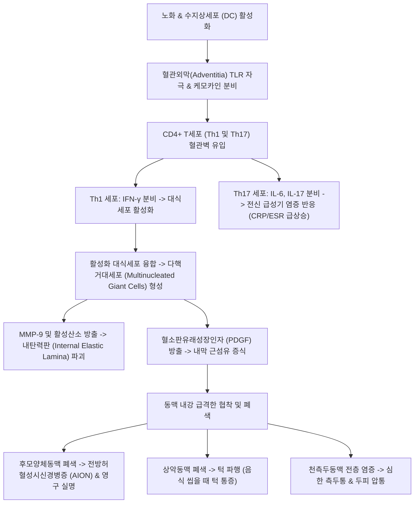

# 🩺 거대세포동맥염 (Giant Cell Arteritis, GCA / 측두동맥염)

> **핵심 3줄 요약 (Key Summary)**:
> - 📍 병소 부위 & 해부·병태생리: 50세 이상에서 호발하는 대형 및 중형 동맥의 만성 육아종성 혈관염(Granulomatous vasculitis)으로, 대동맥궁 분지 및 경동맥의 두개외 분지(특히 천측두동맥, 안동맥, 척추동맥)의 전층 염증 및 내탄력판 파괴를 유발함.
> - 🚩 전형적 임상 양상: 새롭게 발생한 심한 측두부 두통, 두피 압통(머리 빗을 때 통증), 음식을 씹을 때 발생하는 턱 파행(Jaw claudication), 류마티스 다발근통(PMR, 어깨/골반 뻣뻣함), **갑작스러운 영구적 무통성 시력 상실(AION)**.
> - 🛠️ 핵심 검사 & 치료 전략: 적혈구침강속도(ESR > 50~100 mm/hr) 및 CRP 급상승, 측두동맥 초음파(Halo sign) 및 측두동맥 생검(TAB, 다핵거대세포 육아종 확인); 시력 상실 예방을 위해 생검 결과를 기다리지 않고 **즉각적인 전신 고용량 코르티코스테로이드(프레드니손 40~60mg/일 또는 IV 메틸프레드니솔론 펄스)** 투여 및 토실리주맙(IL-6 억제제); 한의학적으로 두통(頭痛)·뇌두풍(雷頭風) 범주로 풍열독사(風熱毒邪)·간담습열(肝膽濕熱) 변증 하에 [[용담사간탕]], [[통규활혈탕]], [[조등산]] 투여 및 태양·풍지·곡지·합곡 자침.
> - ⚠️ 응급 의뢰 레드플래그: 일과성 흑암시(Amaurosis fugax) 또는 한쪽 눈의 급격한 시야 결손/시력 상실(수 시간 내 반대쪽 눈 실명 위험 - 초응급 전원), 대동맥류 파열 및 박리 의심 소견, 뇌졸중 증상.

---

## 📌 목차
1. [질환 개요 & 해부학적 병태생리](#1-질환-개요--해부학적-병태생리)
2. [병태생리 메커니즘 & 생체역학적 악순환 네트워크](#2-병태생리-메커니즘--생체역학적-악순환-네트워크)
3. [임상 증상 & 이학적 검사(Physical Exam) 알고리즘](#3-임상-증상--이학적-검사physical-exam-알고리즘)
4. [감별 진단 매트릭스 (Differential Diagnosis)](#4-감별-진단-매트릭스--differential-diagnosis)
5. [한의 통합 치료 프로토콜 (침·약침·추나·한약)](#5-한의-통합-치료-프로토콜-침약침추나한약)
6. [양방 치료 & 병용·의뢰 기준 (Conventional Treatment & Referral)](#6-양방-치료--병용의뢰-기준-conventional-treatment--referral)
7. [재활 운동 & 생활습관 티칭 가이드](#7-재활-운동--생활습관-티칭-가이드)
8. [💡 사용자 진료실 핵심 필기 & 임상 노하우 (Melt-In 잔여 심화 집약)](#8--사용자-진료실-핵심-필기--임상-노하우--melt-in-잔여-심화-집약)
9. [출처 및 학술 참고 문헌 (References)](#9-출처-및-학술-참고-문헌--references)

---

## 1. 질환 개요 & 해부학적 병태생리

* **질환의 정의 및 역학**:
  * 거대세포동맥염(Giant Cell Arteritis, GCA, 일명 측두동맥염 Temporal Arteritis)은 50세 이상 성인에서 가장 흔하게 발생하는 전신성 대혈관염이다.
  * 여성에서 남성보다 약 2~3배 호발하며, 고령으로 갈수록 발생률이 급증한다 (70~80대 정점).
  * 환자의 약 40~50%에서 **류마티스 다발근통(Polymyalgia Rheumatica, PMR)**이 동반되며, 두 질환은 동일한 면역병리학적 스펙트럼으로 간주된다.

* **호발 해부학적 구조와 혈관병변**:
  * 대동맥(Aorta) 및 대동맥궁에서 분지하는 외경동맥(External carotid artery)의 두개외 분지들이 주 침범 혈관이다:
    * **천측두동맥(Superficial temporal artery)**: 측두부 욱신거리는 두통, 두피 압통, 혈관의 결절성 비후 및 박동 소실.
    * **상악동맥(Maxillary artery)**: 저작근(교근, 측두근) 허혈로 인한 턱 파행(Jaw claudication).
    * **안동맥(Ophthalmic artery) 및 후모양체동맥(Posterior ciliary arteries)**: 시신경 유두 허혈로 인한 **전방 허혈성 시신경병증(AION, Anterior Ischemic Optic Neuropathy)** 및 영구 실명.
    * 대동맥 및 쇄골하동맥: 흉부 대동맥류, 대동맥 박리 위험.

---

## 2. 병태생리 메커니즘 & 생체역학적 악순환 네트워크

* **전층 육아종성 혈관염(Transmural Granulomatous Vasculitis)**:
  * 혈관외막의 수지상세포가 자극되어 CD4+ T세포를 불러들이고, Th1 세포가 방출한 인터페론 감마(IFN-γ)가 대식세포를 육아종성 다핵거대세포로 변환시킨다.
  * 거대세포가 분비한 기질금속단백분해효소(MMP)가 동맥벽의 내탄력판을 조각내고, 내막 평활근세포가 증식하여 동맥 내강을 완전히 틀어막아 말초 허혈을 유발한다.

---

## 3. 임상 증상 & 이학적 검사(Physical Exam) 알고리즘

* **전형적 4대 임상 증상**:
  1. **새로운 양상의 극심한 두통 (Headache, 60~70%)**:
     * 측두부나 후두부에 발생하는 욱신거리거나 찌르는 듯한 박동성 통증. 진통제에 반응하지 않음.
  2. **두피 압통 (Scalp Tenderness)**:
     * 머리를 빗거나 베개에 머리를 벨 때, 모자를 쓸 때 두피가 닿기만 해도 소리를 지를 정도의 통증.
  3. **턱 파행 (Jaw Claudication, 특이도 > 90%)**:
     * 껌을 씹거나 질긴 음식을 씹을 때 턱 근육(교근)에 피가 통하지 않아 뻐근한 통증이 발생하고 씹기를 멈추면 완화됨 (가장 특이적인 진단 단서).
  4. **시각 증상 (Visual Symptoms, 초응급)**:
     * 눈앞이 커튼을 친 것처럼 일시적으로 캄캄해지는 **일과성 흑암시(Amaurosis fugax)**, 복시(Diplopia), 그리고 갑작스러운 한쪽 눈의 무통성 시력 상실.

* **동반 전신 징후**:
  * 류마티스 다발근통(PMR): 아침에 어깨, 목, 골반대의 심한 뻣뻣함과 근육통으로 옷을 입거나 침대에서 일어나기 힘듦.
  * 미열, 식욕부진, 원인 불명의 체중 감소.

* **이학적 검사 및 진단 도구**:
  * **천측두동맥 시진 및 촉진**: 측두부 동맥이 굵은 밧줄처럼 붉게 비후되어 결절상으로 튀어나와 있고, 압통이 심하며 정상적인 동맥 박동이 소실됨.
  * **혈액 염증 수치**: **ESR > 50 mm/hr (흔히 100 mm/hr 초과)**, CRP 현저한 상승, 정구성 정색소성 빈혈, 혈소판 증가증.
  * **측두동맥 컬러 도플러 초음파**: 혈관벽 전층 부종을 나타내는 **저에코 후광 징후 (Halo sign)** 관찰 (비침습적 진단 표준).
  * **측두동맥 생검 (Temporal Artery Biopsy, TAB, 확진)**: 침범 부위가 건너뛰는 도약 병변(Skip lesion)이 있으므로 최소 1.5~2cm 이상 절제하여 전층 육아종성 혈관염 및 거대세포 확인.

---

## 4. 감별 진단 매트릭스 (Differential Diagnosis)

| 감별 질환 | 호발 연령 및 성별 | 침범 혈관 | 핵심 임상 증상 | ESR / CRP | 감별 핵심 포인트 |
| :--- | :--- | :--- | :--- | :--- | :--- |
| **거대세포동맥염 (GCA)** | **50세 이상 (고령), 여성** | **외경동맥 분지, 대동맥** | **측두통, 턱 파행, 시력 상실** | **현저한 상승 (ESR > 50~100)** | **고령 발병, 턱 파행, 측두동맥 비후/Halo sign** |
| **타카야수 동맥염** | 40세 이하 젊은 여성 | 대동맥 및 주요 분지 | 상지 파행, 맥박 소실, 현기증 | 상승 | **젊은 여성 호발**, 요골동맥 맥박 소실 |
| **편두통 / 삼차신경통** | 20~40대 청장년 | 신경혈관성 기능부전 | 박동성 일측 두통, 전격성 안면통 | **정상** | 염증 수치 정상, 턱 파행 및 시력 상실 없음 |
| **류마티스 다발근통 (PMR)** | 50세 이상 고령 | 활막, 점액낭 (혈관염 없음) | 어깨/골반대 뻣뻣함 | 현저한 상승 | 두통, 턱 파행, 시력 증상 부재 (단, GCA 40% 동반) |
| **안과 질환 (급성 녹내장 등)** | 전 연령 | 안구 자체 질환 | 안구통, 충혈, 안압 상승 | 정상 | 두피 압통 없음, 안압 급상승 확인 |

---

## 5. 한의 통합 치료 프로토콜 (침·약침·추나·한약)

* **진료 원칙 및 한의 병기**:
  * 한의학에서 거대세포동맥염은 **두통(頭痛)**, **뇌두풍(雷頭風)**, **편두통(偏頭痛)**, **목맹(目盲)**의 범주에 속한다.
  * 풍열독사(風熱毒邪)와 간담습열(肝膽濕熱)이 머리와 얼굴의 양명경·소양경 맥락(脈絡)으로 치솟아 혈맥이 막히고 열독이 옹체되는 **풍열어독(風熱瘀毒)** 및 **기체혈어(氣滯血瘀)**를 주 병기로 파악한다.
  * ⚠️ **주의**: 시력 상실 위험이 있는 초응급 질환이므로, 한방 치료 단독으로 시간을 지체해서는 절대 안 되며, 양방 고용량 스테로이드 치료가 즉시 시작된 후 병용해야 한다.

* **침구 치료 프로토콜**:
  * **두경부 풍열 배출 및 혈류 순환혈**:
    * **[[태양]](EX-HN5)**, **[[솔곡]](GB8)**: 측두부 통증 및 혈관 주변 근막 긴장 완화.
    * **[[풍지]](GB20)**, **[[천주]](BL10)**: 두개저 후두동맥 혈류 개선 및 뇌혈류 촉진.
    * **[[찬죽]](BL2)**, **[[사죽공]](TE23)**, **[[동자료]](GB1) / [[정명]](BL1)**: 안구 주변 미세혈관 순환 촉진 (천자 유의).
    * **원위 사열혈**: **[[곡지]](LI11)**, **[[합곡]](LI4)**, **[[태충]](LR3)**.
  * **자침 주의점**: 박동이 소실되거나 부어오른 측두동맥 혈관 자체를 직접 찌르는 행위는 동맥 파열 위험이 있으므로 엄금하며, 혈관 주변 경혈에 평자 유침.

* **변증별 한약 처방**:
  * **간담화성·풍열어독형 (肝膽火盛·風熱瘀毒 - 급격한 측두통, 안구 충혈, 턱 통증, 두피 압통, 설홍태황조, 맥현삭)**:
    * 처방: **[[용담사간탕]](龍膽瀉肝湯)** 합 **[[통규활혈탕]](通竅活血湯)** 가미.
    * 군약: 용담초, 황금, 산치자, 시호, 도인, 홍화, 천궁, 적작약.
    * 작용: 간담의 치솟는 화열을 끄고 두면부 맥락의 어혈을 뚫어 혈류를 개통.
  * **간양상항·어혈조락형 (肝陽上亢·瘀血阻絡 - 만성 측두통, 현기증, 안면 홍조, 목덜미 뻣뻣함, 설암, 맥현세)**:
    * 처방: **[[조등산]](釣藤散)** 합 천궁차조산(川芎茶調散).
    * 작용: 간양을 진정시키고 풍사를 흩어 두통 완화.
  * **기혈양허·맥락실양형 (氣血兩虛 - 스테로이드 감량기, 전신 쇠약, 근육통 지속, 설담, 맥세약)**:
    * 처방: 당귀보혈탕(當歸補血湯) 합 독활기생탕.
    * 작용: 기혈을 보양하고 다발근통 증상을 개선.

---

## 6. 양방 치료 & 병용·의뢰 기준 (Conventional Treatment & Referral)

* **초응급 양방 표준 치료 요법**:
  1. **골든타임 확보: 즉각적인 고용량 코르티코스테로이드 투여**:
     * **생검 결과를 기다리지 않고 임상적 의심 즉시 투여 시작** (치료 지연은 반대쪽 눈의 영구 실명으로 직결됨).
     * **시각 증상이 없는 경우**: 경구 프레드니손(Prednisone) 40~60 mg/일.
     * **일과성 흑암시, 시력 저하, 복시 등 시각 증상이 있는 경우**: **메틸프레드니솔론 정맥 펄스 요법 (1g/일 3일간 정맥주사)** 후 경구 고용량 전환.
     * 증상 호전 및 ESR/CRP 정상화 후 1~2년에 걸쳐 매우 서서히 감량.
  2. **스테로이드 감량 및 재발 방지 생물학적 제제**:
     * **토실리주맙 (Tocilizumab, 항-IL-6 수용체 단클론항체)**: 주 1회 피하주사. 스테로이드 누적 사용량을 획기적으로 줄이고 관해 유지율을 대폭 상승시킴.
  3. **항혈전 요법**: 저용량 아스피린(Aspirin 100mg/일) 병용 투여로 뇌졸중 및 시신경 경색 위험 감소.

* **한의 병용 치료 가이드**:
  * 1년 이상 지속되는 고용량 스테로이드 복용으로 인해 발생하는 심각한 골다공증, 당뇨, 백내장, 위궤양 부작용을 줄이기 위해, 양약 유지기에 통규활혈탕 및 보간신(補肝腎) 한약을 병용하면 염증 지표 재상승 없이 스테로이드 감량 일정을 순조롭게 진행할 수 있음.

* **양방·전문과 응급 의뢰 기준 (Referral Criteria)**:
  * 🚨 **즉각적인 대학병원 응급실/류마티스내과 초응급 전원 레드플래그**:
    1. 50세 이상 환자가 겪어보지 못한 심한 측두통과 함께 눈앞이 침침하거나 일시적으로 캄캄해지는 증상(Amaurosis fugax)을 호소할 때 (한쪽 눈 실명 후 수 시간~수일 내 반대쪽 눈 실명 위험).
    2. 턱 파행(음식 씹을 때 통증)과 함께 측두동맥 박동이 소실되고 압통성 비후가 만져질 때.
    3. 대동맥 침범으로 인한 흉통, 등 통증, 양팔 혈압 차이 발생 시.

---

## 7. 재활 운동 & 생활습관 티칭 가이드

* **시력 보호 및 응급 수칙 교육**:
  * 시야가 흐려지거나 번쩍이는 증상, 커튼이 내려오는 듯한 느낌이 들면 즉시 119를 부르거나 대형병원 응급실로 가도록 환자와 보호자에게 엄중히 교육.

* **저작근 부하 경감 (턱 통증 관리)**:
  * 턱 파행 증상이 있을 때는 오징어, 껌, 갈비 등 질기고 딱딱한 음식 섭취를 금하고, 부드러운 유동식이나 잘게 썬 음식을 섭취하도록 지도.

* **고용량 스테로이드 합병증 예방 관리**:
  * 골밀도 저하를 막기 위해 칼슘(1,000mg/일)과 비타민 D(800IU/일) 섭취, 매일 가벼운 평지 걷기 운동.
  * 혈당 및 혈압 매일 모니터링, 저염식 유지.

---

## 8. 💡 사용자 진료실 핵심 필기 & 임상 노하우 (Melt-In 잔여 심화 집약)

* **비오님 진료실 1초 진단 & 실명 방지 노하우**:
  1. **"턱 파행(Jaw claudication)을 반드시 물어라"**: "60대 이상 어르신이 '머리가 욱신거려 침 맞으러 왔다'고 할 때, '밥 먹거나 껌 씹을 때 턱이 뻐근해서 쉬었다 씹어야 합니까?'라고 꼭 물어보라. 턱 파행이 있다면 95% 이상 거대세포동맥염이다. 관자놀이를 만져보아 굵은 힘줄처럼 튀어나와 있고 맥이 뛰지 않는다면, 침을 놓지 말고 그 자리에서 대학병원 류마티스내과나 응급실로 직행시켜야 한다."
  2. **"조직검사를 기다리다 실명한다"**: "거대세포동맥염이 의심될 때 양방 의사가 측두동맥 생검 예약을 잡는다고 며칠을 미루면 그 사이에 반대쪽 눈까지 영구 실명된다. 의심 즉시 고용량 스테로이드를 꽂아야 시신경 괴사를 막을 수 있다."
  3. **"어깨가 굳은 노인의 두통을 조심하라 (PMR과의 연계)"**: "어깨와 엉덩이가 뻣뻣해서 옷도 못 입겠다는 류마티스 다발근통(PMR) 환자에게 두통이 생겼다면, 거대세포동맥염으로 전이된 것이다. 염증 수치(ESR)를 재면 80~100을 훌쩍 넘는다. 침구 치료는 양방 스테로이드로 불을 끈 다음, 후유증 관리와 스테로이드 감량 단계에서 들어가야 안전하다."

---

## 9. 출처 및 학술 참고 문헌 (References)

- Ichikawa T et al. (2026). Anomalous systemic arterial supply to the basal segment of the left lung with large vessel giant cell arteritis demonstrated by 18F-FDG PET/CT. *Indian J Thorac Cardiovasc Surg*. 42(11):1256-1258. PMID: 42953294.

- Borrego-Yaniz G et al. (2026). Genetic biomarkers of clinical manifestations in giant cell arteritis define distinct patient subgroups. *Ann Rheum Dis*. 85(11):2241-2252. PMID: 42399125.

- Quinn KA et al. (2026). 18F-Fluorodeoxyglucose Positron Emission Tomography Imaging Assessment Within a Randomized Controlled Trial in Giant Cell Arteritis. *Arthritis Rheumatol*. 78(11):2317-2327. PMID: 41940456.\n