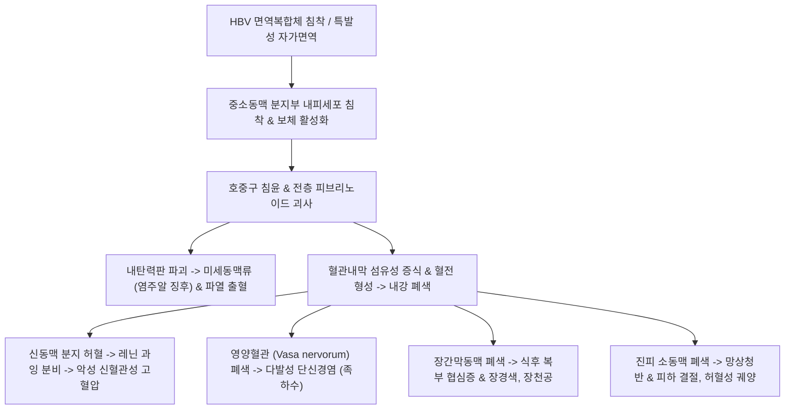

# 🩺 결절성 다발동맥염 (Polyarteritis Nodosa, PAN)

> **핵심 3줄 요약 (Key Summary)**:
> - 📍 병소 부위 & 해부·병태생리: 중소 근육성 동맥(Medium and small-sized muscular arteries)의 분절성 전층 괴사성 혈관염(Transmural necrotizing vasculitis)으로, 혈관벽 비후와 피브리노이드 괴사, 내탄력판 파괴에 의한 미세동맥류(Microaneurysm, 염주알 징후)를 유발함; **폐혈관은 침범하지 않는 것(Sparing of pulmonary circulation)**과 **ANCA 음성**이 결정적 특징.
> - 🚩 전형적 임상 양상: 원인 불명의 발열과 체중 감소, 신혈관성 악성 고혈압, 망상청반(Livedo reticularis), 피하 결절, 급격한 족하수(Foot drop)를 보이는 비대칭적 다발성 단신경염(Mononeuritis multiplex), 식후 극심한 복통(장간막 허혈).
> - 🛠️ 핵심 검사 & 치료 전략: 혈관조영술(신동맥/장간막동맥 미세동맥류 확인), 피부/근육/신경 생검, B형 간염(HBV) 항원 검사; 양방 고용량 글루코코르티코이드 및 사이클로포스파마이드(HBV 연관 시 항바이러스제+혈장교환술); 한의학적으로 맥비(脈痺)·혈비(血痺) 범주로 습열어독(濕熱瘀毒)·기체혈어(氣滯血瘀) 변증 하에 [[사묘용안탕]], [[당귀사역탕]] 투여 및 곡지·족삼리·혈해·삼음교 자침.
> - ⚠️ 응급 의뢰 레드플래그: 장간막 동맥류 파열 및 장경색(급성 복증 및 쇼크), 악성 고혈압성 뇌병증, 급성 뇌경색 및 심근경색 발생 시 즉시 3차 상급병원 응급 전원.

---

## 📌 목차
1. [질환 개요 & 해부학적 병태생리](#1-질환-개요--해부학적-병태생리)
2. [병태생리 메커니즘 & 생체역학적 악순환 네트워크](#2-병태생리-메커니즘--생체역학적-악순환-네트워크)
3. [임상 증상 & 이학적 검사(Physical Exam) 알고리즘](#3-임상-증상--이학적-검사physical-exam-알고리즘)
4. [감별 진단 매트릭스 (Differential Diagnosis)](#4-감별-진단-매트릭스--differential-diagnosis)
5. [한의 통합 치료 프로토콜 (침·약침·추나·한약)](#5-한의-통합-치료-프로토콜-침약침추나한약)
6. [양방 치료 & 병용·의뢰 기준 (Conventional Treatment & Referral)](#6-양방-치료--병용의뢰-기준-conventional-treatment--referral)
7. [재활 운동 & 생활습관 티칭 가이드](#7-재활-운동--생활습관-티칭-가이드)
8. [💡 사용자 진료실 핵심 필기 & 임상 노하우 (Melt-In 잔여 심화 집약)](#8--사용자-진료실-핵심-필기--임상-노하우--melt-in-잔여-심화-집약)
9. [출처 및 학술 참고 문헌 (References)](#9-출처-및-학술-참고-문헌--references)

---

## 1. 질환 개요 & 해부학적 병태생리

* **질환의 정의 및 병리학적 개념**:
  * 결절성 다발동맥염(Polyarteritis Nodosa, PAN)은 중간 및 작은 크기의 근육성 동맥을 분절성으로 침범하는 전신성 괴사성 혈관염이다.
  * 1866년 Kussmaul과 Maier에 의해 기술되었으며, 동맥벽의 분절성 괴사와 혈관 분지부의 미세동맥류가 마치 실에 꿴 염주알(Beads-on-a-string)처럼 결절성으로 형성되어 이와 같은 명칭이 붙었다.
  * 병리조직학적으로 혈관벽의 **전층 괴사성 염증(Transmural necrotizing inflammation)**과 **피브리노이드 괴사(Fibrinoid necrosis)**가 나타나며, 내탄력판 파괴로 수 밀리미터 크기의 **미세동맥류(Microaneurysms)**가 발생한다.

* **결정적 감별 해부학적 특성**:
  * **폐순환 보존 (Sparing of pulmonary circulation)**: 폐동맥을 침범하지 않으므로 폐출혈이나 폐침윤이 발생하지 않는다.
  * **모세혈관 및 사구체 침범 부재**: 미세혈관염(MPA)과 달리 사구체신염을 일으키지 않으며, 신장 침범은 신동맥의 소엽간 동맥 분지 허혈에 기인한다.
  * **ANCA 음성**: 전형적으로 항호중구세포질항체(ANCA)가 음성인 비-ANCA 연관 혈관염이다.
  * **B형 간염(HBV) 연관성**: 환자의 약 10~30%에서 B형 간염 바이러스 표면항원(HBsAg) 복합체 침착으로 발병한다.

---

## 2. 병태생리 메커니즘 & 생체역학적 악순환 네트워크

* **신경 영양혈관(Vasa Nervorum) 허혈과 다발성 단신경염 (Mononeuritis Multiplex)**:
  * 말초신경 줄기에 혈류를 공급하는 영양혈관의 급성 혈전성 폐색으로 인해 개별 신경 섬유가 비대칭적으로 경색에 빠진다.
  * 환자는 하룻밤 사이에 한쪽 발목이 덜렁거리는 족하수(Foot drop, 비골신경 마비)나 손목이 처지는 수하수(Wrist drop, 요골신경 마비)를 겪게 된다.

* **신혈관성 악성 고혈압의 악순환**:
  * 소엽간 신동맥 협착으로 신장 허혈이 유도되면 사구체옆장치에서 레닌(Renin)을 폭발적으로 분비하여 악성 고혈압과 고혈압성 뇌병증을 촉발한다.

---

## 3. 임상 증상 & 이학적 검사(Physical Exam) 알고리즘

* **전형적 다기관 침범 증상**:
  1. **전신 증상**: 수주 이상 지속되는 원인 불명의 발열, 피로, 식욕부진, 6개월 내 10% 이상의 체중 감소.
  2. **말초 신경계 (50~70%)**: 다발성 단신경염(Mononeuritis multiplex)으로 인한 비대칭적 감각 마비 및 운동 마비 (비골신경 침범으로 인한 족하수가 가장 흔함).
  3. **피부 증상 (40~50%)**: 하지의 그물 모양 청자색 혈관 무늬인 **망상청반(Livedo reticularis)**, 누르면 아픈 피하 결절, 자반증, 수지 말단 괴저(Gangrene).
  4. **신장 및 심혈관계**: 급격히 조절되지 않는 이완기 혈압 > 90 mmHg의 고혈압, 혈청 크레아티닌 상승.
  5. **소화기계 (30~50%)**: 식사 30분~1시간 후 발생하는 쥐어짜는 듯한 복통(장간막 허혈에 의한 복부 협심증, Abdominal angina), 혈변, 장경색.

* **이학적 및 특수 검사 알고리즘**:
  * **신경학적 검사**: 비골신경(발목 배측굴곡), 요골신경(손목 신전), 정중신경 근력 및 감각 분절 전수 평가.
  * **혈관조영술 (Catheter / CT / MR Angiography)**: 신동맥, 장간막동맥 분지에서 다발성 미세동맥류(1~5mm)와 협착이 교대로 나타나는 **염주알 징후(Beading appearance)** 확인 (진단적 특이도 90% 이상).
  * **조직 생검 (Biopsy)**: 피부 결절, 비복신경(Sural nerve) 또는 근육 생검을 통해 중소동맥의 전층 괴사성 혈관염 확인.
  * **혈액학적 검사**: **B형 간염 표지자(HBsAg, HBeAg, HBV-DNA) 필수 검사**, ESR/CRP 급상승, **ANCA 음성 확인**.

---

## 4. 감별 진단 매트릭스 (Differential Diagnosis)

| 감별 질환 | 침범 혈관 크기 | 폐 침범 유무 | ANCA 검사 | HBV 연관성 | 핵심 병리 소견 |
| :--- | :--- | :--- | :--- | :--- | :--- |
| **결절성 다발동맥염 (PAN)** | **중소 근육성 동맥** | **폐 침범 없음 (Sparing)** | **음성 (Negative)** | **흔함 (10~30%)** | **전층 피브리노이드 괴사, 미세동맥류** |
| **현미경적 다발혈관염 (MPA)** | 세동맥, 모세혈관, 세정맥 | 흔함 (폐포 출혈) | **p-ANCA (MPO) 양성** | 무관 | 괴사성 반월상 사구체신염, 미세동맥류 없음 |
| **다발혈관염 육아종증 (GPA)** | 소동맥, 모세혈관 | 매우 흔함 (공동, 육아종) | **c-ANCA (PR3) 양성** | 무관 | 괴사성 육아종, 상기도 안장코 |
| **호산구성 다발혈관염 (EGPA)** | 소혈관 | 흔함 (천식, 폐 침윤) | p-ANCA (40~50%) | 무관 | 현저한 호산구 증가증, 천식 병력 |
| **타카야수 동맥염 (Takayasu)** | 대동맥 및 주분지(대혈관) | 폐동맥 침범 가능 | 음성 | 무관 | 맥박 소실, 젊은 여성 호발 |

---

## 5. 한의 통합 치료 프로토콜 (침·약침·추나·한약)

* **진료 원칙 및 한의 병기**:
  * 한의학에서 결절성 다발동맥염은 **맥비(脈痺)**, **혈비(血痺)**, **피비(皮痺)**, **음양독(陰陽毒)**의 범주에 속한다.
  * 체내에 잠복한 습열독사(濕熱毒邪)가 혈맥(血脈)으로 침범하여 열독이 치솟고 혈액이 응체되어 혈맥이 썩고 막히는 **습열어독(濕熱瘀毒)** 및 **기체혈어(氣滯血瘀)**가 핵심 병기이다. 만성화되면 간신휴손(肝腎虧損)으로 귀결된다.

* **침구 치료 프로토콜**:
  * **청열해독(淸熱解毒) 및 활혈통락(活血通絡) 배혈**:
    * **[[곡지]](LI11)**, **[[대추]](GV14)**: 혈액 내 열독을 식히고 전신 염증 수치를 강하.
    * **[[혈해]](SP10)**, **[[삼음교]](SP6)**: 혈맥의 어혈을 제거하고 미세순환을 개선.
    * **[[족삼리]](ST36)**, **[[합곡]](LI4)**, **[[태충]](LR3)**: 기혈을 조화롭게 소통.
    * **마비 신경 배혈 (다발성 단신경염 족하수 시)**: [[양릉천]](GB34), [[현종]](GB39), [[구허]](GB40), [[해계]](ST41).
  * **자침 주의점**: 급성 혈관염 활동기에는 환부 직접 자침을 피하고, 뜸 치료(구법)는 혈관염 열독을 조장하거나 동맥류 파열 위험이 있으므로 급성기 환부에는 절대 금기한다.

* **약침 치료 프로토콜**:
  * 중성어혈 약침 또는 황련해독탕 약침을 양릉천, 위중, 풍지 등 원위 배혈점에 시술하여 신경내막 허혈 부위의 미세순환 회복을 유도 (피하 결절 환부 직접 주입은 엄금).

* **변증별 한약 처방**:
  * **열독온결·맥락어체형 (熱毒蘊結·脈絡瘀滯 - 급성 발열, 피하 결절, 망상청반, 관절통, 설홍강태황조, 맥현삭)**:
    * 처방: **[[사묘용안탕]](四妙勇安湯)** (금은화 대용량 30~60g, 현삼, 당귀, 감초) 합 청온패독음 가미.
    * 작용: 혈관벽의 괴사성 열독을 끄고 미세혈전을 융해.
  * **한응혈어·맥락폐색형 (寒凝血瘀 - 만성 허혈성 신경마비, 족하수, 수지 냉통, 궤양, 설암태백, 맥침세삽)**:
    * 처방: **[[당귀사역탕]](當歸四逆湯)** 합 활락효영단(活絡效靈丹) 가 지룡, 전갈.
    * 작용: 말초 소동맥을 확장시키고 손상된 신경 축삭의 재생을 촉진.
  * **간신휴손·기혈양허형 (肝腎虧損 - 스테로이드 감량기, 만성 쇠약, 족하수 후유증, 설담, 맥세약)**:
    * 처방: 독활기생탕(獨活寄生湯) 합 육미지황탕.
    * 작용: 간신을 보하고 근골을 강화하여 신경 재생을 도모.

---

## 6. 양방 치료 & 병용·의뢰 기준 (Conventional Treatment & Referral)

* **원인별 양방 표준 치료 전략**:
  1. **특발성 PAN (비-HBV 연관)**:
     * **관해 유도**: 경구 프레드니솔론 1 mg/kg/일 (중증 장기 부전 시 메틸프레드니솔론 펄스 1g/일 3일간).
     * 중증 장기 침범(신장, 심장, 위장관, 신경계 침범) 시: **사이클로포스파마이드(Cyclophosphamide) 병용 투여**.
     * **유지 요법**: 관해 후 아자티오프린(AZA) 또는 메토트렉세이트(MTX) 전환.
  2. **HBV 연관 결절성 다발동맥염**:
     * 면역억제제 단독 투여 시 바이러스 폭발적 증식 위험.
     * 차별화 치료: **단기 스테로이드(염증 신속 진정) + 혈장교환술(Plasmapheresis, 면역복합체 제거) + 강력한 항바이러스제(엔테카비르 Entecavir, 테노포비르 Tenofovir)**.

* **한의 병용 치료 가이드**:
  * 면역억제 치료로 급성 혈관염이 안정된 후, 잔류하는 신경마비(족하수) 및 혈류 장애에 침구 치료와 당귀사역탕을 병용하면 말초 신경 축삭 재생을 현저히 단축시킬 수 있음.

* **양방·전문과 응급 의뢰 기준 (Referral Criteria)**:
  * 🚨 **즉각적인 3차 상급병원 응급실 전원 레드플래그**:
    1. **장간막 동맥류 파열 및 장경색**: 식후 복통 후 갑작스러운 복부 판자강직(Board-like rigidity), 토혈, 혈변, 저혈압 쇼크.
    2. 악성 고혈압에 의한 의식 혼탁, 급성 뇌경색, 흉통(심근경색).
    3. 급성 핍뇨 및 혈청 크레아티닌의 급격한 상승.

---

## 7. 재활 운동 & 생활습관 티칭 가이드

* **족하수 환자의 낙상 방지 (AFO 보조기 착용)**:
  * 비골신경 마비로 발목을 위로 들지 못하는 환자는 발목관절 보조기(Ankle-Foot Orthosis, AFO)를 착용하여 보행 시 발끝이 바닥에 걸려 넘어지는 낙상 사고를 방지.

* **보온 및 피부 외상 방지**:
  * 한랭 노출은 말초혈관 수축을 유발하여 피부 궤양을 촉발하므로 양말과 장갑을 착용하고, 감각 저하 부위에 핫팩 등에 의한 저온 화상이 생기지 않도록 주의.

* **혈압 및 감염 모니터링**:
  * 신혈관성 고혈압 감시를 위해 매일 아침저녁 혈압을 측정 기록하고, 면역억제제 복용 중 발열이나 기침 등 감염 징후가 나타나면 즉시 의료진에게 보고.

---

## 8. 💡 사용자 진료실 핵심 필기 & 임상 노하우 (Melt-In 잔여 심화 집약)

* **비오님 진료실 핵심 필기 & 임상 노하우**:
  1. **"다발성 단신경염의 경고"**: "환자가 '발목을 삐지도 않았는데 며칠 전부터 갑자기 발목이 덜렁거리고 발가락이 안 올라가요(족하수)'라고 하면서, 종아리에 붉은 그물망 무늬(망상청반)가 보이고 미열이 난다면 단순 디스크나 비골신경 압박이 아니라 전신 혈관염(PAN)을 가장 먼저 의심해야 한다. 신경 한 가닥씩 산발적으로 망가지는 다발성 단신경염은 PAN의 교과서적 시그니처다."
  2. **"B형 간염 환자의 혈관염"**: "B형 간염 보균자가 원인 모를 고혈압과 복통, 신경마비를 호소하면 HBV 연관 PAN의 가능성이 매우 높다. 이 경우 일반적인 면역억제제만 쓰면 간부전으로 사망할 수 있으므로, 항바이러스제 병용을 위해 반드시 류마티스내과-소화기내과 협진을 의뢰해야 한다."
  3. **"환부에 침·뜸·부항을 절대 대지 마라"**: "활동성 혈관염 환부에는 침이나 뜸, 부항(특히 사혈부항)을 절대 뜨면 안 된다. 약해진 동맥류가 터져 대출혈이 생기거나 난치성 피부 궤양으로 번질 수 있다. 치료는 반드시 원위 취혈과 내복 한약(사묘용안탕 계열)으로 전신 혈열을 꺼주는 전략으로 가야 한다."

---

## 9. 출처 및 학술 참고 문헌 (References)

- Mbongo A et al. (2026). Multifocal intracranial aneurysms and a clinical diagnosis of ruptured retinal arterial macroaneurysm in presumed hepatitis B-associated polyarteritis nodosa: A case report. *Radiol Case Rep*. 21(12):6492-6497. PMID: 42892970.

- Manduca S et al. (2026). Cutaneous Polyarteritis Nodosa Has Prolonged Diagnostic Delays and Frequent Overlap with Systemic Disease. *J Am Acad Dermatol*. ():. PMID: 42933664.

- Kohlmann F et al. (2026). Addition of Intravenous Immunoglobulin in Refractory Cutaneous Polyarteritis Nodosa: A Case Report. *Case Rep Rheumatol*. 2026():4646918. PMID: 42840825.\n