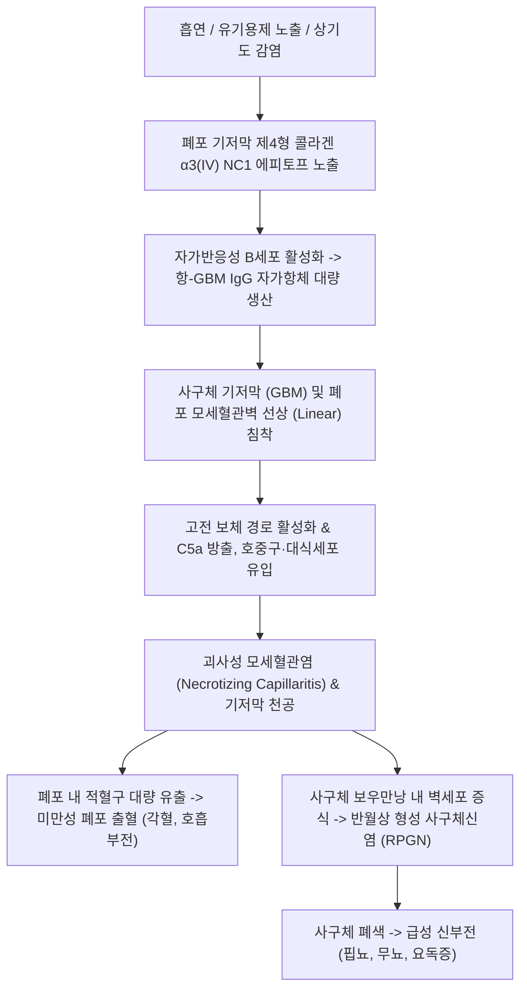

# 🩺 굿 패스쳐 증후군 (Goodpasture Syndrome / Anti-GBM Disease)

> **핵심 3줄 요약 (Key Summary)**:
> - 📍 병소 부위 & 해부·병태생리: 신장 사구체 기저막(GBM)과 폐포 기저막(Alveolar basement membrane)의 제4형 콜라겐 α3 사슬(NC1 도메인)에 대한 자가항체(Anti-GBM IgG)가 선상(Linear)으로 침착되어 발생하는 전격성 폐-신 증후군(Pulmonary-Renal Syndrome).
> - 🚩 전형적 임상 양상: 급격한 각혈(Hemoptysis), 호흡곤란, 양측 미만성 폐포 출혈(DAH)과 함께 수일~수주 내에 급속 진행성 사구체신염(RPGN, 육안적 혈뇨, 핍뇨, 급격한 신부전)이 동반됨.
> - 🛠️ 핵심 검사 & 치료 전략: 혈청 항-GBM 항체(Anti-GBM Ab), 신장 생검상 면역형광 선상 IgG 침착 및 반월상 사구체신염(Crescentic GN), 흉부 CT 양측 폐포 침윤; 영구 신부전 및 질식을 막기 위한 **초응급 혈장교환술(Plasmapheresis) + 고용량 글루코코르티코이드 + 사이클로포스파마이드 삼중 요법**; 한의학적으로 해혈(咳血)·요혈(尿血) 범주로 열독성치(熱毒盛熾)·음허화왕(陰虛火旺) 변증 하에 관해기 [[서각지황탕]], [[백합고금탕]], [[소계음자]] 투여.
> - ⚠️ 응급 의뢰 레드플래그: 각혈과 동반된 급격한 저산소혈증(대량 폐포 출혈 질식 위험), 소변량 급감(핍뇨/무뇨) 및 혈청 크레아티닌 폭증(신부전 비가역화 위험) 시 즉각 대학병원 응급실/중환자실 전원.

---

## 📌 목차
1. [질환 개요 & 해부학적 병태생리](#1-질환-개요--해부학적-병태생리)
2. [병태생리 메커니즘 & 생체역학적 악순환 네트워크](#2-병태생리-메커니즘--생체역학적-악순환-네트워크)
3. [임상 증상 & 이학적 검사(Physical Exam) 알고리즘](#3-임상-증상--이학적-검사physical-exam-알고리즘)
4. [감별 진단 매트릭스 (Differential Diagnosis)](#4-감별-진단-매트릭스--differential-diagnosis)
5. [한의 통합 치료 프로토콜 (침·약침·추나·한약)](#5-한의-통합-치료-프로토콜-침약침추나한약)
6. [양방 치료 & 병용·의뢰 기준 (Conventional Treatment & Referral)](#6-양방-치료--병용의뢰-기준-conventional-treatment--referral)
7. [재활 운동 & 생활습관 티칭 가이드](#7-재활-운동--생활습관-티칭-가이드)
8. [💡 사용자 진료실 핵심 필기 & 임상 노하우 (Melt-In 잔여 심화 집약)](#8--사용자-진료실-핵심-필기--임상-노하우--melt-in-잔여-심화-집약)
9. [출처 및 학술 참고 문헌 (References)](#9-출처-및-학술-참고-문헌--references)

---

## 1. 질환 개요 & 해부학적 병태생리

* **질환의 정의 및 임상적 개념**:
  * 굿 패스쳐 증후군(Goodpasture Syndrome)은 신장 사구체 기저막(GBM)과 폐 모세혈관 기저막에 존재하는 자가항원에 대한 자가항체가 생성되어 **급속 진행성 사구체신염(RPGN)**과 **미만성 폐포 출혈(DAH)**을 동시에 유발하는 희귀하고 치명적인 자가면역 질환이다.
  * 현대 의학적으로는 **항사구체기저막 항체 질환(Anti-GBM Disease)**으로 통칭되며, 폐 출혈 없이 신장만 단독으로 침범하는 형태도 전체의 약 20~40%를 차지한다.
  * 조기에 공격적인 치료를 받지 않으면 90% 이상의 환자가 말기 신부전으로 진행하거나 대량 폐출혈로 사망하는 초응급 질환이다.

* **호발 해부학적 구조와 분자 표적**:
  * 표적 자가항원은 신장 사구체 기저막 및 폐포 기저막의 주성분인 **제4형 콜라겐(Type IV collagen) α3 사슬의 비콜라겐성 도메인-1 (NC1 domain)**이다.
  * 정상 상태에서는 기저막의 육합체(Hexamer) 구조 내부에 항원 결정기(Epitope)가 숨겨져 있으나, 흡연, 호흡기 바이러스 감염, 유기용제(탄화수소 증기) 노출 등에 의해 폐포 상피가 손상되면 은폐된 에피토프가 노출되어 자가면역 반응이 폭발한다.

---

## 2. 병태생리 메커니즘 & 생체역학적 악순환 네트워크

* **제2형 세포독성 과민반응과 선상 면역형광 침착**:
  * 순환 항-GBM IgG 항체가 기저막 전장(Full length)에 걸쳐 균일하게 결합한다.
  * 이로 인해 직접 면역형광 현미경 검사 시 과립상(Granular)이 아닌 매끄러운 **선상 침착(Linear IgG deposition)** 패턴을 보이는 것이 본 질환의 결정적 병리 소견이다.
* **반월상 형성 사구체신염(Crescentic GN)**:
  * 모세혈관벽이 파괴되면 피브린과 염증 세포가 보우만낭(Bowman's capsule) 내부로 유출된다.
  * 보우만낭 벽측 상피세포가 폭발적으로 증식하여 사구체 모세혈관을 초승달 모양으로 짓누르는 **반월상(Crescent)**을 형성하며, 수일 만에 사구체 여과 기능을 비가역적으로 파괴한다.

---

## 3. 임상 증상 & 이학적 검사(Physical Exam) 알고리즘

* **전형적 폐-신 증후군 임상 양상**:
  1. **호흡기 증상 (미만성 폐포 출혈, 60~80%)**:
     * 기침과 함께 피를 토하는 **각혈(Hemoptysis)**, 급격한 호흡곤란, 흉통, 창백함, 피로감.
     * 흡연자에서 폐 침범이 압도적으로 흔하며, 비흡연자는 신장 단독 침범 빈도가 높음.
  2. **신장 증상 (급속 진행성 사구체신염, 80~90%)**:
     * 콜라색 또는 붉은색의 **육안적 혈뇨(Gross hematuria)**, 거품뇨(단백뇨).
     * 수일 내로 급격히 진행되는 소변량 감소(**핍뇨/무뇨**), 전신 부종, 조절되지 않는 고혈압.
  3. **전신 증상**: 발열, 오한, 식욕부진, 극심한 쇠약감, 철결핍성 빈혈.

* **임상병리 및 특수 진단 검사 알고리즘**:
  1. **혈청 항-GBM 항체 검사 (ELISA/RIA, 특이도 > 98%)**:
     * 진료실 의심 즉시 채혈하여 항체 역가 확인.
     * ⚠️ 약 20~30%의 환자에서는 **ANCA(주로 p-ANCA/MPO)가 동시에 양성인 '이중 양성(Double-positive)'** 패턴을 보임.
  2. **소변 검사 (Urinalysis)**:
     * 활동성 뇨침사(Active urinary sediment): 이형 적혈구(Dysmorphic RBC), 적혈구 원주(RBC casts), 현미경적 혈뇨 및 단백뇨.
  3. **흉부 X선 및 고해상도 CT (HRCT)**:
     * 양측 폐문 주위의 미만성 간유리 음영(GGO) 및 폐포 경화 소견 (폐포 출혈 확인).
  4. **신장 조직 생검 (Renal Biopsy, 진단 골드스탠다드)**:
     * 광학현미경: 사구체의 50% 이상에서 반월상 형성(Crescentic necrotizing GN).
     * **면역형광 현미경: 사구체 모세혈관벽을 따라 리본처럼 연속적인 선상(Linear) IgG 및 C3 침착 확인**.

---

## 4. 감별 진단 매트릭스 (Differential Diagnosis)

| 감별 질환 (폐-신 증후군) | 면역형광 생검 소견 | 자가항체 | 폐 침범 양상 | 신장 침범 특징 |
| :--- | :--- | :--- | :--- | :--- |
| **굿 패스쳐 증후군 (Anti-GBM)** | **선상 IgG 침착 (Linear)** | **Anti-GBM 양성** | 미만성 폐포 출혈 (각혈) | 반월상 사구체신염 (급속 신부전) |
| **다발혈관염 육아종증 (GPA)** | 면역침착 없음 (Pauci-immune) | **c-ANCA (PR3) 양성** | 폐 공동, 결절, 안장코 | 괴사성 반월상 사구체신염 |
| **현미경적 다발혈관염 (MPA)** | 면역침착 없음 (Pauci-immune) | **p-ANCA (MPO) 양성** | 미만성 폐포 출혈 | 반월상 사구체신염 (미세동맥류 없음) |
| **루푸스 신염 (SLE)** | 과립상 전층 침착 (Full house) | **Anti-dsDNA, ANA 양성** | 흉막염, 간질성 폐렴 | 다양한 사구체신염 (보체 저하) |
| **한랭글로불린혈증 혈관염** | 사구체 모세혈관 내 혈전 | C형 간염, 류마티스인자 | 폐 침범 드묾 | 막증식성 사구체신염, 자반증 동반 |

---

## 5. 한의 통합 치료 프로토콜 (침·약침·추나·한약)

* **진료 원칙 및 한의 병기**:
  * 한의학에서 굿 패스쳐 증후군은 **해혈(咳血)**, **요혈(尿血)**, **뇨혈(溺血)**, **수종(水腫)**, **관격(關格)**의 범주에 속한다.
  * 열독(熱毒)이 폐와 신장의 혈락(血絡)을 심하게 손상시켜 혈액이 제멋대로 넘쳐흐르는 **열독성치·혈열망행(熱毒盛熾·血熱妄行)**이 급성기 주 병태이며, 이후 기음양허(氣陰兩虛) 및 비신양허(脾腎陽虛)로 이행한다.
  * ⚠️ **절대 경고**: 본 질환은 급성기 수일 내에 사망하거나 신장이 영구 파괴되는 초응급 질환이므로, 급성기에는 100% 양방 응급실/신장내과 중환자 치료를 받아야 하며 한방 단독 치료는 절대 금기이다. 관해 도달 후 회복기 후유증 관리에 한의 치료를 병용한다.

* **침구 치료 프로토콜 (회복기/안정기)**:
  * **폐신 음기 보강 및 지혈 배혈**:
    * **폐경 및 호흡기 조절**: [[척택]](LU5), [[어제]](LU10), [[폐수]](BL13).
    * **신장 기능 및 혈뇨 개선**: [[태계]](KI3), [[신수]](BL23), [[삼음교]](SP6), [[혈해]](SP10).
    * **비위 보양 및 수종 완화**: [[족삼리]](ST36), [[음릉천]](SP9), [[수분]](CV9).

* **변증별 한약 처방 (회복 관해기)**:
  * **혈열망행·음허화왕형 (血熱妄行 - 각혈 및 혈뇨 진정기, 번열, 구갈, 설홍강소태, 맥세삭)**:
    * 처방: **[[서각지황탕]](犀角地黃湯)** 합 **[[백합고금탕]](百合固金湯)** 가미.
    * 군약: 우각, 생지황, 백합, 맥문동, 현삼, 패모, 백급, 아교.
    * 작용: 폐포 점막과 사구체 모세혈관의 잔여 열독을 끄고 진액을 보충하여 조직 재생을 촉진.
  * **하기도습열·요혈형 (下焦濕熱 - 현미경적 혈뇨 및 단백뇨 지속, 소변 삽통, 설태황니)**:
    * 처방: **[[소계음자]](小薊飲子)** 합 도적산(導赤散).
    * 군약: 소계, 포황, 우슬, 활석, 통초, 치자, 담죽엽.
    * 작용: 하초 습열을 소변으로 배출하고 사구체 염증을 가라앉힘.
  * **기음양허·비신부족형 (氣陰兩虛 - 만성 피로, 빈혈, 부종, 소화불량, 설담체비, 맥세무력)**:
    * 처방: 당귀보혈탕(當歸補血湯) 합 지백지황탕(知柏地黃湯).
    * 작용: 골수 조혈을 돕고 손상된 사구체 여과율 회복을 도모.

---

## 6. 양방 치료 & 병용·의뢰 기준 (Conventional Treatment & Referral)

* **초응급 양방 표준 삼중 요법 (Triple Therapy)**:
  1. **혈장교환술 (Plasmapheresis / Plasma Exchange, 1차 필수 요법)**:
     * 순환하는 병인성 항-GBM 자가항체를 체외로 즉각 물리적으로 제거.
     * 매일 또는 격일로 4L의 혈장을 교환(알부민/신선동결혈장 보충)하며, 항체가 검출되지 않을 때까지 최소 2~3주간 지속.
  2. **고용량 글루코코르티코이드**:
     * 메틸프레드니솔론 정맥 펄스(1g/일 3일간) 즉시 투여 후, 경구 프레드니손 1 mg/kg/일로 전환하여 점진적 감량.
  3. **사이클로포스파마이드 (Cyclophosphamide, CYC)**:
     * 새로운 자가항체 생성을 차단하기 위해 경구(2 mg/kg/일) 또는 정맥 펄스로 2~3개월간 투여.
  4. **신대체요법 (투석 및 신장이식)**:
     * 핍뇨성 급성 신부전 시 즉각적인 혈액투석(HD) 시작.
     * 비가역적 신부전 환자는 항-GBM 항체가 완전히 소실된 후 최소 6개월 이상 경과한 뒤 신장이식 시행.

* **한의 병용 치료 가이드**:
  * 공격적인 면역억제 및 혈장교환술 치료가 끝나고 항체가 음전된 관해기 환자에게 백합고금탕과 소계음자, 침구 치료를 병용하면 스테로이드 부작용(골다공증, 감염)을 완화하고 잔류 단백뇨와 신기능 지표를 안전하게 개선할 수 있음.

* **양방·전문과 응급 의뢰 기준 (Referral Criteria)**:
  * 🚨 **즉각적인 대학병원 응급실/신장내과 초응급 전원 레드플래그**:
    1. 각혈(기침할 때 피가 섞여 나옴)과 함께 호흡곤란, 저산소혈증이 나타날 때 (폐포 출혈 질식 초응급).
    2. 소변 색이 붉거나 콜라색으로 변하면서 하루 소변량이 급격히 줄어들 때(핍뇨/무뇨 - 신부전 비가역화 위험).
    3. 전신 부종과 함께 혈압이 급상승할 때.

---

## 7. 재활 운동 & 생활습관 티칭 가이드

* **완전한 금연 및 유해 증기 노출 차단 (재발 방지 제1수칙)**:
  * 흡연은 폐포 모세혈관의 투과성을 급증시켜 잠복해 있던 항-GBM 항체를 폐 기저막에 부착시키는 결정적 방아쇠임 (흡연 환자의 100%에서 폐출혈 발생). 절대 금연 필수.
  * 페인트, 솔벤트, 유기용제(탄화수소), 농약 등의 흡입을 엄격히 차단.

* **호흡기 감염의 철저한 예방**:
  * 인플루엔자나 상기도 바이러스 감염은 항원 노출을 촉발하여 폐출혈을 재발시킬 수 있으므로 마스크 착용, 손 씻기, 백신 접종 지도.

* **저염·저단백 식이 요법 (신기능 보호)**:
  * 신부전 및 부종 환자는 나트륨과 칼륨 섭취를 엄격히 제한하고, 신장 여과 부하를 줄이기 위한 저단백 식이 지도.

---

## 8. 💡 사용자 진료실 핵심 필기 & 임상 노하우 (Melt-In 잔여 심화 집약)

* **비오님 진료실 1초 감별 & 골든타임 노하우**:
  1. **"피 섞인 가래와 콜라색 소변의 조합 (폐-신 증후군)"**: "젊은 남성이 기침할 때 피가 섞여 나온다고 하면서(각혈), 며칠 전부터 소변이 콜라색으로 나오고 붓는다고 한다면, 1초도 망설이지 말고 '굿 패스쳐 증후군(Anti-GBM)'을 떠올려야 한다. 이것은 폐와 신장이 동시에 불타오르는 폐-신 증후군(Pulmonary-renal syndrome)의 응급 상황이다."
  2. **"소변이 멎으면 신장은 영원히 돌아오지 않는다"**: "굿 패스쳐는 병원에 올 때 소변이 조금이라도 나오고 크레아티닌이 5 미만이어야 혈장교환술로 신장을 살릴 수 있다. 소변이 완전히 멎은 상태(무뇨증)로 대학병원에 들어가면 90% 이상 평생 혈액투석을 받아야 한다. 진료실에서 지체하는 1시간이 환자의 평생 신장 운명을 가른다."
  3. **"비흡연자는 신장만 망가지는 경우가 많다"**: "담배를 피우지 않는 환자는 폐출혈 없이 급성 사구체신염만으로 오는 경우가 많다. 원인 불명의 급격한 부종과 혈뇨, 크레아티닌 급상승이 있다면 Anti-GBM 항체 검사를 즉시 의뢰해야 한다."

---

## 9. 출처 및 학술 참고 문헌 (References)

- Shi M et al. (2026). Anti-GBM/ANCA double-positive crescentic nephritis in an elderly patient presenting with heart failure-like symptoms: A case report. *Medicine (Baltimore)*. 105(43):e51225. PMID: 42937723.

- Nguyen QT et al. (2026). Pediatric anti-GBM crescentic glomerulonephritis: partial renal recovery following plasmapheresis and mycophenolate mofetil. *CEN Case Rep*. 15(6):. PMID: 42850491.

- Watanabe M et al. (2026). Histopathologic Assessment of Pulmonary Capillaritis Using Combined Immunohistochemical and Special Stains: An Autopsy Case Double-Positive for MPO-ANCA and Anti-GBM Antibodies. *Pathol Int*. 76(10):e70196. PMID: 42876206.\n