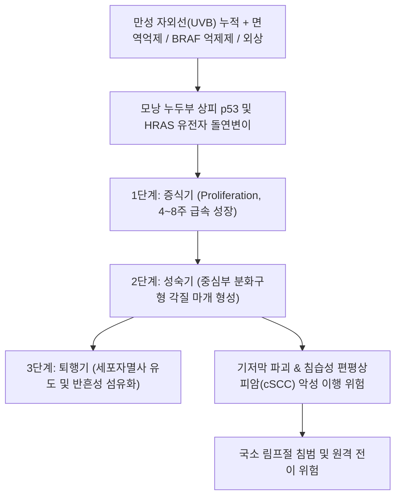

# 🩺 [[각질가시세포종]] (Keratoacanthoma / 角質棘細胞腫, ICD-10: D23 / L85.8)

> **핵심 3줄 요약 (Key Summary)**:
> - 📍 병소 부위 & 해부·병태생리: 만성 자외선 노출 부위 피부의 모낭 누두부(Follicular infundibulum) 상피세포에서 기원하여 중심부에 각질 마개(Keratin plug)를 형성하며 급속 성장하는 피부의 가성 악성 종양(Pseudomalignancy)이자 고분화 편평상피세포암(cSCC)의 임상적 변종.
> - 🚩 전형적 임상 양상 & 3대 징후: 4~8주 만에 1~2.5cm 크기로 분화구 모양 융기하는 대칭성 돔형 홍반성 결절, 중심부의 단단한 분화구형 각질 마개(Crateriform keratin core), 고령자 및 일광 노출 부위(안면부, 코, 뺨, 손등, 전완부) 호발.
> - 🛠️ 핵심 감별 검사 & 한·양방 다각적 치료 전략: 전층 쐐기 생검(Wedge biopsy) 또는 완전 절제 생검(안전연 4~5mm 확보), 침습성 편평상피세포암(cSCC)과의 병리 감별, 양방 외과적 완전 절제/모즈 미세도식 수술(Mohs surgery) 및 한의 절제 후 창상 치유·반흔 구축 방지([[탁리소독음]], [[자운고]]) 통합 치료.
> - ⚠️ 응급 의뢰 레드플래그 & 악화 요인: 단순 사마귀나 각화증으로 오인하여 레이저나 불완전 소작술 시행 시 기저막 침윤을 놓쳐 침습성 편평상피암으로 진행하거나 림프절 전이를 유발할 수 있으므로 조기 전층 절제 생검 필수.

---

## 📌 목차
1. [질환 개요 & 해부학적 병태생리](#1-질환-개요--해부학적-병태생리)
2. [병태생리 메커니즘 & 생체역학적 악순환 네트워크](#2-병태생리-메커니즘--생체역학적-악순환-네트워크)
3. [임상 증상 & 이학적 검사(Physical Exam) 알고리즘](#3-임상-증상--이학적-검사physical-exam-알고리즘)
4. [감별 진단 매트릭스 (Differential Diagnosis)](#4-감별-진단-매트릭스-differential-diagnosis)
5. [한의 통합 치료 프로토콜 (침·약침·추나·한약)](#5-한의-통합-치료-프로토콜-침약침추나한약)
6. [양방 치료 & 병용·의뢰 기준 (Conventional Treatment & Referral)](#6-양방-치료--병용의뢰-기준-conventional-treatment--referral)
7. [재활 운동 & 생활습관 티칭 가이드](#7-재활-운동--생활습관-티칭-가이드)
8. [💡 사용자 진료실 핵심 필기 & 임상 노하우 (Melt-In 잔여 심화 집약)](#8--사용자-진료실-핵심-필기--임상-노하우-melt-in-잔여-심화-집약)
9. [출처 및 학술 참고 문헌 (References)](#9-출처-및-학술-참고-문헌-references)

---

## 1. 질환 개요 & 해부학적 병태생리

* **질환 정의 및 개요**:
  * [[각질가시세포종]](Keratoacanthoma, KA)은 피부 모낭의 모루(Infundibulum) 상피세포에서 발생하는 독특한 피부 종양으로, 단기간(수 주) 내에 분화구 형태의 돔형 결절로 급속 성장한 후 일부 자연 퇴행(Spontaneous regression)하는 가성 악성 종양(Pseudomalignancy)입니다.
  * 그러나 조직학적·유전체학적으로 고분화 **[[편평상피세포암]](Cutaneous Squamous Cell Carcinoma, cSCC)**과 구별이 극히 어렵고, 실제로 침습성 암종으로 이행하는 증례가 다수 보고되므로 현대 피부종양학에서는 'cSCC, 각질가시세포종형(cSCC, KA-type)'으로 간주하여 외과적 완전 절제를 표준으로 권고합니다.
  * 50~70대 고령층, 남성에서 여성보다 약 2배 호발하며, 만성 자외선 노출 부위에 집중 발생합니다.
* **관련 해부학적 구조물**:
  * **표피 및 모낭 구조**: 모낭 누두부(Infundibulum), 외모근초(Outer root sheath), 각질 형성세포(Keratinocytes), 기저막(Basement membrane).
  * **호발 해부학적 부위**: 안면부(코, 뺨, 하순, 이개), 두피, 손등(Dorsum of hand), 전완 폄근측.

---

## 2. 병태생리 메커니즘 & 생체역학적 악순환 네트워크

### 1) 3단계 자연 경과와 세포 생물학적 기전
* **1단계 증식기(Proliferation phase, 4~8주)**: 모낭 상피세포가 폭발적으로 증식하여 진피 깊숙이 가시세포 증식괴(Acantholytic islands)를 형성하며, 임상적으로 1~2.5cm 크기의 매끄러운 홍반성 돔형 구진으로 급속 팽창합니다.
* **2단계 성숙기(Mature phase, 2~8주)**: 종양 중심부의 과각화증(Hyperkeratosis)으로 인해 화산 분화구 모양의 갈색/황백색 각질 마개(Central keratin crater)가 뚜렷해지며 성장을 멈춥니다.
* **3단계 자연 퇴행기(Involution phase, 6~12개월)**: 세포자멸사(Apoptosis)와 면역 반응(림프구 침윤)에 의해 중심부 각질 마개가 탈락하고 위축성 저착색 반흔을 남기며 치유됩니다.

### 2) 악성화 및 침습성 편평상피암(cSCC)과의 중첩
* 조직학적으로 종양 기저부 세포의 이형성(Atypia)과 비정상 유사분열이 빈번하며, 기저막을 뚫고 진피 심부 및 피하지방층으로 침습하는 경우가 적지 않습니다.
* 따라서 임상적으로 퇴행을 기다리기보다는 악성 cSCC를 전제로 하여 완전 절제하는 것이 원칙입니다.

---

## 3. 임상 증상 & 이학적 검사(Physical Exam) 알고리즘

### 1) 주요 임상 증상
* **화산 분화구형 돔 결절**:
  * 경계가 명확하고 대칭적인 돔 형태의 단단한 피부 결절.
  * 결절의 정중앙에 분화구처럼 패인 함몰부가 있으며, 그 안을 단단하고 거친 각질 마개(Keratin plug)가 가득 채우고 있음.
  * 주변 림(Rim) 부위는 매끄럽고 윤기 나는 홍반성 피부로 둘러싸여 있으며, 모세혈관 확장이 관찰되기도 함.
* **급속 성장 속도**:
  * 환자는 "불과 3~4주 전에는 아무것도 없었는데 갑자기 혹이 커졌다"며 급격한 크기 증가를 호소함.

### 2) 필수 진단 검사법
* **전층 쐐기 생검 (Full-thickness Wedge Biopsy)**:
  * 얕은 펀치 생검이나 긁기 생검(Shave biopsy)은 중앙 각질만 채취하여 침습성 기저부를 놓치므로 절대 금기.
  * 병변의 중심부, 융기된 림(Rim), 정상 피부 경계 및 진피 심부/피하조직을 모두 포함하는 쐐기형 절개 생검을 시행해야 병리적으로 cSCC와 감별 가능.
* **조직병리 소견**:
  * 커다란 중심 각질 분화구, 주변 표피가 입술처럼 분화구를 덮는 '표피 입술 징후(Epidermal lip/buttress)', 유리질화된 풍부한 호산성 세포질을 가진 대형 편평세포 군집.

---

## 4. 감별 진단 매트릭스 (Differential Diagnosis)

| 감별 질환 | 성장 속도 및 기간 | 중심부 병변 형태 | 조직학적 소견 | 임상적 핵심 감별점 |
| :--- | :--- | :--- | :--- | :--- |
| **[[각질가시세포종]]** (본 질환) | **4~8주 내 급속 성장** | 대칭성 돔형, **중심 각질 분화구** | 표피 입술 징후, 풍부한 호산성 세포질 | 단기간 급속 팽창, 대칭적 외형 |
| **[[편평상피세포암]]** (cSCC) | 수개월~수년에 걸쳐 서서히 성장 | 불규칙한 궤양, 융기, 출혈, 딱지 | 심부 기저막 침윤, 비정상 다핵 분열 | 비대칭성, 파괴성 궤양, 림프절 전이 |
| **[[기저세포암]]** (BCC) | 매우 서서히 자람 (수년) | 진주빛 반투명 결절, 모세혈관 확장 | 기저양 세포 둥지, 말초 울타리 배열 | 중심 궤양 형성되나 각질 마개 없음 |
| **[[일광각화증]]** (Actinic Keratosis) | 정체되거나 서서히 진행 | 거친 인설성 편평 반점, 융기 미미 | 표피 하부 비정형성, 기저막 침윤 없음 | 결절을 형성하지 않는 편평한 전암병변 |
| **심상성 사마귀** (Verruca Vulgaris) | 수개월간 서서히 성장 | 표면이 거친 유두종성 구진 | 각질 과다, 유두종증, Koilocyte | 중심부 분화구가 없고 점상 출혈점 관찰 |

---

## 5. 한의 통합 치료 프로토콜 (침·약침·추나·한약)

* **한의 치료의 원칙과 한계**:
  * 각질가시세포종은 악성 종양(cSCC)과의 감별 및 완전 절제가 필수적이므로 **종양 자체의 제거는 양방 피부외과적 절제를 최우선 원칙**으로 합니다.
  * 한의 치료는 **수술적 절제 후 창상 유합 촉진, 비후성 반흔 및 안면부 흉터 최소화, 고령자 면역 증강을 통한 피부 전암병변 재발 억제**에 집중합니다.
* **창상 치유 및 면역 한약 치료 (Herbal Medicine)**:
  * **탁리소독음(托裏消毒飮) 가감**: 백지, 길경, 금은화, 당귀, 황기. 절제 수술 후 창상의 육아조직 증식을 촉진하고 무균성 배농 및 상피화를 가속.
  * **보중익기탕(補中益氣湯) 합 소풍산(消風散)**: 노인성 면역 저하 및 일광 손상 피부의 장벽 회복.
* **침구 치료 (Acupuncture)**:
  * **수술 반흔 주변 위자(圍刺) 자침**: 절제 봉합선 주변으로 0.16×15mm 미세 호침을 얕게 자입하여 국소 모세혈관 순환을 촉진하고 섬유아세포 과증식(비후성 반흔) 억제.
  * **전신 면역 경혈**: 곡지(LI11), 합곡(LI4), 족삼리(ST36), 혈해(SP10).
* **외용 요법**:
  * 발사(Stitch out) 후 봉합 부위에 **[[자운고]](紫雲膏)**를 1일 2~3회 얇게 도포하여 피부 건조를 막고 반흔 구축 완화.

---

## 6. 양방 치료 & 병용·의뢰 기준 (Conventional Treatment & Referral)

* **약물 치료 (Medication)**:
  * **병변 내 항암제 주입 (Intralesional Therapy)**:
    * 수술이 불가능한 고령자나 안면 미용상 절제가 어려운 부위: 병변 내 5-플루오로우라실(5-FU 50mg/mL) 또는 메토트렉세이트(MTX 12.5~25mg)를 1~2주 간격으로 주입하여 종양 퇴행 유도.
    * 블레오마이신(Bleomycin) 국소 주입.
  * **전신 레티노이드 (Systemic Retinoids)**:
    * 다발성 각질가시세포종(Grzybowski 증후군, Ferguson-Smith 증후군) 환자에게 아시트레틴(Acitretin 25~50mg/d) 경구 투여.
* **수술적 표준 절제술 (Standard Surgical Excision)**:
  * **완전 외과적 절제 (Surgical Excision)**: 가장 확실한 1차 표준 치료로, 정상 피부 마진 4~5mm를 포함하여 피하지방층 깊이까지 전층 절제 후 봉합.
  * **모즈 미세도식 수술 (Mohs Micrographic Surgery)**: 코, 눈꺼풀, 입술, 귀 등 안면부 중심 병변에서 정상 조직 결손을 최소화하면서 100% 절제연 음성을 확인하는 최적의 수술법.
* **비약물 시술 (Procedures)**:
  * 냉동치료(Cryosurgery), 방사선 치료(방사선 요법은 고령의 수술 거부 환자에서 고려).
* **한의 병용 판단 (Combination Therapy)**:
  * 수술 전 종양을 한의학적 침구나 뜸으로 지지거나 태우는 행위는 암세포의 불완전 제거와 전이를 유발하므로 절대 금기.
  * 수술 후 창상 봉합부에 자운고 도포 및 침 치료는 흉터 형성 예방에 안전하고 효과적임.
* **양방·전문과 의뢰 기준 (Referral Criteria)**:
  * **즉각 피부과·성형외과 전원 (절대적 레드플래그)**: 안면부나 손등에 급속 성장하는 화산 분화구형 결절 발견 시 지체 없이 전층 생검 및 절제 의뢰.
  * **재발 및 림프절 전이 의심**: 절제 후 국소 재발하거나 주변 림프절(이하선, 악하선, 경부 림프절)이 단단하게 만져지는 경우 즉시 상급병원 피부암 센터 전원.

---

## 7. 재활 운동 & 생활습관 티칭 가이드

* **철저한 자외선(UV) 차단 관리**:
  * 각질가시세포종 및 피부암의 가장 핵심 유발 인자는 만성 자외선 손상이므로 사계절 내내 차단제 생활화.
  * 외출 30분 전 광범위 자외선 차단제(SPF 50+, PA++++)를 안면, 목, 귀, 손등에 충분히 도포하고 2~3시간마다 덧바르기.
  * 챙이 넓은 모자, 양산, 긴팔 옷, 자외선 차단 장갑 착용.
* **피부 병변 자극 및 자가 처치 금지**:
  * 결절 중심의 각질 마개를 손톱깎이나 칼, 핀셋으로 뜯어내거나 짜는 행위 엄금(이차 세균 감염 및 침습 촉진).
  * 티눈약(살리실산)이나 사마귀 연고를 임의로 바르지 말 것.

---

## 8. 💡 사용자 진료실 핵심 필기 & 임상 노하우 (Melt-In 잔여 심화 집약)

### 1) 진료실 "화산 분화구형 혹" 3초 판독 요령
* 60~70대 어르신이 "얼굴이나 손등에 몇 주 만에 화산 분화구처럼 가운데가 딱딱하게 푹 파인 혹이 생겼다"며 찾아올 때가 있습니다.
* 이때 절대로 단순 티눈, 사마귀, 쥐젖으로 오인하여 레이저로 표면을 지지거나 뜯어내지 마십시오.
* 겉보기에는 각질가시세포종 같아도 조직 검사를 해보면 30~50%는 침습성 편평상피세포암(cSCC)으로 진단됩니다. "어르신, 이건 살 속 깊이 뿌리를 확인해야 하는 피부 혹이므로 대학병원이나 피부과에서 깨끗하게 도려내는 수술을 받으셔야 합니다"라고 단호하게 전원시켜야 합니다.

### 2) 얕은 펀치 생검의 함정 경고
* 일부 로컬 의원에서 2~3mm 직경의 작은 펀치로 윗부분만 살짝 떼어내 병리과로 보내면 "각화증(Hyperkeratosis) 또는 양성 종양"으로 오진되어 암을 방치하는 치명적 실수가 발생합니다.
* 반드시 종양 기저부와 정상 피부 경계면을 포함하는 전층 절제 생검이 이루어지도록 상급병원 피부과 진료의뢰서를 상세히 작성해주어야 합니다.

### 3) 수술 후 흉터 관리 한의 케어 팁
* 안면부 모즈 수술 후 실밥을 뽑고 3일 뒤부터 절제선 주변에 얇은 안면 호침으로 미세 자침을 시행하고 [[자운고]]를 꾸준히 바르게 하면, 붉은 반흔과 당김 증상이 놀라울 정도로 부드럽게 풀려 환자의 미용적 만족도가 매우 높습니다.

---

## 9. 출처 및 학술 참고 문헌 (References)

1. Zito PM, et al. (2024). Risk factors associated with clinical-histopathological discordance in keratoacanthoma diagnosis. *Dermatol Surg*. PMID: 42190755

   - [연구 요약] 각질가시세포종의 임상 진단과 병리조직학적 판정 간의 불일치 위험 요인을 분석하여, 편평상피세포암(cSCC)과의 감별 진단을 위한 전층 절제 생검의 임상적 필수성을 규명함.

2. Takai T. (2024). New Insights into Pathogenesis and Management of Keratoacanthoma: A Narrative Review. *J Dermatol*. PMID: 41155332

   - [연구 요약] 각질가시세포종의 모낭 기원 분자생물학적 발병 기전, 자연 퇴행 경로 및 현대 피부종양학에서의 외과적 표준 절제술 가이드라인을 집대성한 종설 논문.

3. Falzone C, et al. (2024). Generalized Eruptive Keratoacanthoma of Grzybowski: A Systematic Review of Clinical Presentation, Associated Conditions, and Therapeutic Outcomes. *Am J Clin Dermatol*. PMID: 41454524

   - [연구 요약] 다발성 전신 분출성 각질가시세포종 환자의 임상 양상, 동반 질환 및 전신 레티노이드와 수술적 치료 예후를 분석한 체계적 문헌고찰.
