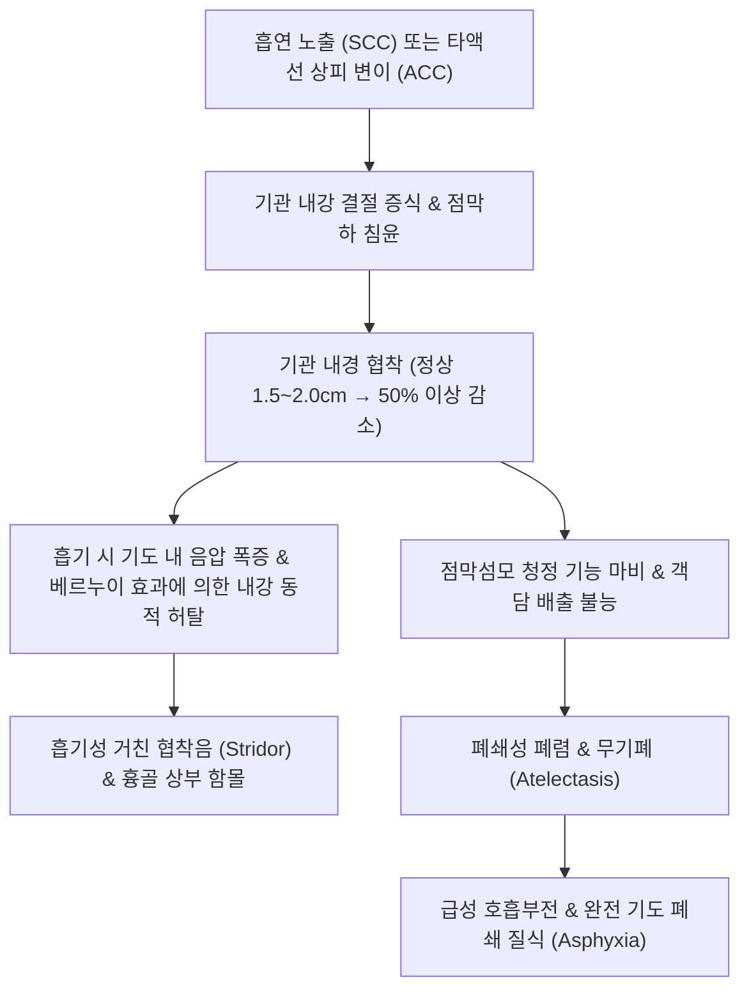

# 🩺 [[기도 종양]] (Tracheal Neoplasms / 氣道腫瘍, ICD-10: C33 / D14.2)

> **핵심 3줄 요약 (Key Summary)**:
> - 📍 병소 부위 & 해부·병태생리: 윤상연골 하부에서 기관 분지부(Carina)에 이르는 기관(Trachea) 및 주기관지 상피·분비선에서 발생하는 원발성 및 속발성 신생물로, 성인 악성의 85% 이상이 [[편평상피세포암]](SCC, 흡연 연관)과 [[선양낭포암]](ACC, 타액선 기원, 신경초 침윤)으로 양분됨.
> - 🚩 전형적 임상 양상 & 3대 징후: 기관 내강이 50% 이상 협착될 때 비로소 발현하는 진행성 호흡곤란, 흡기성 쇠소리 협착음(Stridor), 천식 흡입제 치료에 전혀 반응하지 않는 천명음(Wheezing) 및 객혈.
> - 🛠️ 핵심 감별 검사 & 한·양방 다각적 치료 전략: 흉부 CT 및 3차원 가상 기관지경, 경성/연성 기관지경 생검, 폐기능검사 유량-기량 곡선(Flow-volume loop)의 고정성 기도 폐쇄 패턴, 외과적 기관 분절 절제 및 단단문합술, 수술 후 방사선 및 청폐화담 한의 호흡기 암 재활 요법.
> - ⚠️ 응급 의뢰 레드플래그 & 악화 요인: 성인에서 천식이나 COPD로 오인되어 평균 1년 이상 진단이 지연되다가 급성 완전 기도 폐쇄로 질식(Asphyxia) 및 심정지가 발생할 수 있으므로 흡기성 협착음 및 흉골 상부 함몰 확인 즉시 응급 기관지경 의뢰.

---

## 📌 목차
1. [질환 개요 & 해부학적 병태생리](#1-질환-개요--해부학적-병태생리)
2. [병태생리 메커니즘 & 생체역학적 악순환 네트워크](#2-병태생리-메커니즘--생체역학적-악순환-네트워크)
3. [임상 증상 & 이학적 검사(Physical Exam) 알고리즘](#3-임상-증상--이학적-검사physical-exam-알고리즘)
4. [감별 진단 매트릭스 (Differential Diagnosis)](#4-감별-진단-매트릭스-differential-diagnosis)
5. [한의 통합 치료 프로토콜 (침·약침·추나·한약)](#5-한의-통합-치료-프로토콜-침약침추나한약)
6. [양방 치료 & 병용·의뢰 기준 (Conventional Treatment & Referral)](#6-양방-치료--병용의뢰-기준-conventional-treatment--referral)
7. [재활 운동 & 생활습관 티칭 가이드](#7-재활-운동--생활습관-티칭-가이드)
8. [💡 사용자 진료실 핵심 필기 & 임상 노하우 (Melt-In 잔여 심화 집약)](#8--사용자-진료실-핵심-필기--임상-노하우-melt-in-잔여-심화-집약)
9. [출처 및 학술 참고 문헌 (References)](#9-출처-및-학술-참고-문헌-references)

---

## 1. 질환 개요 & 해부학적 병태생리

* **질환 정의 및 개요**:
  * [[기도 종양]](Tracheal Neoplasms)은 윤상연골(Cricoid cartilage) 하단부터 기관 분지부(Carina)까지 약 10~13cm 길이의 기관(Trachea) 및 주기관지 내강에 발생하는 모든 종양을 총칭합니다.
  * 전체 호흡기 종양 중 약 2% 미만을 차지하는 극히 드문 희귀 질환이나, 성인에서 발생하는 원발성 종양의 약 80~90%가 악성 종양입니다.
  * 양대 주요 악성 원발암:
    * **[[편평상피세포암]](Squamous Cell Carcinoma, SCC)**: 전체 원발성 악성의 약 50%를 차지하며, 50~70대 고령 남성 흡연자에서 호발하고 외장성(Exophytic) 또는 궤양성 결절로 빠르게 성장하여 조기 출혈과 협착을 유발합니다.
    * **선양낭포암(Adenoid Cystic Carcinoma, ACC)**: 약 35~40%를 차지하며, 점막하 소타액선에서 기원하여 남녀 비가 같고 흡연과 무관합니다. 천천히 자라지만 기관 벽을 따라 점막하 및 신경초 침윤(Perineural invasion)을 광범위하게 일으키는 특징이 있습니다.
    * 기타 원발암: 유암종(Carcinoid), 점액표피양암종(MEC), 연골육종; 양성 종양: 평활근종, 유두종(Papilloma), 혈관종.
    * 속발성 종양: 갑상선암, 식도암, 폐암의 직접 침범이 원발암보다 흔하게 발생합니다.
* **관련 해부학적 구조물**:
  * **기관 연골륜(Tracheal Cartilages)**: 16~20개의 C-자형 초자연골(Hyaline cartilage)이 전방 및 외측 벽을 지지하여 흡기 음압 시 내강 허탈을 방지.
  * **막성벽(Membranous Wall)**: 기관 후벽에 위치한 평활근(Trachealis muscle)과 결합조직으로 식도 전벽과 밀접하게 접촉.
  * **신경 및 혈관**: 반회후두신경(Recurrent laryngeal nerve), 미주신경, 하갑상동맥 분지, 기관지동맥.

---

## 2. 병태생리 메커니즘 & 생체역학적 악순환 네트워크

### 1) 기계역학적 협착과 기류 저항의 악순환
* 포아죄유의 법칙(Poiseuille's law)에 따라 기도의 기류 저항은 반경의 4제곱($R \propto 1/r^4$)에 반비례합니다.
* 정상 성인의 기관 내경(15~20mm)이 종양으로 인해 8mm 이하(50% 이상 협착)로 줄어들 때 비로소 노작성 호흡곤란이 시작되며, 5mm 이하로 좁아지면 안정 시에도 극심한 협착음(Stridor)과 질식 위험이 닥칩니다.
* 좁아진 부위를 공기가 고속으로 통과하면서 베르누이 효과(Bernoulli effect)에 의해 내벽이 빨려 들어가 기도가 추가로 동적 허탈(Dynamic collapse)됩니다.

### 2) ACC의 신경초 침윤과 잠행성 확산
* 선양낭포암은 육안적으로 보이는 종양 경계보다 수 센티미터 이상 상하로 점막하 림프관 및 신경초(Perineural space)를 타고 기어가는 침윤성 주행을 보입니다.
* 이로 인해 수술 시 육안적 절제연이 음성이더라도 현미경적 절제연 양성이 흔히 발생하며, 수년~십수 년 후 국소 재발이나 폐 전이를 일으킵니다.

---

## 3. 임상 증상 & 이학적 검사(Physical Exam) 알고리즘

### 1) 주요 임상 증상
* **진행성 호흡곤란 및 협착음 (Stridor)**:
  * 초기에는 운동 시에만 숨이 차다가, 점차 평지 보행 및 누워있을 때도 숨이 가빠짐.
  * 청진기를 대지 않아도 환자의 입과 목 주변에서 거친 쇠소리 흡기성 협착음이 청취됨.
* **난치성 기침 및 객혈**:
  * 종양의 궤양화로 인한 객담 내 혈흔(Hemoptysis) 또는 선홍색 혈담.
  * 분비물이 걸려 뱉어지지 않는 발작성 기침.
* **삼킴 곤란 및 쉰 목소리**:
  * 식도 침범 시 연하곤란, 반회후두신경 침범 시 성대 마비에 의한 애성(Hoarseness).

### 2) 필수 진단 검사법
* **폐기능 검사 (PFT) 유량-기량 곡선 (Flow-Volume Loop)**:
  * 기도 종양의 가장 중요한 비침습적 단서.
  * 흡기 곡선과 호기 곡선이 모두 위아래로 상자가 잘린 듯 평평해지는 **'고정성 상기도 폐쇄(Fixed Upper Airway Obstruction)'의 전형적 평탄화(Plateau)** 소견 확인.
* **흉부 전산화단층촬영 (CT) 및 3D 가상 기관지경**:
  * 기관 내 종양의 정확한 위치, 상하 길이, 내강 협착률, 종격동 및 식도 침범 여부 평가.
* **경성 및 연성 기관지경 (Bronchoscopy)**:
  * 확진을 위한 표준 검사. 종양의 육안적 성상 확인, 조직 생검(Biopsy) 및 기도 확보를 위한 중재술(스텐트, 레이저 소작) 동시 시행.

---

## 4. 감별 진단 매트릭스 (Differential Diagnosis)

| 감별 질환 | 호발 연령 및 배경 | 호흡음 및 호흡곤란 특성 | 흡입제/기관지확장제 반응 | 감별 핵심 진단 소견 |
| :--- | :--- | :--- | :--- | :--- |
| **[[기도 종양]]** (본 질환) | 50대 이상 고령자, 흡연자 | **흡기성 쇠소리 협착음(Stridor)** | **전혀 반응 없음 (불응성)** | CT상 내강 종괴, Flow-volume loop 평탄화 |
| **[[기관지 천식]]** (Asthma) | 소아 또는 성인, 아토피 | 호기성 천명음(Wheezing), 변동성 | SABA/ICS 흡입 시 극적 호전 | 가역적 기도폐쇄(PFT상 12% 200mL 개선) |
| **만성 폐쇄성 폐질환** (COPD) | 60대 이상 장기 흡연자 | 만성 기침, 가래, 노력성 호기 연장 | 부분적 호전 반응 | 폐기능검사상 $FEV_1/FVC < 0.70$ 고정 |
| **기관 삽관 후 기관 협착** | 중환자실 인공호흡기/기관절개 과거력 | 관 형태의 원형 섬유성 협착 | 흡입제 반응 없음 | 종괴 없이 섬유성 반흔 협착 관찰 |
| **기도 이물 흡인** | 소아, 뇌졸중 환자, 노인 | 식사 중 급성 발작성 기침 및 질식 | 반응 없음 | 급성 발병력, 단순 X-ray/기관지경상 이물 |

---

## 5. 한의 통합 치료 프로토콜 (침·약침·추나·한약)

* **한의 치료의 원칙과 안전 한계**:
  * 기도 종양은 내강 폐쇄에 의한 급성 질식을 초래할 수 있는 고위험 종양이므로, **종양의 물리적 제거 및 기도 확보(수술, 기관지경 스텐트)는 반드시 양방 흉부외과/호흡기내과에서 선행**되어야 합니다.
  * 한의 치료는 **수술 전후 호흡근 피로 개선, 기관지 분비물 배출 촉진, 방사선 치료 후 기관 점막 건조증 및 방사선 기관지염 완화, 암성 기침 조절**을 목표로 합니다.
* **청폐윤폐(淸肺潤肺) 및 화담지해(化痰止咳) 한약 치료 (Herbal Medicine)**:
  * **방사선 치료 후 기도 점막 건조 및 마른기침**:
    * [[맥문동탕]](麥門冬湯), [[사삼맥문동탕]](沙蔘麥門冬湯) 가감: 맥문동, 사삼, 백합, 패모. 방사선 조사로 손상된 기도 상피 섬모의 점액 분비를 회복시키고 발작성 기침 완화.
  * **객담 저류 및 호흡곤란 완화**:
    * 청상보하탕(淸上補下湯), 소자강기탕(蘇子降氣湯) 가감: 담음(痰飮) 정체를 삭이고 상역된 폐기를 하강시킴.
* **침구 치료 (Acupuncture)**:
  * **호흡기 안정 및 흉통 완화 배혈**: 천돌(CV22), 전중(CV17), 폐유(BL13), 정천(EX-B1), 척택(LU5), 공최(LU6), 태연(LU9), 족삼리(ST36).
  * **침술 주의**: 천돌혈 자침 시 종양의 위치가 경부 기관 상부일 수 있으므로 깊은 직자를 엄금하고 흉골 후면을 향해 얕게 사자(Oblique insertion)하여 안전 확보.

---

## 6. 양방 치료 & 병용·의뢰 기준 (Conventional Treatment & Referral)

* **수술적 근치 절제술 (Surgical Resection & Reconstruction)**:
  * **기관 분절 절제 및 단단문합술 (Tracheal Resection and Primary Anastomosis)**:
    * 국소 병변에 대한 유일한 완치적 치료법.
    * 종양 부위를 링 형태로 잘라내고 위아래 정상 기관을 직접 문합. 성인에서 안전하게 절제 가능한 최대 길이는 약 4~5cm(약 5~6개 기관륜).
  * **융기부 절제술 (Carinal Resection)**: 종양이 기관 분지부(Carina)를 침범한 경우 기관 분지부를 재건하는 고난도 흉부외과 수술.
* **중재적 기관지경 시술 (Interventional Bronchoscopy)**:
  * 수술 불가능 환자 또는 수술 전 급성 기도 폐쇄 해소를 위한 긴급 시술:
    * **기관 스텐트 삽입술 (Tracheal Stenting)**: 실리콘 스텐트(Dumon stent) 또는 자가팽창성 피복 금속 스텐트(SEMS)를 삽입하여 내강 확보.
    * **경성 기관지경하 종양 소작술**: 레이저(Nd:YAG), 전기소작(Electrocautery), 냉동치료(Cryotherapy)를 통해 내강 돌출 종양을 깎아냄.
* **방사선 치료 및 항암요법**:
  * 선양낭포암(ACC)의 수술 후 보조 방사선 치료(절제연 양성이나 신경초 침윤이 흔하므로 국소 재발 방지를 위해 필수).
  * 수술 불가능한 편평상피세포암(SCC) 환자에서 동시항암방사선치료(CCRT).
* **한의 병용 판단 (Combination Therapy)**:
  * 스텐트 삽입 환자에게 점액 용해 및 섬모 운동 촉진 한약([[맥문동탕]]) 병용 시 스텐트 내 가래 딱지(Mucus plug) 폐색을 예방하는 데 유효함.
* **양방·전문과 의뢰 기준 (Referral Criteria)**:
  * **초응급 119 이송 (레드플래그)**: 흡기 시 극심한 쌕쌕거림(협착음 Stridor), 흉골 상부 및 늑간 함몰 호흡, 청색증, 안정 시 심한 호흡곤란, 대량 객혈 $\rightarrow$ 응급 기도 확보(경성 기관지경 또는 기관절개술) 필수.
  * **호흡기내과/흉부외과 정밀 의뢰**: 성인에서 흡입제 치료에 전혀 반응하지 않는 천명음, Flow-volume loop상 평탄화 소견 확인 시.

---

## 7. 재활 운동 & 생활습관 티칭 가이드

* **철저한 금연 및 호흡기 자극원 차단**:
  * 기관 편평상피세포암의 제1원인은 흡연이므로 절대 금연(간접흡연 포함).
  * 조리 매연, 미세먼지, 유기용제 증기 흡입 차단(외출 시 KF94 마스크 착용).
* **기도 점막 수분 유지 환경 티칭**:
  * 건조한 공기는 기관 분비물을 딱딱하게 굳혀 기도 폐쇄를 촉진하므로 실내 습도 50~60% 유지.
  * 미온수를 자주 조금씩 마시고 생리식염수 네뷸라이저 흡입 활용.
* **기침 및 객담 배출 테크닉 (Huffing 기법)**:
  * 성대를 닫고 무리하게 기침하면 좁아진 기관에 강한 압력이 걸려 점막 손상 및 객혈을 유발하므로, 성대를 연 채 "하- 하-" 소리를 내며 가래를 밀어 올리는 헉-기침법(Huffing) 지도.

---

## 8. 💡 사용자 진료실 핵심 필기 & 임상 노하우 (Melt-In 잔여 심화 집약)

### 1) 천식으로 오진되어 오는 성인 기도 종양 환자 감별법
* 50~60대 환자가 "몇 달 전부터 숨이 차고 쌕쌕거려서 내과에서 천식이라고 흡입제(벤토린, 세레타이드 등)를 처방받았는데, 아무리 뿌려도 숨찬 게 조금도 좋아지지 않는다"고 찾아오면 십중팔구 상기도 폐쇄 질환입니다.
* 환자 입 앞에 귀를 대고 숨을 깊게 들이쉬게 해보십시오. 들이쉴 때 목구멍에서 쇳소리(흡기성 협착음 Stridor)가 난다면 기관 내강이 종양으로 50% 이상 막힌 것입니다.
* 즉시 폐기능 검사의 유량-기량 곡선(Flow-volume loop)을 확인하여 호기와 흡기 곡선이 모두 평평하게 깎인 '고정성 상기도 폐쇄' 그래프를 확인하고 상급병원 호흡기내과 기관지경실로 당일 전원시켜야 합니다.

### 2) 기도 종양 환자 진료 시 절대적 주의사항
* 기도 내강이 좁아진 환자에게 무리하게 심호흡을 강요하거나 환자를 눕히면(Supine) 종양이 기도를 완전히 막아 급성 심정지가 발생할 수 있습니다.
* 환자가 가장 편안해하는 좌위(앉은 자세)를 유지시키고 산소를 공급하며 즉시 응급실로 이송해야 합니다.

### 3) 스텐트 시술 후 가래 관리 한의 노하우
* 기관 스텐트를 넣은 환자는 스텐트 금속망 주변으로 진득한 가래가 달라붙어 숨구멍을 막는 가래 폐색이 가장 위험합니다.
* 이때 [[맥문동탕]]에 어성초, 패모를 가미하여 처방하면 가래 점도가 묽어져 환자가 기침 한두 번으로도 쉽게 가래를 뱉어낼 수 있어 스텐트 폐쇄 합병증을 크게 예방할 수 있습니다.

---

## 9. 출처 및 학술 참고 문헌 (References)

1. Wang H, et al. (2025). Malignant Tracheal Stenosis: A Narrative Review of Current Diagnostic and Therapeutic Approaches. *Diagnostics (Basel)*. PMID: 42882100

   - [연구 요약] 악성 기관 협착 및 기도 종양의 원인별 병태생리, 진단적 기관지경술 및 최신 인터벤션 스텐트 삽입술과 외과적 절제 전략을 포괄적으로 분석한 종설 논문.

2. Al-Riyami S, et al. (2025). Challenges in managing tracheal adenoid cystic carcinoma of the proximal trachea complicated by COVID-19 and bilateral vocal cord palsy. *Respir Med Case Rep*. PMID: 42952967

   - [연구 요약] 근위부 기관에 발생한 선양낭포암(ACC) 환자의 기도 폐쇄 중재술, 신경 침윤에 따른 성대 마비 관리 및 다학제 치료 프로토콜의 임상적 도전을 보고함.

3. Tanriverdi E, et al. (2025). Life-threatening tracheal leiomyoma presenting as acute respiratory failure masquerading as refractory asthma: A case report. *Medicine (Baltimore)*. PMID: 42769692

   - [연구 요약] 난치성 천식으로 오인되어 진단이 지연된 기도 종양 환자가 급성 호흡부전으로 진행한 증례를 통해 조기 기관지경 검사와 상기도 폐쇄 감별의 중요성을 규명함.
