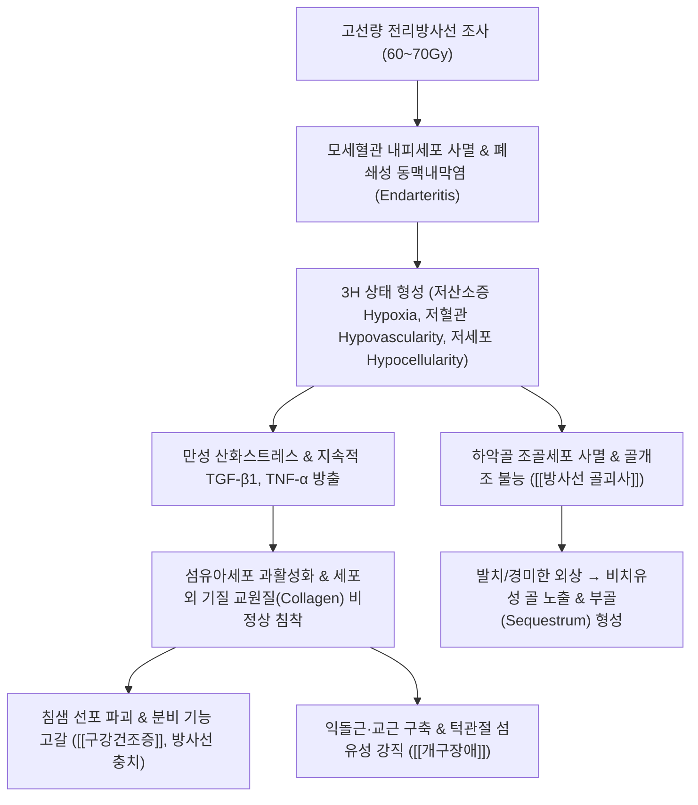

# 🩺 [[두경부 방사선 치료 후유증]] (Late Radiation Toxicities in Head and Neck, ICD-10: T66 / M27.2)

> **핵심 3줄 요약 (Key Summary)**:
> - 📍 병소 부위 & 해부·병태생리: 두경부암(비인두암, 구강암, 후두암 등) 방사선 치료(RT, 60~70Gy) 후 진피 및 연부조직 미세혈관의 폐쇄성 동맥내막염(Endarteritis obliterans)과 TGF-β 매개 섬유화로 인해 유발되는 저산소증(Hypoxia), 저혈관(Hypovascularity), 저세포(Hypocellularity) '3H' 상태 및 진행성 조직 위축증.
> - 🚩 전형적 임상 양상 & 4대 만기 후유증: 타액 분비 고갈로 인한 극심한 구강건조증(Xerostomia) 및 방사선성 급속 치아 우식, 하악골 점막 파열과 뼈 노출을 동반하는 [[방사선 골괴사]](ORN), 익돌근 및 경부 연부조직 섬유화로 인한 심한 개구장애(Trismus, 개구량 < 35mm), 연하근 마비성 연하곤란(Dysphagia).
> - 🛠️ 핵심 감별 검사 & 한·양방 다각적 치료 전략: 파노라마 X-ray 및 안면 CT/MRI, 타액 분비량 측정, 양방 고압산소치료(HBOT) 및 PENTOCLO 요법(Pentoxifylline + Tocopherol), 한의 자음윤조·익기양혈 한약([[사삼맥문동탕]], [[증액탕]], [[보중익기탕]]) 및 안면 침샘·저작근 침구 전침 치료.
> - ⚠️ 응급 의뢰 레드플래그 & 악화 요인: 방사선 치료를 받은 부위에서 발치(Tooth extraction) 등 침습적 치과 시술 시 하악골 전체가 썩어들어가는 난치성 방사선 골괴사(ORN)가 폭발하므로 시술 전후 구강악안면외과 협진 절대 필수.

---

## 📌 목차
1. [질환 개요 & 해부학적 병태생리](#1-질환-개요--해부학적-병태생리)
2. [병태생리 메커니즘 & 생체역학적 악순환 네트워크](#2-병태생리-메커니즘--생체역학적-악순환-네트워크)
3. [임상 증상 & 이학적 검사(Physical Exam) 알고리즘](#3-임상-증상--이학적-검사physical-exam-알고리즘)
4. [감별 진단 매트릭스 (Differential Diagnosis)](#4-감별-진단-매트릭스-differential-diagnosis)
5. [한의 통합 치료 프로토콜 (침·약침·추나·한약)](#5-한의-통합-치료-프로토콜-침약침추나한약)
6. [양방 치료 & 병용·의뢰 기준 (Conventional Treatment & Referral)](#6-양방-치료--병용의뢰-기준-conventional-treatment--referral)
7. [재활 운동 & 생활습관 티칭 가이드](#7-재활-운동--생활습관-티칭-가이드)
8. [💡 사용자 진료실 핵심 필기 & 임상 노하우 (Melt-In 잔여 심화 집약)](#8--사용자-진료실-핵심-필기--임상-노하우-melt-in-잔여-심화-집약)
9. [출처 및 학술 참고 문헌 (References)](#9-출처-및-학술-참고-문헌-references)

---

## 1. 질환 개요 & 해부학적 병태생리

* **질환 정의 및 개요**:
  * [[두경부 방사선 치료 후유증]](Late Radiation Toxicities)은 비인두암, 구강암, 구인두암, 후두암 등 두경부 악성 종양에 대해 완치 목적의 고선량 방사선 치료(대개 60~70Gy 이상)를 완료한 후 수개월에서 수년에 걸쳐 비가역적이고 진행성으로 발생하는 만성 복합 조직 손상 증후군입니다.
  * 종양 세포뿐만 아니라 조사 영역 내의 정상 침샘, 하악골, 저작근, 뇌신경, 경동맥이 영구적 미세혈관 허혈과 섬유화 손상을 입어 발병합니다.
* **4대 만기 핵심 후유증**:
  * **방사선 유발 구강건조증 (Radiation-induced Xerostomia)**: 침샘 선포 세포 괴사 및 도관 섬유화로 타액 분비 영구 고갈.
  * **하악골 방사선 골괴사 (Osteoradionecrosis, ORN)**: 하악골의 무균성 허혈성 괴사로 점막 궤양 및 골 노출, 누공 발생.
  * **경부 섬유화 및 개구장애 (Radiation Fibrosis & Trismus)**: 익돌근, 교근, 흉쇄유돌근의 섬유화 구축으로 입이 벌어지지 않음.
  * **방사선 연하곤란 (Radiation Dysphagia)**: 인두 수축근 및 후두 거상근의 경화로 흡인성 폐렴 반복.
* **관련 해부학적 구조물**:
  * **주요 외분비선**: 이하선(Parotid gland, 조사선량 > 26Gy 시 기능 상실), 악하선, 설하선.
  * **골격계**: 하악골(Mandible - 상악골과 달리 피질골이 두껍고 단일 하치조동맥에 혈류를 의존하여 ORN 발생률이 상악보다 10배 이상 높음).
  * **저작근 및 경부 근육**: [[교근]](Masseter), 내·외측 [[익돌근]](Pterygoids), [[측두근]], [[흉쇄유돌근]](SCM), 사각근.

---

## 2. 병태생리 메커니즘 & 생체역학적 악순환 네트워크

### 1) Marx의 고전적 '3H' 가설과 Delanian의 방사선 유발 섬유위축(RIF) 모델
* 방사선은 혈관 내피세포를 파괴하여 폐쇄성 동맥내막염을 일으켜 조직을 **저산소(Hypoxic), 저혈관(Hypovascular), 저세포(Hypocellular)**의 '3H' 상태로 만듭니다.
* 현대 병태생리학에서는 여기에 더하여 방사선 조사로 유도된 근섬유아세포(Myofibroblast)가 자가 분비성 TGF-β1 신호 회로를 형성하여 수년 동안 쉬지 않고 비정상적인 교원질을 침착시키는 '만성 진행성 섬유위축(Radiation-Induced Fibroatrophy, RIF)' 과정으로 규명합니다.

### 2) 하악골 방사선 골괴사(ORN)의 촉발 기전
* 하악골은 혈관망이 빈약하여 방사선 후 뼈를 재생하는 조골세포와 파골세포가 모두 사멸합니다.
* 이때 발치(Tooth extraction)나 임플란트, 틀니의 미세 압박으로 잇몸 점막이 찢어지면 정상적인 창상 치유가 일어나지 않고 구강 내 상주 세균이 노출된 뼈로 침투하여 골수염과 부골(Sequestrum) 형성을 동반한 급속한 골괴사로 이어집니다.

---

## 3. 임상 증상 & 이학적 검사(Physical Exam) 알고리즘

### 1) 4대 주요 만기 임상 징후
* **극심한 구강건조증 (Xerostomia)**:
  * 입안에 침이 한 방울도 없어 혀와 뺨 점막이 쩍쩍 달라붙고 극심한 작열통 호소.
  * 침의 산 중화 및 살균 기능 상실로 치경부(치아 목 부위)가 까맣게 썩어 부스러지는 **방사선 충치(Radiation Caries)**가 급속 진행.
* **하악골 방사선 골괴사 (Osteoradionecrosis, ORN)**:
  * 잇몸 점막이 궤양화되어 황회색의 딱딱한 죽은 턱뼈(부골)가 구강 내로 직접 노출됨.
  * 심한 골 통증, 악취, 턱 주변 피부로 고름이 터져 나오는 구강-피부 누공(Orocutaneous fistula), 병적 골절(Pathological fracture).
* **개구장애 (Trismus)**:
  * 입을 최대로 벌렸을 때 상하 절치 간 거리(Maximum Incisal Opening, MIO)가 **35mm 미만(손가락 3개 미만)**으로 제한됨(심한 경우 10~15mm 미만으로 빨대로만 식사 가능).
* **목 섬유화 (Woody Neck)**:
  * 목 피부와 연부조직이 나무판자처럼 딱딱하게 굳어 목 회전 및 신전이 불가능해짐.

### 2) 필수 진단 검사법
* **파노라마 X-ray 및 하악골 3D CT**:
  * 하악골 피질골 파괴, 골수강 내 벌레 먹은 듯한 골용해(Moth-eaten osteolysis), 부골(Sequestrum) 형성 및 병적 골절 확인.
* **타액 분비율 검사 (Sialometry)**:
  * 5분간 무자극 타액 분비량 < 0.1mL/min 시 중증 타액선 기능 상실 확진.
* **비디오 연하조영검사 (VFSS)**:
  * 인두 수축력 저하, 후두 거상 부전, 기도 흡인(Aspiration) 여부 정밀 평가.

---

## 4. 감별 진단 매트릭스 (Differential Diagnosis)

| 감별 질환 | 방사선 조사력 | 발병 시기 및 특징 | 임상 증상 및 영상 소견 | 감별 핵심 진단법 |
| :--- | :--- | :--- | :--- | :--- |
| **[[두경부 방사선 치료 후유증]]** (본 질환) | **두경부암 방사선 60~70Gy** | 치료 후 수개월~수년 뒤 진행 | **구강건조증, 뼈 노출(ORN), 개구장애** | 방사선 조사 영역과 일치, 생검상 암세포 음성 |
| **원발암 국소 재발** (Recurrence) | 방사선 치료 과거력 있음 | 치료 후 불규칙 시기 급속 악화 | 급격한 종괴 형성, 경부 림프절 비대 | **조직 생검(Biopsy) 및 PET-CT 필수** |
| **약물 관련 악골괴사** (MRONJ) | **방사선 조사력 없음** | 비스포스포네이트/데노수맙 투약 | 골다공증/암 골전이 표적약 복용 후 뼈 노출 | 방사선력 배제, 골흡수억제제 투약력 |
| **[[쇼그렌 증후군]]** | 방사선 조사력 없음 | 중년 여성 호발, 만성 자가면역 | 양측 눈물샘/침샘 건조, 항Ro/La 양성 | 골괴사 없음, 자가항체 양성, 전신성 |
| **턱관절 장애** (TMD) | 방사선 조사력 없음 | 10~30대 청년층 호발 | 관절 잡음, 저작근 압통, 가역적 개구제한 | CT상 하악골 괴사 없음, 근막 이완 시 호전 |

---

## 5. 한의 통합 치료 프로토콜 (침·약침·추나·한약)

* **한의학적 병리 인식**:
  * 방사선은 강력한 화열독(火熱毒)으로 작용하여 체내의 진음(眞陰)을 태우고 진액을 고갈시키는 **음허화왕(陰虛火旺)**, 화독으로 인한 혈맥 폐색인 **어혈조락(瘀血阻絡)**으로 규정함.
* **침구 치료 (Acupuncture)**:
  * **타액 분비 촉진 배혈**: 하관(ST7), 협거(ST6), 지창(ST4), 염천(CV23), 예풍(TE17), 승읍(ST1).
    * 이하선 및 악하선 실질 부위에 0.20×30mm 호침으로 자침 후 2Hz 저주파 전침을 20분간 통전하여 잔존 분비선 자율신경 자극 및 혈류 개선.
  * **개구장애 및 저작근 이완**: 하관, 협거, 상관(GB3), 하악각 아시혈에 침도 또는 호침으로 유착 박리 자침.
  * **전신 진액 보충 취혈**: 족삼리(ST36), 삼음교(SP6), 태계(KI3), 조해(KI6), 부류(KI7).
* **약침 치료 (Pharmacopuncture)**:
  * **자하거 약침**: 강력한 음혈 보충과 조직 재생 작용을 위해 삼음교, 태계 및 협거혈에 0.1~0.2cc 주입.
  * **주의**: 뼈가 노출된 골괴사 병변 자체에는 감염 위험이 있으므로 직접 자입을 엄금하고 원위혈에만 시술.
* **한약 치료 (Herbal Medicine)**:
  * **자음강화(滋陰降火) 및 생진윤조(生津潤燥) — 구강건조증**:
    * [[사삼맥문동탕]](沙蔘麥門冬湯), [[증액탕]](增液湯) 가감: 사삼, 맥문동, 현삼, 생지황, 백합, 천화분. 손상된 구강 점막의 진액을 공급하고 점막 작열통 완화.
  * **익기활혈(益氣活血) 및 온경통락(溫經通絡) — 방사선 섬유화 및 골괴사 완화**:
    * [[보중익기탕]](補中益氣湯) 합 [[보양환오탕]](補陽還五湯) 가감: 황기, 당귀, 천궁, 단삼, 녹용. 미세혈관 순환을 촉진하고 섬유화된 근막 유착 완화.

---

## 6. 양방 치료 & 병용·의뢰 기준 (Conventional Treatment & Referral)

* **약물 치료 (Medication)**:
  * **타액 분비 촉진제**:
    * [[필로카르핀]](Pilocarpine 5mg tid): 잔존 타액선 기능이 있는 경우 타액 분비 자극(발한, 빈뇨 부작용 주의).
  * **PENTOCLO 요법 (방사선 섬유화 및 ORN 역전 요법)**:
    * 펜톡시필린(Pentoxifylline 400mg bid - 적혈구 유연성 증가, 미세혈류 개선, 항-TNF) + 토코페롤(Tocopherol / Vitamin E 1000IU/d - 활성산소 소거, TGF-β 억제) $\pm$ 클로드로네이트(Clodronate - 골흡수 억제). 최소 6~12개월 장기 복용으로 섬유화 역전 유도.
* **고압산소치료 (Hyperbaric Oxygen Therapy, HBOT)**:
  * 2.0~2.4 기압의 100% 산소를 90분간 흡입(주 5회, 총 20~30회 세션).
  * 조직 산소 분압을 10배 이상 올려 혈관신생(Angiogenesis)과 섬유아세포 증식, 조골세포 활성을 유도하여 골괴사 치유 촉진.
* **외과적 수술 (Surgical Intervention)**:
  * 보존적 치료에 반응하지 않는 진행성 ORN: 부골 절제술(Sequestrectomy), 하악골 분절 절제술 및 **유리 비골 피판술(Free Fibula Flap)**을 이용한 미세혈관 재건 수술.
* **한의 병용 판단 (Combination Therapy)**:
  * **병용 권장**: PENTOCLO 요법이나 HBOT 치료를 받는 환자에게 [[사삼맥문동탕]] 및 안면 침샘 전침 치료를 병용하면 침샘 혈류 촉진 및 구강건조증 개선 속도를 크게 단축시킬 수 있음.
  * **개구장애 개선**: 개구 운동 기구(TheraBite) 훈련 시 익돌근 부위 침 치료를 병행하면 저작근 섬유성 연축이 풀려 개구 범위 회복에 탁월한 시너지 발휘.
* **양방·전문과 의뢰 기준 (Referral Criteria)**:
  * **구강악안면외과 즉각 전원 (레드플래그)**: 잇몸 점막 파열 후 턱뼈 노출, 지속적인 골 통증, 구강-피부 누공, 악취 동반 배농 확인 시.
  * **이비인후과/종양내과 의뢰**: 치료 부위에 단단한 궤양성 결절이 재발하거나 경부 림프절이 급격히 커지는 암 재발 의심 징후.
  * **재활의학과 의뢰**: 음식 섭취 시 반복적인 기침과 사레들림(흡인성 폐렴 위험)으로 연하 치료(VFSS) 필요 시.

---

## 7. 재활 운동 & 생활습관 티칭 가이드

* **철저한 구강 위생 및 치과적 절대 수칙**:
  * **방사선 치료 부위 발치 절대 금기**: 방사선 조사를 받은 환자가 치통으로 로컬 치과에서 임의로 이를 뽑으면 턱뼈 전체가 썩어들어가는 ORN이 발생하므로, 반드시 방사선 치료 이력을 고지하고 대학병원 구강악안면외과에서 처치받아야 함.
  * 하루 4회 이상 고농도 불소 치약 사용 및 식후 생리식염수/베이킹소다 가글.
* **매일 3회 개구 스트레칭 훈련**:
  * 방사선 후 6개월~1년 사이 저작근 섬유화가 급격히 진행되므로, 숟가락이나 손가락 3개(검지, 중지, 약지)를 세워서 입안에 넣는 개구 훈련을 매일 아침, 점심, 저녁 10회씩 반복.
* **음식 섭취 요령**:
  * 마른 음식, 맵고 짠 자극성 음식, 뜨거운 음식 피하기.
  * 국물이나 소스를 곁들여 음식을 촉촉하게 적셔서 섭취하고 식사 중 미온수를 자주 모금모금 마시기.

---

## 8. 💡 사용자 진료실 핵심 필기 & 임상 노하우 (Melt-In 잔여 심화 집약)

### 1) 진료실 "방사선 치료 후 턱뼈 썩음증(ORN)" 경고 티칭
* 두경부암으로 방사선 치료를 받은 환자가 침 맞으러 오면, 반드시 "어르신, 방사선 치료를 받은 턱뼈는 피가 잘 안 통하기 때문에 치과에서 함부로 이를 뽑으시면 턱뼈가 괴사되어 평생 고생하십니다. 치아에 문제가 생기면 절대로 동네 치과에서 그냥 뽑지 마시고 반드시 방사선 치료받은 대학병원 치과로 가셔야 합니다"라고 신신당부해야 합니다.

### 2) 타액 분비 완전 고갈 환자의 한약 투약 요령
* 방사선 조사량이 60~70Gy를 넘어가면 침샘 선포 세포가 거의 전멸하여 필로카르핀을 써도 침이 나오지 않고 땀과 소변만 나와 환자가 탈수됩니다.
* 이 환자들에게는 양약에만 의존하게 하지 말고, [[사삼맥문동탕]]에 석곡, 현삼, 오미자를 가미하여 복용시키면서 인공타액 스프레이를 수시로 뿌리고, 뺨과 턱밑을 손가락으로 가볍게 원을 그리며 마사지하도록 티칭하면 구강 점막의 타는 듯한 작열감이 극적으로 가라앉습니다.

### 3) 숟가락도 안 들어가는 개구장애 침도 치료 포인트
* 방사선 후유증으로 입이 1~2cm도 안 벌어지는 환자는 교근뿐만 아니라 깊은 곳의 외측 및 내측 익돌근이 돌처럼 굳어 있습니다.
* 관자놀이 아래 하관혈(ST7)에서 광대뼈 아래로 침 끝을 살짝 상내측으로 향하여 자입하고, 하악각 안쪽으로 부드럽게 침자하여 익돌근 긴장을 풀어주면 1~2주 만에 입이 손가락 하나 두께만큼 더 벌어지는 극적인 효과를 볼 수 있습니다.

---

## 9. 출처 및 학술 참고 문헌 (References)

1. Brook I. (2020). Late radiation effects in survivors of head and neck cancer: State of the science. *J Laryngol Otol*. PMID: 33992801

   - [연구 요약] 두경부암 생존자에서 발생하는 만기 방사선 후유증인 구강건조증, 방사선 골괴사(ORN), 섬유화 및 연하장애의 병태생리적 기전과 다학제 암 재활 치료 원칙을 정립한 표준 종설 논문.

2. Morais H, et al. (2025). Tooth Extraction Timing After Head and Neck Radiotherapy: A Critical Reappraisal of Osteoradionecrosis Risk and Biological Vulnerability. *Clin Oral Investig*. PMID: 42931359

   - [연구 요약] 두경부 방사선 치료 후 발치 시기와 하악골 골괴사(ORN) 발생 위험 간의 상관성을 분석하여, 방사선 치료 전 예방적 치과 처치 및 방사선 후 침습적 발치 위험성을 재조명한 임상 연구.

3. Chen Y, et al. (2025). Radiation-Induced Xerostomia in Patients With Head and Neck Cancer Treated With Comprehensive Salivary Gland-Sparing Helical Tomotherapy Technique Based on a Back Propagation Artificial Neural Network. *Cancer Radiother*. PMID: 42872169

   - [연구 요약] 두경부암 환자에서 방사선 유발 구강건조증 예방을 위한 타액선 보존 방사선 치료 기법 및 인공신경망 기반 타액 분비능 예측 모델을 검증함.
