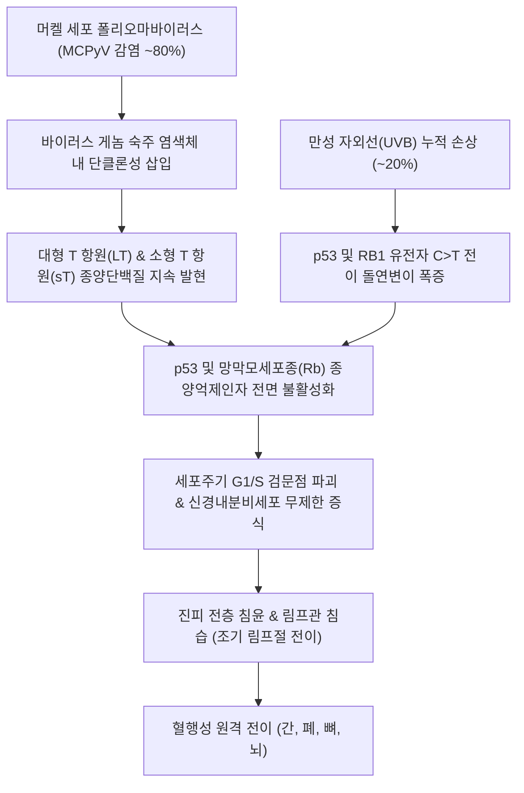

# 🩺 [[머켈 세포 암종]] (Merkel Cell Carcinoma / MCC, ICD-10: C4A)

> **핵심 3줄 요약 (Key Summary)**:
> - 📍 병소 부위 & 해부·병태생리: 피부 표피 기저층의 기계적 감각 수용 세포인 머켈 세포(Merkel cell) 또는 다능성 전구세포에서 기원하는 극히 공격적인 희귀 원발성 신경내분비 피부 악성 종양으로, 머켈 세포 폴리오마바이러스(MCPyV, 약 80%) 감염 및 만성 [[자외선]] 손상이 양대 핵심 병인.
> - 🚩 전형적 임상 양상 & 5대 AEIOU 징후: 무통성(Asymptomatic), 급속 팽창(Expanding rapidly), 면역 저하 환자(Immune suppressed), 50세 이상 고령자(Older than 50), [[자외선]] 노출 부위(UV-exposed: 두경부 및 상하지)에 발생하는 단단한 자홍색(Violaceous) 돔형 결절.
> - 🛠️ 핵심 감별 검사 & 한·양방 다각적 치료 전략: 전층 절제 생검 및 CK20 핵주위 점상(Perinuclear dot-like) 양성 확인, 감시 림프절 생검(SLNB), 광범위 국소 절제(1~2cm 안전연) 및 보조 방사선 요법, 전이성 병기 [[면역관문억제제]](아벨루맙 Avelumab, 펨브롤리주맙 Pembrolizumab), 한의 창상 치유·암 재활 요법([[탁리소독음]], [[보중익기탕]]).
> - ⚠️ 응급 의뢰 레드플래그 & 악화 요인: 단순 낭종이나 혈관종으로 오인하여 레이저나 불완전 소작술 시행 시 급속한 국소 재발과 림프절 및 전신 전이([[악성 흑색종]]의 2배 사망률)를 촉발하므로 의심 결절 발견 즉시 상급병원 피부암 센터 전원 필수.

---

## 📌 목차
1. [질환 개요 & 해부학적 병태생리](#1-질환-개요--해부학적-병태생리)
2. [병태생리 메커니즘 & 생체역학적 악순환 네트워크](#2-병태생리-메커니즘--생체역학적-악순환-네트워크)
3. [임상 증상 & 이학적 검사(Physical Exam) 알고리즘](#3-임상-증상--이학적-검사physical-exam-알고리즘)
4. [감별 진단 매트릭스 (Differential Diagnosis)](#4-감별-진단-매트릭스-differential-diagnosis)
5. [한의 통합 치료 프로토콜 (침·약침·추나·한약)](#5-한의-통합-치료-프로토콜-침약침추나한약)
6. [양방 치료 & 병용·의뢰 기준 (Conventional Treatment & Referral)](#6-양방-치료--병용의뢰-기준-conventional-treatment--referral)
7. [재활 운동 & 생활습관 티칭 가이드](#7-재활-운동--생활습관-티칭-가이드)
8. [💡 사용자 진료실 핵심 필기 & 임상 노하우 (Melt-In 잔여 심화 집약)](#8--사용자-진료실-핵심-필기--임상-노하우-melt-in-잔여-심화-집약)
9. [출처 및 학술 참고 문헌 (References)](#9-출처-및-학술-참고-문헌-references)

---

## 1. 질환 개요 & 해부학적 병태생리

* **질환 정의 및 개요**:
  * [[머켈 세포 암종]](Merkel Cell Carcinoma, MCC)은 피부 표피-진피 경계부의 기저층에 위치한 촉각 수용 신경내분비 세포인 머켈 세포(Merkel cell) 또는 모낭 상피의 다능성 줄기세포에서 기원하는 원발성 피부 신경내분비암입니다.
  * 피부 악성 종양 중 발생률은 드물지만, 국소 재발률 25~30%, 영역 림프절 전이율 50~60%, 원격 전이율 30% 이상에 달하며 [[악성 흑색종]](Melanoma)보다 약 2배 이상 높은 치명률을 보이는 매우 위험한 고등급 악성 신생물입니다.
  * 70대 전후의 고령층, 남성에서 호발하며, 만성 림프구성 백혈병, 장기이식, HIV 감염 등 만성 면역저하자에서 발병 위험이 최대 30~50배까지 급증합니다.
* **관련 해부학적 구조물**:
  * **표피 기저층(Stratum Basale)**: Aβ 유수 감각 신경섬유와 연접하여 미세 촉각을 담당하는 머켈 촉각소체(Merkel nerve ending).
  * **호발 해부학적 부위**: 두경부(Head and Neck, 약 45~50%), 상지 및 손목/수지(30%), 하지(15%), 체간축.
  * **림프 유역**: 경부 림프절, 액와 림프절, 서혜부 림프절.

---

## 2. 병태생리 메커니즘 & 생체역학적 악순환 네트워크

### 1) 이중 병인 경로 (Viral vs UV-driven Pathway)
* **바이러스 양성군(MCPyV-positive, 약 80%)**: 폴리오마바이러스의 대형 T 항원이 절단된 형태로 발현되어 숙주의 Rb 종양 억제 단백질을 차단함으로써 세포 증식을 유도합니다. 유전자 돌연변이 부담(TMB)은 매우 낮으나 바이러스 항원에 의한 면역원성을 가집니다.
* **바이러스 음성군(UV-driven, 약 20%)**: 극심한 자외선 손상으로 인해 TP53, RB1, NOTCH 유전자에 수백 개의 자외선 시그니처 돌연변이가 누적되어 발암하며, TMB가 매우 높아 면역항암제 반응성이 뛰어납니다.

### 2) 빠른 배가 시간과 침습성
* 종양 세포의 분열 속도가 매우 빨라 수 주 만에 결절 크기가 2배 이상으로 팽창하며, 진피 내 미세 림프관과 혈관을 조기에 침범하여 진단 당시 이미 미세 림프절 전이가 동반되는 경우가 흔합니다.

---

## 3. 임상 증상 & 이학적 검사(Physical Exam) 알고리즘

### 1) 5대 특징 임상 징후 (AEIOU Mnemonic)
* **A (Asymptomatic)**: 통증, 압통, 가려움이 전혀 없는 무통성 결절.
* **E (Expanding rapidly)**: 불과 1~3개월 만에 급격히 팽창하는 빠른 성장 속도.
* **I (Immune suppressed)**: 장기이식, 면역억제제 투여, 혈액암 환자 호발.
* **O (Older than 50)**: 50세 이상(평균 70대) 고령자에서 90% 이상 발생.
* **U (UV-exposed site)**: 햇빛을 직접 받는 얼굴, 이마, 목, 손등, 전완부에 붉거나 자줏빛을 띠는 매끄러운 돔형 단단한 결절.

### 2) 필수 진단 검사법
* **전층 절제 생검 및 병리조직 검사**:
  * 진피 전층을 채취하여 작은 둥근 파란 세포(Small round blue cell) 증식 확인.
* **면역조직화학염색 (IHC - 결정적 확진)**:
  * **Cytokeratin 20 (CK20) 양성**: 종양 세포질 내 핵주위 점상(Perinuclear dot-like) 발현(MCC의 90% 이상에서 나타나는 결정적 진단 표지자).
  * **Chromogranin A, Synaptophysin 양성**: 신경내분비 분화 입증.
  * **TTF-1 (Thyroid transcription factor-1) 음성**: 전이성 소세포폐암(SCLC, 대개 TTF-1 양성)과의 감별 기준.
* **감시 림프절 생검 (Sentinel Lymph Node Biopsy, SLNB)**:
  * 크기 1cm 미만의 임상적 조기 병기라도 미세 전이율이 30%에 달하므로 전원 감시 림프절 생검 필수.

---

## 4. 감별 진단 매트릭스 (Differential Diagnosis)

| 감별 질환 | 호발 연령 및 성상 | 성장 속도 및 자각증상 | 병리 및 면역조직화학염색(IHC) | 특이 감별 포인트 |
| :--- | :--- | :--- | :--- | :--- |
| **[[머켈 세포 암종]]** (본 질환) | 70대 고령자, 자외선 노출부 | **수 주 내 급속 팽창**, 무통성 결절 | **CK20 (+) 점상 발현, TTF-1 (-)** | 림프절 조기 전이 빈번, AEIOU 징후 |
| **[[기저세포암]]** (BCC) | 50대 이상, 안면부 호발 | 매우 서서히 성장 (수개월~수년) | Ber-EP4 (+), CK20 (-) | 진주빛 반투명 결절, 중심 궤양 |
| **무멜라닌성 흑색종** | 전 연령대, 자외선 노출부 | 불규칙한 팽창, 가려움/출혈 동반 | S100 (+), SOX10 (+), Melan-A (+) | 색소 결핍 홍반 결절, 비대칭성 |
| **전이성 소세포폐암** | 흡연자, 폐 종괴 선행 | 전신 쇠약, 기침, 객혈 동반 | **CK20 (-), TTF-1 (+)** | 원발성 폐암 병변 존재, CK20 음성 |
| **표피 낭종 / 혈관종** | 청장년층 흔함 | 정체되거나 매우 완만한 성장 | 양성 상피 낭종, 모세혈관 증식 | 중심 모공(Punctum), 압박 시 퇴색 |

---

## 5. 한의 통합 치료 프로토콜 (침·약침·추나·한약)

* **한의 치료의 원칙과 안전 한계**:
  * 머켈 세포 암종은 진행 속도가 치명적이므로 **종양 자체의 외과적 절제와 방사선/면역항암 치료가 1차 필수**입니다.
  * 한의 치료는 **광범위 절제 후 결손부 창상 유합 촉진, 방사선 치료 후 방사선 피부염 및 구강염 완화, 면역 증강을 통한 전이 억제 및 항암 피로 관리**를 목적으로 합니다.
* **창상 치유 및 면역 한약 치료 (Herbal Medicine)**:
  * **탁리소독음(托裏消毒飮) 가감**: 백지, [[황기]], [[당귀]], [[금은화]], 연교. 광범위 절제 수술 후 피판 형성부의 미세순환을 개선하고 육아조직 증식 촉진.
  * **보중익기탕(補中益氣湯) 합 [[십전대보탕]](十全大補湯)**: 고령 환자의 골수 억제와 암성 피로를 보익(補益)하여 [[면역관문억제제]] 투여 지속성 지원.
* **침구 치료 (Acupuncture)**:
  * **수술 봉합선 주변 위자 자침**: 0.16mm 초미세 호침으로 수술 반흔 주위를 얕게 자입하여 림프 순환을 촉진하고 섬유성 유착 완화.
  * **전신 면역 조절 경혈**: [[곡지]](LI11), [[합곡]](LI4), [[족삼리]](ST36), [[혈해]](SP10), [[삼음교]](SP6).
* **외용 요법**:
  * 수술 상처 실밥 제거 후 봉합 부위 및 방사선 조사 피부 건조증에 **[[자운고]](紫雲膏)** 도포로 피부 장벽 재생 지원.

---

## 6. 양방 치료 & 병용·의뢰 기준 (Conventional Treatment & Referral)

* **수술적 치료 (Surgical Resection)**:
  * **광범위 국소 절제술 (Wide Local Excision, WLE)**:
    * 원발 종양 변연부에서 **1~2cm의 정상 안전연(Margin)**을 확보하고 심부 근막(Deep fascia)을 포함하여 일체형 전층 절제.
  * **모즈 미세도식 수술 (Mohs Surgery)**: 안면부, 눈꺼풀 등 정상 조직 보존이 극히 중요한 부위에서 마진 음성을 현미경으로 확인하며 절제.
  * **감시 림프절 생검 (SLNB)**: 국소 절제 시 반드시 동시 시행하며, 양성 확인 시 즉시 광범위 림프절 곽청술(CLND) 또는 영역 림프절 방사선 치료로 전환.
* **방사선 치료 (Radiation Therapy)**:
  * 머켈 세포 암종은 신경내분비암 중 방사선 감수성이 매우 높은 질환으로, 원발 부위 절제 후 마진이 음성이더라도 **보조 방사선 요법(50~60Gy)**을 시행하여 국소 재발률을 60% 이상에서 10~20% 이하로 낮춤.
* **면역관문억제제 전신 요법 (Immunotherapy)**:
  * 절제 불가능한 국소 진행성 또는 전이성 MCC의 1차 표준 치료:
    * **아벨루맙([[아벨루맙]], Avelumab, 항-PD-L1 단클론항체)**: 글로벌 1차 승인 표준 약제로 10mg/kg 2주 간격 정맥 투여.
    * **펨브롤리주맙([[펨브롤리주맙]], Pembrolizumab, 항-PD-1)**: 200mg 3주 간격 투여.
* **한의 병용 판단 (Combination Therapy)**:
  * 면역항암제 투여 중인 환자에게 부정배본(扶正培本) 한약([[보중익기탕]]) 병용 시 T세포 면역 활성을 지원하고 면역 관련 부작용(irAE - 피로, 소화기 장애)을 완화.
* **양방·전문과 의뢰 기준 (Referral Criteria)**:
  * **초응급 피부암 센터 전원 (절대적 레드플래그)**: 고령자의 안면, 팔, 다리에 급속 팽창하는 무통성 붉은 결절 발견 시 당일 피부암 전문 클리닉 절제 생검 의뢰.
  * **영역 림프절 비대**: 결절과 함께 목이나 사타구니, 겨드랑이에 단단한 림프절이 만져지는 경우 즉시 상급병원 혈액종양내과/피부과 전원.

---

## 7. 재활 운동 & 생활습관 티칭 가이드

* **사계절 철저한 자외선(UV) 차단**:
  * 만성 자외선 손상이 바이러스 음성군 MCC의 직접적 발암 원인이므로 매일 자외선 차단제(SPF 50+, PA++++) 도포.
  * 외출 시 챙 넓은 모자, 선글라스, 자외선 차단 긴소매 의류 착용.
* **면역저하자 자가 피부 검진**:
  * 장기이식 수혜자, 자가면역 질환으로 면역억제제 복용 중인 환자는 매달 전신 거울을 통해 신규 피부 결절 발생 여부를 자가 관찰.
* **결절 자극 및 임의 조작 금지**:
  * 결절을 손으로 짜거나 뜯지 말 것.

---

## 8. 💡 사용자 진료실 핵심 필기 & 임상 노하우 (Melt-In 잔여 심화 집약)

### 1) 진료실 "AEIOU 징후" 3초 스크리닝 요령
* 70대 어르신이 "얼굴이나 손등에 통증도 없는 붉은 구진이 생겼는데 한 달 만에 대추알만큼 커졌다"고 찾아올 때가 있습니다.
* 이때 여드름이나 피지낭종, 단순 혈관종으로 가볍게 넘기지 마시고 머릿속으로 **AEIOU**를 떠올리십시오:
  - **A**: 아프지 않은가? (무통성)
  - **E**: 몇 주 만에 커졌는가? (급속 팽창)
  - **I**: 면역저하나 기저 혈액질환이 있는가?
  - **O**: 50세 이상인가?
  - **U**: 햇빛을 많이 받는 얼굴이나 팔인가?
* 이 5가지 중 3~4개가 일치하면 지체 없이 "어르신, 이건 살 속 깊이 퍼지는 위험한 피부 혹일 가능성이 있으니 바로 대학병원 피부과에서 조직검사를 받으셔야 합니다"라고 당일 의뢰서를 작성해 보내야 합니다.

### 2) 불완전 레이저 소작의 치명적 위험 경고
* 일부 비전문의 의원에서 "점이나 사마귀 같다"며 CO2 레이저로 윗부분만 태워버리면, 암세포가 진피 깊숙한 혈관과 림프관을 타고 전신으로 파고들어 환자를 1년 내 사망에 이르게 할 수 있습니다. 의심 결절은 절대 레이저를 대지 말고 전층 생검이 선행되어야 함을 주지해야 합니다.

### 3) 수술 및 방사선 후 림프부종 관리 팁
* 두경부나 사지 림프절 곽청술과 방사선 치료를 병행한 환자는 수술 부위 원위부에 심한 림프부종이 발생합니다.
* 이때 환측 부위에 무리한 도수치료나 침 치료를 직접 가하지 말고, 부드러운 림프 배액 마사지와 함께 [[오령산]](五苓散) 또는 방기[[황기]]탕을 투약하여 부종을 안전하게 조절해야 합니다.

---

## 9. 출처 및 학술 참고 문헌 (References)

1. Cassler NM, et al. (2025). Updates in Management of Merkel Cell Carcinoma: A Scoping Review for Surgeons. *Surg Oncol Clin N Am*. PMID: 42904505

   - [연구 요약] 머켈 세포 암종의 최신 외과적 광범위 국소 절제술(WLE), 감시 림프절 생검(SLNB)의 표준 적응증 및 보조 방사선 요법과 면역항암치료의 외과적 다학제 치료 프로토콜을 정립한 종설 논문.

2. Al-Humiany A, et al. (2025). Survival after lymph node dissection, radiotherapy, and combined treatment in sentinel node-positive stage IIIA Merkel cell carcinoma: A systematic review and meta-analysis. *J Plast Reconstr Aesthet Surg*. PMID: 42861082

   - [연구 요약] 감시 림프절 양성 3기 머켈 세포 암종 환자에서 림프절 곽청술과 방사선 병용 치료의 전반적 생존율 및 무재발 생존율 개선 효과를 검증한 메타분석 연구.

3. Devaney J, et al. (2025). Management of Merkel Cell Carcinoma of the Digits, Hand, and Wrist. *J Hand Surg Am*. PMID: 42876867

   - [연구 요약] 수지 및 수근관절 등 기능적 보존이 중요한 상지에 발생한 머켈 세포 암종의 외과적 절제 마진 확보, 미세도식 수술 및 림프절 평가 임상 가이드라인을 제시함.
