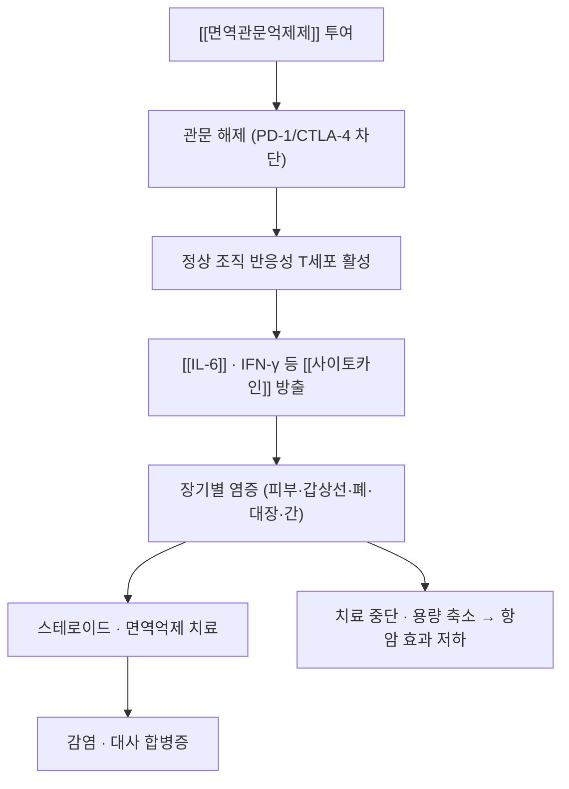

# 🩺 [[면역관련 이상반응]] (Immune-Related Adverse Event, irAE)

> **핵심 3줄 요약 (Key Summary)**:
> - 📍 **병소 부위 & 병태생리**: [[면역관문억제제]]가 종양 특이적이지 않아 정상 조직의 [[면역관문]] 축까지 해제 → T세포 매개 자가면역 유사 손상. 피부·[[갑상선염]]·폐·[[대장염]]·간·뇌하수체가 주 표적.
> - 🚩 **전형적 임상 양상**: 반구진 발진·소양감(가장 흔함), 무증상 TSH 이상, 기침·호흡곤란, 설사·혈변, ALT 상승, 두통·시야장애.
> - 🛠️ **핵심 감별 & 치료 전략**: 감염·질환 진행·한약 부작용과의 3중 감별이 핵심. Grade 2 이상은 스테로이드, Grade 3~4는 중단 + 고용량 스테로이드 + 전문과 의뢰.
> - ⚠️ **응급 의뢰 레드플래그**: 저산소·호흡곤란(폐렴), 혈변·복통(대장염), ALT 3배 초과(간염), 흉통·심계항진(심근염), 두통·시야장애(뇌하수체염).

---

## 📌 목차
1. [질환 개요 & 병태생리](#1-질환-개요--병태생리)
2. [병태생리 메커니즘 & 다계통 악순환](#2-병태생리-메커니즘--다계통-악순환)
3. [임상 증상 & 환자 소견](#3-임상-증상--환자-소견)
4. [감별 진단 매트릭스](#4-감별-진단-매트릭스)
5. [한의 통합 치료 프로토콜](#5-한의-통합-치료-프로토콜)
6. [양방 치료 & 병용·의뢰 기준](#6-양방-치료--병용의뢰-기준)
7. [식이·생활습관 & 자가관리 티칭](#7-식이생활습관--자가관리-티칭)
8. [💡 진료실 핵심 필기 & 임상 노하우](#8--진료실 핵심 필기--임상-노하우)
9. [출처 및 학술 참고 문헌 (References)](#9-출처-및-학술-참고-문헌-references)

---

## 1. 질환 개요 & 병태생리

* **정의**: [[면역관문억제제]] 투여 후 발생하는 T세포 매개 독성의 총칭. 감염·종양 진행·다른 약물 부작용으로 설명되지 않는 염증성 병변으로 정의한다.
* **분류**: 발생 시점 기준 조기(수 주 내)·지연(수개월), 기전 기준 T세포 매개·항체 매개, 중증도 기준 CTCAE Grade 1~4.
* **역학**: [[면역관문억제제]] 단독 요법에서 어느 등급이든 30~50%가 경험하고, CTLA-4 + PD-1 병용에서는 발생률과 중증도가 더 높아진다. 발생 시점 중앙값은 대개 치료 시작 후 2~3개월이나, 치료 종료 후에도 발생할 수 있다.
* **관련 장기**:
  * **주 표적**: 피부(발진·소양감), 갑상선([[갑상선염]]), 폐([[폐렴]]), 대장([[대장염]]), 간([[간염]]).
  * **내분비축**: 뇌하수체–부신–갑상선 축이 함께 무너질 수 있어, 한 개 내분비선 이상을 찾으면 나머지도 확인해야 한다.
  * **심·신경**: 심근염·중증근무력증은 드물지만 치명률이 높다.

> 🖼️ 이미지 미확보 — 대장염 내시경·간염 조직 등 세 번째 슬롯은 CC 라이선스가 확인된 자료를 구하지 못해 비웠다(가이드 §0-12: 도해 슬롯은 실사진으로 채우지 않는다).

---

## 2. 병태생리 메커니즘 & 다계통 악순환

### 1) 분자·세포 수준 기전
* 종양 항원과 정상 조직 항원의 교차반응, 그리고 말초 Treg 기능 저하가 결합해 조직 손상을 일으킨다. 장기별로 우세한 경로가 달라 — 대장염은 Th17/IL-17 축, 갑상선염은 자가항체·T세포 침윤 양상이 강하다.
* [[IL-6]]는 전신 염증 부하의 지표이자 치료 표적이다. 2025년 비소세포폐암 시험에서 [[갈근금련탕]] 병용군의 [[IL-6]]가 유의하게 감소한 것은 이 축을 겨냥한 결과로 해석된다.

### 2) 장기·계통 수준 결과
* 피부·내분비는 삶의 질을, 폐·심근은 생명을 위협한다. 내분비 irAE는 대개 비가역적이어서 호르몬 보충이 평생 필요할 수 있다.

### 3) 위험인자와 진행 단계
* 위험인자: CTLA-4 병용, 고용량, 자가면역 질환 병력, 특정 HLA·장내 미생물 구성, 기저 염증 상태.
* 진행 단계: 무증상 검사 이상 → 경증 증상 → 중등도(치료 필요) → 중증(입원·중단).

---

## 3. 임상 증상 & 환자 소견

![[면역관련이상반응_01_펨브롤리주맙_피부발진.png|440]]
> [그림 1: 펨브롤리주맙 유발 피부염의 치료 전(0주)과 15회기 체외광교환요법 후(6주) 몸통·등 발진 비교 — 피부 조직 H&E 소견 포함. 출처: PMC12311163 Fig.1 (PMID 40755883, CC BY)]

![[면역관련이상반응_02_갑상선_초음파_신티그라피.png|440]]
> [그림 2: 니볼루맙 관련 갑상선염 환자의 갑상선 초음파(B-mode·도플러 혈류)와 갑상선 신티그라피 — 갑상선종대와 섭취 저하 소견. 출처: PMC6434613 Fig.4 (PMID 30909965, CC BY)]

### 1) 주소증 및 핵심 증상
* **피부**: 반구진 발진, 소양감, 백반증 양상 변화. 가장 먼저, 가장 흔하게 나타난다.
* **내분비**: 피로·체중 증가·추위 민감(갑상선기능저하), 두통·시야장애·다음·다뇨(뇌하수체염).
* **소화기**: 하루 4회 이상 설사, 복통, 혈변.
* **호흡기**: 마른기침 → 운동 시 호흡곤란.

### 2) 객관적 소견 (Signs & Labs)
* **검사**: CBC, ALT·AST·빌리루빈, TSH·free T4, 아침 코르티솔·ACTH, Cr, 흉부 CT.
* **판정**: ALT가 기저의 3배 초과면 간염 의심, TSH 이상은 갑상선염 1차 지표.
* **영상**: 폐렴은 CT에서 간유리음영, 갑상선은 초음파 혈류 증가(그림 2).

### 3) 병기·중증도 판정
* CTCAE Grade 1: 관찰. Grade 2: 국소 치료·스테로이드 검토. Grade 3: 중단 + 고용량 [[프레드니솔론]](1~2 mg/kg). Grade 4: 영구 중단 + 입원.

---

## 4. 감별 진단 매트릭스

| 감별 질환 | 특징적 양상 | 감별 포인트 |
| :--- | :--- | :--- |
| [[면역관련 이상반응]] | 치료 시작 수 주~수개월 후, 계통 특이 증상 | 감염 배제 + 약물 시간관계 |
| 감염성 [[폐렴]] | 발열·객담·CRP 상승 | 배양·흉부 CT, 항생제 반응 |
| 항생제 연관 [[설사]] | 항생제 사용 후, 대개 점막 염증 경미 | 복용력, C. difficile 검사 |
| [[간염]] (약인성) | 한약·진통제 복용력 | 인과관계 시간표, 간기능 추적 |
| 종양 진행 | 원발 병소 악화 소견 | 영상 비교 |

> 🚩 **레드플래그**: 저산소·호흡곤란, 혈변, 황달, 흉통·심계항진, 의식 변화 — 한의원에서 먼저 만나면 즉시 응급·종양내과 의뢰.

---

## 5. 한의 통합 치료 프로토콜

* **변증 분류**:
  * **습열(濕熱)**: 발진 홍반·삼출, 설사·변비 교대, 舌紅 苔黃膩 → 청열조습.
  * **음허(陰虛)**: 피부 건조·소양, 구갈·야간 조열 → 자음윤조.
  * **기허(氣虛)**: 피로·식욕부진·연하 무력 → 보기.
  * **어혈(瘀血)**: 색소침착·경결 → 활혈.
* **침구 치료**: 발진부 직접 자침은 피하고, 건측·몸통 중심. 소양감에는 곡지·혈해·삼음교 계열, 소화기 증상에는 족삼리·중완·천추를 배혈한다.
* **약침**: 발진·삼출 부위는 감염 위험이 있어 피한다. 등·복부 배수혈 위주.
* **한약**: 습열형에 [[갈근금련탕]](PMID 40561860), 피부 건조·소양에는 청열자음 계열, 기허에는 [[사군자탕]]·[[이중탕]] 계열.
* **금기·중단**: Grade 3 이상 독성, 발열, ALT 3배 초과에서는 한약을 중단하고 담당의 판단을 우선한다.

> ⚠️ 한약은 irAE를 "치료"하는 대체 요법이 아니라, 경증·회복기 보조와 발생률 감소를 노리는 병용 전략이다.

---

## 6. 양방 치료 & 병용·의뢰 기준

* **약물 치료**:
  * Grade 1: 대증 치료(보습·항히스타민), 2~3일 간격 추적.
  * Grade 2: 국소 스테로이드 또는 [[프레드니솔론]] 0.5~1 mg/kg, 원칙적으로 ICI 유지.
  * Grade 3: ICI 중단, [[프레드니솔론]] 1~2 mg/kg, 48~72시간 반응 없으면 추가 면역억제.
  * Grade 4: 영구 중단, 입원 치료.
* **내분비 irAE**: 스테로이드가 아니라 호르몬 대체(레보티록신 등)가 원칙 — 갑상선기능저하증은 회복되지 않는 경우가 많다.
* **의뢰 기준**: 호흡곤란·저산소(호흡기), 혈변·복통(소화기), ALT 3배 초과(소화기·간), 두통·시야장애(내분비·신경).
* **한의 병용 판단**: 경증·회복기 병용 가능, Grade 3 이상 및 스테로이드 고용량기에는 중단.

---

## 7. 식이·생활습관 & 자가관리 티칭

* **피부**: 무향 보습제 하루 2~3회, 미지근한 물, 자극적 세정제 회피, 자외선 차단.
* **소화기**: 자극적 식이·음주 회피, 수분 보충, 설사 시 이온 음료.
* **자가관리**: 매주 체중·체온 기록, 새 증상 일지(발진 범위·설사 횟수·기침).
* **환자 교육 스크립트**: "이 약은 면역의 브레이크를 푸는 약이라, 정상 조직에도 염증이 생길 수 있습니다. 작은 발진이나 기침도 기록해 주시면, 등급이 올라가기 전에 조정할 수 있습니다."
* **정기 추적**: 2~3주 간격 TSH·간기능, 3개월마다 흉부 영상(폐 병력자).

---

## 8. 💡 진료실 핵심 필기 & 임상 노하우

* **실전 문진 체크리스트**: ① 약제·주기 ② 마지막 투여일 ③ 새 증상 5종(피부·갑상선·폐·장·간) ④ 최근 항생제 ⑤ 자가면역 병력.
* **치료 순서 노하우**: 한약은 점적일과 2시간 이상 분리, 점적 당일 새 처방 시작 금지(귀속 판별). 스테로이드 시작 시 한약은 유지하되 청열 위주로 단순화.
* **놓치기 쉬운 함정**: 갑상선 이상은 증상이 없어 검사로만 잡힌다. ICI 환자의 "그냥 피곤하다"는 반드시 TSH로 확인한다.
* **환자 티칭**: "한약을 끊으면 부작용이 커진다"도 "한약이 부작용을 다 막는다"도 정답이 아니다 — 등급에 따라 역할이 바뀐다는 점을 미리 설명해 둔다.

---

## 9. 출처 및 학술 참고 문헌 (References)

1. **Lu X, et al. (2025)**. *Gegen Qinlian Tablets attenuate immune-related adverse events in NSCLC patients: A multi-center randomized controlled trial in China*. **Phytomedicine**, 145:156968. [PMID 40561860](https://pubmed.ncbi.nlm.nih.gov/40561860/)
   - **[연구 요약]**: irAE 발생률 59.57% → 31.91%(p=0.007), 다계통 독성 3명 → 0명. 한약 병용이 irAE를 줄일 수 있음을 보여준 첫 다기관 RCT.
2. **Zenderowski V, et al. (2025)**. *Extracorporeal photopheresis for pembrolizumab-induced dermatitis: a case report*. **Skin Health Dis**. [PMID 40755883](https://pubmed.ncbi.nlm.nih.gov/40755883/)
   - **[연구 요약]**: 펨브롤리주맙 유발 난치성 피부염에서 체외광교환요법으로 호전된 증례 — 스테로이드 불응성 피부 irAE의 대안.
3. **Ohara N, et al. (2019)**. *Isolated adrenocorticotropic hormone deficiency and thyroiditis associated with nivolumab therapy in a patient with advanced lung adenocarcinoma*. **J Med Case Rep**. [PMID 30909965](https://pubmed.ncbi.nlm.nih.gov/30909965/)
   - **[연구 요약]**: 니볼루맙 중 갑상선염 + 단독 ACTH 결핍 동시 발생 — 내분비 irAE는 다발성으로 확인해야 함.
4. **Yoshimaru R, et al. (2026)**. *Incidence, Clinical Characteristics, Management, and Outcomes of Hematologic Immune-Related Adverse Events Associated With Immune Checkpoint Inhibitors*. **Cancer Med**. [PMID 42839531](https://pubmed.ncbi.nlm.nih.gov/42839531/)
   - **[연구 요약]**: 혈액학적 irAE의 발생률·관리·예후를 정리한 최신 연구.
5. **질병관리청 국가건강정보포털** — [링크](https://health.kdca.go.kr)
   - **[환자용 설명]**: 항암치료 부작용 일반 정보의 국내 표준 자료.
