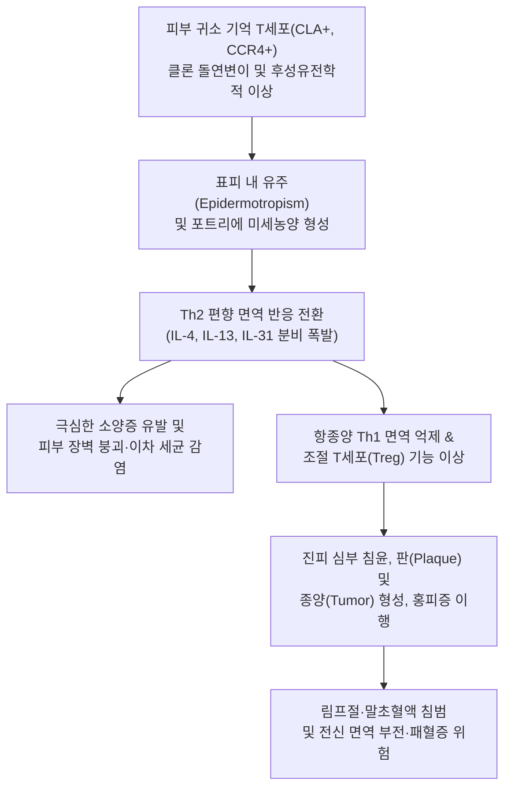
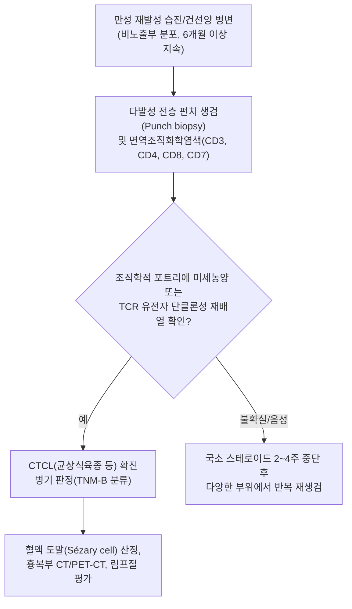

# 🩺 피부 t 세포 림프종

> **핵심 3줄 요약 (Key Summary)**:
> - 📍 병소 부위 & 해부·병태생리: 피부 표피 및 진피로 귀소(skin-homing)하는 악성 성숙 기억 보조 T세포(CD4+)의 단클론성 클론 증식 질환으로, 대표적으로 [[균상식육종]]과 전신 백혈병성 형태인 세자리 증후군(Sézary syndrome)을 포괄함.
> - 🚩 전형적 임상 양상: 초기에는 습진이나 [[건선]], [[접촉성 피부염]]과 유사한 반(Patch), 이후 침윤성 판(Plaque), 진행 시 종양(Tumor) 및 전신 박탈성 [[홍피증]], 난치성 극심한 [[소양증]] 동반.
> - 🛠️ 핵심 검사 & 치료 전략: 다발성 전층 펀치 피부 생검(다단계 병리조직학적 면역염색 CD3/CD4/CD8, T세포 수용체 유전자 재배열 TCR clonality), 말초혈액 도말(Sézary cell 산정); 조기 피부지향 치료(국소 스테로이드, 광선치료, 국소 화학요법) 및 진행기 전신 표적 치료(브렌툭시맙, 모가물리주맙).
> - ⚠️ 응급 의뢰 레드플래그: 체표면적 80% 이상의 전신 박탈성 [[홍피증]], 급격한 전신 [[림프절염]] 및 종양기 궤양성 병변 괴사, 세균성 이차 패혈증 의심, 원인 미상의 [[발열]], 급격한 체중 감소.

---

## 📌 목차
1. [질환 개요 & 해부학적 병태생리](#1-질환-개요--해부학적-병태생리)
2. [병태생리 메커니즘 & 생체역학적 악순환 네트워크](#2-병태생리-메커니즘--생체역학적-악순환-네트워크)
3. [임상 증상 & 이학적 검사(Physical Exam) 알고리즘](#3-임상-증상--이학적-검사physical-exam-알고리즘)
4. [감별 진단 매트릭스 (Differential Diagnosis)](#4-감별-진단-매트릭스--differential-diagnosis)
5. [한의 통합 치료 프로토콜 (침·약침·추나·한약)](#5-한의-통합-치료-프로토콜--침약침추나한약)
6. [양방 치료 & 병용·의뢰 기준 (Conventional Treatment & Referral)](#6-양방-치료--병용의뢰-기준-conventional-treatment--referral)
7. [재활 운동 & 생활습관 티칭 가이드](#7-재활-운동--생활습관-티칭-가이드)
8. [💡 사용자 진료실 핵심 필기 & 임상 노하우 (Melt-In 잔여 심화 집약)](#8--사용자-진료실-핵심-필기--임상-노하우--melt-in-잔여-심화-집약)
9. [출처 및 학술 참고 문헌 (References)](#9-출처-및-학술-참고-문헌--references)

---

## 1. 질환 개요 & 해부학적 병태생리

**피부 T세포 림프종(Cutaneous T-cell Lymphoma, CTCL)**은 피부에 원발성으로 발생하는 비호지킨 T세포 림프종의 일종으로, 전체 원발성 피부 림프종의 약 $75\sim 80\%$를 차지한다. 가장 흔한 아형은 악성 기억 T세포가 피부를 침윤하는 [[균상식육종]](Mycosis Fungoides, MF)이며, 전체 CTCL의 약 $50\sim 70\%$에 달한다. 또 다른 주요 아형인 세자리 증후군(Sézary syndrome)은 백혈병성 침범을 동반하며, 전신 [[홍피증]], 림프절 종대, 말초혈액 내 세자리 세포(뇌회양 핵을 가진 이형 림프구) 검출을 특징으로 하는 고위험 아형이다.

해부병태생리학적으로 피부 귀소 수용체인 CLA(Cutaneous Lymphocyte Antigen) 및 케모카인 수용체 CCR4, CCR10을 발현하는 악성 CD4+ 헬퍼 T세포가 진피 유두부와 표피 기저막을 통과하여 표피 내로 유주(Epidermotropism)한다. 표피 내부에서 악성 T세포들이 랑게르한스 세포 주변에 군집을 형성하는 포트리에 미세농양(Pautrier's microabscess)이 조직학적 결정적 특징이다. 질환이 진행되면 악성 림프구는 표피 귀소능을 상실하고 진피 깊숙이 및 피하지방층으로 침윤하며, 대세포 전환(Large cell transformation)을 거쳐 림프절, 골수 및 내부 장기로 전이된다.

---

## 2. 병태생리 메커니즘 & 생체역학적 악순환 네트워크

초기 균상식육종에서는 면역계의 Th1 반응(IFN-$\gamma$, IL-12)이 악성 T세포 클론 증식을 일정 부분 제어하나, 질환이 만성화되고 진행됨에 따라 Th2 표현형으로 전환된다. 악성 T세포 및 주변 염증세포에서 분비되는 IL-4, IL-5, IL-13, IL-31은 강력한 신경매개 소양증을 유발하고, 피부 지질 장벽 및 항균 펩타이드 분비를 저해하여 황색포도상구균 집락 형성을 촉진한다. 황색포도상구균의 장독소(Enterotoxins)는 초항원(Superantigen)으로 작용하여 악성 T세포의 TCR을 자극하고 세포 분열을 더욱 자극하는 악순환을 유도한다.

---

## 3. 임상 증상 & 이학적 검사(Physical Exam) 알고리즘

### 주요 임상 증상
- **반기 (Patch stage)**: 비노출부(둔부, 하복부, 서혜부, 대퇴부 안쪽 등 '목욕복 분포(Bathing trunk distribution)')에 주로 발생하는 비특이적 홍반성 인설성 반점. 국소 스테로이드 치료에 일시 호전되었다가 재발 반복.
- **판기 (Plaque stage)**: 홍반이 융기되어 표면이 편평하거나 굴곡진 침윤성 판을 형성. 색조는 적갈색 또는 암적색을 띠며 고리 모양(환상) 병변을 나타내기도 함.
- **종양기 (Tumor stage)**: 적갈색 내지 자갈색의 단단한 돔 모양 결절 및 종괴가 형성되며, 중심부 괴사 및 난치성 궤양, 삼출물 분비.
- **홍피증 (Erythroderma)**: 전신 체표면적의 $80\%$ 이상이 붉어지고 각질 탈락, 안면부 주름 심화로 인한 사자 얼굴(Facies leonina), 외반증, 극심한 오한 및 체온 조절 이상.
- **동반 증상**: 수면을 방해하는 극심한 [[소양증]], 손발톱 이영양증, 탈모증, 전신 [[림프절염]], 피로감.

### 단계별 진단 알고리즘

---

## 4. 감별 진단 매트릭스 (Differential Diagnosis)

| 감별 질환 | 호발 연령 및 부위 | 피부 병변 형태 | 병리조직학 및 검사 소견 | 치료 반응 및 감별점 |
| :--- | :--- | :--- | :--- | :--- |
| **피부 T세포 림프종 (CTCL)** | 50대 이상 호발, 둔부·체간 하부(비노출부) | 반(Patch) $\to$ 침윤판 $\to$ 융기 결절 종양, 심한 [[소양증]] | 표피 내 유주, 포트리에 미세농양, CD4/CD8 역전($>4:1$), TCR 단클론성 | 국소 스테로이드 단독에 불완전 반응, 서서히 진행 |
| **[[건선]] (Psoriasis)** | 20~30대 및 50대, 무릎·팔꿈치·두피(신측부) | 경계가 명확한 은백색 인설로 덮인 홍반성 판 | 착각화증, 과각화증, 문로 미세농양(중성구 침윤), 유두부 혈관 확장 | 오스피츠 징후(Auspitz sign) 양성, 광선치료 및 면역억제제에 반응 |
| **[[아토피 피부염]] (Atopic Dermatitis)** | 소아~청년기, 주관절·슬와 굴측부 | 태선화, 삼출, 가려움증, 찰상 | 표피 해면화(Spongiosis), 진피 혈관 주위 림프구 침윤 | 알레르기 소인, IgE 상승, Th2 염증, 나이 들며 호전 |
| **대판상 유건선 (Large-plaque Parapsoriasis)** | 중장년층, 둔부 및 체간 | $5\text{ cm}$ 이상의 담홍색·갈색의 얇은 위축성 반 | 경미한 표피 내 림프구 침윤, TCR 단클론성 종종 동반 | CTCL의 전암 병변으로 간주되며 장기 추적 관찰 필수 |
| **[[접촉성 피부염]] (Contact Dermatitis)** | 전 연령, 항원 노출 국소 부위 | 급성 수포, 홍반, 부종, 진물 | 뚜렷한 표피 해면화 및 단핵구 침윤 | 원인 항원 제거 시 급속 호전, 첩포 검사 양성 |

---

## 5. 한의 통합 치료 프로토콜 (침·약침·추나·한약)

> ⚠️ 한의 치료의 목적은 원발성 림프종의 완치가 아니며, 항암 광선치료 및 전신 요법 중 발생하는 극심한 피부 건조, 열감, 난치성 [[소양증]], 림프 순환 장애 및 전신 피로를 완화하는 지지요법(Supportive care)으로 한정한다.

### 1) 한약 처방 (변증 기반 지지요법)
- **혈열풍조증 (血熱風燥證 - 초기 극심한 소양증, 홍반, 피부 작열감)**:
  - 처방: [[황련해독탕]] 또는 [[온청음]](생지황, 당귀, 백작약, 천궁, 황련, 황금, 황백, 치자) 가감.
  - 약리 기전: [[황련]]의 베르베린(Berberine), [[황금]]의 바이칼린(Baicalin)이 NF-$\kappa$B 경로를 억제하여 전염증성 사이토카인 억제 및 피부 미세순환 염증 진정.
- **혈허풍조증 (血虛風燥證 - 판기 만성화, 태선화, 피부 박탈 및 건조)**:
  - 처방: [[당귀음자]] 또는 소풍산 합 [[사물탕]] 가감 ([[당귀]], [[숙지황]], [[백작약]], [[천궁]], 백질려, 방풍, 형개, 감초).
  - 작용: 진피 결합조직 보습 인자 강화, 신경인성 가려움증 완화.
- **기혈양허 및 어독증 (氣血兩虛 瘀毒證 - 진행기 종양 괴사, 면역 저하, 전신 쇠약)**:
  - 처방: [[십전대보탕]] 합 [[보중익기탕]] 가감 ([[황기]], [[인삼]], [[백출]], [[복령]], [[당귀]], 금은화, 연교).
  - 목적: 면역 감시 세포 활성화, 항암화학요법 부작용에 따른 호중구 감소 완화 및 전신 피로 개선.

### 2) 침구 치료
- **혈위**: 곡지(LI11), 혈해(SP10), 삼음교(SP6), 합곡(LI4), 족삼리(ST36), 풍시(GB31).
- **자침 기법**: 피부 병변 부위 직접 자침은 감염 위험으로 절대 금기. 원격 혈위 위주로 직자하여 염증 매개물질 억제 및 중추 가려움 억제 자극.

---

## 6. 양방 치료 & 병용·의뢰 기준 (Conventional Treatment & Referral)

### 양방 표준 치료 가이드라인 (EORTC/NCCN)
1. **피부 지향 치료 (Skin-directed therapy, 조기 IA~IIA기)**:
   - 국소 고역가 스테로이드(Clobetasol propionate 등).
   - 광선치료: 협대역 자외선 B(NB-UVB, 반기), 광화학요법(PUVA, 판기).
   - 국소 화학요법: 메클로레타민(Mechlorethamine gel), 벡사로텐(Bexarotene gel).
   - 방사선 치료: 국소 전자선 치료 또는 전신 피부 전자선 조사(Total skin electron beam therapy, TSEBT).
2. **전신 치료 (Systemic therapy, 진행기 IIB~IV기)**:
   - 생물학적 제제: 인터페론 알파(IFN-$\alpha$), 렉시노이드계 벡사로텐(Bexarotene oral).
   - 표적 단클론 항체: 브렌툭시맙 베도틴(Brentuximab vedotin - CD30 표적), 모가물리주맙(Mogamulizumab - CCR4 표적).
   - 전신 세포독성 항암제 및 조혈모세포이식(동종/자가).

### 긴급 응급 의뢰 레드플래그
- 체표면적의 $80\%$ 이상을 침범하는 급격한 전신 [[홍피증]] 및 체온 조절 부전.
- 종양 병변의 급속한 중심부 괴사, 농양 형성 및 패혈증 징후(빈맥, 저혈압, 고열).
- 림프절의 급격한 무통성 고정성 종대(단축경 $>1.5\text{ cm}$) 및 체중 감소, 야간 발한.

---

## 7. 재활 운동 & 생활습관 티칭 가이드

- **피부 장벽 보호 및 보습 티칭**: 미온수로 가볍게 샤워(10분 이내)하고 때를 밀거나 거친 타월 사용을 엄격히 금지함. 샤워 직후 3분 이내에 무향료·세라마이드 성분의 저자극성 보습제를 전신에 도포함.
- **소양증 긁기 방지 프로토콜**: 손톱을 항상 짧고 둥글게 유지하며, 수면 중 무의식적 긁기로 인한 상처를 방지하기 위해 얇은 면장갑을 착용함.
- **광선 감작 및 자외선 관리**: 광선치료나 약물 복용 중인 경우 광과민 반응이 발생할 수 있으므로, 외출 시 챙이 넓은 모자, 긴 소매 옷을 착용하고 무기자차 자외선 차단제를 사용함.
- **감염 모니터링**: 병변 부위에 삼출물이 늘거나 노란색 딱지가 형성되는 경우 포도상구균 감염의 신호이므로 즉시 의료진에게 알리도록 교육함.

---

## 8. 💡 사용자 진료실 핵심 필기 & 임상 노하우 (Melt-In 잔여 심화 집약)

> 💡 **임상 핵심 진주 (Clinical Pearls)**:
> - **'난치성 습진'의 가면을 벗겨라**: 성인 후반기에 처음 발생하여 일반적인 항히스타민제나 약한 국소 스테로이드에 6개월 이상 반응하지 않는 건선양·습진양 반점은 반드시 CTCL을 의심하고 피부 펀치 생검을 의뢰해야 한다.
> - **목욕복(Bathing trunk) 분포 법칙**: 햇빛을 받지 않는 둔부, 서혜부, 허벅지 안쪽에 호발하는 특징이 있으며, 이는 광선에 노출되는 부위에 호발하는 일광피부염이나 심상성 건선과의 중요한 육안적 감별점이다.
> - **조직 검사의 함정**: 초기 균상식육종은 1회의 생검으로 진단되지 않는 경우가 흔하며(위음성률 높음), 국소 스테로이드 연고를 사용 중이면 염증 세포가 억제되어 위음성이 나오므로 최소 2~4주간 외용제를 중단한 상태에서 다발성 생검을 시행해야 확진율을 높일 수 있다.
> - **한방 진료실에서의 안전 수칙**: 침 치료 시 피부 병변 위에는 침이나 뜸, 부항을 절대 적용해서는 안 되며, 전신 피부 감염 및 2차 세균 전파를 막기 위해 철저한 무균 시술과 원격 취혈 원칙을 준수해야 한다.

---

## 9. 출처 및 학술 참고 문헌 (References)

- Möhren J, et al. (2026). Skin and Mucosal Manifestations in Cancer Therapies. *Dtsch Arztebl Int*. PMID: 42927803.

- Zheng S, et al. (2026). Immune Responses and the Clinical Significance of Regulatory T Cells in Mycosis Fungoides and Sézary Syndrome. *Dermatol Ther (Heidelb)*. PMID: 42924490.

- Stadler R, et al. (2026). When response lasts: ORR4 as an On-Treatment Prognostic Marker in Mogamulizumab-Treated Mycosis Fungoides and Sézary Syndrome. *Br J Dermatol*. PMID: 42888927.
