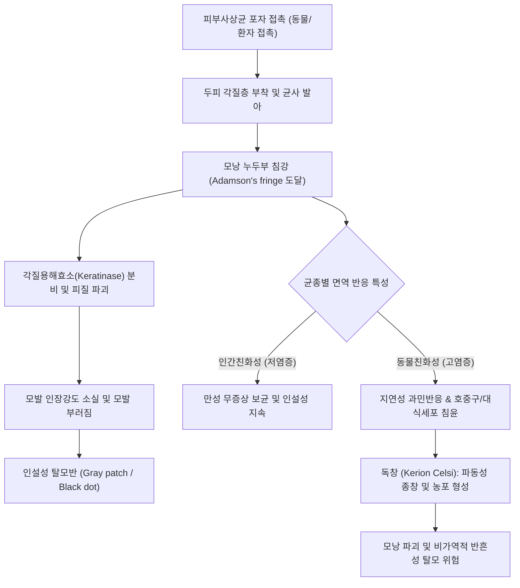

# 🩺 두피 도장부스럼 두피 백선 (Tinea Capitis)

> **핵심 3줄 요약 (Key Summary)**:
> - 📍 병소 부위 & 해부·병태생리: 피부사상균(Dermatophytes, 주로 *Microsporum canis*, *Trichophyton tonsurans*, *Trichophyton violaceum*)이 두피의 각질층(stratum corneum)과 모낭(hair follicle)으로 침범하여 모간(hair shaft) 내부(내모균형, endothrix) 또는 모간 표면(외모균형, ectothrix)을 각질용해효소(keratinase)로 파괴함으로써 모발 절단 및 염증 반응을 일으키는 천재성 진균 감염 질환.
> - 🚩 전형적 임상 양상: 주로 학령기 이전 및 학령기 소아(3~10세)에서 호발하며, 두피의 경계가 명확한 인설성 탈모반(gray-patch 또는 black-dot), 모발 부러짐, 소양증을 보임. 지연성 과민반응에 의해 고름집과 육아종성 종창을 동반하는 심한 염증성 반응인 독창([[Kerion celsi]])으로 급격히 악화될 수 있음.
> - 🛠️ 핵심 검사 & 치료 전략: 10~20% [[KOH 도말 검사]](모발 내·외 포자 관찰), 우드등(Wood's lamp) 검사(*M. canis* 등 외모균 감염 시 밝은 녹색 형광 발현), 진균 배양검사(Dermatophyte Test Medium). **국소 항진균제 단독 치료는 절대 불가**하며, 모낭 심부 도달을 위해 경구 [[그리세오풀빈]](Griseofulvin) 또는 경구 [[테르비나핀]](Terbinafine) 전신 투여가 필수적임.
> - ⚠️ 응급 의뢰 레드플래그: 두피에 광범위한 파동성 종창, 통증, 농포 및 미만성 삼출물을 형성하는 독창([[Kerion celsi]]) 발생 시 영구적 반흔성 탈모(cicatricial alopecia) 예방을 위해 즉시 경구 전신 항진균제 및 단기 경구 코르티코스테로이드 병용 요법 또는 상급 피부과 응급 의뢰.

---

## 📌 목차
1. [질환 개요 & 해부학적 병태생리](#1--질환-개요---해부학적-병태생리)
2. [병태생리 메커니즘 & 생체역학적 악순환 네트워크](#2--병태생리-메커니즘---생체역학적-악순환-네트워크)
3. [임상 증상 & 이학적 검사(Physical Exam) 알고리즘](#3--임상-증상---이학적-검사physical-exam-알고리즘)
4. [진단 검사 & 감별 진단 패널](#4--진단-검사---감별-진단-패널)
5. [양방 치료 프로토콜 & 약물 상호작용](#5--양방-치료-프로토콜---약물-상호작용)
6. [한의 기능의학적 치료 프로토콜](#6--한의-기능의학적-치료-프로토콜)
7. [재활 운동 & 생활습관 티칭 가이드](#7--재활-운동---생활습관-티칭-가이드)
8. [💡 사용자 진료실 핵심 필기 & 임상 노하우 (Melt-In 잔여 심화 집약)](#8--사용자-진료실-핵심-필기---임상-노하우-melt-in-잔여-심화-집약)
9. [출처 및 학술 참고 문헌 (References)](#9--출처-및-학술-참고-문헌-references)

---

## 1. 질환 개요 & 해부학적 병태생리

### 1) 정의 및 역학
두피 도장부스럼(두피 백선, Tinea Capitis)은 피부사상균에 의해 두피 모발과 모낭, 그리고 주변 두피 각질층에 발생하는 표재성 진균 감염증이다. 과거에는 '백선(Ringworm)' 또는 '도장부스럼'으로 불렸으며, 주로 피지 분비가 활성화되지 않은 3세에서 10세 사이의 소아에서 가장 빈번하게 발생한다. 사춘기 이후에는 피지선에서 분비되는 유리지방산(피지산, undecylenic acid 등)의 천연 항진균 활성으로 인해 발병률이 급격히 감소한다. 전 세계적으로 발생하며, 반려동물(고양이, 개)과의 접촉을 통한 동물친화성 균주(*Microsporum canis*) 감염과 학교·유치원 등 집단생활 환경에서의 사람친화성 균주(*Trichophyton tonsurans*, *Trichophyton violaceum*) 접촉을 통해 전파된다.

### 2) 모낭 침범 형태별 해부학적 분류
진균이 모간(hair shaft)을 침범하는 해부학적 양상에 따라 크게 세 가지로 분류된다:
- **외모균형(Ectothrix infection)**: 균사가 모간 내부로 진입한 후 다시 모간 표면으로 빠져나와 큐티클(cuticle)을 파괴하고, 모간 외부에 분절포자(arthroconidia)의 외피를 형성한다. 대표적으로 *Microsporum canis*, *M. audouinii*가 해당하며, 모발이 두피 상부 2~4mm 지점에서 부러져 회색 인설성 탈모반(gray-patch)을 형성한다.
- **내모균형(Endothrix infection)**: 균사가 큐티클 손상 없이 모간 피질 내부로만 침투하여 증식하며, 모간 내부 전체가 포자로 꽉 차게 된다. 대표적으로 *Trichophyton tonsurans*, *T. violaceum*이 해당한다. 모발이 취약해져 두피 표면 높이에서 부러지므로 모낭 입구에 박힌 연필심 모양의 흑점(black dots) 양상을 띤다.
- **황선형(Favus)**: *Trichophyton schoenleinii*에 의해 유발되며, 모발 내부에 균사와 기포가 관찰되고 모낭 주위에 유황색의 함몰된 딱지(scutula)를 형성하여 심한 악취와 영구 반흔성 탈모를 유발한다.

---

## 2. 병태생리 메커니즘 & 생체역학적 악순환 네트워크

### 1) 모낭 침투 및 각질 분해 과정
1. **각질 부착 및 발아**: 피부사상균의 포자가 미세 손상된 두피 각질층에 부착한 후, 발아하여 균사를 뻗어 나간다.
2. **모낭 누두부 침강**: 균사는 모낭 누두부(infundibulum)를 따라 아래로 증식하여 모구(hair bulb) 상방의 각질화 형성대(Adamson's fringe)까지 하강한다. 생세포로 구성된 모구 자체는 면역 방어 기전으로 인해 침범하지 못하고, 각질화가 일어나는 상부 모간 피질을 집중적으로 침식한다.
3. **각질용해효소(Keratinases, Subtilisins) 분비**: 진균 유래 단백질 분해효소가 모발 피질의 이황화 결합(disulfide bond)과 케라틴 섬유망을 와해시켜 모발의 인장 강도를 급격히 저하시킨다.

### 2) 숙주 면역반응과 독창(Kerion) 형성 기전
- **비염증성 반응**: 주로 *T. tonsurans*나 *M. audouinii* 같은 인간친화성 균종 감염 시, 숙주 면역계가 진균을 효과적으로 인지하지 못하여 염증 반응이 미미하고 만성 인설성 병변이 지속된다.
- **염증성 반응 및 독창([[Kerion celsi]])**: *M. canis*나 *T. mentagrophytes* 같은 동물친화성 또는 토양친화성 균종에 노출 시, 진균 항원에 대한 숙주의 세포매개성 면역(Th1 세포 및 Th17 세포 반응) 및 지연성 과민반응(Type IV hypersensitivity)이 격렬하게 활성화된다. 대식세포와 호중구가 모낭 주위로 대량 침윤하여 농포와 육아종성 부종을 형성하고, 모낭 파괴와 2차성 세균 감염이 동반되면서 벌집 모양의 압통성 종창(Kerion)으로 발전한다.

---

## 3. 임상 증상 & 이학적 검사(Physical Exam) 알고리즘

### 1) 대표적 임상 아형
- **회색반형(Gray-patch tinea)**: 두피에 경계가 명확한 원형 또는 타원형의 은백색 인설반이 형성되며, 병변 내 모발이 두피 2~3mm 상부에서 부러져 광택을 잃고 잿빛으로 보인다. 가려움증은 경미함.
- **흑점형(Black-dot tinea)**: 다발성의 작은 탈모반 내에 부러진 모발 잔여물이 모공 속에 박혀 있어 마치 피부에 박힌 흑점처럼 보이며, 흉터나 위축은 초기에는 없다.
- **독창형(Kerion celsi)**: 융기되고 부드러운 파동성의 종창성 병변으로, 표면에 다수의 모낭성 농포와 진물이 관찰된다. 심한 압통과 함께 후두부 및 경부 림프절 비대([[림프절 병증]])가 동반된다.
- **미만성 비듬형(Diffuse seborrheic pattern)**: 탈모는 뚜렷하지 않고 두피 전체에 광범위한 비듬과 인설만 관찰되어 지루성 피부염으로 오진되기 쉽다.

### 2) 이학적 검사 알고리즘
1. **육안 및 확대경(Dermoscopy/Trichoscopy) 검사**:
   - 코마 모발(Comma hair), 코르크마개 모발(Corkscrew hair), 모스 부호 모발(Morse-code hair), 지그재그 모발(Zigzag hair) 등 진균 감염 특이적 모발 변형 확인.
2. **모발 견인 검사(Hair pull test)**: 병변 경계부 모발을 가볍게 당겨 통증 없이 쉽게 뽑히는지 확인(활동성 감염 지표).
3. **경부 림프절 촉진**: 후두부(occipital) 및 후이개(postauricular) 림프절의 압통성 종대 유무 확인 (염증성 백선의 강력한 임상 단서).

---

## 4. 진단 검사 & 감별 진단 패널

### 1) 확진 검사 프로토콜
- **우드등 검사(Wood's lamp examination)**:
  - *Microsporum* 계열 감염 모발에 암실에서 자외선(파장 365nm)을 조사하면 프테리딘(pteridine) 대사산물로 인해 밝은 황록색(bright green-yellow) 형광을 띰.
  - 주의: *Trichophyton* 계열(*T. tonsurans*)은 형광을 띠지 않으므로 형광 음성이라고 해서 두피 백선을 배제할 수 없음.
- **10~20% [[KOH 도말 검사]]**:
  - 병변 부위의 부러진 모발과 두피 인설을 핀셋과 메스로 채취하여 슬라이드 글라스에 놓고 10~20% KOH 용액을 떨어뜨린 후 가온하여 현미경 관찰.
  - 모간 외부를 둘러싼 분절포자(외모균) 또는 모간 내부를 채운 포자 연쇄(내모균)를 즉각 확인.
- **진균 배양(Fungal culture)**:
  - Sabouraud 포도당 한천 배지(SDA) 또는 DTM(Dermatophyte test medium)에 접종하여 2~4주간 실온 배양. 균종 동정 및 역학 추적.

### 2) 감별 진단 패널
| 질환명 | 호발 연령 및 양상 | 임상 및 검사 감별점 |
| :--- | :--- | :--- |
| **[[원형 탈모증]] (Alopecia areata)** | 소아~성인 전 연령 | 인설이 전혀 없음, 경계부 감탄부호 모발(Exclamation mark hair), KOH 검사 음성, 림프절 종대 없음 |
| **지루성 피부염 (Seborrheic dermatitis)** | 영아기 또는 사춘기 이후 | 두피 전반의 황색 기름진 인설, 뚜렷한 탈모반 형성 없음, 모발 부러짐 없음, KOH 음성 |
| **두피 건선 (Scalp psoriasis)** | 청소년~성인 | 두껍고 은백색의 판상 인설, 탈모는 드묾, 팔꿈치/무릎/손발톱 등 타 부위 병변 동반 |
| **발모벽 (Trichotillomania)** | 스트레스 받는 학령기 소아 | 다양한 길이로 부러진 불규칙한 탈모반, 두피 인설이나 홍반 없음, 두피 감각 정상 |
| **세균성 모낭염 / 조모종(Carbuncle)** | 전 연령 | 황색포도상구균 감염, 급성 압통성 농포, 그람염색 양성, 항생제 반응 |

---

## 5. 양방 치료 프로토콜 & 약물 상호작용

### 1) 전신 경구 항진균제 (치료의 핵심)
> ⚠️ **원칙**: 두피 백선은 연고나 크림 등 국소 항진균제만으로는 모낭 심부의 모근까지 침투하지 못하므로 완치가 불가능하다. 반드시 **경구 전신 항진균제**를 최소 4~8주간 복용해야 한다.

- **1차 선택 약제**:
  - **[[그리세오풀빈]](Griseofulvin, 미세결정형)**: 
    - 용량: 소아 20~25 mg/kg/day (최대 1g/day), 1일 1~2회 분복.
    - 투여 기간: 6~8주 (임상적·진균학적 완치 후 2주 추가 복용).
    - 복용법: 지방 함유 음식(우유, 아이스크림)과 함께 복용 시 흡수율 2배 이상 증가. *Microsporum* 감염에 특히 효과적.
  - **[[테르비나핀]](Terbinafine)**:
    - 용량 (체중 기준): < 20 kg: 62.5 mg/day; 20~40 kg: 125 mg/day; > 40 kg: 250 mg/day.
    - 투여 기간: 2~4주 (*Trichophyton* 감염 시 1차 선택제).
- **2차 대체 약제**:
  - **[[이트라코나졸]](Itraconazole)**: 3~5 mg/kg/day 4~6주 연속 복용 또는 펄스 요법.
  - **[[플루코나졸]](Fluconazole)**: 6 mg/kg/day 3~6주 투여.

### 2) 보조 국소 요법 및 염증 조절
- **약용 샴푸 병용**: 2% [[케토코나졸]](Ketoconazole) 샴푸 또는 1~2.5% 황화셀레늄(Selenium sulfide) 샴푸를 주 2~3회 사용하여 두피 표면의 생존 포자 탈락을 억제하고 타인으로의 전파를 차단함.
- **독창(Kerion) 동반 시**: 영구 반흔 형성을 방지하기 위해 경구 [[프레드니솔론]](Prednisolone, 0.5~1 mg/kg/day)을 항진균제 치료 시작 첫 1~2주간 단기 병용.

---

## 6. 한의 기능의학적 치료 프로토콜

### 1) 변증 분형 (TCM Differentiation)
한의학에서 두피 백선은 [[백독창]](白禿瘡, Gray patch), [[비창]](肥瘡, Favus)의 범주에 속하며, [[풍열습독]](風熱濕毒)이 외감하여 기혈(氣血)을 응체시키거나 장기화되어 [[혈허풍조]](血虛風燥)로 모발 영양이 부실해진 병태로 변증한다.

| 변증 | 전형적 증상 | 설태 및 맥상 | 대표 처방 |
| :--- | :--- | :--- | :--- |
| **풍열습독형 (風熱濕毒型)** | 두피 홍반, 삼출물, 미란, 황색 가피, 심한 소양증, 독창 초기 | 설홍 태황니(黃膩), 맥활삭(滑數) | [[소풍산]] 합 [[비해분청음]] 가감 |
| **열독치盛형 (熱毒熾盛型)** | 국소 파동성 종창(독창), 심한 압통, 농포 형성, 경부 림프절 종창 | 설홍 태황후(黃厚), 맥현삭(弦數) | [[오미소독음]] 합 [[황련해독탕]] |
| **혈허풍조형 (血虛風燥型)** | 만성 건조성 탈모반, 백색 인설, 모발 건조 및 조기 탈락, 완고한 가려움 | 설담 태박백(薄白), 맥세약(細弱) | [[당귀음자]] 합 [[육미지황탕]] |

### 2) 침구 치료 혈위
- **두피 국소 기혈 순환 및 염증 완화**: 탈모반 주위 사자(斜刺) 침치료(위침법), [[백회]](GV20), [[풍지]](GB20), [[두유]](ST8), [[태양]](EX-HN5).
- **청열해독 및 구풍지양**: [[곡지]](LI11), [[합곡]](LI4), [[혈해]](SP10), [[대추]](GV14).
- **외용 한약 세정제**: [[고삼]], [[백선피]], [[황백]], [[사상자]] 각 20g을 전탕한 약액으로 두피를 1일 1회 세정하여 국소 항진균 및 소양 완화 유도.

---

## 7. 재활 운동 & 생활습관 티칭 가이드

- **가족 및 집단 내 교차 감염 차단**: 모자, 빗, 수건, 베개, 이발기구의 공동 사용을 엄격히 금지. 사용한 침구와 모자는 60℃ 이상 온수로 세탁하고 고온 건조.
- **반려동물 스크리닝**: 가정 내 키우는 고양이, 개에 대해 수의과적 진균 검사 및 치료 필수 (치료되지 않은 반려동물은 지속적인 재감염의 온상).
- **환아 격리 및 학교 출석**: 적절한 전신 항진균제 복용 및 약용 샴푸 사용 시작 2주 후부터는 전파력이 급격히 감소하므로 무조건적인 등교 중단은 불필요하나, 신체 접촉 운동은 제한.
- **모발 위생 관리**: 머리를 감은 후 두피를 젖은 상태로 방치하지 말고 드라이어 냉풍으로 모근까지 완전히 건조 유지.

---

## 8. 💡 사용자 진료실 핵심 필기 & 임상 노하우 (Melt-In 잔여 심화 집약)

- **소아 탈모반에서 "원형 탈모"로 오진하는 치명적 함정**:
  - 소아 환자가 두피에 동그란 탈모를 주소로 내원했을 때, 원형 탈모로 지레짐작하고 스테로이드 연고(도모베이트 등)를 처방하면 진균 증식이 폭발적으로 일어나 독창(Kerion)으로 악화된다(잠행 백선, Tinea incognito).
  - 감별의 핵심은 **"인설(Scale)"과 "부러진 모발"**이다. 원형 탈모는 두피가 매끈하고 인설이 전혀 없지만, 백선은 반드시 하얀 비듬 같은 인설이 덮여 있고 모발이 중간에서 뚝뚝 부러져 있다.
- **연고만 주어서는 절대 낫지 않는다**:
  - 피부 백선과 달리 두피 백선은 균사가 모낭 깊숙한 곳(Adamson's fringe)까지 침투해 있으므로, 아무리 강력한 항진균 연고를 발라도 흡수되지 않는다. 환자 보호자에게 "이 병은 반드시 먹는 약을 최소 한두 달 먹어야 털이 다시 난다"고 설명하고 복약 순응도를 확보해야 한다.
- **독창(Kerion)을 세균성 농양으로 오인하여 째지 말 것**:
  - 꿀렁거리는 파동성 종창을 보고 절개배농(I&D)을 시행하면 안 된다. 이것은 고름이 고인 단순 세균 농양이 아니라 진균 항원에 대한 극심한 면역 반응 덩어리이므로, 칼을 대면 흉터만 더 커지고 영구 탈모가 남는다. 전신 항진균제와 단기 스테로이드 경구 투여로 가라앉혀야 한다.

---

## 9. 출처 및 학술 참고 문헌 (References)

- Hay, R. J. (2017). Tinea Capitis: Current Status. *Mycopathologia*. PMID: 27599708.

- Mayser, P., et al. (2026). Consensus-based Guideline on tinea capitis. *J Dtsch Dermatol Ges*. PMID: 42444404.

- 대한피부과학회. (2020). *피부과학 (제7판)*. 도서출판 대한의학.

- 대한소아청소년과학회. (2020). *소아청소년과학 (제12판)*. 학지사메디컬.

- 한방안이비인후피부과학회. (2021). *한의피부외과학*. 도서출판 정담.

---

## 관련 노트

- [[체부 백선]]
- [[원형 탈모증]]
- [[지루성 피부염]]
- [[그리세오풀빈]]
- [[테르비나핀]]
- [[소풍산]]
