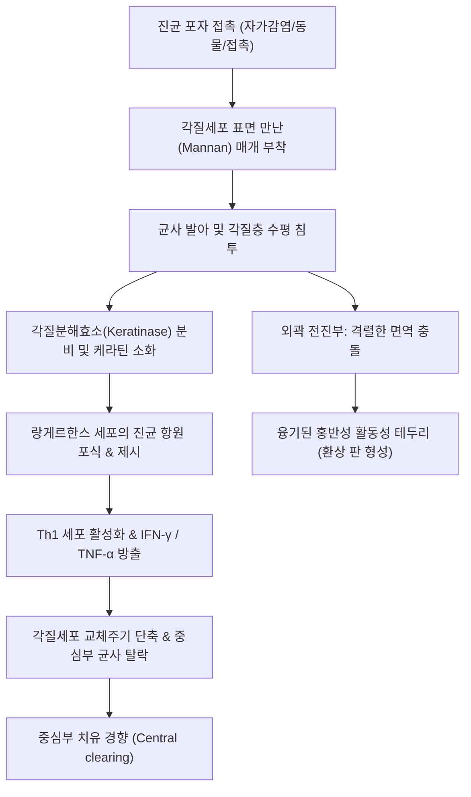

# 🩺 몸 도장부스럼 체부 백선 (Tinea Corporis)

> **핵심 3줄 요약 (Key Summary)**:
> - 📍 병소 부위 & 해부·병태생리: 피부사상균(Dermatophytes, 주로 *Trichophyton rubrum*, *Trichophyton mentagrophytes*, *Microsporum canis*)이 두피, 수염, 안면, 손발 및 서혜부를 제외한 몸통, 체간(trunk) 및 사지(extremities)의 각질층(stratum corneum)에 감염되어 원심성(centrifugal)으로 퍼지며 융기된 활동성 경계와 중심부 치유 경향을 보이는 윤상(ring-shaped) 환상 병변을 형성하는 표재성 진균 질환.
> - 🚩 전형적 임상 양상: 융기된 구진, 소수포, 인설로 둘러싸인 경계가 명확한 고리 모양(환상, annular)의 홍반성 판(plaque), 중심부 소퇴(central clearing) 및 색소침착, 중등도 이상의 가려움증(pruritus).
> - 🛠️ 핵심 검사 & 치료 전략: 병변 활동성 경계부 인설을 채취한 10~20% [[KOH 도말 검사]](분절된 균사 및 관절포자 확인). 국소 항진균제([[테르비나핀]] 1% 크림, [[클로트리마졸]] 1% 크림 등 1일 1~2회, 병변 소실 후 1~2주간 추가 도포). 광범위 병변, 면역저하자, 또는 국소 치료 실패 시 경구 항진균제([[테르비나핀]], [[이트라코나졸]]) 2~4주 전신 투여.
> - ⚠️ 응급 의뢰 레드플래그: 스테로이드 오용으로 인해 경계가 무너지고 모낭염/농포가 동반되는 잠행 백선(Tinea incognito)의 광범위 파급, 심한 2차 세균 감염(봉와직염, 림프관염) 동반 시 즉시 전신 항생제 병용 및 피부과 전문 진료 의뢰.

---

## 📌 목차
1. [질환 개요 & 해부학적 병태생리](#1--질환-개요---해부학적-병태생리)
2. [병태생리 메커니즘 & 생체역학적 악순환 네트워크](#2--병태생리-메커니즘---생체역학적-악순환-네트워크)
3. [임상 증상 & 이학적 검사(Physical Exam) 알고리즘](#3--임상-증상---이학적-검사physical-exam-알고리즘)
4. [진단 검사 & 감별 진단 패널](#4--진단-검사---감별-진단-패널)
5. [양방 치료 프로토콜 & 약물 상호작용](#5--양방-치료-프로토콜---약물-상호작용)
6. [한의 기능의학적 치료 프로토콜](#6--한의-기능의학적-치료-프로토콜)
7. [재활 운동 & 생활습관 티칭 가이드](#7--재활-운동---생활습관-티칭-가이드)
8. [💡 사용자 진료실 핵심 필기 & 임상 노하우 (Melt-In 잔여 심화 집약)](#8--사용자-진료실-핵심-필기---임상-노하우-melt-in-잔여-심화-집약)
9. [출처 및 학술 참고 문헌 (References)](#9--출처-및-학술-참고-문헌-references)

---

## 1. 질환 개요 & 해부학적 병태생리

### 1) 정의 및 역학
몸 도장부스럼(체부 백선, Tinea Corporis)은 머리(두피), 수염, 얼굴, 손, 발, 사타구니를 제외한 몸통과 팔다리의 평활 피부(glabrous skin)에 피부사상균이 침범하여 발생하는 표재성 곰팡이 감염증이다. 고리 모양의 도장 찍힌 형태를 닮았다고 하여 전통적으로 '도장부스럼(Ringworm)'으로 불려왔다. 전 연령층에서 흔히 발병하며, 덥고 습한 기후, 밀착된 의복 착용, 다한증 환자, 레슬링 등 신체 접촉 운동 선수(Tinea corporis gladiatorum), 반려동물 사육 가구에서 빈발한다. 가장 흔한 원인균은 *Trichophyton rubrum*(인간친화성)이며, 그 외에 *Trichophyton mentagrophytes*, *Microsporum canis*(동물친화성)가 주요 원인이다.

### 2) 표재성 피부 각질층의 해부학적 구조와 진균 증식
- **각질층(Stratum corneum)**: 피부사상균은 살아있는 표피 생세포층(유극층, 기저층)이나 진피로는 침투하지 못하고, 오직 무생체 각질화 세포(corneocytes)의 케라틴(keratin)을 영양원으로 삼아 각질층 내에서만 수평 방향으로 증식한다.
- **원심성 확산과 중심부 소퇴**: 진균은 최초 접종 부위에서 바깥쪽으로 방사형(원심성)으로 퍼져나간다. 중심부는 국소 면역 반응에 의한 각질 탈락 속도 증가와 염증 매개물질 방출로 진균 밀도가 급격히 감소하면서 치유되는 양상을 띠고, 균사의 활발한 증식은 외곽 경계부에서 집중적으로 일어난다.

---

## 2. 병태생리 메커니즘 & 생체역학적 악순환 네트워크

### 1) 케라틴 분해 효소와 각질층 침식
피부사상균은 만난(mannan) 당단백질 성분을 통해 각질세포 표면 수용체에 부착한다. 부착된 균사는 세린 단백질 분해효소(Serine proteases), 메탈로프로테아제(Metalloproteases) 및 아황산염 유출 펌프를 통해 케라틴의 단단한 이황화 결합을 환원 분해하여 펩타이드와 아미노산 형태로 흡수한다. 진균 세포벽 성분인 만난은 국소 림프구 증식을 억제하고 각질세포 분열을 둔화시켜 초기 감염의 정착을 돕는다.

### 2) 지연성 과민반응(DTH)과 환상 병변의 역학
각질층에서 분비된 진균 대사산물과 효소가 표피 과립층을 거쳐 랑게르한스 세포(Langerhans cells)에 의해 포식되어 국소 림프절로 이동한다.
1. Th1 림프구가 감작되어 인터페론-감마([[인터페론-감마]], IFN-γ) 및 종양괴사인자([[TNF-α]])를 분비하여 각질세포의 증식과 탈락(turnover)을 촉진한다.
2. 각질 탈락 속도가 균사의 증식 속도를 능가하는 중심부에서는 진균이 물리적으로 배출되어 정상 피부처럼 맑아진다(central clearing).
3. 반면 외곽 경계부에서는 균사의 증식과 숙주 면역세포(호중구, T세포)의 충돌이 최고조에 달하여 염증성 홍반, 침윤, 소수포 및 인설을 형성한다.

---

## 3. 임상 증상 & 이학적 검사(Physical Exam) 알고리즘

### 1) 전형적 임상 증상
- **환상 홍반성 판(Annular erythematous plaque)**: 경계가 매우 뚜렷하며, 바깥 테두리가 둥글거나 뱀 모양(serpiginous)으로 융기되어 있고 표면에 미세한 인설, 구진, 또는 작은 잔물집(vesicles)이 배열되어 있다.
- **중심부 소퇴(Central clearing)**: 고리의 중심부는 정상 피부색으로 회복되거나 약간의 연한 갈색 색소침착 및 미세 인설만 남는다.
- **다발성 및 융합성 병변**: 여러 개의 고리가 서로 커지면서 융합하여 지도 모양(polycyclic)의 병변을 형성할 수 있다.
- **소양감**: 경도에서 중등도의 가려움증을 호소하며, 땀이 나거나 체온이 올라갈 때 악화된다.

### 2) 이학적 검사 알고리즘
1. **병변 경계부 관찰**: 활동성 테두리가 융기되어 있는지, 중심부보다 테두리에 인설이 집중되어 있는지 확인.
2. **원격 부위 동반 감염 탐색**: 발(족부 백선, 무좀), 사타구니([[완선]]), 손발톱([[조갑진균증]])에 동반된 백선 병변이 있는지 전신 피부 시진 (체부 백선의 절반 이상이 발무좀 환자의 긁는 행위를 통한 자가접종으로 발생).
3. **잠행 백선(Tinea incognito) 확인**: 환자가 습진이나 피부염으로 오인하여 국소 스테로이드 연고를 발랐는지 문진. 스테로이드 사용 시 특유의 융기된 융단상 테두리가 소실되고 광범위한 홍반, 모낭염, 위축이 혼재되어 나타남.

---

## 4. 진단 검사 & 감별 진단 패널

### 1) 진단 검사 프로토콜
- **10~20% [[KOH 도말 검사]] (확진의 Gold Standard)**:
  - 병변의 중심부가 아닌 **가장 바깥쪽 활동성 경계부(active border)**의 인설을 메스(#15 blade)로 긁어 슬라이드 글라스에 채취.
  - 10~20% KOH 용액을 한 방울 떨어뜨린 후 커버글라스를 덮고 가볍게 가온하여 각질세포를 용해시킴.
  - 현미경 저배율(100x) 및 고배율(400x)에서 각질세포 경계를 가로지르는 굴절성 격벽 균사(septate branching hyphae)와 사슬 모양의 관절포자 확인.
- **진균 배양검사**: 비전형적 병변이거나, 치료에 불응하거나, 경구 항진균제 투여 전 균종 확인이 필요할 때 Sabouraud 한천 배지 접종.

### 2) 감별 진단 패널
| 질환명 | 임상적 특징 | 백선과의 감별점 |
| :--- | :--- | :--- |
| **[[장미색 비강진]] (Pityriasis rosea)** | 체간부에 타원형 병변, 모반(Herald patch) 선행 후 크리스마스 트리 양상 분포 | 인설이 병변 안쪽 가장자리에 옷깃 모양(collarette scale)으로 붙음, KOH 음성 |
| **원심성 환상 홍반 (Erythema annulare centrifugum)** | 원심성으로 서서히 커지는 고리 모양 홍반 | 인설이 융기부 안쪽(trailing scale)에 존재하거나 없음, KOH 음성 |
| **화폐상 습진 (Nummular eczema)** | 동전 모양의 삼출성, 가피성 병변 | 중심부 소퇴가 없음, 병변 전체에 균일한 구진 및 진물, 심한 가려움, KOH 음성 |
| **환상 육아종 (Granuloma annulare)** | 진피내 구진들이 모여 고리 모양을 이룸 | 표피 인설이 전혀 없음(매끈한 표면), 조직학적으로 교원질 변성, KOH 음성 |
| **원반상 홍반성 루푸스 (DLE)** | 안면, 귀, 두피 등 노출 부위 호발 | 모공 각화전(follicular plugging), 위축성 반흔, 모세혈관 확장 동반, KOH 음성 |

---

## 5. 양방 치료 프로토콜 & 약물 상호작용

### 1) 국소 항진균제 (1차 치료)
국소적이고 단발성의 경증 체부 백선은 국소 외용제 단독으로 2~4주 이내에 80~90% 완치된다.
- **알릴아민계(Allylamine)**:
  - **[[테르비나핀]](Terbinafine 1% 크림)**: 1일 1~2회 도포, 1~2주간 적용. 스쿠알렌 에폭시다아제(squalene epoxidase)를 선택적 억제하여 살진균(fungicidal) 작용을 나타내며, 아졸계보다 재발률이 낮음.
- **이미다졸계(Imidazole)**:
  - **[[클로트리마졸]](Clotrimazole 1% 크림)**, **[[케토코나졸]](Ketoconazole 2% 크림)**: 1일 2회 도포, 2~4주간 적용. 라노스테롤 14α-탈메틸화효소를 억제하여 정진균(fungistatic) 작용.
- **도포 원칙**: 병변의 눈에 보이는 테두리보다 **최소 2~3cm 바깥쪽 정상 피부까지 넓게 도포**해야 하며, 증상이 완전히 소실된 후에도 최소 1~2주간 추가 도포를 유지해야 잠재 포자에 의한 재발을 막을 수 있음.

### 2) 전신 경구 항진균제 (적응증 및 요법)
- **적응증**: 병변이 광범위하거나 다발성인 경우, 모낭 심부를 침범한 경우(Majocchi 육아종), 면역저하 환자, 국소 치료에 반응하지 않는 경우, 잠행 백선으로 전신 확산된 경우.
- **경구 약제**:
  - **[[테르비나핀]](Terbinafine)**: 성인 250 mg 1일 1회, 2~4주간 복용.
  - **[[이트라코나졸]](Itraconazole)**: 성인 100~200 mg 1일 1회 식직후 복용, 2~4주간.
  - **[[플루코나졸]](Fluconazole)**: 150~200 mg 주 1회 복용, 2~4주간.

---

## 6. 한의 기능의학적 치료 프로토콜

### 1) 변증 분형 (TCM Differentiation)
한의학에서 체부 백선은 [[원선]](圓癬), [[전선]](錢癬)의 범주에 속하며, 체질적인 [[풍열습독]](風熱濕毒)이 피부 주리(腠理)에 침습하여 기혈이 응체되거나, 병이 오래되어 [[혈허풍조]](血虛風燥)로 진액이 고갈되어 피부가 영양을 받지 못하는 병태로 변증한다.

| 변증 | 전형적 증상 | 설태 및 맥상 | 대표 처방 |
| :--- | :--- | :--- | :--- |
| **풍습열독형 (風濕熱毒型)** | 급성 발병, 붉은 테두리, 수포, 삼출물, 심한 가려움, 더운 환경에서 악화 | 설홍 태황니(黃膩), 맥활삭(滑數) | [[소풍산]] 합 [[비해승습탕]] 가감 |
| **습열온결형 (濕熱蘊結型)** | 융합된 지도상 병변, 암적색 판, 미란, 번열감, 대변비결 또는 점액변 | 설홍 태황후(黃厚), 맥유삭(濡數) | [[용담사간탕]] 합 [[오미소독음]] |
| **혈허풍조형 (血虛風燥型)** | 만성 재발성 병변, 담홍색 또는 갈색 침착, 건조한 백색 인설, 완고한 가려움 | 설담 태박백(薄白), 맥세삭(細數) | [[당귀음자]] 합 [[소풍음자]] |

### 2) 침구 치료 혈위
- **청열구풍 및 지양**: [[곡지]](LI11), [[합곡]](LI4), [[혈해]](SP10), [[삼음교]](SP6), [[풍시]](GB31).
- **국소 병변 치료 (위침법, 圍針法)**: 환상 병변의 융기된 테두리를 향해 사방에서 중심을 향해 사자(斜刺)하여 국소 미세순환을 촉진하고 면역 반응을 유도.
- **한약 외용 요법**: [[고삼]], [[황백]], [[백선피]], [[사상자]], [[지각]] 각 15g을 달인 약액을 환부에 1일 2회 냉습포(wet dressing)하여 천연 항진균 및 가려움 완화.

---

## 7. 재활 운동 & 생활습관 티칭 가이드

- **건조하고 서늘한 환경 유지**: 땀을 흘린 직후에는 즉시 샤워하고, 환부를 문지르지 말고 톡톡 두드려 완전히 건조시킨 후 통풍이 잘되는 헐렁한 면 소재 옷 착용.
- **자가접종(Auto-inoculation) 차단**: 무좀(족부 백선)이 있는 환자는 발을 만지거나 긁은 손으로 몸통을 만지지 않도록 철저히 교육. 바지를 입을 때 발의 진균이 사타구니와 체간으로 묻지 않도록 양말을 먼저 신도록 지도.
- **접촉 운동 관리**: 유도, 레슬링, 주짓수 등 피부 접촉이 많은 격투기 운동 선수는 완치될 때까지 훈련 및 스파링 참여 중단.
- **반려동물 검진**: 기르는 개나 고양이에 탈모나 비듬이 있는지 확인하고 동물병원에서 동시 치료.

---

## 8. 💡 사용자 진료실 핵심 필기 & 임상 노하우 (Melt-In 잔여 심화 집약)

- **"도장 모양이면 무조건 스테로이드 연고 금지"**:
  - 가장 흔하고 치명적인 임상 실수가 체부 백선 환자에게 종합피부질환연고(스테로이드+항생제 복합제)나 덱사메타손 연고를 주는 것이다. 스테로이드를 바르면 처음 2~3일은 가려움과 붉은 기가 가라앉아 낫는 것처럼 보이지만, 국소 면역이 마비되어 진균이 피부 전신으로 폭발적으로 번지는 **잠행 백선(Tinea incognito)**이 된다.
- **테두리 바깥 3cm까지 바르는 것이 재발 방지의 핵심**:
  - 환자들은 연고를 딱 눈에 보이는 붉은 선 위에만 콕콕 찍어 바른다. 그러나 진균의 살아있는 균사는 붉은 테두리보다 1~2cm 앞서서 이미 정상 피부 쪽으로 뻗어 나가고 있다. 따라서 반드시 "정상 피부 쪽으로 손가락 두 마디 이상 넓게 펴 바르고, 붉은 기가 다 없어져도 일주일은 더 바르라"고 신신당부해야 한다.
- **발과 손발톱을 반드시 함께 벗겨볼 것**:
  - 몸에 백선이 생긴 환자의 60% 이상은 본인 발에 무좀이나 발톱무좀이 있다. 발무좀을 치료하지 않고 몸에만 연고를 백날 발라봐야, 팬티를 올릴 때 발가락에 닿아 사타구니와 배로 계속해서 진균이 재이식된다. 원천지를 찾아 동시 박멸해야 한다.

---

## 9. 출처 및 학술 참고 문헌 (References)

- Ely, J. W., et al. (2014). Diagnosis and management of tinea infections. *Am Fam Physician*. PMID: 25403034.

- Noble, S. L., et al. (1998). Diagnosis and management of common tinea infections. *Am Fam Physician*. PMID: 9672436.

- 대한피부과학회. (2020). *피부과학 (제7판)*. 도서출판 대한의학.

- 대한가정의학회. (2019). *가정의학 (제5판)*. 군자출판사.

- 한방안이비인후피부과학회. (2021). *한의피부외과학*. 도서출판 정담.

---

## 관련 노트

- [[체부 백선]]
- [[두피 도장부스럼 두피 백선]]
- [[완선]]
- [[테르비나핀]]
- [[클로트리마졸]]
- [[소풍산]]
