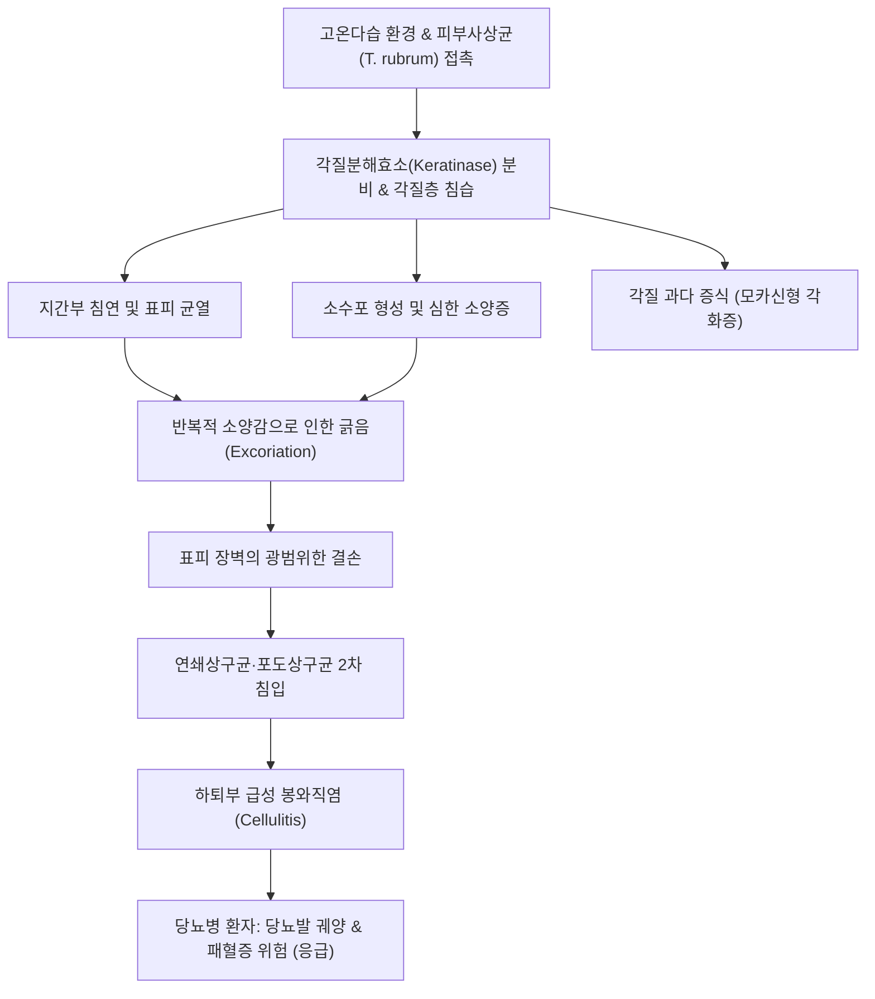

# 🩺 무좀 족부 백선 (Tinea Pedis / Athlete's Foot)

> **핵심 3줄 요약 (Key Summary)**:
> - 📍 병소 부위 & 해부·병태생리: 피부사상균(*Trichophyton rubrum*, *T. mentagrophytes*, *Epidermophyton floccosum*)이 발가락 사이(지간형), 발바닥 및 발 측면(소수포형), 발바닥 전체 각질층(각화형/모카신형)에 감염되어 각질분해효소(Keratinase)로 각질을 용해·침범함.
> - 🚩 전형적 임상 양상: 극심한 소양감(가려움증), 지간부 침연(Maceration) 및 균열, 소수포 형성, 만성적인 은백색 미세 인설 및 과각화증, 악취.
> - 🛠️ 핵심 검사 & 치료 전략: 10~20% KOH 직접 도말 검사(분지형 격벽 균사 관찰), 진균 배양 검사. 국소 항진균제(테르비나핀, 나프티핀, 아졸계) 2~4주 도포, 각화형 또는 난치성일 경우 경구 항진균제 병용.
> - ⚠️ 응급 의뢰 레드플래그: 2차 세균 감염에 의한 급성 봉와직염(단독/연조직염: 국소 발적·열감·부종·심한 통증·오한·발열), 림프관염(Red streak), 당뇨병 환자에서의 당뇨발 궤양 전조 및 괴사 징후.

---

## 📌 목차
1. [질환 개요 & 해부학적 병태생리](#1-질환-개요--해부학적-병태생리)
2. [병태생리 메커니즘 & 생체역학적 악순환 네트워크](#2-병태생리-메커니즘--생체역학적-악순환-네트워크)
3. [임상 증상 & 이학적 검사(Physical Exam) 알고리즘](#3-임상-증상--이학적-검사physical-exam-알고리즘)
4. [감별 진단 매트릭스 (Differential Diagnosis)](#4-감별-진단-매트릭스-differential-diagnosis)
5. [한의 통합 치료 프로토콜 (침·약침·추나·한약)](#5-한의-통합-치료-프로토콜-침약침추나한약)
6. [양방 치료 & 병용·의뢰 기준 (Conventional Treatment & Referral)](#6-양방-치료--병용의뢰-기준-conventional-treatment--referral)
7. [재활 운동 & 생활습관 티칭 가이드](#7-재활-운동--생활습관-티칭-가이드)
8. [💡 사용자 진료실 핵심 필기 & 임상 노하우 (Melt-In 잔여 심화 집약)](#8--사용자-진료실-핵심-필기--임상-노하우--melt-in-잔여-심화-집약)
9. [출처 및 학술 참고 문헌 (References)](#9-출처-및-학술-참고-문헌-references)

---

## 1. 질환 개요 & 해부학적 병태생리

무좀 혹은 족부 백선(Tinea Pedis, Athlete's Foot)은 피부의 가장 바깥층인 표피 각질층(Stratum corneum)에 피부사상균(Dermatophytes)이 침범하여 발생하는 가장 흔한 표재성 진균 감염증이다. 원인균으로는 *Trichophyton rubrum*(가장 흔함, 만성형), *Trichophyton mentagrophytes*(급성 염증 및 수포형), *Epidermophyton floccosum* 등이 대표적이다.

### 임상-해부학적 3대 아형 분류
1. **지간형 (Interdigital type)**:
   - 가장 흔한 형태로, 특히 4~5족지 간(제4지간) 및 3~4족지 간에서 호발함.
   - 해부학적으로 발가락 사이는 밀폐되어 있고 공기 순환이 안 되며 땀이 정체되어 각질층 침연(Maceration), 백색 변색, 박리 및 균열이 발생함.
2. **수포형 / 소수포형 (Vesicular / Vesiculobullous type)**:
   - 주로 발바닥 안쪽 아치(Foot arch)나 발 측면에 좁쌀~완두콩 크기의 끈적한 장액성 소수포가 군집 형성됨.
   - 여름철 고온다습한 환경에서 급격히 악화되며, 심한 소양감과 동통, 건조 후 황갈색 가피 형성.
3. **각화형 / 모카신형 (Hyperkeratotic / Moccasin type)**:
   - 발바닥 전체와 발 뒤꿈치, 측면으로 마치 모카신 구두를 신은 모양처럼 피부가 두꺼워지고 미세한 은백색 분말상의 인설(Fine silvery scaling)이 덮임.
   - 자각 증상(가려움)이 적어 단순 건조증이나 굳은살로 오인되어 방치되기 쉬우며, 조갑진균증(손발톱 무좀, Tinea unguium)과 가장 빈번하게 동반됨.

---

## 2. 병태생리 메커니즘 & 생체역학적 악순환 네트워크

### 1) 진균 침범 및 면역 병태생리
- **각질 분해 및 침투**: 피부사상균 포자가 탈락된 각질을 통해 전파된 후, 고온다습한 미세환경(땀, 꽉 끼는 신발)에서 발아함. 진균이 분비하는 단백분해효소인 각질분해효소(Keratinase, Subtilisin-like protease)가 각질세포의 케라틴을 분해하여 영양분으로 섭취하며 각질층 내부로 수평 확산함.
- **숙주 면역 반응 및 염증**:
  - 만난(Mannan): 진균 세포벽 성분으로, 세포 매개 면역을 억제하고 표피 턴오버를 지연시켜 만성 집락화(모카신형)를 유도.
  - 지연형 과민반응(Type IV Hypersensitivity): T세포가 활성화되면서 홍반, 소포, 심한 가려움증(수포형)을 유발함.
- **피부 장벽 붕괴와 세균 2차 감염의 악순환**:
  - 진균 감염으로 인한 표피 균열과 긁음(Excoriation)으로 인해 피부 물리적 장벽이 파괴됨.
  - 상재균인 *Staphylococcus aureus*, *Streptococcus pyogenes*가 진피 및 피하조직으로 침입하여 급성 연조직염(봉와직염) 및 림프관염을 유발함.

---

## 3. 임상 증상 & 이학적 검사(Physical Exam) 알고리즘

### 1) 주요 임상 증상
- **주관적 증상**: 발가락 사이 및 족저부의 발작적 가려움증, 화끈거림, 보행 시 균열 부위의 찌르는 듯한 통증.
- **객관적 소견**: 발가락 사이 피부의 하얗게 불어터짐(침연), 짓무름, 박리, 잔물집(소수포), 발바닥 각질의 두꺼워짐 및 가루날림, 악취.

### 2) 이학적 검사 및 진단 검사 알고리즘
1. **시진 및 촉진**:
   - 족지간 틈새 전수 확인 (특히 4~5지간 및 3~4지간).
   - 발바닥 아치, 발꿈치 과각화 여부, 조갑(발톱)의 황백색 변색 및 비후(조갑진균증 동반 여부) 확인.
   - 하퇴부(종아리) 발적, 국소 열감, 압통, 오목부종(Pitting edema) 유무를 촉진하여 봉와직염 동반 배제.
2. **KOH 직접 도말 검사 (Potassium Hydroxide Preparation, Gold Standard)**:
   - 병변의 가장자리(진행 부위) 또는 수포 뚜껑, 짓무른 각질을 긁어 슬라이드 글라스에 채취.
   - 10~20% KOH 용액을 떨어뜨려 각질 케라틴을 용해시킨 후 광학현미경 검경.
   - **양성 소견**: 반투명하고 굴절률이 높은 분지형 격벽 균사(Branching septate hyphae) 관찰.
3. **우드등 검사(Wood's Lamp)**: 에리스라스마(홍색음선, *Corynebacterium*) 감별 목적 (백선은 형광을 띠지 않으나 홍색음선은 산호색 붉은 형광).
4. **진균 배양 검사(Sabouraud Dextrose Agar, SDA)**: 치료 저항성이거나 비정형적 임상상일 때 원인균 동정.

---

## 4. 감별 진단 매트릭스 (Differential Diagnosis)

| 감별 질환 | 병인 및 호발 부위 | 임상적 형태 및 주소증 | KOH 도말 검사 소견 | 감별 핵심 포인트 |
| :--- | :--- | :--- | :--- | :--- |
| **무좀 족부 백선 (Tinea Pedis)** | 피부사상균 감염, 족지간·발바닥 | 지간 침연, 소수포, 모카신형 각화, 소양증 | **양성 (격벽 균사 관찰)** | 일측성 우세 가능, 발톱 무좀 동반 흔함, 항진균제 반응 |
| **한포진 (Dyshidrotic Eczema)** | 비감염성 습진, 손·발바닥 측면 | 깊게 위치한 투명 소수포(Tapioca-pudding), 극심한 가려움 | **음성 (균사 없음)** | 대칭성 발생, 계절성/스트레스 연관, 스테로이드 반응 |
| **홍색음선 (Erythrasma)** | *Corynebacterium minutissimum* 세균 | 족지간 균열, 갈색-붉은색 반점, 미약한 가려움 | **음성** | **우드등 검사상 산호색 붉은 형광 (Coral-red)** |
| **[[손발바닥 농포증]] (掌蹠膿疱症)** | 무균성 자가면역 수포 질환 | 발바닥에 무균성 농포 및 황갈색 가피, 각화 | **음성** | 무균성 농포, [[건선]] 동반 흔함, 난치성 만성 경과 |
| **접촉 피부염 (Contact Dermatitis)** | 신발 염료, 고무 등 알레르겐 | 신발 접촉 부위(발등, 발바닥)의 홍반 및 가려움 | **음성** | 접촉 부위와 병변 일치, 족지간은 보존되는 경향 |
| **발바닥 각질건조증 / 굳은살** | 물리적 마찰, 노화, 보습 부족 | 발뒤꿈치 단순 균열 및 과각화, 가려움 없음 | **음성** | 염증 징후 및 소양감 없음, 단순 보습제로 호전 |

---

## 5. 한의 통합 치료 프로토콜 (침·약침·추나·한약)

> 💡 **한의학적 병인론**:
> 무좀은 한의학에서 **각기(脚氣)**, **습창(濕瘡)**, **족선(足癬)**의 범주에 속한다. 주된 병기는 외감습열(外感濕熱)의 사기가 족소음·족태음 경락을 침범하거나, 비위(脾胃)의 운화 실조로 체내에 습열(濕熱)이 내생하여 사지 말단인 족부로 하주(下注)한 것이다. 만성화되면 풍습열(風濕熱)이 울체되어 혈허풍조(血虛風燥)로 전변, 각화와 균열이 심해진다.

### 1) 침구 치료 프로토콜
- **청열이습(淸熱利濕) 및 거풍지양(祛風止癢)**:
  - [[삼음교]](SP6), [[음릉천]](SP9): 비경(脾經)의 습열을 배출하여 족부 침연과 부종 완화.
  - [[곡지]](LI11), [[혈해]](SP10): 청열양혈(淸熱凉血), 거풍지양(소양감 진정).
  - [[태충]](LR3), [[행간]](LR2): 간경화(肝經火)를 사하고 국소 염증성 수포 진정.
  - [[태계]](KI3), [[곤륜]](BL60): 족관절 국소 순환 촉진 및 말초 면역력 증강.
- **환부 주변 특수 자침**: 소포 주변 및 각화 부위에 아시혈(阿是穴) 위주로 천자(얕은 자침) 및 피내침 요법 적용.

### 2) 약침 치료 (항균 및 피부 재생)
- **적용 혈위**: [[음릉천]](SP9), [[삼음교]](SP6), 족삼리([[ST36]]), 국소 아시혈.
- **처방 약침**:
  - 황련해독탕 약침: 강력한 청열해독(淸熱解毒) 작용을 통해 국소 염증 및 진균 증식 억제 (부위당 0.2~0.3cc).
  - 중성어혈약침: 각화형 무좀의 미세 순환 장애 및 피부 영양 결핍 해소를 위해 족관절 주변에 0.5cc 주입.

### 3) 한방 외용 요법 (습포 및 세족 요법)
- **고삼세제(苦蔘洗劑) 족욕**:
  - 처방 구성: [[고삼]], [[황백]], [[백선피]], [[사상자]], [[지각]] 각 20g.
  - 달인 미온수에 환부를 15~20분간 담그는 족욕 요법 시행 (주 2~3회).
  - 효능: 항진균, 가려움증 완화, 과각화 각질 연화.
- **금기**: 빙초산이나 고농도 식초에 원액 발을 담그는 민간요법은 **화학적 화상 및 급성 세균 감염(봉와직염)의 주요 원인이므로 엄격히 금지**함.

### 4) 한약 처방 (변증별 가감)
- **습열하주(濕熱下注)형 (지간 짓무름, 수포, 심한 가려움, 황색 분비물)**:
  - **용담사간탕(龍膽瀉肝湯)** 또는 **소풍산(消風散) 가감**:
  - 처방 구성: [[용담초]], [[황금]], [[산치자]], [[택사]], [[목통]], [[차전자]], [[당귀]], [[생지황]], [[시호]], [[감초]].
  - 습열사를 대소변으로 배출하고 소양감을 신속히 억제함.
- **혈허풍조(血虛風燥)형 (만성 각화형, 피부 갈라짐, 통증, 인설, 건조)**:
  - **당귀음자(當歸飮子)** 또는 **사물탕(四物湯) 가미방**:
  - 혈액을 자양하고 건조한 풍사를 몰아내어 피부 각질 턴오버를 정상화함.
  - 구성: [[당귀]], [[백작약]], [[천궁]], [[숙지황]], [[백질려]], [[방풍]], [[형개]], [[하수오]].
- **비허습성(脾虛濕盛)형 (다한증 동반, 무기력, 소화불량, 재발성 지간형)**:
  - **이묘산(二妙散)** 합 **위령탕(胃苓湯)**:
  - 구성: [[황백]], [[창출]], [[후박]], [[진피]], [[저령]], [[택사]], [[백출]], [[복령]].

---

## 6. 양방 치료 & 병용·의뢰 기준 (Conventional Treatment & Referral)

### 1) 약물 치료 (Medication)
- **국소 항진균제 (Topical Antifungals, 1차 치료)**:
  - **알릴아민계 (Allylamines, 살진균 작용 Fungicidal)**:
    - 테르비나핀(Terbinafine 1% 크림), 나프티핀(Naftifine): 치료 기간이 짧고(1~2주) 재발률이 낮음.
  - **아졸계 (Azoles, 정진균 작용 Fungistatic)**:
    - 클로트리마졸(Clotrimazole), 케토코나졸(Ketoconazole), 미코나졸(Miconazole): 2~4주간 도포.
  - 도포 원칙: 병변 부위뿐만 아니라 병변 경계 밖 2~3cm 정상 피부까지 넓게 바르며, 증상이 소실된 후에도 1~2주간 추가 도포하여 재발 방지.
- **경구 항진균제 (Oral Antifungals, 적응증: 광범위한 모카신형, 국소 치료 실패, 면역저하자, 조갑진균증 동반 시)**:
  - 테르비나핀(Terbinafine): 250 mg 1일 1회, 2주간 복용 (1차 선택제).
  - 이트라코나졸(Itraconazole): 100 mg 1일 2회, 1주간 복용 (식직후 복용).
  - 플루코나졸(Fluconazole): 150 mg 주 1회, 2~6주간 복용.
  - **주의사항**: 경구제는 간독성 위험이 있으므로 투약 전후 간기능 검사(LFT) 모니터링 필요.
- **각질 용해제 병용**:
  - 각화형 무좀에는 살리실산(Salicylic acid 3~5%) 또는 요소(Urea 10~20%) 연고를 항진균제 도포 전에 사용하여 침투력 증대.

### 2) 한의 병용 판단 및 상호작용
- 국소 한방 외용제(고삼 세족액)와 국소 항진균제 크림은 상호보완적으로 병용 가능함 (족욕 후 완전히 건조시킨 뒤 항진균 크림 도포).
- 경구 항진균제 복용 환자에게 청열해독 한약을 투여할 때는 간 대사 부담을 고려하여 장기 병용을 피하고 간수치 변동을 관찰함.

### 3) 양방·전문과 응급 의뢰 기준 (Referral Criteria)
- 🚨 **급성 세균성 봉와직염(Cellulitis) 의뢰 트리거**:
  - 무좀 병변 주변이나 하퇴부로 퍼지는 급격한 발적, 부종, 열감, 심한 압통.
  - 서혜부 림프절 종대(림프관염 붉은 선 관찰) 및 $38^\circ\text{C}$ 이상의 고열, 오한.
- 🚨 **당뇨병 환자(당뇨발 고위험군)**:
  - 감각 저하(당뇨병성 말초신경병증) 환자에서 족부 궤양, 피부 괴사, 심부 감염이 의심될 때 즉시 내분비내과 또는 정형외과 족부 클리닉 의뢰.

---

## 7. 재활 운동 & 생활습관 티칭 가이드

### 1) 족부 건조 및 위생 관리 수칙
- **철저한 건조**: 샤워 후 발가락 사이를 수건으로 꼼꼼히 닦고, 필요 시 헤어드라이어 찬바람으로 완전히 말리기.
- **양말 및 신발 관리**:
  - 땀 흡수가 잘 되는 면양말 착용, 하루 2회 이상 젖으면 즉시 교체.
  - 통풍이 잘 되는 신발 착용, 동일한 신발을 연속해서 신지 않고 2~3켤레를 번갈아 착용하며 건조 유지.
  - 신발 내부에 항진균 분말(Powder) 도포 권장.
- **공공장소 주의**: 수영장, 사우나, 헬스장 샤워실 바닥을 맨발로 걷지 말고 개인 슬리퍼 착용.

### 2) 재감발 방지 티칭
- 가족 간 슬리퍼, 발수건, 손톱깎이 공유 금지.
- 발톱 무좀(조갑진균증)이 동반된 경우 족부 백선의 지속적인 저류소(Reservoir) 역할을 하므로, 발 무좀과 발톱 무좀을 반드시 동시에 완치시켜야 함.

---

## 8. 💡 사용자 진료실 핵심 필기 & 임상 노하우 (Melt-In 잔여 심화 집약)

### 1) 진료실에서 가장 흔한 오진: "무좀약 바르고 더 뒤집어졌어요"
- 환자가 무좀약을 바른 후 피부가 더 붉어지고 수포가 터지며 진물이 난다고 호소하는 경우:
  - 원인 1: 진균증이 아닌 **한포진(습진)** 환자에게 항진균제를 바른 경우 (습진 피부염 악화).
  - 원인 2: 항진균제 연고에 포함된 기제나 방부제에 의한 **알레르기 접촉 피부염**.
  - 원인 3: 민간요법(식초, 마늘즙 등)으로 인한 **화학 화상**.
- 대처법: 즉시 항진균제 도포를 중단하고, KOH 도말 검사로 진균 존재를 재확인하기 전까지는 냉습포(Wet dressing)와 순한 보습제로 진정시킴.

### 2) 하퇴부 봉와직염의 '숨은 입구'는 언제나 발가락 사이
- 정형외과나 한의원에 다리가 붓고 빨갛게 열이 나서 내원하는 환자의 80%는 발가락 사이에 짓무른 무좀(지간형 족부 백선)을 가지고 있다.
- 종아리만 치료하면 봉와직염이 반드시 재발하므로, **"봉와직염 치료의 마침표는 발가락 무좀의 완치"**임을 환자에게 명확히 설명해야 한다.

---

## 9. 출처 및 학술 참고 문헌 (References)

1. Caplan, A. S., et al. (2025). Diagnosis and Management of Tinea Infections. *Am Fam Physician*, 112(4):382-392. PMID: 41118183.

2. Abo Zeid, M., et al. (2025). A comprehensive evaluation of Naftifine's efficacy and safety in treating dermatophyte infections; systematic review and meta-analysis. *Arch Dermatol Res*, 317(1):522. PMID: 40053133.

3. Sierla, R., et al. (2026). Secondary prevention of cellulitis: A systematic review. *Phlebology*, 41(6):463-479. PMID: 41275489.

---

## 관련 노트

- [[손발바닥 농포증]]
- [[건선]]
- [[삼음교]]
- [[음릉천]]
- [[곡지]]
- [[혈해]]
- [[태충]]
- [[행간]]
- [[태계]]
- [[곤륜]]
- [[고삼]]
- [[황백]]
- [[백선피]]
- [[사상자]]
- [[용담초]]
- [[황금]]
- [[산치자]]
- [[택사]]
- [[목통]]
- [[차전자]]
- [[당귀]]
- [[생지황]]
- [[시호]]
- [[감초]]
- [[백작약]]
- [[천궁]]
- [[숙지황]]
- [[창출]]
- [[용담사간탕]]
- [[소풍산]]
- [[당귀음자]]
- [[이묘산]]
- [[위령탕]]
