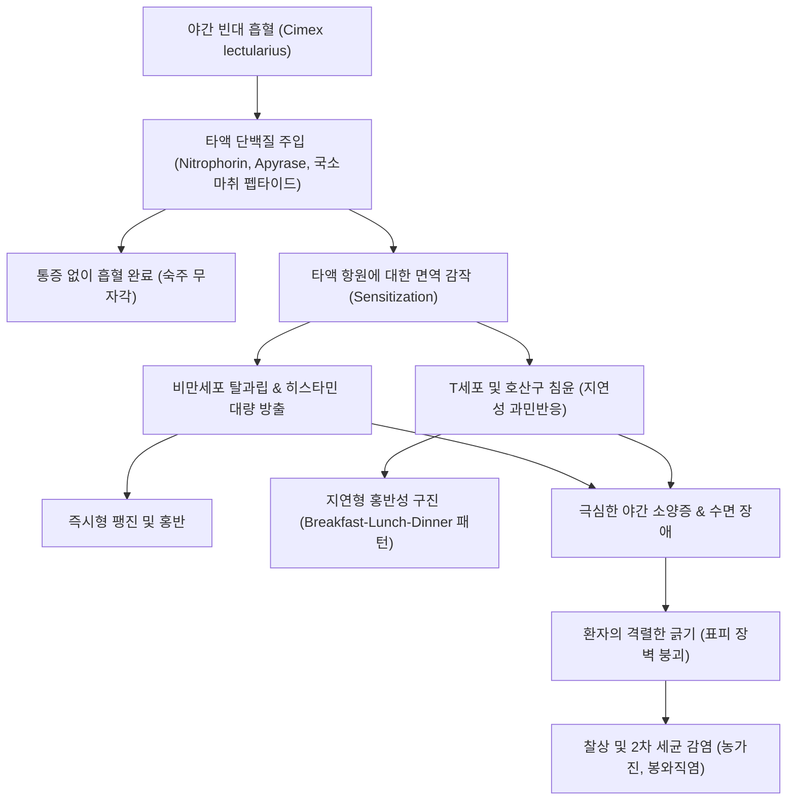

# 🩺 빈대 감염 (Bedbug Infestation, Cimicosis)

> **핵심 3줄 요약 (Key Summary)**:
> - 📍 병소 부위 & 해부·병태생리: 노린재목 빈대과(Cimicidae)의 흡혈 곤충인 빈대(*Cimex lectularius*, 열대빈대 *Cimex hemipterus*)가 야간에 인체의 노출된 피부(얼굴, 목, 팔, 손, 다리)를 구기(proboscis)로 찔러 흡혈하는 과정에서 타액 단백질(니타포린, 아피라아제 등)을 주입하여 IgE 및 세포매개성 복합 알레르기 과민반응을 유발하는 절지동물 피부 감염증.
> - 🚩 전형적 임상 양상: 수면 중 흡혈당한 부위에 나타나는 극심한 가려움증을 동반한 2~5mm 크기의 홍반성 구진(erythematous papules), 팽진(wheals), 중심부 출혈점(central punctum). 하룻밤 사이에 혈관을 찾아 이동하며 물어뜯는 특징적인 선상 또는 군집성 '아침-점심-저녁(Breakfast, Lunch, and Dinner)' 패턴의 병변 배열.
> - 🛠️ 핵심 검사 & 치료 전략: 특징적 임상 양상 문진(최근 여행력, 숙박업소 투숙력, 매트리스 솔기/침대 프레임 틈새의 혈흔 및 흑갈색 배설물 반점 확인). 증상 완화를 위한 2세대 [[항히스타민제]] 및 중등도 국소 [[코르티코스테로이드]] 도포; 2차 세균 감염 시 항생제 연고. **의학적 치료보다 주거 환경의 물리적·화학적 열처리 및 방제가 근본 해결책**.
> - ⚠️ 응급 의뢰 레드플래그: 타액 단백질 과민반응에 의한 전신 두드러기, 혈관부종, 천식 발작, 아나필락시스([[쇼크]]) 발생 시 즉시 에피네프린 근주 및 응급실 후송. 긁어서 발생한 광범위한 봉와직염, 림프관염 또는 화농성 농가진 악화 시 전신 항생제 투여.

---

## 📌 목차
1. [질환 개요 & 해부학적 병태생리](#1--질환-개요---해부학적-병태생리)
2. [병태생리 메커니즘 & 생체역학적 악순환 네트워크](#2--병태생리-메커니즘---생체역학적-악순환-네트워크)
3. [임상 증상 & 이학적 검사(Physical Exam) 알고리즘](#3--임상-증상---이학적-검사physical-exam-알고리즘)
4. [진단 검사 & 감별 진단 패널](#4--진단-검사---감별-진단-패널)
5. [양방 치료 프로토콜 & 약물 상호작용](#5--양방-치료-프로토콜---약물-상호작용)
6. [한의 기능의학적 치료 프로토콜](#6--한의-기능의학적-치료-프로토콜)
7. [재활 운동 & 생활습관 티칭 가이드](#7--재활-운동---생활습관-티칭-가이드)
8. [💡 사용자 진료실 핵심 필기 & 임상 노하우 (Melt-In 잔여 심화 집약)](#8--사용자-진료실-핵심-필기---임상-노하우-melt-in-잔여-심화-집약)
9. [출처 및 학술 참고 문헌 (References)](#9--출처-및-학술-참고-문헌-references)

---

## 1. 질환 개요 & 해부학적 병태생리

### 1) 정의 및 매개체 생물학
빈대 감염(Bedbug Infestation, 침식증, Cimicosis)은 야행성 무시성(날개가 없는) 흡혈 곤충인 빈대(Common bed bug, *Cimex lectularius*) 또는 온대·열대 지방의 열대빈대(*Cimex hemipterus*)의 자상(bite)에 의해 피부 과민반응이 유발되는 외인성 절지동물 피부염이다. 성충은 5~7mm 크기로 납작한 적갈색 난형이며, 흡혈 후에는 몸이 팽창하고 짙은 붉은색으로 변한다. 빈대는 침대 매트리스 솔기, 침대 헤드보드 뒷면, 벽지 틈새, 가구 이음매 등에 은신하다가 야간에 이산화탄소([[이산화탄소]])와 체온, 냄새를 감지하여 숙주로 접근한다. 1회 흡혈 시 5~10분이 소요되며, 혈액을 섭취하지 않고도 상온에서 수개월 이상 생존할 수 있는 강한 생명력을 지닌다. 현재까지 B형 간염, 샤가스병(Chagas disease) 등 병원체의 생물학적 매개 가능성은 실험실적으로 보고된 바 있으나, 실제 인체 간 전염병을 전파하는 매개체(vector) 역할을 한다는 명확한 임상적 증거는 없다.

### 2) 흡혈 기구의 미세 해부학 및 타액 성분
빈대의 구기(proboscis)는 두 개의 관으로 구성된다:
- **침샘관(Salivary canal)**: 피부를 관통할 때 타액을 주입한다. 타액 속에는 숙주의 통각을 마비시키는 국소 마취 유사 펩타이드, 혈소판 응집을 억제하는 아피라아제(Apyrase), 혈관을 확장시키는 산화질소([[산화질소]], NO) 운반 단백질인 니타포린(Nitrophorin, cLubrin), 그리고 항응고 효소(Factor Xa 억제제)가 포함되어 있어 숙주가 통증을 느끼지 못한 채 혈류를 확보하게 한다.
- **음식관(Food canal)**: 확장된 모세혈관으로부터 혈액을 빨아올린다.

---

## 2. 병태생리 메커니즘 & 생체역학적 악순환 네트워크

### 1) 면역 과민반응의 단계적 전변
빈대 자상에 대한 인체의 반응은 주입된 타액 단백질에 대한 숙주의 면역학적 감작(sensitization) 상태에 따라 극적으로 달라진다:
1. **무반응기 (초회 노출)**: 이전에 빈대에 물린 적이 없는 환자는 최초 흡혈 시 항체가 형성되어 있지 않아 아무런 피부 증상이나 가려움이 나타나지 않을 수 있다 (초기 노출 환자의 30~50%에서 무반응).
2. **지연형 과민반응 (반복 노출)**: 물린 지 1~3일(최장 14일) 후에 서서히 붉은 구진과 가려움이 시작된다. 주입된 타액 항원에 의해 Th2 세포가 활성화되고 호산구, 비만세포, 림프구가 진피로 침윤한다.
3. **즉시형 과민반응 (고도 감작)**: 수차례 반복 노출되어 특이 IgE 항체가 형성된 환자는 물린 지 수 분에서 수 시간 내에 심한 팽진과 발적([[두드러기]])이 발생하며, 이후 지연형 구진성 병변이 수일간 지속된다.
4. **저반응/탈감작기 (만성 노출)**: 수개월~수년간 지속적으로 노출된 일부 환자에서는 면역 관용이 유도되어 반응이 다시 경미해질 수 있다.

### 2) 소양증과 2차 세균 감염의 악순환
비만세포 탈과립에 의해 방출된 [[히스타민]], 류코트리엔 및 프로스타글란딘이 진피의 무수 C-신경섬유를 자극하여 극심한 불면성 소양증을 유발한다. 환자의 무의식적인 반복 소파(scratching)로 인해 표피 장벽이 파괴되면 황색포도상구균(*Staphylococcus aureus*)이나 화농성연쇄상구균(*Streptococcus pyogenes*)이 침투하여 농포, 농가진, 봉와직염([[연조직염]]) 및 태선화(lichenification)로 악화된다.

---

## 3. 임상 증상 & 이학적 검사(Physical Exam) 알고리즘

### 1) 특징적 임상 양상
- **병변 분포**: 잠옷이나 의복으로 덮이지 않고 노출된 부위인 **얼굴, 목구비, 어깨, 팔, 손등, 발목, 하지**에 집중적으로 발생한다 (의복 속이나 겨드랑이, 서혜부 등 굴곡부에 주로 생기는 옴 진드기와 대조적).
- **'아침-점심-저녁' 패턴 (Breakfast, Lunch, and Dinner Sign)**: 2~3개 이상의 홍반성 구진이 일직선(linear) 모양이나 삼각형 군집(clustered) 형태로 배열된다. 빈대가 흡혈 중 방해를 받거나 더 나은 모세혈관을 찾기 위해 수 센티미터씩 이동하며 연속으로 물기 때문에 나타나는 병태생리학적 특징이다.
- **중심부 출혈점(Central punctum)**: 구진의 정중앙에 흡혈 시 구기가 관통한 작은 출혈성 점이나 소수포가 관찰된다.
- **수포성 병변**: 심한 과민반응을 보이는 환자에서는 큰 물집(bullae)이 형성되기도 한다.

### 2) 이학적 검사 및 환경 탐색 알고리즘
1. **피부 병변 시진**: 선상 배열 여부, 노출부 집중 여부, 중심부 천공점 유무 확인.
2. **환자 환경 및 역학 문진**:
   - 최근 1~4주 내 국내외 여행력, 호텔/모텔/게스트하우스 숙박력.
   - 중고 가구, 매트리스 구입력.
   - 가족 또는 룸메이트의 유사 증상 발생 여부.
3. **환경적 실체 확인 (Bedbug inspection)**:
   - 매트리스 테두리 솔기, 침대 시트의 **작고 짙은 핏자국(rust-colored blood spots)**.
   - 벽지 틈이나 프레임 모서리의 **검은 곰팡이 모양 배설물 점(fecal spotting)**.
   - 빈대 특유의 퀴퀴하고 달콤한 단내(musty sweet odor).
   - 탈피한 외골격 껍질(cast skins) 또는 살아있는 성충 발견.

---

## 4. 진단 검사 & 감별 진단 패널

### 1) 진단 기준
빈대 감염의 진단은 임상적 증상과 함께 **환경 내 빈대 또는 그 흔적(배설물, 혈흔, 외골격)을 직접 확인**함으로써 확진된다. 혈액 검사나 피부 생검은 비특이적 염증 소견만 보이므로 통상적인 진단 목적으로는 불필요하다 (생검 시 호산구 침윤을 동반한 진피 천층 및 심층의 혈관주위염 소견).

### 2) 감별 진단 패널
| 질환명 | 주 병변 부위 및 양상 | 빈대 감염과의 핵심 감별점 |
| :--- | :--- | :--- |
| **[[옴]] (Scabies)** | 손가락 사이, 손목 굴측, 겨드랑이, 외음부, 배꼽 주위 | 굴(burrow, 수도) 발견, 노출부보다는 접히는 부위 호발, 현미경으로 진드기 및 충란 확인 |
| **벼룩 교상 (Flea bites)** | 주로 발목과 종아리 하부 집중 | 야외 노출, 애완동물(개/고양이) 접촉력, 군집성 작고 붉은 구진 |
| **모기 교상 (Mosquito bites)** | 불규칙하게 흩어진 단발성 팽진 | 선상 또는 '아침-점심-저녁' 배열 없음, 발생 계절(여름철), 수일 내 소퇴 |
| **체이 감염 (Body lice)** | 옷 솔기가 닿는 허리선, 목둘레, 어깨 | 옷 솔기 안쪽에 이와 서캐가 서식, 불량한 위생 상태와 연관 |
| **구진성 두드러기 (Papular urticaria)** | 전신 산재성 가려운 구진 | 만성 재발성 알레르기 소아 질환, 특정 곤충 흔적 불명확 |

---

## 5. 양방 치료 프로토콜 & 약물 상호작용

### 1) 피부 증상 완화 대증 치료
빈대 물림 자체는 자가국한성(self-limiting)으로, 추가 노출이 차단되면 통상 1~2주 이내에 자연 치유된다. 치료의 주안점은 극심한 가려움증 완화와 2차 감염 예방이다.
- **국소 스테로이드 제제**:
  - 중등도~강도 국소 [[코르티코스테로이드]](예: Hydrocortisone butyrate 0.1%, Betamethasone valerate 0.1% 크림): 1일 1~2회, 5~7일간 단기 도포하여 홍반과 부종 완화.
- **경구 항히스타민제**:
  - 주간: 2세대 비진정성 항히스타민제([[세티리진]] 10mg, [[펙소페나딘]] 180mg, [[로라타딘]] 10mg).
  - 야간: 수면 방해 및 야간 소파 방지를 위해 1세대 진정성 항히스타민제([[하이드록시진]] 10~25mg, [[클로르페니라민]] 4mg) 취침 전 투여.
- **2차 세균 감염 동반 시**:
  - 국소 항생제 연고(Mupirocin 2% 또는 Fucidic acid 2% 연고) 1일 2회 도포.
  - 봉와직염 등 광범위 감염 시 경구 1세대 세팔로스포린([[세팔렉신]]) 또는 아목시실린/클라불란산 7~10일 복용.

### 2) 환경적 박멸 프로토콜 (가장 결정적인 치료)
> ⚠️ 의료기관에서 아무리 약을 처방해도 주거 공간의 빈대를 박멸하지 않으면 환자는 매일 밤 재감염된다.

- **물리적 방제 (열처리)**:
  - 의류, 침구류, 커튼을 60℃ 이상의 온수로 세탁하고 건조기에서 30분 이상 고온 건조.
  - 침대 매트리스 및 가구 틈새에 100℃ 이상의 고온 스팀 청소기 분사.
  - 매트리스 전용 지퍼형 완전 밀폐 방충 커버(Encasement) 씌우기 (최소 1년 이상 유지하여 내부 빈대 아사 유도).
- **화학적 방제**:
  - 피레스로이드계(Pyrethroid) 살충제에 대한 내성이 전 세계적으로 80~90% 이상 보고되므로, 최근 승인된 네오니코티노이드계 복합제 또는 규조토(Diatomaceous earth, 물리적 외골격 파괴제) 활용 전문 방제업체(PCO) 의뢰.

---

## 6. 한의 기능의학적 치료 프로토콜

### 1) 변증 분형 (TCM Differentiation)
한의학적으로 빈대 감염은 [[충교상]](蟲咬傷)으로 인한 [[외감풍열습독]](外感風熱濕毒)에 해당하며, 충독(蟲毒)이 피부 기표(肌表)에 울체되어 기혈(氣血)을 응체시키고 열독(熱毒)이 치성해지는 병태로 변증한다.

| 변증 | 전형적 증상 | 설태 및 맥상 | 대표 처방 |
| :--- | :--- | :--- | :--- |
| **풍열습독형 (風熱濕毒型)** | 선상 배열의 붉은 구진, 팽진, 극심한 야간 가려움, 번조 | 설홍 태박황(薄黃), 맥부삭(浮數) | [[소풍산]] 합 [[황련해독탕]] 가감 |
| **열독치성·농포형 (熱毒熾盛·膿疱型)** | 심한 긁음으로 인한 미란, 농포, 화농성 삼출물, 국소 열감과 통증 | 설홍 태황후(黃厚), 맥활삭(滑數) | [[오미소독음]] 합 [[선방활명음]] |
| **혈허풍조형 (血虛風燥型)** | 만성적인 물림으로 인한 피부 태선화, 색소침착, 건조성 완고 가려움 | 설담 태소(少苔), 맥세삭(細數) | [[당귀음자]] 합 [[소풍음자]] |

### 2) 침구 치료 혈위
- **거풍지양 및 청열해독**: [[곡지]](LI11), [[합곡]](LI4), [[혈해]](SP10), [[대추]](GV14).
- **진정 및 신경성 소양 완화**: [[신문]](HT7), [[태충]](LR3), [[삼음교]](SP6).
- **외용 한약 세정 요법**: [[고삼]], [[황백]], [[지부자]], [[백선피]], [[박하]] 각 15g을 전탕하여 환부에 냉습포(cold compress)함으로써 진통, 지양, 항염증 효과 유도.

---

## 7. 재활 운동 & 생활습관 티칭 가이드

- **여행 및 숙박 시 예방 수칙**:
  - 호텔 객실 입실 시 가방을 침대나 카펫에 바로 올려놓지 말고 금속 러기지 랙(Luggage rack)이나 욕실 타일 바닥에 둘 것.
  - 침대 시트를 걷어 매트리스 4면 솔기와 헤드보드 뒷면에 검은 배설물 반점이 있는지 3분간 점검.
- **귀가 후 조치**:
  - 여행지에서 가져온 모든 의류는 귀가 즉시 세탁기로 직행하여 고온 온수 세탁 및 열풍 건조. 캐리어 내부는 청소기로 흡입 후 밀폐 보관.
- **가려움 완화 물리 요법**:
  - 물린 부위를 얼음팩(Ice pack)으로 10~15분간 냉찜질하여 감각신경 전달 차단. 뜨거운 물로 지지는 행위는 히스타민 방출을 촉발하므로 절대 금지.

---

## 8. 💡 사용자 진료실 핵심 필기 & 임상 노하우 (Melt-In 잔여 심화 집약)

- **"아침-점심-저녁(Breakfast, Lunch, Dinner)" 패턴을 눈에 새길 것**:
  - 환자가 "어젯밤 자고 일어났는데 팔과 목에 모기 물린 것처럼 빨갛게 3~4개가 조로록 줄지어 생겼어요"라고 호소하면 십중팔구 빈대이다. 모기는 날아다니므로 일직선으로 물지 않는다. 빈대는 기어 다니며 피가 잘 나오는 모세혈관을 찾을 때까지 한 발짝 가다 물고, 한 발짝 가다 무는 습성이 있어 정확한 선상(linear) 배열을 만든다.
- **"약만 주면 백 프로 컴플레인 돌아온다"**:
  - 환자에게 항히스타민제와 스테로이드 연고를 주면서 "이건 가려움만 가라앉히는 약이고, 댁에 있는 침대와 방을 방제하지 않으면 오늘 밤에 또 물립니다"라고 반드시 명확히 티칭해야 한다. 의사의 역할은 피부 치료뿐 아니라 환자에게 전문 방제업체를 부르고 침구를 고온 세탁하도록 안내하는 것까지 포함된다.
- **정신적 트라우마(Cimicophobia) 케어**:
  - 빈대에 물린 환자들은 벌레가 몸을 기어다니는 듯한 환촉(formication), 불면증, 심한 불안증을 겪는 경우가 흔하다. 옴처럼 몸속에 파고들어 기생하는 것이 아니며, 침대 밖으로 나오면 몸에 붙어있지 않다는 사실을 안심시켜 주어야 한다.

---

## 9. 출처 및 학술 참고 문헌 (References)

- Doggett, S. L., et al. (2012). Bed bugs: clinical relevance and control options. *Clin Microbiol Rev*. PMID: 22232375.

- Goddard, J., & de Shazo, R. (2009). Bed bugs (Cimex lectularius) and clinical consequences of their bites. *JAMA*. PMID: 19336711.

- 대한피부과학회. (2020). *피부과학 (제7판)*. 도서출판 대한의학.

- 질병관리청. (2023). *빈대 예방 및 관리 안내서*. 질병관리청 감염병관리과.

- 한방안이비인후피부과학회. (2021). *한의피부외과학*. 도서출판 정담.

---

## 관련 노트

- [[옴]]
- [[두드러기]]
- [[쇼크]]
- [[항히스타민제]]
- [[코르티코스테로이드]]
- [[소풍산]]
