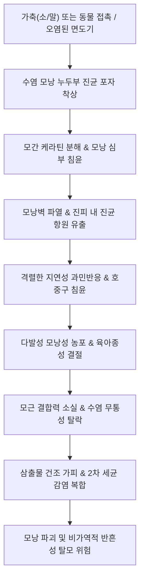

# 🩺 수염 도장부스럼 수염 백선 (Tinea Barbae)

> **핵심 3줄 요약 (Key Summary)**:
> - 📍 병소 부위 & 해부·병태생리: 성인 남성의 수염 부위(턱, 뺨, 목둘레, 인중)의 굵은 종말모(terminal hair)와 모낭(hair follicle)에 피부사상균(주로 동물친화성 *Trichophyton mentagrophytes*, *Trichophyton verrucosum*, 드물게 인간친화성 *Trichophyton rubrum*)이 침입하여 모낭염, 모낭주위염 및 농포성 육아종성 병변을 일으키는 표재성 진균 감염 질환.
> - 🚩 전형적 임상 양상: 농가진양 또는 세균성 모낭염과 유사한 심한 염증성 결절, 삼출물, 농포, 가피 형성, 수염의 통증 없는 발모(뽑힘), 동측 림프절 비대([[림프절 병증]]). 두피 백선의 독창([[Kerion celsi]])과 동일한 모낭성 육아종성 종창을 보임.
> - 🛠️ 핵심 검사 & 치료 전략: 10~20% [[KOH 도말 검사]](병변 수염 모간 및 농포 삼출물에서 균사 및 포자 확인), 진균 배양검사. **국소 항진균제 단독 치료는 실패하므로 금기**이며, 경구 [[테르비나핀]](Terbinafine, 250 mg/day 2~4주) 또는 [[이트라코나졸]](Itraconazole, 200 mg/day 4주) 전신 투여가 필수적임. 면도기 소독 및 공유 금지.
> - ⚠️ 응급 의뢰 레드플래그: 세균성 수염 모낭염(Sycosis barbae) 또는 봉와직염으로 오진하여 스테로이드를 투여한 후 급속 악화된 잠행 백선, 2차 세균 패혈증 의심 소견, 광범위한 안면부 연조직 종창 및 괴사성 병변 동반 시 즉시 상급병원 피부과 의뢰.

---

## 📌 목차
1. [질환 개요 & 해부학적 병태생리](#1--질환-개요---해부학적-병태생리)
2. [병태생리 메커니즘 & 생체역학적 악순환 네트워크](#2--병태생리-메커니즘---생체역학적-악순환-네트워크)
3. [임상 증상 & 이학적 검사(Physical Exam) 알고리즘](#3--임상-증상---이학적-검사physical-exam-알고리즘)
4. [진단 검사 & 감별 진단 패널](#4--진단-검사---감별-진단-패널)
5. [양방 치료 프로토콜 & 약물 상호작용](#5--양방-치료-프로토콜---약물-상호작용)
6. [한의 기능의학적 치료 프로토콜](#6--한의-기능의학적-치료-프로토콜)
7. [재활 운동 & 생활습관 티칭 가이드](#7--재활-운동---생활습관-티칭-가이드)
8. [💡 사용자 진료실 핵심 필기 & 임상 노하우 (Melt-In 잔여 심화 집약)](#8--사용자-진료실-핵심-필기---임상-노하우-melt-in-잔여-심화-집약)
9. [출처 및 학술 참고 문헌 (References)](#9--출처-및-학술-참고-문헌-references)

---

## 1. 질환 개요 & 해부학적 병태생리

### 1) 정의 및 역학
수염 도장부스럼(수염 백선, Tinea Barbae, 'Barber's itch')은 사춘기 이후 성인 남성의 수염 부위(안면 하부 및 경부) 모낭과 주변 피부에 발생하는 진균성 모낭염이다. 과거 비위생적인 이발소 면도기 공유로 집단 발병하여 이발사 가려움증으로 불렸으나, 현대에는 축산업 종사자, 수의사, 농촌 거주자 또는 반려동물(소, 말, 개, 고양이)과 접촉하는 남성에서 동물원성 감염으로 호발한다. 원인균으로는 소나 가축에서 유래하는 *Trichophyton verrucosum*, 설치류나 가축 유래의 *Trichophyton mentagrophytes*가 가장 흔하며, 드물게 인간친화성인 *Trichophyton rubrum*이나 *Microsporum canis*가 원인이 된다.

### 2) 수염 모낭 침범의 해부학적 특성
수염 부위는 인체에서 가장 굵고 깊은 종말모(terminal hair)가 밀집되어 있으며, 안드로겐 자극으로 피지선이 발달해 있다.
- 진균은 모간(hair shaft)의 큐티클을 뚫고 모간 내부(endothrix) 또는 모간 표면(ectothrix)을 둘러싸며 자란다.
- 깊은 진피망까지 연장된 모낭 누두부와 외모근초(outer root sheath) 주위로 염증성 세포 침윤이 일어나 모낭벽이 파열되고, 진피 내로 케라틴 파편과 진균 항원이 유출되면서 격렬한 이물 육아종 반응을 일으킨다.

---

## 2. 병태생리 메커니즘 & 생체역학적 악순환 네트워크

### 1) 균종별 병리 형태
- **심재성 염증형 (Kerion-like / Sycosiform)**: 주로 *T. verrucosum*, *T. mentagrophytes* 등 동물친화성 진균에 의해 유발된다. 진균 항원에 대한 숙주의 격렬한 Th1 매개 세포성 면역반응으로 다발성 결절, 파동성 종창, 농포, 화농성 삼출물이 형성되며 영구적 반흔성 탈모를 초래할 수 있다.
- **천재성 비염증형 (Superficial ringworm-like)**: 주로 *T. rubrum*에 의해 유발되며, 체부 백선처럼 중심부 소퇴와 경계부 인설 및 구진을 동반한 원형 판을 형성하고 염증 반응은 경미하다.

---

## 3. 임상 증상 & 이학적 검사(Physical Exam) 알고리즘

### 1) 전형적 임상 증상
- **염증성 결절 및 농포**: 턱, 뺨, 목둘레에 융기된 붉고 단단한 결절이 생기며, 병변 중심부에서 고름이 배출되는 다발성 모낭 개구부가 관찰된다.
- **수염의 무통성 탈락 (Painless epilation)**: 세균성 모낭염에서는 털을 뽑을 때 극심한 통증이 발생하지만, 수염 백선에서는 모근의 케라틴이 진균에 의해 이미 소화되어 핀셋으로 수염을 살짝 당겨도 통증 없이 쑥 빠진다(진단적 가치 매우 높음).
- **심한 가피와 삼출물**: 황갈색의 두꺼운 딱지가 수염 사이에 엉겨 붙어 있으며, 부전공성 종창(boggy swelling)과 국소 림프절 비대가 동반된다.

### 2) 이학적 검사 알고리즘
1. **수염 견인 검사(Epilation test)**: 병변 부위의 수염을 핀셋으로 가볍게 잡아당겨 저항이나 통증 없이 쉽게 빠지는지 확인.
2. **배농 및 촉진**: 병변을 가볍게 눌렀을 때 모낭 개구부에서 치약 짜듯 고름이 스며 나오는지, 기저부에 단단한 침윤성 결절이 만져지는지 확인.
3. **경부 림프절 촉진**: 턱밑(submandibular), 악하, 전경부 림프절의 압통성 종대 확인.

---

## 4. 진단 검사 & 감별 진단 패널

### 1) 진단 검사 프로토콜
- **10~20% [[KOH 도말 검사]]**: 뽑아낸 수염과 농포액을 채취하여 검사. 모간 내부 또는 외부에 분절포자 쇄상 배열 및 균사 관찰.
- **진균 배양검사**: DTM 또는 SDA 배지에 접종하여 원인균 동정.
- **세균 배양검사**: 황색포도상구균 2차 감염 유무 감별.

### 2) 감별 진단 패널
| 질환명 | 호발 요인 및 양상 | 수염 백선과의 감별점 |
| :--- | :--- | :--- |
| **세균성 수염 모낭염 (Sycosis barbae)** | 황색포도상구균 감염, 면도 자극 | 모발 견인 시 심한 통증 발생, 그람양성 구균 확인, KOH 음성, 항생제에 반응 |
| **수염 가성모낭염 (Pseudofolliculitis barbae)** | 곱슬머리 흑인 남성, 면도 후 모발 내향성 매몰 | 이물 반응에 의한 구진, 진균이나 세균 감염 없음, 면도 중단 시 호전 |
| **접촉성 피부염 (Contact dermatitis)** | 면도 크림, 애프터셰이브 알레르기 | 모낭 중심성이 아님, 수염 탈락 없음, 표재성 홍반 및 소양증 위주 |
| **단순포진 (Herpes simplex)** | 군집성 수포, 작열감 선행 | 수포성 병변, Tzanck 도말 검사 양성, 수염 침범 없음 |

---

## 5. 양방 치료 프로토콜 & 약물 상호작용

### 1) 전신 경구 항진균제 (필수 요법)
수염 백선은 굵은 모낭 심부 감염이므로 외용 연고만으로는 결코 완치되지 않는다. 반드시 경구 전신 치료를 시행해야 한다.
- **1차 선택제**:
  - **[[테르비나핀]](Terbinafine)**: 성인 250 mg 1일 1회 경구 투여, 2~4주간 복용.
  - **[[이트라코나졸]](Itraconazole)**: 성인 100~200 mg 1일 1회 식후 복용, 2~4주간.
  - **[[그리세오풀빈]](Griseofulvin)**: 500~1,000 mg/day, 4~6주간 복용.
- **보조 요법**:
  - 2차 세균 감염 시 1세대 세팔로스포린계 경구 항생제 병용.
  - 심한 염증성 독창형 종창 시 단기 경구 [[코르티코스테로이드]](프레드니솔론 20~30 mg/day, 5~7일간) 투여로 영구 반흔 방지.

---

## 6. 한의 기능의학적 치료 프로토콜

### 1) 변증 분형 (TCM Differentiation)
한의학적으로 수염 백선은 [[양수창]](羊鬚瘡), [[염창]](鬚瘡)의 범주에 속하며, [[비위습열]](脾胃濕熱)이 양명경(陽明經) 경락을 따라 안면으로 상염(上炎)하고 [[외감풍독]](外感風毒)과 상박하여 화농성 옹저를 형성하는 병태로 본다.

| 변증 | 전형적 증상 | 설태 및 맥상 | 대표 처방 |
| :--- | :--- | :--- | :--- |
| **양명습열·화농형 (陽明濕熱·化膿型)** | 턱과 뺨의 결절, 농포, 화농성 삼출물, 구갈, 변비, 발열감 | 설홍 태황후니(黃厚膩), 맥활삭(滑數) | [[황련해독탕]] 합 [[비해분청음]] 가감 |
| **풍열독성형 (風熱毒盛型)** | 안면 홍반, 가려움, 구진, 인설 위주의 천재성 병변 | 설첨홍 태박황(薄黃), 맥부삭(浮數) | [[소풍산]] 합 [[오미소독음]] |
| **기혈양허·어혈형 (氣血兩虛·瘀血型)** | 만성적인 암자색 결절, 반흔성 탈모, 신생 수염 부실, 무기력 | 설담어반 태백, 맥세삽(細澁) | [[탁리소독음]] 합 [[팔진탕]] |

### 2) 침구 치료 혈위
- **양명경 청열소종**: [[승읍]](ST1), [[지창]](ST4), [[협거]](ST6), [[하관]](ST7), [[합곡]](LI4), [[곡지]](LI11).
- **해독배농 및 지양**: [[혈해]](SP10), [[대추]](GV14), [[삼음교]](SP6).
- **외용 한약 세정**: [[고삼]], [[황백]], [[백지]], [[사상자]] 각 15g 전탕액으로 환부 세정.

---

## 7. 재활 운동 & 생활습관 티칭 가이드

- **면도 방법의 전환**: 병변이 완전히 치유될 때까지 날 면도기 사용을 전면 중단. 수염을 깎아야 할 경우 전기면도기를 사용하되 날을 매회 소독용 에탄올로 세척.
- **면도기 및 수건 절대 단독 사용**: 가족 간 수건 및 면도기 공유 금지.
- **가축 및 반려동물 접촉 주의**: 소, 말, 개, 고양이 등 원인 동물의 피부염 병변 확인 및 수의과적 치료 병행.

---

## 8. 💡 사용자 진료실 핵심 필기 & 임상 노하우 (Melt-In 잔여 심화 집약)

- **"수염을 살짝 당겼을 때 안 아프게 쑥 빠지면 무조건 백선"**:
  - 세균성 모낭염(황색포도상구균) 환자의 수염을 핀셋으로 뽑으려 하면 아파서 비명을 지른다. 반면 수염 백선 환자는 진균이 모근 각질을 다 갉아먹어 놓았기 때문에 아무런 통증 없이 저항 없이 쑥 뽑힌다. 진료실에서 진균 검사기구가 없더라도 핀셋 하나로 세균성과 진균성을 10초 만에 감별할 수 있는 최고의 임상 비기이다.
- **절개배농(I&D)을 하지 말 것**:
  - 두피의 독창과 마찬가지로 턱에 생긴 꿀렁거리는 종창을 고름집으로 오인하여 메스를 대면 진균이 주변 조직으로 번지고 심각한 안면 흉터가 남는다. 경구 항진균제 투여만으로도 부종은 자연 흡수된다.

---

## 9. 출처 및 학술 참고 문헌 (References)

- Ely, J. W., et al. (2014). Diagnosis and management of tinea infections. *Am Fam Physician*. PMID: 25403034.

- Noble, S. L., et al. (1998). Diagnosis and management of common tinea infections. *Am Fam Physician*. PMID: 9672436.

- 대한피부과학회. (2020). *피부과학 (제7판)*. 도서출판 대한의학.

- 대한가정의학회. (2019). *가정의학 (제5판)*. 군자출판사.

- 한방안이비인후피부과학회. (2021). *한의피부외과학*. 도서출판 정담.

---

## 관련 노트

- [[체부 백선]]
- [[두피 도장부스럼 두피 백선]]
- [[테르비나핀]]
- [[이트라코나졸]]
- [[황련해독탕]]
- [[소풍산]]
