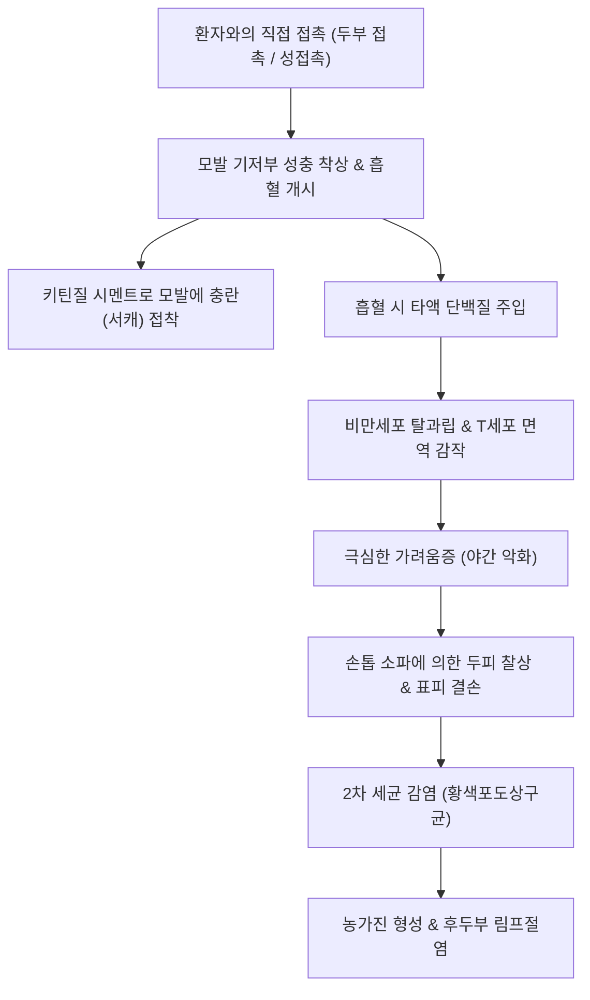

# 🩺 이 침입 (Pediculosis, Lice Infestation)

> **핵심 3줄 요약 (Key Summary)**:
> - 📍 병소 부위 & 해부·병태생리: 이목(Phthiraptera)의 무시성 곤충인 머릿이(*Pediculus humanus capitis*), 몸이(*Pediculus humanus corporis*), 사면발이(*Pthirus pubis*)가 인간의 모발(두발, 체모, 음모) 및 의복에 기생하며 피부를 찔러 흡혈하는 과정에서 타액 단백질에 대한 면역학적 알레르기 과민반응과 심한 가려움증을 유발하는 외부 기생충 피부 질환.
> - 🚩 전형적 임상 양상: 후두부 및 측두부의 극심한 두피 소양증, 모발 기저부 0.5~1cm 이내에 단단히 고착된 백색 서캐(nits, 충란), 피부 긁음으로 인한 찰상, 장액성 삼출물 및 2차 농가진, 사면발이 흡혈 부위의 특징적인 청백색 청색반(maculae ceruleae).
> - 🛠️ 핵심 검사 & 치료 전략: 젖은 모발 상태에서 미세 참빗(wet combing)을 이용한 살아있는 성충 또는 유충 발견(확진). 1차 국소 살충제 치료로 1% [[퍼메트린]](Permethrin) 크림 또는 0.5% 말라티온(Malathion) 로션 도포 후 잔여 알 부화를 차단하기 위해 7~10일 후 2차 재도포. 모든 침구 및 의류의 60℃ 이상 고온 온수 세탁.
> - ⚠️ 응급 의뢰 레드플래그: 몸이(*P. humanus corporis*) 감염 시 발진티푸스(*Rickettsia prowazekii*), 참호열(*Bartonella quintana*), 재귀열(*Borrelia recurrentis*) 등 치명적 전신 감염병의 매개체로 작용하므로 고열, 오한, 두통, 전신 발진 동반 시 즉시 감염내과 격리 및 독시사이클린 투여.

---

## 📌 목차
1. [질환 개요 & 해부학적 병태생리](#1--질환-개요---해부학적-병태생리)
2. [병태생리 메커니즘 & 생체역학적 악순환 네트워크](#2--병태생리-메커니즘---생체역학적-악순환-네트워크)
3. [임상 증상 & 이학적 검사(Physical Exam) 알고리즘](#3--임상-증상---이학적-검사physical-exam-알고리즘)
4. [진단 검사 & 감별 진단 패널](#4--진단-검사---감별-진단-패널)
5. [양방 치료 프로토콜 & 약물 상호작용](#5--양방-치료-프로토콜---약물-상호작용)
6. [한의 기능의학적 치료 프로토콜](#6--한의-기능의학적-치료-프로토콜)
7. [재활 운동 & 생활습관 티칭 가이드](#7--재활-운동---생활습관-티칭-가이드)
8. [💡 사용자 진료실 핵심 필기 & 임상 노하우 (Melt-In 잔여 심화 집약)](#8--사용자-진료실-핵심-필기---임상-노하우-melt-in-잔여-심화-집약)
9. [출처 및 학술 참고 문헌 (References)](#9--출처-및-학술-참고-문헌-references)

---

## 1. 질환 개요 & 해부학적 병태생리

### 1) 기생충 아종별 해부학적 기생 부위
'이'는 인간에게만 특이적으로 기생하는 숙주 특이적 곤충으로, 기생하는 해부학적 부위에 따라 세 가지 아종으로 명확히 구분된다:
- **머릿이 (Pediculosis capitis)**: *Pediculus humanus capitis*. 2~3mm 크기로 두피 모발(주로 후두부, 귀 뒤쪽)에 기생한다. 학령기 소아(3~11세)에서 가장 흔하며, 날거나 뛰지 못하고 기어서 머리와 머리의 직접 접촉(head-to-head contact)으로 전파된다. 감염병 매개 능력은 없다.
- **몸이 (Pediculosis corporis)**: *Pediculus humanus corporis*. 피부 자체가 아닌 환자의 의복 솔기(seams of clothing) 내피에 서식하며, 흡혈할 때만 피부로 이동한다. 노숙인, 난민, 위생 시설이 부재한 빈곤층에서 발생하며, 발진티푸스 등의 치명적 전염병을 매개한다.
- **사면발이 (Pediculosis pubis, Pthiriasis)**: *Pthirus pubis*. 1~2mm의 넓적한 게 모양 게이(Crab louse)로, 모발 간격이 넓고 성긴 음모(pubic hair)를 집게다리로 움켜쥐고 기생한다. 드물게 겨드랑이 털, 수염, 속눈썹(Phthiriasis palpebrarum)을 침범하기도 하며, 주로 성접촉을 통해 전파된다.

### 2) 생활사와 충란(서캐)의 부착 메커니즘
암컷 성충은 교미 후 1일 3~10개의 알(서캐, nits)을 산란하며 평생 약 100~300개를 낳는다.
- 암컷은 질 분비물 샘에서 유래하는 특수한 키틴질 기반 불용성 시멘트 접착물질(chitinous cement)을 분비하여 모발 줄기 기저부(두피로부터 0.5cm 이내)에 서캐를 단단히 접착시킨다.
- 두피의 체온(32~35℃)과 습도 환경에서 7~10일 만에 부화하여 약충(nymph)이 되며, 3회의 탈피 과정을 거쳐 약 9~12일 후 생식 가능한 성충으로 성장한다.

---

## 2. 병태생리 메커니즘 & 생체역학적 악순환 네트워크

### 1) 흡혈과 타액 면역반응
이는 하루 4~6회 피부 모세혈관을 구기로 천자하여 소량의 혈액을 섭취한다.
1. 흡혈 시 주입되는 이의 타액 속 항응고제 및 혈관확장 단백질에 숙주의 면역계가 감작된다.
2. 최초 감염 환자는 면역 감작에 2~6주가 소요되므로 초기에는 가려움증을 전혀 느끼지 못하는 무증상 보균 상태가 유지된다.
3. 재감염된 환자는 이미 감작된 비만세포와 T세포에 의해 24~48시간 이내에 격렬한 즉시형 및 지연형 과민반응이 유발되어 참을 수 없는 소양증이 발생한다.

### 2) 2차 합병증 네트워크
소양증에 의한 반복적인 손톱 긁음은 표피 박탈과 찰상을 일으키며, 두피의 상재균인 황색포도상구균 및 연쇄상구균 침투를 유도하여 농가진(impetigo), 모낭염, 경부 림프절 비대([[림프절 병증]])를 형성한다. 심한 경우 모발이 진물과 고름으로 뒤엉키고 악취를 풍기는 소위 '플리카 폴로니카(Plica polonica)' 상태에 이른다.

---

## 3. 임상 증상 & 이학적 검사(Physical Exam) 알고리즘

### 1) 임상 양상
- **머릿이**: 후두부(occipital scalp)와 귀 뒤(postauricular area)의 심한 가려움증. 환아가 머리를 끊임없이 긁고 집중력 저하, 수면 장애를 호소.
- **몸이**: 의복과 피부 마찰이 심한 허리선, 겨드랑이, 서혜부의 긁은 상처, 구진, 태선화 및 만성 과색소침착(Vagabond's disease).
- **사면발이**: 외음부의 야간 소양증, 속옷의 갈색 배설물 반점, 하복부와 대퇴부 피부의 직경 0.5~1cm 크기의 특징적인 무통성 청백색 반점인 **청색반(Maculae ceruleae)** (사면발이 타액 성분에 의해 헤모글로빈이 빌리베르딘으로 전환되어 발생).

### 2) 진단적 검사 알고리즘
1. **습식 빗질 검사 (Wet combing, 골드 스탠다드)**:
   - 모발을 물에 적시고 헤어 컨디셔너를 도포하여 이의 움직임을 둔화시킨 후, 치간 간격이 0.2~0.3mm인 플라스틱 미세 참빗으로 모근부터 모발 끝까지 빗어 흰 종이나 티슈 위에 떨어뜨려 육안 관찰.
   - 마른 상태 시진보다 진단 민감도가 4배 이상 높음.
2. **서캐(Nit)의 생존 여부 판정**:
   - 두피로부터 **0.5cm(6mm) 이내**에 위치한 서캐: 부화 가능한 살아있는 충란일 가능성이 매우 높음 (활동성 감염).
   - 두피로부터 **1cm 이상** 떨어진 서캐: 이미 부화하여 비어있는 난각(hatched casing)이거나 사멸한 서캐 (과거 감염의 흔적).

---

## 4. 진단 검사 & 감별 진단 패널

### 1) 감별 진단 패널
| 질환 / 소견 | 임상적 형태 | 이 감염(서캐)과의 결정적 감별점 |
| :--- | :--- | :--- |
| **비듬 (Dandruff / Seborrhea)** | 부정형의 건조한 각질 파편 | 모발에 붙어있지 않고 손가락으로 털면 쉽게 떨어짐 (서캐는 시멘트로 붙어 있어 털어도 떨어지지 않고 손톱으로 훑어야만 이동함) |
| **모발초 (Hair casts)** | 모발을 둘러싼 원통형 케라틴 원주 | 모발을 따라 부드럽게 위아래로 미끄러져 움직임, KOH 및 현미경 검사상 충란 구조 없음 |
| **두피 백선 (Tinea capitis)** | 인설성 탈모반, 부러진 모발 | 모발 절단, 진균 균사 관찰, 충란 없음 |
| **옴 (Scabies)** | 손가락 사이, 손목 굴측 호발 | 두피는 침범하지 않음(영아 제외), 수도(burrow) 관찰 |

---

## 5. 양방 치료 프로토콜 & 약물 상호작용

### 1) 국소 살충제 치료 프로토콜
> ⚠️ **핵심 원칙**: 대부분의 살충제는 성충과 약충을 죽이지만 충란(서캐)의 난각을 완전히 투과하지 못한다. 따라서 최초 도포 후 남아있는 서캐가 부화하는 시점(생후 7~10일째)에 **반드시 7~10일 간격으로 2차 재도포**를 시행해야 완치된다.

- **1차 선택제**:
  - **1% [[퍼메트린]](Permethrin 크림/로션)**: 합성 피레스로이드계. 샴푸 후 타월 드라이한 젖은 모발에 두피와 모발 전체에 도포하고 10분 후 미온수로 헹굼. 7~9일 후 2회차 도포.
  - **0.5% 말라티온(Malathion 로션)**: 유기인계(Cholinesterase inhibitor). 건조 모발에 도포 후 8~12시간 방치 후 세척. 살란(ovicidal) 활성이 매우 우수하나 가연성이 있으므로 헤어드라이어 사용 금지.
- **2차 및 난치성 내성 균주 대체 약제**:
  - **5% 벤질알코올(Benzyl alcohol 로션)**: 이의 호흡관(spiracles)을 질식시켜 박멸 (신경독성 없음, 6개월 이상 영아 안전).
  - **0.5% 이버멕틴(Ivermectin 국소 로션)** 또는 **경구 [[이버멕틴]](Ivermectin)**: 200 µg/kg 단회 경구 복용 후 7~14일째 2회차 복용 (체중 15kg 이상 소아 및 성인).

---

## 6. 한의 기능의학적 치료 프로토콜

### 1) 변증 분형 (TCM Differentiation)
한의학적으로 이 감염은 기표(肌表)의 청결하지 못한 환경에서 [[습열온독]](濕熱蘊毒)이 외생(外生)하거나 접촉을 통해 충독(蟲毒)이 기표에 기생하여 [[풍열혈열]](風熱血熱)을 촉발한 병태로 변증한다.

| 변증 | 전형적 증상 | 설태 및 맥상 | 대표 처방 |
| :--- | :--- | :--- | :--- |
| **풍열습독·소양형 (風熱濕毒·瘙癢型)** | 두피 극심 소양, 구진, 찰상, 불안, 불면, 번조 | 설홍 태박황(薄黃), 맥부삭(浮數) | [[소풍산]] 합 [[황련해독탕]] 가감 |
| **열독치성·농포형 (熱毒熾盛·膿疱型)** | 긁어서 생긴 미란, 화농성 삼출물, 악취, 경부 림프절 종창 | 설홍 태황후(黃厚), 맥활삭(滑數) | [[오미소독음]] 합 [[용담사간탕]] |
| **혈허풍조형 (血虛風燥型)** | 만성적인 소양, 두피 건조, 각질 비후, 체모 탈락 | 설담 태박백(薄白), 맥세약(細弱) | [[당귀음자]] 합 [[사물탕]] |

### 2) 한약 외용 살충 세정 요법
- **백부근 살충 외용액**: [[백부근]](Stemonae Radix) 100g, [[고삼]] 50g, [[황백]] 30g을 물 1L에 달여 식힌 후 식초 50mL를 혼합. 모발과 두피에 흠뻑 적신 후 비닐 캡을 씌우고 30~60분간 방치 후 참빗질로 사멸된 이와 서캐를 제거하고 온수로 세척 (백부근의 알칼로이드 성분은 천연 신경독성 살충 작용을 지님).

---

## 7. 재활 운동 & 생활습관 티칭 가이드

- **환경 방제 및 세탁**: 환자가 최근 48시간 이내 착용한 옷, 모자, 침구, 베개 커버는 60℃ 이상 온수로 세탁하고 건조기에서 고온으로 30분 이상 건조.
- **밀폐 격리**: 세탁이 불가능한 인형, 코트, 모자 등은 비닐봉지에 밀봉하여 2주간 보관 (이는 숙주를 떠나면 48시간 이내 탈수와 굶주림으로 사멸함).
- **빗과 브러시 소독**: 사용한 빗과 헤어 액세서리는 60℃ 이상의 뜨거운 물에 최소 10분간 침적.
- **학교 무단 결석 금지 (No-nit policy 폐지 권고)**: 서캐가 모발에 남아있다는 이유만으로 아이를 등교 거부시키는 것은 불필요하며, 적절한 치료를 1회 받은 후에는 즉시 등교 가능함.

---

## 8. 💡 사용자 진료실 핵심 필기 & 임상 노하우 (Melt-In 잔여 심화 집약)

- **"비듬인가 서캐인가?" 손가락으로 튕겨보면 1초 만에 판정**:
  - 보호자가 "비듬인지 서캐인지 헷갈린다"며 데려왔을 때 감별법은 간단하다. 손가락 끝으로 모발을 톡톡 털어보아서 아래로 흩날려 떨어지면 비듬이나 헤어스프레이 잔여물이다. 만약 손가락으로 세게 튕겨도 털리지 않고 모발에 착 달라붙어 손톱으로 꽉 쥐고 훑어내려야만 겨우 빠진다면 100% 서캐이다.
- **7~10일째 2차 도포를 누락하면 실패한다**:
  - 환자 보호자에게 1회 바르고 이가 다 죽었다고 안심하지 말라고 강조해야 한다. 시판 살충제는 서캐 껍질 속 알을 100% 죽이지 못한다. 일주일 뒤 알이 부화해서 새끼 이가 나오는 순간을 노려 반드시 2차 도포로 숨통을 끊어야 한다.
- **사면발이 환자를 보았을 때의 성매개 감염 스크리닝**:
  - 음모에서 사면발이가 발견된 성인 환자는 30% 이상에서 클라미디아, 임질, 매독, HIV 등 다른 성매개 감염병(STI)을 동반하고 있다. 단순히 연고만 처방하고 보낼 것이 아니라 반드시 혈액 및 소변 STI 패널 검사를 병행해야 한다.

---

## 9. 출처 및 학술 참고 문헌 (References)

- Devore, C. D., et al. (2015). Head lice. *Pediatrics*. PMID: 25917986.

- Thomas, C., et al. (2024). Scabies, Bedbug, and Body Lice Infestations: A Review. *JAMA*. PMID: 39250129.

- 대한피부과학회. (2020). *피부과학 (제7판)*. 도서출판 대한의학.

- 질병관리청. (2022). *기생충 감염병 관리지침*. 질병관리청 감염병관리과.

- 한방안이비인후피부과학회. (2021). *한의피부외과학*. 도서출판 정담.

---

## 관련 노트

- [[옴]]
- [[빈대 감염]]
- [[임파선염]]
- [[퍼메트린]]
- [[소풍산]]
- [[황련해독탕]]
