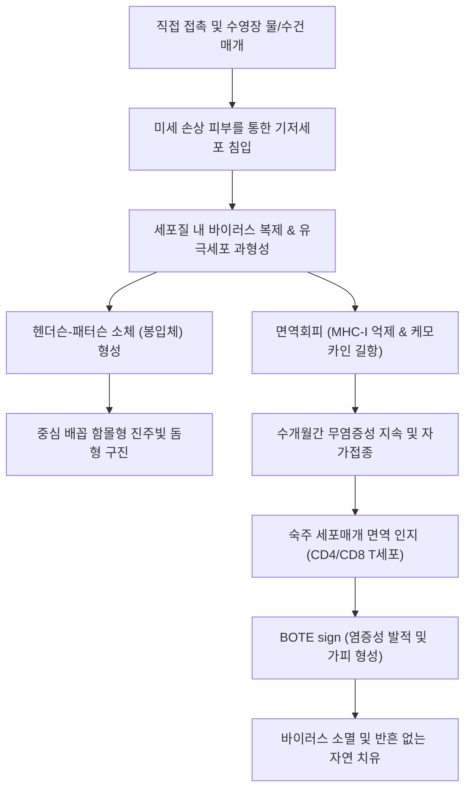

# 🩺 전염성 물렁종 (Molluscum Contagiosum, 물사마귀)

> **핵심 3줄 요약 (Key Summary)**:
> - 📍 병소 부위 & 해부·병태생리: 폭스바이러스과(Poxviridae)의 물렁종 바이러스(Molluscum Contagiosum Virus, MCV)가 표피 각질형성세포(keratinocytes)에 국소 감염되어 세포질 내에서 증식하며 대형 호산성 봉입체인 헨더슨-패터슨 소체(Henderson-Paterson bodies)를 형성하고, 표피의 과형성을 유발하여 중심부 배꼽 모양 함몰(central umbilication)을 가진 돔형 구진을 형성하는 양성 피부 바이러스 감염증.
> - 🚩 전형적 임상 양상: 소아의 체간, 사지 굴측 또는 성인의 서혜부/외음부에 나타나는 2~5mm 크기의 진주빛 또는 살색의 반구형 구진. 중앙부가 배꼽처럼 오목하게 들어가 있으며, 압출 시 치즈 모양의 백색 물렁종 소체(molluscum body) 핵이 배출됨.
> - 🛠️ 핵심 검사 & 치료 전략: 특징적인 중심 함몰 구진의 임상적 육안 진찰(Dermoscopy상 백색/황색 무구조 구체와 방사상 혈관). 대다수는 6~12개월 내 자가소퇴(self-limiting)하므로 경과 관찰이 원칙이나, 자가접종 및 전파 방지를 위해 소파술(curettage), 냉동치료(cryotherapy), 칸타리딘(Cantharidin) 도포 또는 살리실산 국소 요법 시행.
> - ⚠️ 응급 의뢰 레드플래그: 안면부 전체에 수백 개 이상 거대하게 다발성으로 발생하는 경우 또는 직경 10mm 이상의 거대 물렁종(Giant molluscum) 출현 시 중증 면역결핍증([[HIV 감염]] 또는 백혈병)의 강력한 지표이므로 전신 면역학적 정밀 검사 필수.

---

## 📌 목차
1. [질환 개요 & 해부학적 병태생리](#1--질환-개요---해부학적-병태생리)
2. [병태생리 메커니즘 & 생체역학적 악순환 네트워크](#2--병태생리-메커니즘---생체역학적-악순환-네트워크)
3. [임상 증상 & 이학적 검사(Physical Exam) 알고리즘](#3--임상-증상---이학적-검사physical-exam-알고리즘)
4. [진단 검사 & 감별 진단 패널](#4--진단-검사---감별-진단-패널)
5. [양방 치료 프로토콜 & 약물 상호작용](#5--양방-치료-프로토콜---약물-상호작용)
6. [한의 기능의학적 치료 프로토콜](#6--한의-기능의학적-치료-프로토콜)
7. [재활 운동 & 생활습관 티칭 가이드](#7--재활-운동---생활습관-티칭-가이드)
8. [💡 사용자 진료실 핵심 필기 & 임상 노하우 (Melt-In 잔여 심화 집약)](#8--사용자-진료실-핵심-필기---임상-노하우-melt-in-잔여-심화-집약)
9. [출처 및 학술 참고 문헌 (References)](#9--출처-및-학술-참고-문헌-references)

---

## 1. 질환 개요 & 해부학적 병태생리

### 1) 정의 및 바이러스 특성
전염성 물렁종(Molluscum Contagiosum, 물사마귀, 전염성 연속종)은 대형 이중나선 DNA 바이러스인 Molluscum Contagiosum Virus(MCV, Poxviridae과 Molluscipoxvirus속) 감염에 의해 발생하는 표재성 표피 질환이다. 유전자형에 따라 MCV-1부터 MCV-4까지 4종류가 존재하며, 임상 병변의 90% 이상은 MCV-1에 의해 발생한다. 주로 피부 장벽이 미성숙한 1~10세의 소아(수영장 이용, 아토피 피부염 동반아)와 성접촉을 통해 감염되는 젊은 성인(외음부, 회음부 발생)에서 호발한다. 직접적인 피부 대 피부 접촉, 수건이나 스펀지 등 매개물(fomites), 또는 환자 자신의 긁는 행위에 의한 자가접종(autoinoculation)을 통해 전파된다.

### 2) 표피 내 감염과 헨더슨-패터슨 소체(물렁종 소체)
- MCV는 진피나 전신 혈류로 침투하지 않고, 오직 표피 기저층(stratum basale)의 분열하는 각질형성세포에만 특이적으로 결합·침입한다.
- 감염된 기저세포가 유극층(stratum spinosum)과 과립층(stratum granulosum)으로 분화·상승함에 따라 세포질 내에서 대량의 바이러스 복제가 진행된다.
- 세포질 전체를 가득 채우는 거대한 난형의 호산성(초기) 및 호염기성(후기) 봉입체인 **물렁종 소체(Molluscum bodies 또는 Henderson-Paterson bodies)**가 형성되며, 이 소체가 핵을 세포막 가장자리로 밀어내 초승달 모양으로 변형시킨다.
- 각질층 중심부가 괴사·탈락하면서 특유의 중앙 분화구 모양 배꼽 함몰(crateriform umbilication)이 형성되며, 그 내부에는 바이러스 입자로 가득 찬 백색 치즈양 점성 물질이 응집된다.

---

## 2. 병태생리 메커니즘 & 생체역학적 악순환 네트워크

### 1) 숙주 면역 회피 기전
MCV는 인간 면역계를 회피하기 위한 정교한 면역 조절 유전자를 보유하고 있어 수개월 이상 면역 반응 없이 잠복·증식할 수 있다:
- **MC013L**: NF-κB 활성화를 억제하여 전염증성 사이토카인 방출을 차단.
- **MC080L**: 세포 표면의 MHC class I 분자 발현을 하향 조절하여 세포독성 T세포(CD8+)의 인식을 회피.
- **MC148**: 케모카인 수용체 길항제로 작용하여 단핵구와 백혈구의 병변 침윤을 억제.
- **MC066L**: 셀레노단백질(selenoprotein)로서 숙주 대식세포가 생성하는 활성산소종(ROS)에 의한 산화 손상으로부터 바이러스를 보호.

### 2) 비긴 증후군 (BOTE sign)과 자가소퇴
감염 수개월 후, 숙주의 면역계가 결국 바이러스 항원을 인지하면 병변 주위로 림프구 침윤이 급격히 증가한다.
- 병변 주위가 붉어지고 붓고 고름이 잡히는 **'물렁종의 시작의 끝(Beginning of the End, BOTE sign)'** 또는 물렁종 주위 피부염이 발생한다.
- 이는 세균성 2차 감염이 아니라 숙주 면역계가 바이러스를 파괴하고 있다는 강력한 면역학적 치유 신호이며, BOTE 반응이 나타난 병변은 수주 이내에 자연 소퇴된다.

---

## 3. 임상 증상 & 이학적 검사(Physical Exam) 알고리즘

### 1) 전형적 임상 증상
- **돔형 구진 (Dome-shaped papules)**: 직경 2~5mm(드물게 10mm 이상)의 표면이 매끈하고 반짝이는 진주빛(pearly), 살색 또는 분홍색의 단단한 반구형 구진.
- **중심 배꼽 함몰 (Central umbilication)**: 구진의 정중앙에 옴팡하게 패인 작은 배꼽 모양 함몰이 뚜렷하게 관찰된다.
- **병변 분포**: 소아는 몸통, 액와부, 둔부, 무릎 뒤 오금 및 팔 접히는 부위에 군집을 이루며 호발한다(손바닥, 발바닥은 침범하지 않음). 성인은 서혜부, 하복부, 외음부 및 대퇴 안쪽에 호발한다.
- **자가접종 선상 배열**: 쾨브너 현상(Koebner phenomenon)에 의해 환자가 긁은 자리를 따라 일직선으로 병변이 줄지어 생길 수 있다.

### 2) 이학적 검사 알고리즘
1. **중심 함몰 확인**: 측면 사광선 조명 또는 더모스코피(Dermoscopy)를 통해 중심 배꼽 분화구 구조 확인.
2. **더모스코피 소견**: 무정형의 백색 또는 황색 구체(clods/orbs)가 중심부에 밀집되어 있고, 주변을 방사상 또는 관 모양의 혈관(radial/crown vessels)이 둘러싸고 있으나 중심 구체 내부로는 관통하지 않는 소견 확인.
3. **압출 검사(Expressibility)**: 핀셋으로 구진을 측면에서 가볍게 쥐어짰을 때 중심 구멍에서 단단한 백색 치즈 모양의 중심핵(molluscum core)이 쉽게 튀어나오는지 확인.

---

## 4. 진단 검사 & 감별 진단 패널

### 1) 감별 진단 패널
| 질환명 | 호발 연령 및 형태 | 전염성 물렁종과의 핵심 감별점 |
| :--- | :--- | :--- |
| **심상성 사마귀 (Verruca vulgaris)** | HPV 감염, 각질성 거친 표면 | 표면이 거칠고 사마귀 모양(verrucous), 점상 출혈(thrombosed capillaries) 관찰, 중심 함몰 없음 |
| **수두 (Varicella)** | 전신 산재성, 급성 발열 동반 | 맑은 이슬방울 모양 수포(dewdrop on rose petal), 급속한 농포 및 가피 전변 |
| **폐립종 (Milium)** | 안면부 안와 주위 1~2mm 각질 낭종 | 중심 함몰이 없음, 매우 단단한 백색 각질 덩어리, 자가접종 선상 배열 없음 |
| **모낭염 (Folliculitis)** | 모낭 중심의 급성 홍반 및 농포 | 모낭을 관통하는 털이 관찰됨, 중심 압통, 세균 감염 위주 |
| **기저세포암 (Basal cell carcinoma)** | 고령자 안면 노출부, 진주빛 결절 | 궤양 형성, 모세혈관 확장증이 결절 표면을 가로지름, 중심 함몰이 아닌 궤양화 |

---

## 5. 양방 치료 프로토콜 & 약물 상호작용

### 1) 경과 관찰 (자연 치유 대기)
전염성 물렁종은 건강한 소아에서 평균 6~18개월(최장 3~4년) 이내에 흉터 없이 자발적으로 소퇴한다. 통증을 수반하는 침습적 치료가 아이에게 트라우마를 줄 수 있으므로, 병변 수가 적고 가려움이 없다면 무치료 경과 관찰이 1차 선택지로 권고된다.

### 2) 능동적 물리적·화학적 제거술 (적응증 시)
- **적응증**: 미용적 스트레스가 심한 노출 부위, 자가접종으로 급격히 확산되는 경우, 아토피 피부염 병발 부위, 성매개 감염 성인 환자.
- **외과적 소파술(Curettage)**: 국소 마취 크림(EMLA 등) 도포 30~60분 후, 큐렛(Dermal curette)으로 중심핵을 긁어내어 물리적으로 제거 (가장 빠르고 확실한 완치율).
- **냉동요법(Cryotherapy)**: 액체질소(-196℃)를 면봉이나 스프레이로 5~10초간 적용, 2~3주 간격 반복.
- **칸타리딘(Cantharidin 0.7~0.9% 용액)**: 딱정벌레 유래 수포형성제. 병변 중심에 미량 점적 후 2~6시간 뒤 비누로 세척하여 무통성 수포 형성 후 탈락 유도.
- **국소 면역조절제**: 5% [[이미퀴모드]](Imiquimod 크림) 주 3회 도포 (면역 반응 유도).

---

## 6. 한의 기능의학적 치료 프로토콜

### 1) 변증 분형 (TCM Differentiation)
한의학적으로 전염성 물렁종은 [[포창]](疱瘡), [[서우]](鼠乳)의 범주에 속하며, 체질적으로 [[폐비기허]](肺脾氣虛)하여 위기(衛氣)가 견고하지 못한 상태에서 [[풍열습독]](風熱濕毒)이 피부 주리(腠理)로 침범하여 기혈을 울체시키고 췌우(贅疣)를 형성한 병태로 변증한다.

| 변증 | 전형적 증상 | 설태 및 맥상 | 대표 처방 |
| :--- | :--- | :--- | :--- |
| **비허습성형 (脾虛濕盛型)** | 안색위황, 식욕부진, 연변, 다발성 물사마귀, 만성 지속 | 설담반 치흔, 태백니(白膩), 맥완약(緩弱) | [[의이인탕]] 합 [[삼령백출산]] 가감 |
| **풍열울체형 (風熱鬱滯型)** | 구진 주위 발적, 가려움, 신생 병변 급속 확산, 번조 | 설홍 태박황(薄黃), 맥부삭(浮數) | [[소풍산]] 합 [[상국음]] |
| **기허혈어형 (氣虛血瘀型)** | 장기 지속되는 암회색 구진, 단단한 췌우, 피로, 면역 저하 | 설담어반, 맥세삽(細澁) | [[보중익기탕]] 합 [[도홍사물탕]] |

### 2) 핵심 단미제 요법
- **[[의이인]](율무, Coicis Semen)**: 전염성 물렁종 한의 치료의 군약(君藥). 하루 30~60g을 진하게 전탕하여 복용하거나 분말로 복용. 의이인의 코이세놀라이드(Coixenolide) 성분은 항바이러스 활성과 세포성 면역 증강을 촉진하여 물렁종의 자가탈락을 강력히 유도함.

---

## 7. 재활 운동 & 생활습관 티칭 가이드

- **목욕 및 수영장 관리**: 병변이 완전히 소퇴할 때까지 공용 수영장, 대중목욕탕 이용을 자제. 가정 내에서도 형제·자매와의 동반 통목욕을 금지하고 단독 샤워 권고.
- **수건 및 옷 단독 사용**: 수건, 목욕 스펀지, 옷을 가족과 철저히 분리.
- **병변 긁기 방지**: 환아의 손톱을 짧게 깎아주고, 긁어서 자가접종되지 않도록 낮에는 헐렁한 긴소매 옷을 입히거나 하이드로콜로이드 밴드로 물리적 차단.
- **아토피 피부염 병행 치료**: 아토피가 동반된 환아는 피부 장벽 파괴와 소파 행위로 전신 확산 위험이 높으므로, 보습제 도포를 철저히 하여 기저 피부염을 안정화시킴.

---

## 8. 💡 사용자 진료실 핵심 필기 & 임상 노하우 (Melt-In 잔여 심화 집약)

- **"빨갛게 곪았다고 해서 항생제 먹이지 말 것 (BOTE Sign)"**:
  - 부모들이 "물사마귀가 곪고 터지려고 해요"라며 겁을 먹고 내원하는 경우가 많다. 병변이 빨갛게 부어오르고 고름처럼 보이는 것은 세균 감염이 아니라 아이의 몸속 면역세포가 바이러스를 파악해 총공격을 퍼붓고 있는 **BOTE(Beginning of the End) 징후**이다. 이 반응이 오면 2~3주 안에 그 물사마귀는 깨끗이 떨어진다. 항생제나 스테로이드를 쓰지 말고 "이제 몸에서 이겨내고 있으니 가만히 두시라"고 안심시키는 것이 명의의 티칭이다.
- **억지로 다 짜내려다 트라우마만 남긴다**:
  - 수십 개가 번진 소아 환자를 잡고 큐렛이나 핀셋으로 피를 흘리며 다 짜내면 아이는 병원 공포증이 생기고 부모도 지친다. 가장 크고 긁기 쉬운 몇 개만 제거해주고, 나머지는 의이인(율무) 처방과 면역 안정화로 자연 소퇴를 유도하는 것이 훨씬 순응도가 높다.
- **성인의 외음부 물사마귀는 콘딜로마(곤지름)와의 감별이 최우선**:
  - 성인의 생식기에 생긴 물사마귀는 배꼽 함몰이 뚜렷하지 않으면 첨규 콘딜로마(HPV)로 오진되기 쉽다. 압출 시 치즈 같은 중심핵이 튀어나오면 물렁종이고, 닭볏이나 유두 모양으로 자라나면 곤지름이다.

---

## 9. 출처 및 학술 참고 문헌 (References)

- Meza-Romero, R., et al. (2019). Molluscum contagiosum: an update and review of new perspectives in etiology, diagnosis, and treatment. *Clin Cosmet Investig Dermatol*. PMID: 31239742.

- 대한피부과학회. (2020). *피부과학 (제7판)*. 도서출판 대한의학.

- 대한소아청소년과학회. (2020). *소아청소년과학 (제12판)*. 학지사메디컬.

- 한방안이비인후피부과학회. (2021). *한의피부외과학*. 도서출판 정담.

---

## 관련 노트

- [[사마귀]]
- [[아토피 피부염]]
- [[의이인]]
- [[보중익기탕]]
- [[소풍산]]
