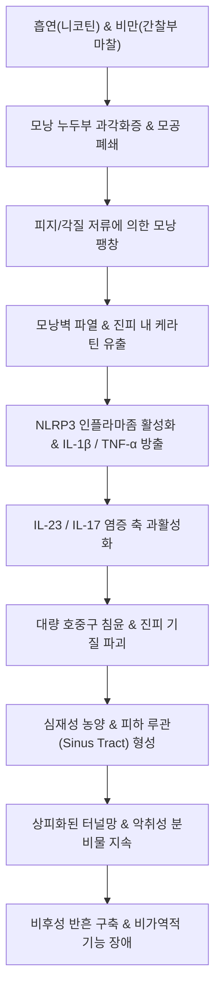

# 🩺 화농땀샘염 (Hidradenitis Suppurativa, 반전성 여드름)

> **핵심 3줄 요약 (Key Summary)**:
> - 📍 병소 부위 & 해부·병태생리: 아포크린샘(apocrine glands)이 밀집된 간찰 부위(액와부, 서혜부, 회음부, 둔부, 유방 하부)의 모낭 누두부(follicular infundibulum) 과각화증으로 모낭이 폐쇄·파열되어 케라틴과 세균이 진피로 유출됨으로써 호중구 침윤, 만성 육아종성 농양, 피하동도(sinus tract) 및 광범위한 밧줄 모양 비후성 반흔을 형성하는 재발성 만성 염증성 모낭 질환.
> - 🚩 전형적 임상 양상: 사춘기 이후 성인에서 발생하는 통증성 심재성 결절, 재발성 농양, 악취를 풍기는 화농성 삼출물 배출 샛길(루관), 다발성 개방 면포(tombstone double-ended comedones), 흉터 구축. 허리 Hurley 3단계 병기 분류로 중증도 평가.
> - 🛠️ 핵심 검사 & 치료 전략: 특징적 호발 부위와 재발성 병변의 임상 진찰(초음파로 피하 누관 및 농양 깊이 평가). 1단계: 국소 클린다마이신; 2단계: 경구 테트라사이클린계 또는 클린다마이신+리팜핀 병용; 3단계: 생물학적 제제인 항[[TNF-α]] 제제([[아달리무맙]], Adalimumab) 또는 항IL-17 제제([[세쿠키누맙]], Secukinumab), 외과적 누관 절제술 및 광범위 절제술. 체중 감량과 금연 필수.
> - ⚠️ 응급 의뢰 레드플래그: 광범위한 심부 농양 파열로 인한 패혈증([[쇼크]]), 급성 골반 봉와직염, 괴사성 근막염 의심 시 즉시 상급병원 응급 수술 및 광범위 정맥 항생제 투여. 10~20년 이상 지속된 만성 누관 부위에서 편평세포암(Squamous cell carcinoma) 발생 위험 모니터링.

---

## 📌 목차
1. [질환 개요 & 해부학적 병태생리](#1--질환-개요---해부학적-병태생리)
2. [병태생리 메커니즘 & 생체역학적 악순환 네트워크](#2--병태생리-메커니즘---생체역학적-악순환-네트워크)
3. [임상 증상 & 이학적 검사(Physical Exam) 알고리즘](#3--임상-증상---이학적-검사physical-exam-알고리즘)
4. [진단 검사 & 감별 진단 패널](#4--진단-검사---감별-진단-패널)
5. [양방 치료 프로토콜 & 약물 상호작용](#5--양방-치료-프로토콜---약물-상호작용)
6. [한의 기능의학적 치료 프로토콜](#6--한의-기능의학적-치료-프로토콜)
7. [재활 운동 & 생활습관 티칭 가이드](#7--재활-운동---생활습관-티칭-가이드)
8. [💡 사용자 진료실 핵심 필기 & 임상 노하우 (Melt-In 잔여 심화 집약)](#8--사용자-진료실-핵심-필기---임상-노하우-melt-in-잔여-심화-집약)
9. [출처 및 학술 참고 문헌 (References)](#9--출처-및-학술-참고-문헌-references)

---

## 1. 질환 개요 & 해부학적 병태생리

### 1) 정의 및 역학
화농땀샘염(화농성 한선염, Hidradenitis Suppurativa, HS, Acne inversa)은 모낭-피지선-아포크린 복합체(pilosebaceous-apocrine unit)에 발생하는 파괴적인 만성 재발성 염증성 질환이다. 과거에는 아포크린 땀샘 자체의 원발성 세균 감염으로 여겨졌으나, 현대 병리학에서는 **모낭 누두부의 과각화성 폐쇄(follicular occlusion)**가 선행하는 자가염증성 질환으로 규명되었다. 전 세계적으로 유병률은 약 0.5~2%이며, 여성에서 남성보다 3배 흔하고 주로 사춘기 이후 20~30대에 발병한다. 흡연, 비만(대사증후군), 유전적 소인(γ-secretase 복합체 변이), 기계적 마찰이 핵심적인 악화 요인이다.

### 2) 간찰 부위의 미세 해부학적 병변 형성
- **호발 부위**: 아포크린샘이 발달하고 피부 접힘과 마찰이 심한 겨드랑이(액와), 사타구니(서혜부), 회음부, 항문 주위, 둔부 주름, 여성의 유방 밑 주름에 대칭적으로 호발한다.
- **모낭 폐쇄와 파열**: 모낭 누두부 각질세포가 과도하게 증식하여 모낭 입구를 막으면 피지와 각질 파편이 저류되어 모낭이 낭종성으로 팽창한다.
- **진피 내 염증 파급**: 결국 모낭벽이 파열되면서 갇혀있던 각질, 세균 산물, 피지가 진피 결합조직 내로 쏟아져 나온다. 이에 반응하여 호중구와 대식세포가 결집하면서 급성 농양(abscess)이 형성된다.
- **피하 루관(Sinus tract) 및 반흔 형성**: 만성적인 염증 자극으로 모낭 상피가 진피 내로 비정상적으로 자라 들어가 피하 터널(샛길, sinus tract)을 형성한다. 여러 개의 터널이 서로 연결되며 고름과 장액이 지속 배출되고, 치유 과정에서 섬유모세포 증식으로 비후성 반흔과 밧줄 모양의 흉터 띠(bridging keloid-like scars)가 고착된다.

---

## 2. 병태생리 메커니즘 & 생체역학적 악순환 네트워크

### 1) 자가염증 경로 (IL-1, IL-17, TNF-α)
모낭 파열 후 유출된 물질은 패턴인식수용체(TLR2, TLR4)를 자극하여 NLRP3 인플라마좀을 활성화한다.
1. 대식세포와 수지상세포에서 대량의 인터루킨-1베타([[IL-1β]]), [[TNF-α]], [[IL-23]]이 분비된다.
2. IL-23은 Th17 림프구를 강력히 분화시켜 [[IL-17]] 생성을 자극한다.
3. IL-17과 TNF-α의 시너지 작용으로 CXCL8(IL-8) 등 케모카인이 폭발적으로 방출되어 진피로 엄청난 수의 호중구를 동원한다. 호중구의 세포외 덫(NETs)과 엘라스타아제 분비로 진피 기질이 파괴되고 심부 농양이 확대된다.

### 2) 생체역학적 마찰과 니코틴의 증폭 효과
- **마찰 전단응력**: 비만 환자에서 간찰 부위의 살과 살이 맞닿는 기계적 마찰은 모낭벽의 조기 파열을 물리적으로 촉진한다.
- **흡연(니코틴)**: 표피 각질세포의 아세틸콜린 수용체(α7-nAChR)를 자극하여 모낭 누두부의 과각화증을 악화시키고, 호중구의 주화성을 비정상적으로 항진시키며, 아포크린샘 분비를 억제하여 세균총 불균형(dysbiosis)을 유발한다.

---

## 3. 임상 증상 & 이학적 검사(Physical Exam) 알고리즘

### 1) Hurley 병기 분류 (Staging System)
- **Hurley 1기 (경증)**: 피하 누관(fistula)이나 흉터 형성 없이 단발성 또는 다발성의 고립된 농양 및 통증성 결절만 관찰됨.
- **Hurley 2기 (중등도)**: 재발성 농양과 함께 하나 이상의 피하 누관(fistula) 및 흉터 형성이 관찰되나, 병변 사이에 정상 피부가 분리되어 존재함.
- **Hurley 3기 (중증)**: 병변 부위 전체에 걸쳐 정상 피부 없이 미만성으로 연결된 광범위한 피하 누관망, 다발성 상호연결 농양 및 융합된 비후성 흉터 덩어리가 관찰됨.

### 2) 이학적 검사 특징
- **묘비 양두 면포 (Tombstone double-ended comedones)**: 두 개 이상의 모공 개구부가 피하에서 서로 연결되어 다발성 블랙헤드처럼 보이는 특징적 병변.
- **피하 누관 촉진**: 두 손가락으로 병변 주변을 압박했을 때 수 센티미터 떨어진 다른 구멍에서 치약처럼 고름이 솟구쳐 나오는 개통성 확인.
- **구축 및 관절 운동 제한**: 액와부나 서혜부의 심한 반흔 구축으로 팔을 들어 올리거나 다리를 벌리는 관절 가동 범위 제한 확인.

---

## 4. 진단 검사 & 감별 진단 패널

### 1) 진단 기준
화농땀샘염은 다음 세 가지 핵심 임상 기준을 만족하면 임상적으로 확진된다:
1. 전형적인 병변: 심재성 통증성 결절, 농양, 누관, 다발 면포, 흉터.
2. 전형적인 해부학적 위치: 액와부, 서혜부, 회음부, 둔부, 유방 하부.
3. 만성 재발성 경과: 최근 6개월 이내 2회 이상 재발.

### 2) 감별 진단 패널
| 질환명 | 주 병변 및 특징 | 화농땀샘염과의 핵심 감별점 |
| :--- | :--- | :--- |
| **단순 모낭염 및 절종 (Furuncle/Carbuncle)** | 급성 세균 감염(황색포도상구균) | 단발성 급성 병변, 항생제 치료 시 완전 소퇴, 피하 누관이나 양두 면포 형성 없음 |
| **[[피부 결핵]] / 스크로풀라더마** | 림프절 결핵 파열에 의한 누관 | 결핵균 배양 양성, 체중 감소 및 발열 동반, 폐결핵 병력 |
| **크론병 피부 병변 (Cutaneous Crohn's)** | 회음부 및 항문 주위 누관 | 소화기 증상(만성 설사, 복통), 대장내시경 소견, 무건락성 육아종 조직 소견 |
| **표피낭종 파열 (Ruptured epidermoid cyst)** | 각질 충만 낭종의 염증성 파열 | 단발성 병변, 피하 누관망 형성 없음, 낭벽 조직 확인 |
| **모소낭 질환 (Pilonidal sinus)** | 둔부 미골 부위 정중선 함몰 및 샛길 | 미골 부위(천미골부)에 국한, 털 뭉치 매몰 |

---

## 5. 양방 치료 프로토콜 & 약물 상호작용

### 1) 단계별 약물 치료 프로토콜
- **Hurley 1기**:
  - 국소 항생제: [[클린다마이신]](Clindamycin 1% 액/겔) 1일 2회, 12주간 도포.
  - 급성 통증성 결절: 병변내 트리암시놀론 주사(ILTA, 5~10 mg/mL).
- **Hurley 2기 (전신 항생제 및 항안드로겐 요법)**:
  - 1차 경구 항생제: 테트라사이클린계([[독시사이클린]] 100mg 1일 2회 또는 미노사이클린 100mg 1일 2회) 10~12주간 투여 (항균 효과보다 항염증 효과 목적).
  - 2차 경구 복합 항생제: [[클린다마이신]](300mg bid) + [[리팜핀]](300mg bid) 병용 10~12주간 투여.
  - 여성 환자: 항안드로겐 요법(스피로놀락톤 50~100mg/day 또는 에스트로겐 함유 경구피임약).
- **Hurley 3기 또는 불응성 2기 (생물학적 제제)**:
  - **[[아달리무맙]](Adalimumab, Humira)**: 항TNF-α 제제. 최초 160mg, 2주차 80mg, 4주차부터 매주 40mg 피하 주사.
  - **[[세쿠키누맙]](Secukinumab, Cosentyx)**: 항IL-17A 제제. 300mg 피하 주사.

### 2) 외과적 수술 치료
- **누관 개방술(Deroofing)**: 국소 마취 하에 누관의 덮개(천장)를 절개하여 내부를 긁어내고 이차 의도 치유(secondary intention healing)를 유도.
- **광범위 근치적 절제술(Wide surgical excision)**: 3기 중증 환자에서 피하 조직 전체를 마진을 두고 완전 절제 후 피부 이식 또는 피판술 시행 (재발률을 가장 낮추는 근본 요법).

---

## 6. 한의 기능의학적 치료 프로토콜

### 1) 변증 분형 (TCM Differentiation)
한의학적으로 화농땀샘염은 [[음저]](陰疽), [[침골저]](浸骨疽), [[액옹]](腋癰)의 범주에 속하며, [[간담습열]](肝膽濕熱), [[비허습체]](脾虛濕滯)로 인해 체내에 축적된 습담(濕痰)과 어혈(瘀血)이 기표(肌表)로 몰려 만성적인 농포와 루관을 형성한 병태로 변증한다.

| 변증 | 전형적 증상 | 설태 및 맥상 | 대표 처방 |
| :--- | :--- | :--- | :--- |
| **습열온독·급성결절형 (濕熱蘊毒·急性結節型)** | 국소 열감, 심한 압통, 팽창성 결절, 구갈, 변비, 번열 | 설홍 태황후니(黃厚膩), 맥활삭(滑數) | [[용담사간탕]] 합 [[오미소독음]] |
| **담어호결·누관형 (痰瘀互結·瘻管型)** | 밧줄 모양의 반흔, 만성 배농 샛길, 암자색 결절, 무열감 | 설자어반 태백니(白膩), 맥현삽(弦澁) | [[선방활명음]] 합 [[이진탕]] 가감 |
| **기혈양허·독체불거형 (氣血兩虛·毒滯不去型)** | 묽은 고름 지속 배출, 창구 불유합, 창백, 만성 피로, 무기력 | 설담 태박백(薄白), 맥세약무력(細弱無力) | [[탁리소독음]] 합 [[십전대보탕]] |

### 2) 침구 및 한약 외용 치료
- **국소 배농 및 어혈 순환 촉진**: 병변 주변 위침법(圍針法), [[극문]](PC4), [[혈해]](SP10), [[음릉천]](SP9), [[곡천]](LR8).
- **탁리배농(托裏排膿)**: 황기(黃芪), 당귀(當歸), 백지(白芷)를 증량하여 허증 상태의 만성 누관의 육아조직 증식 및 상피 유합 유도.

---

## 7. 재활 운동 & 생활습관 티칭 가이드

- **금연 (절대적 필수 수칙)**: 흡연은 HS 발병과 중증도 악화의 제1원인이다. 금연하지 않고 약물 치료만 받는 것은 밑 빠진 독에 물 붓기임을 환자에게 명확히 주지.
- **체중 감량 및 식습관 개선**: BMI를 정상화하여 피부 접힘 마찰을 줄이고 인슐린 저항성을 개선. 고혈당 지수(High GI) 음식, 유제품, 가공육 섭취 제한.
- **의복 관리**: 땀을 흡수하고 통풍이 잘되는 헐렁한 면 소재 속옷 착용. 조이는 와이어 브래지어, 레깅스, 꽉 끼는 청바지 착용 금지.
- **국소 세정**: 마찰을 유발하는 때밀이 목욕 금지. 무자극성 약산성 클렌저 또는 클로르헥시딘 바디워시 사용.

---

## 8. 💡 사용자 진료실 핵심 필기 & 임상 노하우 (Melt-In 잔여 심화 집약)

- **"단순 종기인 줄 알고 자꾸 째면 병을 키운다"**:
  - 화농땀샘염 환자가 결절을 호소할 때마다 동네 의원에서 단순 절개배농(I&D)만 반복하면 피하 조직이 더 손상되어 샛길(sinus tract)이 사방으로 뚫리는 최악의 결과를 낳는다. 급성 통증 조절 목적이 아니라면 단순 절개는 금기이며, 누관을 완전히 열어젖히는 Deroofing이나 전신 치료를 해야 한다.
- **"더러워서 생기는 병이 아닙니다"라는 환자 안심 티칭**:
  - 악취와 고름 때문에 환자들은 자신이 잘 안 씻어서 병이 생겼다고 자책하며 극심한 우울증과 대인기피증을 겪는다. 환자에게 "이 병은 세균에 감염되어 안 씻어서 생긴 병이 아니라, 모공 입구가 막혀서 생기는 체질적 염증 질환"임을 분명히 설명하여 심리적 자괴감을 해소해 주어야 한다.
- **체중 10kg 감량과 금연이 생물학적 제제보다 강하다**:
  - 수백만 원짜리 휴미라를 맞아도 매일 담배를 피우고 고도비만 상태를 유지하면 1년 안에 약효가 소실된다. 진료실에서 가장 먼저 달성해야 할 치료 목표는 금연 클리닉 연계와 체중 감량 플랜이다.

---

## 9. 출처 및 학술 참고 문헌 (References)

- Sabat, R., et al. (2025). Hidradenitis suppurativa. *Lancet*. PMID: 39862870.

- 대한피부과학회. (2020). *피부과학 (제7판)*. 도서출판 대한의학.

- 대한내과학회. (2020). *Harrison's 내과학 (제20판)*. 도서출판 MIP.

- 한방안이비인후피부과학회. (2021). *한의피부외과학*. 도서출판 정담.

---

## 관련 노트

- [[만성 단순 태선]]
- [[대사증후군]]
- [[아달리무맙]]
- [[클린다마이신]]
- [[용담사간탕]]
- [[탁리소독음]]
