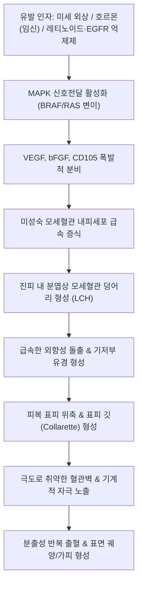

# 🩺 화농성 육아종 (Pyogenic Granuloma, 분엽상 모세혈관종)

> **핵심 3줄 요약 (Key Summary)**:
> - 📍 병소 부위 & 해부·병태생리: 이름과 달리 세균성 '화농(pyogenic)'이나 진정한 육아종성(granulomatous) 염증이 아니며, 미세 외상, 호르몬 자극(임신), 약물 등에 반응하여 피부 및 점막의 모세혈관이 폭발적으로 증식하여 섬유성 점액성 간질에 둘러싸인 분엽(lobules)을 형성하는 양성 혈관 증식성 종양(분엽상 모세혈관종, Lobular Capillary Hemangioma, LCH).
> - 🚩 전형적 임상 양상: 소아의 안면부나 젊은 성인의 손가락, 입술, 구강 치은(임신성 육아종)에 호발하는 유경성(pedunculated) 또는 무경성의 적갈색 구진/결절(직경 수 mm~1cm). 표면 궤양, 미세한 자극에도 멈추지 않는 분출성 출혈(profuse recurrent bleeding), 기저부를 둘러싼 표피 깃(epidermal collarette).
> - 🛠️ 핵심 검사 & 치료 전략: 특징적 육안 소견 및 더모스코피(적색 균일 영역과 백색 철도선상 궤도 띠). 악성 흑색종(무색소성 흑색종), 카포시 육종과의 감별을 위한 병리 조직검사 필수. 치료는 국소마취 하 소파 및 전기소작술(Curettage & Electrodessication), 외과적 쐐기 절제술, 또는 소아에서 국소/경구 [[프로프라놀롤]](Propranolol)이나 베타차단제(티몰롤 0.5% 점안액) 도포.
> - ⚠️ 응급 의뢰 레드플래그: 고령자에서 신생한 출혈성 붉은 결절은 무색소성 악성 흑색종(Amelanotic melanoma) 또는 혈관육종(Angiosarcoma)과의 육안적 구분이 불가능하므로 지체 없이 전층 절제 생검 및 피부암 전문 센터 의뢰.

---

## 📌 목차
1. [질환 개요 & 해부학적 병태생리](#1--질환-개요---해부학적-병태생리)
2. [병태생리 메커니즘 & 생체역학적 악순환 네트워크](#2--병태생리-메커니즘---생체역학적-악순환-네트워크)
3. [임상 증상 & 이학적 검사(Physical Exam) 알고리즘](#3--임상-증상---이학적-검사physical-exam-알고리즘)
4. [진단 검사 & 감별 진단 패널](#4--진단-검사---감별-진단-패널)
5. [양방 치료 프로토콜 & 약물 상호작용](#5--양방-치료-프로토콜---약물-상호작용)
6. [한의 기능의학적 치료 프로토콜](#6--한의-기능의학적-치료-프로토콜)
7. [재활 운동 & 생활습관 티칭 가이드](#7--재활-운동---생활습관-티칭-가이드)
8. [💡 사용자 진료실 핵심 필기 & 임상 노하우 (Melt-In 잔여 심화 집약)](#8--사용자-진료실-핵심-필기---임상-노하우-melt-in-잔여-심화-집약)
9. [출처 및 학술 참고 문헌 (References)](#9--출처-및-학술-참고-문헌-references)

---

## 1. 질환 개요 & 해부학적 병태생리

### 1) 정의 및 명칭의 역사적 오류
화농성 육아종(Pyogenic Granuloma, PG)은 피부와 구강 점막에 흔히 발생하는 양성 혈관성 신생물이다. 1897년 Poncet과 Dor에 의해 처음 기술될 당시 포도상구균 감염에 의한 화농성 감염 질환으로 오인되어 '화농성 육아종'이라는 이름이 붙었으나, 실제로는 감염균이나 진정한 육아종성 염증 반응이 존재하지 않는 순수한 **반응성 모세혈관 증식증**이다. 이에 따라 병리학적으로는 **분엽상 모세혈관종(Lobular Capillary Hemangioma, LCH)**이 정확한 표준 질환명이다. 전 연령에서 발생하나 소아·청소년(평균 6~10세)과 가임기 여성(임신 2~3기)에서 유병률이 가장 높다.

### 2) 미세 해부학적 구조와 혈관 분엽화
- **병변의 구성**: 진피 내에 내피세포로 둘러싸인 무수한 미성숙 모세혈관들이 점액성 또는 섬유성 기질에 의해 나뉘어 특징적인 **분엽(lobules)**을 형성한다.
- **표피 깃 (Epidermal collarette)**: 종양이 진피로부터 빠르게 상방으로 팽창함에 따라 표피가 측면으로 밀려나 기저부 둘레를 에워싸는 얇은 표피성 깃(collarette) 구조를 형성한다.
- **표면 미란 및 이차 염증**: 종양을 덮고 있는 표피가 매우 얇고 위축되어 있어 가벼운 기계적 자극에도 쉽게 파열되어 궤양과 섬유소성 삼출물을 형성하며, 이 표재성 궤양 부위에만 이차적으로 호중구가 침윤한다.

---

## 2. 병태생리 메커니즘 & 생체역학적 악순환 네트워크

### 1) 혈관신생 촉진 인자의 과발현
화농성 육아종은 국소 조직 손상에 대한 비정상적인 상처 치유 반응(aberrant wound healing)으로 이해된다:
1. **외상 및 만성 자극**: 가벼운 찔림, 긁힘, 곤충 교상, 손톱 뜯기 등이 선행 요인으로 작용한다.
2. **혈관내피성장인자([[VEGF]]) 및 bFGF 급증**: 국소 저산소증과 조직 손상에 반응하여 대식세포와 섬유모세포에서 VEGF, 염기성 섬유모세포성장인자(bFGF), 엔도글린(CD105)이 과분비된다.
3. **BRAF / KRAS 체세포 돌연변이**: 최근 분자유전학 연구에 따르면 화농성 육아종 조직의 70~80%에서 MAPK 경로를 활성화하는 *BRAF* 또는 *RAS* 유전자의 체세포 돌연변이가 발견되어 단순 과형성을 넘어 클론성 혈관 신생물임이 밝혀졌다.

### 2) 호르몬 및 약물 유발 네트워크
- **임신성 육아종 (Granuloma gravidarum)**: 에스트로겐과 [[프로게스테론]] 수치가 급상승하는 임신 중에는 혈관 내피세포 증식이 극대화되어 구강 치은(잇몸)에 빈발하며, 출산 후 호르몬이 정상화되면 자연 퇴행하는 경향을 보인다.
- **약물 유발성**: 레티노이드(Isotretinoin, 아큐탄), 표적항암제(EGFR 억제제인 Geftinib, Erlotinib), 항레트로바이러스제(Indinavir) 복용 환자에서 조갑주위염과 함께 다발성으로 발생한다.

---

## 3. 임상 증상 & 이학적 검사(Physical Exam) 알고리즘

### 1) 특징적 임상 양상
- **급속한 성장 속도**: 며칠에서 수주 사이에 수 mm에서 1~2cm 크기로 급속히 커져 환자나 보호자가 악성 종양을 의심하고 공포를 느낌.
- **외형**: 선홍색, 암적색, 또는 자갈색의 매끈하거나 과립상의 반구형 또는 버섯 모양(유경성, pedunculated) 결절.
- **반복되는 난치성 출혈**: 옷에 스치거나 세수할 때 가볍게 닿기만 해도 동맥성 출혈처럼 피가 뿜어져 나오거나 멈추지 않고 수십 분간 흘러나옴.
- **호발 부위**: 안면부(뺨, 이마, 코), 입술, 혀, 잇몸, 손가락(특히 손톱 주위), 손바닥, 발가락.

### 2) 이학적 검사 및 더모스코피 알고리즘
1. **기저부 확인**: 결절의 목 부분(pedicle)을 둘러싸고 있는 하얀 띠 모양의 **표피 깃(Epidermal collarette)** 확인 (PG의 핵심 진단 단서).
2. **더모스코피(Dermoscopy) 소견**:
   - **적색 균일 영역(Red homogeneous areas)**: 증식된 모세혈관 분엽을 반영.
   - **백색 철도선상 궤도(White rail lines)**: 모세혈관 분엽 사이를 가로지르는 섬유성 중격(septa).
   - 완전 둘레를 감싸는 백색 표피 깃.
3. **압박 지혈 테스트**: 거즈로 직접 압박했을 때 쉽게 지혈되지 않는 고혈류성 혈관성 병변 특성 확인.

---

## 4. 진단 검사 & 감별 진단 패널

### 1) 진단적 병리 조직검사 (확진 및 악성 배제)
화농성 육아종은 육안적으로 악성 흑색종이나 카포시 육종과 구분이 어려울 수 있으므로, 제거 후 **반드시 조직병리검사를 의뢰**하여 악성 종양을 배제해야 한다:
- 병리 소견: 표피 직하부에 뚜렷한 섬유성 중격에 의해 분엽화된 모세혈관 증식, 내피세포 증식, 기저부 표피 깃 형성.

### 2) 감별 진단 패널
| 질환명 | 호발 연령 및 양상 | 화농성 육아종과의 감별점 |
| :--- | :--- | :--- |
| **무색소성 악성 흑색종 (Amelanotic melanoma)** | 중장년~고령자, 비대칭적 궤양성 결절 | 멜라닌 색소가 결여된 붉은 결절로 PG와 거의 동일하게 보임. 생검 필수, S100/HMB45 면역염색 양성 |
| **카포시 육종 (Kaposi sarcoma)** | 면역저하자, 고령자 하지 | HHV-8 바이러스 연관, 방추형 세포 증식 및 혈관 열공, CD31/HHV-8 양성 |
| **바실리 혈관종증 (Bacillary angiomatosis)** | 면역저하자([[HIV 감염]]) | *Bartonella henselae* 감염, Warthin-Starry 은염색에서 균체 관찰, 다발성 |
| **체리 혈관종 (Cherry angioma)** | 성인 체간부 다발성 적색 구진 | 급성 성장 없음, 출혈 경향 드묾, 크기 변화 적음 |
| **혈관확장성 육아종 / 편평세포암** | 고령자 노출부 만성 궤양성 결절 | 비정형 각질형성세포의 진피 침윤, 단단한 각화성 변연 |

---

## 5. 양방 치료 프로토콜 & 약물 상호작용

### 1) 외과적 및 물리적 치료 (표준 요법)
단순 절제만 하고 기저부를 남기면 15~40%의 높은 재발률을 보이므로, 기저부 혈관 공급대를 완전히 파괴해야 한다.
- **소파 및 전기소작술 (Curettage & Electrodessication, 1차 선택)**:
  - 국소 마취 하에 큐렛으로 종양 본체를 긁어내어 조직검사 검체로 보내고, 남아있는 기저부 혈관 공급대를 전기소작기로 지혈 및 탄화 소작 (재발률 < 5%).
- **외과적 쐐기 절제술 (Full-thickness excision)**: 재발 병변이거나 악성 감별이 불확실한 경우 전층 절제 후 일차 봉합.
- **냉동치료(Cryotherapy)** 또는 **혈관 레이저(PDL, Nd:YAG)**: 소아의 작은 병변에 적용.

### 2) 국소 약물 요법 (소아 및 비침습적 대안)
- **국소 베타차단제 요법**:
  - **티몰롤(Timolol 0.5% 점안액/겔)**: 1일 2~3회 환부에 1~2방울 점적 도포 후 밀폐 드레싱, 4~12주간 적용. 내피세포 수축 및 VEGF 하향 조절을 통해 수술 없이 완전 소퇴 유도 (소아 안면부 병변에 비침습적 1차 치료로 급부상).
  - 경구 [[프로프라놀롤]](Propranolol): 다발성 또는 수술이 어려운 소아 혈관종성 병변 시 고려.

---

## 6. 한의 기능의학적 치료 프로토콜

### 1) 변증 분형 (TCM Differentiation)
한의학에서 화농성 육아종은 [[혈우]](血疣), [[혈류]](血瘤)의 범주에 속하며, 외상으로 인해 피부 낙맥(絡脈)이 손상되어 [[혈열망행]](血熱妄行)하거나 기혈이 옹체되어 [[담어응결]](痰瘀凝結)된 병태로 변증한다.

| 변증 | 전형적 증상 | 설태 및 맥상 | 대표 처방 |
| :--- | :--- | :--- | :--- |
| **혈열어체형 (血熱瘀滯型)** | 선홍색 결절, 잦은 분출성 출혈, 구갈, 신열감, 번조 | 설홍 태황, 맥현삭(弦數) | [[양혈사물탕]] 합 [[십회산]] 가감 |
| **기체혈어형 (氣滯血瘀型)** | 암적색 유경성 결절, 단단한 기저부, 만성 지속, 외상 병력 | 설자어반, 맥세삽(細澁) | [[도홍사물탕]] 합 [[혈부축어탕]] |
| **비불통혈형 (脾不統血型)** | 담홍색 결절, 출혈 후 지혈 지연, 만성 피로, 창백 | 설담 태박백, 맥세약(細弱) | [[귀비탕]] 합 [[황토탕]] |

### 2) 한의 외치 및 결찰 요법
- **사상결찰법 (絲線結紮法)**: 유경성(자루가 있는) 병변의 목(기저부)을 소독된 명주실이나 외과용 봉합사로 단단히 동여매어 혈류 공급을 차단함으로써 3~5일 내에 괴사 탈락시키는 전통 외치 요법.
- **청열지혈 한약 외용**: 삼칠근(三七根), 백급(白芨), 오배자(五倍子) 미세 분말을 바세린에 개어 환부에 도포하여 지혈 및 수렴 유도.

---

## 7. 재활 운동 & 생활습관 티칭 가이드

- **급성 출혈 시 응급 지혈법**:
  - 피가 뿜어져 나올 때 당황하여 거즈를 자주 떼어보지 말고, 깨끗한 거즈로 병변을 **손가락으로 15분 이상 쉬지 않고 강하게 압박** 유지. 얼음팩을 함께 대어주면 혈관 수축에 도움.
- **외상 및 조갑 습관 교정**:
  - 손톱 주변 피부를 뜯거나 물어뜯는 습관(onchophagia) 금지. 가시가 찔리거나 찰과상이 생겼을 때 즉시 소독 및 보호 드레싱.
- **임신성 치은 육아종 관리**:
  - 부드러운 칫솔모 사용, 치간 칫솔 및 정기적 스케일링으로 치석 자극 최소화. 출산 후 자연 소퇴 여부를 2~3개월간 관찰 후 잔존 시 절제.

---

## 8. 💡 사용자 진료실 핵심 필기 & 임상 노하우 (Melt-In 잔여 심화 집약)

- **"피가 분수처럼 솟구친다고 놀라지 마라"**:
  - 환자들이 "살짝 건드렸는데 피가 멈추지 않고 철철 흘러 응급실에 갈 뻔했다"며 사색이 되어 내원한다. 화농성 육아종은 내부에 동맥압에 준하는 모세혈관망이 차 있어서 생기는 양성 질환의 자연스러운 경과임을 환자에게 설명하고 안심시켜야 한다.
- **반드시 조직검사를 보내야 하는 이유 (Amelanotic Melanoma 경계)**:
  - 50대 이상 환자의 손가락이나 두피에 생긴 붉은 혹을 "단순 혈관종"으로 치부하고 소작술만 하고 버리면 큰일 난다. 멜라닌 색소가 없는 악성 흑색종(Amelanotic melanoma)이 화농성 육아종과 육안적으로 100% 똑같이 생겼다. 긁어낸 조직은 단 한 조각도 버리지 말고 반드시 병리과에 의뢰해야 의료소송을 예방할 수 있다.
- **소아 환자에게 메스 대신 티몰롤 점안액(베타차단제)의 마법**:
  - 어린아이의 얼굴이나 입술에 생긴 육아종을 수술하려면 전신마취를 하거나 아이를 묶어놓고 울려야 한다. 이럴 때 녹내장 안약인 **티몰롤 0.5% 점안액**을 하루 2회 환부에 바르고 밴드를 붙여주면, 4~8주 만에 혈관이 쪼그라들며 흉터 없이 사라지는 기적 같은 효과를 볼 수 있다.

---

## 9. 출처 및 학술 참고 문헌 (References)

- Patrice, S. J., et al. (1991). Pyogenic granuloma (lobular capillary hemangioma): a clinicopathologic study of 178 cases. *Pediatr Dermatol*. PMID: 1792196.

- Giblin, A. V., et al. (2007). Pyogenic granuloma - the quest for optimum treatment: audit of treatment of 408 cases. *J Plast Reconstr Aesthet Surg*. PMID: 17478135.

- 대한피부과학회. (2020). *피부과학 (제7판)*. 도서출판 대한의학.

- 대한성형외과학회. (2019). *성형외과학 (제4판)*. 군자출판사.

- 한방안이비인후피부과학회. (2021). *한의피부외과학*. 도서출판 정담.

---

## 관련 노트

- [[모세혈관종]]
- [[악성 흑색종]]
- [[프로프라놀롤]]
- [[도홍사물탕]]
- [[귀비탕]]
