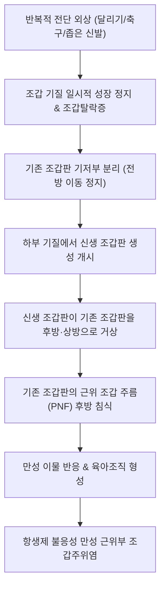

# 🩺 근위부 손발톱내성장 (Retronychia)

> **핵심 3줄 요약 (Key Summary)**:
> - 📍 병소 부위 & 해부·병태생리: 족지(특히 무지, 엄지발가락)에 반복적인 미세 외상(운동, 꼭 끼는 신발)이 가해져 조갑 기질(nail matrix)에서 기존 조갑판(old nail plate)이 조상(nail bed)으로부터 탈락(조갑탈락증, onychomadesis)된 후 전방으로 자라나가지 못하고, 하부에서 신생한 새 조갑판(new nail plate)에 의해 밀려 올라가 근위부 조갑 주름(proximal nail fold) 속으로 후방 역행 침범(ingrowth)하여 만성 육아종성 조갑주위염을 유발하는 구조적 조갑 장애.
> - 🚩 전형적 임상 양상: 수개월 이상 지속되는 근위부 조갑 주름의 난치성 발적, 종창, 통증, 육아조직 증식, 조갑 성장 정지, 조갑판의 황색 변색 및 조갑판의 상하 다층 중첩(stacking of nail plates).
> - 🛠️ 핵심 검사 & 치료 전략: 조갑 고해상도 초음파 검사(근위부 조갑 주름의 비후, 조갑판 다층 중첩, 저에코성 후륜 염증성 달로). 항생제 치료에 반응하지 않으며, **상부의 오래된 조갑판을 외과적으로 발조(avulsion)**하여 근위부 압박을 해제하면 신생 조갑판이 정상적으로 자라나와 즉각 완치됨.
> - ⚠️ 응급 의뢰 레드플래그: 만성 육아조직의 악화로 뼈로의 염증 파급(원위지골 골수염) 의심 시 또는 궤양성 병변이 지속되어 조갑하 편평세포암 등 악성 종양 감별이 필요한 경우 상급병원 정형외과/피부과 의뢰.

---

## 📌 목차
1. [질환 개요 & 해부학적 병태생리](#1--질환-개요---해부학적-병태생리)
2. [병태생리 메커니즘 & 생체역학적 악순환 네트워크](#2--병태생리-메커니즘---생체역학적-악순환-네트워크)
3. [임상 증상 & 이학적 검사(Physical Exam) 알고리즘](#3--임상-증상---이학적-검사physical-exam-알고리즘)
4. [진단 검사 & 감별 진단 패널](#4--진단-검사---감별-진단-패널)
5. [양방 치료 프로토콜 & 약물 상호작용](#5--양방-치료-프로토콜---약물-상호작용)
6. [한의 기능의학적 치료 프로토콜](#6--한의-기능의학적-치료-프로토콜)
7. [재활 운동 & 생활습관 티칭 가이드](#7--재활-운동---생활습관-티칭-가이드)
8. [💡 사용자 진료실 핵심 필기 & 임상 노하우 (Melt-In 잔여 심화 집약)](#8--사용자-진료실-핵심-필기---임상-노하우-melt-in-잔여-심화-집약)
9. [출처 및 학술 참고 문헌 (References)](#9--출처-및-학술-참고-문헌-references)

---

## 1. 질환 개요 & 해부학적 병태생리

### 1) 정의 및 역사적 배경
근위부 손발톱내성장(레트로니키아, Retronychia)은 조갑판(nail plate)이 전방이 아닌 근위부(후방), 즉 조갑 기질과 근위 조갑 주름(Proximal Nail Fold, PNF)을 향해 거꾸로 파고들어 발생하는 역방향 내향성 조갑 질환이다. 1999년 de Berker 등에 의해 처음 명명된 질환으로, 측면으로 파고드는 일반적인 내향성 발톱(Onychocryptosis)과 해부학적 침범 방향이 완전히 반대이다. 젊은 활동성 성인과 운동선수(달리기, 축구, 발레, 등산)의 엄지발가락에 압도적으로 호발하며, 최근에는 손가락 조갑에서도 보고되고 있다.

### 2) 조갑 복합체의 해부학적 병소 구조
- **조갑 기질(Nail matrix)**: 케라틴을 생성하여 조갑판을 앞으로 밀어내는 성장대.
- **근위 조갑 주름(PNF)**: 조갑판의 기저부를 덮어 보호하는 연조직 주름.
- **병태 역학**: 기질에서 조갑탈락증(onychomadesis)이 발생하여 기존 조갑판의 기저부가 기질 상피로부터 분리되었음에도 불구하고, 측면 연조직에 붙들려 전방으로 밀려나지 못하고 제자리에 갇히게 된다. 하부 기질에서 계속해서 새로운 조갑판이 생성되어 밀어 올리면, 기존 조갑판의 날카로운 후방 가장자리가 PNF 연조직 속으로 박히면서 만성 이물 반응과 염증성 육아조직을 유발한다.

---

## 2. 병태생리 메커니즘 & 생체역학적 악순환 네트워크

### 1) 역방향 내성장의 2단계 발병 기전
1. **1단계 (유발 외상과 조갑탈락증)**: 발가락 끝에 반복적인 전단력이나 압박(급정지, 좁은 신발)이 가해지거나 급성 외상(발가락 찧음)을 입으면 조갑 기질 세포의 분열이 일시적으로 정지하고 조갑판 기저부가 기질로부터 박리된다.
2. **2단계 (새 조갑판의 하부 성장과 역행성 쐐기 작용)**: 기질이 회복되어 새로운 조갑판을 자라나게 하지만, 위에 얹혀있는 오래된 조갑판에 가로막혀 정상 전방 경로로 나아가지 못한다. 새 조갑판이 지레 역할을 하여 오래된 조갑판을 위쪽과 뒤쪽으로 밀어 올리게 되고, 오래된 조갑판의 톱니 같은 근위단이 PNF 연조직을 뚫고 들어가며 만성 염증을 영구화한다.

---

## 3. 임상 증상 & 이학적 검사(Physical Exam) 알고리즘

### 1) 3대 전형적 임상 징후 (Clinical Triad)
1. **만성 근위부 조갑주위염 (Chronic proximal paronychia)**: PNF 부위의 홍반, 부종, 심한 압통 및 큐티클(eopnychium) 아래에서 솟아오르는 화농성 육아조직.
2. **조갑 성장 정지 (Nail growth arrest)**: 수개월 동안 발톱이 전혀 앞으로 자라지 않는다고 호소.
3. **조갑판의 다층 중첩 (Stacking/Stratification)**: 조갑판이 2겹 이상 계단식으로 겹쳐져 두꺼워지고 탁한 황갈색(xanthonychia)으로 변색됨.

### 2) 이학적 검사 알고리즘
1. **발톱 전방 이동성 검사**: 근위 조갑 주름을 후방으로 밀고 발톱 표면을 관찰하여 신생 발톱이 오래된 발톱 밑에 겹쳐 있는지 확인.
2. **압통 유발 검사**: 근위 조갑 주름을 발가락 기저부 방향으로 눌렀을 때 심한 국소 압통과 장액성/혈성 삼출물 배출 확인.

---

## 4. 진단 검사 & 감별 진단 패널

### 1) 영상의학적 확진 (고해상도 초음파 검사)
레트로니키아의 확진에 초음파(20~22 MHz 고주파 프로브)가 핵심적인 비침습적 진단 도구로 활용된다:
- 근위 조갑 주름의 비후 (> 1.5mm).
- 조갑판의 2겹 이상 다층 중첩상 관찰 (두 겹의 고에코성 선).
- 조갑 기질 및 PNF 후방의 혈류 증가를 동반한 저에코성 염증성 달로(hypoechoic halo).

### 2) 감별 진단 패널
| 질환명 | 주 증상 및 특징 | 근위부 손발톱내성장과의 감별점 |
| :--- | :--- | :--- |
| **세균성 조갑주위염 (Bacterial paronychia)** | 급성 발적, 종창, 황색 농포 | 급성 발병(수일 내), 항생제에 반응, 조갑판 중첩 없음, 성장 정지 없음 |
| **[[조갑진균증]] (Onychomycosis)** | 발톱의 비후, 황변, 과각화 | 통증이나 근위부 육아조직 없음, KOH 양성, 조갑 성장 정지 없음 |
| **내향성 발톱 (Onychocryptosis)** | 측면 조갑 주름의 통증과 육아종 | 측면 조갑벽(lateral fold) 침범, 전방 모서리 침식, 근위부 PNF는 정상 |
| **조갑하 사마귀 / 종양** | 결절성 병변, 조갑 기형 | 국소 종괴 촉진, 다층 중첩 없음, 조직 생검 감별 |

---

## 5. 양방 치료 프로토콜 & 약물 상호작용

### 1) 보존적 치료 (초기 또는 경증)
- 항생제 복용은 2차 세균 감염이 없는 한 효과가 없다.
- 조갑 주름 아래로 강력한 국소 [[코르티코스테로이드]](클로베타솔 0.05% 연고) 도포 또는 병변내 트리암시놀론 주사(ILTA 2.5~5 mg/mL)를 통해 초기 염증을 가라앉히고 자연 배출을 유도할 수 있으나 완치율은 낮음.

### 2) 외과적 발조술 (Definitive Surgical Cure)
> ⚠️ **치료의 핵심 원칙**: 상부에 갇혀서 쐐기 역할을 하고 있는 **오래된 조갑판(superficial old nail plate)만을 선택적으로 발조**하는 것이다.

- **수술 프로토콜**:
  1. 지골 신경차단술(Digital nerve block)로 국소 마취.
  2. 프레러 엘리베이터(Freer elevator)로 근위 조갑 주름과 오래된 발톱 사이를 박리.
  3. **하부에 이미 형성되어 있는 신생 조갑판은 건드리지 않고**, 상부의 분리된 오래된 발톱만을 겸자로 잡아 후방 견인하여 제거.
  4. 육아조직을 소파하고 세척 후 압박 드레싱.
- **예후**: 원인 발톱을 뽑아내는 즉시 PNF 압박이 해제되어 통증이 소실되며, 남아있던 새 발톱이 정상적으로 자라나와 6~12개월 후 완전 정상 조갑으로 회복됨(재발률 극히 낮음).

---

## 6. 한의 기능의학적 치료 프로토콜

### 1) 변증 분형 (TCM Differentiation)
한의학적으로 근위부 손발톱내성장은 외상으로 인한 [[어혈조체]](瘀血阻滯)와 국소 [[열독온결]](熱毒蘊結), 그리고 지속적인 자극에 의한 [[기체혈어]](氣滯血瘀)로 조갑 영양이 실조된 병태로 본다.

| 변증 | 전형적 증상 | 설태 및 맥상 | 대표 처방 |
| :--- | :--- | :--- | :--- |
| **어혈조체·열독형 (瘀血阻滯·熱毒型)** | PNF 암적색 종창, 작열감, 자통(찌르는 통증), 화농성 육아종 | 설자어반 태황, 맥현삽(弦澁) | [[도홍사물탕]] 합 [[오미소독음]] |
| **기혈어체·조갑실영형 (氣血瘀滯·爪甲失榮型)** | 만성 조갑 성장 정지, 조갑 비후 및 황변, 은은한 통증 | 설담어반 태박백, 맥세약(細弱) | [[당귀사역탕]] 합 [[활락효영단]] |

### 2) 침구 치료 혈위
- **국소 어혈 사혈 및 소종진통**: 족무지 기저부의 [[은백]](SP1), [[대돈]](LR1) 점자출혈(사혈요법)을 통해 국소 미세혈관 울혈 해소.
- **원위부 경락 순환 촉진**: [[태충]](LR3), [[태계]](KI3), [[삼음교]](SP6), [[곡천]](LR8).

---

## 7. 재활 운동 & 생활습관 티칭 가이드

- **신발의 선택**: 발가락 끝에 1~1.5cm 이상의 여유가 있는 넓은 토박스(Toe-box) 신발 착용. 신발 안에서 발이 앞으로 쏠리지 않도록 끈을 발등에서 단단히 고정.
- **운동 습관 교정**: 족지 끝에 급격한 전방 제동이 걸리는 운동(축구, 테니스, 농구, 등산 내리막길) 시 보호용 실리콘 토캡(Toe cap) 착용.
- **조갑 관리**: 발톱을 둥글게 파내거나 너무 짧게 깎지 말고 수평으로 일자형 깎기 유지.

---

## 8. 💡 사용자 진료실 핵심 필기 & 임상 노하우 (Melt-In 잔여 심화 집약)

- **"항생제 먹여도 몇 달째 낫지 않는 발톱 염증은 십중팔구 레트로니키아"**:
  - 발톱 주위염이라 하여 피부과나 정형외과에서 세균 감염으로 진단받고 먹는 항생제와 연고만 3~6개월째 쓰며 낫지 않는다고 내원하는 환자가 매우 많다. 근위부 주름이 빨갛게 붓고 육아종이 있는데 발톱이 앞으로 자라지 않는다면, 세균이 문제가 아니라 속에 갇힌 '죽은 발톱'이 살을 찌르고 있는 것이다.
- **발톱 밑에 발톱이 또 있다 (계단식 발톱)**:
  - 돋보기나 더모스코프로 근위부를 자세히 들여다보면, 발톱이 한 겹이 아니라 2~3겹이 기와장처럼 포개져 있다. 아래 발톱이 위 발톱을 지렛대처럼 들어 올려 살 속으로 쑤셔 넣고 있는 형국이다.
- **수술 시 '위 발톱'만 살짝 걷어내면 된다**:
  - 발톱 전체를 뿌리째 다 뽑아버리는 조갑 전절제술을 할 필요가 없다. 갇혀있는 상부의 오래된 발톱 조각만 핀셋으로 살짝 들어 올려 제거해주면, 마취가 풀리기도 전에 통증이 드라마틱하게 사라지고 아래에 있던 새 발톱이 예쁘게 자라난다.

---

## 9. 출처 및 학술 참고 문헌 (References)

- Litaiem, N., et al. (2019). Retronychia of the toenails: a review with emphasis on pathogenesis, new diagnostic and management trends. *Arch Dermatol Res*. PMID: 31076847.

- Ricardo, J. W., et al. (2026). Evaluation and management of mechanical and structural nail disorders: A clinical review. *J Am Acad Dermatol*. PMID: 41242632.

- 대한피부과학회. (2020). *피부과학 (제7판)*. 도서출판 대한의학.

- 대한정형외과학회. (2020). *정형외과학 (제8판)*. 최신의학사.

- 한방안이비인후피부과학회. (2021). *한의피부외과학*. 도서출판 정담.

---

## 관련 노트

- [[내신성 발톱]]
- [[조갑진균증]]
- [[도홍사물탕]]
- [[오미소독음]]
