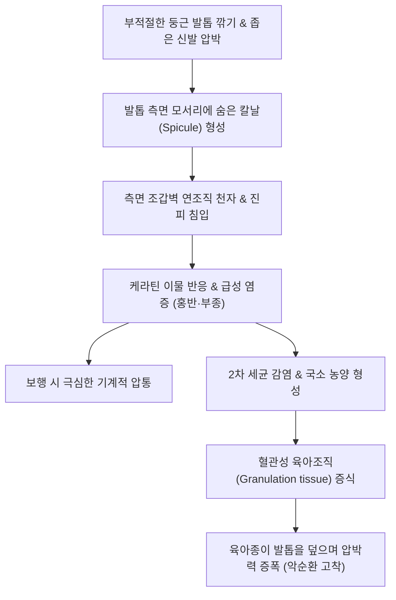

# 🩺 내신성 발톱 (Onychocryptosis, 내향성 모포/발톱)

> **핵심 3줄 요약 (Key Summary)**:
> - 📍 병소 부위 & 해부·병태생리: 족지(압도적으로 제1족지 엄지발가락)의 조갑판(nail plate) 외측 또는 내측 모서리가 측면 조갑 주름(lateral nail fold)의 연조직 속을 파고들어 지속적인 기계적 손상과 이물 반응을 일으킴으로써 급만성 염증, 부종, 극심한 통증 및 화농성 육아종(granulation tissue)을 형성하는 질환.
> - 🚩 전형적 임상 양상: 발톱 측면의 보행 시 심한 압통과 부종, 발적, 보행 장애(절뚝거림), 삼출물 및 피고름 배출, 조갑벽을 덮으며 자라나는 붉은 육아조직. Heifetz/Mozena 3단계 병기로 분류.
> - 🛠️ 핵심 검사 & 치료 전략: 임상적 시진 및 촉진. 초기(1기): 온수 족욕, 솜/치과용 치실 끼우기(cotton-wick insertion), 거터 스플린트(gutter splint), 일자형 발톱 깎기 지도. 진행기(2~3기): 국소 마취 하 부분 조갑 절제술(Partial nail avulsion) 및 페놀(Phenol 88%)을 이용한 외측 조갑 기질 화학적 소작술(Chemical matricectomy, 재발률 < 5%).
> - ⚠️ 응급 의뢰 레드플래그: 당뇨병성 족부 궤양 환자 또는 말초동맥질환([[말초동맥 질환]]) 환자에서 내향성 발톱 병발 시 급속한 괴저(gangrene) 및 골수염(osteomyelitis) 진행 위험이 극히 높으므로 즉시 당뇨발 전문 클리닉 전원.

---

## 📌 목차
1. [질환 개요 & 해부학적 병태생리](#1--질환-개요---해부학적-병태생리)
2. [병태생리 메커니즘 & 생체역학적 악순환 네트워크](#2--병태생리-메커니즘---생체역학적-악순환-네트워크)
3. [임상 증상 & 이학적 검사(Physical Exam) 알고리즘](#3--임상-증상---이학적-검사physical-exam-알고리즘)
4. [진단 검사 & 감별 진단 패널](#4--진단-검사---감별-진단-패널)
5. [양방 치료 프로토콜 & 약물 상호작용](#5--양방-치료-프로토콜---약물-상호작용)
6. [한의 기능의학적 치료 프로토콜](#6--한의-기능의학적-치료-프로토콜)
7. [재활 운동 & 생활습관 티칭 가이드](#7--재활-운동---생활습관-티칭-가이드)
8. [💡 사용자 진료실 핵심 필기 & 임상 노하우 (Melt-In 잔여 심화 집약)](#8--사용자-진료실-핵심-필기---임상-노하우-melt-in-잔여-심화-집약)
9. [출처 및 학술 참고 문헌 (References)](#9--출처-및-학술-참고-문헌-references)

---

## 1. 질환 개요 & 해부학적 병태생리

### 1) 정의 및 역학
내신성 발톱(내향성 발톱, 파고드는 발톱, Onychocryptosis, Ingrown Toenail)은 발톱의 가장자리 판이 인접한 외측 또는 내측 조갑벽(lateral nail fold)의 연조직을 뚫고 들어가 발생하는 매우 흔한 족부 질환이다. '내신(內身/內申)'이라는 용어는 발톱이 살 속으로 깊이 뻗어 들어간다는 한자어 표현이다. 주로 10~20대 청소년과 젊은 성인 남성에서 호발하며, 족부 질환 중 가장 흔하게 일차 진료실을 찾는 원인 중 하나이다. 90% 이상이 엄지발가락(제1족지)에 발생하며, 부적절한 발톱 깎기 습관, 앞코가 좁고 꽉 끼는 신발(하이힐, 축구화), 다한증(연화된 피부), 비만, 발의 과도한 회내(pronation) 변형 등이 주된 유발 요인이다.

### 2) 측면 조갑 단위의 미세 해부학
- **조갑판(Nail plate)**: 단단한 케라틴판으로 전방으로 성장.
- **측면 조갑 주름(Lateral nail fold)**: 발톱의 측면을 감싸 지지하는 연조직.
- **조갑 홈(Nail groove/sulcus)**: 조갑판 측면 가장자리가 놓이는 피부 함몰 홈.
- **해부학적 충돌**: 발톱 모서리를 둥글게 깊이 파서 깎으면, 발톱이 자라나면서 측면 조갑 홈의 부드러운 피부 살점을 칼날처럼 찌르게 된다.

---

## 2. 병태생리 메커니즘 & 생체역학적 악순환 네트워크

### 1) 발병의 3단계 악순환 기전
1. **기계적 손상과 상처 형성**: 둥글게 파서 깎은 발톱 모서리의 날카로운 가시(spicule)가 측면 조갑벽 피부를 뚫고 진피로 침입한다.
2. **이물 반응 및 세균 침입**: 케라틴 단백질이 진피에 이물질로 작용하여 대식세포와 호중구를 유인하고 급성 염증 반응을 촉발한다. 피부 장벽이 붕괴되면서 황색포도상구균 등 피부 상재균이 침입하여 농양을 형성한다.
3. **육아조직 증식과 악화의 덫**: 만성 염증 자극으로 모세혈관과 섬유모세포가 폭발적으로 증식하여 붉은 육아종(granulation tissue)을 형성하고, 이 육아조직이 발톱 위로 부풀어 올라 덮이면서 발톱을 더욱 강하게 살 속으로 압박하는 악순환 궤도에 진입한다.

---

## 3. 임상 증상 & 이학적 검사(Physical Exam) 알고리즘

### 1) Mozena 병기 분류 (Clinical Staging)
- **1기 (경증)**: 발톱 측면 조갑 주름의 경미한 홍반, 부종 및 압통. 보행 시 통증이 있으나 분비물이나 육아조직은 없음.
- **2기 (중등도)**: 심한 통증, 현저한 부종, 장액성 또는 화농성 분비물 배출, 발톱 가장자리를 따라 국소 육아조직 형성 시작 (< 3mm).
- **3기 (중증)**: 심한 만성 염증, 발톱판 위를 광범위하게 덮는 거대한 육아조직 (> 3mm), 조갑판의 비후 및 변형, 신발 착용 불가능 및 파행(절뚝거림).

### 2) 이학적 검사 알고리즘
1. **측면 조갑 홈 탐침 검사**: 소독된 큐렛이나 탐침으로 측면 홈을 따라 훑어 내려가며 숨겨진 발톱 가시(spicule)의 존재 확인.
2. **염증성 육아조직 및 박동성 통증 확인**: 압박 시 고름 배출 여부 및 박동성 욱신거림 확인.
3. **발의 생체역학적 평가**: 무지외반증, 평발(과도한 회내) 등 보행 시 엄지발가락 내측에 과도한 지면 반발력이 집중되는지 관찰.

---

## 4. 진단 검사 & 감별 진단 패널

### 1) 진단적 평가
임상적 병력과 육안적 시진으로 진단이 명확하다. 단, 3기 이상으로 만성화되었거나 골 변형이 의심되는 경우 단순 X-선 검사(Foot AP/Lateral/Oblique)를 시행하여 하부 원위지골의 골수염(osteomyelitis) 또는 조갑하 골연골종(Subungual osteochondroma)을 배제해야 한다.

### 2) 감별 진단 패널
| 질환명 | 주 증상 및 양상 | 내신성 발톱과의 감별점 |
| :--- | :--- | :--- |
| **[[조갑주위염]] (Paronychia)** | 손발톱 주변의 급성 세균 감염 | 발톱 측면 파고듦 없이 표재성 주름 감염, 발톱 깎기 이상 무관 |
| **조갑하 골연골종 (Subungual osteochondroma)** | 발톱 밑에서 뼈가 자라 발톱을 들어 올림 | X-선상 지골 피질골과 연속된 골성 돌출 확인, 젊은 층 호발 |
| **화농성 육아종 (Pyogenic granuloma)** | 선홍색 버섯 모양의 출혈성 결절 | 발톱 침식이 원인이 아닌 혈관 증식증, 표피 깃 관찰 |
| **조갑하 사마귀 (Subungual verruca)** | 조갑하 각화성 결절, 통증 | 표면이 거칠고 점상 출혈 관찰, 사마귀 바이러스(HPV) 연관 |

---

## 5. 양방 치료 프로토콜 & 약물 상호작용

### 1) 보존적 치료 (1기 및 경증 2기)
- **온수 족욕**: 따뜻한 물(미온수)에 하루 2~3회, 15분씩 발을 담가 연조직을 부드럽게 연화.
- **솜 패킹 (Cotton-wicking) / 치실 삽입**: 소독된 솜 뭉치나 치과용 치실을 발톱 모서리와 살 사이에 밀어 넣어 발톱이 살을 찌르지 않고 위로 타고 넘어가도록 유도.
- **거터 스플린트 (Gutter splint technique)**: 정맥주사 카테터(IV cannula)의 멸균 플라스틱 튜브를 세로로 갈라 발톱 측면 모서리에 끼워 고정 (즉각적인 통증 경감 효과).
- **형상기억합금 테이핑 및 교정기**: 발톱 교정기구(오니코클립 등)를 장착하여 평평하게 펴줌.

### 2) 외과적 근치 수술 (2기 후반 및 3기, 잦은 재발)
> ⚠️ **원칙**: 단순히 파고든 발톱만 잘라내면 발톱이 다시 자라면서 100% 재발한다. 반드시 파고드는 **외측 조갑 기질(lateral matrix)을 함께 파괴**해야 영구 완치된다.

- **부분 조갑 절제술 및 화학적 기질소작술 (PNA with Chemical Matricectomy, 표준 술식)**:
  1. 지골 신경차단 마취 후 지혈대(tourniquet) 적용.
  2. 파고든 발톱의 외측 2~3mm 폭을 기저부까지 세로로 직선 절개하여 제거.
  3. 노출된 외측 조갑 기질 부위에 88% 페놀(Phenol) 용액을 면봉으로 1분간 3회(총 3분) 도포하여 기질 상피를 화학적으로 영구 응고 소작.
  4. 70% 에탄올 또는 생리식염수로 중화 세척.
  5. 봉합 없이 2차 의도 치유 (수술 시간 10분, 술 후 통증 경미, 재발률 2~5% 미만).

---

## 6. 한의 기능의학적 치료 프로토콜

### 1) 변증 분형 (TCM Differentiation)
한의학에서 내신성 발톱은 [[갑저]](甲疽), [[조갑감입]](爪甲嵌入)의 범주에 속하며, 외상으로 인한 [[어혈온결]](瘀血蘊結)과 [[습열독체]](濕熱毒滯)가 족궐음간경(足厥陰肝經) 경락에 울체되어 화농과 육아를 형성한 병태로 변증한다.

| 변증 | 전형적 증상 | 설태 및 맥상 | 대표 처방 |
| :--- | :--- | :--- | :--- |
| **습열온독형 (濕熱蘊毒型)** | 급성 발적, 종창, 박동성 통증, 화농성 삼출물, 육아종 | 설홍 태황니(黃膩), 맥활삭(滑數) | [[오미소독음]] 합 [[황련해독탕]] |
| **기체혈어형 (氣滯血瘀型)** | 만성적인 암자색 종창, 보행 시 찌르는 통증, 단단한 흉터 | 설자어반, 맥현삽(弦澁) | [[도홍사물탕]] 합 [[활락효영단]] |
| **기혈양허형 (氣血兩虛型)** | 만성 배농, 상처 불유합, 창백, 만성 피로, 지체 무력 | 설담 태박백, 맥세약(細弱) | [[탁리소독음]] |

### 2) 침구 및 한의 외치 요법
- **기혈 순환 및 사혈 배농**: 족무지의 [[대돈]](LR1), [[은백]](SP1) 삼릉침 점자출혈로 국소 울혈 및 열독 즉각 배출.
- **원위 취혈**: [[태충]](LR3), [[곡천]](LR8), [[족삼리]](ST36), [[양릉천]](GB34).
- **청열해독 배농 습포**: [[황백]], [[고삼]], [[금은화]], [[포공영]] 각 20g 전탕액으로 일일 1회 환부 족욕 및 냉습포.

---

## 7. 재활 운동 & 생활습관 티칭 가이드

- **발톱 깎기 절대 수칙 (일자 깎기)**:
  - **발톱 양 모서리를 절대로 둥글게 파내지 말 것**.
  - 발톱 끝을 **일직선(수평)**으로 깎고, 발톱 양 끝 모서리가 살 밖으로 1~2mm 정도 노출되도록 길이를 유지.
- **신발 착용 지도**: 발가락을 꼼지락거릴 수 있을 정도로 앞볼이 넓고 굽이 낮은 신발 착용. 신발 코가 뾰족하거나 굽이 높은 하이힐은 체중이 엄지발가락 외측으로 쏠리므로 착용 금지.
- **다한증 관리**: 발에 땀이 많으면 피부가 짓물러 발톱이 더 쉽게 살을 파고들므로, 통풍이 잘되는 양말을 신거나 파우더 사용.

---

## 8. 💡 사용자 진료실 핵심 필기 & 임상 노하우 (Melt-In 잔여 심화 집약)

- **"발톱을 깊게 파서 자를수록 다음 달엔 지옥을 맛본다"**:
  - 환자들은 발톱이 살을 찌르니까 아파서 손톱깎이나 칼로 아픈 모서리를 후벼 파서 잘라낸다. 이렇게 자르면 2~3일은 안 아프지만, 잘려나간 발톱 뒤편에서 자라 나오는 날카로운 칼날(Spicule)이 살 속 깊은 곳에서 자라나 살을 찢어발기며 2차 농양을 만든다. 환자에게 "절대로 모서리를 파지 말고, 아파도 길러서 살 밖으로 내밀어야 한다"고 목에 핏대를 세워 교육해야 한다.
- **발톱 전체를 다 뽑는 무식한 수술은 이제 그만**:
  - 과거에 흔히 하던 발톱 완전 발조술(Total nail avulsion)은 마취 풀리면 극심한 고통을 유발할 뿐 아니라, 발톱이 자라 나오면서 쪼그라들어 70% 이상 재발한다. 파고든 외측 2mm만 자르고 페놀로 기질을 지지는 **페놀 기질소작술**을 하면 마취 주사 맞을 때만 따끔하고 당일 걸어서 귀가하며 재발도 거의 없다.
- **당뇨 환자의 내향성 발톱은 사형선고가 될 수 있다**:
  - 당뇨병 신경병증 환자는 발톱이 살을 뚫고 뼈까지 썩어 들어가도 통증을 못 느낀다. 고름이 양말을 적실 때쯤 오면 이미 골수염으로 발가락을 절단해야 할 수도 있다. 당뇨 환자가 오면 신발과 양말부터 벗겨 발톱을 전수 검사해야 한다.

---

## 9. 출처 및 학술 참고 문헌 (References)

- Ricardo, J. W., et al. (2026). Evaluation and management of mechanical and structural nail disorders: A clinical review. *J Am Acad Dermatol*. PMID: 41242632.

- 대한피부과학회. (2020). *피부과학 (제7판)*. 도서출판 대한의학.

- 대한정형외과학회. (2020). *정형외과학 (제8판)*. 최신의학사.

- 한방안이비인후피부과학회. (2021). *한의피부외과학*. 도서출판 정담.

---

## 관련 노트

- [[근위부 손발톱내성장]]
- [[조갑주위염]]
- [[말초동맥 질환]]
- [[오미소독음]]
- [[도홍사물탕]]
