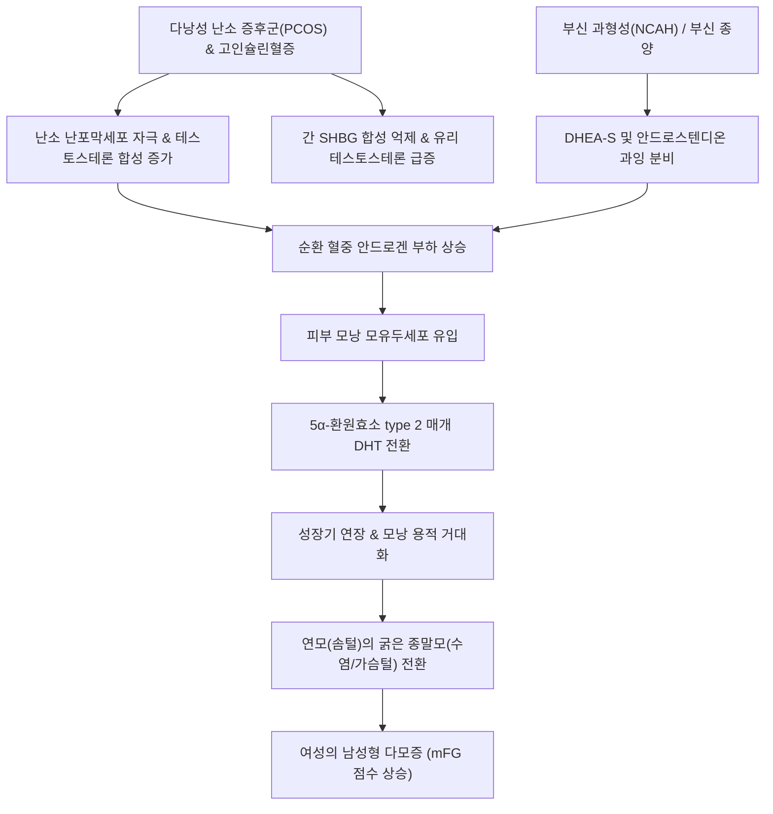

# 🩺 다모 (Hypertrichosis & Hirsutism, 다모증·다모)

> **핵심 3줄 요약 (Key Summary)**:
> - 📍 병소 부위 & 해부·병태생리: 신체 부위 및 연령·성별 기준 정상치보다 모발(배냇솜털 lanugo, 솜털 vellus, 종말모 terminal hair)이 과도하게 증식하는 질환군. 안드로겐 비의존적으로 전신 또는 국소에 솜털/연모가 증가하는 **다모증(Hypertrichosis)**과, 안드로겐 과다(PCOS, 부신 종양)에 의해 여성에서 남성형 분포(인중, 턱, 가슴, 하복부, 등)를 따라 굵은 종말모가 자라나는 **남성형 다모증(Hirsutism)**으로 명확히 구분됨.
> - 🚩 전형적 임상 양상: 여성에서 수염, 가슴털, 배꼽 아래 정중선 털의 굵고 짙은 증식; 다낭성 난소 증후군([[다낭성 난소 증후군]]) 연관 시 월경불순, 무월경, 여드름, 안드로겐성 [[탈모]], 비만 동반. 수정 Ferriman-Gallwey(mFG) 척도로 점수화(한국인 기준 $\ge$ 6~8점 이상 시 다모증).
> - 🛠️ 핵심 검사 & 치료 전략: 혈청 총 테스토스테론([[테스토스테론]]), 유리 테스토스테론, DHEA-S, 17-OHP, 골반 초음파. 약물 치료: 복합 경구피임약(COC, 안드로겐 생성 억제), 항안드로겐제([[스피로놀락톤]], Spironolactone 50~200 mg/day). 물리적 제모: 롱펄스 알렉산드라이트/다이오드 레이저 제모, 에플로르니틴(Eflornithine 13.9% 크림).
> - ⚠️ 응급 의뢰 레드플래그: 수주~수개월 내에 다모증이 급격히 진행되면서 음핵 비대, 목소리 저음화, 근육량 증가 등 남성화(virilization) 징후가 동반되거나 혈청 테스토스테론 > 200 ng/dL, DHEA-S > 700 µg/dL 초과 시 안드로겐 분비성 난소암 또는 부신피질암 감별을 위해 즉시 상급병원 내분비내과/부인과 의뢰.

---

## 📌 목차
1. [질환 개요 & 해부학적 병태생리](#1--질환-개요---해부학적-병태생리)
2. [병태생리 메커니즘 & 생체역학적 악순환 네트워크](#2--병태생리-메커니즘---생체역학적-악순환-네트워크)
3. [임상 증상 & 이학적 검사(Physical Exam) 알고리즘](#3--임상-증상---이학적-검사physical-exam-알고리즘)
4. [진단 검사 & 감별 진단 패널](#4--진단-검사---감별-진단-패널)
5. [양방 치료 프로토콜 & 약물 상호작용](#5--양방-치료-프로토콜---약물-상호작용)
6. [한의 기능의학적 치료 프로토콜](#6--한의-기능의학적-치료-프로토콜)
7. [재활 운동 & 생활습관 티칭 가이드](#7--재활-운동---생활습관-티칭-가이드)
8. [💡 사용자 진료실 핵심 필기 & 임상 노하우 (Melt-In 잔여 심화 집약)](#8--사용자-진료실-핵심-필기---임상-노하우-melt-in-잔여-심화-집약)
9. [출처 및 학술 참고 문헌 (References)](#9--출처-및-학술-참고-문헌-references)

---

## 1. 질환 개요 & 해부학적 병태생리

### 1) 개념의 명확한 이분법: Hypertrichosis vs Hirsutism
과도한 체모 증식은 병태생리학적으로 다음 두 가지로 엄격히 구분된다:
- **다모증 (Hypertrichosis)**: 안드로겐 호르몬과 무관하게 신체 어느 부위에서나 비정상적으로 모발 밀도와 길이가 증가하는 상태이다. 유전적 질환, 대사 장애(갑상선기능저하증, 포르피린증), 영양 실조(신경성 식욕부진증), 약물(미녹시딜, 사이클로스포린, 페니토인) 또는 악성 종양의 부종양 증후군(후천성 전신 배냇솜털 다모증)으로 발생한다.
- **남성형 다모증 (Hirsutism)**: 안드로겐 의존성 부위(수염, 턱, 인중, 가슴, 하복부 정중선, 허벅지 안쪽)에서 여성에게 남성형 패턴으로 굵고 색소가 짙은 종말모(terminal hair)가 자라나는 상태이다. 가임기 여성의 약 5~10%에서 관찰되며, 80% 이상이 [[다낭성 난소 증후군]](PCOS)에 의해 유발된다.

### 2) 모발 생리학과 안드로겐의 모낭 변환 작용
모발은 크게 배냇솜털(lanugo), 연모(vellus, 솜털), 종말모(terminal)로 나뉜다.
- 순환하는 테스토스테론([[테스토스테론]])이 모낭 모유두세포(dermal papilla) 내부로 유입되면, **5알파-환원효소(5α-reductase, 특히 type 2)**에 의해 활성형인 디하이드로테스토스테론([[DHT]])으로 전환된다.
- 안드로겐 수용체(AR)에 결합한 DHT는 모낭의 성장기(anagen phase)를 연장시키고 모구 크기를 팽창시켜, 얇고 색소가 없는 연모(솜털)를 굵고 단단하며 멜라닌이 풍부한 **종말모(terminal hair)로 비가역적으로 전환**시킨다.
- 흥미롭게도 동일한 DHT가 전두부와 정수리 두피 모낭에서는 오히려 성장기를 단축시키고 모낭을 소형화하여 안드로겐성 [[탈모]]를 유발하는 상반된 반응을 보인다.

---

## 2. 병태생리 메커니즘 & 생체역학적 악순환 네트워크

### 1) 안드로겐 과다 분비의 병태생리 축
여성에서 안드로겐 과다를 일으키는 3대 축:
1. **난소 기원 (PCOS)**: 황체형성호르몬([[LH]])의 비정상적 분비 증가와 난포막 세포(theca cells)의 과형성으로 난소에서 테스토스테론과 안드로스텐디온이 대량 합성된다. 동반된 고인슐린혈증은 간에서 성호르몬결합글로불린(SHBG) 합성을 억제하여, 활성형인 **유리 테스토스테론(free testosterone)** 분율을 급증시킨다.
2. **부신 기원 (NCAH 및 부신 종양)**: 21-수산화효소 결핍에 의한 비전형 선천성 부신과형성증(NCAH) 또는 부신 종양에서 DHEA-S 및 17-OH 프로게스테론이 과잉 생성된다.
3. **특발성 다모증 (Idiopathic hirsutism)**: 순환 혈중 안드로겐 수치는 정상이나, 피부 국소 5α-환원효소 활성도 증가 또는 안드로겐 수용체의 과민성으로 인해 발생한다.

---

## 3. 임상 증상 & 이학적 검사(Physical Exam) 알고리즘

### 1) 수정 Ferriman-Gallwey (mFG) 평가 척도
여성의 9개 안드로겐 민감 부위(인중, 턱, 가슴, 상복부, 하복부, 상완, 허벅지, 등 상부, 등 하부)의 털의 굵기와 밀도를 각각 0~4점으로 평가하여 합산한다:
- 서양인 기준: $\ge$ 8점 이상 시 다모증 진단.
- **한국인/동양인 기준**: 체모 밀도가 원래 낮은 인종적 특성을 반영하여 **$\ge$ 6점(일부 가이드라인 4~5점)** 이상을 임상적 남성형 다모증으로 판정.

### 2) 남성화(Virilization) 동반 징후 진찰
단순 다모증을 넘어 심각한 안드로겐 분비 종양(악성 의심)을 시사하는 신체 징후 전수 진찰:
- 음핵 비대 (Clitoromegaly, 음핵 지수 > 35 mm²).
- 목소리 굵어짐 (Deepening of voice).
- 유방 위축 (Breast atrophy) 및 측두부 남성형 M자 탈모.
- 어깨 근육량 증가 및 남성형 체형 변화.

---

## 4. 진단 검사 & 감별 진단 패널

### 1) 혈액 호르몬 및 영상 검사 패널
- **기초 호르몬 검사**: 생리 시작 3~5일째 아침 공복(또는 무월경 시 임의 시점) 채혈:
  - 총 테스토스테론 및 유리 테스토스테론 (Free T).
  - DHEA-S (부신성 안드로겐 평가).
  - 17-OH 프로게스테론 (아침 공복 > 2 ng/mL 시 NCAH 의심, ACTH 자극검사 요망).
  - LH / FSH 비 (LH/FSH > 2~3 시 PCOS 강력 시사), 프로락틴, TSH.
- **영상 검사**:
  - 경질 또는 경복부 골반 초음파: 난소의 다낭성 형태(20개 이상의 2~9mm 난포 또는 난소 부피 > 10 mL) 확인.
  - 부신 CT / MRI: DHEA-S > 700 µg/dL 또는 테스토스테론 > 200 ng/dL 초과 시 부신 종양 배제.

### 2) 감별 진단 패널
| 질환명 | 주된 특징 및 호르몬 이상 | 다모증과의 감별 포인트 |
| :--- | :--- | :--- |
| **다낭성 난소 증후군 (PCOS)** | 무월경/희발월경, 비만, 인슐린 저항성, LH 상승 | 가장 흔한 원인(80%), 서서히 진행, 남성화 징후는 드묾 |
| **비전형 선천성 부신과형성증 (NCAH)** | 사춘기 전후 발병, 다모증, 여드름 | 17-OH 프로게스테론 상승 (> 10 ng/mL on ACTH stim) |
| **쿠싱 증후군 (Cushing's syndrome)** | 중심성 비만, 문페이스, 붉은 자색선조, 근위부 근력약화 | 24시간 소변 유리 코르티솔 상승, 야간 덱사메타손 억제검사 양성 |
| **안드로겐 분비 종양 (난소/부신)** | 수개월 내 급속 진행, 뚜렷한 남성화 | 테스토스테론 > 200 ng/dL, 폐경 후 급발 다모증 |
| **약물 유발성 다모증 (Hypertrichosis)** | 전신 솜털 증가, 안드로겐 수치 정상 | 미녹시딜, 사이클로스포린 복용력, 남성형 분포 아님 |

---

## 5. 양방 치료 프로토콜 & 약물 상호작용

### 1) 약물 요법 (모발 성장 억제)
> ⚠️ **원칙**: 모발의 생장 주기로 인해 약물 복용 후 효과가 나타나기까지 **최소 6개월 이상의 지속 복용**이 필요하다. 기존에 이미 자란 종말모는 약물로 사라지지 않으므로 물리적 제모를 병행해야 한다.

- **1차 선택제: 복합 경구피임약 (Combined Oral Contraceptives, COC)**:
  - 에스트로겐(에티닐 에스트라디올) + 항안드로겐성 프로게스틴(드레스피레논 Drospirenone 또는 사이프로테론 Cyproterone acetate) 복합제(예: 야즈, 야스민, 다이안느).
  - 기전: 난소의 LH 분비를 억제하여 안드로겐 생성을 차단하고, 간에서 SHBG 생성을 촉진하여 유리 테스토스테론을 50% 이상 격감시킴.
- **병용 2차 선택제: 항안드로겐제 (Antiandrogens)**:
  - **[[스피로놀락톤]](Spironolactone)**: 알도스테론 및 안드로겐 수용체 차단제, 5α-환원효소 억제. 50~200 mg/day (반드시 피임 대책 수립 후 투여, 남성 태아 여성화 기형 위험).
  - 피나스테리드([[피나스테리드]]) 또는 두타스테리드: 5α-환원효소 억제제 (가임기 여성 금기, 폐경 후 또는 철저한 피임 전제 시 사용).
- **국소 외용제**:
  - **에플로르니틴(Eflornithine 13.9% 크림, Vaniqa)**: 모낭 내 오르니틴 탈탄산효소(ODC)를 비가역적으로 억제하여 모발 성장 속도를 늦춤 (얼굴 체모에 1일 2회 도포).

### 2) 물리적 영구 제모술
- **레이저 제모 (Laser hair reduction)**: 755nm 알렉산드라이트 또는 810nm 다이오드 레이저를 4~6주 간격으로 6회 이상 시술하여 멜라닌을 매개로 모낭을 선택적 열파괴 (약물 치료와 병용 시 최대 효과).

---

## 6. 한의 기능의학적 치료 프로토콜

### 1) 변증 분형 (TCM Differentiation)
한의학적으로 여성의 남성형 다모증은 [[담습조체]](痰濕阻滯), [[간울기체]](肝鬱氣滯), [[신허어혈]](腎虛瘀血)로 인해 포궁(胞宮)의 충임맥(衝任脈)이 실조되고 기혈 순환이 장애되어 비정상적인 체모가 돋아나는 병태로 변증한다.

| 변증 | 전형적 증상 | 설태 및 맥상 | 대표 처방 |
| :--- | :--- | :--- | :--- |
| **담습조체·비허형 (痰濕阻滯·脾虛型)** | 비만, 다모증, 무월경 또는 희발월경, 대하 과다, 나태 기와 | 설담반 치흔 태백니(白膩), 맥활(滑) | [[창부도담탕]] 합 [[이진탕]] 가감 |
| **간울화화·혈열형 (肝鬱化火·血熱型)** | 흉협창만, 번조, 안면 여드름, 붉은 설포, 월경선기 또는 불순 | 설홍 태황(黃), 맥현삭(弦數) | [[단치소요산]] 합 [[용담사간탕]] |
| **신허간울·어혈형 (腎虛肝鬱·瘀血型)** | 요슬산연, 만성 피로, 월경통, 암자색 혈괴, 하복냉감 | 설자어반 태박, 맥침세삽(沈細澁) | [[조경종옥탕]] 합 [[계지복령환]] |

### 2) 침구 치료 혈위
- **인슐린 저항성 개선 및 충임맥 조절**: [[중완]](CV12), [[기해]](CV6), [[관원]](CV4), [[수도]](ST28), [[귀래]](ST29).
- **비신 기능 강화 및 소담행혈**: [[족삼리]](ST36), [[삼음교]](SP6), [[음릉천]](SP9), [[태충]](LR3), [[혈해]](SP10).
- **전침 치료**: 관원-중완 및 양측 삼음교에 2Hz 저주파 전침을 주 2회 적용하여 교감신경 흥분을 가라앉히고 난소 혈류 개선.

---

## 7. 재활 운동 & 생활습관 티칭 가이드

- **체중 5~10% 감량의 기적**: 비만형 PCOS 환자에서 체중을 5%만 줄여도 고인슐린혈증이 개선되고 간의 SHBG 합성이 증가하여 유리 테스토스테론이 급감하며, 배란 회복과 함께 다모증 진행이 멈춤.
- **저탄수화물 지중해식 식단**: 정제 탄수화물, 액상과당, 설탕을 전면 배제하고 양질의 단백질과 불포화 지방 위주의 식단 유지.
- **규칙적인 근력 운동과 유산소 운동**: 주 3~5회 인슐린 감수성을 증진시키는 중강도 저항성 운동 시행.
- **족집게 뽑기(Plucking) 자극 금지**: 털을 족집게로 반복해서 뽑으면 모낭 주변 혈류가 증가하고 기계적 염증으로 인해 모낭이 더욱 굵어지는 역효과가 나므로 면도나 레이저 제모 권고.

---

## 8. 💡 사용자 진료실 핵심 필기 & 임상 노하우 (Melt-In 잔여 심화 집약)

- **"약 먹는다고 이미 난 털이 우수수 빠지지는 않는다"**:
  - 환자에게 복합 피임약이나 스피로놀락톤을 처방하면서 "이 약을 먹으면 턱수염이 마법처럼 다 빠질 것"이라고 헛된 기대를 주면 3개월 뒤 환자가 치료를 포기한다. 약물은 **"새로 나는 털이 얇아지고 천천히 자라게 하는 방어막"**이고, 이미 자라난 굵은 털은 레이저 제모로 태워 없애야 한다는 병용 전략을 명확히 설명해야 한다.
- **급격한 목소리 변화와 음핵 비대는 응급 암 신호**:
  - 10대부터 서서히 다모증이 있던 환자는 대개 PCOS이지만, 평생 털이 없던 30~50대 여성이 불과 3~6개월 만에 턱수염이 덥수룩하게 자라고 목소리가 남자처럼 굵어졌다면 100% 난소나 부신의 안드로겐 분비 종양이다. 지체 없이 부신 CT와 골반 초음파를 돌려야 한다.
- **스피로놀락톤 처방 시 임신 절대 금기 교육**:
  - 스피로놀락톤은 남성호르몬을 차단하므로 가임기 여성이 복용 중 임신하여 남아를 가질 경우 태아의 외생식기가 여성화되는 치명적인 기형을 초래한다. 반드시 피임약과 함께 복용시키거나 철저한 피임을 문서로 확인받아야 한다.

---

## 9. 출처 및 학술 참고 문헌 (References)

- Wendelin, D. S., et al. (2003). Hypertrichosis. *J Am Acad Dermatol*. PMID: 12582385.

- Barrionuevo, P., et al. (2018). Treatment Options for Hirsutism: A Systematic Review and Network Meta-Analysis. *J Clin Endocrinol Metab*. PMID: 29522176.

- 대한피부과학회. (2020). *피부과학 (제7판)*. 도서출판 대한의학.

- 대한내분비학회. (2021). *내분비대사학 (제3판)*. 군자출판사.

- 대한한방부인과학회. (2021). *한방부인과학*. 도서출판 정담.

---

## 관련 노트

- [[다낭성 난소 증후군]]
- [[탈모]]
- [[스피로놀락톤]]
- [[피나스테리드]]
- [[단치소요산]]
- [[창부도담탕]]
