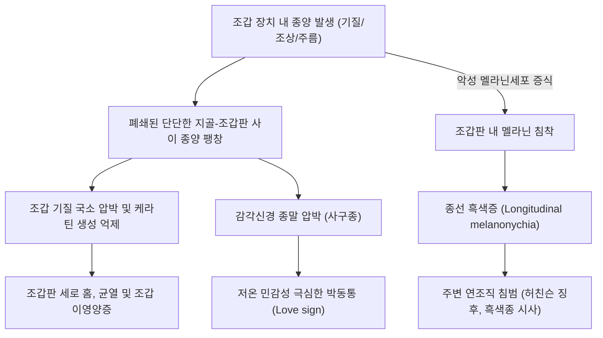

# 🩺 손발톱 종양 (Tumors of the Nail Apparatus, 조갑 종양)

> **핵심 3줄 요약 (Key Summary)**:
> - 📍 병소 부위 & 해부·병태생리: 조갑 장치(조갑 기질 nail matrix, 조상 nail bed, 조갑 주름 nail fold)를 구성하는 상피, 간엽, 혈관, 멜라닌세포 등 다양한 조직에서 발생하는 양성 및 악성 종양군. 대표적 양성 종양으로 사구종([[사구종]], Glomus tumor), 점액낭종(Digital mucous cyst), 조갑기질종(Onychomatricoma), 조갑유두종(Onychopapilloma)이 있으며, 치명적 악성 종양으로 조갑하 흑색종(Subungual melanoma)과 조갑하 편평세포암([[편평세포암]], SCC)이 포함됨.
> - 🚩 전형적 임상 양상: 한 손발톱에만 국한되어 나타나는 단일 조갑 이영양증, 종선(longitudinal band), 조갑판 융기 또는 함몰. 사구종은 심한 저온 불내성 및 극심한 국소 박동성 자통; 조갑하 흑색종은 비대칭적 다색성 흑색조갑증(종선 흑색증, Longitudinal melanonychia) 및 허친슨 징후(Hutchinson's sign, 색소가 조갑 주름 피부로 침범).
> - 🛠️ 핵심 검사 & 치료 전략: 조갑 더모스코피(Onychoscopy), 고해상도 초음파/조갑 MRI, **조갑 기질/조상 전층 조직 생검(Biopsy, Gold Standard)**. 사구종 및 양성 종양은 조갑판 거상 후 단순 핵출/절제술; 조갑하 편평세포암/흑색종은 모즈 미세도식 수술(Mohs surgery) 또는 지골 절단술(Amputation).
> - ⚠️ 응급 의뢰 레드플래그: 성인에서 단일 손발톱에 새로 발생한 불규칙한 갈색/흑색 띠(폭 > 3mm), 색소 침착이 근위부 조갑 주름이나 측면 피부로 번지는 허친슨 징후(Hutchinson's sign), 또는 만성 궤양/출혈/조갑 파괴 동반 시 즉시 악성 흑색종 감별을 위해 상급병원 피부암 센터 전원.

---

## 📌 목차
1. [질환 개요 & 해부학적 병태생리](#1--질환-개요---해부학적-병태생리)
2. [병태생리 메커니즘 & 생체역학적 악순환 네트워크](#2--병태생리-메커니즘---생체역학적-악순환-네트워크)
3. [임상 증상 & 이학적 검사(Physical Exam) 알고리즘](#3--임상-증상---이학적-검사physical-exam-알고리즘)
4. [진단 검사 & 감별 진단 패널](#4--진단-검사---감별-진단-패널)
5. [양방 치료 프로토콜 & 약물 상호작용](#5--양방-치료-프로토콜---약물-상호작용)
6. [한의 기능의학적 치료 프로토콜](#6--한의-기능의학적-치료-프로토콜)
7. [재활 운동 & 생활습관 티칭 가이드](#7--재활-운동---생활습관-티칭-가이드)
8. [💡 사용자 진료실 핵심 필기 & 임상 노하우 (Melt-In 잔여 심화 집약)](#8--사용자-진료실-핵심-필기---임상-노하우-melt-in-잔여-심화-집약)
9. [출처 및 학술 참고 문헌 (References)](#9--출처-및-학술-참고-문헌-references)

---

## 1. 질환 개요 & 해부학적 병태생리

### 1) 정의 및 해부학적 특수성
손발톱 종양(Tumors of the Nail Unit, 조갑 종양)은 조갑판(nail plate)과 이를 지지·생성하는 4대 해부학적 구조물인 근위/측면 조갑 주름(Nail folds), 조갑 기질(Nail matrix), 조상(Nail bed), 조하피(Hyponychium)에서 기원하는 모든 양성 및 악성 종양을 통칭한다. 조갑 장치는 단단한 각질판과 하부 지골(distal phalanx)이라는 폐쇄된 골성 구조 사이에 끼어 있어, 종양이 미세하더라도 극심한 압박 통증을 유발하거나 조갑판의 기형적인 변형을 동반하는 고유한 병태학적 특징을 지닌다.

### 2) 기원 세포별 주요 종양 분류
- **사구체 기원 (Glomus tumor)**: 체온 조절을 담당하는 동정맥 문합 혈관 구조인 사구체(Glomus body)의 신경-혈관-평활근 세포에서 발생하는 양성 혈관종양. 조상 부위에 가장 호발.
- **섬유·점액성 기원 (Digital mucous cyst)**: 원위 지절관절(DIP joint)의 골관절염과 연관되어 관절포가 탈출하거나 섬유모세포의 뮤신 과분비로 발생하는 가성낭종. PNF를 압박하여 발톱에 세로 고랑(groove)을 형성.
- **조갑 상피 기원 (Onychomatricoma & Onychopapilloma)**: 기질 상피에서 자라나 발톱 내부를 벌집 모양 구멍으로 채우는 조갑기질종, 또는 조상 상피의 유두종.
- **악성 종양 (Malignant tumors)**:
  - **조갑하 흑색종 (Subungual melanoma)**: 말단 흑자성 흑색종(Acral lentiginous melanoma)의 일종으로, 조갑 기질의 악성 멜라닌세포에서 발생하여 조갑판에 흑색 선을 형성하며 치명률이 높음.
  - **조갑하 편평세포암 ([[편평세포암]], SCC)**: HPV 16/18 감염 및 만성 자극과 연관되며, 사마귀나 만성 조갑주위염으로 장기간 오진되기 쉬움.

---

## 2. 병태생리 메커니즘 & 생체역학적 악순환 네트워크

### 1) 기질 압박과 조갑판 변형 기전
조갑판은 조갑 기질 세포의 분열과 각질화(keratinization)로 생성되어 전방으로 미끄러져 나간다:
1. 조갑 기질에 종양(예: 점액낭종, 사구종)이 위치하면, 기질 상피가 국소적으로 압박을 받아 케라틴 생성이 중단되거나 얇아진다.
2. 결과적으로 조갑판 전장에 걸쳐 세로 방향의 고랑(longitudinal groove), 함몰, 또는 균열(longitudinal splitting)이 형성된다.
3. 조갑 기질의 멜라닌세포가 종양에 의해 자극(활성화)되거나 악성 증식하면, 자라 나오는 조갑판에 멜라닌 색소가 띠 모양으로 침착되는 **종선 흑색증(Longitudinal melanonychia)**이 발현된다.

---

## 3. 임상 증상 & 이학적 검사(Physical Exam) 알고리즘

### 1) 주요 종양별 핵심 임상 징후
- **사구종 (Glomus tumor)**:
  - 3대 전형 징후: **자발적 박동통, 국소 압통, 저온 민감성(Cold hypersensitivity)**.
  - 발톱 밑에 1~5mm 크기의 붉거나 푸르스름한 반점이 비쳐 보임.
  - **러브 검사 (Love's pin test)**: 볼펜 끝이나 핀으로 병변 의심 부위를 정확히 눌렀을 때 극심한 통증 유발 (양성).
  - **힐드레스 검사 (Hildreth's test)**: 손가락 기저부에 지혈대를 감아 허혈을 유도하면 통증이 소실되고, 지혈대를 풀면 즉시 통증이 재발함 (양성).
- **조갑하 흑색종 (Subungual melanoma)**:
  - **ABCDEF 진단 룰**:
    - **A** (Age): 50~70세 호발.
    - **B** (Band/Brown-black): 갈색~검은색 띠, 폭 $\ge$ 3mm, 경계가 흐릿하고 불규칙.
    - **C** (Change): 띠의 폭이 넓어지거나 색이 짙어지는 급격한 변화.
    - **D** (Digit): 엄지손가락(제1수지) 또는 엄지발가락(제1족지)에 가장 호발.
    - **E** (Extension, **Hutchinson's sign**): 색소 침착이 조갑판을 넘어 **근위부 조갑 주름이나 측면 피부로 번져나감**(흑색종의 결정적 징후).
    - **F** (Family history): 흑색종 가족력.

### 2) 더모스코피 (Onychoscopy) 평가 알고리즘
- 갈색/흑색 띠의 선 간격, 색조, 평행성 관찰:
  - 양성 멜라닌세포 모반: 규칙적인 평행 선, 균일한 색조, 얇은 띠.
  - 악성 흑색종: 불규칙한 색조, 파괴된 평행성, 기저부에서 원위부로 갈수록 넓어지는 삼각형 형태(triangular shape), 허친슨 징후.

---

## 4. 진단 검사 & 감별 진단 패널

### 1) 확진을 위한 생검 프로토콜 (Nail Biopsy)
조갑하 악성 종양이 의심될 경우 외래에서 펀치 생검(Punch biopsy)이나 조갑판 박리 후 기질 종선 절제 생검(Longitudinal matrix excision)을 시행하여 병리 조직학적으로 확진해야 한다.

### 2) 영상의학적 검사
- **조갑 고해상도 초음파 / MRI**: 사구종의 위치(조상 내 2~5mm 경계 명확한 저에코성 혈류 풍부 결절 확인) 및 골 침식 여부 평가.

### 3) 감별 진단 패널
| 질환명 | 주된 임상 소견 | 손발톱 종양과의 핵심 감별점 |
| :--- | :--- | :--- |
| **조갑하 혈종 (Subungual hematoma)** | 외상 후 발생한 암적색~자색 반점 | 발톱이 자라남에 따라 원위부로 이동하여 정상화됨, 더모스코피상 둥근 혈액 웅덩이(globules) |
| **조갑진균증 (Onychomycosis)** | 발톱 비후, 박리, 백황색 변색 | 다발성 손발톱 침범 흔함, 통증 없음, KOH 도말 양성 |
| **심상성 사마귀 (Verruca)** | 조갑주위 과각화성 결절 | 표면 거침, 점상 출혈, 모자이크 패턴 (SCC로의 악성 변형 주의) |
| **인종적 흑색조갑증 (Ethnic melanonychia)** | 피부색이 짙은 인종의 다발성 갈색 선 | 여러 손발톱에 대칭적으로 나타남, 안정적 경과, 허친슨 징후 없음 |

---

## 5. 양방 치료 프로토콜 & 약물 상호작용

### 1) 양성 종양 치료 프로토콜
- **사구종 (Glomus tumor)**:
  - 수술적 핵출술: 국소 마취 하에 조갑판을 부분 거상하고 조상 상피를 절개하여 캡슐에 싸인 적자색 종양 결절을 완전 적출 (제거 즉시 수년간 지속된 통증 완치).
- **점액낭종 (Digital mucous cyst)**:
  - 낭종 천자 및 스테로이드 주입 또는 골극(osteophyte) 절제를 동반한 낭종 외과적 절제술.
- **화농성 육아종**: 소파 및 전기소작술.

### 2) 악성 종양 치료 프로토콜
- **조갑하 편평세포암 (SCC)**:
  - 모즈 미세도식 수술(Mohs micrographic surgery)을 통한 조직 보존 절제, 또는 원위 지골 절단술(Distal interphalangeal amputation).
- **조갑하 흑색종 (Subungual melanoma)**:
  - 침습 깊이(Breslow thickness)에 따른 광범위 국소 절제술 또는 지골 절단술, 감시림프절 생검(SLNB). 전신 전이 시 표적치료제(BRAF 억제제) 또는 면역관문억제제(펨브롤리주맙, 니볼루맙) 투여.

---

## 6. 한의 기능의학적 치료 프로토콜

### 1) 변증 분형 (TCM Differentiation)
한의학적으로 손발톱 종양은 [[어혈어결]](瘀血瘀結), [[담탁응체]](痰濁凝滯), [[기체혈어]](氣滯血瘀)로 인해 조갑 부위의 낙맥(絡脈)이 막혀 기혈 순환이 단절되고 종괴를 형성한 병태로 변증한다.

| 변증 | 전형적 증상 | 설태 및 맥상 | 대표 처방 |
| :--- | :--- | :--- | :--- |
| **어혈조락·통비형 (瘀血阻絡·痛痺型, 사구종)** | 극심한 자통, 야간통 악화, 한랭 노출 시 극통, 암자색 설 | 설자어반, 맥세삽(細澁) | [[활락효영단]] 합 [[도홍사물탕]] |
| **담어응결·췌우형 (痰瘀凝結·贅疣型, 양성종양)** | 단단한 결절, 조갑 변형, 무통 또는 둔통, 완고한 지속 | 설담어반 태백니(白膩), 맥현삽(弦澁) | [[선방활명음]] 합 [[이진탕]] |
| **독사울결·기혈양허형 (毒邪鬱結·氣血兩虛型, 악성의심)** | 암흑색 띠의 불규칙 확산, 궤양, 만성 소모, 창백, 피로 | 설자암소태, 맥미세무력(微細無力) | [[보중익기탕]] 합 [[귀비탕]] |

### 2) 침구 치료 혈위
- **국소 통증 차단 및 낙맥 순환**: 지절부의 [[십선혈]](EX-UE11), [[팔사혈]](EX-UE9) 점자출혈.
- **원위 취혈**: [[합곡]](LI4), [[태충]](LR3), [[곡지]](LI11), [[삼음교]](SP6).

---

## 7. 재활 운동 & 생활습관 티칭 가이드

- **단일 조갑 변화 자가 점검 (규칙적 관찰)**:
  - 매니큐어나 젤네일을 지운 상태에서 주기적으로 손발톱을 관찰.
  - 특히 **단 하나의 손발톱에만 세로 흑색 띠나 변형이 생겼는지** 확인.
- **반복 외상 회피**: 손가락 끝에 반복적인 진동이나 충격이 가해지는 직업적 자극 차단.
- **찬물 노출 주의 (사구종 환자)**: 사구종 환자는 찬물에 손을 넣거나 겨울철 찬 공기에 노출되면 기절할 듯한 통증이 발생하므로 보온 장갑 착용.

---

## 8. 💡 사용자 진료실 핵심 필기 & 임상 노하우 (Melt-In 잔여 심화 집약)

- **"한 손가락만 아프고 찬물에 손 넣으면 비명을 지른다? 100% 사구종"**:
  - 환자가 "손톱 밑이 너무 아파서 잠을 못 자는데 겉보기엔 멀쩡해요. 찬물로 손을 씻거나 겨울에 밖에 나가면 손가락이 잘려나가는 것 같아요"라고 호소하면 의심할 여지 없이 **사구종(Glomus tumor)**이다. 볼펜 끝으로 손톱 위를 살살 누르다가 특정 한 점(지름 2mm)에서 환자가 비명을 지르면(Love's pin test 양성) 진단 완료이다. MRI 찍어서 째고 콩알만 한 붉은 결절을 쏙 빼주면 10년 묵은 통증이 그 자리에서 끝난다.
- **흑색 띠가 살점(피부)으로 번졌다면 1초도 지체 말고 대학병원으로 (Hutchinson's Sign)**:
  - 발톱에 검은 줄이 생겼다고 무조건 암은 아니다. 하지만 그 검은 색소가 발톱 뿌리 쪽 피부나 옆 피부(조갑 주름)까지 번져서 묻어 있다면 이것이 바로 **허친슨 징후(Hutchinson's sign)**이며 악성 흑색종의 결정적 증거이다. 절대로 손톱을 뽑거나 레이저로 지지지 말고 즉시 대학병원 피부암 센터로 전원시켜야 환자의 생명을 살릴 수 있다.

---

## 9. 출처 및 학술 참고 문헌 (References)

- Haneke, E., et al. (2001). Longitudinal melanonychia. *Dermatol Surg*. PMID: 11442597.

- 대한피부과학회. (2020). *피부과학 (제7판)*. 도서출판 대한의학.

- 대한성형외과학회. (2019). *성형외과학 (제4판)*. 군자출판사.

- 한방안이비인후피부과학회. (2021). *한의피부외과학*. 도서출판 정담.

---

## 관련 노트

- [[편평세포암]]
- [[사구종]]
- [[악성 흑색종]]
- [[도홍사물탕]]
- [[활락효영단]]
