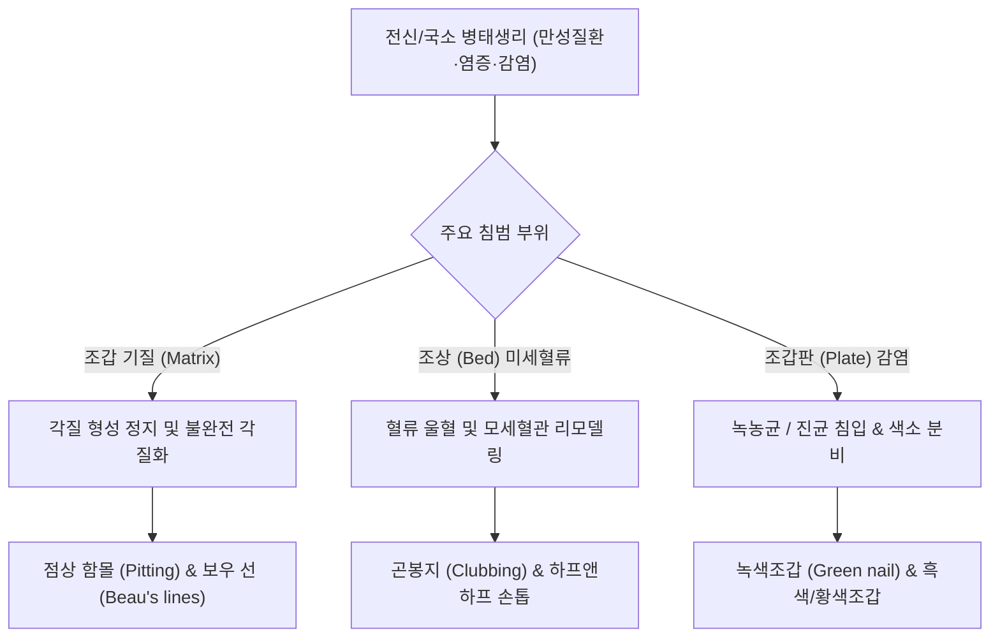

# 🩺 손발톱의 변형 이상증 변색 (Nail Dystrophy, Deformity & Dyschromia)

> **핵심 3줄 요약 (Key Summary)**:
> - 📍 병소 부위 & 해부·병태생리: 조갑 기질(nail matrix), 조상(nail bed), 또는 조갑판(nail plate)의 각질화 및 색소형성 장애로 인해 손발톱의 형태, 구조, 두께 및 색조가 비정상적으로 변형되는 질환군. 원발성 피부 질환([[건선]], [[편평태선]], [[원형 탈모증]]), 전신 질환(간경변, 신부전, 심부전, 폐질환, 빈혈), 감염증([[조갑진균증]]), 약물 및 외인성 착색에 의해 유발됨.
> - 🚩 전형적 임상 양상: 
>   - 변형/이상증: 조갑 함몰표면(오목패임, Pitting), 조갑박리증(Onycholysis), 시계유리벽 곤봉지(Clubbing), 숟가락형 조갑(Koilonychia), Beau 선(횡구증), 보우만-하프 조갑(Lindsay's nails).
> - 색조 이상: 백색조갑(Leukonychia), 황색조갑(Yellow nail syndrome), 갈색/흑색조갑(Melanonychia), 녹색조갑(Green nail syndrome, 녹농균 감염).
> - 🛠️ 핵심 검사 & 치료 전략: 조갑 더모스코피(Onychoscopy), KOH 도말 및 진균 배양검사, 전신 기저질환 스크리닝(CBC, LFT, Cr, TSH, 흉부 X-선). 원인 질환 치료(건선/태선 국소 스테로이드, 녹농균 시프로플록사신 점적, 영양 결핍 교정).
> - ⚠️ 응급 의뢰 레드플래그: 곤봉지(Clubbing)의 급격한 출현은 폐암, 폐농양, 간질성 폐질환 또는 청색증형 심장병의 강력한 징후이므로 즉시 흉부 CT 의뢰. 조갑하 선상 출혈(Splinter hemorrhages)과 함께 발열, 심잡음 동반 시 감염성 심내막염([[심내막염]]) 정밀 심초음파 필수.

---

## 📌 목차
1. [질환 개요 & 해부학적 병태생리](#1--질환-개요---해부학적-병태생리)
2. [병태생리 메커니즘 & 생체역학적 악순환 네트워크](#2--병태생리-메커니즘---생체역학적-악순환-네트워크)
3. [임상 증상 & 이학적 검사(Physical Exam) 알고리즘](#3--임상-증상---이학적-검사physical-exam-알고리즘)
4. [진단 검사 & 감별 진단 패널](#4--진단-검사---감별-진단-패널)
5. [양방 치료 프로토콜 & 약물 상호작용](#5--양방-치료-프로토콜---약물-상호작용)
6. [한의 기능의학적 치료 프로토콜](#6--한의-기능의학적-치료-프로토콜)
7. [재활 운동 & 생활습관 티칭 가이드](#7--재활-운동---생활습관-티칭-가이드)
8. [💡 사용자 진료실 핵심 필기 & 임상 노하우 (Melt-In 잔여 심화 집약)](#8--사용자-진료실-핵심-필기---임상-노하우-melt-in-잔여-심화-집약)
9. [출처 및 학술 참고 문헌 (References)](#9--출처-및-학술-참고-문헌-references)

---

## 1. 질환 개요 & 해부학적 병태생리

### 1) 정의 및 임상적 의의
손발톱의 변형·이상증 및 변색(Nail Deformity, Dystrophy & Dyschromia)은 조갑 복합체의 구조적 손상이나 생리적 대사 변화로 인해 발톱과 손톱의 두께, 모양, 표면 질감 및 색조에 이상이 초래된 상태를 망라한다. 손발톱은 '인체의 건강을 비추는 창문'이라 불리며, 피부 국소 질환뿐 아니라 심장, 폐, 간, 신장, 내분비계 등 중대한 전신 내부 장기의 만성 질환이나 결핍 상태가 조갑의 성장과 미세혈류에 고스란히 반영되어 특유의 징후를 나타낸다.

### 2) 조갑 해부학적 병소 위치별 병변 기전
- **조갑 기질(Nail matrix) 병변**: 기질의 각질화 이상 시 조갑판 자체의 두께와 표면 이상이 초래된다 (예: 건선의 점상 함몰 Pitting, 편평태선의 익상편 Pterygium, 보우선 Beau's lines).
- **조상(Nail bed) 병변**: 조상 상피의 분리나 모세혈관 혈류 변화로 색조 및 박리가 발생한다 (예: 조갑박리증 Onycholysis, 오일 방울 징후 Oil-drop sign, 선상 출혈 Splinter hemorrhages, 반반 손톱 Half-and-half nail).
- **조갑판(Nail plate) 자체의 침착**: 진균 침입, 화학물질(염색약), 외인성 세균 색소(녹농균의 파이오시아닌) 침착.

---

## 2. 병태생리 메커니즘 & 생체역학적 악순환 네트워크

### 1) 주요 변형(Dystrophy)의 병태생리
- **점상 함몰 (Pitting)**: 근위 조갑 기질에 국소적 염증세포(호중구 등)가 침윤하여 불완전 각질화된 세포 덩어리(부전각화증)가 형성되고, 조갑판이 전방으로 성장하면서 이 미성숙 세포들이 탈락하여 표면에 작은 웅덩이(pitting)를 남김 ([[건선]], [[원형 탈모증]]).
- **곤봉지 (Clubbing, Hippocratic nails)**: 만성 저산소증에 의해 말단 모세혈관 내 거핵구와 혈소판 덩어리가 포착되어 PDGF와 VEGF를 국소 방출함. 이로 인해 조상 연조직과 지골 기질이 비후되고 Lovibond 각도가 180° 이상으로 증가.
- **스푼형 조갑 (Koilonychia)**: 만성 철결핍성 빈혈([[철결핍성 빈혈]])로 인해 조갑 기질 세포의 시스테인/케라틴 대사 장애가 발생하여 원위부 조갑판이 위쪽으로 뒤집히며 중앙부가 오목하게 함몰.
- **보우 선 (Beau's lines)**: 급성 중증 열성 질환, 패혈증, 항암치료 등으로 인해 조갑 기질의 단백질 합성이 일시적으로 완전 정지되어 발생하는 깊은 가로 고랑(transverse groove).

### 2) 주요 변색(Chromonychia)의 원인 메커니즘
- **백색조갑 (Leukonychia)**: 기질 부전각화증(진성 백색조갑) 또는 저알부민혈증에 의한 조상 혈류 이상(Muehrcke 선, Terry 손톱).
- **하프 앤 하프 손톱 (Half-and-half nail, Lindsay nail)**: 만성 신부전([[만성 콩팥병]]) 환자에서 근위부 50%는 백색, 원위부 50%는 갈색/적색으로 분리.
- **녹색조갑 (Green nail syndrome)**: 조갑박리증 부위에 녹농균(*Pseudomonas aeruginosa*)이 증식하여 녹색 색소인 파이오시아닌(Pyocyanin) 분비.
- **황색조갑 증후군 (Yellow nail syndrome)**: 림프관 형성 부전으로 림프액 저류, 흉막삼출, 기관지확장증과 함께 조갑 성장이 정지되고 두꺼운 황색 조갑 형성.

---

## 3. 임상 증상 & 이학적 검사(Physical Exam) 알고리즘

### 1) 전신 질환과 연관된 대표적 손발톱 징후
| 조갑 징후 | 형태학적 특징 | 연관 전신 / 국소 질환 |
| :--- | :--- | :--- |
| **곤봉지 (Clubbing)** | 조갑-조갑주름 각도 > 180° (Schamroth 창 소실) | 폐암, 기관지확장증, 특발성 폐섬유증, 청색증형 선천성 심장병, 간경변 |
| **스푼형 조갑 (Koilonychia)** | 중앙 함몰, 모서리 뒤집힘 (물방울이 고임) | 철결핍성 빈혈, 혈색소침착증, 레이노 증후군 |
| **테리 손톱 (Terry's nails)** | 근위부 80% 이상이 우윳빛 백색, 원위부 얇은 분홍 띠 | 간경변(80%), 울혈성 심부전, 2형 당뇨병, 고령 |
| **린제이 손톱 (Lindsay's nails)** | 근위부 40~80% 백색, 원위부 적갈색 경계 명확 | 만성 신부전 (요독증성 신병증) |
| **점상 함몰 (Pitting)** | 골프공 표면 같은 다발성 작은 오목 패임 | 건선(Psoriasis), 원형 탈모증, 아토피 피부염 |
| **선상 출혈 (Splinter hemorrhage)** | 조갑 세로 방향의 얇은 적흑색 선 | 감염성 심내막염, 항인지질항체 증후군, 미세 외상 |
| **조갑박리증 (Onycholysis)** | 조갑판이 조상으로부터 하얗게 들뜸 | 갑상선기능항진증(Plummer's nail), 외상, 접촉피부염, 건선 |

### 2) 이학적 검사 알고리즘
1. **샴로스 창 검사 (Schamroth's window test)**: 양손 검지손톱의 등쪽 표면을 서로 맞대었을 때 기저부에 생기는 마름모꼴 다이아몬드 창이 소실되면 곤봉지 양성.
2. **더모스코피 관찰**: 선상 출혈, 오일 방울 징후(연어살 반점, 건선 특이적), 모세혈관류 확인.

---

## 4. 진단 검사 & 감별 진단 패널

### 1) 진단적 검사 패널
- **진균학적 검사 (KOH 및 배양)**: 변색 및 박리 병변에서 진균증 배제 필수.
- **전신 질환 감별 검사**:
  - 일반혈액검사(CBC, Ferritin, TIBC) $
ightarrow$ 철결핍성 빈혈.
  - 신기능(BUN, Cr, eGFR) $
ightarrow$ 린제이 손톱.
  - 간기능(AST, ALT, Albumin, Bilirubin) $
ightarrow$ 테리 손톱.
  - 흉부 X-선 / CT $
ightarrow$ 곤봉지 환자에서 폐암 및 만성 폐질환 배제.
  - 심초음파(Echocardiography) $
ightarrow$ 선상 출혈 환자에서 감염성 심내막염 배제.

---

## 5. 양방 치료 프로토콜 & 약물 상호작용

### 1) 원인 질환별 맞춤 치료 프로토콜
- **건선성 조갑염**:
  - 국소 치료: 고강도 코르티코스테로이드 + 칼시포트리올 복합제(자미올 등) 근위 조갑 주름 도포.
  - 병변내 주사: 트리암시놀론 주사(ILTA 2.5~5 mg/mL) 기질 주사.
  - 중증 시 생물학적 제제(IL-17, IL-23 억제제).
- **녹색조갑 증후군 (Green nail syndrome)**:
  - 조갑박리 부위의 녹농균 박멸을 위해 조갑판 부분 절제 후 0.3% 시프로플록사신(Ciprofloxacin) 점안액을 1일 2~3회 환부에 점적 도포. 식초(acetic acid) 희석액 족욕 병행.
- **철결핍성 빈혈 (스푼형 조갑)**: 경구 철분제 복용으로 빈혈 교정 시 신생 조갑판이 정상 형태로 회복.
- **원인 불명 취약 조갑 (Brittle nails)**: 비오틴(Biotin 2.5~5 mg/day) 3~6개월 경구 투여.

---

## 6. 한의 기능의학적 치료 프로토콜

### 1) 변증 분형 (TCM Differentiation)
한의학적으로 손발톱은 [[간주근]](肝主筋)과 [[간기화재조]](肝其華在爪)의 생리 이론에 따라 간(肝)의 영양 상태와 직결되며, [[기혈양허]](氣血兩虛), [[간신음허]](肝腎陰虛), [[어혈조락]](瘀血阻絡), [[습열침음]](濕熱浸淫)으로 조갑 영양이 실조(조갑실영, 爪甲失榮)된 병태로 변증한다.

| 변증 | 전형적 증상 | 설태 및 맥상 | 대표 처방 |
| :--- | :--- | :--- | :--- |
| **간혈허·조갑실영형 (肝血虛·爪甲失榮型)** | 스푼형 조갑, 얇고 부서지는 손톱, 안색창백, 현훈, 월경과소 | 설담 태박백, 맥세약(細弱) | [[사물탕]] 합 [[귀비탕]] 가감 |
| **간신음허형 (肝腎陰虛型)** | 건조성 조갑박리, 세로줄 고랑, 요슬산연, 이명, 조열도한 | 설홍소태, 맥세삭(細數) | [[육미지황탕]] 합 [[일관전]] |
| **습열하주·탁조형 (濕熱下注·濁爪型, 녹색/황색조갑)** | 두껍고 탁한 황녹색 변색, 소양감, 열감, 대하 또는 습진 | 설홍 태황니(黃膩), 맥활삭(滑數) | [[용담사간탕]] 합 [[비해분청음]] |
| **기체혈어형 (氣滯血瘀型, 청자색 변색/선상출혈)** | 암자색 조갑, 수족냉증, 찌르는 듯한 말초 통증, 한랭 악화 | 설자어반, 맥세삽(細澁) | [[당귀사역탕]] 합 [[혈부축어탕]] |

### 2) 침구 치료 혈위
- **간혈 보익 및 말초 미세순환 촉진**: [[태충]](LR3), [[곡천]](LR8), [[족삼리]](ST36), [[삼음교]](SP6), [[혈해]](SP10).
- **국소 지절 경락 순환**: [[십선혈]](EX-UE11), [[팔사혈]](EX-UE9), 정혈(井穴) 취혈.

---

## 7. 재활 운동 & 생활습관 티칭 가이드

- **물과 세제 접촉 최소화**: 잦은 손 씻기와 설거지, 화학 약품 접촉은 조갑 탈수와 박리를 가속화하므로, 면장갑 착용 후 고무장갑 착용(이중 장갑 수칙).
- **보습제 생활화**: 손을 씻은 직후 핸드크림이나 바세린을 손톱과 큐티클 부위까지 꼼꼼히 마사지하듯 도포.
- **인위적 큐티클 제거 금지**: 네일샵에서 큐티클(Eponychium)을 억지로 잘라내면 조갑 주름과 조갑판 사이 방어벽이 뚫려 세균과 진균이 침투하므로 미용 목적의 과도한 큐티클 정리 금지.

---

## 8. 💡 사용자 진료실 핵심 필기 & 임상 노하우 (Melt-In 잔여 심화 집약)

- **손톱을 보면 환자의 간과 콩팥, 심장이 보인다**:
  - 환자가 진료실에 들어왔을 때 손톱을 3초만 스캔해도 거대한 질병을 잡아낼 수 있다.
  - 손톱 절반이 하얗고 절반이 갈색이면 **신장내과(만성 신부전)**, 손톱 전체가 우윳빛으로 하얗고 끝에만 살짝 붉으면 **소화기내과(간경변)**, 손톱이 둥글게 부풀어 마름모 창이 안 보이면 **호흡기내과(폐암/폐섬유증)**로 직행시켜야 한다.
- **녹색 손톱에 무좀약 주지 마라 (Green Nail)**:
  - 손톱이 시퍼렇게 변했다고 무좀(진균)으로 오진하여 항진균제를 처방하면 환자가 한 달 뒤 분통을 터뜨린다. 녹색은 곰팡이가 아니라 습한 틈새에 서식하는 **녹농균(Pseudomonas)**의 배설물 색깔이다. 식초물에 손가락을 담그고 안약용 항생제(시프로플록사신)를 몇 방울 떨어뜨려 주면 2주 만에 깨끗해진다.
- **손톱 영양제보다 단백질과 철분 섭취가 기본**:
  - 손톱이 뚝뚝 부러진다고 비싼 콜라겐이나 비오틴 영양제만 찾는 여성 환자들은 대개 무리한 다이어트로 단백질과 철분이 고갈되어 있다. 달걀, 소고기, 두부를 먹이고 3개월을 기다려야 새로 자라는 손톱이 단단해진다.

---

## 9. 출처 및 학술 참고 문헌 (References)

- Mendiratta, V., et al. (2011). Nail dyschromias. *Indian J Dermatol Venereol Leprol*. PMID: 22016271.

- Ricardo, J. W., et al. (2026). Evaluation and management of mechanical and structural nail disorders: A clinical review. *J Am Acad Dermatol*. PMID: 41242632.

- 대한피부과학회. (2020). *피부과학 (제7판)*. 도서출판 대한의학.

- 대한내과학회. (2020). *Harrison's 내과학 (제20판)*. 도서출판 MIP.

- 한방안이비인후피부과학회. (2021). *한의피부외과학*. 도서출판 정담.

---

## 관련 노트

- [[건선]]
- [[조갑진균증]]
- [[철결핍성 빈혈]]
- [[만성 콩팥병]]
- [[사물탕]]
- [[귀비탕]]
