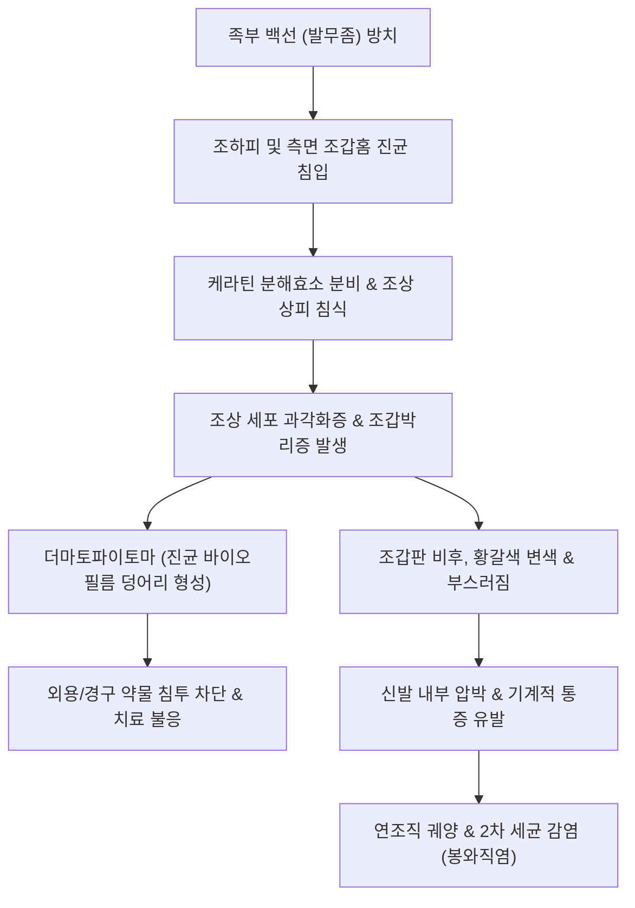

# 🩺 조갑진균증 (Onychomycosis, 손발톱 무좀)

> **핵심 3줄 요약 (Key Summary)**:
> - 📍 병소 부위 & 해부·병태생리: 피부사상균(주로 *Trichophyton rubrum*, *Trichophyton mentagrophytes*), 효모균(*Candida albicans*), 또는 비피부사상균성 곰팡이(NDM)가 손발톱판(nail plate), 조상(nail bed), 조하피(hyponychium)로 침입하여 케라틴을 분해하고 조갑 비후, 박리, 조갑하 각화과다증(subungual hyperkeratosis) 및 변색을 일으키는 조갑 진균 감염증.
> - 🚩 전형적 임상 양상: 조갑의 백황색 또는 황갈색 변색, 광택 소실, 두꺼워짐(비후), 부스러짐(취약성), 조갑박리증. 임상 아형으로 원위측부 조갑하형(DLSO, 가장 흔함), 백색 표재형(WSO), 근위부 조갑하형(PSO, HIV 감염 의심), 전이영양형(TDO)으로 분류.
> - 🛠️ 핵심 검사 & 치료 전략: 치료 전 **진균학적 확진 필수**(10~20% [[KOH 도말 검사]], 진균 배양검사 또는 조갑박편 PAS 염색 조직검사). 경증~중등도(기질 침범 없음): 국소 항진균제(에피나코나졸 10% 외용액 [[에피나코나졸]], 시클로피록스 8% 래커); 중등도~중증(기질 침범, 50% 이상 침범): 경구 항진균제([[테르비나핀]] 250 mg/day 손톱 6주/발톱 12주, 또는 [[이트라코나졸]] 펄스 요법).
> - ⚠️ 응급 의뢰 레드플래그: 당뇨병성 족부 질환 또는 면역저하 환자에서 조갑 비후로 인한 압박 궤양, 심한 2차 세균 감염(봉와직염, 급성 림프관염) 병발 시 즉시 전신 항생제 투여 및 상급병원 당뇨발 클리닉 의뢰.

---

## 📌 목차
1. [질환 개요 & 해부학적 병태생리](#1--질환-개요---해부학적-병태생리)
2. [병태생리 메커니즘 & 생체역학적 악순환 네트워크](#2--병태생리-메커니즘---생체역학적-악순환-네트워크)
3. [임상 증상 & 이학적 검사(Physical Exam) 알고리즘](#3--임상-증상---이학적-검사physical-exam-알고리즘)
4. [진단 검사 & 감별 진단 패널](#4--진단-검사---감별-진단-패널)
5. [양방 치료 프로토콜 & 약물 상호작용](#5--양방-치료-프로토콜---약물-상호작용)
6. [한의 기능의학적 치료 프로토콜](#6--한의-기능의학적-치료-프로토콜)
7. [재활 운동 & 생활습관 티칭 가이드](#7--재활-운동---생활습관-티칭-가이드)
8. [💡 사용자 진료실 핵심 필기 & 임상 노하우 (Melt-In 잔여 심화 집약)](#8--사용자-진료실-핵심-필기---임상-노하우-melt-in-잔여-심화-집약)
9. [출처 및 학술 참고 문헌 (References)](#9--출처-및-학술-참고-문헌-references)

---

## 1. 질환 개요 & 해부학적 병태생리

### 1) 정의 및 역학
조갑진균증(Onychomycosis, Tinea unguium)은 진균에 의해 발생하는 손톱과 발톱의 감염 질환으로, 전체 조갑 질환의 약 50%, 피부 진균 감염증의 약 30%를 차지하는 가장 흔한 조갑 질환이다. 발톱 감염이 손톱 감염보다 약 4~10배 빈번하며, 고령자(60세 이상에서 20% 이상), 남성, 당뇨병 환자, 말초혈관질환자, 면역저하자, 무좀(족부 백선) 기저 환자에서 유병률이 급증한다. 원인 병원체로는 피부사상균(*Trichophyton rubrum* 70%, *Trichophyton mentagrophytes* 20%)이 대부분이며, 효모균(*Candida albicans*)과 비피부사상균성 곰팡이(*Scopulariopsis*, *Fusarium*, *Aspergillus*)가 나머지를 차지한다.

### 2) 조갑 침범 경로에 따른 5대 임상 아형
- **원위측부 조갑하형 (Distal Lateral Subungual Onychomycosis, DLSO)**: 가장 흔한 형태(80~90%). 발가락 끝 조하피(hyponychium)와 측면 조갑 홈에서 시작하여 조상 상피를 따라 근위부(기질 방향)로 균사가 침투하여 조갑하 과각화증과 황변을 유발.
- **백색 표재형 (White Superficial Onychomycosis, WSO)**: 주로 *T. mentagrophytes*가 조갑판 배측(dorsal surface) 표면을 직접 침식하여 분필가루 같은 백색 반점과 거친 표면을 형성.
- **근위부 조갑하형 (Proximal Subungual Onychomycosis, PSO)**: 균이 큐티클을 통해 근위 조갑 주름(PNF)으로 침입하여 조갑 기질을 먼저 침범함. 면역 기능이 극도로 저하된 환자([[HIV 감염]] 환자의 강력한 임상 지표)에서 특징적으로 관찰됨.
- **칸디다성 조갑염 (Candida onychomycosis)**: *Candida* 감염에 의해 조갑판 전체가 침범되며, 조갑주위염(paronychia)을 동반하여 손톱이 물에 자주 닿는 주부, 요리사에서 호발.
- **전이영양형 (Total Dystrophic Onychomycosis, TDO)**: 모든 아형의 말기 단계로, 조갑판 전체가 부스러지고 두꺼운 각질 덩어리만 남아 정상 형태가 완전히 파괴됨.

---

## 2. 병태생리 메커니즘 & 생체역학적 악순환 네트워크

### 1) 케라틴 분해와 바이오필름 형성
1. **각질 침식**: 피부사상균은 아황산염 유출 펌프를 통해 케라틴의 이황화 결합을 약화시키고, 세린 단백분해효소(subtilisin)를 분비하여 단단한 조갑 케라틴을 분해한다.
2. **조갑하 공간 박리**: 조상 상피세포가 진균 자극에 반응하여 비정상적인 과각화 반응을 일으키고, 조갑판과 조상이 분리되는 조갑박리증이 발생한다.
3. **더마토파이토마 (Dermatophytoma)**: 조갑판 아래에 진균 균사와 후벽포자(chlamydoconidia)가 빽빽하게 엉겨 붙어 두꺼운 바이오필름 덩어리를 형성하면, 국소 및 경구 약물이 침투하지 못해 심각한 난치성 치료 저항을 나타낸다.

---

## 3. 임상 증상 & 이학적 검사(Physical Exam) 알고리즘

### 1) 대표적 임상 증상
- **변색 (Dyschromia)**: 백색, 황색, 황갈색, 암갈색 변색.
- **조갑하 과각화증 (Subungual hyperkeratosis)**: 발톱 밑에 치즈가루나 마른 각질 찌꺼기가 두껍게 쌓임.
- **조갑박리 (Onycholysis)**: 발톱 끝이 살에서 하얗게 들뜸.
- **조갑비후 및 조갑구축증 (Onychogryphosis)**: 발톱이 비정상적으로 두꺼워져 새의 발톱이나 산양의 뿔처럼 굽어 자람.
- **보행 통증**: 두꺼워진 발톱이 신발에 눌려 발생하는 족지 통증 및 티눈 병발.

### 2) 이학적 검사 알고리즘
1. **더모스코피(Onychoscopy) 검사**:
   - 원위부 경계면의 톱니 모양 파열(Jagged proximal edge with spikes).
   - 세로 방향의 황백색 줄무늬(Longitudinal striae).
   - 더마토파이토마(황색 또는 백색의 둥근 불투명 덩어리) 유무 확인.
2. **동반 부위 전수 진찰**: 족저부, 지간부 백선(발가락 사이 짓무름, 각화형 무좀) 동반 여부 확인.

---

## 4. 진단 검사 & 감별 진단 패널

### 1) 진단 확진 검사 프로토콜 (치료 전 필수)
> ⚠️ 발톱이 두껍고 누렇다고 해서 모두 무좀이 아니다. 변형 조갑의 50%는 건선, 외상, 습진 등 비진균성 질환이므로 **반드시 진균학적 검사로 균을 확인한 후 항진균제를 투여**해야 한다.

- **10~20% [[KOH 도말 검사]]**: 조갑하 각질 부스러기 채취 후 가온 용해하여 현미경 검경 (격벽 균사 관찰).
- **진균 배양검사 (SDA 배지)**: 균종 동정.
- **조갑박편 PAS 염색 조직검사 (Nail clipping with PAS stain, 최고 민감도)**: 발톱을 잘라 포르말린에 고정 후 병리과에서 PAS 염색 시행 (민감도 > 85~90%로 가장 정확).

### 2) 감별 진단 패널
| 질환명 | 임상 양상 | 조갑진균증과의 감별점 |
| :--- | :--- | :--- |
| **조갑 건선 (Nail psoriasis)** | 오일 방울 징후(연어살 반점), 조갑 점상 함몰(Pitting) | 양측 대칭성, 손발톱 다수 침범, 피부 건선 병변 동반, KOH 음성 |
| **만성 외상성 조갑이영양증** | 운동선수의 반복 찧김으로 인한 비후 | 균 검사 음성, 발가락 길이와 신발 마찰 부위 일치 |
| **편평태선 (Lichen planus)** | 조갑판 위축, 세로 능선, 익상편(Pterygium) | 기질 파괴로 인한 흉터성 변화, 얇아짐 위주 |
| **황색조갑 증후군** | 20개 조갑 전체의 성장 정지, 큐티클 소실 | 림프부종, 흉막삼출 동반, 균 검사 음성 |

---

## 5. 양방 치료 프로토콜 & 약물 상호작용

### 1) 경구 항진균제 치료 (중등도~중증, 표준 1차 요법)
- **[[테르비나핀]](Terbinafine, 1차 선택제)**:
  - 용량: 250 mg 1일 1회 연속 복용.
  - 투여 기간: 손톱 6주, **발톱 12주**.
  - 완치율: 70~80% (가장 높은 진균학적 완치율).
  - 모니터링: 간독성 및 미각 상실 부작용 가능하므로 **투약 전 및 투약 4~6주째 간기능 검사(LFT) 필수**.
- **[[이트라코나졸]](Itraconazole, 펄스 요법)**:
  - 용량: 200 mg 1일 2회 (1일 400 mg) 1주일 복용 후 3주일 휴약 (1주기).
  - 손톱은 2주기(2개월), 발톱은 3주기(3개월) 시행.
  - 심부전 환자 금기(음성 수축력 작용), CYP3A4 억제로 다발성 약물 상호작용 주의.

### 2) 국소 외용 항진균제 (경증 또는 경구제 금기 환자)
- 조갑 침범 면적 < 50%이고 조갑 기질(lunula)을 침범하지 않은 경우 단독 사용, 또는 경구제와 병용.
- **[[에피나코나졸]](Efinaconazole 10% 외용액, 주블리아)**: 케라틴 친화도가 낮아 조갑판 투과력이 매우 우수함. 1일 1회 48주간 매일 도포.
- **시클로피록스(Ciclopirox 8% 매니큐어)** / **아모롤핀(Amorolfine 5% 래커)**.

---

## 6. 한의 기능의학적 치료 프로토콜

### 1) 변증 분형 (TCM Differentiation)
한의학적으로 조갑진균증은 [[조갑실영]](爪甲失榮), [[회조갑]](灰指甲)의 범주에 속하며, [[비허습열]](脾虛濕熱)과 [[외감풍습독]](外感風濕毒)이 피부 조갑에 울체되거나, 병이 오래되어 [[간신음허]](肝腎陰虛), [[기혈양허]](氣혈兩虛)로 조갑 영양이 고갈된 병태로 변증한다.

| 변증 | 전형적 증상 | 설태 및 맥상 | 대표 처방 |
| :--- | :--- | :--- | :--- |
| **습열하주·충독형 (濕熱下注·蟲毒型)** | 발톱 황탁 비후, 족부 짓무름, 심한 가려움과 냄새 | 설홍 태황니(黃膩), 맥활삭(滑數) | [[용담사간탕]] 합 [[비해분청음]] |
| **기혈부족·조갑실영형 (氣血不足·爪甲失榮型)** | 발톱이 건조하고 쉽게 부스러짐, 안색위황, 피로 | 설담 태박백, 맥세약(細弱) | [[팔진탕]] 합 [[당귀음자]] |
| **간신음허·어혈형 (肝腎陰虛·瘀血型)** | 만성 암갈색 변색, 각화 비후, 요슬산연, 수족심열 | 설홍소태, 맥세삭(細數) | [[육미지황탕]] 합 [[도홍사물탕]] |

### 2) 한약 외용 침적 요법
- **식초-한약 침적액**: [[고삼]], [[황백]], [[백선피]], [[사상자]], [[대황]] 각 30g을 양조식초(또는 사과식초) 1L에 넣고 1주일간 침출시킨 후, 미온수에 1:1로 희석하여 환부를 매일 15~20분간 족욕 침적 (식초의 산성 환경과 한약의 항진균 성분 복합 작용).

---

## 7. 재활 운동 & 생활습관 티칭 가이드

- **발과 신발 건조 유지**: 하루 일과 후 신발에 신문지나 제습제를 넣어 건조시키고, 같은 신발을 이틀 연속 신지 않도록 2~3켤레 번갈아 착용.
- **발수건 및 손톱깎이 분리**: 가족 간 진균 전파를 막기 위해 발수건, 양말, 손톱깎이를 철저히 분리 사용. 손톱깎이는 사용 후 알코올 소독.
- **족부 백선(무좀) 동시 치료**: 발톱만 치료하고 발바닥 무좀을 방치하면 즉시 재감염되므로 족부 백선 연고를 발 전체에 4주 이상 동시 도포.
- **치료 완료 후에도 인내심 유지**: 발톱은 한 달에 1.5mm씩 자라므로, 약을 다 먹은 후에도 완전히 정상 발톱으로 밀려 나오기까지 **최소 9~12개월**이 소요됨을 환자에게 사전 설명.

---

## 8. 💡 사용자 진료실 핵심 필기 & 임상 노하우 (Melt-In 잔여 심화 집약)

- **"피검사(LFT) 없이 테르비나핀 처방하지 마라"**:
  - 테르비나핀은 매우 훌륭한 약이지만 드물게 전격성 간부전을 일으킨다. 약을 주기 전에 baseline LFT를 확인하고, 복용 한 달 뒤 추적 LFT를 확인해야 법적·임상적 리스크를 피할 수 있다. 만성 음주자나 간질환 환자는 주블리아(에피나코나졸) 같은 국소 도포제로 선회해야 한다.
- **'더마토파이토마(노란 쐐기 기둥)'는 갈아내야 낫는다**:
  - 발톱 밑에 노란색 두꺼운 줄이나 덩어리(Dermatophytoma)가 박혀 있는 환자는 약을 1년을 먹어도 그 자리가 안 낫는다. 진균 덩어리가 캡슐을 형성하고 있기 때문이다. 네일 드릴(그라인더)이나 큐렛으로 발톱 표면을 갈아내어 덩어리를 물리적으로 뚫어주거나 부분 제거한 뒤 약을 써야 완치된다.
- **먹는 약 끝났다고 바로 끊지 말고 바르는 약으로 바톤 터치**:
  - 발톱무좀 치료 실패의 가장 큰 원인은 '재발'이다. 경구약 3개월 복용이 끝난 시점에는 발톱 뿌리만 깨끗하고 끝부분엔 아직 곰팡이가 남아있다. 경구약 종료 후 발톱이 완전히 다 밀려 나갈 때까지(추가 6개월간) 주블리아나 매니큐어형 외용제를 유지해 주어야 재발 없는 완전 완치가 가능하다.

---

## 9. 출처 및 학술 참고 문헌 (References)

- Westerberg, D. P., & Voyack, M. J. (2013). Onychomycosis: Current trends in diagnosis and treatment. *Am Fam Physician*. PMID: 24364524.

- Gupta, A. K., et al. (2025). Treating Onychomycosis with Efinaconazole: Considerations for Diverse Patient Groups. *J Fungi (Basel)*. PMID: 41440669.

- 대한피부과학회. (2020). *피부과학 (제7판)*. 도서출판 대한의학.

- 대한진균학회. (2021). *임상진균학 (제3판)*. 도서출판 정담.

- 한방안이비인후피부과학회. (2021). *한의피부외과학*. 도서출판 정담.

---

## 관련 노트

- [[체부 백선]]
- [[족부 백선]]
- [[테르비나핀]]
- [[에피나코나졸]]
- [[용담사간탕]]
- [[팔진탕]]
