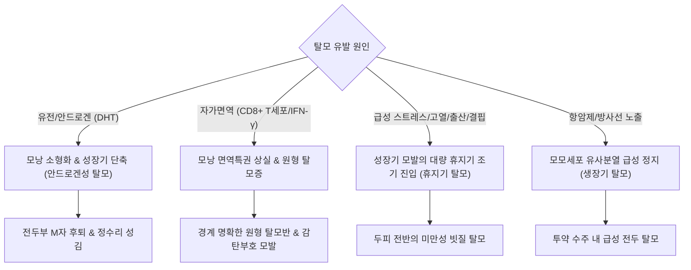

# 🩺 탈모증 (Alopecia, 탈모)

> **핵심 3줄 요약 (Key Summary)**:
> - 📍 병소 부위 & 해부·병태생리: 모낭 단위(hair follicle unit)의 모주기(hair cycle, 성장기 anagen-퇴행기 catagen-휴지기 telogen) 조절 장애, 안드로겐 감수성 및 면역학적 공격으로 인해 모발이 조기 탈락하거나 소형화(miniaturization)되는 질환군. 정상 두발은 8~12만 개(평방 cm당 120~140개)이며, 일일 생리적 탈락량은 50~100개이나 하루 100~120개 이상 빠질 경우 병적 탈모로 진단.
> - 🚩 전형적 임상 양상:
>   - **비반흔성 탈모(Non-scarring)**: 안드로겐성 탈모([[남성형 탈모증]], 안드로겐성 탈모증, 전두부 M자 및 정수리 연모화), 자가면역 질환인 [[원형 탈모증]](경계 명확한 원형 탈모반, 감탄부호 모발), 전신 스트레스 후 2~3개월 뒤 발생하는 휴지기 탈모증(Telogen effluvium, 미만성 탈모), 항암치료/방사선에 의한 성장기 탈모증(Anagen effluvium).
>   - **반흔성 탈모(Scarring)**: 모낭이 영구 파괴되어 모공이 소실되는 모공성 편평태선, 원반상 루푸스.
> - 🛠️ 핵심 검사 & 치료 전략: 모발 견인 검사(Hair pull test), 더모스코피(Trichoscopy), 혈청 ferritin/TIBC, TSH, 비타민 D, 호르몬 검사. 국소 [[미녹시딜]](Minoxidil 3~5%), 경구 5α-환원효소 억제제([[피나스테리드]], [[두타스테리드]]), 원형 탈모 시 병변내 코르티코스테로이드 주사(ILTA) 또는 JAK 억제제(올루미언트).
> - ⚠️ 응급 의뢰 레드플래그: 두피의 홍반, 위축, 모공 소실 및 영구 흉터가 형성되는 반흔성 탈모증(Cicatricial alopecia) 의심 시 또는 급격한 전신 탈모(범발성 원형 탈모증) 발생 시 지체 없이 확진 펀치 생검 및 상급 피부과 의뢰.

---

## 📌 목차
1. [질환 개요 & 해부학적 병태생리](#1--질환-개요---해부학적-병태생리)
2. [병태생리 메커니즘 & 생체역학적 악순환 네트워크](#2--병태생리-메커니즘---생체역학적-악순환-네트워크)
3. [임상 증상 & 이학적 검사(Physical Exam) 알고리즘](#3--임상-증상---이학적-검사physical-exam-알고리즘)
4. [진단 검사 & 감별 진단 패널](#4--진단-검사---감별-진단-패널)
5. [양방 치료 프로토콜 & 약물 상호작용](#5--양방-치료-프로토콜---약물-상호작용)
6. [한의 기능의학적 치료 프로토콜](#6--한의-기능의학적-치료-프로토콜)
7. [재활 운동 & 생활습관 티칭 가이드](#7--재활-운동---생활습관-티칭-가이드)
8. [💡 사용자 진료실 핵심 필기 & 임상 노하우 (Melt-In 잔여 심화 집약)](#8--사용자-진료실-핵심-필기---임상-노하우-melt-in-잔여-심화-집약)
9. [출처 및 학술 참고 문헌 (References)](#9--출처-및-학술-참고-문헌-references)

---

## 1. 질환 개요 & 해부학적 병태생리

### 1) 모발의 해부생리학과 생체 모주기 (Hair Cycle)
인간의 두피에는 약 10만 개의 모발이 존재하며, 평방 cm당 약 120~140개가 분포한다 (남성 약 8~10만 개, 여성 약 10~12만 개). 두발의 성장 속도는 매일 0.1~0.4mm(평균 0.35mm, 한 달 약 1cm)이며, 낮보다 밤에, 가을/겨울보다 봄/여름에 성장이 빠르다. 평생 동안 각 모낭은 10~20회의 독립적인 주기를 반복한다:
- **생장기 (Anagen phase)**: 2~6년 지속. 전체 두발의 85~90%를 차지하며, 모모세포(matrix cells)가 활발히 분열하여 모간을 생산.
- **퇴행기 (Catagen phase)**: 약 2~3주 지속. 전체 두발의 1% 미만. 세포 분열이 멈추고 모구(hair bulb)가 수축하여 위쪽으로 이동.
- **휴지기 (Telogen phase)**: 약 2~3개월 지속. 전체 두발의 10~15%. 모낭이 완전히 휴식을 취하며, 하부에서 새로운 생장기 모발이 자라 올라오면서 곤봉모(club hair)가 탈락(Exogen)함.
- **생리적 정상 탈락량**: 하루 평균 50~100개. 하루 탈모량이 **100~120개 이상** 지속될 때 병적 탈모증으로 판정한다.

### 2) 탈모의 2대 대분류: 비반흔성 vs 반흔성
- **비반흔성 탈모증 (Non-scarring alopecia)**: 모낭 줄기세포(bulge area)가 보존되어 있어 모공(follicular ostia)이 유지되며, 원인 교정 시 모발이 다시 자라날 수 있음 (안드로겐성 탈모, 원형 탈모, 휴지기 탈모, 생장기 탈모, 발모벽).
- **반흔성 탈모증 (Scarring/Cicatricial alopecia)**: 모낭 협부(isthmus)와 팽대부(bulge)의 줄기세포가 염증성 침윤(림프구 또는 호중구)에 의해 비가역적으로 파괴되어 섬유화되고 모공이 완전히 소실됨 (모공성 편평태선, 원반상 홍반성 루푸스, 탈모성 모낭염).

---

## 2. 병태생리 메커니즘 & 생체역학적 악순환 네트워크

### 1) 주요 탈모 아형별 발병 기전
- **안드로겐성 탈모증 (AGA)**: 유전적 소인을 가진 모낭에서 5α-환원효소에 의해 생성된 디하이드로테스토스테론([[DHT]])이 모유두세포의 안드로겐 수용체에 결합 $
ightarrow$ TGF-β 및 DKK-1 등 억제 사이토카인을 방출하여 성장기(anagen)를 극적으로 단축시키고 휴지기 비율을 증가시킴 $
ightarrow$ 모낭 소형화(miniaturization) 진행으로 굵은 종말모가 가늘고 짧은 연모(솜털)로 전변.
- **원형 탈모증 (Alopecia Areata, AA)**: 모낭의 '면역 특권(immune privilege)' 붕괴로 인해 세포독성 T세포(CD8+ NKG2D+)가 모낭의 멜라닌세포 관련 자가항원을 공격 $
ightarrow$ 인터페론-감마([[인터페론-감마]], IFN-γ) 및 IL-15가 JAK-STAT 신호전달계를 활성화하여 성장기 모낭을 급격한 조기 퇴행기로 몰아넣음.
- **휴지기 탈모증 (Telogen Effluvium, TE)**: 고열, 중증 감염(COVID-19, 독감), 출산, 대수술, 극단적 다이어트, 중증 정신적 스트레스 노출 후 2~3개월 뒤에 성장기에 있던 수많은 모발(30~50% 이상)이 한꺼번에 휴지기로 조기 진입하여 미만성으로 동시 탈락.
- **생장기 탈모증 (Anagen Effluvium)**: 항암화학요법제나 방사선 노출로 모모세포의 급격한 유사분열 정지가 일어나 모발이 부러지며 수일~수주 내에 폭발적으로 탈락.

---

## 3. 임상 증상 & 이학적 검사(Physical Exam) 알고리즘

### 1) 이학적 진찰 술기
1. **모발 견인 검사 (Hair pull test)**:
   - 두피의 여러 부위에서 약 50~60가닥의 모발을 엄지와 검지로 잡고 기저부에서 끝까지 부드럽게 당김.
   - **양성 기준**: 6가닥(> 10%) 이상의 모발이 통증 없이 쉽게 빠져나오면 활동성 탈모 진행 상태(휴지기 탈모증 또는 급성 원형 탈모증 활동기)로 판정.
2. **더모스코피 (Trichoscopy) 핵심 소견**:
   - 안드로겐성 탈모: **모발 굵기 다양성(Hair diameter diversity > 20%)**, 모낭 주위 갈색 달로(peripilar sign), 단일 모발 단위 증가.
   - 원형 탈모증: **감탄부호 모발(Exclamation mark hair)**, 흑점(black dots), 황색점(yellow dots), 짧은 잔털.
   - 반흔성 탈모증: 모공 입구 소실(absence of follicular ostia), 모낭 주위 홍반 및 각화성 칼라.

---

## 4. 진단 검사 & 감별 진단 패널

### 1) 검사실 평가 패널 (미만성 탈모 환자 필수)
- **혈청 페리틴(Ferritin) 및 철(Iron/TIBC)**: 페리틴 < 30~50 ng/mL 시 저장철 결핍성 모발 성장 장애.
- **갑상선 기능 검사 (TSH, Free T4)**: 갑상선기능저하증 및 항진증 모두 탈모 유발.
- **혈청 25-OH 비타민 D 및 아연(Zinc)**: 모낭 대사 조절 인자.
- **여성 호르몬 검사**: 생리불순 동반 여성에서 총 테스토스테론, DHEA-S, 17-OHP 확인.

---

## 5. 양방 치료 프로토콜 & 약물 상호작용

### 1) 안드로겐성 탈모증 (AGA) 1차 요법
- **경구 5α-환원효소 억제제 (남성 표준 요법)**:
  - **[[피나스테리드]](Finasteride 1 mg/day)** 또는 **[[두타스테리드]](Dutasteride 0.5 mg/day)**: DHT 생성을 70~90% 억제하여 모낭 소형화를 역전시키고 모발 밀도를 회복. 최소 6~12개월 복용 후 판정, 중단 시 효과 소실. 가임기 여성 금기.
- **국소 [[미녹시딜]](Minoxidil 3~5% 외용액/폼)**:
  - 남성 5%, 여성 2~3% (또는 5% 폼 1일 1회). 칼륨 통로 개방을 통해 모낭 혈류를 증가시키고 성장기를 유도. 도포 초기 2~6주에 일시적인 모발 탈락 증가(쉐딩 현상, shedding)가 나타날 수 있음을 사전 교육.
- **저용량 경구 미녹시딜 (Off-label)**: 성인 남성 2.5~5 mg, 여성 0.625~1.25 mg 1일 1회.

### 2) 원형 탈모증 (AA) 요법
- 국소/병변내 스테로이드 주사(Triamcinolone acetonide 2.5~5 mg/mL, 4~6주 간격).
- 중증 전두/범발성 탈모: 경구 JAK 억제제(바리시티닙 Baricitinib 2~4 mg/day).

---

## 6. 한의 기능의학적 치료 프로토콜

### 1) 변증 분형 (TCM Differentiation)
한의학적으로 모발은 [[신주모]](腎主毛, 腎其華在髮)와 [[혈지여]](血之餘, 발은 혈액의 잉여)의 원리에 따라 신정(腎精)과 간혈(肝血)의 충만 상태를 반영한다. 탈모는 [[간신음허]](肝腎陰虛), [[기혈양허]](氣血兩虛), [[비위습열]](脾胃濕熱), [[혈열생풍]](血熱生風)의 병태로 변증한다.

| 변증 | 전형적 증상 | 설태 및 맥상 | 대표 처방 |
| :--- | :--- | :--- | :--- |
| **간신음허·정혈부족형 (肝腎陰虛·精血不足型)** | 서서히 진행하는 탈모, 정수리 성김, 요슬산연, 현훈, 이명 | 설홍소태, 맥세삭(細數) | [[칠보미염단]] 합 [[육미지황탕]] |
| **기혈양허형 (氣血兩虛型, 휴지기/산후탈모)** | 산후 또는 대병 후 미만성 탈모, 안색위황, 피로, 심계 | 설담 치흔 태백, 맥세약(細弱) | [[팔진탕]] 합 [[십전대보탕]] |
| **습열상충형 (濕熱上衝型, 지루성 두피염 동반)** | 두피 유분 과다, 비듬, 소양증, 홍반, 여드름, 구취 | 설홍 태황니(黃膩), 맥활삭(滑數) | [[용담사간탕]] 합 [[비해승습탕]] |
| **혈열생풍형 (血熱生風型, 급성 원형탈모)** | 단기간에 갑자기 동전 모양 탈모반 형성, 두피 작열감, 번조 | 설첨홍 태황, 맥현삭(弦數) | [[양혈생발캡슐]] 방의 합 [[소풍산]] |

### 2) 침구 치료 혈위
- **두피 국소 기혈 순환 촉진 (매화침/미세다륜침 요법)**: 탈모반 국소 부위에 자락 및 미세자극침 치료, [[백회]](GV20), [[사신총]](EX-HN1), [[풍지]](GB20), [[두유]](ST8), [[태양]](EX-HN5).
- **간신정혈 보익**: [[태계]](KI3), [[신수]](BL23), [[간수]](BL18), [[태충]](LR3), [[족삼리]](ST36), [[삼음교]](SP6).

---

## 7. 재활 운동 & 생활습관 티칭 가이드

- **두피 열감(Head heat) 관리**: 잦은 음주, 자극적인 야식, 흡연은 두피 미세순환을 악화시키고 피지 분비를 촉진하므로 금주·금연 철저.
- **올바른 샴푸 습관**: 지루성 두피 환자는 하루 1회 저녁에 미온수로 샴푸하여 낮 동안 쌓인 피지와 오염물질을 세정하고, 찬바람으로 모근까지 완전히 건조 후 취침.
- **수면과 생체리듬**: 모모세포 분열과 성장호르몬 분비가 극대화되는 밤 11시~새벽 2시 사이에 숙면 취하기.
- **영양 공급**: 단백질(검은콩, 달걀, 생선), 비타민 B군, 아연, 철분이 풍부한 잡곡과 채소 섭취.

---

## 8. 💡 사용자 진료실 핵심 필기 & 임상 노하우 (Melt-In 잔여 심화 집약)

- **"하루에 머리 몇 개 빠지세요?"라는 질문에 속지 마라**:
  - 환자들은 "머리가 수채구멍에 한 움큼 빠져요, 대머리 되는 것 아니냐"며 사색이 되어 온다.
  - 진료실에서 즉시 머리를 50가닥 잡고 부드럽게 당겨보라(Hair pull test). 3가닥 이하로 빠진다면 활동성 탈모가 아니며, 단순히 머리가 길어서 많이 빠져 보이는 정상 휴지기 탈락(하루 50~100개)이다. 환자를 안심시켜 불안 스트레스로 인한 2차 휴지기 탈모를 막아야 한다.
- **휴지기 탈모는 '3개월 전의 사건'을 캐물어라**:
  - "원장님, 요즘 갑자기 머리가 숭숭 빠져요."
  - 지금의 스트레스 때문이 아니다. 모발의 휴지기는 3개월이다. "3개월 전에 혹시 코로나 앓으셨어요? 고열 난 적 있나요? 극단적 다이어트나 큰 수술, 출산 하셨나요?"라고 물으면 열에 아홉은 무릎을 친다. 휴지기 탈모는 원인 사건이 해결되면 3~6개월 뒤 무조건 저절로 100% 다시 자란다고 티칭해야 한다.
- **미녹시딜 쉐딩(Shedding) 현상을 미리 말 안 해주면 고소당한다**:
  - 미녹시딜을 바르고 2~4주가 지나면 잠자고 있던 휴지기 모발이 새 털에 밀려 일시적으로 머리가 평소보다 2배는 더 빠진다. 이걸 미리 경고하지 않으면 환자는 "이 약 바르고 머리 다 빠졌다"며 약을 내던지고 분노한다. "이건 늙은 털이 빠지고 굵은 새 털이 올라오는 아주 좋은 신호이니 절대 끊지 마시라"고 못을 박아야 한다.

---

## 9. 출처 및 학술 참고 문헌 (References)

- Phillips, T. G., et al. (2017). Hair Loss: Common Causes and Treatment. *Am Fam Physician*. PMID: 28925637.

- Malkud, S. (2015). Telogen Effluvium: A Review. *J Clin Diagn Res*. PMID: 26500992.

- 대한피부과학회. (2020). *피부과학 (제7판)*. 도서출판 대한의학.

- 대한모발학회. (2021). *모발의학 (제2판)*. 군자출판사.

- 한방안이비인후피부과학회. (2021). *한의피부외과학*. 도서출판 정담.

---

## 관련 노트

- [[남성형 탈모증]]
- [[원형 탈모증]]
- [[피나스테리드]]
- [[미녹시딜]]
- [[팔진탕]]
- [[소풍산]]
