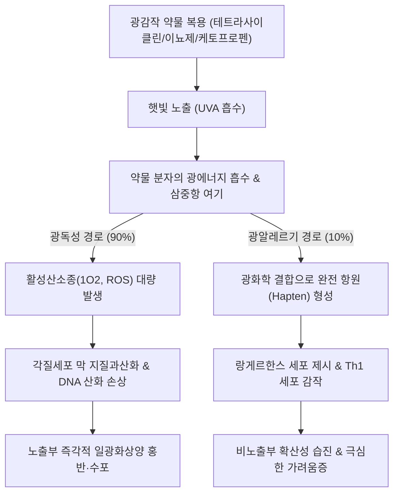

# 🩺 광감작 반응 (Photosensitivity Reaction, 광과민 반응)

> **핵심 3줄 요약 (Key Summary)**:
> - 📍 병소 부위 & 해부·병태생리: 자외선(주로 UVA 320~400nm, 일부 UVB 290~320nm) 또는 가시광선에 노출되었을 때, 외인성 화학물질(약물, 화장품, 식물)이나 내인성 광흡수체(포르피린 등)가 광에너지를 흡수하여 활성산소종([[활성산소]])을 방출해 직접 세포막을 손상시키는 **광독성 반응(Phototoxicity, 비면역성)** 또는 광화학 물질이 합텐으로 작용하여 T세포 매개 지연형 과민반응을 일으키는 **광알레르기 반응(Photoallergy, 면역성)**으로 인해 발생하는 피부 염증 질환.
> - 🚩 전형적 임상 양상: 햇빛 노출 부위(얼굴, 목둘레 V자 부위, 상완 외측, 손등)에 정확히 일치하여 나타나는 심한 일광 화상양 홍반, 부종, 수포, 작열감, 색소침착. 광알레르기 반응은 비노출 부위로 병변이 번지고 심한 가려움증성 습진성 병변을 보임.
> - 🛠️ 핵심 검사 & 치료 전략: 원인 약물 복용력 및 광노출력 청취, 광첩포 검사(Photopatch test), 최소홍반량(MED) 측정, ANA/항Ro 항체(루푸스 감별). 원인 광감작 약물 즉각 중단, 광범위 자외선 차단제(UVA+UVB 차단, 무기자차) 도포, 국소 코르티코스테로이드 및 중증 시 단기 경구 스테로이드 투여.
> - ⚠️ 응급 의뢰 레드플래그: 광감작 약물 복용 후 표피 박탈과 점막 침범이 동반되는 스티븐스-존슨 증후군([[스티븐스-존슨 증후군]], SJS) 또는 독성표피괴사용해(TEN) 진행 의심 시, 혹은 전신 홍반성 루푸스([[전신 홍반성 루푸스]])의 급성 광과민성 전신 발작 동반 시 즉시 상급병원 응급실 전원.

---

## 📌 목차
1. [질환 개요 & 해부학적 병태생리](#1--질환-개요---해부학적-병태생리)
2. [병태생리 메커니즘 & 생체역학적 악순환 네트워크](#2--병태생리-메커니즘---생체역학적-악순환-네트워크)
3. [임상 증상 & 이학적 검사(Physical Exam) 알고리즘](#3--임상-증상---이학적-검사physical-exam-알고리즘)
4. [진단 검사 & 감별 진단 패널](#4--진단-검사---감별-진단-패널)
5. [양방 치료 프로토콜 & 약물 상호작용](#5--양방-치료-프로토콜---약물-상호작용)
6. [한의 기능의학적 치료 프로토콜](#6--한의-기능의학적-치료-프로토콜)
7. [재활 운동 & 생활습관 티칭 가이드](#7--재활-운동---생활습관-티칭-가이드)
8. [💡 사용자 진료실 핵심 필기 & 임상 노하우 (Melt-In 잔여 심화 집약)](#8--사용자-진료실-핵심-필기---임상-노하우-melt-in-잔여-심화-집약)
9. [출처 및 학술 참고 문헌 (References)](#9--출처-및-학술-참고-문헌-references)

---

## 1. 질환 개요 & 해부학적 병태생리

### 1) 정의 및 역학
광감작 반응(광과민 반응, Photosensitivity Reaction, 광선피부염)은 정상적인 사람에게는 무해한 통상적인 수준의 햇빛(자외선 및 가시광선) 노출에 대해 비정상적으로 과도하거나 변형된 피부 반응이 유발되는 상태이다. 임상적으로 가장 흔한 형태는 전신 투여된 약물이나 국소 접촉 물질에 의해 유발되는 **약물 유발성 광과민증(Drug-induced photosensitivity)**이다. 고령화와 함께 심혈관계 약물(이뇨제, 항부정맥제), 항생제, 소염진통제의 복용이 증가하면서 전 세계적으로 유병률이 꾸준히 상승하고 있다.

### 2) 광독성과 광알레르기의 해부·면역학적 대조
| 구분 | 광독성 반응 (Phototoxicity) | 광알레르기 반응 (Photoallergy) |
| :--- | :--- | :--- |
| **발병 기전** | **비면역학적(직접 세포독성)** | **면역학적 (제4형 지연성 과민반응)** |
| **유병률** | 약물 광감작의 90% 이상 (매우 흔함) | 약물 광감작의 < 10% (드묾) |
| **초회 노출** | 첫 노출에서도 충분한 용량이면 즉시 발병 | 감작 기간 필요 (1~2주 후 발병) |
| **용량 의존성** | 약물 용량 및 광량에 비례함 | 용량과 무관 (미량에도 발병) |
| **잠복기** | 광노출 수 분~수 시간 이내 | 광노출 24~72시간 후 |
| **임상 양상** | 심한 일광 화상양 (홍반, 부종, 수포, 작열통) | 습진양 (가려운 구진, 수포, 태선화) |
| **병변 분포** | **빛을 쬔 부위에만 엄격히 국한** | **빛을 쬐지 않은 부위로도 확산 가능** |
| **색소침착** | 흔하게 현저한 과색소침착 남김 | 드묾 |

---

## 2. 병태생리 메커니즘 & 생체역학적 악순환 네트워크

### 1) 광독성 반응의 분자 생화학 기전
1. **광흡수 및 여기 상태(Excited state)**: 체내에 흡수된 광감작 약물 분자(예: 독시사이클린, 아미오다론)가 파장이 긴 자외선 A(UVA, 320~400nm)를 흡수하여 높은 에너지의 삼중항(triplet) 여기 상태로 전환된다.
2. **활성산소종(ROS) 대량 생성**: 여기된 약물 분자가 주변의 산소 분자에 에너지를 전달하여 일중항 산소(singlet oxygen, $^{1}	ext{O}_2$) 및 과산화물 음이온(superoxide)을 폭발적으로 생성한다.
3. **지질 과산화 및 세포막 붕괴**: 생성된 ROS가 표피 각질형성세포의 세포막 지질을 과산화시키고, 미토콘드리아 및 DNA를 직접 산화 손상시켜 일광화상 세포(sunburn cells, 아포토시스 세포)를 유발하고 혈관벽 투과성을 급격히 증가시킨다.

### 2) 주요 원인 약물군 (Culprit Drugs)
- **항생제**: 테트라사이클린계([[독시사이클린]], 미노사이클린), 퀴놀론계(시프로플록사신, 레보플록사신), 설폰아미드계(TMP-SMX).
- **심혈관계 약물**: 티아지드계 이뇨제(히드로클로로티아지드), [[아미오다론]](Amiodarone, 청회색 색소침착 유발).
- **소염진통제**: 케토프로펜(국소 파스류에서 광알레르기 최다 빈도), 피록시캄, 나프록센.
- **향정신성/신경계 약물**: 페노티아진계(클로르프로마진).
- **기타**: 비스테로이드성 레티노이드, 항진균제(보리코나졸).

---

## 3. 임상 증상 & 이학적 검사(Physical Exam) 알고리즘

### 1) 특징적 병변 분포 (해부학적 단서)
- **전형적 노출 부위 침범**:
  - 이마, 뺨, 콧등, 귀바퀴 외측.
  - 목의 앞가슴 V-자 부위 및 뒷목둘레.
  - 반소매 상의 착용 시 노출되는 팔의 외측 신전면, 손등(수배부).
- **특징적인 비노출 '차폐 부위(Shadowed areas)'의 보존**:
  - **턱 밑(Submental area)**: 턱에 가려 그늘진 부위는 병변이 전혀 없음(매우 중요한 진단 단서).
  - 눈꺼풀 상부, 귀 뒤쪽, 손가락 사이 굴측면, 코 밑 인중 그늘 부위는 깨끗하게 보존됨.

### 2) 이학적 검사 알고리즘
1. **차폐 부위 경계 확인**: 턱 밑 피부와 목 앞 피부의 경계선이 칼로 자른 듯 명확하게 정상과 병변으로 나뉘는지 시진.
2. **손등 vs 손바닥 대조**: 손등은 붉게 부어오르고 수포가 있으나 손바닥은 완전히 정상인지 확인.
3. **조갑광박리증(Photo-onycholysis)** 확인: 테트라사이클린이나 프소랄렌 복용 환자에서 햇빛 노출 후 발톱이나 손톱이 조상에서 통증성으로 들뜨는 현상 관찰.

---

## 4. 진단 검사 & 감별 진단 패널

### 1) 진단적 검사 패널
- **광첩포 검사 (Photopatch test)**:
  - 의심되는 광알레르기 물질(케토프로펜, 자외선차단제 성분 등)을 등에 양측으로 2벌 부착.
  - 48시간 후 한쪽만 UVA(5 J/cm²)를 조사하고, 추가 48시간 후 빛을 쬔 쪽에서만 습진성 양성 반응이 나타나는지 확인 (광알레르기 확진).
- **자가면역 항체 검사**:
  - 항핵항체([[ANA]]), 항Ro(SS-A), 항La(SS-B) 항체 검사 $
ightarrow$ 아급성 피부 루푸스(SCLE) 및 전신 홍반성 루푸스([[전신 홍반성 루푸스]]) 감별 필수.
- **소변/혈청 포르피린 분석**: 수포성 병변 동반 시 만발성 피부 포르피린증(PCT) 배제.

---

## 5. 양방 치료 프로토콜 & 약물 상호작용

### 1) 원인 약물 중단 및 차단 (치료의 절대 원칙)
- 원인으로 의심되는 광감작 약물을 즉각 중단하고 대체 약제로 전환.
- 광화학 물질이 체내에서 완전히 대사 배출될 때까지(약물에 따라 수일~수주일, 아미오다론은 수개월) 철저한 광차단 유지.

### 2) 급성기 염증 조절 프로토콜
- **냉습포 (Cool compresses)**: 생리식염수나 Burow 용액으로 1회 15분씩 1일 3~4회 냉습포하여 급성 화상양 작열통과 부종 완화.
- **국소 코르티코스테로이드**: 중등도~고강도 국소 스테로이드 크림(메틸프레드니솔론 아세포네이트 등) 1일 1~2회 단기 도포.
- **전신 코르티코스테로이드**: 광범위 수포 및 부종 동반 중증 환자에서 경구 프레드니솔론(0.5~1 mg/kg/day) 5~7일간 단기 투여 후 감량 중단.
- **가려움증 조절**: 1세대 또는 2세대 경구 [[항히스타민제]] 투여.

---

## 6. 한의 기능의학적 치료 프로토콜

### 1) 변증 분형 (TCM Differentiation)
한의학적으로 광감작 반응은 [[일사창]](日曬瘡), [[양덕화화]](陽德化火)의 범주에 속하며, 체내의 [[혈열온결]](血熱蘊結)이나 [[음허내열]](陰虛內熱) 상태에서 [[열독]](熱毒)이 강렬한 햇빛(화사, 火邪)과 결합하여 기표(肌表)를 불태우고 기혈을 손상시키는 병태로 변증한다.

| 변증 | 전형적 증상 | 설태 및 맥상 | 대표 처방 |
| :--- | :--- | :--- | :--- |
| **열독치성형 (熱毒熾盛型, 급성 광독성)** | 피부 선홍색 홍반, 수포, 심한 작열통, 구갈, 신열, 번조 | 설홍 태황건(黃乾), 맥홍삭(洪數) | [[백호탕]] 합 [[황련해독탕]] 가감 |
| **풍열습독형 (風熱濕毒型, 아급성 광알레르기)** | 노출부 및 비노출부 구진, 소양증, 삼출물, 미란 | 설첨홍 태박황(薄黃), 맥활삭(滑數) | [[소풍산]] 합 [[청호갈근탕]] |
| **음허혈열·색소침착형 (陰虛血熱型)** | 만성적인 암갈색 색소침착, 피부 건조, 미열감, 구갈 | 설홍소태, 맥세삭(細數) | [[생지황탕]] 합 [[지모황백탕]] |

### 2) 침구 치료 혈위
- **청열사화 및 양혈해독**: [[대추]](GV14), [[곡지]](LI11), [[합곡]](LI4), [[혈해]](SP10), [[위중]](BL40) 점자사혈.
- **국소 청열 외용 한약**: [[황련]], [[황백]], [[치자]], [[석고]] 각 20g 전탕액을 냉장 보관 후 거즈에 적셔 환부에 냉습포.

---

## 7. 재활 운동 & 생활습관 티칭 가이드

- **UVA 차단 지수(PA 등급) 확인 필수**:
  - 대부분의 약물 유발성 광감작 반응은 유리를 통과하는 장파장 자외선인 **UVA**에 의해 유발된다.
  - 따라서 SPF(UVB 차단)뿐 아니라 **PA++++(UVA 최고 차단 등급)** 등급을 받은 광범위 자외선 차단제(Broad-spectrum sunscreen)를 필수 선택.
  - 피부 자극을 줄이기 위해 화학적 흡수제보다 **징크옥사이드(Zinc oxide), 티타늄디옥사이드(Titanium dioxide) 성분의 물리적(무기) 차단제** 권장.
- **차광 의복 착용**: 챙이 7cm 이상인 넓은 모자, 자외선 차단 가공 의류(UPF 50+), 선글라스, 긴소매 옷 착용.
- **실내 창가 주의**: UVA는 일반 유리창을 90% 이상 투과하므로, 실내 창가 좌석이나 자동차 운전 중에도 자외선 차단제 도포 및 암막 커튼 활용.

---

## 8. 💡 사용자 진료실 핵심 필기 & 임상 노하우 (Melt-In 잔여 심화 집약)

- **"턱 밑 살점을 보아라 (The Submental Shadow)"**:
  - 얼굴 전체가 새빨갛게 타서 내원한 환자가 단순 접촉피부염인지 햇빛 알레르기(광감작)인지 1초 만에 감별하는 자리는 바로 **턱 밑(턱 아래 접히는 그늘)**이다.
  - 접촉피부염은 화장품을 얼굴 전체에 바르므로 턱 밑까지 빨갛다. 하지만 광감작 반응은 턱뼈가 햇빛을 가려주기 때문에 턱 아래 살점만 자를 댄 듯이 하얗고 깨끗하게 남아있다.
- **여드름 약(독시사이클린) 줄 때 자외선 차단 티칭 누락은 의료과실**:
  - 10~20대 여드름 환자에게 독시사이클린을 처방하면서 "햇빛 조심하라"는 말을 안 해주면, 주말에 야외활동 후 얼굴과 손등에 물집이 잡혀 울면서 찾아온다. "이 약을 먹는 동안에는 햇빛을 받으면 살이 타버리니 선크림을 3시간마다 덧바르라"고 반드시 복약지도해야 한다.
- **파스 붙이고 골프 친 뒤 생긴 물집은 케토프로펜 광알레르기**:
  - 어깨나 팔꿈치에 케토프로펜 관절 파스를 붙인 채 골프나 등산을 다녀온 환자의 팔에 파스 모양 그대로 심한 물집과 습진이 생기는 경우가 비일비재하다. 이 광알레르기는 파스를 뗀 후에도 수개월간 햇빛만 닿으면 재발하는 광독성 기억(Persistent light reaction)을 남길 수 있으므로 즉시 파스 사용을 영구 중단시켜야 한다.

---

## 9. 출처 및 학술 참고 문헌 (References)

- Blakely, K. M., et al. (2019). Drug-Induced Photosensitivity-An Update: Culprit Drugs, Prevention and Management. *Drug Saf*. PMID: 30888626.

- Lehmann, P., & Schwarz, T. (2011). Photodermatoses: diagnosis and treatment. *Dtsch Arztebl Int*. PMID: 21442060.

- 대한피부과학회. (2020). *피부과학 (제7판)*. 도서출판 대한의학.

- 대한내과학회. (2020). *Harrison's 내과학 (제20판)*. 도서출판 MIP.

- 한방안이비인후피부과학회. (2021). *한의피부외과학*. 도서출판 정담.

---

## 관련 노트

- [[일광 화상]]
- [[전신 홍반성 루푸스]]
- [[접촉성 피부염]]
- [[황련해독탕]]
- [[백호탕]]
