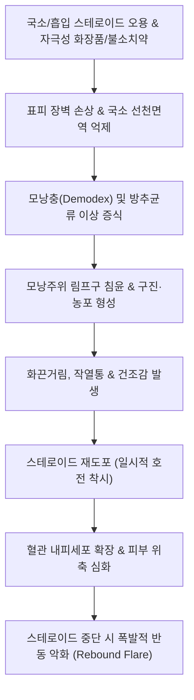

# 🩺 구위 피부염 (Perioral Dermatitis, 입주위 피부염)

> **핵심 3줄 요약 (Key Summary)**:
> - 📍 병소 부위 & 해부·병태생리: 20~40대 가임기 여성과 소아에서 호발하는 안면부의 염증성 구진-농포성 피부 질환. 구강 주변(입술 주위, 비순구, 턱), 때로는 비강 주위(perinasal)나 안와 주위(periorbital)에 발생하며, 국소 또는 전신 코르티코스테로이드([[코르티코스테로이드]])의 오남용, 자극적인 화장품/보습제, 불소 함유 치약 등에 의해 피부 장벽이 손상되고 모낭 내 미생물(모낭충 *Demodex*, *Fusobacterium*)이 증식하여 모낭주위 만성 림프구 침윤을 일으키는 질환.
> - 🚩 전형적 임상 양상: 입술 경계부(vermilion border) 주위 1~2mm 폭의 **정상 피부 띠(spared clear zone)**를 남겨두고 그 외곽으로 대칭적으로 밀집하는 직경 1~2mm 크기의 미세한 홍반성 구진(papules), 농포(pustules), 인설. 가려움증보다는 흔히 **작열감(burning sensation)**, 화끈거림, 당김을 호소.
> - 🛠️ 핵심 검사 & 치료 전략: 임상적 특징(입술 경계부 정상 보존대)을 바탕으로 한 시진. **절대 제1원칙: 모든 스테로이드 제제(외용 연고, 흡입제, 점안제)의 즉각적 중단(Zero-therapy)**. 초기 스테로이드 반동성 악화(flare)를 극복하기 위해 경구 테트라사이클린계 항생제([[독시사이클린]] 50~100 mg/day, 4~8주), 국소 메트로니다졸(Metronidazole 0.75% 겔), 피메크로리무스(Pimecrolimus 1% 크림) 또는 이버멕틴(Ivermectin 1% 크림) 투여.
> - ⚠️ 응급 의뢰 레드플래그: 소아에서 심한 황색 육아종성 구진이 안면 전체로 번지는 육아종성 구위 피부염(Granulomatous perioral dermatitis) 또는 사르코이드증, 결핵성 루푸스와의 감별이 불확실한 경우 전층 피부 생검 의뢰.

---

## 📌 목차
1. [질환 개요 & 해부학적 병태생리](#1--질환-개요---해부학적-병태생리)
2. [병태생리 메커니즘 & 생체역학적 악순환 네트워크](#2--병태생리-메커니즘---생체역학적-악순환-네트워크)
3. [임상 증상 & 이학적 검사(Physical Exam) 알고리즘](#3--임상-증상---이학적-검사physical-exam-알고리즘)
4. [진단 검사 & 감별 진단 패널](#4--진단-검사---감별-진단-패널)
5. [양방 치료 프로토콜 & 약물 상호작용](#5--양방-치료-프로토콜---약물-상호작용)
6. [한의 기능의학적 치료 프로토콜](#6--한의-기능의학적-치료-프로토콜)
7. [재활 운동 & 생활습관 티칭 가이드](#7--재활-운동---생활습관-티칭-가이드)
8. [💡 사용자 진료실 핵심 필기 & 임상 노하우 (Melt-In 잔여 심화 집약)](#8--사용자-진료실-핵심-필기---임상-노하우-melt-in-잔여-심화-집약)
9. [출처 및 학술 참고 문헌 (References)](#9--출처-및-학술-참고-문헌-references)

---

## 1. 질환 개요 & 해부학적 병태생리

### 1) 정의 및 역학
구위 피부염(입주위 피부염, Perioral Dermatitis, Periorificial dermatitis)은 입 주위, 코 주위, 눈 주위 등 얼굴의 안면 자연 개구부 둘레에 작은 붉은 구진과 농포가 무리 지어 발생하는 만성 재발성 안면 피부염이다. 주사(Rosacea)의 변형으로 분류되기도 한다. 환자의 약 90% 이상이 20~45세의 가임기 성인 여성에서 발생하며, 소아(소아 구위 피부염)에서도 빈발한다. 과거 '스튜어디스병(Flight attendant disease)'으로 불리기도 했는데, 이는 잦은 보습제 도포, 짙은 메이크업, 건조한 기내 환경 등 복합적 피부 장벽 손상 요인과 밀접하게 연관되어 있기 때문이다.

### 2) 안면부 피부의 해부학적 특수성과 입술 홍순 경계부의 보존
- **입술 주위 피부 구조**: 입술 주위 피부는 피지선과 미세 모낭이 매우 밀집되어 있으며 표피 각질층이 얇아 외부 화학물질의 침투에 매우 취약하다.
- **홍순 경계부(Vermilion border)의 여백 보존 현상**: 구위 피부염의 가장 결정적인 해부학적 특징은 **입술의 붉은 입술선(vermilion border) 바로 바깥쪽 약 1~2mm 폭의 피부에는 구진이 생기지 않고 정상 피부색을 유지(clear zone)**한다는 점이다. 이는 입술 가장자리 바로 인접 부위에는 피지선-모낭 단위의 밀도가 급격히 낮아져 모낭 염증이 발생하지 않기 때문이다.

---

## 2. 병태생리 메커니즘 & 생체역학적 악순환 네트워크

### 1) 스테로이드 오용과 모낭 미생물 증식의 악순환
1. **외용 스테로이드의 유혹과 피부 장벽 파괴**: 경미한 피부염이나 건조감에 무분별하게 바른 국소 코르티코스테로이드(히드로코르티손, 프레드니카르베이트 등)는 초기에는 강력한 혈관수축 작용으로 붉은 기를 가라앉히지만, 지속 사용 시 표피 위축, 각질세포간 지질 감소, 국소 피부 면역 저하를 초래한다.
2. **모낭 내 미생물 폭발**: 면역이 억제된 모낭 누두부에서 모낭충(*Demodex folliculorum*), *Fusobacterium*, *Candida* 등이 이상 증식한다.
3. **스테로이드 중단 후 반동 현상 (Rebound flare)**: 환자가 약을 끊으려 하면 억제되었던 혈관이 비정상적으로 확장되고 염증 세포가 쏟아져 들어오며 병변이 2~3배로 폭발적으로 악화(반동성 홍반 및 농포)되어, 환자는 공포심에 다시 스테로이드를 바르는 치명적인 중독 악순환 고리에 갇히게 된다.

---

## 3. 임상 증상 & 이학적 검사(Physical Exam) 알고리즘

### 1) 전형적 임상 증상
- **병변 형태**: 크기 1~2mm의 균일한 크기를 가진 무수한 홍반성 미세 구진(papules)과 농포(pustules)가 홍반성 바탕 위에 옹기종기 모여 군집을 이룸.
- **주요 침범 부위**: 입술 주변(턱, 윗입술 상방, 팔자주름 비순구), 코 볼 주변(perinasal), 눈 주위(periorbital, 안와 주위염).
- **특징적 자각 증상**: 환자는 "가렵다"고 표현하기보다는 **"얼굴이 화끈거리고 타는 것 같다(burning)", "피부가 팽팽하게 땅기고 따갑다(stinging)"**는 작열감을 호소함.

### 2) 이학적 검사 알고리즘
1. **입술 경계부 클리어 존 (Clear Zone) 확인**: 돋보기나 더모스코프로 입술 점막과 피부 경계선(vermilion border) 사이에 1~2mm의 정상 피부 띠가 깨끗하게 보존되어 있는지 시진 (구위 피부염 진단의 핵심 열쇠).
2. **면포(Blackhead/Whitehead) 부재 확인**: 병변 내에 면포가 전혀 없음을 확인 (여드름과의 감별).
3. **모세혈관 확장증 및 홍조(Flushing) 평가**: 뺨이나 이마로 광범위하게 확장된 홍조가 있는지 평가 (주사와의 중복 감별).

---

## 4. 진단 검사 & 감별 진단 패널

### 1) 감별 진단 패널
| 질환명 | 주 증상 및 특징 | 구위 피부염과의 핵심 감별점 |
| :--- | :--- | :--- |
| **심상성 여드름 (Acne vulgaris)** | 면포(Comedones), 농포, 결절, 낭종 | **면포(블랙헤드/화이트헤드)가 반드시 존재**, 피지 분비 과다, 입술 경계부 보존 없음 |
| **주사 (Rosacea)** | 뺨과 코 중심의 안면 홍조, 모세혈관 확장 | 안면 중앙부(뺨, 코) 호발, 홍조 발작(Flushing), 입술 주변에 국한되지 않음 |
| **지루성 피부염 (Seborrheic dermatitis)** | 비순구, 눈썹의 황색 기름진 인설 | 구진이나 농포가 없음, 가려움증 위주, 두피 비듬 동반 |
| **접촉성 피부염 (Contact dermatitis)** | 원인 물질 접촉 부위의 습진, 심한 가려움 | 입술 경계부 클리어 존 없음(입술까지 침범), 극심한 소양증, 첩포시험 양성 |

---

## 5. 양방 치료 프로토콜 & 약물 상호작용

### 1) 무치료 요법 (Zero Therapy, 치료의 제1원칙)
- **모든 외용제 중단**: 사용 중이던 모든 국소 스테로이드 연고, 보습 크림, 파운데이션, 자외선 차단제, 안티에이징 에센스를 즉각 전면 중단.
- **세안**: 비누나 폼클렌저 사용을 중단하고 미온수로만 가볍게 물세안.
- **치약 교체**: 불소가 함유되지 않은(Fluoride-free) 치약으로 교체.

### 2) 약물 치료 프로토콜
> ⚠️ **스테로이드 반동성 악화(Rebound flare) 사전 경고**: 스테로이드를 끊으면 첫 7~10일 동안 얼굴이 더 빨개지고 고름이 솟구치는 반동 현상이 반드시 찾아온다. 이를 견뎌내야 완치된다는 점을 환자에게 미리 주지시켜야 치료 탈락을 막을 수 있다.

- **경구 전신 항생제 (항염증 목적, 1차 선택)**:
  - **[[독시사이클린]](Doxycycline)** 50~100 mg 1일 1회 (또는 미노사이클린 50~100 mg/day) 4~8주간 복용 (항균 작용이 아닌 호중구 주화성 억제 및 항염증 효과).
  - 소아 및 임산부: 경구 에리스로마이신(Erythromycin) 또는 아지스로마이신(Azithromycin).
- **국소 외용제 (비선택적 비스테로이드성)**:
  - **메트로니다졸(Metronidazole 0.75% 겔/크림)**: 1일 2회 도포.
  - **피메크로리무스(Pimecrolimus 1% 크림, 엘리델)** 또는 타크로리무스: 국소 칼시뉴린 억제제(TCIs), 스테로이드 대체 항염증제 (도포 초기 며칠간 작열감 주의).
  - **이버멕틴(Ivermectin 1% 크림, 수란트라)**: 모낭충 박멸 및 항염증.

---

## 6. 한의 기능의학적 치료 프로토콜

### 1) 변증 분형 (TCM Differentiation)
한의학적으로 입술과 구강 주변은 비위(脾胃) 경락의 주관 영역이며, 구위 피부염은 [[비위습열]](脾胃濕熱)이 위로 치솟거나(상염), 기름진 음식과 스트레스로 인해 [[양명위열]](陽明胃熱)과 [[폐열혈열]](肺熱血熱)이 안면 기표(肌表)에 옹체된 병태로 변증한다.

| 변증 | 전형적 증상 | 설태 및 맥상 | 대표 처방 |
| :--- | :--- | :--- | :--- |
| **위열치성·풍열형 (胃熱熾盛·風熱型)** | 입술 주위 작열통, 붉은 구진, 구갈, 구취, 변비, 번조 | 설홍 태황건(黃乾), 맥활삭(滑數) | [[청위산]] 합 [[백호탕]] 가감 |
| **비위습열형 (脾胃濕熱型)** | 농포, 진물, 기름진 피부, 소화불량, 복부 팽만, 연변 | 설홍 태황니(黃膩), 맥유삭(濡數) | [[황련해독탕]] 합 [[비해분청음]] |
| **음허내열형 (陰虛內熱型, 만성 반동기)** | 피부 붉은 기 지속, 건조감, 각질, 안면 상열감, 조열 | 설홍소태 또는 박태, 맥세삭(細數) | [[지백지황탕]] 합 [[양혈사물탕]] |

### 2) 침구 치료 혈위
- **양명경 위열 청포**: [[지창]](ST4), [[협거]](ST6), [[승읍]](ST1), [[내정]](ST44), [[합곡]](LI4), [[곡지]](LI11).
- **청열소종 및 해독**: [[대추]](GV14), [[혈해]](SP10), [[족삼리]](ST36).

---

## 7. 재활 운동 & 생활습관 티칭 가이드

- **화장품 단식 (Cosmetic Fasting)**: 피부가 완전히 회복될 때까지 색조 화장은 물론 기능성 화장품, 앰플, 페이셜 오일의 사용을 일체 금지.
- **불소 및 계면활성제(SLS) 무함유 치약 사용**: 치약에 든 라우릴황산나트륨(SLS)과 불소가 입 주위 피부 장벽을 녹이므로 유기농 무불소 치약 사용 및 양치 후 입 주위를 물로 깨끗이 헹굼.
- **맵고 뜨거운 자극성 음식 제한**: 캡사이신, 뜨거운 찌개류, 알코올은 삼차신경-혈관 반사를 자극하여 입 주위 혈류를 급증시키고 염증을 악화시킴.

---

## 8. 💡 사용자 진료실 핵심 필기 & 임상 노하우 (Melt-In 잔여 심화 집약)

- **"입술 붉은 선 바로 바깥 1mm를 보라 (The Clear Lip Margin)"**:
  - 입 주변이 온통 빨갛고 오돌토돌 좁쌀처럼 올라왔을 때, 입술 라인(홍순 경계) 바로 바깥 1~2mm에 하얗게 정상 피부 띠가 둘러져 있다면 그것은 1초 만에 **구위 피부염**으로 확진할 수 있다. 접촉피부염이나 구순염은 입술 살점까지 침범하지만, 구위 피부염은 입술 경계를 절대로 침범하지 않는다.
- **"스테로이드 끊으면 일주일 동안 지옥이 옵니다, 그래도 버티셔야 합니다"**:
  - 구위 피부염 환자 열에 아홉은 피부과나 약국에서 스테로이드 연고를 받아 바르다가 중독된 상태이다. "연고를 끊으면 3~5일 뒤에 얼굴이 불타는 것처럼 빨개지고 고름이 터져 나올 겁니다. 하지만 그것은 피부 속에 억눌려 있던 염증이 밖으로 털려 나오는 정상적인 과정이니 절대로 다시 연고에 손대지 마십시오"라고 단단히 각오를 시켜야 환자가 다시 스테로이드의 늪으로 빠지지 않는다.
- **항생제(독시사이클린)는 균을 죽이려고 쓰는 게 아니다**:
  - 환자에게 "이 약은 균을 죽이는 용도가 아니라, 염증을 가라앉히는 소염제 용도로 저용량 처방하는 것"이라고 설명해야 2달간의 복약 순응도를 유지할 수 있다.

---

## 9. 출처 및 학술 참고 문헌 (References)

- Tempark, T., et al. (2014). Perioral dermatitis: a review of the condition with special attention to treatment options. *Am J Clin Dermatol*. PMID: 24623018.

- Searle, T., et al. (2021). Perioral dermatitis: Diagnosis, proposed etiologies, and management. *J Cosmet Dermatol*. PMID: 33751778.

- 대한피부과학회. (2020). *피부과학 (제7판)*. 도서출판 대한의학.

- 대한가정의학회. (2019). *가정의학 (제5판)*. 군자출판사.

- 한방안이비인후피부과학회. (2021). *한의피부외과학*. 도서출판 정담.

---

## 관련 노트

- [[접촉성 피부염]]
- [[독시사이클린]]
- [[코르티코스테로이드]]
- [[청위산]]
- [[황련해독탕]]
