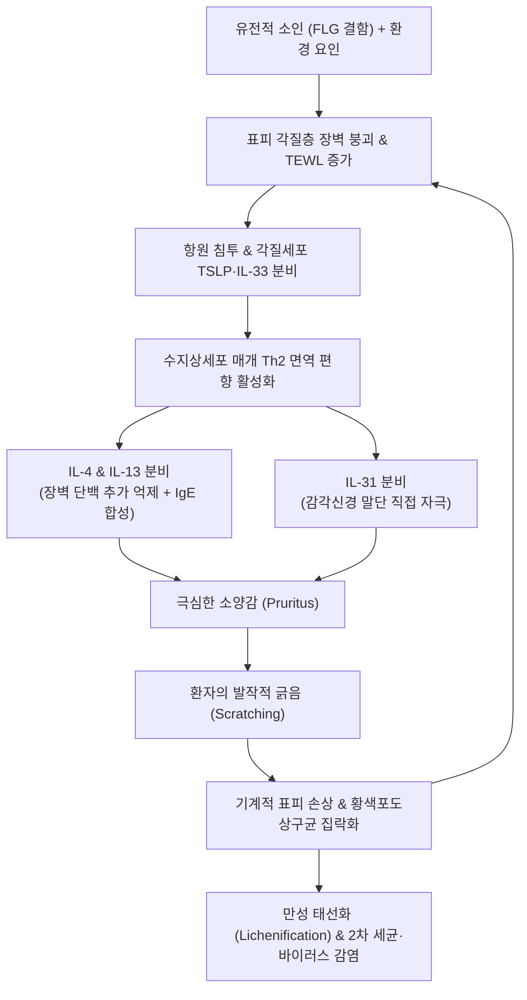

# 🩺 아토피 피부염 습진 (Atopic Dermatitis / Eczema)

> **핵심 3줄 요약 (Key Summary)**:
> - 📍 병소 부위 & 해부·병태생리: 필라그린(FLG) 유전자 변이 및 세라마이드 결핍에 의한 표피 각질층 장벽 붕괴, 경피 수분 손실(TEWL) 증가, 알라민(TSLP, IL-33) 매개 Th2 편향 면역 반응(IL-4, IL-13) 및 비만세포·감각신경 가려움증 전달.
> - 🚩 전형적 임상 양상: 연령별 특징적 분포(영아기 안면·신측부, 소아·성인기 굴측부 굴곡부 태선화), 발작적 야간 극심한 소양감, 피부 건조증, 홍반, 삼출, 가피, '가려움-긁기(Itch-Scratch)' 악순환.
> - 🛠️ 핵심 검사 & 치료 전략: Hanifin & Rajka 진단 기준, SCORAD / EASI 중증도 평가, 혈청 총 IgE 및 특이 IgE(MAST). 기본 보습제 도포 + 국소 항염증제(스테로이드, 국소 칼시뉴린 억제제 TCI), 중등도-중증 시 표적 생물학적 제제(듀필루맙 Dupilumab) 또는 JAK 억제제.
> - ⚠️ 응급 의뢰 레드플래그: 단순포진 바이러스 중복 감염에 의한 카포시 수두양 발진(Eczema herpeticum: 급격한 발열과 배꼽 모양 수포의 전신 파급), 전신 홍피증(Erythroderma: 체온 조절 장애 및 탈수), 광범위 세균성 2차 감염(농가진·봉와직염).

---

## 📌 목차
1. [질환 개요 & 해부학적 병태생리](#1-질환-개요--해부학적-병태생리)
2. [병태생리 메커니즘 & 생체역학적 악순환 네트워크](#2-병태생리-메커니즘--생체역학적-악순환-네트워크)
3. [임상 증상 & 이학적 검사(Physical Exam) 알고리즘](#3-임상-증상--이학적-검사physical-exam-알고리즘)
4. [감별 진단 매트릭스 (Differential Diagnosis)](#4-감별-진단-매트릭스-differential-diagnosis)
5. [한의 통합 치료 프로토콜 (침·약침·추나·한약)](#5-한의-통합-치료-프로토콜-침약침추나한약)
6. [양방 치료 & 병용·의뢰 기준 (Conventional Treatment & Referral)](#6-양방-치료--병용의뢰-기준-conventional-treatment--referral)
7. [재활 운동 & 생활습관 티칭 가이드](#7-재활-운동--생활습관-티칭-가이드)
8. [💡 사용자 진료실 핵심 필기 & 임상 노하우 (Melt-In 잔여 심화 집약)](#8--사용자-진료실-핵심-필기--임상-노하우-melt-in-잔여-심화-집약)
9. [출처 및 학술 참고 문헌 (References)](#9-출처-및-학술-참고-문헌-references)

---

## 1. 질환 개요 & 해부학적 병태생리

![[아토피피부염습진_01_주와부태선화.png|450]]
> [그림 1: 팔꿈치 안쪽(주와부) 실사 — 피부가 두꺼워지고 주름이 깊어진 태선화(lichenification)와 긁은 자국이 보인다. 소아·성인기 아토피 피부염의 대표적 굴측부 병변 — 출처: Wikimedia Commons — File:Atopy2010.JPG (CC BY-SA 3.0)]

아토피 피부염(Atopic Dermatitis, AD)은 만성 재발성의 염증성 피부 질환으로, 심한 소양증(가려움증)과 특징적인 습진성 피부 병변을 주소로 한다. 천식, 알레르기 비염, 알레르기 결막염과 함께 대표적인 '아토피 행진(Atopic March)'의 첫 관문으로 작용한다.

### 해부학적 피부 장벽 붕괴 및 연령별 호발 부위
1. **표피 각질층(Stratum Corneum)의 결함**:
   - 표피 각질세포 외피를 구성하는 **필라그린(Filaggrin, FLG)** 단백질의 기능 상실성 돌연변이(Loss-of-function mutation) 및 천연보습인자(NMF) 결핍.
   - 각질세포 간 지질(세라마이드, 콜레스테롤, 유리지방산)의 조성 불균형으로 각질 세포 간 응집력이 소실되고 경피 수분 손실(Transepidermal Water Loss, TEWL)이 급격히 증가함.
2. **연령별 호발 부위의 해부학적 변천**:
   - **영아기 (생후 2개월~2세)**: 양 뺨(안면부), 이마, 두피, 신측부(팔다리 바깥쪽). 기저귀 부위는 습도가 유지되므로 대개 보존됨.
   - **소아기 (2세~12세)**: 주관절와(팔오금), 슬와(오금), 손목, 발목, 목 주위 등 관절의 굴측부(Flexural areas).
   - **청소년 및 성인기 (12세 이상)**: 굴측부 외에도 얼굴(이마, 눈가, 입주위), 목, 상흉부, 손습진. 장기간 긁음으로 인한 두꺼운 가죽 모양의 태선화(Lichenification) 및 과색소침착 우세.

---

## 2. 병태생리 메커니즘 & 생체역학적 악순환 네트워크

![[아토피피부염습진_02_병태생리경로.png|450]]
> [그림 2: 아토피 피부염 병태생리 도해 — 집먼트·꽃가루·세균(Staphylococcus) 자극이 손상된 피부장벽을 통과하면 수지상세포가 항원을 CD4+ T세포에 제시하고, Th2 쪽으로 기울며 IL-4·IL-13이 분비되어 염증이 유지되는 경로를 한 장에 정리했다 — 출처: Elsevier 임상 피부과학 교재 도판 — File:on017-002 (ISBN 978-0-323-35775-3) (교재 도판(학습용 인용))]

![[아토피피부염습진_03_흔한알레르겐.png|450]]
> [그림 3: 아토피 습진을 악화시키는 흔한 알레르겐 모음 — 집먼지진드기, 식품, 식물 꽃가루, 곰팡이, 동물 비듬이 각 그림으로 제시되고, 가운데에 굴측부 병변 사진이 함께 놓여 있다 — 출처: Wikimedia Commons — File:Atopic eczema - common allergens.jpg (CC BY-SA 3.0)]

### 1) 면역학적 기전 및 Th2 축의 주도
- **외인성 항원 침투 및 알라민 분비**: 장벽이 손상된 각질층을 통해 집먼지진드기, 세균(*Staphylococcus aureus*), 공기 항원이 침투하여 상피세포에서 TSLP(Thymic Stromal Lymphopoietin), IL-25, IL-33 분비를 유도함.
- **Th2 / Th22 면역 반응 활성화**:
  - 수지상세포에 의해 Th2 세포가 활성화되어 **IL-4 및 IL-13**을 대량 분비함.
  - IL-4/IL-13은 각질세포의 필라그린 발현을 추가로 억제하여 장벽 결함을 더욱 악화시킴 (Inside-out & Outside-in 병태생리).
  - B세포를 자극하여 혈청 총 IgE 합성을 폭증시킴.
- **신경 면역학적 소양증 전달 (Neuroimmune Itch Axis)**:
  - **IL-31(가려움증 사이토카인)**: 감각신경 C-섬유 말단의 IL-31RA/OSMR에 직접 결합하여 중추신경계로 극심한 가려움 신호를 전달함.
  - 비만세포 탈과립에 의한 히스타민, 트립타제 분비.

---

## 3. 임상 증상 & 이학적 검사(Physical Exam) 알고리즘

![[아토피피부염습진_04_임상소견모음.png|450]]
> [그림 4: 아토피 피부염의 임상 소견을 유형별로 모은 판 — 홍반(erythema), 구진·수포(papulovesicular), 찰상(excoriation), 미란(erosion), 건조증(xerosis), 태선화(lichenification)를 각각 실사로 보여준다(영문 라벨) — 출처: Wikimedia Commons — File:Clinical features of atopic dermatitis in English.png (CC BY 4.0)]

![[아토피피부염습진_05_영아기병변.png|450]]
> [그림 5: 영아 실사 — 기저귀 부위와 볼기 전면에 경계가 불분명한 홍반과 인설이 번진 모습. 얼굴·기저귀 부위를 침범하는 영아기 아토피 피부염의 분포를 보여준다 — 출처: Wikimedia Commons — File:Atopic dermatitis child 3.jpg (CC BY-SA 4.0)]

![[아토피피부염습진_06_삼출가피.jpeg|450]]
> [그림 6: 확대 실사 — 홍반 위에 장액이 말라 붙은 가피와 미란이 여러 군데 생겨 있고 주변 표피가 벗겨져 있다. 긁어서 2차 감염이 동반된 삼출성 병변 — 출처: Wikimedia Commons — File:Atopic dermatitis close up ad.jpeg (CC BY-SA 3.0)]

### 1) 주요 임상 증상
- **주관적 증상**: 참을 수 없는 발작적 소양증(특히 야간 수면 중 악화되어 수면장애 및 성장장애 유발), 피부 건조감, 작열감.
- **시기별 피부 병변**:
  - 급성기: 심한 홍반성 구진, 소수포, 삼출(진물), 미란(부스럼).
  - 아급성기: 홍반, 인설, 찰상(긁은 자국).
  - 만성기: 피부가 두꺼워지고 주름이 깊어지는 **태선화(Lichenification)**, 건조증, 색소침착.

### 2) 이학적 검사 및 진단 기준 (Hanifin & Rajka Criteria)
- **주 진단 기준 (4개 중 3개 이상 만족)**:
  1. 소양증 (가려움증).
  2. 특징적 형태 및 호발 부위 (연령별 안면, 신측부, 굴측부 태선화).
  3. 만성 및 재발성 경과 (6개월 이상 지속).
  4. 아토피 질환(천식, 알레르기 비염, 아토피 피부염)의 개인력 또는 가족력.
- **부 진단 기준 (다수 동반)**:
  - 피부 건조증, 모공각화증, 손발의 비특이적 습진, 눈 주위 색소침착, 데니-모건 주름(Dennie-Morgan fold), 백색 비강진, 두피 인설, 백색 묘기증(White dermographism), 높은 혈청 IgE 수치.
- **중증도 평가 도구**:
  - **EASI (Eczema Area and Severity Index)**: 4개 신체 부위의 홍반, 경화, 찰상, 태선화 면적 합산 (0~72점).
  - **SCORAD (SCORing Atopic Dermatitis)**: 병변 범위, 중증도, 주관적 증상(가려움, 불면) 통합 평가.

---

## 4. 감별 진단 매트릭스 (Differential Diagnosis)

| 감별 질환 | 호발 연령 및 부위 | 주소증 및 피부 소견 | 알레르기 소인 / 검사 | 감별 핵심 포인트 |
| :--- | :--- | :--- | :--- | :--- |
| **아토피 피부염** | 영아~성인 전 연령, 굴측부 태선화 | 만성 재발성, 극심한 가려움, 진물 및 건조 | 혈청 IgE 상승, 아토피 가족력 | 주 진단 기준 충족, 연령별 전형적 부위 변천 |
| **지루성 피부염** | 신생아(두피·안면), 중장년 피지선 부위 | 황색의 기름진 인설, 경도 홍반, 가려움 경미 | 아토피 소인 무관 | 오금·팔오금 침범 없음, 가려움증 훨씬 덜함 |
| **접촉 피부염** | 접촉 물질 노출 성인, 국소 부위 | 접촉 부위에 국한된 홍반, 수포, 작열감 | 첩포 시험(Patch test) 양성 | 원인 물질 접촉력 뚜렷, 노출 중단 시 호전 |
| **[[옴]] (Scabies)** | 집단생활자, 손가락 사이, 겨드랑이, 회음부 | 야간 극심한 소양감, 굴(Burrow) 형성, 결절 | 광유 현미경 검사(옴진드기 관찰) | 가족·동거인 동시 발생, 굴 관찰, 항옴진드기제 완치 |
| **[[건선]] (Psoriasis)** | 20~50대, 팔꿈치·무릎 신측부, 두피, 둔부 | 경계 명확한 은백색 인설의 두꺼운 홍반판 | Auspitz 징후 양성, Koebner 현상 | 굴측부보다 신측부 호발, 가려움 덜함 |
| **카포시 수두양 발진 (Eczema herpeticum)** | 아토피 피부염 환자 급성 합병증 | 기존 아토피 병변 위 급격한 배꼽 수포, 고열 | Tzanck 도말 검사 양성, HSV PCR | **즉각적인 항바이러스제(아시클로버) 응급 투여** |

---

## 5. 한의 통합 치료 프로토콜 (침·약침·추나·한약)

> 💡 **한의학적 병인론 및 변증**:
> 아토피 피부염은 한의학에서 **사만풍(四彎風)**, **태열(胎熱)**, **습창(濕瘡)**에 해당한다. 선천적인 품부부족(稟賦不足)과 비위 기능 허약으로 수습이 정체되어 습열(濕熱)을 형성하거나, 풍열(風熱)의 사기가 기표(肌表)를 침범하여 발생한다. 만성화되면 열이 성하여 진액을 손상시키고 혈허풍조(血虛風燥)로 전변하여 피부가 건조하고 태선화된다.

### 1) 침구 치료 프로토콜
- **청열해독(淸熱解毒) 및 거풍지양(祛風止癢)**:
  - [[곡지]](LI11), [[대추]](GV14): 전신 풍열(風熱)을 사하고 피부 염증과 소양감 완화.
  - [[혈해]](SP10), [[삼음교]](SP6): 청열양혈(淸熱凉血), 활혈윤조(活血潤燥).
  - [[합곡]](LI4), [[태충]](LR3): 사관혈(四關穴) 배혈로 기혈 소통 및 자율신경계 긴장 안정.
  - [[폐수]](BL13): 폐주피모(肺主皮毛) 이론에 근거하여 피부 면역 장벽 기능 조절.
- **자침 기법**: 급성 삼출기에는 사법(瀉法) 위주로 천자하며, 환부 직접 자침을 피하고 원격 취혈을 주로 활용함.

### 2) 약침 치료 (염증 제어 및 면역 조절)
- **적용 혈위**: [[대추]](GV14), [[곡지]](LI11), [[폐수]](BL13), [[비수]](BL20).
- **처방 약침**:
  - 황련해독탕 약침: 급성기 습열독(濕熱毒)으로 인한 홍반, 삼출, 열감 제어 (부위당 0.2~0.3cc).
  - 자하거(태반) 약침: 만성기 혈허풍조형의 피부 위축, 건조증, 면역력 저하 개선을 위해 폐수, 신수([[BL23]])에 0.5cc 주입.

### 3) 한방 외용 요법 및 습포 치료
- **삼황세제(三黃洗劑) 또는 황백 황련 전탕액 냉습포(Wet wrap)**:
  - 급성기 진물이 나고 열감이 심할 때 멸균 거즈에 미온 전탕액을 적셔 15분간 냉습포 시행.
- **자운고(紫雲膏) 도포**:
  - 만성기 건조하고 갈라지는 태선화 부위에 도포하여 보습 및 피부 재생 촉진 ([[자초]], [[당귀]] 주성분).

### 4) 한약 처방 (변증별 가감)
- **풍열습독(風熱濕毒)형 (급성기, 홍반, 삼출물, 부스럼, 극심한 가려움)**:
  - **소풍산(消風散)** 또는 **청기화습음(淸肌化濕飮) 가감**:
  - 처방 구성: [[형개]], [[방풍]], [[우방자]], [[선태]], [[창출]], [[고삼]], [[지모]], [[석고]], [[당귀]], [[생지황]], [[목통]], [[감초]].
- **비허습온(脾虛濕蘊)형 (소아 다빈도, 묽은 진물, 안면 창백, 식욕 부진, 연변)**:
  - **위령탕(胃苓湯)** 합 **이진탕(二陳湯) 가감**:
  - 비위 기능을 건전하게 하여 체내 습기를 배출.
  - 구성: [[백출]], [[창출]], [[복령]], [[저령]], [[택사]], [[후박]], [[진피]], [[반하]], [[감초]].
- **혈허풍조(血虛風燥)형 (만성기, 피부 건조, 두꺼운 태선화, 인설, 야간 소양감)**:
  - **당귀음자(當歸飮子)** 또는 **온청음(溫淸飮) 가미방**:
  - 음혈(陰血)을 자양하여 풍사를 잠재우고 각질 장벽 재생.
  - 구성: [[당귀]], [[백작약]], [[천궁]], [[숙지황]], [[황련]], [[황금]], [[황백]], [[치자]], [[하수오]], [[백질려]].

---

## 6. 양방 치료 & 병용·의뢰 기준 (Conventional Treatment & Referral)

### 1) 단계별 약물 치료 (Stepwise Treatment)
- **기본 관리 (모든 단계)**:
  - 무향·저자극 보습제(Ceramide-dominant emollient) 하루 2회 이상 충분히 도포.
- **1단계: 국소 치료제 (경증~중등도)**:
  - **국소 코르티코스테로이드 (TCS)**: 급성 악화기 1차 치료. 연령 및 부위별 강도 조절 (얼굴·목: Low-potency Class 6~7 Hydrocortisone; 몸통·사지: Medium~High potency).
  - **국소 칼시뉴린 억제제 (TCI)**: 타크로리무스(Tacrolimus 0.03%, 0.1%), 피메크로리무스(Pimecrolimus 1%). 얼굴, 목, 성기부 등 피부가 얇은 부위의 장기 유지 요법에 적합(피부 위축 부작용 없음).
  - **국소 PDE4 억제제 (Crisaborole)**: 비스테로이드성 국소 항염증제.
- **2단계: 전신 치료제 및 표적 생물학적 제제 (중등도~중증 난치성)**:
  - **생물학적 제제 (Biologics)**:
    - **듀필루맙 (Dupilumab, Dupixent)**: IL-4/IL-13 신호 전달 억제 항체 (2주 간격 피하 주사). 장기 안전성이 우수하고 장벽 기능 회복.
    - 트랄로키누맙 (Tralokinumab): IL-13 표적 억제제.
  - **경구 JAK 억제제 (JAK Inhibitors)**:
    - 우파다시티닙(Upadacitinib), 아브로시티닙(Abrocitinib), 바리시티닙(Baricitinib): 빠른 가려움증 개선 효과 (투약 전 결핵, 간염 스크리닝 및 정기 혈액 검사 필요).
  - 면역억제제: 사이클로스포린(Cyclosporine), 메토트렉세이트(MTX) 단기 요법.

### 2) 한의 병용 판단 및 상호작용
- **국소 스테로이드 복용/도포 환자의 한의 치료**:
  - 스테로이드를 갑자기 중단하면 극심한 리바운드(Rebound flare)가 발생하므로, 한약 투여와 병행하면서 단계적으로 감량(Tapering)을 유도함.
  - 보습제와 자운고는 상호보완적으로 활용 가능하며, 스테로이드 흡수율을 방해하지 않도록 도포 간격(15~30분)을 둠.
- **생물학적 제제/JAK 억제제 병용 시**:
  - 감염 위험 모니터링이 필수적이므로 한방 침구 시술 시 철저한 멸균 무균 조작을 준수함.

### 3) 양방·전문과 응급 의뢰 기준 (Referral Criteria)
- 🚨 **카포시 수두양 발진 (Eczema herpeticum) 의심**:
  - 아토피 피부염 병변 부위에 갑자기 돔 형태의 작은 수포가 돋아나고 중앙이 배꼽처럼 함몰되며 고열이 동반될 때 (즉각적인 항바이러스제 응급 투여 필요, 실명 및 패혈증 위험).
- 🚨 **홍피증 (Erythroderma)**:
  - 전신 체표면적의 90% 이상이 붉어지고 각질이 벗겨지며 저체온증, 부종, 심부전 전조 징후가 있을 때.
- 🚨 광범위한 삼출성 화농성 농포와 함께 오한, 림프절염을 동반한 2차 세균성 패혈증 전조.

---

## 7. 재활 운동 & 생활습관 티칭 가이드

### 1) 목욕 및 보습 가이드 ('3분 룰')
- **미온수 목욕**: 32~34도의 미지근한 물로 10~15분 이내로 가볍게 목욕 (뜨거운 물 샤워 절대 금지).
- **저자극 세정제**: 약산성(pH 5.5) 합성계면활성제 프리 바디워시 사용, 때밀이 타월 사용 엄금.
- **즉각 보습**: 수건으로 두드리듯(Pat-dry) 물기를 닦아내고, 수분이 마르기 전 **3분 이내**에 충분한 양의 보습제를 전신에 도포.

### 2) 환경 및 의복 관리
- 실내 온도 $20\sim 22^\circ\text{C}$, 습도 $40\sim 50\%$ 유지 (땀은 가장 강력한 소양증 유발 인자임).
- 털옷, 모직, 거친 화학섬유를 피하고 부드러운 100% 면 의복 착용.
- 침구류는 2주 간격으로 $60^\circ\text{C}$ 이상 온수로 세탁하여 집먼지진드기 사멸.

---

## 8. 💡 사용자 진료실 핵심 필기 & 임상 노하우 (Melt-In 잔여 심화 집약)

### 1) "가려워서 긁는 것인가, 긁어서 가려운 것인가?"
- 아토피 피부염은 'Itch that rashes'(발진을 유발하는 가려움) 질환이다.
- 환자에게 "가려워도 참으라"는 식의 티칭은 전혀 통하지 않는다. 가려움증을 유발하는 건조함과 히스타민/IL-31 신호를 약물과 냉찜질로 즉시 차단해 주는 것이 치료의 첫 단추이다.
- 야간 수면 중 무의식적으로 긁어 피부가 찢어지는 것을 방지하기 위해 환아의 손톱을 짧게 깎고 면장갑을 착용시키는 물리적 차단 교육이 필수적이다.

### 2) 스테로이드 포비아(Phobia)의 올바른 교정
- 많은 아토피 환자들이 스테로이드 부작용에 대한 과도한 공포로 양방 연고를 일절 거부하다 만신창이가 되어 한의원에 내원한다.
- 급성 염증과 진물이 펄펄 끓는 상태에서는 적절한 강도의 국소 스테로이드를 짧고 굵게 사용하여 불을 끄고, 이후 보습 관리와 한약 투여로 장벽을 재건하며 스테로이드를 서서히 떼어내는 '소방수와 건축가'의 협력 모델을 환자에게 차분히 설명해야 치료 순응도가 비약적으로 올라간다.

---

## 9. 출처 및 학술 참고 문헌 (References)

1. Practical Guidance for Systemic Treatment Selection in Pediatric Refractory Atopic Dermatitis. (2026). *Immunol Allergy Clin North Am*, 46(4):. PMID: 42833744.

2. Guidelines for diagnostic testing in adults with presumed atopic dermatitis refractory to treatment. (2026). *J Am Acad Dermatol*, 95(3):. PMID: 42678322.

3. Evidence-Based Clinical Recommendations on the Appropriateness of Prescriptions and Diagnostic Tests in Paediatric Allergology: Focus on IgE-Mediated and Non-IgE Mediated Food Allergy, Eosinophilic Gastrointestinal Disease, Urticaria, Angioedema and Atopic Dermatitis. (2026). *Children (Basel)*, 13(9):. PMID: 42794167.

---

## 관련 노트

- [[건선]]
- [[옴]]
- [[천식]]
- [[곡지]]
- [[대추]]
- [[혈해]]
- [[삼음교]]
- [[합곡]]
- [[태충]]
- [[폐수]]
- [[비수]]
- [[신수]]
- [[형개]]
- [[방풍]]
- [[우방자]]
- [[선태]]
- [[창출]]
- [[고삼]]
- [[지모]]
- [[석고]]
- [[당귀]]
- [[생지황]]
- [[목통]]
- [[감초]]
- [[백출]]
- [[복령]]
- [[저령]]
- [[택사]]
- [[후박]]
- [[진피]]
- [[반하]]
- [[백작약]]
- [[천궁]]
- [[숙지황]]
- [[황련]]
- [[황금]]
- [[황백]]
- [[자초]]
- [[소풍산]]
- [[위령탕]]
- [[이진탕]]
- [[당귀음자]]
- [[온청음]]
- [[자운고]]
