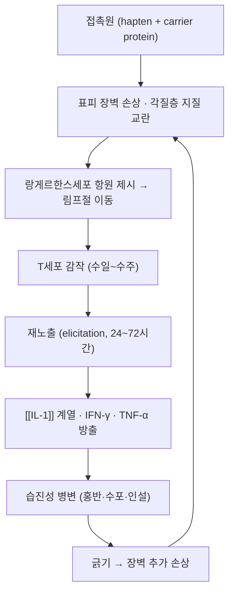

# 🩺 접촉 피부염 (Contact Dermatitis, ICD-10 L23·L24)

> **핵심 3줄 요약 (Key Summary)**:
> - 📍 병소 부위 & 해부·병태생리: 접촉원이 닿은 부위의 표피에 생기는 습진성 염증. 자극성(직접 세포독성, 면역 기억 없음)과 알레르기성(hapten에 대한 제4형 지연형 과민반응)으로 갈린다.
> - 🚩 전형적 임상 양상: 접촉 부위와 일치하는 경계가 뚜렷한 홍반·부종·구진·수포, 심한 소양감. 만성화하면 인설·태선화·균열. 파스·테이핑 후 발생하면 부착면 모양 그대로의 사각형 병변이 특징이다.
> - 🛠️ 핵심 검사 & 치료 전략: 첩포시험(patch test)으로 원인 항원 확인, 회피가 근본 치료. 국소 스테로이드·국소 칼시뉴린 억제제, 중증은 단기 전신 스테로이드.
> - ⚠️ 레드플래그: 얼굴·눈 주위 광범위 침범, 2차 감염(농가진·봉와직염), 전신 홍피증, [[스티븐스-존슨 증후군]]·독성표피괴사증과의 감별.

---

## 📌 목차
1. [질환 개요 & 해부학적 병태생리](#1-질환-개요--해부학적-병태생리)
2. [병태생리 메커니즘 & 악순환 네트워크](#2-병태생리-메커니즘--악순환-네트워크)
3. [임상 증상 & 이학적 검사 알고리즘](#3-임상-증상--이학적-검사-알고리즘)
4. [감별 진단 매트릭스 (Differential Diagnosis)](#4-감별-진단-매트릭스-differential-diagnosis)
5. [한의 통합 치료 프로토콜](#5-한의-통합-치료-프로토콜)
6. [양방 치료 & 병용·의뢰 기준](#6-양방-치료--병용의뢰-기준)
7. [재발 방지 & 생활습관 티칭 가이드](#7-재발-방지--생활습관-티칭-가이드)
8. [💡 진료실 핵심 필기 & 임상 노하우](#8--진료실-핵심-필기--임상-노하우)
9. [출처 및 학술 참고 문헌 (References)](#9-출처-및-학술-참고-문헌-references)

---

## 1. 질환 개요 & 해부학적 병태생리

![[접촉피부염_01_임상사진.jpg|450]]
> [그림 1: 손바닥 엄지두덩 부위의 경계가 뚜렷한 홍반성 반상 병변 — File:Contact dermatitis.jpg, Wikimedia Commons, CC BY-SA 4.0]

![[접촉피부염_06_손등발진.jpg|450]]
> [그림 2: 양손 등·손가락에 광범위하게 퍼진 홍반·인설·태선화 — 만성 접촉 피부염의 전형적 분포. File:Hands rash and lesions post contact of air allergen.jpg, Wikimedia Commons, CC BY-SA 4.0]

- 정의: 외부 물질과 피부의 접촉으로 생기는 습진성 염증. 크게 두 갈래다.
  - 자극성 접촉 피부염(Irritant CD): 계면활성제·산·알칼리·용제가 표피 장벽을 직접 파괴한다. 면역 기억이 없어 첫 노출에도 생기고, 병변은 접촉 범위에 국한된다. 임상 접촉 피부염의 다수를 차지한다.
  - 알레르기성 접촉 피부염(Allergic CD): 니켈, 티우람류 고무촉진제, 콜로포니(로진), 아크릴레이트, 향료, 방부제, 국소 NSAID 등 저분자 hapten이 표피 단백과 결합해 완전항원이 되고, 랑게르한스세포가 이를 림프절로 운반해 T세포를 감작한다. 재노출 시 24~72시간에 걸쳐 습진이 발현된다(제4형 지연형).
- 호발 부위: 손(직업성), 얼굴·목(화장품·향료), 손목·허리(시계줄·벨트), 파스 부착부(무릎·어깨·등), 발(신발 접착제·염료).
- 파스·카타플라스마 관련: 2021년 조사마 카타플라스마 시험에서 피부 자극이 28.8%(대조 9.8%)였고, 이상반응 38건 중 34건이 약물이 아닌 부착재(mount material)에 의한 접촉 피부염이었다([PMID 34025414](https://pubmed.ncbi.nlm.nih.gov/34025414/)). 즉 파스 알레르기의 주범은 약물보다 점착제·기질인 경우가 많다 → [[카타플라스마제]]

---

## 2. 병태생리 메커니즘 & 악순환 네트워크

![[접촉피부염_02_발생기전도해.png|450]]
> [그림 3: 알레르기성 피부염의 병변 분포와 확대 소견을 도식화한 의학 일러스트 — File:Blausen 0014 AllergicDermatitis.png, Wikimedia Commons, CC BY 3.0]

### 1) 자극성과 알레르기성의 분자 차이
- 자극성: 각질층 지질(세라마이드·콜레스테롤) 용출과 각질세포 단백 변성으로 즉시 장벽이 무너진다. 염증 매개체는 선천면역(IL-1α, IL-8) 중심이며 면역 기억이 없다.
- 알레르기성: hapten 특이 T세포 클론이 형성되어 재노출마다 빠르게 활성화된다. IL-1 계열 사이토카인의 균형이 병변 강도를 좌우한다는 보고가 있다([PMID 24164463](https://pubmed.ncbi.nlm.nih.gov/24164463/)).
- 두 형태는 공존한다. 자극성으로 장벽이 무너진 피부는 알레르기 감작이 더 쉽게 일어난다(장벽-감작 연쇄).

### 2) 만성화 기전
- 반복 긁기와 마찰 → 표피 증식·태선화, 신경섬유 말단의 소양 매개체 증가 → 가려움-긁기 악순환.

---

## 3. 임상 증상 & 이학적 검사 알고리즘

### 1) 주소증
- 급성: 경계가 명확한 홍반, 부종, 구진, 소수포, 삼출. 심한 소양감 또는 작열감.
- 아급성·만성: 인설, 균열, 태선화, 색소침착.
- 분포가 진단의 열쇠다. 접촉원의 형태·범위와 병변의 기하학적 일치(사각형 파스 자국, 손목시계 띠, 신발 모양)를 확인한다.

### 2) 첩포시험 (Patch Test) — 원인 확인의 표준

![[접촉피부염_03_첩포시험_부착.jpg|420]]
> [그림 4: 등에 다수의 첩포 시험용 챔버를 부착한 모습 — File:Epikutanni-test.jpg, Wikimedia Commons, CC BY-SA 3.0]

![[접촉피부염_04_첩포양성반응.jpg|420]]
> [그림 5: 첩포 제거 후 판독에서 홍반·구진성 양성 반응이 확인된 부위 — File:2+ reaction.jpg, Wikimedia Commons, CC0]

![[접촉피부염_05_첩포시험_판독.jpg|420]]
> [그림 6: 등에 부착한 시험 패널의 격자 위치를 확인하며 판독하는 장면 — File:Skin patch allergy test crop.jpg, Wikimedia Commons, CC BY 4.0]

- 절차: 표준 항원 series를 등 상부에 48시간 부착 → 제거 직후(48시간)와 72~96시간에 판독. 지연 반응을 놓치지 않으려면 후기 판독(7일 전후)을 추가한다. 유럽 접촉피부염학회(ESCD) 2026 갱신 가이드라인이 판독 시점·판독 기준·주의사항을 정리했다([PMID 42324086](https://pubmed.ncbi.nlm.nih.gov/42324086/)).
- 판독: 홍반만 있으면 약양성(+), 홍반+구진·부종이면 중등도(++), 수포·괴사가 동반되면 강양성(+++). 자극 반응(경계가 날카롭고 빠르게 소실)과 알레르기 반응(경계가 번지고 지연)을 감별한다.
- 한의원 실무: 첩포시험은 피부과 의뢰 영역이다. 진료실에서는 ① 병변 모양과 접촉원의 일치 확인 ② 사용 중단-재노출로 확인( provocative use test) ③ 의뢰 시 의심 항원 목록(파스 점착제, 한약 외용제, 밴드, 향료)을 함께 전달하는 것이 현실적이다.

---

## 4. 감별 진단 매트릭스 (Differential Diagnosis)

| 감별 질환 | 호발 병소 및 원인 | 주소증 차이점 | 특이적 소견 |
| :--- | :--- | :--- | :--- |
| [[접촉 피부염]] (본 질환) | 접촉원과 일치하는 부위 | 경계 명확, 소양감, 접촉력 있음 | 첩포시험 양성, 회피 시 호전 |
| [[아토피 피부염 습진]] | 굴곡부·안면 등 양측 대칭 | 건조증·야간 소양, 어린 시절부터 | 개인·가족력 아토피, 총 IgE 상승 |
| 지루 피부염 | 두피·비구순·이개 주위 | 기름진 인설, 소양 경도 | 접촉력 없음, 항진균 치료 반응 |
| [[건선]] | 주두·주관절·슬개부 | 은백색 인설, 경계 명확한 판 | 오스피츠 징후, 손발톱 이상 |
| 진균 감염(백선) | 사타구니·발가락 사이 | 중심 소실의 활동성 변연 | KOH 도말 양성 |
| [[스티븐스-존슨 증후군]] | 점막 포함 전신 | 발열·점막 미란, 급격한 진행 | 약물력, 응급 의뢰 |

---

## 5. 한의 통합 치료 프로토콜
- 변증 축: 濕熱浸淫(급성·삼출) → 淸熱利濕, 脾虛濕蘊(만성·재발) → 健脾除濕, 血虛風燥(태선화·건조) → 養血潤燥.
- 대표 처방: [[소풍산]]·[[소요산]] 계열(급성 소양), [[당귀음자]]·[[사물탕]] 가미(만성 건조·태선화). 외용은 [[황백]]·[[고삼]] 전탕 냉습포가 전통적 선택이나, 손상 피부에는 자극이 될 수 있어 농도·시간을 낮춘다.
- 침구: 곡지(LI11), 혈해(SP10), 삼음교(SP6), 족삼리(ST36) 등 청열·조혈 축. 소양이 심하면 신문(HT7)·태충(LR3)으로 긴장 조절. 병변 부위 직접 자침은 감염 위험으로 피한다.
- 약침·부항·뜸은 급성 삼출기 병변에 직접 적용하지 않는다. 피부 장벽이 회복된 뒤 재개한다.
- 양방 국소 스테로이드와 병용은 가능하다. 다만 같은 부위에 외용 한약제와 스테로이드제를 겹쳐 바르면 자극·흡수 변화가 생기므로 시간대를 나눈다.

---

## 6. 양방 치료 & 병용·의뢰 기준
- 1차: 원인 회피 + 국소 스테로이드(부위별 등급 선택: 얼굴·굴곡부는 저효능, 손·몸통은 중간 효능) 1~2주, 국소 칼시뉴린 억제제(얼굴·민감부).
- 소양 조절: 경구 항히스타민제는 야간 소양에 제한적 도움. 근거는 약하다.
- 중증·광범위: 단기 경구 스테로이드(감량 코스). 얼굴·손·생식기 침범, 2차 감염은 피부과 의뢰.
- 금기·주의: 병변에 밀봉 드레싱을 하지 않는다. 파스류 재사용 금지.
- 의뢰 기준: ① 첩포시험 필요 ② 2주 치료에도 악화 ③ 점막 침범·발열 동반 ④ 직업성 접촉 피부염으로 산재·보상 판단이 필요한 경우.

---

## 7. 재발 방지 & 생활습관 티칭 가이드
- 접촉원 목록 만들기: 사용한 파스·밴드·화장품·세제·금속 액세서리를 브랜드까지 기록한다.
- 파스 사용 규칙: 같은 자리 연속 부착 금지, 8~12시간 후 제거, 부착 부위 교대, 첫 1주 매일 확인.
- 손 위생: 자극성 접촉 피부염이 흔한 직업군(주부, 요리, 미용, 의료)은 물 접촉 후 보습제를 즉시 도포하고, 가능하면 글루브 사용.
- 금속·향료 회피: 니켈은 땀에 녹아 나오므로 여름철 액세서리 착용을 줄인다.

---

## 8. 💡 진료실 핵심 필기 & 임상 노하우
- **파스 알레르기 vs 자극**: 부착면 모양 그대로 사각형이고 경계가 날카로우면 자극 또는 점착제 반응, 경계가 번지고 부착 부위 밖으로 퍼지면 알레르기다. 전자는 제품 교체로 해결되는 경우가 많고, 후자는 같은 계열 전체를 피해야 한다.
- **한약 외용제 상담 포인트**: "한방 파스"는 대부분 카타플라스마제이며 점착제 성분이 원인인 경우가 적지 않다. 환자가 파스 알레르기를 호소하면 약물보다 기질을 먼저 의심한다 → [[카타플라스마제]]
- **첩포시험 의뢰 시**: 의심 항원을 서면으로 전달한다(예: "○○ 첩부제, 티우람계 고무촉진제 의심"). 막연히 "파스 알레르기"라고 적으면 표준 series로는 잡히지 않는다.
- **환자 티칭**: "파스 자국 모양으로만 빨갛고 가려우면 점착제 자극일 수 있습니다. 같은 자리에 계속 붙이지 말고, 붙이는 자리를 옮기고, 8시간 넘기지 마십시오. 붙인 부위 밖까지 번지면 알레르기이므로 그 제품은 앞으로 쓰지 마십시오."

---

## 9. 출처 및 학술 참고 문헌 (References)
1. **European Society of Contact Dermatitis (2026)**. *European Society of Contact Dermatitis Guideline for Diagnostic Patch Testing — Recommendations on Best Practice (Update 2026)*. Contact Dermatitis. [PMID 42324086](https://pubmed.ncbi.nlm.nih.gov/42324086/)
   - [연구 요약] 첩포시험의 적응증·항원 선택·부착 시간·판독 시점(48시간 및 후기 판독)·판독 기준의 국제 표준. 진료실 의뢰 판단의 근거.
2. **접촉 피부염 병태생리 (2013)**. *The balance between pro- and anti-inflammatory cytokines is crucial in human allergic contact dermatitis pathogenesis: the role of IL-1 family members*. Experimental Dermatology, 22(12). [PMID 24164463](https://pubmed.ncbi.nlm.nih.gov/24164463/)
   - [연구 요약] 사람 알레르기성 접촉 피부염 병변에서 IL-1 계열 사이토카인 균형이 염증 강도를 결정함을 보인 연구.
3. **Cortex Daphnes 연구팀 (2021)**. *Clinical Efficacy of Cortex Daphnes (Zushima) Patch in Patients With Symptomatic Knee Osteoarthritis*. Frontiers in Pharmacology, 12, 646310. [PMID 34025414](https://pubmed.ncbi.nlm.nih.gov/34025414/)
   - [연구 요약] 카타플라스마 2주 적용에서 피부 자극 28.8%(대조 9.8%), 이상반응 38건 중 34건이 부착재 접촉 피부염. 파스 관련 접촉 피부염의 실제 발생 규모를 보여준다.
4. **직업성 접촉 피부염 (2026)**. *Occupational Contact Dermatitis in the Post-COVID Era: From Barrier Dysfunction and Microbiome Dysbiosis to Prevention and Precision Management*. Journal of Clinical Medicine. [PMID 42652757](https://pubmed.ncbi.nlm.nih.gov/42652757/)
   - [연구 요약] 장벽 기능 이상·미생물총 불균형을 축으로 직업성 접촉 피부염의 예방·관리 전략을 정리한 고찰.

## 함께 보기
- [[카타플라스마제]] · [[인도메타신]] · [[조사마]] · [[아토피 피부염 습진]] · 지루 피부염 · [[건선]] · 첩포시험 · 랑게르한스세포
- [[2026-10-20_근골격계-사지말초_심층리뷰]] 1번 · [[2026-10-20_근골격계-사지말초_개념학습]]
