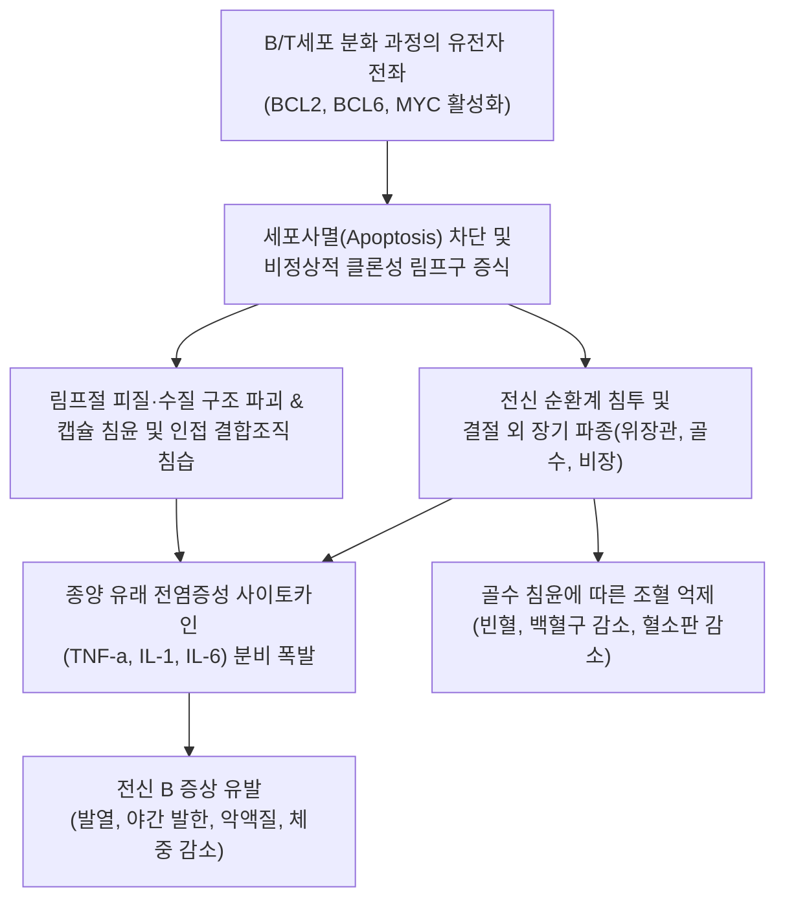
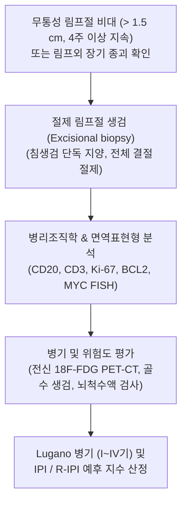

# 🩺 비호지킨 림프종

> **핵심 3줄 요약 (Key Summary)**:
> - 📍 병소 부위 & 해부·병태생리: 림프절, 비장, 골수 및 림프외 장기(위장관, 편도, 중추신경계) 등 전신 림프망내계 조직에서 유래하는 B세포(약 85%) 또는 T/NK세포(약 15%)의 이질적인 악성 신생물군.
> - 🚩 전형적 임상 양상: 무통성의 비대칭적 [[림프절염]] 양상(경부, 액와부, 쇄골상와, 서혜부), 전신 B 증상(38°C 이상의 [[발열]], 야간 발한, 6개월 내 10% 이상의 체중 감소), 간비대 및 [[비장 비대]].
> - 🛠️ 핵심 검사 & 치료 전략: 절제 림프절 생검(Excisional biopsy - 침생검은 아형 분류에 부적합), 면역표현형 분석(CD20, CD3 등), 전신 PET-CT 및 골수 생검; 아형(저위험군 여포성 림프종 vs 고위험군 미만성 거대 B세포 림프종)에 따른 면역화학요법(R-CHOP, Pola-R-CHP), 표적치료, CAR-T 세포치료.
> - ⚠️ 응급 의뢰 레드플래그: 종격동 림프절 비대로 인한 상대정맥 증후군(SVCS - 안면 부종, 경정맥 확장, 호흡곤란), 척수 압박 증후군(급격한 하지 마비, 대소변 실금), 종양 용해 증후군(TLS - 핍뇨, 고칼륨혈증, 부정맥).

---

## 📌 목차
1. [질환 개요 & 해부학적 병태생리](#1-질환-개요--해부학적-병태생리)
2. [병태생리 메커니즘 & 생체역학적 악순환 네트워크](#2-병태생리-메커니즘--생체역학적-악순환-네트워크)
3. [임상 증상 & 이학적 검사(Physical Exam) 알고리즘](#3-임상-증상--이학적-검사physical-exam-알고리즘)
4. [감별 진단 매트릭스 (Differential Diagnosis)](#4-감별-진단-매트릭스--differential-diagnosis)
5. [한의 통합 치료 프로토콜 (침·약침·추나·한약)](#5-한의-통합-치료-프로토콜--침약침추나한약)
6. [양방 치료 & 병용·의뢰 기준 (Conventional Treatment & Referral)](#6-양방-치료--병용의뢰-기준-conventional-treatment--referral)
7. [재활 운동 & 생활습관 티칭 가이드](#7-재활-운동--생활습관-티칭-가이드)
8. [💡 사용자 진료실 핵심 필기 & 임상 노하우 (Melt-In 잔여 심화 집약)](#8--사용자-진료실-핵심-필기--임상-노하우--melt-in-잔여-심화-집약)
9. [출처 및 학술 참고 문헌 (References)](#9-출처-및-학술-참고-문헌--references)

---

## 1. 질환 개요 & 해부학적 병태생리

**비호지킨 림프종(Non-Hodgkin Lymphoma, NHL)**은 호지킨 림프종을 제외한 모든 악성 림프 증식성 질환을 총칭하는 포괄적 병명으로, 전 세계 림프계 악성 종양의 대부분을 차지한다. 조직학적 및 면역유전학적으로 매우 이질적인 60개 이상의 아형으로 분류되며, 서양 및 국내 모두 B세포 기원이 약 $85\%$, T세포 및 NK세포 기원이 약 $15\%$를 차지한다. 가장 대표적인 공격형(Aggressive) 림프종은 미만성 거대 B세포 림프종(DLBCL)이며, 완서형(Indolent) 림프종의 대표는 여포성 림프종(FL)이다.

해부학적으로 림프절 내부의 배중심(Germinal center) 또는 배중심 후 B세포에서 발생하는 면역글로불린 유전자 체세포 과돌연변이 및 염색체 전좌(예: $t(14;18)$에 의한 BCL2 과발현, $t(3;14)$에 의한 BCL6 재배열, $t(8;14)$에 의한 MYC 과발현 등)가 세포사멸 억제와 무제한적 증식을 유도한다. 호지킨 림프종이 인접 림프절로 규칙적이고 연속적으로 전파되는 경향을 보이는 반면, 비호지킨 림프종은 비연속적이고 예측 불가능하게 파종되며 림프절 외 장기(위장관, 간, 비장, 골수, 폐, 뇌 등)를 침범하는 빈도가 $20\sim 40\%$에 달한다.

---

## 2. 병태생리 메커니즘 & 생체역학적 악순환 네트워크

림프종 세포는 정상 면역 반응 메커니즘을 탈취하여 종양 미세환경을 재프로그래밍한다. 종양 주변 대식세포와 T세포를 억제성 표현형으로 유도하고 PD-L1 발현을 증가시켜 면역 회피(Immune evasion)를 달성한다. 증식하는 종양 덩어리는 국소 혈관과 림프관을 압박하여 림프부종을 유발하고, 대량의 림프종 세포가 혈류를 통해 전신 장기로 파종되며 정상 장기 실질을 파괴한다. 고등급 림프종에서는 세포 회전율(Cell turnover)이 극도로 빨라 자발성 종양 용해 또는 화학요법 시 급격한 대사 이상을 유발한다.

---

## 3. 임상 증상 & 이학적 검사(Physical Exam) 알고리즘

### 주요 임상 증상
- **무통성 림프절 종대**: 경부, 쇄골상와, 액와부, 서혜부에서 단단하고 고무 같은(Rubber-like) 경도의 무통성 림프절이 서서히 또는 급격히 비대해짐.
- **전신 B 증상**: 원인 불명의 $38^\circ\text{C}$ 이상의 [[발열]], 옷을 적실 정도의 야간 도한, 최근 6개월 이내 평소 체중의 $10\%$ 이상의 감소.
- **결절 외 침범 증상**:
  - 위장관 침범: 복통, 소화불량, 장폐색, 복부 종괴, 잠혈 또는 흑색변.
  - 종격동 침범: 기침, 흉통, 호흡곤란, 상대정맥 증후군(안면 및 상지 부종).
  - 중추신경계 침범: 두통, 신경학적 결손, 뇌신경 마비, 의식 변화.
  - 골수 침범: 골수 기능 부전으로 인한 피로 및 [[빈혈]], 출혈 경향, 기회 감염.

### 진단 및 병기 설정 알고리즘

---

## 4. 감별 진단 매트릭스 (Differential Diagnosis)

| 감별 질환 | 호발 연령 및 양상 | 림프절 촉진 소견 | 전신 증상 및 장기 침범 | 조직학적 감별 기준 |
| :--- | :--- | :--- | :--- | :--- |
| **비호지킨 림프종 (NHL)** | 60대 이상 호발(전 연령 가능) | 무통성, 단단하고 탄력성 있음, 비연속적 파종 | B 증상, 결절 외 장기 침범 빈번($20\sim 40\%$) | 림프절 정상 구조 파괴, 단클론성 B/T세포 침윤 |
| **[[호지킨 림프종]] (HL)** | 20대 청년기 및 60대 양봉형 | 무통성, 고무 같음, 경부·종격동에 연속적 파종 | 전신 [[소양증]], 펠-엡스타인 열, 음주 시 통증 | 리드-스턴버그 세포(Reed-Sternberg cell, CD30+, CD15+) |
| **반응성 [[림프절염]] (Reactive Lymphadenitis)** | 소아·청소년 흔함, 급성 | 압통 동반, 부드럽고 가동성 있음, 국소 감염원 | 인후통, 치과 질환, 국소 피부 감염 | 배중심 보존, 다클론성 염증세포 침윤, 원인 호전 시 소실 |
| **결핵성 림프절염 (Scrofula)** | 전 연령, 쇄골상와 및 경부 | 초기 단단함 $\to$ 건락화로 연화 및 융합, 누공 형성 | 미열, 야간 식은땀, 만성 기침 | 건락성 육아종, 항산균(AFB) 염색 양성, PCR 양성 |
| **전이성 악성 종양 (Metastatic Carcinoma)** | 50대 이상, 두경부암, 폐암, 위암 등 | 암석양 경도(Rock-hard), 주변 조직에 강하게 고정 | 원발암 부위 증상, Virchow 결절(좌측 쇄골상와) | 비림프계 상피성 악성 세포 침윤 (CK 양성) |

---

## 5. 한의 통합 치료 프로토콜 (침·약침·추나·한약)

> ⚠️ 한의학적 치료는 암세포의 근본 제거를 목적으로 하지 않으며, 표준 화학요법 및 방사선 치료 중 발생하는 골수 억제(빈혈, 백혈구 감소증), 항암제 유발성 말초신경병증(CIPN), 극심한 식욕부진 및 암성 피로를 관리하는 보완 지지요법으로 시행한다.

### 1) 한약 처방 (변증별 지지요법)
- **기혈양허증 (氣血兩虛證 - 항암화학요법 후 빈혈, 백혈구 감소, 극심한 피로)**:
  - 처방: [[십전대보탕]] 또는 [[보중익기탕]] 가감 ([[황기]], [[인삼]], [[백출]], [[복령]], [[당귀]], [[숙지황]], [[백작약]], [[천궁]]).
  - 학술 근거: 황기-인삼 다당체 성분이 골수 조혈 모세포 증식을 촉진하고 과립구 집락 자극 인자(G-CSF) 반응성을 보조하여 호중구 회복 속도를 단축.
- **비위기허 및 담어교결증 (脾胃氣虛 痰瘀交結證 - 오심, 구토, 복부 팽만, 식욕부진)**:
  - 처방: [[삼령백출산]] 또는 반하백출천마탕 합 [[사군자탕]] 가감.
  - 효과: 위장관 점막 손상 보호, 오심 완화, 영양 섭취 개선.
- **심비양허증 (心脾兩虛證 - 암 진단 후 불안, 불면, 가슴 두근거림, 쇠약)**:
  - 처방: [[귀비탕]] ([[인삼]], [[황기]], [[백출]], [[복령]], 산조인, 원지, [[당귀]], 용안육).
  - 작용: 자율신경계 안정, 수면 질 개선 및 신경면역학적 회복 지원.

### 2) 침구 치료
- **혈위**: 족삼리(ST36), 삼음교(SP6), 중완(CV12), 내관(PC6), 비수(BL20), 격수(BL17).
- **시술 지침**: 림프절 종대 부위, 림프부종 부위, 방사선 조사 부위 직접 자침은 절대 금기. 말초혈액 검사상 혈소판 수치가 $50,000/\mu\text{L}$ 미만이거나 절대 호중구 수(ANC)가 $1,000/\mu\text{L}$ 미만일 때는 침 치료를 유보함.

---

## 6. 양방 치료 & 병용·의뢰 기준 (Conventional Treatment & Referral)

### 양방 표준 치료 프로토콜
1. **공격형 림프종 (DLBCL 등)**:
   - 1차 표준 치료: Pola-R-CHP(폴라투주맙 베도틴 + 리툭시맙 + 시클로포스파미드 + 독소루비신 + 프레드니손) 또는 R-CHOP 요법 6주기.
   - 재발 및 불응성: CAR-T 세포 치료(티사젠렉류셀, 액시캅타진 실로류셀), 이중특이항체(에프코리타맙, 글로피타맙), 고용량 화학요법 및 자가 조혈모세포이식.
2. **완서형 림프종 (여포성 림프종 등)**:
   - 무증상 초기: 대기 요법(Watch and wait).
   - 증상 동반 진행기: BR 요법(벤다무스틴 + 리툭시맙), R-CHOP, 또는 레날리도마이드 + 리툭시맙(R2 요법).

### 긴급 응급 의뢰 레드플래그
- **상대정맥 증후군 (SVCS)**: 안면 및 경부의 급격한 부종, 결막 충혈, 경정맥 확장, 앙와위 시 악화되는 호흡곤란.
- **척수 압박 증후군 (Spinal cord compression)**: 등이나 허리의 극심한 통증과 함께 급격히 진행하는 하지 위약, 감각 마비, 괄약근 조절 부전.
- **종양 용해 증후군 (TLS)**: 화학요법 시작 후 핍뇨, 급격한 혈청 요산·칼륨·인 상승 및 저칼슘혈증, 심부정맥.

---

## 7. 재활 운동 & 생활습관 티칭 가이드

- **항암 치료 중 감염 예방 수칙**: 호중구 감소기에는 사람이 많은 밀폐된 장소를 피하고, 외출 시 KF94 마스크 착용, 날음식(생선회, 육회 등) 섭취 금지 및 멸균식 또는 익힌 음식 위주 식사.
- **저강도 유산소 걷기 운동**: 체력이 허용하는 범위 내에서 매일 $20\sim 30$분 가벼운 평지 걷기를 시행하여 암성 피로를 개선하고 근육량 소실(악액질)을 예방.
- **림프부종 예방 관리**: 액와부 또는 서혜부 림프절 비대로 순환이 저하된 사지에는 무거운 물건을 들지 않고, 꽉 끼는 의복이나 장신구를 피하며, 해당 팔다리에서의 혈압 측정 및 채혈을 금지함.
- **영양 및 대사 지원**: 고단백, 균형 잡힌 칼로리 섭취를 유지하며, 소화 효소 부담을 줄이기 위해 소량씩 자주 섭취하도록 안내함.

---

## 8. 💡 사용자 진료실 핵심 필기 & 임상 노하우 (Melt-In 잔여 심화 집약)

> 💡 **임상 핵심 진주 (Clinical Pearls)**:
> - **침생검(Core needle)의 치명적 한계**: 림프절 비대 환자가 내원했을 때 세침흡인(FNA)이나 총생검으로 '악성 림프종 의심' 소견만 받고 오는 경우가 많다. 그러나 림프종은 림프절의 전체 여포 구조와 피질·수질 아키텍처를 온전히 확인해야 60여 종의 아형 중 정확한 진단과 치료 방침(R-CHOP vs 관찰 등)이 결정되므로, 반드시 외과적 절제 생검(Excisional biopsy)을 받도록 환자에게 티칭해야 한다.
> - **쇄골상와 림프절(Virchow's node)의 무게감**: 경부 림프절 비대는 양성 반응성 림프절염이 흔하지만, 쇄골상와(Supraclavicular fossa)에서 만져지는 림프절은 연령을 불문하고 $90\%$ 이상에서 악성 종양(림프종 또는 위·폐 전이암)이므로 절대로 경과 관찰하지 말고 즉시 상급 병원으로 전원해야 한다.
> - **고무 같은 질감(Rubber-like consistency)**: 암 전이의 경우 돌처럼 딱딱하고 표면이 울퉁불퉁하게 굳어있는(Rock-hard) 반면, 비호지킨 림프종은 지우개나 단단한 고무를 만지는 듯한 탄력적인 질감을 보이며 무통성으로 융합되는 특징이 있다.
> - **한방 치료 시 감염 관리의 절대성**: 암 환자 진료 시 열감이나 림프절 부위를 보고 '소염' 목적으로 사혈 침이나 부항을 뜨는 행위는 국소 조직 괴사 및 이차성 세균 감염, 패혈증을 유발하는 중대한 의료사고 위험이 있으므로 엄격히 금해야 한다.

---

## 9. 출처 및 학술 참고 문헌 (References)

- Han X, et al. (2026). Pretreatment Prognostic Nutritional Index Is Associated with Treatment Response and Survival in Patients with Relapsed or Refractory Non-Hodgkin Lymphoma Receiving CAR-T Cell Therapy. *Nutrients*. PMID: 42942996.

- Shah H, et al. (2026). Racial and socioeconomic differences in time to treatment initiation and outcomes in aggressive non-Hodgkin lymphoma. *Blood Neoplasia*. PMID: 42904098.

- Dreyling M, et al. (2026). Newly Diagnosed and Relapsed Follicular Lymphoma: ESMO Clinical Practice Guideline for Diagnosis, Treatment and Follow-Up. *Ann Oncol*. PMID: 42703457.
