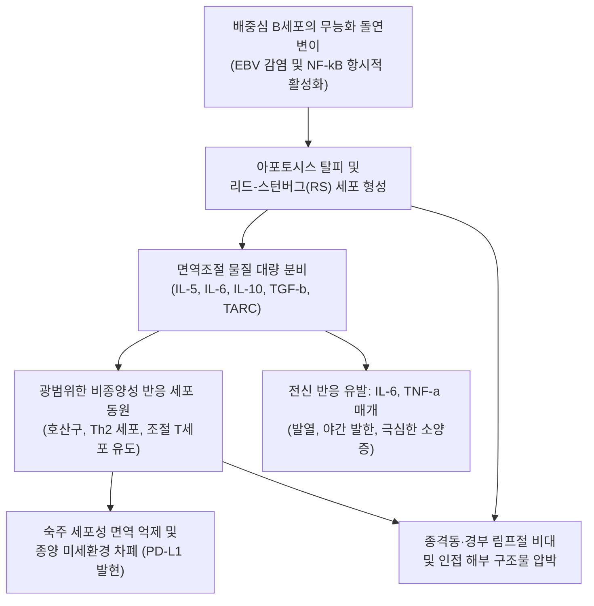
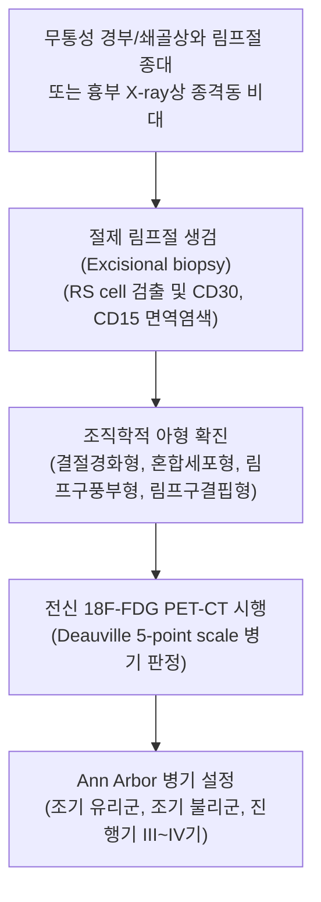

# 🩺 호지킨 림프종

> **핵심 3줄 요약 (Key Summary)**:
> - 📍 병소 부위 & 해부·병태생리: 림프절 내 B세포 기원의 거대 단핵 또는 다핵성 신생 세포인 리드-스턴버그 세포(Reed-Sternberg cell)와 주변의 풍부한 반응성 비종양 염증 세포 침윤을 특징으로 하는 원발성 림프 악성 신생물.
> - 🚩 전형적 임상 양상: 20대 청년층 및 60대 이상에서 쌍봉형(Bimodal) 발생; 경부 및 쇄골상와의 무통성 고무상 림프절 비대, 종격동 침범에 따른 마른기침, 전신 B 증상([[발열]], 야간 발한, 체중 감소), 알코올 유발성 림프절 통증, 난치성 [[소양증]].
> - 🛠️ 핵심 검사 & 치료 전략: 절제 림프절 생검(RS cell 및 CD30, CD15 면역염색 양성), 전신 PET-CT 병기 설정; 병기 및 위험군에 따른 복합 항암화학요법(ABVD, brentuximab vedotin 병용, nivolumab-AVD) 및 병변 부위 방사선 치료(ISRT). 현대 항암 요법으로 80~90% 완치율 달성.
> - ⚠️ 응급 의뢰 레드플래그: 종격동 거대 종괴(Bulky disease, > 10 cm)에 의한 상대정맥 압박, 기도 폐쇄 및 급성 호흡부전, 척수 압박 징후, 급격한 호중구 감소성 고열.

---

## 📌 목차
1. [질환 개요 & 해부학적 병태생리](#1-질환-개요--해부학적-병태생리)
2. [병태생리 메커니즘 & 생체역학적 악순환 네트워크](#2-병태생리-메커니즘--생체역학적-악순환-네트워크)
3. [임상 증상 & 이학적 검사(Physical Exam) 알고리즘](#3-임상-증상--이학적-검사physical-exam-알고리즘)
4. [감별 진단 매트릭스 (Differential Diagnosis)](#4-감별-진단-매트릭스--differential-diagnosis)
5. [한의 통합 치료 프로토콜 (침·약침·추나·한약)](#5-한의-통합-치료-프로토콜--침약침추나한약)
6. [양방 치료 & 병용·의뢰 기준 (Conventional Treatment & Referral)](#6-양방-치료--병용의뢰-기준-conventional-treatment--referral)
7. [재활 운동 & 생활습관 티칭 가이드](#7-재활-운동--생활습관-티칭-가이드)
8. [💡 사용자 진료실 핵심 필기 & 임상 노하우 (Melt-In 잔여 심화 집약)](#8--사용자-진료실-핵심-필기--임상-노하우--melt-in-잔여-심화-집약)
9. [출처 및 학술 참고 문헌 (References)](#9-출처-및-학술-참고-문헌--references)

---

## 1. 질환 개요 & 해부학적 병태생리

**호지킨 림프종(Hodgkin Lymphoma, HL)**은 림프계에 발생하는 특이한 악성 종양으로, 토마스 호지킨(Thomas Hodgkin)에 의해 처음 기술되었다. 비호지킨 림프종과 대비되는 가장 중요한 병리학적 특징은 종양 덩어리의 대부분($99\%$ 이상)이 림프구, 호산구, 호중구, 대식세포, 섬유모세포 등 비종양성 반응성 염증 세포로 구성되어 있으며, 실제 악성 신생 세포인 리드-스턴버그 세포(Reed-Sternberg cell, RS cell) 및 호지킨 세포는 전체 세포의 $1\%$ 미만에 불과하다는 점이다.

해부학적 전파 양상에서 호지킨 림프종은 인접한 림프절 구획을 따라 해부학적으로 연속적(Contiguous)으로 퍼져나가는 뚜렷한 특징을 보인다. 전형적으로 경부 림프절(약 $70\sim 80\%$) 및 쇄골상와 림프절에서 시작하여 전종격동 림프절(약 $50\sim 60\%$)로 하향 진행하며, 액와부 및 복부 대동맥 주위 림프절, 비장으로 순차적 확산된다. 비호지킨 림프종에 비해 위장관이나 뇌, 간 등의 림프절 외 장기(Extranodal) 원발 침범은 극히 드물다.

---

## 2. 병태생리 메커니즘 & 생체역학적 악순환 네트워크

RS 세포는 배중심 B세포 기원이지만 면역글로불린 유전자 전사 능력을 상실하여 전형적인 B세포 표지자(CD19, CD20)의 발현이 소실되거나 매우 약하며, 대신 CD30과 CD15를 강하게 발현한다. RS 세포는 염색체 9p24.1 증폭을 통해 PD-L1 및 PD-L2를 과발현시켜 종양 침윤 T세포의 PD-1 수용체와 결합함으로써 세포독성 T세포의 항종양 면역 반응을 완벽하게 무력화한다. 또한 RS 세포가 분비하는 케모카인(TARC/CCL17)은 비효과적인 Th2 세포와 면역억제성 Treg을 대량으로 유인하여 종양을 보호하는 보호벽을 형성한다.

---

## 3. 임상 증상 & 이학적 검사(Physical Exam) 알고리즘

### 주요 임상 증상
- **무통성 고무상 림프절 비대**: 한 개 또는 여러 개의 단단한 고무 같은(Firm, rubbery) 경부 또는 쇄골상와 림프절이 무통성으로 만져짐. 가동성이 있으나 점차 서로 융합(Matted)됨.
- **종격동 종괴 증상**: 젊은 환자에서 기침, 호흡곤란, 흉골 후방 흉통, 앙와위 시 악화되는 천명음.
- **전신 증상 (Systemic symptoms)**:
  - B 증상: $38^\circ\text{C}$ 이상의 [[발열]], 자고 일어나면 침구를 적시는 다한증, 체중의 $10\%$ 이상의 감소.
  - 펠-엡스타인 열(Pel-Ebstein fever): 수일간의 고열 후 수일~수주의 무열기가 주기적으로 반복되는 특이 열형.
  - 전신성 [[소양증]]: 병변 부위와 무관하게 전신에 나타나는 극심한 가려움증으로, 일반 항히스타민제에 반응하지 않음.
  - 알코올 유발성 통증(Alcohol-induced pain): 알코올 섭취 후 수 분 이내에 비대된 림프절 부위에 찌르는 듯한 통증이 발생하는 매우 특이적인 임상 징후.

### 진단 및 병기 알고리즘

---

## 4. 감별 진단 매트릭스 (Differential Diagnosis)

| 감별 질환 | 호발 연령 및 부위 | 병리조직학적 특징 | 임상적 감별 포인트 |
| :--- | :--- | :--- | :--- |
| **호지킨 림프종 (HL)** | 15~35세 및 60대 이상 쌍봉형, 경부·종격동 호발 | 리드-스턴버그 세포(CD30+, CD15+, PAX5 약양성), 풍부한 반응성 세포 | 해부학적 연속성 전파, 음주 시 통증, 펠-엡스타인 열, 결절 외 침범 드뭄 |
| **[[비호지킨 림프종]] (NHL)** | 60대 이상 호발, 전신 림프절 및 장기 | 균일한 단클론성 B 또는 T세포 증식, RS cell 없음 | 비연속적 파종, 위장관·골수 등 림프절 외 침범 빈번($>30\%$) |
| **전염성 단핵구증 (EBV 감염)** | 청소년 및 청년층, 경부 림프절 | 반응성 이형 림프구(Atypical lymphocyte), 다클론성 | 급성 인후통, 편도 삼출물, [[발열]], 비장비대, 이형 림프구증, 수주 내 호전 |
| **기쿠치병 (아급성 괴사성 림프절염)** | 20~30대 젊은 동양 여성, 후경부 호발 | 림프절 피질의 조직구성 괴사 및 세포 찌꺼기 | 압통 동반 림프절 비대, 백혈구 감소증, 미열, $1\sim 4$개월 내 자연 치유 |
| **결핵성 림프절염** | 전 연령, 쇄골상와 및 전경부 | 건락성 괴사를 동반한 만성 육아종성 염증 | 만성 경과, 결핵 반응 검사(IGRA, TST) 양성, 흉부 X선 결핵 흔적 |

---

## 5. 한의 통합 치료 프로토콜 (침·약침·추나·한약)

> ⚠️ 호지킨 림프종은 현대 복합 항암화학요법과 방사선 치료로 $80\sim 90\%$ 이상의 높은 완치율을 달성할 수 있는 질환이므로, 양방 종양내과 표준 치료가 최우선이며 한의 치료는 항암 부작용(골수 억제, 피로, 구역구토) 완화 및 치료 완수를 돕는 보조 지지요법으로 엄격히 제한한다.

### 1) 한약 처방 (변증 기반 보조요법)
- **기음양허증 (氣陰兩虛證 - 방사선 치료 후 구강 건조, 마른기침, 미열, 쇠약)**:
  - 처방: [[생맥산]] 또는 [[사삼맥문동탕]] 가감 ([[맥문동]], [[인삼]], 오미자, 사삼, 옥죽, 천화분, [[생지황]]).
  - 기전: 방사선 조사로 손상된 침샘 및 점막 상피 세포의 수분 유지, 폐 점막 염증 진정.
- **비신양허 및 골수억제증 (脾腎兩虛 骨髓抑制證 - 항암화학요법 후 백혈구 감소, 빈혈, 오한)**:
  - 처방: [[십전대보탕]] 합 [[보폐원탕]] 가감 ([[황기]], [[당귀]], [[백출]], [[숙지황]], [[산약]], [[산수유]]).
  - 목적: 조혈모세포 미세환경 개선, 세포성 면역 회복 및 전신 무력감 개선.
- **간울화화 및 담핵증 (肝鬱化火 痰核證 - 경부 종대, 극심한 가려움, 불면, 번조)**:
  - 처방: 가미소요산 또는 [[온청음]] 가감 ([[시호]], [[당귀]], [[백작약]], [[치자]], [[목단피]], 연교, 하고초).
  - 작용: 중추 신경성 긴장 완화 및 신경매개 소양증 진정.

### 2) 침구 치료
- **혈위**: 족삼리(ST36), 합곡(LI4), 태충(LR3), 내관(PC6), 비수(BL20), 신수(BL23).
- **시술 지침**: 비대된 림프절 부위, 전경부, 흉골 부위 직접 자침은 엄격히 금기. 원격 혈위 위주로 가볍게 자침하여 항암제 유발 오심 완화 및 자율신경계 균형 유도. 혈소판 수치가 $50,000/\mu\text{L}$ 미만일 경우 자침을 유보함.

---

## 6. 양방 치료 & 병용·의뢰 기준 (Conventional Treatment & Referral)

### 양방 표준 치료 프로토콜
1. **조기 병기 (I~II기 유리군 및 불리군)**:
   - 표준 요법: ABVD(독소루비신, 블레오마이신, 빈블라스틴, 다카르바진) 2~4주기 후 중간 PET-CT 평가.
   - 최근 발전: 니볼루맙(Nivolumab - 항PD-1 항체) 병용 요법(NIVAHL 연구 등) 도입으로 블레오마이신 유발성 폐독성 배제 및 관해율 극대화.
   - 국소 침범 부위 방사선 치료(ISRT, $20\sim 30\text{ Gy}$).
2. **진행기 병기 (III~IV기)**:
   - BV-AVD(브렌툭시맙 베도틴 + 독소루비신 + 빈블라스틴 + 다카르바진) 6주기 또는 고용량 escalated BEACOPP 요법.
   - 재발/불응성: 항PD-1 면역관문억제제(펨브롤리주맙, 니볼루맙), 고용량 항암화학요법 및 자가 조혈모세포이식.

### 긴급 응급 의뢰 레드플래그
- 종격동 거대 종괴로 인한 급성 호흡곤란, 협착음(Stridor), 청색증.
- 안면, 경부, 양측 상지의 급격한 부종 및 흉벽 정맥 노창(상대정맥 증후군).
- 흉통과 동반된 심낭 삼출 및 심장 압전 징후(Beck 3징후: 저혈압, 경정맥 확장, 심음 감약).

---

## 7. 재활 운동 & 생활습관 티칭 가이드

- **장기 심폐 독성 모니터링**: 독소루비신에 의한 심근병증 및 블레오마이신 또는 종격동 방사선에 의한 폐섬유화 위험이 있으므로, 완치 후에도 정기적인 심초음파와 폐기능 검사가 필수적임.
- **이차암 예방 티칭**: 흉부 방사선 조사를 받은 여성 환자는 유방암 발생 위험이 정상인 대비 $20\sim 30$배 증가하므로, 치료 후 8~10년 뒤(또는 25세 이후)부터 정기적인 유방 MRI 및 촬영술 조기 검진을 받도록 교육함.
- **규칙적인 유산소 운동**: 치료 종료 후 중등도 강도의 유산소 운동(주 3~5회, 회당 30분 이상 가벼운 조깅이나 자전거)을 통해 항암 치료 후 장기 심혈관 합병증을 예방하고 체력을 재건함.
- **금연 및 감염 예방**: 폐 손상 위험을 최소화하기 위해 절대 금연하며, 폐렴구균 및 인플루엔자 백신을 정기적으로 접종함.

---

## 8. 💡 사용자 진료실 핵심 필기 & 임상 노하우 (Melt-In 잔여 심화 집약)

> 💡 **임상 핵심 진주 (Clinical Pearls)**:
> - **알코올 유발성 림프절 통증의 독보적 가치**: 환자가 "술을 한 잔만 마셔도 목이나 쇄골 쪽 림프절이 쑤시고 아프다"고 호소하면 이는 호지킨 림프종을 강력히 시사하는 병태생리학적 징후이다(혈관 확장 및 RS 세포 내 통증 유발 물질 방출). 이 증상은 다른 양성 림프절염에서는 거의 나타나지 않는다.
> - **완치율 90% 질환에서의 의사의 역할**: 호지킨 림프종은 현대 의학에서 가장 완치율이 높은 암 중 하나이다. 따라서 환자가 한의원에 불안감으로 내원했을 때, 잘못된 민간요법이나 한방 단독 치료에 매달려 골든타임을 놓치지 않도록 신속히 혈액종양내과로 전원하여 완치 프로토콜을 밟도록 안심시키고 설득하는 것이 최고의 의료 행위이다.
> - **결절경화형(Nodular Sclerosis)의 젊은 여성 호발**: 20대 젊은 여성에서 기침과 함께 전종격동 종괴나 경부 림프절이 발견되면 결절경화형 호지킨 림프종을 1순위로 고려해야 하며, 양성 낭종이나 결핵으로 오진하여 시간을 지체하지 않아야 한다.
> - **젊은 암 생존자의 삶의 질**: 치료 성공률이 높은 만큼 수십 년간 생존하므로, 항암 치료 중 생식능력 보존(정자/난자 동결 보존) 상담 여부를 확인하고, 치료 후 발생할 수 있는 갑상선기능저하증 및 조기 관상동맥 질환에 대한 지속적인 생활습관 관리를 지도해야 한다.

---

## 9. 출처 및 학술 참고 문헌 (References)

- Gajwani P, et al. (2026). Evolving Role of Radiation Therapy in Pediatric Hodgkin Lymphoma: Evidence-Based Current Consensus and Controversies. *Pediatr Blood Cancer*. PMID: 42963233.

- Picardi M, et al. (2026). Brentuximab vedotin-containing regimen time toxicity for front-line therapy of advanced-stage classical Hodgkin lymphoma in young adults and adults: Real-life comparison between condensed BrECADD versus traditional Bv + AVD. *Br J Haematol*. PMID: 42934121.

- Hüttmann A, et al. (2026). S3-Leitlinie Diagnostik, Therapie und Nachsorge für erwachsene Patientinnen und Patienten mit einem Hodgkin-Lymphom. *J Dtsch Dermatol Ges*. PMID: 42888915.
