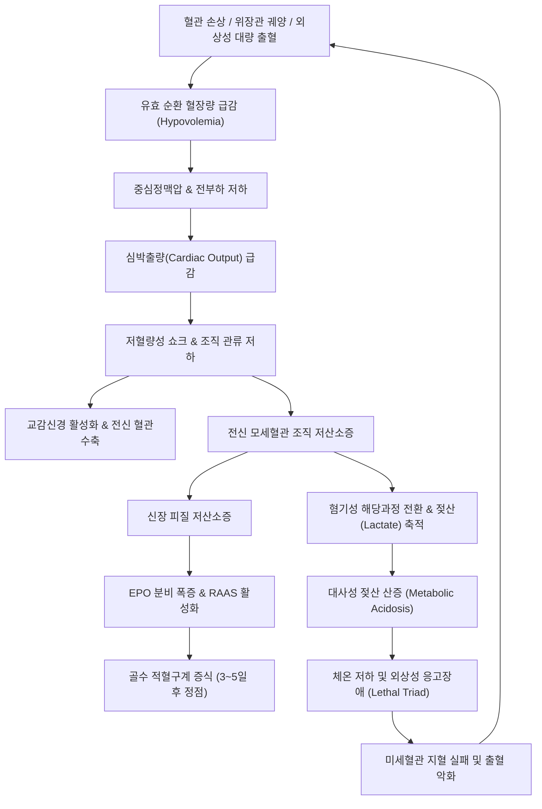

# 🩺 과다 출혈로 인한 빈혈 (Anemia of Blood Loss / 出血性貧血, ICD-10: D62 / D50.0)

> **핵심 3줄 요약 (Key Summary)**:
> - 📍 **병소 부위 & 병태생리**: 혈관 손상 및 내장 장기 출혈로 인한 유효 순환 혈류량 급감. 급성기에는 혈관수축 및 수액 체류 보상 후 혈장 재충만에 의해 정상세구성 정상색소성 빈혈이 유발되며, 만성 잠혈 출혈 시에는 체내 철 저장량 고갈로 인해 소구성 저색소성 [[철결핍 빈혈]]로 이행함.
> - 🚩 **전형적 임상 양상 & 3대 징후**: 급성 실혈의 저혈량성 쇼크 징후(빈맥, 기립성 저혈압, 식은땀, 호흡곤란, 핍뇨) 및 만성 실혈의 서서히 진행하는 전신 쇠약감, 결막 창백, 흑색변(Melena) 또는 혈변(Hematochezia).
> - 🛠️ **핵심 감별 & 한·양방 치료 전략**: 초기 정상 헤모글로빈 수치의 희석 지연 함정 인지, 활동성 출혈원 차단(내시경 결찰, 혈관조영 색전술), 대량 수혈 프로토콜(pRBC:FFP:PLT 1:1:1) 및 철분 주사 투여. 한의학적으로 실혈·망혈 허탈기에 [[독삼탕]], [[당귀]]·[[황기]] 배합의 당귀보혈탕, 출혈기 [[십회산]], 자궁출혈 시 [[궁귀교애탕]], 만성기 [[보중익기탕]]·[[귀비탕]]을 적용함.
> - <font color="#fa7e7e">⚠️ **응급 의뢰 레드플래그**: 활력징후 불안정(수축기 혈압 <90 mmHg, 맥박 >120회/분), 대량 토혈/혈변, 의식 저하, 급성 흉통(심근 허혈 징후), 쇼크 지수(Shock Index = HR/SBP) ≥ 1.0 즉각 상급병원 응급실 의뢰.</font>

---

## 📌 목차
1. [질환 개요 & 병태생리 (Disease Overview)](#1-질환-개요--병태생리-disease-overview)
2. [병태생리 메커니즘 & 대사·장기부전 악순환 네트워크](#2-병태생리-메커니즘--대사장기부전-악순환-네트워크)
3. [임상 증상 & 환자 소견 (Clinical Presentation)](#3-임상-증상--환자-소견-clinical-presentation)
4. [감별 진단 매트릭스 (Differential Diagnosis)](#4-감별-진단-매트릭스-differential-diagnosis)
5. [한의 통합 치료 프로토콜 (침·약침·한약)](#5-한의-통합-치료-프로토콜-침약침한약)
6. [양방 치료 & 병용·의뢰 기준 (Conventional Treatment & Referral)](#6-양방-치료--병용의뢰-기준-conventional-treatment--referral)
7. [식이·생활습관 & 자가관리 티칭 가이드](#7-식이생활습관--자가관리-티칭-가이드)
8. [💡 진료실 핵심 필기 & 임상 노하우](#8--진료실-핵심-필기--임상-노하우)
9. [출처 및 학술 참고 문헌 (References)](#9-출처-및-학술-참고-문헌-references)

---

## 1. 질환 개요 & 병태생리 (Disease Overview)

* **질환 정의 및 임상적 분류**:
  * 과다 출혈로 인한 빈혈(Anemia of Blood Loss)은 체내 혈관망의 물리적 파열, 점막 궤양, 종양 파괴 또는 지혈 장애로 인해 체외로 혈액이 유출되거나 체강(흉강, 복강, 후복막강, 관절강 등) 내로 혈액이 급격히 소실되어 발생하는 빈혈을 총칭한다.
  * 임상 경과 및 발생 기전에 따라 크게 **급성 실혈 후 빈혈(Acute posthemorrhagic anemia, ICD-10: D62)**과 **만성 실혈 빈혈(Chronic blood loss anemia, ICD-10: D50.0)**로 양분된다.
    * **급성 실혈(Acute Blood Loss)**: 단시간(수분~수시간) 내에 혈관 내 혈액량이 급격히 빠져나가는 상태로, 초기 위협은 적혈구 질량의 부족보다는 유효 순환 혈장량(effective circulating volume) 급감에 따른 혈역학적 허탈과 [[저혈량성 쇼크]]이다. 출혈 직후에는 혈장과 혈구가 같은 비율로 소실되므로 헤모글로빈(Hb) 및 헤마토크리트(Hct) 농도가 정상으로 유지될 수 있으며, 24~72시간에 걸친 혈관외액의 혈관내 재충만(transcapillary refill)과 수액 투여로 혈액이 희석된 후에야 비로소 정구성 정색소성 빈혈(normocytic normochromic anemia)로 확진된다.
    * **만성 실혈(Chronic Blood Loss)**: 수일에서 수개월에 걸쳐 소화관 점막, 비뇨생식기 등에서 육안으로 쉽게 관찰되지 않는 미세 잠혈 출혈(occult bleeding)이 지속되는 상태이다. 체내 보상 기전(혈장량 증가, 심박출량 적응)에 의해 혈역학적으로는 안정되나, 매일 지속되는 적혈구 유출로 체내 총 철분 함유량의 65% 이상을 차지하는 헤모글로빈 철이 지속적으로 고갈되어 골수 저장철 페리틴(Ferritin)이 소진되며, 결국 전형적인 소구성 저색소성 빈혈(microcytic hypochromic anemia, 즉 [[철결핍 빈혈]])을 초래한다.

* **관련 장기 및 조직 계통**:
  * **주 이환 장기**: 전신 [[혈관]] 순환계(모세혈관망, 동맥, 정맥), 조혈기관인 [[골수]](적혈구계 전구세포 증식), 세망내피계의 중심인 [[비장]] 및 [[간]].
  * **출혈 호발 병소 장기**:
    * 상부 위장관: 식도정맥류(간경변 합병증), 말로리-바이스 증후군, [[위궤양]], 급성 미란성 위염, [[십이지장궤양]], [[위암]].
    * 하부 위장관: 게실증 출혈, 혈관형성이상(angiodysplasia), [[궤양성 대장염]], [[크론병]], [[대장암]], 진행성 치핵 및 항문 열상.
    * 산부인과 및 생식기: 기능성 자궁출혈, 자궁근종, 자궁선근증, 자궁내막암, 자궁외임신 파열, 산과적 태반조기박리 및 산후 출혈.
    * 외상 및 수술: 골반 골절, 대퇴골 골절, 둔상에 의한 비장 파열 및 간 열창, 대혈관 파열, 주요 정형외과 및 흉복부 외과 수술.
    * 비뇨기계: 신장 결석, 방광암, 신세포암, 전립선 비대증에 수반된 육안적 혈뇨.
  * **연관 내분비·체액 대사 조절계**:
    * 신장 세뇨관주위 섬유아세포: 저산소증 자극에 감응하여 [[에리스로포이에틴]](Erythropoietin, EPO) 전사인자 HIF-1α 및 HIF-2α를 축적하고 EPO 분비를 수십 배 급증시킴.
    * 부신수질 및 교감신경계: 에피네프린 및 노르에피네프린 방출로 심근 수축력 증가 및 말초 세동맥 수축 유도.
    * 레닌-안지오텐신-알도스테론계(RAAS) 및 바소프레신(ADH): 신동맥 관류압 저하에 반응하여 수분과 나트륨의 신세뇨관 재흡수를 극대화하여 혈관내 용적을 방어.
  * **합병증 표적 장기**:
    * [[심장]]: 관상동맥 관류압 저하와 빈맥에 따른 심근 산소요구량 급증으로 심근 허혈, 급성 심근경색(NSTEMI/STEMI Type 2), 심부전 유발.
    * [[뇌]]: 대뇌 관류압 감소로 인한 허혈성 뇌병증, 실신, 섬망 및 뇌경색 위험 증가.
    * [[신장]]: 신혈류 허혈로 인한 급성 세뇨관 괴사(Acute Tubular Necrosis, ATN) 및 급성 신손상(AKI).

---

## 2. 병태생리 메커니즘 & 대사·장기부전 악순환 네트워크

```
[ASCII 병태생리 도해: 급성 실혈 vs 만성 실혈의 전신 보상 및 병역동학적 진행 경로]

========================================================================================
[1단계: 급성 대량 출혈 (Acute Massive Bleeding)]
  전혈(전체 혈액) 소실 (RBC + 혈장 동시 상실)
       │
       ├─→ 혈관내 유효 순환 혈류량 급감 ──→ 심박출량 저하 ──→ 전신 관류압 부전
       │         │
       │         ▼
       │   [보상적 신경내분비 폭풍]
       │   - 교감신경계 과활성화 (에피네프린/노르에피네프린 ↑) ──→ 빈맥, 말초 혈관수축
       │   - RAAS 축 활성화 (레닌 ↑, 안지오텐신 II ↑, 알도스테론 ↑) ──→ 나트륨/수분 저류
       │   - 시상하부-하수체 ADH 분비 촉진 ──→ 요량 감소 (핍뇨)
       │         │
       │         ▼
       │   [24~72시간 후: 혈장 재충만 (Transcapillary Refill)]
       │   간질액 유입 + 수액 주입 ──→ 혈액 희석 ──→ 정상세구성 정색소성 빈혈 현성화 (Hb 급락)
       │         │
       │         ▼
       │   [골수 조혈 보상]
       │   신장 저산소증 ──→ HIF-1α 활성화 ──→ EPO 폭증 ──→ 3~7일차 망상적혈구(RPI > 2.0) 급증
       │
========================================================================================
[2단계: 만성 잠혈 출혈 (Chronic Occult Bleeding)]
  일일 5~15 mL 지속적 미세 실혈 (소화성 궤양, 대장 용종/암, 월경과다)
       │
       ├─→ 매일 2.5~7.5 mg 원소철 체외 유실 (정상 흡수능 1~2 mg/일 초과)
       │         │
       │         ▼
       │   [체내 철 대사 불균형 단계]
       │   1단계: 간/비장/골수 대식세포의 페리틴(Ferritin) 저장철 점진적 소진
       │   2단계: 혈청 철(Fe) 감소 및 총철결합능(TIBC) 상승 ──→ 트랜스페린 포화도 <16%
       │   3단계: 적혈구 조혈 시 헴(Heme) 합성 결함 ──→ 세포분열 추가 발생
       │         │
       │         ▼
       │   [소구성 저색소성 빈혈(Microcytic Hypochromic Anemia) 확립]
       │   - MCV < 80 fL, MCH < 27 pg, 혈청 Ferritin < 15~30 ng/mL
       │   - 적혈구 대소부동증(Anisocytosis, RDW 상승), 연필형 적혈구(Pencil cell) 출현
========================================================================================
```



### 1) 분자·세포 수준 기전
* **급성기 초기 체액 이동 및 혈액학적 역설(Hemodilution Paradox)**:
  * 모세혈관 정수압이 급격히 떨어지면 스타링 힘(Starling forces)의 불균형으로 인해 간질액(interstitial fluid)이 모세혈관 내강으로 빨려 들어오는 경모세혈관 재충만(transcapillary refill)이 가동된다. 이 과정은 시간당 최대 50~100 mL 속도로 진행되어 24~72시간 내에 손실된 혈장량을 간질액으로 대체한다.
  * 따라서 출혈 직후 응급실에 도착한 환자의 모세혈관 채혈 또는 정맥혈 일반혈액검사(CBC)에서 측정되는 헤모글로빈과 헤마토크리트는 전혈이 통째로 빠져나간 직후이므로 농도 변화가 없어 **정상 범위를 나타내는 치명적인 위음성 함정**을 보인다. 체액 이동이 완료되거나 생리식염수 등의 결정질 수액이 주입된 후에야 농도가 급격히 떨어져 빈혈 수치가 드러난다.
* **적혈구 조혈 보상 기전 및 분자 신호 전달**:
  * 빈혈로 인한 신장 관류 저산소증은 산소 감지 효소인 프롤릴 수산화효소(Prolyl hydroxylase, PHD) 활성을 억제한다. 이로 인해 유비퀴틴-프로테아좀 분해 경로에서 벗어난 HIF-1α/2α가 핵 내로 이동하여 p300/CBP와 복합체를 형성하고 [[에리스로포이에틴]](EPO) 유전자 전사를 폭발적으로 유도한다.
  * 혈중 EPO 농도는 출혈 2~4시간 내에 상승하기 시작하여 24~48시간에 수백 배에 도달한다. EPO는 골수 내 적혈구계 집락형성단위(CFU-E) 및 전적혈구모세포(proerythroblast) 표면의 EPO 수용체(EPOR)에 결합하여 JAK2-STAT5 및 PI3K-Akt 항세포자멸사 신호 경로를 활성화함으로써 적혈구모세포의 조기 사멸을 차단하고 성숙을 가속화한다.
  * 이로 인해 망상적혈구(Reticulocyte)가 골수동(bone marrow sinusoids)의 기저막을 뚫고 조기 방출되어 말초혈액에 다염성 거대 적혈구(shift reticulocytes)가 나타나며, 출혈 4~7일째 망상적혈구 생산지수(RPI)가 2.5~3.5 이상으로 치솟는다.
* **만성 잠혈 출혈의 분자 기전 (철 결핍성 캐스케이드)**:
  * 정상 성인의 체내 총 철분량은 약 3~4g이며, 이 중 2~2.5g은 헤모글로빈, 1g은 간과 대식세포의 페리틴 및 헤모시데린에 저장되어 있다. 정상 대변을 통한 일일 철 손실량은 1mg 내외이나, 만성 궤양이나 종양으로 매일 10mL의 혈액이 소실되면 5mg 이상의 철이 상실된다.
  * 십이지장의 장세포 페로포틴(Ferroportin)을 통한 식이철 흡수 최대치(일일 3~5mg)를 초과하게 되면, 저장철인 페리틴이 지속적으로 소모되어 결국 0에 수렴한다.
  * 철분이 결핍되면 미토콘드리아 내에서 프로토포르피린 IX에 Fe2+를 결합시키는 페로킬라타아제(Ferrochelatase) 반응이 정체되어 헴(Heme) 합성이 중단된다. 적혈구모세포는 헴 농도가 일정 수준에 도달할 때까지 세포분열을 지속하도록 프로그래밍되어 있으므로, 헴 합성이 지연되면 추가적인 세포분열을 1~2회 더 거치게 되어 크기가 극도로 작고 얇아진 소구성 저색소성 적혈구(MCV < 80 fL, MCH < 27 pg)가 형성된다.

### 2) 장기·계통 수준 결과 및 치명적 3징후(Lethal Triad)
* **급성 실혈의 저혈량성 쇼크 악순환**:
  * 유효 혈류량 감소 → 전부하 저하 → 일회박출량 감소 → 심박출량 감소 → 전신 조직 관류 저하.
  * 혐기성 대사로의 강제 전환 → 젖산(Lactate) 대량 축적 → 중증 대사성 젖산 산증(Metabolic acidosis).
  * 조직 관류 저하로 인한 체온 조절 중추 기능 저하 및 대사열 생산 부족 → 저체온증(Hypothermia).
  * 산증과 저체온증은 혈액응고 효소 복합체(Tenase, Prothrombinase)의 활성을 비가역적으로 억제하고 혈소판 응집능을 마비시킴 → 외상성/실혈성 응고장애(Coagulopathy).
  * **저체온증 + 대사성 산증 + 응고장애**로 구성되는 **치명적 3징후(Lethal Triad)**가 형성되면 미세혈관 지혈이 전면 붕괴되어 출혈이 기하급수적으로 폭증하고 다태성 장기부전(MOF)으로 사망에 이른다.
* **심혈관계 및 뇌관류 2차 허혈 손상**:
  * 헤모글로빈 농도 감소와 혈압 저하는 관상동맥 관류압(이완기 대동맥압)을 떨어뜨린다. 보상성 빈맥은 심실 이완기를 단축시켜 관상동맥 충류 시간을 감소시키는 동시에 심근의 산소소모량을 증폭시킨다. 기저 관상동맥 협착이 있는 고령 환자에서는 심근 산소 공급-요구 불균형으로 인해 제2형 심근경색(Type 2 MI) 및 부정맥이 유발된다.

### 3) 위험인자와 진행 단계 (ATLS 출혈 분류)
* 미국외과학회 외상진료지침(ATLS)에 따른 급성 실혈의 4단계 중증도 분류:

| 출혈 단계 | 실혈량 (% 및 mL 기준) | 맥박수 (BPM) | 수축기 혈압 | 호흡수 (회/분) | 소변량 (mL/hr) | 신경학적 정신상태 | 수액/수혈 치료 방침 |
| :--- | :--- | :--- | :--- | :--- | :--- | :--- | :--- |
| **Class I** | <15% (<750 mL) | <100 | 정상 유지 | 14~20 | >30 | 약간 불안 | 결정질 수액(Crystalloid)으로 충분 |
| **Class II** | 15~30% (750~1500 mL) | 100~120 | 정상 또는 맥압 감소 | 20~30 | 20~30 | 불안, 초조 | 결정질 수액 투여, 필요 시 수혈 고려 |
| **Class III** | 30~40% (1500~2000 mL) | 120~140 | 현저한 저하 (<90) | 30~40 | 5~15 | 혼돈, 기면 | 결정질 수액 + 농축적혈구(pRBC) 즉시 수혈 |
| **Class IV** | >40% (>2000 mL) | >140 | 극심한 저하 (<70) | >35 | 무뇨 (Anuria) | 혼미, 혼수 | 대량 수혈 프로토콜(MTP 1:1:1) 즉각 가동 |

---

## 3. 임상 증상 & 환자 소견 (Clinical Presentation)

### 1) 주소증 및 핵심 증상
* **급성 실혈 환자의 전형적 주소증**:
  * **혈역학적 허탈 징후**: 기립 시 발생하는 눈앞이 캄캄해짐(Amaurosis fugax), 실신(Syncope), 식은땀(Diaphoresis), 심계항진(Palpitation).
  * **조직 허혈 증상**: 흉부 압박감, 호흡곤란, 전신 근육 쇠약, 극심한 구갈(Extreme thirst, 순환 혈장량 감소로 인한 시상하부 삼투압 수용체 자극).
  * **출혈원 직접 징후**: 대량 토혈(Hematemesis, 선홍색 또는 커피색), 선홍색 혈변(Hematochezia), 자장면색 흑색변(Melena), 대량 객혈, 질 출혈.
* **만성 잠혈 출혈 환자의 주소증**:
  * 수주~수개월에 걸쳐 점진적으로 발생하므로 심혈관계가 보상 적응하여 헤모글로빈이 6~7 g/dL까지 떨어져도 안정을 취할 때는 자각 증상이 거의 없을 수 있음.
  * **운동성 호흡곤란(Exertional dyspnea)**: 계단을 오르거나 빠르게 걸을 때 발생하는 숨가쁨과 심계항진.
  * 만성 피로 및 기력 감퇴, 어지럼증, 집중력 저하, 두통, 이명.
  * **이식증(Pica)**: 특히 얼음을 반복적으로 씹어 먹는 빙식증(Pagophagia)은 철 결핍의 매우 특징적인 임상 징후.
  * 하지불안증후군(Restless Legs Syndrome): 야간 수면 시 다리에 벌레가 기어가는 듯한 이상감각.

### 2) 객관적 소견 (Signs & Labs)
* **신체 진찰 소견 (Physical Examination)**:
  * 안검 결막 창백(Conjunctival pallor): 하안검을 내렸을 때 혈관망의 붉은 기운이 소실되고 백색으로 관찰됨.
  * 구강 점막, 손바닥 주름, 조상(Nail bed)의 창백.
  * 조갑건열 및 숟가락형 손톱(Koilonychia): 만성 철 결핍이 수개월 이상 지속될 때 손톱 중앙이 옴폭 파이는 변형.
  * 모세혈관 재충혈 시간(Capillary Refill Time, CRT): 손톱을 5초간 압박 후 뗐을 때 정상 분홍색으로 복귀하는 시간이 2초 이상 지연(말초 혈관수축 반영).
  * 기립성 활력징후 검사(Tilt test): 앙와위에서 기립 2분 후 측정한 수축기 혈압이 20 mmHg 이상 강하하거나 맥박이 20회/분 이상 상승하면 1,000 mL 이상의 유의한 혈액량 결손을 시사.
  * 심장 청진: 박출성 수축기 기능성 잡음(Systolic ejection murmur, 혈액 점도 저하 및 고심박출성 순환에 기인).
* **임상병리 검사 수치 매트릭스**:

| 검사 항목 | 급성 실혈 초기 (0~6시간) | 급성 실혈 보상기 (24~72시간) | 급성 실혈 회복기 (4~7일) | 만성 잠혈 실혈 (수개월) | 정상 참고치 |
| :--- | :--- | :--- | :--- | :--- | :--- |
| **Hb (헤모글로빈)** | **정상 또는 경미 저하** (위음성) | 현저한 저하 (희석 완료) | 점진적 상승 회복 | 현저한 저하 (4~9 g/dL) | 남 13~18, 여 12~16 g/dL |
| **MCV (평균적혈구용적)** | 정상 (80~100 fL) | 정상 (80~100 fL) | 정상 또는 일시적 상승(망상적혈구 영향) | **현저한 저하 (<80 fL)** | 80~100 fL |
| **MCH / MCHC** | 정상 | 정상 | 정상 | **현저한 저하 (<27 pg / <32%)** | 27~33 pg / 32~36% |
| **망상적혈구 분율 (%)** | 정상 (0.5~1.5%) | 1.5~2.5% | **현저한 증가 (4~10% 이상)** | 정상 또는 경미 감소 | 0.5~1.5% |
| **RPI (생산지수)** | <1.0 | 1.0~1.5 | **>2.5~3.5 (골수 반응성 양호)** | <1.5 (철분 결핍으로 조혈 정체) | 1.0 (정상) |
| **혈청 Ferritin** | 정상 (또는 스트레스성 상승) | 정상 | 정상 | **현저한 고갈 (<15~30 ng/mL)** | 30~300 ng/mL |
| **혈청 철 (Serum Iron)** | 정상 | 정상 | 정상 | 현저한 감소 (<40 ug/dL) | 60~170 ug/dL |
| **TIBC (총철결합능)** | 정상 | 정상 | 정상 | **현저한 증가 (>400 ug/dL)** | 250~400 ug/dL |
| **혈소판 (Platelet)** | 정상 또는 스트레스성 일시 증가 | 소비성 감소 또는 정상 | 반응성 혈소판 증가(Rebound) | 반응성 혈소판 증가증 흔함 | 15만~45만/uL |
| **대변 잠혈(FOBT/FIT)** | 출혈원에 따라 양성/음성 | 양성 | 음성화 | **지속적 강양성** | 음성 |

### 3) 출혈원 확진 및 영상·내시경 알고리즘
* 상부 위장관 내시경(EGD): 토혈, 흑색변, 원인 불명 철결핍 환자의 제1선 검사(궤양, 암, 혈관 이형성 확인).
* 대장 내시경(Colonoscopy): 혈변 및 50세 이상 성인의 만성 철결핍성 빈혈에서 대장암 배제를 위한 필수 검사.
* 캡슐 내시경(Capsule Endoscopy) 및 소장 내시경: 상/하부 내시경에서 음성이나 지속적 출혈이 있는 원인 불명 위장관 출혈(OGIB)의 소장 병변 탐색.
* 복부-골반 조영 CT 및 CT 혈관조영술(CT Angiography): 활동성 출혈 속도가 분당 0.3~0.5 mL 이상일 때 조영제 혈관 밖 유출(Extravasation)을 확인하여 출혈 동맥을 정밀 국소화.
* 적혈구 스캔(Technetium-99m labeled RBC scan): 분당 0.1 mL 이하의 간헐적 미세 출혈 감지에 유효.

---

## 4. 감별 진단 매트릭스 (Differential Diagnosis)

| 감별 질환 | 병태생리 핵심 차이 | MCV / MCHC | 망상적혈구 생산지수 (RPI) | 페리틴 (Ferritin) | 혈청 철 / TIBC | 감별 확진 포인트 |
| :--- | :--- | :--- | :--- | :--- | :--- | :--- |
| **[[과다 출혈로 인한 빈혈]] (급성)** | 전혈 급속 소실, 체액 이동 후 정상세구성 빈혈 현성화 | 정상 (80~100) / 정상 | **>2.5~3.0 (급성 조혈 반응)** | 정상 범위 유지 | 정상 범위 | 외상/혈관파열 병력, 혈압 저하, 내시경 출혈원 관찰 |
| **[[과다 출혈로 인한 빈혈]] (만성)** | 지속적 잠혈 유실로 인한 체내 철 저장량 2차 고갈 | **소구성 (<80) / 저색소성** | <1.5 (철분 결핍성 조혈 장애) | **현저한 감소 (<15~30)** | 감소 / **현저한 상승 (>400)** | 대변 잠혈(FOBT) 양성, 위/대장 내시경 병변 확진 |
| **[[철결핍 빈혈]] (영양성/흡수부전)** | 섭취 부족 또는 십이지장 흡수 장애([[셀리악병]], 위절제) | **소구성 (<80) / 저색소성** | <1.5 | **현저한 감소 (<15)** | 감소 / 상승 | 출혈원 없음, 위장관 절제력, 식이 편중, 혈청 아연/엽산 복합 결핍 |
| **[[만성질환에 의한 빈혈]] (ACD/AI)** | 감염/종양/염증으로 간 헵시딘 증가, 대식세포 내 철 격리 | 정상 (80%) 또는 경미 감소 | <1.5 (철 이용 장애) | **정상 또는 증가 (>100)** | 감소 / **감소 (<250)** | CRP/ESR 상승, 기저 만성 염증 질환, sTfR 정상 |
| **[[자가면역 용혈성 빈혈]] (AIHA)** | 적혈구 자가항체로 인한 혈관 내/외 적혈구 파괴 | 정상 또는 대구성(망상적혈구) | **>3.0 (왕성한 조혈 보상)** | 정상 또는 용혈로 상승 | 혈청 철 상승 / TIBC 정상 | 쿰스 검사(Direct Coombs) 양성, 비포합 빌리루빈 ↑, 햅토글로빈 결핍 |
| **[[재생 불량성 빈혈]] (AA)** | 자가면역 T세포에 의한 골수 조혈모세포 공격 및 파괴 | 정상세구성 또는 경미 대구성 | **<0.5 (극심한 골수 무형성)** | 증가 (철분 이용 정체) | 혈청 철 상승 / TIBC 정상 | 범혈구감소증(Pancytopenia), 골수 생검상 세포충실도 <25% |

> 🚩 **레드플래그 감별 (응급 의뢰 트리거)**:
> 1. 대량 토혈(Coffee-ground 포함) 또는 대량 선홍색 혈변과 함께 분당 맥박수 > 120회, 수축기 혈압 < 90 mmHg (상/하부 위장관 대량 출혈 응급).
> 2. 가임기 여성의 급성 하복부 통증, 어지럼증, 질 출혈 및 골반강 내 체액 저류 (자궁외임신 파열 응급).
> 3. 박동성 복부 종괴를 동반한 극심한 배부통 또는 복통 (복부대동맥류 파열 의심).
> 4. 외상 환자에서 초음파(FAST) 상 비장 주위 또는 복강 내 자유 체액(유리 혈액) 저류 확인 시.

---

## 5. 한의 통합 치료 프로토콜 (침·약침·한약)

* **한의학적 병전(病轉) 및 변증 체계**:
  * 출혈성 빈혈은 전통 의학에서 **실혈(失血)**, **망혈(亡血)**, **혈허(血虛)**의 범주에 속한다.
  * 급성기 대량 출혈은 혈액이 폭발적으로 빠져나가면서 혈(血)의 거처를 잃고 기(氣)가 혈을 따라 흩어지는 **기수혈탈(氣隨血脫)** 및 **망혈허탈(亡血虛脫)** 상태로 직결되며, 맥은 부대무력(浮大無力)하거나 규맥(芤脈, 파줄기처럼 속이 빈 맥)을 보인다.
  * 출혈이 멎은 후 만성 회복기에는 비장(脾臟)의 통혈(統血) 및 조혈 기능 장애로 인한 **기허불섭혈(氣虛不攝血)**, **비위기허(脾胃氣虛)**, 그리고 국소적인 미세혈관 파열부에 잔류한 혈액이 엉켜 기혈 순환을 막는 **어혈조체(瘀血阻滯)**가 복합적으로 나타난다.

```
[한의 변증별 병태 및 치법 배속도]

  [급성 망혈기] ──→ 기수혈탈 (氣隨血脫) ────→ 치법: 대보원기 (大補元氣), 익기고탈 (益氣固脫)
         │                                       처방: [[독삼탕]], 생맥산 가미
         ▼
  [활동성 출혈기] ─→ 혈열망행 (血熱妄行) ────→ 치법: 양혈지혈 (凉血止血), 청열사화 (淸熱瀉火)
         │                                       처방: [[십회산]], 황련해독탕 합 삼칠근
         ▼
  [부인과 누혈] ──→ 충임허손 (衝任虛損) ────→ 치법: 양혈지혈 (養血止血), 온경안태 (溫經安胎)
         │                                       처방: [[궁귀교애탕]]
         ▼
  [만성 회복기] ──→ 기허불섭혈 (氣虛不攝血) ──→ 치법: 건비익기 (健脾益氣), 섭혈양혈 (攝血養血)
                     기혈양허 (氣血兩虛)         처방: [[보중익기탕]], [[귀비탕]], [[당귀]]·[[황기]] 배합
```

### 1) 변증 분류 및 감별
1. **망혈허탈(亡血虛脫) / 기수혈탈(氣隨血脫)**:
   * 임상 양상: 대량 출혈 직후 안색창백, 사지궐랭, 대한출(식은땀 줄줄 흘림), 기단식미(호흡이 미약함), 실신, 맥미세욕절(微細欲絶) 또는 규맥(芤脈).
   * 치법: 회양구역(回陽救逆), 대보원기(大補元氣).
2. **혈열망행(血熱妄行)**:
   * 임상 양상: 토혈이나 변혈의 색이 선홍색이고 양이 많으며, 구갈, 신열, 심번(가슴 답답함), 설홍태황, 맥삭(脈數).
   * 치법: 청열양혈(淸熱凉血), 지혈(止血).
3. **기허불섭혈(氣虛不攝血)**:
   * 임상 양상: 지속적이고 은은한 잠혈 출혈, 변혈 색이 어둡거나 묽음, 안색위황, 권태무력, 식욕부진, 설담태백, 맥침세무력.
   * 치법: 익기건비(益氣健脾), 통혈지혈(統血止血).
4. **기혈양허(氣血兩虛) / 충임허손(衝任虛損)**:
   * 임상 양상: 출혈이 멎은 후 지속되는 현훈, 심계, 면색창백, 조갑건열, 자궁의 지속적 누혈(점적출혈), 요슬산연, 맥세약.
   * 치법: 기혈쌍보(氣血雙補), 양혈고충(養血固衝).

### 2) 침구 치료 프로토콜 (Acupuncture)
* **주혈(主穴)**:
  * 백회(GV20): 승양익기(升陽益氣), 허탈 상태의 양기를 두정부로 끌어올려 기립성 어지럼증과 실신을 완화.
  * 기해(CV6) · 관원(CV4): 원기를 도모하고 하초의 충임맥을 튼튼히 하여 지혈 및 조혈 기전을 활성화.
  * 족삼리(ST36) · 비수(BL20): 후천의 본인 비위의 수곡정미 흡수능을 증강하여 기혈 생성을 촉진.
  * 격수(BL17): 혈회(血會)로서 전신 혈액 순환을 총괄하고 혈액 생성을 정상화.
  * 삼음교(SP6): 족삼음경(비·간·신)의 교회혈로 생혈(生血) 및 통혈(統血)을 유도.
* **변증 배혈(配穴)**:
  * 망혈허탈: 인중(GV26), 용천(KI1), 신궐(CV8) 온구.
  * 기허불섭혈: 비수(BL20), 위수(BL21), 은백(SP1) 뜸(건비통혈의 명혈).
  * 자궁출혈/붕루: 삼음교(SP6), 혈해(SP10), 귀래(ST28), 은백(SP1).
  * 어혈 잔류 복통: 합곡(LI4), 태충(LR3), 혈해(SP10).
* **자침 기법**:
  * 보법(補法) 위주: 염전보법(捻轉補法) 및 서질보법(徐疾補法, 천천히 찌르고 신속히 발침).
  * 유침 시간: 20~25분. 허탈 환자는 과도한 자극을 피하고 침감이 은은하게 도달하도록 유도.
  * 뜸(온구) 요법: 신궐(CV8), 관원(CV4), 은백(SP1)에 간접구(신기구 또는 뜸봉)를 15~20분 적용하여 온양섭혈(溫陽攝血) 유도.

### 3) 약침 치료 프로토콜 (Pharmacopuncture)
* **약침 제제 선택**:
  * **자하거(Hominis Placenta) 약침**: 혈육유정지품(血肉有情之品)으로서 다양한 펩타이드, 성장인자, 조혈 촉진 전구물질을 함유하여 골수 적혈구계 증식과 전신 기혈 회복을 극대화.
  * **황기(Astragali Radix) 약침**: 비기허 환자의 익기섭혈(益氣攝血)을 강화.
  * **산삼 약침(Cultivated Wild Ginseng)**: 망혈 후 극심한 무기력증 및 기혈 탈색 시 급속한 원기 회복을 목적으로 적용.
* **주입 부위 및 용량**:
  * 격수(BL17), 비수(BL20), 신수(BL23), 족삼리(ST36), 관원(CV4)에 분할 주입.
  * 혈위당 0.1~0.2 mL, 1회 총 용량 1.0~2.0 mL 주입 (주 2~3회 시행).

### 4) 한약 처방 프로토콜 (Herbal Medicine)
* **급성 망혈 허탈기 (응급 보조 및 기혈 소생)**:
  * `[[독삼탕]](獨參湯)`: [[인삼]](또는 홍삼) 30~50g을 진하게 달여 수시로 복용. 인삼의 Ginsenoside Rg1, Rb1 성분이 혈관내피 기능을 개선하고 교감신경계 긴장을 조절하여 기수혈탈을 구원함.
  * `당귀보혈탕(當歸補血湯)`: [[황기]] 30g, [[당귀]] 6g (5:1 황금 배합). "유형지혈은 불능속생이요, 무형지기는 당급고라(有形之血 不能速生, 無形之氣 當急固)"의 원리에 따라 기를 크게 보하여 피를 생성함.
* **혈열망행 급성 출혈기 (양혈지혈)**:
  * `[[십회산]](十灰散)`: 대계, 소계, 하엽, 측백엽, 백모근, 천초 등을 태워 재로 만든 탄제(炭劑) 처방. 지혈 속도를 촉진하고 모세혈관 투과성을 억제함. 단미 가미로 삼칠근(三七根) 3~5g을 분말로 온수 복용(지혈이부유어, 止血而不留瘀의 특효).
* **부인과 붕루 및 산후/만성 자궁출혈**:
  * `[[궁귀교애탕]](芎歸膠艾湯)`: [[천궁]] 6g, [[당귀]] 12g, [[아교]] 8g(용해), [[작약]] 12g, 건지황 15g, 애엽 6g, 감초 4g. 충임맥을 따뜻하게 하고 혈액을 길러 지혈과 보혈을 동시 달성.
* **만성 잠혈 및 비기허성 기허불섭혈**:
  * `[[보중익기탕]](補中益氣湯)` 가 삼칠, 포황, 백출. [[황기]], [[인삼]], [[백출]], [[감초]], [[당귀]], 진피, 승마, 시호로 구성되어 중초의 기운을 끌어올려 출혈을 방지.
* **출혈 후 회복기 (기혈쌍보)**:
  * `[[사물탕]](四物湯)` ([[숙지황]], [[백작약]], [[당귀]], [[천궁]]) 합 `[[사군자탕]](四군子湯)` ([[인삼]], [[백출]], [[복령]], [[감초]])으로 구성된 팔진탕 또는 `[[귀비탕]](歸脾湯)`. 귀비탕은 심인성 스트레스와 비기허가 겹친 만성 소화관 잠혈 환자에서 심비(心脾)를 쌍보하여 조혈을 유도함.

---

## 6. 양방 치료 & 병용·의뢰 기준 (Conventional Treatment & Referral)

### 1) 약물 치료 및 철분 보충 요법
* **지혈제 및 위산 분비 억제제**:
  * 프로톤펌프억제제(PPI, 예: Pantoprazole, Esomeprazole): 상부 위장관 소화성 궤양 출혈 시 위내 pH를 6.0 이상으로 유지해야 혈소판 응집과 피브린 혈전 응고가 안정화됨. 초기 80 mg 정맥 일시 주입 후 시간당 8 mg 지속 정맥 투여(80-8-8 요법).
  * 트라넥삼산(Tranexamic Acid, TXA): 플라스미노겐 활성화를 억제하는 항섬유소용해제. 외상성 출혈(CRASH-2 시험)에서 수상 3시간 이내에 1g 정주 후 8시간 동안 1g 지속 투여 시 사망률 유의하게 감소.
* **철분 보충 요법**:
  * **정맥 철분제(Intravenous Iron)**: 만성 출혈로 페리틴이 심각하게 고갈되었거나 경구 철분제 복용 시 심한 위장관 부작용(오심, 구토, 극심한 변비)이 있는 경우, 또는 신속한 헤모글로빈 회복이 필요한 경우 우선 선택.
    * 제제: 페릭 카르복시말토오스(Ferric carboxymaltose, 페린젝트 등), 철 수크로오스(Iron sucrose).
    * 간츠오니 공식(Ganzoni formula): 총 철분 결손량(mg) = 체중(kg) × (목표 Hb - 실제 Hb)(g/dL) × 2.4 + 저장철 보충량(500 mg).
    * 통상 500~1000 mg을 15~30분에 걸쳐 1회 단회 점적 정주.
  * **경구 철분제(Oral Iron)**:
    * 황산제일철(Ferrous sulfate, 원소철 65 mg/정), 푸마르산제일철(Ferrous fumarate).
    * 용법: 1일 원소철 100~200 mg을 1~2회 분복. 격일 복용(alternate-day dosing, 1일 1회 100mg 격일) 시 헵시딘 상승을 억제하여 오히려 분획 흡수율을 높이고 부작용을 줄인다는 최신 지침 반영.

### 2) 수액 및 수혈 요법 (Fluid & Transfusion Protocol)
* **초기 수액 소생술(Fluid Resuscitation)**:
  * 대량 출혈 초기에는 차가운 생리식염수를 과량 투여하면 희석성 응고장애(dilutional coagulopathy)와 고염소혈증성 산증이 유발되므로, 등장성 평형 염류 용액(Balanced crystalloid, 예: Plasmalyte 또는 Hartman 용액)을 1~2L 이내로 제한 투여.
  * 허용 저혈압(Permissive Hypotension): 활동성 동맥 출혈이 외과적/내시경적으로 제어되기 전까지는 수축기 혈압을 80~90 mmHg (평균동맥압 MAP 60~65 mmHg) 수준으로 유지하여 형성된 혈전이 수액 압력에 의해 탈락되는 것을 방지.
* **농축적혈구(pRBC) 수혈 적응증 (Restrictive vs Liberal)**:
  * **제한적 수혈 전략(Restrictive Strategy)**: 활력징후가 안정적인 일반 입원 환자에서는 헤모글로빈 < 7.0 g/dL 일 때 수혈을 개시하며, 목표치는 7.0~8.0 g/dL로 유지(과다 수혈 시 혈액점도 증가 및 수혈관련 폐손상 TRALI 위험 예방).
  * **적극적 수혈 전략(Liberal Strategy)**: 기저 허혈성 심질환(관상동맥질환, 급성 심근경색), 중증 심부전, 뇌혈관질환 환자 또는 쇼크 징후가 지속되는 급성 출혈 환자에서는 헤모글로빈 < 8.0~9.0 g/dL을 수혈 역치로 설정.
* **대량 수혈 프로토콜 (Massive Transfusion Protocol, MTP)**:
  * 정의: 24시간 이내에 환자 체내 혈액량 전체(약 10단위 pRBC)를 수혈하거나, 1시간 내에 4단위 이상의 pRBC를 수혈하는 경우.
  * 투여 비율: **농축적혈구(pRBC) : 신선동결혈장(FFP) : 농소판(Platelet) = 1 : 1 : 1 균등 투여**. 응고인자와 혈소판의 고갈을 원천 차단하여 외상성 삼치명 징후를 극복.

### 3) 수술 및 중재 시술 적응증
* 소화기 내시경 지혈술: 활동성 분출성 출혈(Forrest Ia) 또는 혈관 노출 궤양(Forrest IIa) 시 헤모클립 결찰술(Hemoclipping), 열응고술(Argon plasma coagulation), 에피네프린 국소 주입술.
* 경도자 동맥 색전술(Transcatheter Arterial Embolization, TAE): 내시경 지혈에 실패한 소화관 궤양 출혈, 골반 골절에 동반된 내장골동맥 파열 시 혈관조영실에서 코일 및 젤폼으로 출혈 혈관을 색전.
* 외과적 응급 개복술/개흉술: 비장 파열, 간 파열, 대동맥 파열, 보존적 치료에 반응하지 않는 천공성 궤양.

### 4) 한의 병용 판단 및 약물 상호작용
* **철분제와 한약 복용 간격**:
  * 한약재 중 탄닌(Tannin) 성분이 풍부한 약재([[지유]], [[오배자]], [[석류피]], 녹차 등)는 2가 철 이온(Fe2+)과 킬레이트 복합체를 형성하여 불용성 침전을 만들어 철분의 장관 흡수를 방해한다. 따라서 철분제 복용과 한약 복용은 **최소 2시간 이상의 시차**를 두어야 한다.
* **항응고제/항혈소판제 복용 환자 관리**:
  * 아스피린, 클로피도그렐, 와파린, DOAC(아픽사반, 리바록사반 등)을 복용 중인 환자가 출혈성 빈혈을 보일 때 활혈거어약([[단삼]], [[도인]], [[홍화]], [[수질]])을 무분별하게 고용량 투여하는 것은 재출혈 위험을 가중시킬 수 있으므로, 급성기에는 지혈약과 보기약을 우선 배합하고 양방 처방의와 항응고제 일시 중단 여부를 즉시 상의해야 한다.

---

## 7. 식이·생활습관 & 자가관리 티칭 가이드

* **식이 지도 (Dietary Guidance)**:
  * **헴철(Heme iron)의 적극적 섭취**:
    * 헴철은 장점막의 헴 운반체-1(HCP-1)을 통해 헵시딘이나 식이 간섭 인자의 방해를 덜 받고 20~30%의 높은 흡수율을 나타냄.
    * 추천 식품: 소간, 붉은 살코기(소고기, 양고기), 굴, 바지락, 조개류, 계란 노른자.
  * **비헴철(Non-heme iron) 흡수 촉진법**:
    * 식물성 식품(시금치, 케일, 콩류, 미역, 다시마)에 함유된 비헴철은 3가 철(Fe3+) 상태로 존재하므로 흡수율이 2~5%에 불과함.
    * 비타민 C(아스코르브산)는 Fe3+를 흡수 가능한 Fe2+로 환원시키므로, 식사 시 레몬즙, 파프리카, 오렌지, 브로콜리를 반드시 곁들여 섭취하도록 지도.
  * **철분 흡수 방해 요인 차단**:
    * 식사 중 또는 식후 1시간 이내에 커피, 홍차, 녹차(탄닌 성분) 및 우유, 치즈(칼슘 성분이 철 흡수 통로인 DMT-1 경합 차단) 섭취를 엄격히 금지.
* **생활습관 지도 (Lifestyle)**:
  * **기립성 저혈압 예방 3단계 기립법**:
    * 침대에서 일어날 때: 1단계(앙와위에서 기지개 켜기) → 2단계(침대 가장자리에 다리를 걸치고 1분간 앉아 있기) → 3단계(천천히 일어서서 어지럼증 여부를 확인한 후 보행 시작).
  * **자가 대변 관찰법 교육**:
    * 매일 배변 후 변기 물을 내리기 전 대변의 색상을 확인하도록 티칭.
    * 대변이 자장면 소스처럼 끈적하고 검은빛(Melena)을 띠거나, 선홍색 혈액이 섞여 나오는 경우 즉시 병원에 내원하도록 경고.
  * 급성기 운동 제한: 헤모글로빈이 8 g/dL 이하로 떨어진 상태에서는 사우나, 과격한 유산소 운동, 무거운 물건 들기 등을 전면 금지(심근 허혈 방지).
* **환자 교육 스크립트**:
  * "환자분, 지금 피가 모자란 것은 공장에서 피를 못 만드는 것이 아니라, 어디선가 수도관이 터져 물이 새어나가듯 몸 밖으로 혈액이 빠져나갔기 때문입니다. 피가 빠져나간 직후에는 혈액 검사에서 빈혈 수치가 정상으로 보일 수 있지만, 몸속의 물이 혈관으로 들어오면 수치가 뚝 떨어지게 됩니다. 지금 가장 중요한 것은 피를 만드는 약을 먹는 것보다 '어디서 피가 새고 있는지' 내시경 등으로 파괴된 부위를 찾아 완벽히 지혈하는 것입니다."

---

## 8. 💡 진료실 핵심 필기 & 임상 노하우

* **초기 정상 헤모글로빈의 함정에 절대 빠지지 말 것**:
  * 환자가 대량 객혈이나 토혈 후 진료실로 걸어 들어왔을 때, 혈압 100/60 mmHg에 응급 CBC상 Hb이 13.5 g/dL로 정상이더라도 환자의 안색이 창백하고 맥박이 110회/분 이상이면 이미 1,000 mL 이상의 실혈이 발생한 상태이다. 12시간 후 수액이 들어가면 Hb은 8 g/dL대로 폭락한다. 맥박수와 기립성 활력징후, 호흡수를 절대치로 신뢰해야 한다.
* **쇼크 지수(Shock Index, SI)의 실전 활용**:
  * `Shock Index = 심박수(HR) / 수축기 혈압(SBP)`
  * 정상치: 0.5 ~ 0.7.
  * **SI ≥ 0.9 ~ 1.0**: 은폐된 급성 대량 출혈 및 잠재적 쇼크의 강력한 지표. 침구 치료나 한약 처방을 시도하지 말고 즉시 상급병원 응급실로 직행시켜야 한다.
* **한의 1차 진료실에서의 출혈 추적 노하우**:
  * 60세 이상 환자가 원인 모를 기력 저하와 소구성 저색소성 빈혈(MCV < 75 fL)로 내원했을 때, 환자가 "소화는 잘 되고 아픈 곳은 전혀 없다"고 하더라도 우측 대장암(Cecum cancer)에 의한 무통성 만성 잠혈 출혈일 가능성이 매우 높다. 대변 잠혈 검사(FOBT)와 대장 내시경 없이는 보혈제(사물탕, 십전대보탕)만 투여하며 시간을 지체해서는 안 된다.
* **선지혈 후보혈(先止血 後補血)과 삼칠근의 묘용**:
  * 피가 계속 새고 있는 상태에서 당귀, 숙지황 등 자음보혈(滋陰補血) 약재를 대량 투여하면 중초가 체하여 소화장애를 유발하고 혈관벽의 울혈을 조장할 수 있다.
  * 반드시 출혈을 먼저 멎게 하거나 지혈제를 병용해야 한다. 이때 **삼칠근(三七根)** 미세분말 3g을 1일 2~3회 온수로 복용시키면, 기존의 혈전은 응고시키지 않으면서(불류어, 不留瘀) 파열된 모세혈관의 출혈만을 신속히 차단하므로 위장관 및 산부인과 출혈 환자의 1차 한의 지혈 관리에 최고의 선택지가 된다.

---

## 9. 출처 및 학술 참고 문헌 (References)

1. **MSD 매뉴얼 전문가용** — 빈혈의 개요 및 실혈로 인한 빈혈 (Etiology, Pathophysiology, and Management of Anemia of Blood Loss). [링크](https://www.msdmanuals.com/professional/hematology-and-oncology/anemias-caused-by-deficient-erythropoiesis)

2. Solga I, Stierstorfer M, Rumpf P, et al. (2025). Acute blood loss anemia aggravates endothelial dysfunction after acute myocardial infarction. *Front Cardiovasc Med*. 12:1635293. [PMID 41158731](https://pubmed.ncbi.nlm.nih.gov/41158731/).
   - **[연구 요약]**: 급성 심근경색 후 급성 실혈 빈혈이 동반된 동물 및 임상 모델에서 모세혈관 내피세포 기능부전과 산화 스트레스가 증폭되어 심근 관류 장애 및 허혈-재관류 손상이 악화됨을 규명함.

3. Dasarathy D, Dong T, Patel B, et al. (2024). Acute blood loss anemia in hospitalized patients is associated with adverse outcomes: An analysis of the Nationwide Inpatient Sample. *Am J Med Sci*. 367(4):243-250. [PMID 38185404](https://pubmed.ncbi.nlm.nih.gov/38185404/).
   - **[연구 요약]**: 대규모 전국 입원 환자 표본 코호트 분석을 통해 입원 중 발생한 급성 실혈성 빈혈이 원내 사망률, 급성 신손상, 중환자실 재원 기간 및 의료 비용을 유의하게 증가시키는 독립적 위험인자임을 통계적으로 입증함.

