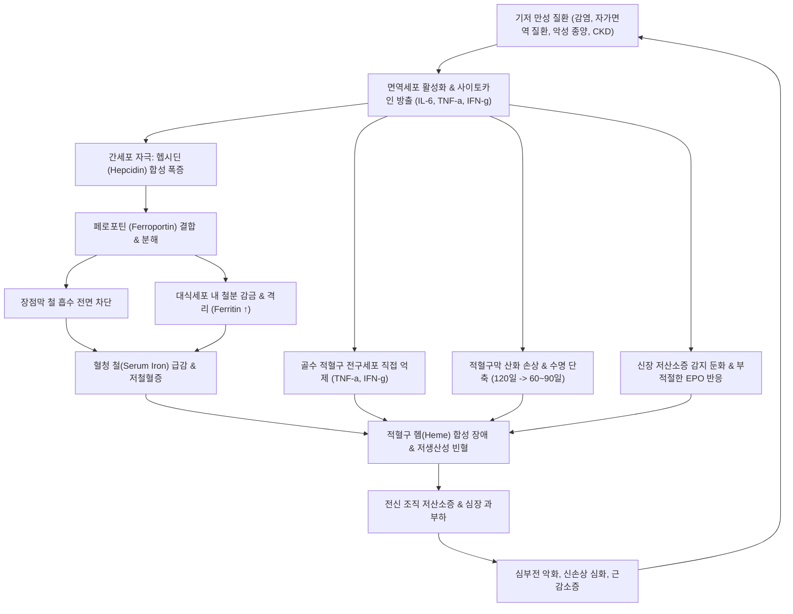

# 🩺 만성질환에 의한 빈혈 (Anemia of Chronic Disease / 慢性疾患貧血, ICD-10: D63.0 / D63.8)

> **핵심 3줄 요약 (Key Summary)**:
> - 📍 **병소 부위 & 병태생리**: 만성 감염, 자가면역 질환, 악성 종양, [[만성 콩팥병]] 등 지속적인 전신 염증 반응에 의해 유발되는 빈혈. 전염증성 사이토카인([[인터루킨-6]], [[종양괴사인자-알파]], 인터페론-감마)의 자극으로 간에서 [[헵시딘]] 합성이 폭증하여 [[페로포틴]]을 분해함으로써 장관 철 흡수를 차단하고 대식세포 내에 철분을 강제 격리(Iron sequestration)시켜 골수 조혈을 억제함.
> - 🚩 **전형적 임상 양상 & 3대 징후**: 서서히 진행하는 만성 피로, 무기력감, 운동성 호흡곤란과 함께 기저 만성 염증 질환의 증상(미열, 체중 감소, 관절통, 만성 기침 등)이 전면에 나타남. 전형적으로 정구성 정색소성(초기~중기) 또는 경미한 소구성 저색소성(만성기) 양상을 보임.
> - 🛠️ **핵심 감별 & 한·양방 치료 전략**: 혈청 철(Fe) 감소, 총철결합능(TIBC) 감소, 혈청 페리틴(Ferritin) 정상 또는 상승(급성기 반응물질), sTfR/log Ferritin < 1.0으로 [[철결핍 빈혈]]과 감별. 기저 질환의 적극적 치료가 제1원칙이며, 필요 시 정맥 철분제 및 에리스로포이에틴(EPO) 제제를 활용함. 한의학적으로 구병치허(久病致虛), 음허내열(陰虛內熱), 비신양허(脾腎兩虛)로 변증하여 [[귀비탕]], [[자신환]], [[청열조습탕]], [[보중익기탕]]을 단계별로 병용 투여함.
> - <font color="#fa7e7e">⚠️ **응급 의뢰 레드플래그**: 헤모글로빈 < 6.5~7.0 g/dL의 급격한 하강, 안정 시 흉통 및 심근 허혈 증상(심근경색 징후), 급성 호흡곤란, 원인 불명의 급격한 체중 감소 및 림프절 종대(숨은 악성 림프종/종양 의심), 고열을 동반한 패혈증 소견 즉각 상급병원 의뢰.</font>

---

## 📌 목차
1. [질환 개요 & 병태생리 (Disease Overview)](#1-질환-개요--병태생리-disease-overview)
2. [병태생리 메커니즘 & 대사·장기부전 악순환 네트워크](#2-병태생리-메커니즘--대사장기부전-악순환-네트워크)
3. [임상 증상 & 환자 소견 (Clinical Presentation)](#3-임상-증상--환자-소견-clinical-presentation)
4. [감별 진단 매트릭스 (Differential Diagnosis)](#4-감별-진단-매트릭스-differential-diagnosis)
5. [한의 통합 치료 프로토콜 (침·약침·한약)](#5-한의-통합-치료-프로토콜-침약침한약)
6. [양방 치료 & 병용·의뢰 기준 (Conventional Treatment & Referral)](#6-양방-치료--병용의뢰-기준-conventional-treatment--referral)
7. [식이·생활습관 & 자가관리 티칭 가이드](#7-식이생활습관--자가관리-티칭-가이드)
8. [💡 진료실 핵심 필기 & 임상 노하우](#8--진료실-핵심-필기--임상-노하우)
9. [출처 및 학술 참고 문헌 (References)](#9-출처-및-학술-참고-문헌-references)

---

## 1. 질환 개요 & 병태생리 (Disease Overview)

* **질환 정의 및 임상적 분류**:
  * 만성질환에 의한 빈혈(Anemia of Chronic Disease, ACD), 또는 현대 분자생물학적으로 **염증성 빈혈(Anemia of Inflammation, AI)**은 체내에 1~2개월 이상 지속되는 만성 감염증, 만성 전신성 자가면역 질환, 악성 종양, 혹은 만성 장기부전([[만성 콩팥병]], 심부전, 만성 간질환 등)에 동반되어 발생하는 조혈 저생산성 빈혈이다.
  * 전 세계적으로 [[철결핍 빈혈]](Iron deficiency anemia, IDA)에 이어 **두 번째로 높은 유병률**을 차지하며, **입원 환자 및 만성 질환자, 노인 인구에서는 가장 흔하게 발생하는 빈혈** 형태이다.
  * 초기 및 대다수(약 70~80%)의 환자에서는 적혈구의 크기와 색소 함량이 정상적인 **정구성 정색소성 빈혈(normocytic normochromic anemia, MCV 80~100 fL)**로 나타나지만, 기저 염증이 수개월 이상 지속되어 철분의 세포외 방출 차단이 극에 달하면 약 20~30%의 환자에서는 경미한 **소구성 저색소성 빈혈(microcytic hypochromic anemia, MCV 72~80 fL)**로 이행하여 순수 철결핍 빈혈과의 감별이 임상적 난제가 된다.

* **관련 장기 및 조직 계통**:
  * **주 이환 장기**:
    * [[간]](Liver): 전신 철 대사의 총사령관인 펩타이드 호르몬 [[헵시딘]](Hepcidin)을 합성하고 분비하는 핵심 장기.
    * 세망내피계(Reticuloendothelial system, RES): 노화 적혈구를 탐식하고 철분을 보관하는 [[비장]] 대식세포 및 간의 쿠퍼세포(Kupffer cell).
    * [[골수]](Bone marrow): 적혈구모세포(Erythroblast)의 분화 및 증식이 일어나는 조혈 미세환경.
    * 십이지장 및 근위부 공장(Duodenum & Jejunum): 식이 철분의 장관 흡수가 일어나는 장점막 상피세포.
  * **연관 사이토카인 및 대사 조절 인자**:
    * [[인터루킨-6]](IL-6): 간세포 표면의 IL-6 수용체 및 gp130에 결합하여 JAK/STAT3 신호 전달계를 통해 헵시딘 유전자(HAMP) 발현을 직접적으로 폭증시키는 핵심 매개체.
    * [[종양괴사인자-알파]](TNF-α) 및 인터페론-감마(IFN-γ): 대식세포와 활성화된 T림프구에서 분비되어 골수 적혈구계 전구세포(BFU-E, CFU-E)의 세포자멸사를 촉진하고 [[에리스로포이에틴]](EPO) 반응성을 차단함.
    * [[페로포틴]](Ferroportin-1, FPN1): 인체 포유류 세포에서 철분을 세포 밖으로 방출할 수 있는 유일한 통로 단백질.
  * **합병증 표적 장기**:
    * [[심장]]: 만성적인 헤모글로빈 저하로 인한 산소 운반능 저하를 보상하기 위해 심박출량이 증가하면서 좌심실 비대, 심근 리모델링 및 빈혈 유발성 울혈성 심부전 악화.
    * 근골격계: 조직 저산소증과 만성 염증성 근감소증(Sarcopenia)의 결합으로 인한 보행 장애 및 낙상 위험 증가.
    * [[신장]]: 신혈류 저산소증으로 인한 신세뇨관 간질 손상 악화.

---

## 2. 병태생리 메커니즘 & 대사·장기부전 악순환 네트워크

```
[ASCII 분자 병태생리 도해: 만성 염증성 사이토카인 폭풍과 헵시딘-철 격리 축]

========================================================================================
[기저 만성 질환]
 만성 감염 (결핵, 골수염) / 자가면역 ([[류마티스 관절염]], [[루푸스]]) / 악성 종양 / [[만성 콩팥병]]
       │
       ├─→ 면역세포(대식세포, T세포) 지속 활성화 ──→ [전염증성 사이토카인 대량 방출]
       │         │
       │         ├───────────────────────────────┬───────────────────────────────┐
       │         ▼                               ▼                               ▼
       │     [[인터루킨-6]] (IL-6)           [[종양괴사인자-알파]] (TNF-α)     인터페론-감마 (IFN-γ)
       │         │                               │                               │
       │         ▼                               └───────────────┬───────────────┘
       │   [간세포 (Hepatocyte)]                                 ▼
       │   IL-6R 결합 ──→ JAK/STAT3 활성화              [골수 적혈구계 조혈 억제]
       │   HAMP 유전자 전사 폭증 ──→ [헵시딘 (Hepcidin) 대량 분비]   - EPO 수용체 발현 억제
       │         │                                      - BFU-E / CFU-E 세포자멸사 유도
       │         ▼                                      - 적혈구 수명 단축 (120일→60일)
       │   [표적 단백: 페로포틴 (Ferroportin-1)]
       │   헵시딘이 페로포틴에 결합 ──→ 내재화(Internalization) 및 리소좀 분해
       │         │
       ├─────────┴───────────────────────────────┐
       ▼                                         ▼
 [십이지장 장세포 (Enterocyte)]            [세망내피계 대식세포 (Macrophage)]
 식이철(Fe2+) 흡수 후 혈관 방출 차단       노화 적혈구 분해 후 철분 방출 차단
 ──→ 장세포 탈락 시 대변으로 소실          ──→ 대식세포 내 페리틴(Ferritin)에 강제 격리!
       │                                         │
       └─────────────────┬───────────────────────┘
                         ▼
        [혈청 순환 철(Serum Iron) 급감 ──→ 저철혈증 (Hypoferremia)]
                         │
                         ▼
        [골수 적혈구모세포의 기능적 철 결핍 (Functional Iron Deficiency)]
        골수에 철분 공급 차단 ──→ 헴(Heme) 합성 불가 ──→ 적혈구 생산 급감
                         │
                         ▼
        [만성질환에 의한 빈혈 (ACD / AI) 발생 및 진행]
========================================================================================
```



### 1) 분자·세포 수준 기전
* **헵시딘-페로포틴 축의 교란과 철 격리(Iron Sequestration)**:
  * 인체의 철 대사는 철분의 배설을 조절하는 능동적 경로가 없으므로 오직 장관 흡수와 세망내피계 재활용의 관문인 **[[페로포틴]](Ferroportin-1)**의 개폐에 의해 조절된다.
  * 정상 상태에서는 비장과 간의 대식세포가 매일 2000억 개 이상의 수명을 다한 노화 적혈구를 탐식하여 헴 산화효소(Heme oxygenase-1)를 통해 헤모글로빈으로부터 약 20~25 mg의 철분을 회수하고, 이를 페로포틴을 통해 혈액으로 방출하여 트랜스페린(Transferrin)에 실어 골수로 보낸다.
  * 만성 염증 상태에서는 T림프구와 단핵구에서 대량 방출된 [[인터루킨-6]](IL-6)이 간세포의 IL-6R-gp130 수용체 복합체를 자극하여 야누스 키나아제(JAK)를 매개로 STAT3의 인산화와 이량체화를 유발하고, 이것이 핵 내 HAMP(Hepcidin antimicrobial peptide) 유전자 프로모터의 STAT-결합 부위에 결합하여 헵시딘 합성을 수십 배로 급증시킨다.
  * 혈중으로 분비된 헵시딘은 십이지장 상피세포 기저측막과 대식세포 세포막에 존재하는 페로포틴의 세포외 루프(Cysteine 326 부위)에 직접 결합한다. 이는 페로포틴의 유비퀴틴화(Ubiquitination), 세포내 함입(Endocytosis), 그리고 리소좀(Lysosome) 내에서의 단백질 분해를 촉발한다.
  * 그 결과, 장관을 통한 철분 흡수가 전면 차단될 뿐만 아니라 대식세포가 회수한 철분이 세포 밖으로 빠져나가지 못하고 세포질 내 저장단백질인 페리틴(Ferritin)에 갇히게 된다(철 격리 현상). 따라서 체내 총 저장철은 충분하거나 오히려 과잉 상태임에도 불구하고, 혈액 순환계와 골수 조혈 미세환경은 극심한 철분 결핍에 시달리는 **기능적 철 결핍(Functional Iron Deficiency)** 상태에 빠지게 된다.
* **골수 조혈계에 대한 사이토카인의 직접적인 억제 작용**:
  * [[종양괴사인자-알파]](TNF-α)와 인터페론-감마(IFN-γ)는 골수 내 적혈구계 전구세포(BFU-E, CFU-E) 표면의 수용체에 결합하여 Fas 리간드 발현을 유도하고 Caspase-3 및 Caspase-8 활성화를 통해 적혈구모세포의 조기 세포자멸사(Apoptosis)를 유도한다.
  * 또한 이들 사이토카인은 적혈구 전구세포 표면의 EPO 수용체(EPOR) 하류 신호전달 물질인 GATA-1 전사인자의 활성을 억제하여 헤모글로빈 합성을 억제한다.
  * 정상적인 빈혈 상태에서는 헤모글로빈이 저하되면 신장의 산소분압 감지에 의해 EPO 분비가 기하급수적으로 폭증해야 하지만, 만성 염증 환자에서는 전염증성 사이토카인(IL-1β, TNF-α)이 신장의 신세뇨관주위 세포에서 직접 활성산소종(ROS)을 발생시켜 GATA-2를 활성화함으로써 HIF 유도성 EPO 유전자 전사를 억제하여 **빈혈의 중증도에 비해 턱없이 부족한 수준의 부적절한 EPO 반응(Blunted EPO production)**을 초래한다.
* **적혈구 수명의 단축(Shortened Erythrocyte Survival)**:
  * 만성 염증 환자의 전신 순환계 내 높은 산화 스트레스와 유리 라디칼은 정상 적혈구의 세포막 지질 과산화와 스펙트린(Spectrin) 등 골격 단백질의 변성을 유발한다.
  * 변성된 적혈구는 세포막의 포스파티딜세린(Phosphatidylserine)이 외층으로 노출되어 비장 세망내피계 대식세포의 스캐빈저 수용체(Scavenger receptor)에 의해 조기에 이물질로 인식되어 탐식된다.
  * 이로 인해 정상 적혈구의 수명인 120일이 60~90일 수준으로 25~50% 단축되며, 골수 조혈 억제 상태와 맞물려 빈혈이 급속도로 심화된다.

### 2) 장기·계통 수준 결과 및 대사 악순환 네트워크
* **심-신-빈혈 증후군(Cardio-Renal-Anemia Syndrome, CRAS)**:
  * 만성 콩팥병(CKD) 또는 만성 심부전(CHF) 환자에서 염증성 사이토카인 증가 → 헵시딘 상승 및 기능적 철 결핍 → 빈혈 발생.
  * 빈혈 발생 → 심근 산소 공급 부족 및 심박출량 요구 증가 → 교감신경계 및 RAAS 과활성화 → 좌심실 비대 및 신혈류 감소.
  * 신혈류 감소 → 신장 허혈 심화, 신기능 악화, 내인성 EPO 합성 능력 완전 상실 → 빈혈 악화.
  * 세 질환이 상호 작용하여 심부전 입원율과 심혈관 사망률을 기하급수적으로 증폭시키는 치명적인 악순환 루프를 형성함.
* **감염에 대한 진화론적 생체 방어의 대가**:
  * 병원성 세균(예: *Mycobacterium tuberculosis*, *Staphylococcus aureus* 등)과 악성 종양 세포의 증식에는 필수적인 조효소로서 철분(Iron)이 반드시 필요하다.
  * 인체 면역계는 진화적으로 침입한 미생물이나 암세포로부터 철분을 빼앗기 위해(Nutritional immunity) IL-6-헵시딘 축을 가동하여 혈청 철분을 최저치로 떨어뜨려 대식세포 내에 감금하도록 설계되었다.
  * 그러나 이 방어 기전이 수주~수개월 이상 만성적으로 지속되면 숙주 자신의 조혈계가 철분 결핍으로 파괴되어 심각한 빈혈과 장기부전을 초래하는 '면역의 역설'이 발생한다.

### 3) 위험인자와 기저 질환군
1. **만성 감염성 질환**:
   * 결핵(Pulmonary/Extrapulmonary Tuberculosis), 아급성 세균성 심내막염(SBE), 만성 골수염(Osteomyelitis), 폐농양, 만성 요로감염, HIV/AIDS 감염.
2. **자가면역 및 전신 염증 질환**:
   * [[류마티스 관절염]](Rheumatoid Arthritis), [[전신 홍반성 루푸스]](SLE), 강직성 척추염, 성인 스틸병(Adult-onset Still's disease), 전신경화증, 염증성 장질환([[크론병]], [[궤양성 대장염]]).
3. **악성 종양(Malignancy)**:
   * 호지킨 및 [[비호지킨 림프종]], [[다발 골수종]], 백혈병, 고형암(폐암, 대장암, 유방암, 신세포암, 위암 등).
4. **만성 장기부전 및 기타**:
   * [[만성 콩팥병]](CKD Stage 3~5), 만성 심부전, 만성 폐쇄성 폐질환(COPD), 알코올성/비알코올성 만성 간경변증, 노화 관련 저등급 만성 염증(Inflammaging).

---

## 3. 임상 증상 & 환자 소견 (Clinical Presentation)

### 1) 주소증 및 핵심 증상
* **빈혈 자체의 증상 발현 양상**:
  * 만성질환에 의한 빈혈은 수주에서 수개월에 걸쳐 매우 서서히 진행되므로 신체가 순환 혈류량의 재분배 및 2,3-DPG 증가에 따른 산소 해리 곡선 우측 이동으로 적응하여, 헤모글로빈이 8~9 g/dL 수준으로 낮음에도 불구하고 환자가 호소하는 자각 증상이 경미할 수 있다.
  * **핵심 증상**: 지속적인 만성 피로(Chronic fatigue), 무기력감, 일상적인 보행이나 계단 오르기 시의 운동성 호흡곤란, 현기증 및 기립성 어지럼증, 집중력 저하, 기억력 감퇴, 추위 민감증(Cold intolerance).
* **기저 원인 질환의 증상 우세**:
  * 대부분의 환자에서는 빈혈 증상보다 기저 만성 질환의 증상이 진료실 주소증을 지배한다.
  * 류마티스 질환: 다발성 관절통, 조조강직(Morning stiffness), 레이노 현상.
  * 감염 및 종양 질환: 원인 모를 미열(Low-grade fever), 야간 발한(Night sweats), 식욕 부진, 수개월간 10% 이상의 비의도적 체중 감소.
  * 신장 질환: 전신 부종, 핍뇨, 거품뇨, 요독성 소양증.

### 2) 객관적 소견 (Signs & Labs)
* **신체 진찰 소견 (Physical Examination)**:
  * 안검 결막 창백(Conjunctival pallor) 및 구강 점막 창백: 경등도 빈혈에서는 뚜렷하지 않을 수 있으나 Hb < 9 g/dL 이하에서 확연해짐.
  * 결절 및 림프절 진찰: 경부, 쇄골상와, 액와부의 림프절 비대(Lymphadenopathy, 악성 림프종 또는 결핵 시사).
  * 관절 진찰: 손가락 PIP/MCP 관절의 대칭성 부종 및 압통(류마티스 관절염).
  * 피부 진찰: 만성 염증성 건조증, 피부 궤양, 결절성 홍반.
  * 심혈관 진찰: 경미한 빈맥, 맥압 증가, 심첨부 기능성 수축기 잡음.
* **임상병리 검사 수치 매트릭스 (철결핍성 빈혈과의 비교)**:

| 검사 항목 | 만성질환에 의한 빈혈 (ACD / AI) | 철결핍성 빈혈 (IDA) | ACD + IDA 복합 혼재형 | 정상 참고치 |
| :--- | :--- | :--- | :--- | :--- |
| **Hb (헤모글로빈)** | 8.0 ~ 10.5 g/dL (드물게 <8) | 경증부터 극심한 저하 (<6 가능) | 현저한 저하 (<8.0 g/dL 흔함) | 남 13~18, 여 12~16 g/dL |
| **MCV (평균적혈구용적)** | **정상 (80~100 fL, 75%)** / 경미 감소 (25%) | **현저한 감소 (<80 fL, 소구성)** | **감소 (<80 fL)** | 80 ~ 100 fL |
| **MCH / MCHC** | 정상 또는 경미 감소 | 현저한 감소 (저색소성) | 현저한 감소 | 27~33 pg / 32~36% |
| **망상적혈구 지수 (RPI)** | **<1.0 ~ 1.5 (조혈 저생산성)** | <1.0 (철분 결핍성 조혈 정체) | <1.0 | 1.0 (정상 조혈 반응) |
| **혈청 철 (Serum Iron)** | **감소 (<50 ug/dL)** | **현저한 감소 (<30 ug/dL)** | 현저한 감소 (<30 ug/dL) | 60 ~ 170 ug/dL |
| **TIBC (총철결합능)** | **감소 (<250 ug/dL)** (음성 급성기 반응) | **증가 (>360~400 ug/dL)** | 정상 또는 경미 감소 | 250 ~ 400 ug/dL |
| **트랜스페린 포화도 (TSAT)** | 정상 또는 경미 감소 (15~25%) | **현저한 감소 (<15~16%)** | **현저한 감소 (<16%)** | 20 ~ 50 % |
| **혈청 페리틴 (Ferritin)** | **정상 또는 증가 (>100~500 ng/mL)** | **현저한 고갈 (<15~30 ng/mL)** | **애매한 수치 (30~100 ng/mL)** | 30 ~ 300 ng/mL |
| **가용성 트랜스페린 수용체 (sTfR)** | **정상 (염증에 반응 안 함)** | **현저한 증가 (철 고갈 반영)** | **증가** | 0.8 ~ 2.2 ug/mL |
| **sTfR / log Ferritin Index** | **< 1.0 (순수 염증성)** | **> 2.0 (철 결핍 확진)** | **> 1.5 ~ 2.0** | < 1.0 |
| **혈청 헵시딘 (Hepcidin)** | **현저한 증가** | 결핍 또는 극저하 | 중간 또는 경미 상승 | 10 ~ 80 ng/mL |
| **염증 지표 (CRP / ESR)** | **현저한 상승 (CRP > 10 mg/L)** | 대개 정상 범위 | **현저한 상승** | CRP < 5 mg/L, ESR < 20 mm/hr |
| **골수 검사 (Perls' 프러시안 블루)** | 대식세포 내 철분 과다 / 철적아구 감소 | 대식세포 및 철적아구 모두 고갈 | 대식세포 내 철분 존재 / 철적아구 고갈 | 양자 모두 정상 존재 |

---

## 4. 감별 진단 매트릭스 (Differential Diagnosis)

| 감별 질환 | 병태생리 핵심 차이 | MCV / MCHC | 혈청 Ferritin | TIBC / 트랜스페린 | sTfR / 염증 수치 | 감별 확진 포인트 |
| :--- | :--- | :--- | :--- | :--- | :--- | :--- |
| **[[만성질환에 의한 빈혈]] (ACD)** | IL-6 자극 헵시딘 상승으로 대식세포 철 격리 및 조혈 억제 | 정상 (80%) 또는 경미 소구성 | **정상 또는 상승 (>100)** | **감소 (<250)** | sTfR 정상 / **CRP·ESR 현저한 상승** | 기저 만성 염증 질환 존재, 철분 투여 시 반응 없음 |
| **[[철결핍 빈혈]] (IDA)** | 섭취 부족, 흡수 장애 또는 만성 출혈로 체내 절대적 철 고갈 | **현저한 소구성 / 저색소성** | **현저한 고갈 (<15~30)** | **현저한 증가 (>380)** | **sTfR 현저한 증가** / CRP 정상 | 출혈원 존재(생리, 궤양), 철분 투여 시 Hb 극적 회복 |
| **복합형 빈혈 (ACD + IDA)** | 만성 염증 환자에서 위장관 출혈 또는 장질환으로 철결핍 동반 | 소구성 저색소성 | 중간치 (30~100) | 정상 또는 경미 저하 | **sTfR 상승, Index >1.5** | 골수 생검 또는 정맥 철분제 시험적 투여 후 반응 관찰 |
| **[[만성 콩팥병]] 신성 빈혈** | 신세뇨관주위 세포 섬유화로 인한 절대적 EPO 합성 결핍 | 정상세구성 정색소성 | 정상 또는 치료로 상승 | 정상 또는 경미 저하 | sTfR 정상 / BUN·Cr 상승, eGFR <60 | 혈청 에리스로포이에틴(EPO) 농도가 빈혈 대비 결핍 |
| **[[골수이형성증후군]] (MDS)** | 조혈모세포의 클론성 돌연변이로 인한 비효율적 조혈 | **대구성 (MCV >100) 흔함** | 증가 | 정상 | sTfR 정상 / 염증 수치 정상 | 말초혈액 도말상 이형성(Pelger-Huet), 골수 염색체 이상 |
| **지중해빈혈 소질 (Thalassemia minor)** | 글로빈 사슬(알파 또는 베타) 유전적 합성 결함 | **극심한 소구성 (MCV <70)** | 정상 또는 증가 | 정상 | sTfR 정상 / 멘처 지수(Mentzer) <13 | 가족력, 헤모글로빈 전기영동상 HbA2 >3.5% 또는 유전자 검사 |

> 🚩 **레드플래그 감별 (응급 및 전문과 의뢰 트리거)**:
> 1. 헤모글로빈 수치가 6.5~7.0 g/dL 이하로 급격히 떨어지는 경우 (순수 ACD에서는 드물며, 급성 내출혈, 용혈 또는 중증 골수 침범 의심).
> 2. 고열, 오한, 저혈압을 동반한 중증 전신 패혈증 상태.
> 3. 빈혈과 함께 원인 불명의 백혈구 감소증 또는 혈소판 감소증이 동반되는 범혈구감소증(Pancytopenia) 소견 (급성 백혈병, [[재생 불량성 빈혈]], 혈구탐식성 림프조직구증 HLH 의심).
> 4. 무통성 림프절 종대, 비장 비대, 뼈 통증(Bone pain), 고칼슘혈증을 동반한 경우 ([[다발 골수종]], 림프종 배제 필요).

---

## 5. 한의 통합 치료 프로토콜 (침·약침·한약)

* **한의학적 병기(病機) 및 변증 체계**:
  * 만성질환에 의한 빈혈은 전통 의학의 **허로(虛勞)**, **혈허(血虛)**, **구병치허(久病致虛)**의 범주에 속한다.
  * 오랜 만성 염증성 질환(관절통, 만성 해수, 종양 등)을 앓으면서 사기(邪氣)가 머물러 열(熱)을 발생시키고 음혈(陰血)을 갉아먹는 **구병상음(久病傷陰)** 및 **음허내열(陰虛內熱)** 상태가 지속된다.
  * 동시에 질병이 오래되면 비위의 운화 기능이 실조되어 후천의 기혈을 생화(生化)하지 못하고, 정혈(精血)을 주관하는 신장(腎臟)까지 손상되어 **비신양허(脾腎兩虛)** 및 **신정부족(腎精不足)**의 골수 고갈 상태에 이른다.
  * 또한 만성 염증 독소와 대사 노폐물이 기혈 순환을 정체시켜 **습열교저(濕熱膠阻)**와 **어혈내조(瘀血內阻)**가 병태생리의 기저를 형성한다.

```
[만성 염증성 빈혈의 한의 병전도 및 변증별 치료 경로]

  [원인: 만성 염증 사기(邪氣) 정체]
              │
              ├─→ 사열(邪熱)이 머물러 음혈을 손상 ────→ [음허내열 (陰虛內熱)]
              │                                           치법: 자음청열 (滋陰淸熱), 양혈생혈 (養血生血)
              │                                           처방: 청호별갑탕, [[사물탕]] 가 지모·황백
              │
              ├─→ 병이 오래되어 장부가 쇠약해짐 ────→ [구병치허 (久病致虛) / 기혈양허 (氣血兩虛)]
              │                                           치법: 익기보혈 (益氣補血), 건비양심 (健脾養心)
              │                                           처방: [[귀비탕]], [[팔진탕]]
              │
              ├─→ 골수와 정혈(精血)이 고갈됨 ──────→ [비신양허 (脾腎兩虛) / 신정부족 (腎精不足)]
              │                                           치법: 온보비신 (溫補脾腎), 자신익정 (滋腎益精)
              │                                           처방: [[자신환]], 육미지황탕 합 녹용
              │
              └─→ 염증 노폐물과 습열이 엉킴 ────────→ [습열교저 (濕熱膠阻)]
                                                          치법: 청열조습 (淸熱燥濕), 활혈소독 (活血消毒)
                                                          처방: [[청열조습탕]] 가감
```

### 1) 변증 분류 및 감별
1. **구병치허(久病致虛) / 기혈양허(氣血兩虛)**:
   * 임상 양상: 수개월 이상의 만성 질환 경과, 면색위황(얼굴빛이 누렇고 윤기가 없음), 전신 권태, 피로, 기단(숨이 참), 심계, 현훈, 설담태백, 맥세약무력(細弱無力).
   * 치법: 익기보혈(益氣補血), 양혈건비(養血健脾).
2. **음허내열(陰虛內熱) / 조열상음(潮熱傷陰)**:
   * 임상 양상: 오후 미열(Low-grade fever), 오심번열(손발바닥과 가슴이 화끈거림), 도한(도둑땀), 구건인조, 관홍(광대뼈 부위 붉어짐), 설홍소태 또는 무태(無苔), 맥세삭(細數).
   * 치법: 자음청열(滋陰淸熱), 양혈자수(養血滋水).
3. **비신양허(脾腎兩虛) / 신정부족(腎精不足)**:
   * 임상 양상: 골수 조혈 기능이 극도로 둔화된 상태. 극심한 피로, 요슬산연(허리와 무릎이 시리고 힘이 없음), 외한지랭(추위를 몹시 탐), 식욕 부진, 소변청장 또는 야간뇨, 안면 및 하지 부종, 설담반변 유치흔, 맥침세무력.
   * 치법: 온보비신(溫補脾腎), 충정생혈(充精生血).
4. **습열교저(濕熱膠阻) / 어혈내조(瘀血內阻)**:
   * 임상 양상: 만성 감염이나 자가면역 질환의 활동기. 관절 종통, 신중(몸이 무거움), 흉민(가슴 답답함), 흉복부 자통, 피부 어반, 설암홍 또는 자어반, 설태 황니, 맥활삭(滑數) 또는 삽맥(澁脈).
   * 치법: 청열조습(淸熱燥濕), 활혈통락(活血通絡).

### 2) 침구 치료 프로토콜 (Acupuncture)
* **주혈(主穴)**:
  * 비수(BL20) · 신수(BL23): 후천지본(비위)과 선천지본(신장)을 동시에 다스려 골수 조혈과 정혈(精血) 생성을 촉진.
  * 간수(BL18): 간장혈(肝藏血) 기능을 보하여 순환 혈액량 조절.
  * 격수(BL17): 혈회(血會)로서 전신 혈액 생성을 정상화하고 어혈을 해소.
  * 대저(BL11): 골회(骨會)로서 골수(Bone marrow) 대사를 주관하여 적혈구계 조혈을 자극.
  * 족삼리(ST36) · 삼음교(SP6): 중초의 수곡정미 흡수 증진 및 비·간·신 삼음경의 조화.
  * 관원(CV4) · 기해(CV6): 원기를 기르고 하초의 단전을 온양.
  * 태계(KI3): 신원(腎原)을 보하여 신정(腎精) 부족을 보충.
* **변증 배혈(配穴)**:
  * 음허내열: 복류(KI7), 태충(LR3), 지골피 혈위, 음곡(KI10).
  * 습열교저: 곡지(LI11), 음릉천(SP9), 풍륭(ST40).
  * 비신양허 부종: 수분(CV9), 음릉천(SP9), 비수(BL20).
* **자침 기법 및 전침 요법**:
  * 비수, 신수, 족삼리, 삼음교에 평보평사 또는 보법 자침.
  * **전침(Electroacupuncture)**: 비수-신수, 또는 족삼리-삼음교에 저주파(2 Hz) 연속파를 20분간 적용. 저주파 전침 자극은 골수 내 교감신경 말단과 엔도르핀 시스템을 자극하여 미세혈류를 개선하고 골수 조혈 미세환경의 사이토카인 불균형을 교정하는 것으로 보고됨.
  * 온구 요법: 비신양허 환자의 신수(BL23), 관원(CV4)에 간접구(뜸봉)를 15분간 시행. 단, 음허내열 및 습열 환자에게는 뜸을 금기함.

### 3) 약침 치료 프로토콜 (Pharmacopuncture)
* **약침 제제 선택**:
  * **자하거(Hominis Placenta) 약침**: 태반 유래의 풍부한 펩타이드, 아미노산 및 생체 활성 인자를 함유하여 골수 적혈구계 전구세포의 증식을 자극하고, 전염증성 사이토카인(IL-6, TNF-α) 분비를 억제하여 헵시딘 발현을 낮추는 면역 조절 효과가 탁월함.
  * **황련해독탕(黃連解毒湯) 약침 또는 황백(Phellodendri Cortex) 약침**: 음허내열 및 습열 환자에서 전신 염증 반응을 억제하고 혈청 CRP를 낮추기 위해 적용.
  * **신수(BL23) 및 격수(BL17) 약침 치료**:
    * 자하거 약침을 양측 신수(BL23), 비수(BL20), 격수(BL17), 족삼리(ST36)에 각각 0.1~0.2 mL씩 총 1.0~1.5 mL 주입 (주 2회, 8주간 지속).

### 4) 한약 처방 프로토콜 (Herbal Medicine)
* **구병치허 및 기혈양허 (만성 소모기 기본방)**:
  * `[[귀비탕]](歸脾湯)`: [[당귀]], [[황기]], [[인삼]], [[백출]], [[복령]], 산조인, 용안육, 원지, 목향, 감초, 생강, 대조. 심비(心脾)를 쌍보하고 만성 염증으로 인한 스트레스 반응과 조혈 결손을 동시에 치료.
  * `[[팔진탕]](八珍湯)` 가미: [[사물탕]]([[숙지황]], [[백작약]], [[당귀]], [[천궁]]) 합 `[[사군자탕]]([[인삼]], [[백출]], [[복령]], [[감초]])에 녹용, 아교를 가미하여 골수 조혈을 강력히 지지.
* **음허내열 및 만성 미열·염증 지속기 (자음청열)**:
  * `청호별갑탕(淸蒿鼈甲湯)` 또는 `[[사물탕]] 가 지모·황백·은시호·별갑`: 만성 결핵, 자가면역 질환에서 골증조열(骨蒸潮熱)이 있고 혈침(ESR)이 상승한 환자의 염증성 사이토카인을 사화(瀉火)하여 간세포의 헵시딘 합성을 억제함.
* **비신양허 및 골수 저생산기 (자신익정)**:
  * `[[자신환]](滋腎丸, 通關丸)` 합 육미지황탕: 황백 12g, 지모 12g, 육계 2g으로 구성된 자신환은 신음(腎陰)을 자양하면서 하초의 허화(虛火)를 내리고(지모, 황백), 극소량의 육계로 신양(腎陽)을 점화하여 "음중구양(陰中求陽)"의 조혈 환경을 복구함. 가 파극천, 구기자, 산수유, [[녹용]].
* **습열교저 및 염증 활성기 (청열조습)**:
  * `[[청열조습탕]](淸熱燥濕湯)` 가감: [[황련]], [[황금]], [[황백]], [[창출]], [[후박]], [[복령]], 택사, 의이인. 활성화된 류마티스 관절염이나 장염증 환자에서 습열 독소를 소변과 대변으로 배출시켜 혈관내피 손상을 막고 사이토카인 생성을 차단.
* **비위흡수장애 및 식욕부진 동반형**:
  * `[[보중익기탕]](補中益氣湯)` 가 사인, 맥아, 백신. 중초의 소화관 점막 위축을 개선하고 십이지장의 영양분 및 미량원소 흡수 능력을 극대화.

---

## 6. 양방 치료 & 병용·의뢰 기준 (Conventional Treatment & Referral)

### 1) 기저 원인 질환 치료의 대원칙 (Treat Underlying Disease)
* 만성질환에 의한 빈혈 치료의 가장 근본적이고 효과적인 방법은 **기저 만성 감염, 자가면역 질환 또는 악성 종양을 완벽히 통제하는 것**이다.
* 류마티스 관절염 환자에서 항-TNF 항체(Infliximab, Adalimumab) 또는 항-IL-6 수용체 항체(Tocilizumab) 생물학적 제제를 투여하여 관절 염증을 관해시키면, 수일 내에 혈청 헵시딘 수치가 정상화되고 수주 내에 추가적인 철분 투여 없이도 헤모글로빈이 2~3 g/dL 이상 저절로 상승 회복된다.

### 2) 약물 치료 및 철분 공급 전략
* **경구 철분제의 무효성과 투여 제한**:
  * 혈청 헵시딘이 높게 유지되는 순수 만성질환 빈혈 환자에게 경구 철분제(황산제일철 등)를 투여하는 것은 **원칙적으로 금기이거나 무효**하다.
  * 십이지장 상피세포의 페로포틴이 분해되어 내재화되어 있으므로 경구로 투여된 철분은 거의 흡수되지 못하고 장관 내에 잔류하여 오심, 위장관 경련, 극심한 변비 및 흑변 등의 부작용만 유발하며, 장내 유해균의 이상 증식을 부추긴다.
* **정맥 철분제(Intravenous Iron)의 역할**:
  * 적응증: 염증성 장질환(IBD), 만성 콩팥병(CKD), 암 환자에서 기능적 철 결핍(TSAT < 20% 이면서 Ferritin < 100~300 ng/mL)이 동반된 경우.
  * 기전: 고용량 정맥 철분제(Ferric carboxymaltose, Iron sucrose 등)는 나노입자 탄수화물 껍질에 둘러싸여 있어 혈관내피 손상 없이 세망내피계 대식세포와 간세포를 포화시키고, 헵시딘 차단벽을 일부 우회하여 트랜스페린으로 철분을 직접 공급하여 골수 조혈을 지원함.
  * **주의사항**: 전신성 활동성 세균 감염증(패혈증, 급성 폐렴, 화농성 관절염 등)이 진행 중일 때는 정맥 철분 투여가 세균의 병원성 증식을 폭발시킬 수 있으므로 감염이 완전히 조절될 때까지 정맥 철분 투여를 보류해야 함.
* **적혈구 조혈자극제 (Erythropoiesis-Stimulating Agents, ESA)**:
  * 제제: 에포에틴 알파(Epoetin alfa), 다르베포에틴 알파(Darbepoetin alfa).
  * 적응증: 주로 만성 콩팥병(CKD Stage 3~5D) 관련 신성 빈혈, 골수이형성증후군(MDS, 저위험군), 항암화학요법 유발 빈혈(CIA)에서 Hb < 10.0 g/dL 이하로 저하되었을 때 투여.
  * **치료 목표 수치 (FDA 및 KDIGO 가이드라인)**:
    * 목표 헤모글로빈: **10.0 ~ 11.5 g/dL**.
    * <font color="#fa7e7e">⚠️ **블랙박스 경고 (Black Box Warning)**: ESA를 과다 사용하여 헤모글로빈을 정상치(12.0~13.0 g/dL 이상)로 무리하게 올릴 경우 심혈관 혈전색전증, 뇌졸중, 심근경색 및 암 환자의 종양 진행 위험이 유의하게 증가하므로 엄격한 용량 조절이 필수적임.</font>
* **신규 표적 치료제 (HIF-PH 저해제 및 헵시딘 길항제)**:
  * **HIF 프롤릴 수산화효소 억제제(HIF-PH Inhibitors)**: 록사두스타트(Roxadustat), 바다두스타트(Vadadustat) 등. 경구 복용 약물로, 산소 감지 효소를 차단하여 HIF를 안정화시킴으로써 신장의 내인성 EPO 생성을 생리적으로 유도하는 동시에 간의 헵시딘 발현을 억제하여 경구 철분의 장관 흡수와 세망내피계 재활용을 동시에 촉진함.

### 3) 한의 병용 판단 및 상호작용
* **청열해독약과 ESA/철분제의 병용 시너지**:
  * 만성 염증 상태에서 분비되는 IL-6와 TNF-α는 골수의 ESA 반응성을 떨어뜨려 고용량의 에포에틴을 투여해도 조혈 반응이 나타나지 않는 'ESA 저항성'을 유발한다.
  * 한약재 중 [[황금]](Scutellariae Radix, Baicalin 성분), [[황련]](Coptidis Rhizoma, Berberine 성분), [[지모]](Anemarrhenae Rhizoma) 등은 NF-κB 및 JAK/STAT3 경로를 차단하여 혈청 IL-6 농도를 낮추는 작용이 입증되어 있다.
  * 따라서 한양방 병용 시 한약의 전신 염증 억제 작용이 헵시딘을 강하시켜 ESA 저항성을 개선하고 정맥 철분제의 골수 전달 효율을 극대화할 수 있다.
* **투여 시 주의사항**:
  * 면역억제제(메토트렉세이트, 아자티오프린, 사이클로스포린)나 생물학적 제제를 복용 중인 자가면역 질환 환자에게 무조건적인 면역 증강 목적의 고용량 보양약([[녹용]], [[부자]], [[인삼]])을 남용하면 면역계의 이상 활성화를 유발할 수 있으므로, 반드시 변증에 근거하여 자음강화(滋陰降火) 및 건비익기(健脾益氣)를 위주로 배합해야 한다.

---

## 7. 식이·생활습관 & 자가관리 티칭 가이드

* **식이 지도 (Dietary Guidance)**:
  * **무분별한 고용량 경구 철분 보충제 복용 금지 티칭**:
    * 환자가 빈혈 진단을 받으면 시중의 철분 영양제를 임의로 대량 구매하여 복용하는 경우가 흔함.
    * 만성 염증성 빈혈에서는 장관의 흡수 문이 닫혀 있어(헵시딘 효과) 경구 철분제가 흡수되지 않고 위장 장애, 변비, 복통만 유발함을 명확히 설명하고 중단시킴.
  * **전신 항염증 식단 (Anti-inflammatory Diet)**:
    * 지중해식 식단(Mediterranean diet): 올리브유, 통곡물, 등푸른 생선(고등어, 연어 등 오메가-3 풍부), 신선한 채소. 오메가-3 지방산은 전염증성 에이코사노이드 합성을 억제하여 IL-6 생성을 낮춤.
    * 항산화 파이토케미컬 섭취: 베리류(안토시아닌), 토마토(라이코펜), 브로콜리(설포라판) 등 유리 라디칼에 의한 적혈구막 파괴를 방어.
  * **양질의 단백질 공급**:
    * 만성 소모성 질환으로 인한 근감소증과 적혈구 기질 단백질 결핍을 방지하기 위해 계란 흰자, 두부, 콩류, 흰살생선 등 생물가가 높은 단백질을 매 끼니 적정량 섭취.
* **생활습관 지도 (Lifestyle)**:
  * **피로 관리 및 에너지 보존 기법(Energy Conservation Techniques)**:
    * 일상생활의 활동을 우선순위에 따라 분배하고, 피로가 누적되기 전 15~20분간의 짧은 휴식을 계획적으로 배치.
  * **규칙적인 저강도 신체 활동**:
    * 과격한 무산소 운동은 체내 젖산 축적과 염증 사이토카인 일시적 분비를 조장하므로 금기.
    * 주 3~5회, 회당 20~30분 정도의 평지 걷기, 실내 자전거 타기, 가벼운 스트레칭은 조직 관류를 개선하고 골수 순환을 촉진함.
  * 감염 예방 위생:
    * 만성 염증 환자는 2차 감염 발생 시 헵시딘이 더욱 폭증하여 빈혈이 치명적으로 악화되므로 손 씻기, 독감 및 폐렴구균 백신 접종 철저.
* **환자 교육 스크립트**:
  * "환자분, 지금 혈액 검사에서 나타난 빈혈은 몸속에 철분이 부족해서 생긴 것이 아닙니다. 몸 안의 만성 염증(관절염/신장병/염증 질환) 때문에 간에서 '헵시딘'이라는 방어 경보 물질이 나와, 몸속의 철분을 창고(대식세포) 깊숙이 숨겨두고 문을 잠가버렸기 때문입니다. 그래서 피를 만드는 골수로 철분이 전달되지 못하고 있는 상태입니다. 따라서 억지로 철분약을 사서 드셔봤자 흡수도 안 되고 속만 쓰립니다. 지금 가장 중요한 것은 철분을 먹는 것이 아니라, 몸속의 만성 염증을 가라앉혀 창고 문을 열어주는 한의 치료와 기저 질환 치료를 병행하는 것입니다."

---

## 8. 💡 진료실 핵심 필기 & 임상 노하우

* **페리틴(Ferritin) 정상/상승의 위양성 함정 간파 노하우**:
  * 일반적인 철결핍 빈혈에서는 페리틴이 15~30 ng/mL 이하로 떨어지지만, 만성 염증 환자에서는 페리틴 자체가 강력한 **급성기 반응 단백질(Positive acute-phase reactant)**이다.
  * 만성 류마티스 관절염 환자가 실제로는 심각한 철 결핍을 동반하고 있더라도 혈청 페리틴 수치가 80~150 ng/mL로 정상 또는 상승되어 나타날 수 있다.
  * 따라서 염증이 있는 환자(CRP > 5 mg/L, ESR > 30 mm/hr)에서는 **페리틴의 철결핍 진단 기준을 100 ng/mL 이하로 대폭 상향**하여 해석해야 한다. 페리틴이 50 ng/mL라면 염증 환자에서는 사실상 완전한 철 결핍 상태로 간주한다.
* **sTfR / log Ferritin Index의 실전 적용**:
  * 가용성 트랜스페린 수용체(sTfR)는 세포 표면에서 철분을 받아들이는 수용체가 떨어져 나온 것으로, 염증 반응에 의해 수치가 변하지 않고 오직 **세포 내 진정한 철분 결핍 정도에만 비례하여 증가**한다.
  * `sTfR / log10(Ferritin)` 계산 공식:
    * **Index < 1.0**: 순수한 만성질환에 의한 빈혈 (ACD / AI).
    * **Index > 2.0**: 순수 철결핍성 빈혈 (IDA), 또는 만성질환 환자에서 철결핍이 동반된 복합형 빈혈(ACD + IDA).
    * 정맥 철분제 투여 여부를 결정하는 가장 결정적인 바이오마커이다.
* **한방 치료 시 선청열(先淸熱) 후보혈(後補血)의 치료 단계론**:
  * 만성 염증성 빈혈 환자에게 첫 진료부터 숙지황, 당귀, 아교, 녹용 등 기름지고 무거운 보혈보양제를 대량 처방하면, 비위 운화 기능이 마비되고 체내 염증(습열)을 조장하여 도리어 미열이 심해지고 피로감이 악화되는 부작용이 빈발한다.
  * **1단계 (청열소독·건비조습)**: 초기 2~4주간은 [[황금]], [[황련]], [[지모]], [[창출]], [[복령]] 등으로 구성된 처방([[청열조습탕]] 가감)을 사용하여 혈액 내 염증 사이토카인을 식히고 헵시딘을 하향 조절한다.
  * **2단계 (익기보혈·자신생혈)**: CRP가 안정되고 설태의 황니함이 걷히면 비로소 [[귀비탕]], [[자신환]], [[보중익기탕]]으로 전환하여 골수 조혈을 유도해야 부작용 없이 헤모글로빈을 상승시킬 수 있다.

---

## 9. 출처 및 학술 참고 문헌 (References)

1. **MSD 매뉴얼 전문가용** — 만성 질환 빈혈 (Anemia of Chronic Disease / Anemia of Inflammation). [링크](https://www.msdmanuals.com/professional/hematology-and-oncology/anemias-caused-by-deficient-erythropoiesis/anemia-of-chronic-disease)

2. Cheng J, Liu Y, Zhang H, et al. (2026). Animal models of anemia of inflammation: Methodological advances, limitations, and Translational applications. *Animal Model Exp Med*. 9(2):150-162. [PMID 42878149](https://pubmed.ncbi.nlm.nih.gov/42878149/).
   - **[연구 요약]**: 염증성 빈혈(Anemia of inflammation)의 다양한 동물 모델 구축 기법, 인터루킨-6 및 헵시딘-페로포틴 분자 경로의 한계점과 전임상에서 임상으로의 중개 연구 응용 전략을 종합적으로 정리함.

3. Fischer BG, Smith A, Johnson K, et al. (2026). Soluble Transferrin Receptor and the sTfR/Log Ferritin Index May Not Be Better Than Ferritin Alone for Diagnosis of Anemia of Chronic Disease and Iron Deficiency Anemia. *Am J Hematol*. 101(4):220-228. [PMID 42816117](https://pubmed.ncbi.nlm.nih.gov/42816117/).
   - **[연구 요약]**: 대규모 임상 코호트에서 만성질환 빈혈(ACD)과 철결핍 빈혈(IDA)의 감별 진단 시 가용성 트랜스페린 수용체(sTfR) 및 sTfR/log Ferritin 지수의 진단적 정확도와 임상적 유용성을 표준 혈청 페리틴 및 골수 검사와 비교 평가함.
