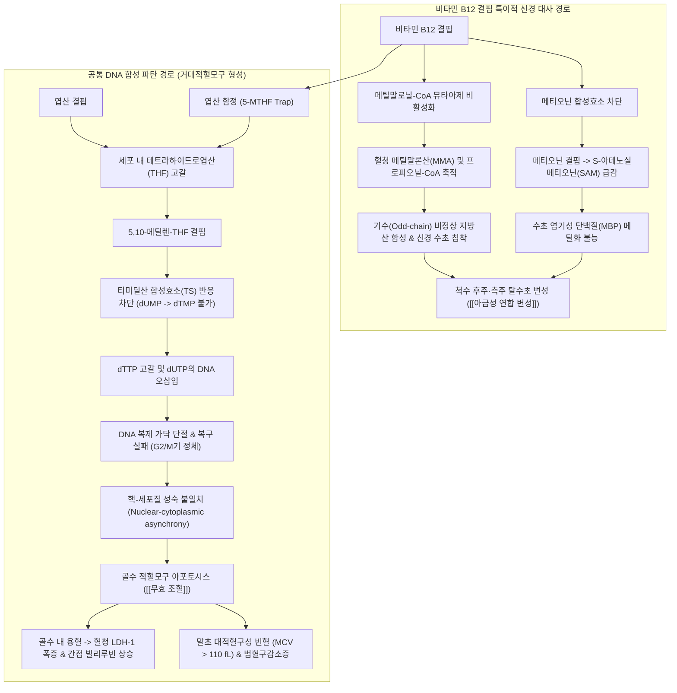

# 🩺 [[비타민 결핍 빈혈]] (Vitamin Deficiency Anemia / Megaloblastic Anemia / 維生素缺乏性貧血, ICD-10: D51-D53 / KCD: D51-D53)

> **핵심 3줄 요약 (Key Summary)**:
> - 📍 **병소 부위 & 병태생리**: [[골수]] 조혈계, 위장관 상피 점막, 중추 및 말초신경계([[척수]]). 비타민 B12([[코발라민]]) 또는 비타민 B9([[엽산]]) 결핍에 따른 티미딜산(dTMP) 합성 억제 및 DNA 복제 지연으로 유발되는 핵-세포질 성숙 불일치(Nuclear-cytoplasmic asynchrony)와 골수 내 무효 조혈(Ineffective erythropoiesis) 및 조기 세포사멸.
> - 🚩 **전형적 임상 양상 & 3대 징후**: 대적혈구성 빈혈(MCV > 100 fL, 흔히 > 110 fL)과 말초혈액도말상 과분엽 호중구(Hypersegmented neutrophil), 위점막 위축·위축성 설염(쇠고기색 혓바닥, Hunter's glossitis)과 경미한 레몬빛 [[황달]](무효 조혈로 인한 간접 빌리루빈·LDH 상승), 비타민 B12 결핍 특이적 척수 [[아급성 연합 변성]](Subacute combined degeneration of the spinal cord, SCD: 척수 후주·측주 탈수초에 따른 진동·위치감각 소실, 보행 실조, 대칭성 사지 감각이상, 인지 기능 저하).
> - 🛠️ **핵심 감별 & 한·양방 치료 전략**: 혈청 B12·엽산 수치 측정, [[호모시스테인]](B12·엽산 모두 상승) 및 [[메틸말론산]](MMA, B12 결핍 시만 특이적 상승) 감별, 항내인자항체·항벽세포항체([[악성 빈혈]]). 비타민 B12 비경구(근주)/경구 고용량 보충(⚠️ B12 결핍 환자에게 엽산 단독 투여 시 혈액학적 수치만 위장 개선되고 신경학적 손상이 영구화·비가역적으로 급속 악화되므로 절대 금기). 한의학적 [[혈허]](血虛)·[[비위기허]](脾胃氣虛)·[[간신부족]](肝腎不足) 변증에 따른 [[귀비탕]], [[사물탕가미]], [[인삼양영탕]], [[십전대보탕]] 및 [[족삼리]], [[삼음교]], [[비수]], [[신수]] 침구 치법.
> - <font color="#fa7e7e">⚠️ **응급 의뢰 레드플래그**: 급속 진행성 보행 실조 및 하지 마비([[아급성 연합 변성]] 진행 의심), 중증 범혈구감소증(Pancytopenia)에 동반된 패혈성 발열 또는 출혈 경향, 고박출성 심부전 및 협심증, 자가면역성 악성 빈혈 환자의 체중 감소 및 소화불량(위선암 및 위 신경내분비종양 발병 위험 2~3배 상승) 즉시 상급 병원 의뢰.</font>

---

## 📌 목차
1. [질환 개요 & 병태생리 (Disease Overview)](#1-질환-개요--병태생리-disease-overview)
2. [병태생리 메커니즘 & 대사·장기부전 악순환 네트워크](#2-병태생리-메커니즘--대사장기부전-악순환-네트워크)
3. [임상 증상 & 환자 소견 (Clinical Presentation)](#3-임상-증상--환자-소견-clinical-presentation)
4. [감별 진단 매트릭스 (Differential Diagnosis)](#4-감별-진단-매트릭스-differential-diagnosis)
5. [한의 통합 치료 프로토콜 (침·약침·한약)](#5-한의-통합-치료-프로토콜-침약침한약)
6. [양방 치료 & 병용·의뢰 기준 (Conventional Treatment & Referral)](#6-양방-치료--병용의뢰-기준-conventional-treatment--referral)
7. [식이·생활습관 & 자가관리 티칭 가이드](#7-식이생활습관--자가관리-티칭-가이드)
8. [💡 진료실 핵심 필기 & 임상 노하우](#8--진료실-핵심-필기--임상-노하우)
9. [출처 및 학술 참고 문헌 (References)](#9-출처-및-학술-참고-문헌-references)

---

## 1. 질환 개요 & 병태생리 (Disease Overview)

* **질환 정의 및 기본 개념**:
  * 비타민 결핍 빈혈(Vitamin Deficiency Anemia)은 적혈구 생성과 세포 분열에 필수적인 수용성 비타민인 **비타민 B12([[코발라민]])** 또는 **비타민 B9([[엽산]])**의 섭취 부족, 흡수 장애, 또는 체내 이용 불능으로 인해 발생하는 조혈 장애 질환이다.
  * 혈액학적으로 골수 내 적모구의 DNA 합성이 심각하게 저해되어 세포 분열 속도가 세포질의 단백질 합성 및 성장 속도를 따라가지 못하는 **핵-세포질 성숙 불일치(Nuclear-cytoplasmic asynchrony)**를 특징으로 하며, 형태학적으로 골수 내 거대적혈모구(Megaloblast)와 말초혈액 내 거대난원적혈구(Macro-ovalocyte)가 출현하는 **거대적혈모구 빈혈(Megaloblastic Anemia)**의 대표적 원인이다.
  * 평균적혈구용적(MCV)이 100 fL 이상으로 증가하는 대적혈구성 빈혈(Macrocytic anemia)에 속하며, 간질환, 만성 알코올 중독, [[갑상선 기능 저하증]], 골수이형성증후군(MDS) 등에서 나타나는 비거대적혈모구성 대적혈구증(Non-megaloblastic macrocytosis)과 엄격히 구별된다.

* **원인 영양소별 역학 및 생화학적 특성 비교**:
  * **비타민 B12([[코발라민]])**:
    * **체내 저장량과 결핍 속도**: 체내 총 저장량은 약 2~5 mg으로 주로 [[간]]에 저장되며, 1일 배설·손실량이 극히 미미(약 1~3 $\mu$g/day)하여 체내 흡수가 완전히 중단되더라도 결핍 증상이 가시화되기까지 통상 **3~5년 이상의 긴 잠복기**가 소요된다.
    * **자연계 공급원**: 오직 동물성 식품(육류, 간, 어패류, 난류, 유제품)에만 존재하며, 식물성 식품에는 전무하므로 엄격한 채식주의자(Vegan)에서 식이성 결핍 위험이 급증한다.
    * **흡수 기전의 복잡성**: 식이 단백질과 결합된 B12는 위산과 펩신에 의해 유리된 후 침샘 분비 합토코린(Haptocorrin/R-binder)과 결합한다. [[십이지장]]에서 췌장 단백분해효소에 의해 합토코린이 분해된 후, 위저부·위체부 벽세포(Parietal cell)에서 분비된 **[[내인자]](Intrinsic Factor, IF)**와 결합 복합체를 형성한다. 이 복합체는 소장을 통과하여 회장 말단부(Terminal ileum)의 큐빌린-암니온리스(Cubilin-Amnionless/Cubam) 수용체 복합체에 결합하여 세포내섭취(Endocytosis)로 흡수된다. 혈중 방출 후에는 트랜스코발라민 II(Transcobalamin II)와 결합하여 간과 골수로 운반된다.
    * **주요 병인군**: 자가면역성 [[위축성 위염]]으로 벽세포가 파괴되어 내인자 분비가 차단되는 **[[악성 빈혈]](Pernicious Anemia)**, 전위절제술 또는 소매절제술(Bariatric surgery), 회장 말단부 절제술, 크론병([[염증성 장질환]]), 장결핵, Imerslund-Gräsbeck 증후군(선천성 큐빌린 수용체 결함), 장내 세균 과증식 증후군(SIBO), 열두조충(Diphyllobothrium latum) 기생충 감염, 위산분비억제제(PPI, H2 차단제) 장기 복용, [[메트포르민]] 장기 투여.
  * **비타민 B9([[엽산]], Folate)**:
    * **체내 저장량과 결핍 속도**: 체내 총 저장량은 약 5~20 mg에 불과하며, 1일 소비량이 100~200 $\mu$g에 달하여 섭취가 중단되면 **수 주에서 3~4개월 만에 급속도로 결핍증**이 발현된다.
    * **공급원 및 불안정성**: 녹색 잎채소(시금치, 케일 등), 두류, 견과류, 간, 과일에 풍부하나 열과 조리에 극도로 취약하여 끓이거나 굽는 과정에서 50~90%가 파괴된다.
    * **흡수 기전**: 식이 폴리글루타메이트(Polyglutamate) 형태는 공장 솔가장자리 효소(Glutamate carboxypeptidase II)에 의해 모노글루타메이트(Monoglutamate)로 가수분해된 후 주로 근위부 공장(Jejunum)에서 흡수된다.
    * **주요 병인군**: 만성 알코올 중독(식사 결핍 + 장관 흡수 차단 + 간내 장간순환 방해), 채소 섭취가 전무한 영양실조, 요구량 급증(임신, 수유, 만성 용혈성 빈혈, 박탈성 피부염, 혈액투석), 흡수 장애(셀리악병, 열대성 스프루), 약물 복용(항엽산제인 [[메토트렉세이트]] MTX, 피리메타민, 트리메토프림, 항전간제인 페니토인, 카르바마제핀, 설파살라진).

* **관련 장기 및 조직 계통**:
  * **주 이환 장기**: [[골수]](적혈구계, 과립구계, 거핵구계 전구세포), [[위장관]](위벽세포, 소장 융모 상피세포, 설 점막 상피), 신경계([[척수]] 후주 및 측주, 말초신경 축삭 및 수초, 대뇌 피질).
  * **연관 대사·조절계**: [[호모시스테인]] 대사 경로, 메티오닌 회로(Methionine cycle), 엽산 셔틀 회로(Tetrahydrofolate shuttle), 프로피오닐-CoA 및 [[메틸말론산]] 분해 대사계.
  * **합병증 표적 장기**: 중추신경계(척수 연합 변성에 따른 감각신경성 운동마비, 가역성/비가역성 치매, 우울증), 심혈관계(고호모시스테인혈증으로 인한 죽상경화증 및 정맥혈전색전증, 만성 고박출성 심부전), 위장관계(악성 빈혈 환자의 위선암 및 신경내분비종양 이환).

---

## 2. 병태생리 메커니즘 & 대사·장기부전 악순환 네트워크

```
[비타민 B12 / 엽산 결핍의 세포·분자 수준 병태생리 기전]

     식이 섭취 부족 / 흡수 장애 / 자가면역 벽세포 파괴 / 장관 절제
                                  │
         ┌────────────────────────┴────────────────────────┐
         ▼                                                 ▼
[비타민 B12 (코발라민) 결핍]                      [비타민 B9 (엽산) 결핍]
         │                                                 │
         ├──────────────────────┐                          │
         │                      ▼                          │
         │       [메티오닌 합성효소 불활성화]                │
         │       (Methionine Synthase 차단)                │
         │                      │                          │
         │          ┌───────────┴───────────┐              │
         │          ▼                       ▼              │
         │    호모시스테인 축적        5-MTHF 탈메틸화 불능    │
         │   (고호모시스테인혈증)      (5-MTHF Trap 현상)    │
         │          │                       │              │
         │          │                       ▼              │
         │          │             [세포 내 활성 THF 고갈]◄─┘
         │          │                       │
         │          │                       ▼
         │          │          [5,10-메틸렌-THF 생성 차단]
         │          │                       │
         │          │                       ▼
         │          │       [dUMP -> dTMP (티미딜산) 전환 불능]
         │          │                       │
         │          │                       ▼
         │          │           [dTTP 결핍 & dUTP 오삽입]
         │          │                       │
         │          │                       ▼
         │          │           [DNA 복제 포크 정체 & 손상]
         │          │         (DNA 가닥 절단, 염색체 단편화)
         │          │                       │
         │          │         ┌─────────────┴─────────────┐
         │          │         ▼                           ▼
         │          │   [핵 성숙 분열 정지]       [RNA·단백질 합성 정상]
         │          │   (세포 분열 지연)          (세포질은 지속 비대)
         │          │         └─────────────┬─────────────┘
         │          │                       ▼
         │          │       [핵-세포질 성숙 불일치 (거대적혈모구)]
         │          │                       │
         │          │         ┌─────────────┴─────────────┐
         │          │         ▼                           ▼
         │          │   [골수 내 무효 조혈]          [말초혈액 범혈구감소]
         │          │   (거대세포 자멸사, 용혈)      (대적혈구, 과분엽 호중구)
         │          │         │
         │          │         ▼
         │          │   [간접 빌리루빈 상승]
         │          │   [혈청 LDH-1 폭증]
         │          │
         ▼          ▼
[메틸말로닐-CoA 뮤타아제 차단]
         │
         ▼
[메틸말론산(MMA) 비정상 축적]
         │
         ▼
[기수(Odd-chain) 비정상 지방산 축적]
& [S-아데노실메티오닌(SAM) 합성 급감]
         │
         ▼
[신경 수초(Myelin) 합성 결손 & 지질 붕괴]
         │
         ▼
[척수 아급성 연합 변성 (SCD)]
(후주: 진동·위치감각 소실 / 측주: 강직성 대마비)
```



### 1) 분자·세포 수준 기전
* **티미딜산 합성 장애와 DNA 단편화**:
  * 세포 핵 DNA 복제 시 티민(Thymine)의 전구체인 데옥시티미딘 일인산(dTMP)은 데옥시우리딘 일인산(dUMP)에 5,10-메틸렌-THF가 메틸기를 공여함으로써 합성된다.
  * 엽산 결핍 또는 비타민 B12 결핍 시 5,10-메틸렌-THF의 공급이 중단되면 티미딜산 합성효소(Thymidylate synthase) 활성이 정지된다.
  * DNA 중합효소는 세포 내 고갈된 dTTP 대신 과잉 축적된 dUTP를 비정상적으로 결합시키며, 세포 내 DNA 복구 기전인 우라실-DNA 글리코실라아제(Uracil-DNA glycosylase)가 이를 반복적으로 제거하는 과정에서 DNA 이중가닥 절단(Double-strand break)과 염색체 단편화가 유발된다.
* **엽산 함정 가설(Folate Trap Hypothesis)**:
  * 비타민 B12는 5-메틸-THF(5-MTHF)로부터 메틸기를 건네받아 [[호모시스테인]]을 메티오닌으로 전환하는 메티오닌 합성효소(Methionine synthase)의 필수 조효소(메틸코발라민)로 작용한다.
  * B12가 결핍되면 5-MTHF가 THF로 탈메틸화되지 못하고 체내에 갇히게 되며(Trap), 이 반응은 비가역적이므로 세포 내에 엽산 총량이 존재하더라도 조혈에 실질적으로 사용 가능한 활성형 THF 및 폴리글루타밀 엽산이 바닥나 결국 엽산 결핍과 동일한 DNA 합성 장애가 일어난다.
* **비타민 B12 특이적 신경 독성 기전**:
  * 미토콘드리아 내 아데노실코발라민을 조효소로 사용하는 메틸말로닐-CoA 뮤타아제(Methylmalonyl-CoA mutase)의 활성 정체로 [[메틸말론산]](MMA)과 프로피오닐-CoA가 비정상적으로 축적된다.
  * 축적된 프로피오닐-CoA는 정상적인 짝수 지방산 대신 기수(Odd-chain) 지방산의 비정상 생합성을 촉진하며, 이 기수 지방산이 중추 및 말초신경의 미엘린 수초(Myelin sheath)에 구조적으로 침투하여 막 안정성을 파괴한다.
  * 동시에 메티오닌 합성 결핍으로 인해 중추신경계의 주요 메틸기 공여체인 S-아데노실메티오닌(SAM)이 고갈되어 수초 염기성 단백질(Myelin basic protein)의 번역 후 메틸화가 차단되어 심각한 탈수초화(Demyelination)가 발생한다.

### 2) 장기·계통 수준 결과 및 대사 악순환
* **골수 내 무효 조혈(Ineffective Erythropoiesis)과 혈구 붕괴**:
  * 핵 성숙이 정지된 거대적혈모구는 골수 내 세망내피계 대식세포에 의해 이물질로 인식되어 순환 혈액으로 방출되기도 전에 골수 내에서 대량 파괴된다(골수 내 용혈).
  * 세포질 내에 풍부하게 함유되어 있던 젖산탈수소효소(LDH, 특히 심근·적혈구 동종효소인 LDH-1)가 순환계로 쏟아져 나와 혈청 LDH 수치가 정상치의 3~5배 이상(수천 단위)으로 폭증한다.
  * 헴 분해 산물인 비포합(간접) 빌리루빈이 상승하여 피부와 공막에 은은한 황색을 띠게 되나, 요중 빌리루빈은 음성을 보인다.
  * 조혈 줄기세포의 공통 DNA 합성 장애로 인해 적혈구뿐만 아니라 과립구계와 혈소판계도 동반 억제되어 중증 시 **범혈구감소증(Pancytopenia)**으로 발전한다.
* **신경계 병변: 척수 아급성 연합 변성([[아급성 연합 변성]], SCD)**:
  * 초기에는 경추부 및 흉추부의 **후주(Dorsal columns: 박속 및 쐐기속)**를 침범하여 심부 감각(위치감각, 고유수용감각, 진동감각)의 전도가 차단된다.
  * 진행 시 **측주(Lateral columns: 외측 피질척수로, 척수소뇌로)**로 탈수초화가 파급되어 상위운동신경원 손상 소견(경직성 대마비, 병적 반사) 및 소뇌성 조절 장애가 병발한다.

---

## 3. 임상 증상 & 환자 소견 (Clinical Presentation)

```
[비타민 B12 vs 엽산 결핍의 임상 징후 대조]
┌───────────────────────┬────────────────────────────────┬────────────────────────────────┐
│ 구분                  │ 비타민 B12 결핍증              │ 엽산 (비타민 B9) 결핍증        │
├───────────────────────┼────────────────────────────────┼────────────────────────────────┤
│ 빈혈 발현 속도        │ 매우 서서히 점진적 (수년)       │ 비교적 빠르게 발현 (수개월)     │
│ 전신 징후             │ 레몬빛 황달, 창백, 만성 피로   │ 안면 창백, 피로, 쇠약감        │
│ 구강 점막             │ 헌터 설염 (쇠고기색 혓바닥)    │ 위축성 설염, 아프타성 궤양     │
│ 척수 아급성 연합 변성 │ 전형적 발현 (후주·측주 침범)   │ 절대 발생하지 않음 (신경 정상) │
│ 감각이상 / 보행 실조  │ 대칭성 사지 저림, 감각 실조    │ 없음                           │
│ 정신과적 징후         │ 인지저하, 가역적 치매, 환각    │ 우울, 과민성, 불면             │
│ 혈청 메틸말론산 (MMA) │ 현저한 상승 (특이 지표)        │ 정상                           │
│ 혈청 호모시스테인     │ 상승                           │ 상승                           │
└───────────────────────┴────────────────────────────────┴────────────────────────────────┘
```

### 1) 주소증 및 핵심 증상
* **전형적 혈액학적 전신 증상**:
  * 만성적인 조직 저산소증으로 인한 극심한 전신 쇠약, 피로감, 운동 시 호흡곤란, 현훈, 심계항진.
  * 피부 소견: 중증 빈혈의 창백함(Pallor) 위에 골수 내 무효 조혈로 인한 경미한 고빌리루빈혈증이 중첩되어 전형적인 **‘레몬빛 엷은 황색조(Lemon-yellow tint)’** 피부색을 띤다.
* **소화기계 점막 위축 증상**:
  * **헌터 설염(Hunter's glossitis)**: 혀의 사상유두(Filiform papillae)와 균상유두가 위축·소실되어 혓바닥 표면이 유리처럼 매끄럽고 붉게 빛나며, 마치 날 소고기(Beefy red tongue)처럼 보인다. 자극성 음식 섭취 시 심한 작열통과 미각 이상(Dysgeusia)을 호소한다.
  * 만성적인 식욕 부진, 조기 포만감, 흡수 장애로 인한 만성 설사, 유의미한 체중 감소.
* **신경정신과적 증상 (비타민 B12 결핍 특이 소견)**:
  * ⚠️ *주의*: 신경 증상은 혈액학적 빈혈이나 MCV 상승이 나타나기 전에 **단독으로 선행 발현(환자의 20~30%)**할 수 있다.
  * **초기 말초감각 장애**: 양측 손발 말단의 대칭적 저림, 찌르는 듯한 감각, 무감각(Glove-and-stocking paresthesia).
  * **후주 침범 증상**: 진동감각 소실(음차 진동 검사상 발목 및 무릎에서 소실), 관절 위치감각 상실로 인한 보행 불안정, 어두운 곳이나 눈을 감았을 때 균형을 잡지 못하고 쓰러지는 **롬베르크 징후(Romberg's sign) 양성**, 발을 넓게 벌리고 바닥을 내려치는 감각 실조성 보행(Sensory ataxic gait).
  * **측주 침범 증상**: 진행 시 하지 근력 약화, 근긴장도 항진, 강직성 보행, 슬개건반사 항진, 바빈스키 반사(Babinski sign) 양성 등 상위운동신경원(UMN) 징후 출현.
  * **대뇌 및 정신과적 증상 ("Megaloblastic Madness")**: 기억력 감퇴, 집중력 결핍, 무감동증, 중증 우울증, 망상, 편집증, 환각, 고령자에서 알츠하이머병으로 오인되는 가역성 치매.

### 2) 객관적 소견 (Signs & Labs)
* **신체 진찰 소견**:
  * 결막 창백, 공막 황달, 매끄럽고 붉은 혀 유두 위축.
  * 신경학적 진찰: 128Hz 음차를 이용한 원위부 진동감각 소실 확인, 엄지발가락 위치감각 검사 이상, 롬베르크 검사 양성, 바빈스키/호프만 반사 유발, 보행 실조 관찰.
* **말초혈액 및 혈액 검사 수치 매트릭스**:

| 검사 항목 | 전형적 이상 수치 | 임상적 의미 및 판독 포인트 |
| :--- | :--- | :--- |
| **혈색소 (Hb) & Hct** | 저하 (중증 시 Hb 4~8 g/dL) | 빈혈의 중증도 반영 |
| **MCV (평균적혈구용적)** | **> 100 fL (흔히 115~130 fL)** | 현저한 대적혈구성 빈혈. 130 이상 시 거대적혈모구증 강력 시사 |
| **RDW (적혈구분포폭)** | **상승 (> 15%)** | 적혈구 크기의 극심한 부동화(Anisocytosis) 반영 |
| **망상적혈구 지수** | 저하 (< 2% 또는 RPI < 1) | 무효 조혈로 인한 골수 저형성·생산 부전 |
| **말초혈액도말 (PBS)** | **과분엽 호중구**, 거대난원적혈구 | 5엽 이상 호중구 > 5% 또는 6엽 이상 호중구 1개 이상 관찰 시 확진적 |
| **혈청 LDH** | **현저한 상승 (수천 U/L)** | 골수 내 무효 조혈로 인한 적아구 파괴 (LDH-1 우세) |
| **간접 빌리루빈** | 경도~중등도 상승 (1.5~3 mg/dL) | 골수 내 용혈에 따른 비포합 담즙색소 증가 |
| **혈청 비타민 B12** | **< 200 pg/mL** (< 150 pmol/L) | 결핍 상태 확진 (200~300 pg/mL는 경계역 -> MMA 추가 검사 필요) |
| **혈청 엽산** | **< 4 ng/mL** (< 10 nmol/L) | 엽산 결핍 (최근 식이에 영향받음) |
| **적혈구(RBC) 엽산** | **< 150 ng/mL** | 최근 식이에 무관한 지난 3개월간의 실제 조직 내 엽산 저장량 반영 |
| **혈청 메틸말론산 (MMA)** | **현저한 상승 (> 0.4 $\mu$mol/L)** | 비타민 B12 결핍의 최고 특이도 지표 (엽산 결핍 시 정상) |
| **혈청 호모시스테인** | **상승 (> 15 $\mu$mol/L)** | B12 및 엽산 결핍 시 모두 상승 (민감도는 높으나 비특이적) |

---

## 4. 감별 진단 매트릭스 (Differential Diagnosis)

| 감별 질환 | MCV / 혈액도말 | B12 / 엽산 수치 | 대사체 (MMA / Hcy) | 특징적 임상 양상 및 감별점 |
| :--- | :--- | :--- | :--- | :--- |
| **[[비타민 B12 결핍증]]** (본 질환) | MCV > 110 fL<br>과분엽 호중구 | **B12 저하**<br>엽산 정상 | **MMA 상승 (↑↑)**<br>**Hcy 상승 (↑↑)** | **척수 아급성 연합 변성(SCD)** 동반, 자가면역 [[악성 빈혈]], 신경학적 결손 선행 가능 |
| **[[엽산 결핍증]]** (본 질환) | MCV > 110 fL<br>과분엽 호중구 | B12 정상<br>**엽산 저하** | **MMA 정상**<br>**Hcy 상승 (↑↑)** | **신경학적 증상 전혀 없음**, 알코올 중독, 임신, 불량한 식습관, 흡수장애 |
| **[[골수이형성증후군]] (MDS)** | MCV 100~110 fL<br>Pelger-Huët 기형 | B12 정상<br>엽산 정상 | MMA 정상<br>Hcy 정상 | 고령자, 이형성 세포(Dyselplasia), 아세포(Blast) 출현, B12/엽산 보충에 무반응 |
| **급성/만성 [[용혈성 빈혈]]** | MCV 경도 상승<br>다염성 적혈구 | B12 정상<br>엽산 소모성 저하 가능 | MMA 정상<br>Hcy 정상 | **망상적혈구 급증(RPI > 2.5)**, 쿰스 검사(Coombs) 양성, 비장 종대, 햅토글로빈 결손 |
| **알코올성 간질환** | MCV 100~105 fL<br>표적세포, 구순적혈구 | 정상 또는 경도 저하 | MMA 정상<br>Hcy 가변적 | 과분엽 호중구 없음, 골수 내 거대적모구 부재, 간효소치(AST/ALT > 2) 이상 |
| **[[갑상선 기능 저하증]]** | MCV 100~105 fL<br>정상 도말 소견 | 대개 정상<br>(동반 가능) | 정상 | TSH 현저한 상승, Free T4 저하, 점액수종, 한냉 불내성, 건반사 이완 지연 |

> 🚩 **레드플래그 감별**:
> 1. **급성 척수 압박(Spinal Cord Compression)**: 척추 전이암, 경막외 농양. 국소 척추 통증 및 명확한 감각 신경 분절 레벨(Sensory level)이 존재하므로 대칭성 다발신경병증 양상의 SCD와 감별 후 응급 척추 MRI 시행.
> 2. **길랑-바레 증후군(GBS)**: 급성 진행성 대칭성 이완성 마비 및 건반사 완전 소실, 뇌척수액 단백-세포 해리.
> 3. **급성 백혈병 및 재생불량성 빈혈**: 골수 천자 생검을 통한 아세포 백분율 및 세포충실도 확인 필수.

---

## 5. 한의 통합 치료 프로토콜 (침·약침·한약)

* **한의 병리 기전 및 변증 체계**:
  * 한의학에서는 비타민 결핍 빈혈의 혈액학적 병태를 **[[혈허]](血虛)**, **허로(虛勞)**, **위황(萎黃)**의 범주로 파악하며, 신경학적 후유증(SCD)을 **위증(痿證)**, **마목(痲木)**, **각기(脚氣)**로 규정한다.
  * 음식물로부터 조혈 정미를 흡수하지 못하는 것은 비위의 부숙(腐熟) 및 운화(運化) 실조인 **[[비위기허]](脾胃氣虛)**에 기인하며, 장기화된 정혈 부족이 수해(髓海)를 영양하지 못하여 척수와 뇌의 신경 변성을 초래하는 것은 **[[간신부족]](肝腎不足)** 및 **명문수쇠(命門水衰)**의 병리로 귀결된다.

* **변증 분류 및 맞춤 처방 (Herbal Medicine)**:
  1. **비위기허(脾胃氣虛) / 심비양허(心脾兩虛)형**:
     * **임상 양상**: 안면 위황, 전신 권태, 식후 복창, 소식, 연변, 심계항진, 불면, 건망, 설담태백, 맥세약.
     * **치법**: 건비익기(健脾益氣), 보혈안신(補血安神).
     * **대표 처방**: **[[귀비탕]](歸脾湯)** 또는 **[[향사육군자탕]](香砂六君子湯)** 합 **[[사물탕]](四物湯)**.
     * **가감법**: 헌터 설염의 점막 작열통 동반 시 지모, 맥문동, 천화분을 가하고, 소화 흡수력 증진을 위해 사인, 백출을 증량.
  2. **기혈양허(氣血兩虛) / 혈허영체(血虛營滯)형**:
     * **임상 양상**: 극심한 피로, 호흡 촉박, 피부 건조, 탈모, 사지 말단 저림(마목), 설담홍, 맥세약무력.
     * **치법**: 기혈쌍보(氣血雙補), 온경통락(溫經通絡).
     * **대표 처방**: **[[십전대보탕]](十全大補湯)**, **[[인삼양영탕]](人蔘養榮湯)**, **[[사물탕가미]](四物湯加味)**.
     * **방제 구성 및 용량**: 인삼 8g, 백출 8g, 복령 8g, 감초 4g, 숙지황 12g, 백작약 10g, 당귀 10g, 천궁 6g, 황기 15g, 육계 4g, 오미자 4g, 원지 4g.
  3. **간신부족(肝腎不足) / 수해불충(髓海不充)형 (척수 아급성 연합 변성 병발)**:
     * **임상 양상**: 하지 위약, 보행 실조, 사지 심부 감각 소실, 요슬산연, 이명, 현훈, 건망, 하지 강직, 설홍소태, 맥침세삭 또는 세현.
     * **치법**: 보익간신(補益肝腎), 충수생정(充髓生精), 통락서근(通絡舒筋).
     * **대표 처방**: **[[좌귀환]](左歸丸)**, **[[우귀음]](右歸飮)**, 또는 **호잠환(虎潛丸)** 가감.
     * **약물 배오**: 숙지황, 산약, 산수유, 구기자, 우슬, 토사자, 녹각교, 녹용, 귀판, 모과, 계혈등.

* **침구 치료 (Acupuncture)**:
  * **조혈 및 비위 기능 촉진 배혈**:
    * **주혈**: [[족삼리]](ST36), [[삼음교]](SP6), [[비수]](BL20), [[위수]](BL21), [[격수]](BL17, 혈회혈), [[중완]](CV12), [[관원]](CV4).
    * **자침 수기**: 족삼리와 비수에는 보법(補法)을 적용하며, 복부 경혈은 유침 20분간 온침(溫針) 요법을 병행하여 비위 허한을 개선.
  * **척수 신경 변성 및 하지 보행 장애 개선 배혈**:
    * **하지 위증 특효혈**: 양릉천(GB34, 근회혈), 현종(GB39, 수회혈), 태계(KI3), 독비(ST35), 족삼리(ST36).
    * **척수 신경 분절 자극**: T10~L2 요배부 협척혈(EX-B2) 및 신수(BL23), 대장수(BL25).
    * **전침 요법(Electroacupuncture)**: 양릉천-현종, 족삼리-삼음교에 저주파(2Hz) 연속파를 20분간 통전하여 말초신경 축삭 및 미엘린 재생을 유도.
    * **말초 감각이상**: 사지 말단 기혈 순환 촉진을 위한 팔사(EX-UE9), 팔풍(EX-LE10) 점자출혈 및 자침.

* **약침 치료 (Pharmacopuncture)**:
  * **자하거(Hominis Placenta) 약침**:
    * **적응증**: 만성 악성 빈혈, 골수 조혈 기능 감퇴, 척수 아급성 연합 변성으로 인한 신경 탈수초 손상.
    * **시술 부위**: 격수(BL17), 신수(BL23), 비수(BL20), 족삼리(ST36), 관원(CV4).
    * **용량 및 기법**: 각 혈위당 0.1~0.2 cc씩 총 1.0~2.0 cc를 주 2~3회 심부 피하 또는 근육층에 주입. 태반 가수분해물 내 펩타이드 및 신경성장인자가 골수 세포 증식과 신경 축삭 수초화를 강력히 촉진.
  * **황기 약침**: 비위 기허증이 현저하고 극심한 만성 피로와 기력 저하를 호소할 때 중완, 족삼리에 분할 시술.

* **뜸 및 온구 요법**:
  * 중완(CV12), 신궐(CV8), 관원(CV4)에 신기구 또는 간접구를 격일로 시행하여 위장관 흡수 기능을 극대화하고 심부 체온을 상승시켜 소화기 효소 활성을 유도.

---

## 6. 양방 치료 & 병용·의뢰 기준 (Conventional Treatment & Referral)

* **비타민 B12 결핍증의 표준 약물 치료**:
  * **비경구 보충 요법 (Parenteral Cyanocobalamin / Hydroxocobalamin)**:
    * **적응증**: 자가면역성 [[악성 빈혈]], 위절제술/회장절제술 환자, 신경학적 결손([[아급성 연합 변성]])이 동반된 모든 환자.
    * **표준 프로토콜**:
      * **초기 적정기**: 시아노코발라민 **1,000 $\mu$g을 매일 또는 격일로 1~2주간** 심부 근육주사(IM).
      * **유도기**: 이후 **주 1회씩 4~8주간** 1,000 $\mu$g 근육주사 (신경학적 증상 호전 추세를 확인).
      * **평생 유지 요법**: 흡수 장애가 비가역적인 경우(악성 빈혈, 위절제) **평생 1~3개월마다 1,000 $\mu$g씩 1회 근육주사**.
  * **경구 고용량 요법 (High-Dose Oral Cobalamin)**:
    * **기전**: 내인자가 완전히 결핍된 환자라도 1일 1,000~2,000 $\mu$g의 고용량을 투여하면 소장 전체에서 약 1~2%가 비수용체성 수동 확산(Passive diffusion)으로 흡수되어 일일 필요량(1~2 $\mu$g)을 충분히 충족할 수 있다.
    * **용량**: 1일 **1,000 ~ 2,000 $\mu$g qd** 경구 투여. 순응도가 우수하고 비침습적이나, 정기적인 B12 및 MMA 혈중 농도 추적 검사가 수반되어야 한다.

* **엽산 결핍증의 표준 약물 치료**:
  * 경구 엽산(Folic acid) **1 ~ 5 mg/day qd** 경구 투여.
  * 통상 1 mg/day로 충분하나 흡수 장애(셀리악병 등)가 동반된 경우 5 mg/day 유지.
  * 체내 저장량 회복과 원인 교정을 위해 최소 3~4개월간 지속 투약.

* **🚨 절대적 금기 사항: 엽산 단독 투여의 치명적 위험 (The Danger of Folic Acid Monotherapy)**:
  * <font color="#fa7e7e">**임상적 경고**: 비타민 B12 결핍 환자에게 원인을 감별하지 않고 엽산(Folic acid)만을 단독 투여하는 것은 절대적인 의료 과오에 해당한다.</font>
  * **기전 및 파국적 결과**: 고용량 엽산은 비타민 B12 비의존적인 경로로 dTMP 합성을 일시적으로 우회 정상화하여 말초혈액의 빈혈과 MCV 수치를 극적으로 개선한다. 그러나 비타민 B12 결핍으로 인한 메틸말론산 축적과 신경 수초 파괴는 전혀 교정하지 못한다.
  * 결과적으로 혈액 검사상 빈혈이 완치된 것처럼 마스킹(Masking)된 상태에서 척수의 [[아급성 연합 변성]]이 은밀하고 비가역적으로 급속 진행되어, 환자가 **영구적인 하지 강직성 마비, 감각 소실, 실조증**에 빠지게 된다.
  * 따라서 대적혈구성 빈혈 환자에서는 반드시 B12와 엽산 수치를 동시에 확인해야 하며, 응급 투여가 필요한 경우 B12를 병용 투여해야 한다.

* **치료 반응 모니터링 및 조기 합병증 관리**:
  * **골수 및 혈액학적 반응**: 투약 24~48시간 내 골수의 거대적모구가 정상 적모구로 역전되며, 5~7일째 망상적혈구 수가 폭발적으로 정점(Reticulocyte crisis)에 달하고, 4~8주 내 헤모글로빈이 완전히 정상화된다.
  * **⚠️ 치료 초기 치명적 저칼륨혈증(Hypokalemia) 감시**:
    * 치료 시작 후 48~72시간 동안 수억 개의 새로운 적혈구가 급격히 생성되면서 순환 혈중 칼륨($K^+$)이 미성숙 적혈구 세포 내로 대량 유입된다.
    * 혈청 칼륨이 급락하여 치명적인 부정맥, 심정지, 급사를 초래할 수 있으므로 중증 빈혈 환자 치료 초기에는 반드시 전해질 수치를 모니터링하고 필요 시 칼륨을 보충한다.
  * **철분 결핍의 동반 발현**: 저장철이 고갈되어 있던 환자는 급격한 조혈 과정에서 2차성 철결핍 빈혈이 나타나므로 철분 보충이 병행될 수 있다.

* **양방 병용 및 전문과 의뢰 기준 (Referral Criteria)**:
  * **신경과 즉시 의뢰**: 보행 실조, 하지 마목, 건반사 이상, 바빈스키 양성 소견이 동반된 경우 척수 MRI 평가 및 비가역적 축삭 손상 방지를 위해 즉시 전원.
  * **소화기내과 정기 추적 의뢰**: 자가면역성 악성 빈혈 환자는 정상인에 비해 **위선암(Gastric adenocarcinoma) 발생 위험이 2~3배**, 위 신경내분비종양(Carcinoid) 발생 위험이 현저히 높으므로 1~2년 주기의 선별 상부위장관 내시경을 반드시 의뢰한다.

---

## 7. 식이·생활습관 & 자가관리 티칭 가이드

* **비타민 B12 보충 식이 지도**:
  * **권장 식품**: 소간, 돼지간, 조개류(굴, 바지락, 홍합), 등푸른 생선(고등어, 꽁치, 연어), 육류(소고기, 돼지고기), 달걀 노른자, 발효 유제품(치즈, 요거트).
  * **채식주의자(Vegan) 필수 수칙**: 식물성 식단에는 활성형 B12가 존재하지 않으므로 비타민 B12 강화 두유, 강화 시리얼, 영양 효모(Nutritional yeast)를 적극 섭취하거나, 1일 250~500 $\mu$g 이상의 B12 정제를 영구적으로 복약하도록 교육한다.
* **엽산 보충 식이 지도**:
  * **권장 식품**: 짙은 녹색 잎채소(시금치, 케일, 갓, 아스파라거스, 브로콜리), 두류(렌틸콩, 병아리콩, 대두), 해바라기씨, 동물의 간, 오렌지 및 감귤류.
  * **조리법 주의사항**: 엽산은 열과 수분에 취약하므로 채소를 오래 삶거나 끓이지 말고, 가볍게 찌거나 날것 그대로 샐러드로 섭취하는 조리 방식을 지도한다.
* **생활습관 및 약물 교정**:
  * **완전 금주**: 알코올은 장점막의 엽산 흡수 수송체(PCFT)를 억제하고 간내 엽산 저장을 고갈시키며 직접적인 골수 조혈 억제 독성을 나타내므로 금주가 절대적이다.
  * **약물 상호작용 검토**: 당뇨병 치료제인 메트포르민은 4개월 이상 장기 복용 시 회장 점막의 칼슘 의존성 B12 흡수를 방해하여 환자의 10~30%에서 결핍을 유발하므로 매년 혈청 B12 측정을 권고한다. 장기간 제산제나 PPI를 복용 중인 환자는 위산 분비 저하로 단백질 결합 B12의 해리가 불가능하므로 비타민 제제 복용을 지도한다.
* **환자 교육 스크립트**:
  * *"비타민 결핍 빈혈은 단순한 영양 부족이 아니라 몸 안에서 피를 만드는 설계도인 DNA가 고장 난 상태입니다. 특히 비타민 B12가 부족할 때 생기는 손발 저림과 걸음걸이 이상은 척수 신경이 손상되고 있다는 위험 신호입니다. 엽산 영양제만 임의로 사서 드시면 피 검사 수치만 정상처럼 속여서 다리 신경 마비를 영구적으로 남길 수 있으므로, 반드시 정확한 검사 후 비타민 B12 주사나 고용량 복합 치료를 끝까지 받으셔야 합니다."*

---

## 8. 💡 진료실 핵심 필기 & 임상 노하우

### 1) 혈액학적 위장과 진단적 함정 극복법
* **철결핍과 B12/엽산 결핍의 동반 (이형성 빈혈, Dimorphic Anemia)**:
  * 만성 위축성 위염이나 위절제 환자는 위산 부족으로 철분 흡수 장애와 비타민 B12 흡수 장애가 동시에 빈발한다.
  * 소구성 빈혈을 유발하는 철 결핍과 대적혈구성을 유발하는 B12 결핍이 공존하면 두 병태가 상쇄되어 **MCV가 85~95 fL의 완벽한 정상 범위로 나타나는 치명적 진단 함정**이 발생한다.
  * **임상 팁**: MCV가 정상이더라도 **적혈구분포폭(RDW)이 18~20% 이상으로 현저히 상승**해 있거나, 말초혈액도말상 작은 적혈구와 큰 적혈구가 섞여 있는 이중 적혈구 분포(Dimorphic red cells)가 관찰된다면 반드시 페리틴, B12, 엽산을 모두 동시에 확인해야 한다.
* **정상 B12 수치를 보이는 기능적 결핍 환자**:
  * 혈청 B12가 200~350 pg/mL의 회색지대(Gray zone)에 있더라도 환자가 전형적인 척수 신경병증이나 헌터 설염을 호소할 수 있다. 이때 혈청 메틸말론산(MMA)과 호모시스테인을 측정하면 MMA가 3~5배 이상 치솟아 있어 세포 수준의 진성 B12 결핍을 명확히 증명할 수 있다.

### 2) 한의 진료실 신경학적 회복 골든타임 프로토콜
* **척수 손상의 시간 창(Window of Opportunity)**:
  * 척수 아급성 연합 변성(SCD)으로 인한 보행 실조와 감각 소실은 **발병 후 3~6개월 이내에 B12 보충과 한의 복합 치료를 집중 투여하면 80~90% 이상 가역적으로 완전 회복**된다.
  * 그러나 1년 이상 방치되어 척수 후주와 측주의 축삭이 비가역적 섬유화 및 괴사에 도달하면 비타민 수치를 정상화하더라도 영구적인 강직성 보행과 감각 마비가 남는다.
  * 한의원 내원 시 "최근 몇 달 사이에 발바닥에 모래가 낀 것 같고 어두운 곳에서 비틀거린다"고 호소하는 환자는 즉각 비타민 B12 투여를 개시함과 동시에, 자하거 약침(신수, 격수, 족삼리)과 척추 협척혈 전침 요법, 간신부족을 보하는 [[좌귀환]] 또는 [[우귀음]]을 최소 3개월간 밀도 있게 집중 투약해야 한다.

---

## 9. 출처 및 학술 참고 문헌 (References)

1. **Khurana R, Sharma N, Gupta V, et al.** (2026). Case Report: Imerslund Grasbeck syndrome: a rare cause of megaloblastic anemia in a well-nourished child. *Front Nutr*. 13:1883519. [PMID 42661605](https://pubmed.ncbi.nlm.nih.gov/42661605/)
   - **[연구 요약]**: 영양 섭취가 양호한 소아에서 큐빌린 수용체 결함으로 발생하는 드문 상염색체 열성 비타민 B12 흡수 장애인 Imerslund-Gräsbeck 증후군의 임상 증례를 보고하고, 단백뇨를 동반한 대적혈구성 빈혈 및 조기 비타민 B12 비경구 투여의 완치 효과를 규명함.

2. **Gurzhikhanova M, Ismailov R, Aliyev M, et al.** (2026). An Endemic Region of Thiamine-Responsive Megaloblastic Anemia Caused by an SLC19A2 c.1223+1G>A Founder Mutation. *Int J Mol Sci*. 27(14):7890. [PMID 42511616](https://pubmed.ncbi.nlm.nih.gov/42511616/)
   - **[연구 요약]**: 고친족 집단에서 SLC19A2 창시자 돌연변이에 의해 유발된 티아민 반응성 거대적혈모구 빈혈(TRMA)의 풍토병적 유전 역학을 분석하고, 비타민 대사 수송체 결함이 거대적혈모구 빈혈, 당뇨병, 감각신경성 난청에 미치는 다발성 분자생물학적 병태생리를 규명함.

3. **MSD 매뉴얼 전문가용** — [거대적혈모구 빈혈 (Megaloblastic Anemias)](https://www.msdmanuals.com/professional/hematology-and-oncology/anemias-caused-by-deficient-erythropoiesis/megaloblastic-macrocytic-anemias)
   - **[매뉴얼 요약]**: 비타민 B12 및 엽산 결핍의 감별 진단, 말초혈액도말상 과분엽 호중구 판독, 골수 무효 조혈, 척수 아급성 연합 변성의 임상적 평가 및 비경구/경구 시아노코발라민 치료 지침 총괄.

4. **Green R, Allen LH, Bjørke-Monsen AL, et al.** (2017). Vitamin B12 deficiency. *Nat Rev Dis Primers*. 3:17040. [doi:10.1038/nrdp.2017.40](https://doi.org/10.1038/nrdp.2017.40)
   - **[세미나 요약]**: 전 세계 코발라민 결핍의 역학, 흡수 장애 질환군, 호모시스테인 및 메틸말론산 축적 기전, 신경계 탈수초화 병태생리 및 고용량 경구 치료의 생체이용률을 집대성한 표준 리뷰.
