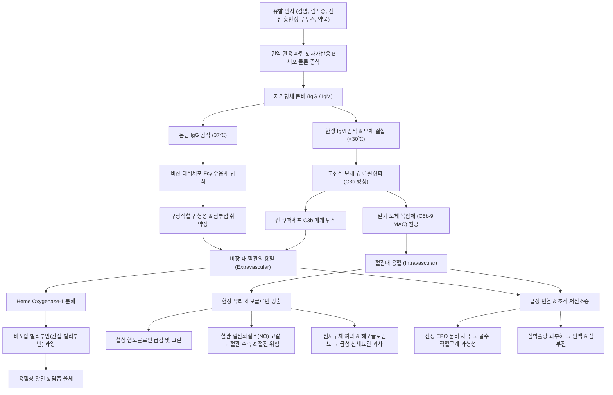

# 🩺 [[자가면역 용혈성 빈혈]] (Autoimmune Hemolytic Anemia / 自身免疫性溶血性貧血, ICD-10: D59.1 / KCD: D59.1)

> **핵심 3줄 요약 (Key Summary)**:
> - 📍 **병소 부위 & 병태생리**: [[적혈구]] 막 자가항원에 대한 자가항체(IgG 또는 IgM)가 결합하여 [[비장]]의 [[대식세포]](혈관외 용혈) 또는 [[보체]] 활성화([[간]]의 [[쿠퍼세포]] 포식 및 막공격복합체 형성, 혈관내 용혈)에 의해 적혈구가 조기 파괴되는 후천성 면역 질환.
> - 🚩 **전형적 임상 양상 & 3대 징후**: 급만성 빈혈 증후(피로, 창백, 운동성 호흡곤란), 고간접빌리루빈혈증에 의한 [[황달]](공막 및 피부 황달, 암갈색 뇨), [[비장]] 종대(온난 항체형의 50~60%) 및 한랭 노출 시 말초 청색증(한랭응집소증).
> - 🛠️ **핵심 감별 & 한·양방 치료 전략**: 직접 [[쿰스 검사]](DAT) 양성, [[망상적혈구]] 급증, [[햅토글로빈]] 결핍, [[젖산탈수소효소]](LDH) 상승 확인; 양방 1차 [[프레드니솔론]], 2차 [[리툭시맙]]/[[수팀리맙]]/[[비장절제술]]; 한의학적 황달(黃疸)·혈증(血證) 변증에 따른 [[인진호탕]], [[청영탕]], [[지백지황탕]], [[당귀보혈탕]] 및 [[혈해]]·[[삼음교]]·[[간수]]·[[비수]] 침구 병용.
> - <font color="#fa7e7e">⚠️ **응급 의뢰 레드플래그**: 급격한 혈색소 추락(Hb < 6.0 g/dL), 급성 혈관내 용혈성 위기(암갈색 혈색소뇨, 핍뇨, [[급성 신부전]]), 파종성 혈관내 응고([[혈전증]]), 에반스 증후군 동반 심각한 점막 대출혈.</font>

---

## 📌 목차
1. [질환 개요 & 병태생리 (Disease Overview)](#1-질환-개요--병태생리-disease-overview)
2. [병태생리 메커니즘 & 대사·장기부전 악순환 네트워크](#2-병태생리-메커니즘--대사장기부전-악순환-네트워크)
3. [임상 증상 & 환자 소견 (Clinical Presentation)](#3-임상-증상--환자-소견-clinical-presentation)
4. [감별 진단 매트릭스 (Differential Diagnosis)](#4-감별-진단-매트릭스-differential-diagnosis)
5. [한의 통합 치료 프로토콜 (침·약침·한약)](#5-한의-통합-치료-프로토콜-침약침한약)
6. [양방 치료 & 병용·의뢰 기준 (Conventional Treatment & Referral)](#6-양방-치료--병용의뢰-기준-conventional-treatment--referral)
7. [식이·생활습관 & 자가관리 티칭 가이드](#7-식이생활습관--자가관리-티칭-가이드)
8. [💡 진료실 핵심 필기 & 임상 노하우](#8--진료실-핵심-필기--임상-노하우)
9. [출처 및 학술 참고 문헌 (References)](#9-출처-및-학술-참고-문헌-references)

---

## 1. 질환 개요 & 병태생리 (Disease Overview)

* **질환 정의 및 개요**:
  * [[자가면역 용혈성 빈혈]](Autoimmune Hemolytic Anemia, AIHA)은 체내 면역 관용의 파탄으로 인해 자신의 [[적혈구]] 막 표면 항원에 결합하는 자가항체(Autoantibody)가 생성되고, 이로 인해 정상 수명인 약 120일을 다 채우지 못한 채 적혈구가 체내 망상내피계(비장, 간) 또는 순환 혈관 내에서 조기에 파괴되어 발생하는 후천성 [[용혈성 빈혈]]이다.
  * 연간 발생률은 인구 10만 명당 약 1~3명으로 비교적 드문 희귀 혈액질환이나, 급격한 빈혈 진행 및 용혈 위기로 인해 생명을 위협할 수 있는 내과적 응급 질환이다.
  * 남녀 성비는 약 1:2로 여성에서 호발하며, 전 연령대에서 발생할 수 있으나 50~60대 이후 고령층에서 발생 빈도가 급증한다. 소아의 경우 바이러스 감염 후 급성으로 일과성 발병하는 경향을 보인다.

* **질환의 주요 임상·면역학적 아형 분류**:
  1. **온난 항체형 자가면역 용혈성 빈혈 (Warm AIHA, wAIHA)**:
     - 전체 AIHA의 약 70~80%를 차지하는 가장 흔한 형태이다.
     - 자가항체의 최적 반응 온도가 37℃(체온)이며, 주로 면역글로불린 G([[면역글로불린 G]], IgG) 단독 또는 IgG와 보체([[보체]], C3d)가 복합적으로 적혈구 막(주로 Rh 복합 항원)에 감작된다.
     - 감작된 적혈구는 [[비장]](Spleen) 적색수질을 통과할 때 비장 [[대식세포]](Macrophage)의 Fcγ 수용체에 의해 세포막이 일부 뜯겨나가며 세포 표면적 대비 체적 비율이 감소하여 둥글고 경직된 [[구상적혈구]](Spherocyte)로 변형된 후 최종적으로 탐식·파괴되는 **혈관외 용혈(Extravascular hemolysis)**을 일으킨다.
  2. **한랭 항체형 자가면역 용혈성 빈혈 (Cold AIHA)**:
     - **한랭응집소증(Cold Agglutinin Disease, CAD)**: 전체 AIHA의 약 15~20%를 차지한다. 0~4℃의 저온에서 최적 반응하며 30℃ 이하의 말초 혈액 순환 시 적혈구 I/i 탄수화물 항원에 결합하는 면역글로불린 M([[면역글로불린 M]], IgM) 항체에 의해 유발된다. IgM은 5합체 구조로 고전적 보체 경로를 강력하게 활성화하여 적혈구 표면에 [[C3b]]를 부착시킨다. 중심 순환계로 돌아와 온도가 상승하면 IgM은 해리되나 C3b는 표면에 남아 주로 [[간]](Liver)의 [[쿠퍼세포]](Kupffer cell)에 발현된 보체 수용체(CR1)에 의해 포식되는 혈관외 용혈을 유발하며, 보체 연쇄반응이 끝까지 진행되면 막공격복합체(MAC, C5b-9)가 형성되어 **혈관내 용혈(Intravascular hemolysis)** 및 혈색소뇨증을 초래한다.
     - **발작성 한랭 혈색소뇨증(Paroxysmal Cold Hemoglobinuria, PCH)**: 소아 바이러스 감염(홍역, 수두, 아데노바이러스 등) 후 드물게 발생하며, 도나트-란트슈타이너(Donath-Landsteiner) 항체라 불리는 다클론성 IgG 항체가 저온에서 적혈구 P 항원에 결합한 뒤 중심 체온(37℃)으로 복원 시 보체를 급격히 활성화하여 대량의 급성 혈관내 용혈과 암갈색 혈색소뇨를 유발한다.
  3. **혼합형 자가면역 용혈성 빈혈 (Mixed AIHA)**:
     - 전체 AIHA의 약 5~10% 미만으로, 37℃에서 반응하는 온난 IgG 자가항체와 30℃ 이상에서도 높은 역가를 유지하는 한랭 IgM 자가응집소가 동시에 공존하여 비장 및 간 양측에서 극심한 용혈을 일으킨다.
  4. **약물 유발성 면역용혈 빈혈 (Drug-Induced Immune Hemolytic Anemia, DIIHA)**:
     - 약물(세파계 항생제, 페니실린, 메틸도파 등)이 적혈구 막에 흡착되거나 신항원(neoantigen)을 형성하여 면역 파괴를 유도한다.
  5. **[[에반스 증후군]](Evans Syndrome)**:
     - 자가면역 용혈성 빈혈(AIHA)과 면역성 저혈소판증([[특발성 혈소판 감소성 자반증]], ITP)이 동시에 혹은 순차적으로 동반 발현되는 질환으로, T세포 및 B세포 조절 부전이 극심하여 예후가 불량하고 치료 저항성이 높다.

* **관련 장기 및 계통 병태**:
  * **주 이환 장기**:
    - 순환 혈액계: [[적혈구]] 막 손상, 급격한 적혈구 수명 단축(수일 이내 파괴).
    - [[비장]]: 적색수질 세망내피계의 대식세포 증식 및 비장 종대(Splenomegaly), 비장 기능항진증.
    - [[간]]: 간 순환 시 쿠퍼세포에 의한 보체 감작 적혈구 탐식, 급격한 빌리루빈 대사 과부하.
    - [[골수]]: 용혈성 빈혈에 반응하여 조혈을 촉진하려는 [[에리스로포이에틴]](EPO) 자극에 의한 적혈구계 과형성(Erythroid hyperplasia).
  * **합병증 표적 장기**:
    - [[신장]]: 혈관내 용혈 시 대량 방출된 유리 헤모글로빈이 사구체를 통해 여과되어 근위세뇨관 내 침착 및 헤모시데린뇨, 세뇨관 상피 괴사에 따른 [[급성 신부전]](Acute Kidney Injury, AKI).
    - [[심장]]: 급성 저산소증에 따른 보상성 박출량 증가, 심계항진, 허혈성 심근 손상 및 고박출성 [[심부전]].
    - 전신 미세순환계: 유리 헤모글로빈의 [[일산화질소]](NO) 포획(Scavenging) 효과에 의한 혈관 수축, 혈소판 활성화 및 파종성 정맥 [[혈전증]](Deep Vein Thrombosis, Pulmonary Embolism).

---

## 2. 병태생리 메커니즘 & 대사·장기부전 악순환 네트워크

### 1) 온난 및 한랭 항체형 분자 병태생리 비교 다이어그램

```
[ 온난 항체형 wAIHA (Extravascular) ]
  적혈구 표면 Rh 항원
         │
         ▼ + 자가항체 IgG (37℃ 결합)
  IgG 감작 적혈구 (Fc 도메인 노출)
         │
         ▼ (비장 모세혈관 순환)
  비장 대식세포 FcγR 결합 → 세포막 파편 탐식
         │
         ▼
  표면적/체적비 감소 → [ 구상적혈구 (Spherocyte) 형성 ]
         │
         ▼ (비장 비대 & 삼투압 취약성 증가)
  비장 적색수질 통과 불능 → 완전 포식 및 파괴
         │
         ▼
  Heme 산화 → 빌리베르딘 → 비포합 빌리루빈 급증 → [ 황달(Jaundice) ]


[ 한랭 항체형 CAD (Complement-mediated) ]
  말초 모세혈관 저온 노출 (0~4℃, 30℃ 이하)
         │
         ▼ + 자가항체 IgM (I/i 탄수화물 항원 결합)
  IgM 적혈구 응집 (Agglutination) → 말초 순환정체 & 청색증
         │
         ▼ C1 복합체 활성화 (고전적 보체 경로)
  적혈구 표면 C3b / C3d 강력 침착
         │
         ▼ 중심 체온(37℃) 복귀 시 IgM 해리
  C3b 감작 적혈구 간 순환
         │
   ┌─────┴────────────────────────┐
   ▼                              ▼
간 쿠퍼세포 CR1 결합       말기 보체 연쇄 활성화 (C5b-9 MAC)
[ 혈관외 용혈 (간) ]       [ 혈관내 용혈 (Intravascular) ]
                                  │
                                  ▼
                    유리 Hb 방출 → 햅토글로빈 고갈
                                  │
                    사구체 여과 → [ 혈색소뇨 & 급성신부전 ]
```



### 2) 분자·세포 수준 기전
* **면역 관용 파탄 및 조절 결핍**:
  - 정상적인 상태에서는 자가반응성 B림프구가 중추 및 말초 관용에 의해 제거되거나 무반응(Anergy) 상태로 억제된다.
  - 감염, [[전신 홍반성 루푸스]](SLE), 만성 림프구성 백혈병(CLL), 비호지킨 림프종 등의 기저 질환 또는 유전적 소인 하에서 조절 T세포(Treg)의 기능 저하와 자가반응 B림프구 클론의 증식이 발생하여 자가항체가 지속 분비된다.
* **헴(Heme) 분해 대사 및 빌리루빈 과부하**:
  - 탐식된 적혈구의 헤모글로빈은 대식세포 내 헴 산화효소-1(Heme Oxygenase-1, HO-1)에 의해 헴, 철(Fe²⁺), 일산화탄소(CO), 빌리베르딘(Biliverdin)으로 분해된다.
  - 빌리베르딘은 빌리베르딘 환원효소에 의해 지용성인 **비포합 빌리루빈(Unconjugated/Indirect Bilirubin)**으로 전환되어 알부민과 결합하여 혈류로 방출된다.
  - 혈중 비포합 빌리루빈의 대량 생성은 간의 글루쿠론산 전이효소(UGT1A1)의 포합 용량을 초과하여 혈중 간접 빌리루빈 상승과 공막 황달을 유발한다.

### 3) 장기 수준 악순환 네트워크
* **혈관내 유리 헤모글로빈 독성과 혈전 악순환**:
  - 한랭형 또는 중증 온난형에서 혈관내 용혈 발생 시 방출된 4합체 헤모글로빈은 2합체로 분해되어 혈청 [[햅토글로빈]](Haptoglobin)과 1:1로 결합하여 CD163 수용체를 통해 간과 세망내피계로 흡수된다.
  - 햅토글로빈 결합 능력이 고갈되면 유리 헤모글로빈이 혈관 내벽의 강력한 혈관이완 인자인 일산화질소(Nitric Oxide, NO)와 반응하여 메트헤모글로빈과 질산염으로 산화되며 NO를 고갈(NO Scavenging)시킨다.
  - NO 고갈은 평활근 수축, 내피세포 활성화, 혈소판 응집 촉진, 조직인자(Tissue factor) 발현 증가로 이어져 심부정맥혈전증 및 폐색전증의 위험을 최대 15~30%까지 폭발적으로 증가시키는 혈전성 악순환 고리를 형성한다.

---

## 3. 임상 증상 & 환자 소견 (Clinical Presentation)

### 1) 주소증 및 핵심 임상 증상
* **빈혈 증후군 (Anemic Symptoms)**:
  - 급성 또는 서서히 진행하는 전신 쇠약감, 피로, 운동성 호흡곤란(DOE), 현훈, 두통.
  - 심혈관계 대상 작용으로 인한 빈맥, 심계항진, 박동성 이명, 협심통.
* **용혈 및 고빌리루빈혈증 징후 (Hemolytic Signs)**:
  - 결막 및 피부의 창백과 동반된 결막/공막 황달(Scleral icterus).
  - 소변 색상의 변화: 비포합 빌리루빈은 지용성이어서 사구체를 통과하지 못하므로 요중 빌리루빈은 음성이지만, 대량의 유로빌리노겐(Urobilinogen) 증가로 진한 주황색 뇨가 나타나며, 혈관내 용혈 시에는 유리 헤모글로빈 여과로 인해 콜라색 또는 간장색의 암갈색 **혈색소뇨(Hemoglobinuria)**를 배설한다.
* **한랭 노출 증상 (Cold-Induced Symptoms, CAD 특이적)**:
  - 기온 저하 시 손가락, 발가락, 코끝, 귓바퀴 등 말초 부위의 혈류 정체로 인한 청색증(Acrocyanosis).
  - 레이노 현상(Raynaud's phenomenon)과 유사한 창백-청색-발적의 피부 색조 변화, 한랭 두드러기(Cold urticaria), 저림 및 감각 이상.
* **복부 및 장기 증상**:
  - 좌상복부 불쾌감, 둔통 및 조기 포만감: [[비장]] 종대(Splenomegaly)에 의해 유발된다.

### 2) 객관적 검사 소견 (Signs & Laboratory Findings)

| 검사항목 | 정상 범위 | AIHA 전형적 검사 수치 | 임상적 의의 및 판독 핵심 |
| :--- | :--- | :--- | :--- |
| **혈색소 (Hb)** | 13~17 g/dL (남) / 12~15 (여) | 5.0 ~ 9.0 g/dL (중증 저하) | 적혈구 파괴 속도가 골수 보상능력을 초과함 |
| **MCV (평균적혈구용적)** | 80 ~ 100 fL | 100 ~ 115 fL (경도 대구성) | 대형 망상적혈구 증가 및 CAD의 적혈구 응집 인공물 |
| **망상적혈구 백분율 / ARC**| 0.5 ~ 2.0% / 25~75 ×10³/μL | 5.0 ~ 20.0% / > 150 ×10³/μL | 골수의 왕성한 적혈구계 조혈 보상 반영 |
| **말초혈액도말 (PBS)** | 정상 쌍오목 원반형 | [[구상적혈구]](+++), 다염구(Polychromasia) | wAIHA의 특징적 적혈구 형태 이상 (중심창백 소실) |
| **직접 쿰스 검사 (DAT)** | 음성 (Negative) | **양성 (Positive)** | wAIHA: IgG(+), C3d(±) / CAD: C3d(+), IgG(-) |
| **간접 쿰스 검사 (IAT)** | 음성 | 양성 또는 음성 | 혈청 내 유리 적혈구 자가항체 존재 확인 |
| **혈청 햅토글로빈** | 30 ~ 200 mg/dL | **< 10 mg/dL (측정 불가 수준 결핍)**| 용혈 진단의 가장 민감도 높은 표지자 |
| **혈청 젖산탈수소효소 (LDH)**| 140 ~ 270 U/L | 500 ~ 3000 U/L (현저한 상승) | 파괴된 적혈구 내 세포질 효소 대량 유출 |
| **총 / 비포합 빌리루빈** | 0.2~1.2 / 0.1~0.8 mg/dL | 2.5 ~ 6.0 / 2.0 ~ 5.0 mg/dL | 간접 빌리루빈 우세형 고빌리루빈혈증 |
| **소변 검사** | 요단백 음성, 요잠혈 음성 | 요잠혈(Dipstick) 양성, 요침사 적혈구 없음 | 진정한 혈뇨가 아닌 유리 헤모글로빈뇨의 증거 |

### 3) 병기 및 중증도 판정
1. **경증 (Mild AIHA)**:
   - Hb ≥ 10.0 g/dL, 보상성 망상적혈구증가증 상태, 안정 시 증상 경미, 외래 경구 약물 치료 가능.
2. **중등증 (Moderate AIHA)**:
   - Hb 8.0 ~ 9.9 g/dL, 운동성 호흡곤란 및 일상생활 장애, 황달 발현, 전신 스테로이드 요법 개시 적응증.
3. **중증 (Severe AIHA)**:
   - Hb 6.0 ~ 7.9 g/dL, 안정 시 흉통, 심한 빈맥, 전신 무력감, 입원 정맥 면역억제 치료 필요.
4. **치명적 용혈성 위기 (Fulminant Hemolytic Crisis)**:
   - Hb < 6.0 g/dL, 급성 혈관내 용혈, 핍뇨성 [[급성 신부전]], 젖산 산증, 파종성 혈전증, 심근허혈 동반. 집중치료실(ICU) 수용 및 긴급 혈액투석·면역글로불린·수혈 준비 필요.

---

## 4. 감별 진단 매트릭스 (Differential Diagnosis)

| 감별 질환 | 주요 특징 및 임상 증상 | 직접 쿰스(DAT) | PBS 적혈구 형태 | 핵심 감별 지표 및 검사 |
| :--- | :--- | :--- | :--- | :--- |
| **온난 AIHA (wAIHA)** | 급만성 빈혈, 황달, 비장종대 | **양성 (IgG ± C3d)** | [[구상적혈구]](Spherocyte) 다수 | 37℃ 반응 IgG, 스테로이드 반응 우수 |
| **한랭응집소증 (CAD)** | 한랭 노출 시 말초 청색증, 암갈색 뇨 | **양성 (C3d 단독)** | 적혈구 덩어리 응집체 (Clumps) | 한랭응집소 역가 ≥ 1:64 (4℃), IgM 클론 |
| **유전성 구상적혈구증 (HS)**| 가족력, 소아기 담석증, 비장종대 | **음성 (Negative)** | 구상적혈구 다수 | 삼투압 취약성 검사(OF test) 양성, EMA 결합검사 |
| **발작성 야간 혈색소뇨증 (PNH)**| 아침 첫 소변 혈색소뇨, 정맥혈전증 | **음성 (Negative)** | 정상 또는 다형성, 용혈 소견 | 유세포분석(Flow cytometry): CD55, CD59 결손 |
| **혈전미세혈관병증 (TTP/HUS)**| 발열, 신경학적 이상, 신기능 저하 | **음성 (Negative)** | **파편적혈구 (Schistocytes)** | 혈소판 급감, ADAMTS13 활성도 < 10% |
| **약물유발 면역용혈 (DIIHA)**| 특정 약물(세프트리악손 등) 복용력 | 양성 (IgG 또는 C3) | 구상적혈구 또는 정상 | 원인 약물 중단 시 용혈 호전 |
| **에반스 증후군 (Evans)** | AIHA 증상 + 전신 자반증, 점막 출혈 | **양성 (DAT +)** | 구상적혈구 + 혈소판 결핍 | 혈소판감소증(ITP) 동반 발현 |

> 🚩 **레드플래그 감별 (TTP vs AIHA)**:
> 말초혈액도말(PBS)에서 적혈구가 깨진 형태인 **파편적혈구(Schistocytes)**가 관찰되고 혈소판 감소증이 동반된 경우, AIHA가 아닌 치명적 혈전미세혈관병증([[혈전성 혈소판감소성 자반증]], TTP)을 반드시 배제해야 한다. TTP는 사망률이 90%에 달하므로 즉각적인 혈장교환술(Plasma exchange)을 요한다.

---

## 5. 한의 통합 치료 프로토콜 (침·약침·한약)

* **한의학적 질병 인식**:
  - 한의학에서 자가면역 용혈성 빈혈은 [[황달]](黃疸), [[혈증]](血證), [[허로]](虛勞), [[위황]](萎黃), 급성 열독에 의한 열독발황(熱毒發黃)의 범주에 속한다.
  - 급성기에는 습열(濕熱)과 사독(邪毒)이 영혈(營血)로 침범하여 열독이 혈액을 훈증하고 적혈(赤血)을 부패시켜 황달과 혈뇨를 야기하며, 만성기에는 비신(脾腎)의 양기와 음혈이 손상되어 정혈(精血) 생성이 결핍되는 허실협잡(虛實挾雜)의 병기를 나타낸다.

### 1) 변증 분류 및 한약 치료

```
[ 급성 활성기: 열독·습열 우세 ]
  열독치성(熱毒熾盛) / 습열훈증(濕熱薰蒸)
    ├── 청열양혈(淸熱凉血) & 이습퇴황(利濕退黃)
    └── 대표 처방: [[청영탕]](淸營湯), [[인진호탕]](茵蔯蒿湯) 가미

[ 만성 안정기 / 관해기: 기혈·음양 허손 우세 ]
  간신음허(肝腎陰虛) ─── 자음강화(滋陰降火) ─── [[지백지황탕]](知柏地黃湯)
  기혈양허(氣血兩虛) ─── 익기생혈(益氣生血) ─── [[당귀보혈탕]](當歸補血湯), [[팔진탕]]
  비신양허(脾腎陽虛) ─── 온양보혈(溫陽補血) ─── [[이중탕]](理中湯), [[사역탕]](CAD 대응)
```

1. **습열훈증(濕熱薰蒸) / 열독발황(熱毒發黃)형 (급성 용혈 악화기)**:
   - **주증상**: 전신 및 안구의 선명한 황색 황달(양황 陽黃), 미열 또는 고열, 번조구갈, 소변 농황적(또는 암갈색), 대변 비결, 설홍태황니(舌紅苔黃膩), 맥현활삭(脈弦滑數).
   - **치법**: 청열양혈(淸熱凉血), 사화해독(瀉火解毒), 이습퇴황(利濕退黃).
   - **대표 처방**: **[[인진호탕]](茵蔯蒿湯) 가미방** 또는 **[[청영탕]](淸營湯) 합 [[서각지황탕]](犀角地黃湯 - 수우각 대체)**.
   - **약물 구성**: [[인진]](茵蔯) 24g, [[치자]](梔子) 12g, [[대황]](大黃) 8g, 수우각(水牛角) 20g, [[생지황]](生地黃) 20g, [[적작약]](赤芍藥) 12g, [[목단피]](牡丹皮) 10g, 금은화(金銀花) 15g, 차전자(車前子) 10g.
   - **치료 근거**: 인진의 인진호락톤 및 스코폴레틴 성분은 간세포 담즙 분비를 촉진하고 비포합 빌리루빈 배설을 증진시키며, 치자의 제니포시드(Geniposide)는 간세포 항염증 작용과 세포막 보호 효과를 나타낸다.

2. **간신음허(肝腎陰虛)형 (만성 지속성 용혈 및 스테로이드 장기 투여 후기)**:
   - **주증상**: 만성적인 안구 황달, 미열, 조열도한(潮熱盜汗), 구건인조, 오심번열(手足心熱), 현훈이명, 요슬산연(허리와 무릎 시림), 설홍소태(舌紅少苔), 맥세삭(脈細數).
   - **치법**: 자음강화(滋陰降火), 보익간신(補益肝腎), 양혈소어(養血消瘀).
   - **대표 처방**: **[[지백지황탕]](知柏地黃湯) 합 일관전(一貫煎) 가감방**.
   - **약물 구성**: [[숙지황]](熟地黃) 16g, 산약(山藥) 12g, 산수유(山茱萸) 10g, [[지모]](知母) 10g, [[황백]](黃柏) 10g, 복령(茯苓) 10g, 택사(澤瀉) 10g, [[목단피]](牡丹皮) 10g, 사삼(沙參) 12g, 맥문동(麥門冬) 12g, [[당귀]](當歸) 10g.
   - **치료 근거**: 지모·황백의 베르베린(Berberine) 및 티모사포닌 성분은 면역계 과활성화된 염증성 사이토카인 분비를 억제하고, 숙지황·산수유는 골수 미세환경의 항산화능을 보강하여 자가면역 공격을 완화한다.

3. **기혈양허(氣血兩虛)형 (용혈 완화 후 빈혈 회복기)**:
   - **주증상**: 안면 창백, 심계항진, 현훈, 극심한 피로 무력감, 자한(自汗), 식욕 부진, 설담태백(舌淡苔白), 맥허세(脈虛細).
   - **치법**: 보익기혈(補益氣血), 건비생혈(健脾生血).
   - **대표 처방**: **[[당귀보혈탕]](當歸補血湯) 합 [[팔진탕]](八珍湯) 가감방**.
   - **약물 구성**: [[황기]](黃芪) 30g, [[당귀]](當歸) 10g, [[인삼]](人蔘) 10g, 백출(白朮) 10g, 복령(茯苓) 10g, [[백작약]](白芍藥) 12g, [[숙지황]](熟地黃) 15g, 천궁(川芎) 6g, 감초(甘草) 6g, 대조(大棗) 4g.
   - **치료 근거**: 황기 다당류(Astragalus polysaccharide)는 적혈구 막 지질 과산화를 억제하고 신장 에리스로포이에틴(EPO) 신호전달을 촉진하여 골수 적혈구 조혈을 가속화한다.

4. **비신양허(脾腎陽虛) / 한습조체(寒濕阻滯)형 (한랭응집소증 CAD 대응)**:
   - **주증상**: 오한지랭, 사지냉감, 추위에 노출 시 손끝 청색증 및 통증, 안색 위황, 소변 맑고 김, 대변 당설, 설담반치흔(舌淡胖齒痕), 태백활(苔白滑), 맥침지미약(脈沈遲微弱).
   - **치법**: 온양건비(溫陽健脾), 온신익기(溫腎益氣), 거한활혈(祛寒活血).
   - **대표 처방**: **[[이중탕]](理中湯) 합 [[사역탕]](四逆湯) 가미방**.
   - **약물 구성**: 포부자(포부자) 8g, 건강(乾薑) 10g, [[인삼]](人蔘) 10g, 백출(白朮) 12g, 육계(肉桂) 6g, 세신(細辛) 3g, 계지(桂枝) 8g, 감초(甘草) 6g.

### 2) 침구 치료 (Acupuncture Protocol)
* **치료 원칙**: 양혈생혈(養血生血), 청열이습(淸熱利濕), 건비익신(健脾益腎).
* **주혈 선정**:
  - [[혈해]](SP10): 비경의 혈극혈로 혈액 순환 촉진, 청열양혈 작용.
  - [[삼음교]](SP6): 비·간·신 3음경의 교회혈로 음혈 생성 촉진 및 면역 조절.
  - [[족삼리]](ST36): 후천의 본인 비위 기운을 강화하여 영양 흡수 및 조혈 촉진.
  - [[격수]](BL17): 팔회혈 중 혈회(血會)로 혈액 질환의 요혈.
  - [[간수]](BL18) & [[비수]](BL20): 간장혈(肝藏血) 및 비통혈(脾統血) 기능 정상화.
  - [[신수]](BL23) & [[관원]](CV4): 선천의 정기를 보강하고 골수 조혈 기능 강화.
* **자침 기법**:
  - 급성 습열기: 혈해, 간수, 음릉천(SP9), 태충(LR3)에 사법(瀉法) 또는 평보평사(平補平瀉).
  - 만성 기혈허약기: 족삼리, 비수, 신수에 보법(補法), 15~20분 유침.
* **온구(뜸) 요법**:
  - 한랭형(CAD) 환자에게 족삼리, 신수, 관원에 간접구(신기구)를 시행하여 심부 체온을 상승시키고 한랭 응집 유발을 억제한다 (단, 급성 열독발황기에는 뜸 치료 금기).

### 3) 약침 치료 (Pharmacopuncture)
* **제제 선택 및 적용 부위**:
  - **자하거(Hominis Placenta) 약침**: 만성기 기혈양허 및 간신음허 환자에게 [[신수]](BL23), [[비수]](BL20), [[격수]](BL17)에 각 0.5 mL씩 주입. 조혈 전구세포 증식 자극 및 면역 조절 효과.
  - **황련해독탕 약침**: 급성기 습열훈증 환자에게 [[간수]](BL18), [[혈해]](SP10)에 각 0.2~0.3 mL 주입하여 전신 염증 완화.

---

## 6. 양방 치료 & 병용·의뢰 기준 (Conventional Treatment & Referral)

### 1) 온난 및 한랭형 표준 약물 치료

| 구분 | 온난 항체형 (wAIHA) 표준 치료 | 한랭응집소증 (CAD) 표준 치료 |
| :--- | :--- | :--- |
| **1차 치료** | **경구 코르티코스테로이드 ([[프레드니솔론]])**<br>- 1.0 ~ 1.5 mg/kg/day (통상 60~80 mg/일)<br>- 3~4주 유지 후 반응 평가(반응률 70~80%)<br>- Hb > 10 g/dL 도달 시 주당 5~10 mg씩 서서히 감량(Tapering) | **철저한 보온 (Thermal protection)**<br>- **스테로이드 및 비장절제술 무효/금기**<br>- 중심 체온 및 말초 체온 유지 요법<br>- 빈혈 심할 시 C1s 억제제 투여 |
| **2차 치료** | **[[리툭시맙]](Rituximab, anti-CD20 mAb)**<br>- 375 mg/m² 주 1회, 4주간 정맥 투여<br>- B세포 제거를 통한 자가항체 억제<br>- 또는 **복강경 [[비장절제술]](Splenectomy)** | **[[수팀리맙]](Sutimlimab, C1s 억제제)**<br>- 주 1회 후 2주 간격 정맥 투여<br>- 고전적 보체 경로 C1s를 선택 차단<br>- 또는 **[[리툭시맙]] ± 벤다무스틴(Bendamustine)** |
| **3차/난치성** | 면역억제제:<br>- [[아자티오프린]](Azathioprine, 100~150 mg/일)<br>- [[시클로스포린]](Cyclosporine A)<br>- 미코페놀레이트 모페틸(MMF) | 혈장교환술(Plasmapheresis, 급성 위기 일과성),<br>보체 C3 억제제(페그세타코플란 등 임상시험) |
| **보조 치료** | [[엽산]](Folic acid) 1~5 mg/일 (조혈 소모 보충)<br>정맥혈전증 예방 헤파린(LMWH) 투여 | 혈액 가온기(Blood warmer) 필수 수혈<br>엽산 보충 |

### 2) 수혈 시 특수 주의점 (Transfusion Precautions)
* AIHA 환자의 혈액에는 범반응성(pan-reactive) 자가항체가 존재하므로 통상적인 교차시험(Cross-matching) 시 시판되는 모든 공여자 적혈구와 응집 반응을 일으켜 **"적합 혈액 없음(Incompatible)"** 판정이 나온다.
* 자가항체에 가려진 동종항체(Alloantibody)를 감지하기 위해 자가흡착법(Auto-adsorption) 또는 동종흡착법을 시행해야 한다.
* 활력징후 붕괴 위험이 있는 초응급 상황에서는 "최소 불일치(Least incompatible) 적혈구 제제"를 선별하여 전문의 감독 하에 극히 서서히 가온 주입해야 한다.
* CAD 환자 수혈 시 반드시 **혈액 가온기(Blood Warmer, 37℃)**를 사용하여 투여 중 적혈구 응집 및 급성 혈관내 용혈을 방지해야 한다.

### 3) 한·양방 병용 판단 및 상호작용
* **스테로이드 감량기 한약 병용 (적극 권장)**:
  - 프레드니솔론 고용량 장기 복용 시 쿠싱증후군, 당뇨, 골다공증, 면역저하 등 심각한 부작용이 발생한다.
  - 스테로이드를 점진적으로 감량(Tapering)하는 단계에서 기혈을 보하고 음허화왕을 제어하는 한약([[지백지황탕]], [[당귀보혈탕]])을 병용하면 용혈 재발(Rebound phenomenon)을 억제하고 안전한 스테로이드 감량을 돕는다.
* **면역억제제 투여 중 간·신기능 모니터링**:
  - 아자티오프린, 시클로스포린 복용 중 한약 병용 시 2~4주 간격 간기능(AST/ALT) 및 신기능(BUN/Cr) 검사를 병행한다.

### 4) 응급 전원 및 상급병원 의뢰 기준 (Referral Criteria)
1. **헤모글로빈 급락 (Hb < 6.0 g/dL)** 또는 안정 시 흉통, 의식 혼미, 빈맥(HR > 120회/분) 등 심혈관계 허탈 징후 발생 시.
2. 콜라색 소변과 함께 소변량 급감(24시간 요량 < 400 mL), 혈청 Cr 급상승 등 [[급성 신부전]] 발생 시.
3. [[에반스 증후군]] 환자에서 혈소판 수 < 20,000/μL로 점막 출혈, 객혈, 흑색변 또는 중추신경계 출혈 의심 징후 발생 시.
4. 호흡곤란 및 일측성 하지 부종 등 심부정맥혈전증/폐색전증 의심 징후 발현 시 즉시 상급병원 응급의학과로 전원한다.

---

## 7. 식이·생활습관 & 자가관리 티칭 가이드

* **필수 영양 및 식이 요법**:
  * **[[엽산]](Folic Acid) 보충의 절대성**: 골수의 극심한 보상성 조혈 작용으로 인해 체내 엽산 소모가 극대화되므로 하루 1~5 mg의 엽산 제제 복용 또는 짙은 녹색 잎채소(시금치, 브로콜리), 아스파라거스, 콩류를 풍부하게 섭취하도록 지도한다.
  * **철분 보충제 임의 복용 엄금**: 용혈성 빈혈은 출혈성 빈혈과 달리 적혈구 파괴 시 방출된 철분이 체내 세망내피계에 재축적되므로, 철 결핍이 객관적으로 증명되지 않은 상태에서 철분제를 임의 복용하면 간·심장 혈색소증(Iron overload)을 초래하여 장기 부전을 유발한다.
  * **항산화 식품 권장**: 비타민 E, 비타민 C, 플라보노이드가 풍부한 블루베리, 토마토 등은 적혈구 세포막의 지질 과산화를 방지하여 적혈구 취약성을 완화한다.
* **한랭응집소증(CAD) 환자의 체온 관리 수칙**:
  * 외출 시 모자, 목도리, 방한 장갑, 두꺼운 보온 양말을 필히 착용하여 말초 부위가 15℃ 이하의 환경에 노출되지 않도록 한다.
  * 냉장고 문을 열 때 장갑을 착용하고, 얼음물이나 찬 음료를 절대 마시지 않으며, 미온수를 음용한다.
  * 여름철 에어컨 바람이 직접 피부에 닿지 않도록 얇은 겉옷을 상시 소지한다.
* **자가 모니터링 체크리스트**:
  * 매일 아침 첫 소변의 색상을 확인하여 적갈색 또는 간장색으로 짙어지는지 관찰한다 (용혈 악화의 조기 지표).
  * 결막 및 손바닥의 창백도, 눈 흰자위의 황달 정도를 매일 거울로 관찰하고 기록한다.
  * 계단 보행 시 호흡곤란의 정도가 심해지거나 안정 시 심장이 심하게 뛰면 즉시 진료를 받도록 교육한다.
* **감염 예방 수칙**:
  * 바이러스 및 세균 감염은 면역 반응을 촉발하여 AIHA를 급성 재발시키므로 손 씻기, 마스크 착용, 폐렴구균 및 인플루엔자 예방접종을 철저히 시행한다 (특히 비장절제술을 시행한 환자는 피막성 세균 감염에 취약하므로 필수).

---

## 8. 💡 진료실 핵심 필기 & 임상 노하우

* **문진 시 핵심 체크리스트**:
  1. "소변 색깔이 갑자기 콜라색이나 진한 붉은색으로 변한 적이 있습니까?" (혈관내 용혈 감별)
  2. "추운 곳에 가면 손가락 끝이나 코끝이 파랗게 변하고 시린 통증이 생깁니까?" (CAD 감별)
  3. "최근 새로 처방받거나 복용한 항생제, 소염진통제, 혈압약이 있습니까?" (약물성 용혈 감별)
  4. "피부에 멍이 쉽게 들거나 잇몸 출혈, 코피가 멈추지 않는 증상이 함께 나타납니까?" (에반스 증후군 배제)

* **검사 결과 판독의 숨겨진 함정**:
  * **MCV 가성 증가 현상**: CAD 환자의 혈액 검체는 실온(20~25℃)으로 냉각되는 즉시 시험관 내에서 적혈구들이 자가응집(Agglutination)하여 혈구분석기가 2~3개의 적혈구를 1개의 거대 적혈구로 인식함으로써 MCV가 110~130 fL로 인공적으로 높게 측정된다. 이때 검체를 37℃로 재가온한 후 재측정하면 진정한 MCV 수치를 확인할 수 있다.
  * **망상적혈구감소성 위기(Reticulocytopenic Crisis)**: 용혈성 빈혈 환자는 정상적으로 망상적혈구가 급증해야 하지만, 파보바이러스 B19 감염이 동반되거나 적혈구계 전구세포에 대한 자가항체가 작용하는 경우 망상적혈구가 오히려 0.1% 이하로 급감할 수 있다. 이는 급격한 활력징후 붕괴를 초래하는 초응급 상태이므로 주의를 요한다.

* **환자 안심 및 티칭 스크립트**:
  - *"환자분, 지금 겪고 계신 빈혈은 철분이 부족해서 생기는 흔한 빈혈이 아니라, 몸의 면역계가 자신의 적혈구를 적으로 오인하여 파괴하는 '자가면역 용혈' 상태입니다. 따라서 시중의 철분제를 드시면 안 되고, 파괴된 적혈구 색소가 소변과 눈으로 나와 황달과 갈색 소변이 생기는 것입니다. 현대의학적 면역 치료로 적혈구 파괴를 진정시키면서, 한의학적으로는 간과 비장의 해독과 조혈 기능을 도와주는 처방을 병용하여 안전하게 체력을 회복하도록 돕겠습니다."*

---

## 9. 출처 및 학술 참고 문헌 (References)

1. Choi DH, Lee SH, Kim HJ, et al. (2026). Cold agglutinin disease: pathophysiology, diagnosis, and the evolving therapeutic landscape. *Blood Res*. 61(1):30-41. [PMID: 42696222](https://pubmed.ncbi.nlm.nih.gov/42696222/)
   - **[연구 요약]**: 한랭응집소증(CAD)의 고전적 보체 경로 활성화 분자 기전을 규명하고, C1s 표적 단클론항체 수팀리맙(Sutimlimab)의 최신 임상 결과와 혈관내 용혈 차단 전략을 종합 분석함.

2. Ceccarelli F, Perricone C, Spinelli FR, et al. (2026). Targeting type I interferon in lupus autoimmune haemolytic anaemia: first report with anifrolumab. *Lupus Sci Med*. 13(2):e001240. [PMID: 42508961](https://pubmed.ncbi.nlm.nih.gov/42508961/)
   - **[연구 요약]**: 전신 홍반성 루푸스에 병발한 난치성 자가면역 용혈성 빈혈 환자에서 1형 인터페론 수용체 억제제 아니프로루맙(Anifrolumab)을 투여하여 자가항체 생성 억제 및 혈색소 수치 정상화를 유도한 최신 증례 보고.

3. Hill QA, Stamps R, Massey E, et al. (2017). The diagnosis and management of primary autoimmune haemolytic anaemia. *Br J Haematol*. 176(3):395-411. [PMID: 28005293](https://pubmed.ncbi.nlm.nih.gov/28005293/)
   - **[연구 요약]**: 영국혈액학회(BSH)의 원발성 자가면역 용혈성 빈혈 진단 및 관리 가이드라인으로 직접 쿰스 검사 해석 기준과 1차 스테로이드, 2차 리툭시맙 치료 권고안 수립.

4. Barcellini W, Fattizzo B. (2020). The Changing Landscape of Autoimmune Hemolytic Anemia. *Front Immunol*. 11:946. [PMID: 32655543](https://pubmed.ncbi.nlm.nih.gov/32655543/)
   - **[연구 요약]**: wAIHA 및 CAD의 면역 병태생리 차이, B세포 조절 장애, 새로운 보체 억제제 및 비장 티로신 인산화효소(Syk) 억제제 등 차세대 표적 치료제 개발 현황 검토.

5. Jäger U, Barcellini W, Broome CM, et al. (2020). Diagnosis and treatment of autoimmune hemolytic anemia in adults: Recommendations from the First International Consensus Meeting. *Blood Rev*. 41:100648. [PMID: 31839434](https://pubmed.ncbi.nlm.nih.gov/31839434/)
   - **[연구 요약]**: 성인 자가면역 용혈성 빈혈에 대한 제1차 국제 합의 권고안으로 중증도별 표준 접근법, 수혈 프로토콜 및 혈전색전증 예방 요법 제시.

---

## 관련 노트
- [[용혈성 빈혈]]
- [[황달]]
- [[에반스 증후군]]
- [[특발성 혈소판 감소성 자반증]]
- [[전신 홍반성 루푸스]]
- [[발작성 야간 혈색소뇨증]]
- [[재생 불량성 빈혈]]
- [[인진호탕]]
- [[청영탕]]
- [[지백지황탕]]
- [[당귀보혈탕]]
- [[프레드니솔론]]
- [[리툭시맙]]
