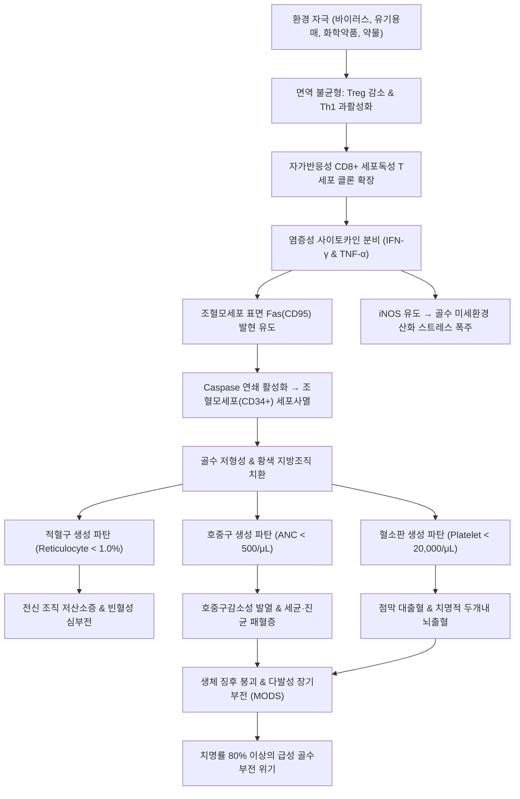

# 🩺 [[재생 불량성 빈혈]] (Aplastic Anemia / 再生不良性貧血, ICD-10: D61.9 / KCD: D61.9)

> **핵심 3줄 요약 (Key Summary)**:
> - 📍 **병소 부위 & 병태생리**: [[골수]] 내 다능성 [[조혈모세포]](HSC, CD34+)의 자가면역 매개성 파괴(올리고클로날 세포독성 T세포의 [[인터페론 감마]] 및 [[종양괴사인자 알파]] 분비 → Fas/FasL 아포토시스 유도)로 인한 조혈 부전 및 골수 지방 치환.
> - 🚩 **전형적 임상 양상 & 3대 징후**: 말초혈액 [[범혈구 감소증]](Pancytopenia)에 기인한 3대 주소증 — 빈혈성 전신 무력감·창백, [[호중구]] 감소에 따른 반복적 고열·중증 기회감염, [[혈소판]] 결핍에 의한 피부 자반·점막 대출혈 (간비종대 및 림프절 비대 부재가 중요한 감별점).
> - 🛠️ **핵심 감별 & 한·양방 치료 전략**: Camitta 중증도 분류(SAA 판정: 골수 세포충실도 < 25% + 호중구 ANC < 500/μL 등); 양방 40세 미만 형제 일치 시 동종 조혈모세포이식(allo-HSCT), 40세 이상/비일치 시 삼제 면역억제요법([[항흉선세포글로불린]] + [[시클로스포린]] + [[엘트롬보팍]]); 한의학적 수고(髓枯)·허로(虛勞)·신허(腎虛) 변증에 따른 [[보골생혈탕]], [[귀록이선교]], [[익위승양탕]], [[녹용대보탕]] 및 [[족삼리]]·[[신수]]·[[명문]] 침구 보법(출혈 경향 감안한 비침습적 관리).
> - <font color="#fa7e7e">⚠️ **응급 의뢰 레드플래그**: 절대 호중구 수 < 500/μL 동반 체온 ≥ 38.3℃ (호중구감소성 발열 neutropenic fever, 패혈증 위험), 혈소판 < 10,000/μL 동반 중추신경계 출혈(격심한 두통, 의식저하) 또는 소화관 대량 출혈.</font>

---

## 📌 목차
1. [질환 개요 & 병태생리 (Disease Overview)](#1-질환-개요--병태생리-disease-overview)
2. [병태생리 메커니즘 & 대사·장기부전 악순환 네트워크](#2-병태생리-메커니즘--대사장기부전-악순환-네트워크)
3. [임상 증상 & 환자 소견 (Clinical Presentation)](#3-임상-증상--환자-소견-clinical-presentation)
4. [감별 진단 매트릭스 (Differential Diagnosis)](#4-감별-진단-매트릭스-differential-diagnosis)
5. [한의 통합 치료 프로토콜 (침·약침·한약)](#5-한의-통합-치료-프로토콜-침약침한약)
6. [양방 치료 & 병용·의뢰 기준 (Conventional Treatment & Referral)](#6-양방-치료--병용의뢰-기준-conventional-treatment--referral)
7. [식이·생활습관 & 자가관리 티칭 가이드](#7-식이생활습관--자가관리-티칭-가이드)
8. [💡 진료실 핵심 필기 & 임상 노하우](#8--진료실-핵심-필기--임상-노하우)
9. [출처 및 학술 참고 문헌 (References)](#9-출처-및-학술-참고-문헌-references)

---

## 1. 질환 개요 & 병태생리 (Disease Overview)

* **질환 정의 및 개요**:
  * [[재생 불량성 빈혈]](Aplastic Anemia, AA)은 [[골수]](Bone marrow) 내에서 모든 혈액세포를 만들어내는 근원 세포인 다능성 [[조혈모세포]](Hematopoietic Stem and Progenitor Cells, HSPC, CD34+)의 양적 고갈 및 기능적 부전으로 인하여, 말초 혈액에서 [[적혈구]], [[백혈구]](특히 [[호중구]]), [[혈소판]]이 모두 지속적으로 감소하는 **[[범혈구 감소증]](Pancytopenia)**과 골수 조직 검사상 조혈세포가 소실되고 황색 지방 조직으로 치환되는 **골수 저형성(Hypocellular bone marrow)**을 특징으로 하는 중증 골수부전 증후군(Bone marrow failure syndrome)이다.
  * 서구에 비해 동아시아(한국, 일본, 중국)에서 유병률이 2~3배 높아 인구 100만 명당 연간 약 4~6명의 발생 빈도를 보인다.
  * 발병 연령은 15~25세의 청년층과 60세 이상의 고령층에서 두 개의 정점을 이루는 이상성(Bimodal) 분포를 나타내며, 남녀 간 발생 비율은 대체로 유사하다.

* **질환의 병인론적 분류**:
  1. **후천성 특발성 재생불량성 빈혈 (Acquired Idiopathic AA, > 80~85%)**:
     - 명확한 선행 원인을 특정할 수 없으나, 후천적인 자가반응성 T림프구 과활성화로 인해 조혈모세포가 파괴되는 자가면역 질환으로 확립되어 있다.
     - HLA-DRB1*15:01 등 특정 면역유전학적 대립유전자와 강한 연관성을 보인다.
  2. **후천성 2차성 재생불량성 빈혈 (Secondary AA, ~10~15%)**:
     - **바이러스 감염 후 AA**: 급성 비A-비B-비C 간염 후 발병하는 간염관련 재생불량성 빈혈(Hepatitis-associated AA, HAAA), 엡스타인-바 바이러스(EBV), 거대세포바이러스(CMV), 파보바이러스 B19(Parvovirus B19), HIV 감염 등.
     - **의약품 및 화학물질**: 벤젠(Benzene) 및 유기용매 노출, 클로람페니콜(Chloramphenicol), 설폰아미드계 항생제, 금제제, 항갑상선제, 페닐부타존, 살충제.
     - **방사선 피폭 및 항암 화학요법**: 전신 방사선 조사 및 DNA 알킬화제에 의한 직접적 조혈모세포 손상.
     - **기저 면역질환**: 전신 홍반성 루푸스(SLE), 흉선종, 호산구성 근막염.
  3. **선천성/유전성 골수부전 증후군 (Inherited Bone Marrow Failure)**:
     - 팬코니 빈혈(Fanconi Anemia, FA): DNA 상호가교 수복 결함(BRCA 경로), 골격 기형, 피부 밀크커피반점 동반.
     - 선천성 이상각화증(Dyskeratosis Congenita, DC): 텔로머레이스(TERT, TERC) 유전자 변이에 의한 조기 텔로미어 단축, 조갑 이영양증, 구강 백반증 동반.

* **Camitta 중증도 분류 기준 (국제 표준)**:

| 중증도 분류 | 골수 조직 검사 기준 (Bone Marrow) | 말초혈액 검사 기준 (Peripheral Blood, 3개 중 2개 이상) |
| :--- | :--- | :--- |
| **중증 재생불량성 빈혈<br>(Severe AA, SAA)** | 골수 세포충실도(Cellularity) **< 25%**<br>(또는 25~50%이더라도 조혈세포 분율 < 30%) | ① 절대 호중구 수(ANC) **< 500 /μL** (0.5 × 10⁹/L)<br>② 혈소판 수 **< 20,000 /μL** (20 × 10⁹/L)<br>③ 교정 망상적혈구 **< 1.0%** (또는 ARC < 20,000 /μL) |
| **초중증 재생불량성 빈혈<br>(Very Severe AA, vSAA)** | SAA 골수 기준 충족 | SAA 기준을 충족하면서 **ANC < 200 /μL** (극도의 치명적 패혈증 위험) |
| **비중증 재생불량성 빈혈<br>(Non-severe AA, NSAA)** | 골수 저형성 소견 확인 | 범혈구 감소증이 존재하나 SAA 기준을 완전히 충족하지 않는 상태 |

* **관련 장기 및 조직**:
  * **주 이환 장기**:
    - [[골수]](Bone marrow): 척추체, 장골, 흉골 등의 적색 골수(Red marrow)가 조혈 기능을 상실하고 지방세포로 가득 찬 황색 골수(Yellow marrow)로 치환.
    - 말초 순환계: [[적혈구]], [[백혈구]], [[혈소판]] 삼계열 혈액세포의 절대적 고갈.
  * **합병증 표적 장기**:
    - 호흡기계 및 피부·점막: 호중구 결핍에 따른 기회감염 병소 (치은염, 구강 궤양, 폐렴, 패혈증).
    - 중추신경계 및 소화기계: 혈소판 결핍에 따른 자발성 두개내 출혈(Subarachnoid/Intracerebral hemorrhage) 및 위장관 대량 출혈.
    - 간 및 심장: 잦은 수혈 요법으로 인한 이차성 혈색소침착증(Iron overload) 및 심부전.

---

## 2. 병태생리 메커니즘 & 대사·장기부전 악순환 네트워크

### 1) 면역 매개성 조혈모세포 파괴 ASCII 다이어그램

```
  [ 외인성 유발 자극 ] (바이러스 항원, 벤젠, 특정 약물, 자가항원 변이)
            │
            ▼
  항원제시세포 (Dendritic Cell) ─── HLA-DR15 표출
            │
            ▼
  CD4+ Th1 림프구 과활성화 ─── IL-2 방출
            │
            ▼
  CD8+ 세포독성 T림프구 (CTL) 올리고클로날 증식 (Oligoclonal Expansion)
            │
            ├───▶ [ [[인터페론 감마]] (IFN-γ) 대량 분비 ]
            └───▶ [ [[종양괴사인자 알파]] (TNF-α) 대량 분비 ]
                         │
                         ▼
  골수 미세환경 내 확산 & 조혈모세포 (HSC, CD34+) 표면 수용체 결합
                         │
        ┌────────────────┴────────────────────────┐
        ▼                                         ▼
   Fas 수용체 (CD95) 상향 조절             조혈 전사인자 파탄
   Fas - FasL 상호작용                    GATA-2 억제 & TPO 신호 차단
        │                                         │
        ▼                                         ▼
   Caspase-8, Caspase-3 연쇄 활성화       세포주기 정지 (Cell Cycle Arrest)
        │                                         │
        └────────────────┬────────────────────────┘
                         ▼
        [ 조혈모세포 (CD34+) 대량 아포토시스 (Apoptosis) ]
                         │
                         ▼
        골수 내 조혈 줄기세포 고갈 & 지방세포 치환
                         │
    ┌────────────────────┼────────────────────┐
    ▼                    ▼                    ▼
적혈구계 결손        골수구계 결손        거핵구계 결손
(Erythroid failure)  (Myeloid failure)    (Megakaryocytic failure)
    │                    │                    │
    ▼                    ▼                    ▼
[ 중증 빈혈 ]       [ 호중구감소증 ]     [ 혈소판감소증 ]
조직 저산소증        치명적 기회감염      자발성 치명적 출혈
```



### 2) 분자·세포 수준 병태생리
* **올리고클로날 CD8+ T세포 침윤**:
  - 환자의 골수에는 특정 T세포 수용체 Vβ(TCR-Vβ) 레퍼토리를 지닌 항원 특이적 세포독성 T림프구 클론이 비정상적으로 증식하여 조혈모세포를 표적 공격한다.
  - 이 과정에서 면역억제 기능을 담당하는 조절 T세포([[조절 T세포]], Treg, CD4+CD25+FoxP3+)의 수적 결핍과 기능 저하가 동반된다.
* **IFN-γ 및 TNF-α의 파괴적 협동 작용**:
  - 활성화된 T세포가 분비하는 [[인터페론 감마]](IFN-γ)는 조혈모세포의 Fas 수용체 발현을 현저히 상향 조절하며, 세포 증식에 필수적인 c-kit 및 에리스로포이에틴 수용체(EPOR) 신호 전달을 차단한다.
  - 동시에 분비되는 [[종양괴사인자 알파]](TNF-α)는 유도성 일산화질소 합성효소(iNOS)를 발현시켜 국소 NO 농도를 급증시키고, 이는 미토콘드리아 막전위를 붕괴시켜 시토크롬 c 유출과 아포토시스를 가속화한다.
* **골수 미세환경(Niche)의 붕괴**:
  - 간엽줄기세포(Mesenchymal stem cells, MSC)의 지질 분화가 촉진되어 조혈 공간이 아디포사이트(Adipocyte, 지방세포)로 채워지며, 조혈 인자 분비(G-CSF, GM-CSF, TPO) 미세환경이 영구 파괴된다.

---

## 3. 임상 증상 & 환자 소견 (Clinical Presentation)

### 1) 주소증 및 3대 핵심 증상군

```
[ 1. 적혈구 결핍 증후군 (Anemia) ]
  ├── 만성 피로, 전신 쇠약감, 무기력
  ├── 창백한 안색 (결막, 구강점막, 손바닥)
  └── 운동 시 호흡곤란, 빈맥, 심계항진, 어지럼증

[ 2. 백혈구/호중구 결핍 증후군 (Neutropenia) ]
  ├── 원인불명의 오한과 38.3℃ 이상의 고열
  ├── 괴사성 구내염, 치은염, 인두통, 항문주위 농양
  └── 녹농균, 폐렴간균, 아스페르길루스에 의한 치명적 패혈증

[ 3. 혈소판 결핍 증후군 (Thrombocytopenia) ]
  ├── 하지 및 압박 부위의 점상출혈 (Petechiae)
  ├── 잦은 비출혈 (코피), 잇몸 출혈, 발치 후 지혈 지연
  └── 결막하 출혈, 월경과다, 혈뇨, 흑색변, 뇌출혈
```

### 2) 중요한 신체검사 음성 소견 (Negative Signs)
* **간비종대(Hepatosplenomegaly) 및 림프절 비대(Lymphadenopathy)의 부재**:
  - 재생불량성 빈혈에서는 골수 외 조혈이나 악성 세포 증식이 일어나지 않으므로 비장, 간, 림프절이 커지지 않는다.
  - 만약 신체 진찰상 **간비종대나 림프절 종창이 발견된다면**, 이는 AA가 아니라 급성 백혈병, 림프종, 골수섬유증, 또는 혈구탐식성 림프조직구증(HLH)을 강력하게 시사하는 배제 징후이다.

### 3) 객관적 검사 소견 (Signs & Laboratory Findings)

| 검사항목 | 정상 범위 | 재생불량성 빈혈(AA) 전형적 수치 | 임상적 의의 |
| :--- | :--- | :--- | :--- |
| **백혈구 (WBC)** | 4,000 ~ 10,000 /μL | 1,000 ~ 2,500 /μL (현저한 저하) | 골수 조혈부전으로 인한 백혈구 결손 |
| **절대 호중구 수 (ANC)** | 1,500 ~ 7,000 /μL | **< 500 /μL** (SAA) / **< 200** (vSAA)| 중증 감염 및 패혈증 위험의 절대 척도 |
| **혈색소 (Hb)** | 13 ~ 17 g/dL (남) / 12~15 (여) | 5.0 ~ 8.0 g/dL | 정구성 정색소성 (또는 경도 대구성) 빈혈 |
| **혈소판 (Platelet)** | 150,000 ~ 450,000 /μL | **< 20,000 /μL** (중증 저하) | 자발성 뇌출혈 및 점막 출혈 위험 |
| **교정 망상적혈구 분율** | 0.5 ~ 2.0% | **< 1.0%** (절대수 < 20,000 /μL) | 골수 적혈구계 조혈 정지의 결정적 증거 |
| **말초혈액도말 (PBS)** | 정상 적혈구, 백혈구, 혈소판 | 정상 형태의 세포 수 격감, 아세포(Blast) 없음 | 이형성 세포(Dysplastic cell) 없음 확인 |
| **골수 흡인 및 생검** | 세포충실도 30 ~ 70% | **세포충실도 < 25%**, 지방 치환 | 조혈세포 소실, 잔존 림프구·형질세포만 관찰 |
| **골수 세포유전학 (염색체)** | 46, XX 또는 46, XY (정상) | 정상 핵형 (> 85~90%) | MDS 감별 (-7, del(5q) 등 악성 클론 배제) |
| **PNH 클론 검사 (FLAER)** | 음성 (Negative) | 40~50%의 환자에서 **미세 PNH 클론(+)** | GPI 앵커 결손 과립구 검출 (면역반응 예측 인자) |
| **혈청 철 / 페리틴 / EPO** | 정상 | 혈청 철 상승, 페리틴 급증, EPO 극상승 | 철 이용 장애 및 골수 반응 결여 반영 |

---

## 4. 감별 진단 매트릭스 (Differential Diagnosis)

| 감별 질환 | 골수 소견 (Bone Marrow) | 말초혈액 (PBS) 특징 | 간비종대/림프절 | 핵심 감별 포인트 및 검사 |
| :--- | :--- | :--- | :--- | :--- |
| **재생 불량성 빈혈 (AA)**| **극심한 저형성 (<25%), 지방 치환** | 범혈구 감소, 정상 세포 형태 | **절대 없음** | 정상 염색체 핵형, 아세포 없음, 비타민 정상 |
| **골수이형성증후군 (MDS)**| 과형성 또는 정상 (드물게 저형성) | **삼계열 세포 이형성(Dysplasia)** | 드물게 있음 | 골수 아세포(Blast) 증가, 7번/5번 염색체 결실 |
| **급성 무백혈병성 백혈병** | 골수 아세포(Blast) **≥ 20%** 침윤 | 범혈구 감소, 아세포 출현 가능 | 흔히 동반됨 | 면역표현형(Flow cytometry) 백혈병 아세포 확인 |
| **거대적혈모구 빈혈** | 거대적혈모구 과형성 (비효율 조혈) | 대구성 빈혈(MCV>110), **과분엽 호중구** | 드물게 있음 | 혈청 비타민 B12 또는 엽산 결핍 확인 |
| **발작성 야간혈색소뇨증 (PNH)**| 정상 또는 저형성 (AA와 중복 증후군) | 용혈 소견, 망상적혈구 증가 가능 | 없음 | 유세포분석: CD55, CD59 결손 과립구/적혈구 |
| **혈구탐식성 림프조직구증**| 대식세포의 혈구 탐식(Hemophagocytosis)| 범혈구 감소, 비정상 림프구 | **현저한 종대** | 페리틴 극상승(>10,000), 고중성지방, 피브리노겐 저하 |
| **전신 홍반성 루푸스 (SLE)**| 정상 또는 반응성 림프구 증식 | 자가항체 매개 삼계열 감소 | 동반 가능 | ANA 양성, anti-dsDNA 양성, 보체(C3/C4) 저하 |

> 🚩 **레드플래그 감별 (AA vs 저형성 MDS)**:
> 저형성 골수이형성증후군(Hypoplastic MDS)은 AA와 유사하게 골수 세포충실도가 25% 미만으로 나타날 수 있으나, 세포유전학적 이상(-7, del(5q), complex karyotype)이나 조혈세포의 형태학적 이형성(Pelger-Huët 기형 호중구, 반지모양 철적모구)이 관찰된다. MDS는 급성 골수성 백혈병(AML)으로의 전환 위험이 높아 치료 프로토콜이 근본적으로 다르다.

---

## 5. 한의 통합 치료 프로토콜 (침·약침·한약)

* **한의학적 질병 인식**:
  - 한의학에서 재생불량성 빈혈은 **수고(髓枯)**, **허로(虛勞)**, **혈증(血證)**, **혈허(血虛)**의 범주에 속한다.
  - 한의 생리학에서 "신주골생수(腎主骨生髓)"라 하여 골수의 생성과 충실은 선천의 정(精)을 주관하는 신(腎)에 근본을 두고 있으며, "비위위기혈생화지원(脾胃爲氣血生化之源)"이라 하여 혈액의 생성은 후천의 수곡정미를 흡수하는 비위에 의존한다. 따라서 본 질환은 **"신본비용(腎本脾用)", "정혈동원(精血同源)"**의 병리기전에 기초한다.
  - 신정(腎精)이 고갈되고 비기(脾氣)가 쇠락하여 정이 혈로 화하지 못하는(精不化血) 골수 결손 상태에서, 비통혈(脾統血) 기능 실조로 출혈이 겹치고, 사독(邪毒)이 침범하여 음허화왕(陰虛火旺) 또는 열독(熱毒)이 발현하는 본허표실(本虛標實)의 복합 병기를 형성한다.

### 1) 변증 분류 및 한약 치료

```
[ 본태성 허손 (골수 생성 부전기) ]
  비신양허(脾腎陽虛) ─── 온신건비 & 보골생혈 ─── [[보골생혈탕]], [[귀록이선교]], [[녹용대보탕]]
  간신음허(肝腎陰虛) ─── 자음강화 & 익정양혈 ─── [[좌귀음]], [[대보음환]], [[지백지황탕]]
  기혈양허(氣血兩虛) ─── 보익기혈 & 익위승양 ─── [[익위승양탕]], [[인삼양영탕]], [[귀비탕]]

[ 급성 합병기 (감염 및 대출혈 위기) ]
  열독치성(熱毒熾盛) / 열입영혈(熱入營血) ──── 청열해독 & 양혈지혈 ──── [[청영탕]], [[서각지황탕]]
```

1. **비신양허(脾腎陽虛)형 (만성 관해 유지기 및 조혈 자극기)**:
   - **주증상**: 안색 창백 또는 위황, 극심한 피로, 오한지랭(추위를 심하게 탐), 요슬랭통, 소화불량, 식욕부진, 대변 당설(묽은 변), 자반증, 설담반치흔(舌淡胖齒痕), 태백(苔白), 맥침세무력(脈沈細無力).
   - **치법**: 온신익정(溫腎益精), 건비익기(健脾益氣), 보골생수(補骨生髓).
   - **대표 처방**: **[[보골생혈탕]](補骨生血湯) 합 [[귀록이선교]](龜鹿二仙膠) 가감방**.
   - **약물 구성**: [[녹용]](鹿茸) 6g, 귀판(龜板) 12g, [[숙지황]](熟地黃) 15g, [[인삼]](人蔘) 10g, [[황기]](黃芪) 30g, [[당귀]](當歸) 12g, [[음양곽]](淫羊藿) 12g, [[보골지]](補骨脂) 10g, [[파극천]](巴戟天) 10g, 백출(白朮) 12g, 산약(山藥) 15g, 구기자(枸杞子) 12g, 감초(甘草) 6g.
   - **치료 근거**: 녹용의 폴리펩타이드 및 판토크린 성분은 골수 CD34+ 조혈모세포 증식을 자극하고 과립구 집락형성단위(CFU-GM) 형성을 유도하며, 음양곽의 이카린(Icariin)은 조혈모세포의 Fas 발현을 하향 조절하여 세포사멸을 억제한다.

2. **간신음허(肝腎陰虛)형 (조열도한 및 경도 출혈 경향기)**:
   - **주증상**: 미열, 오심번열(손발바닥 화끈거림), 조열도한(밤에 식은땀), 구건설조, 현훈이명, 요슬산연, 피부 점상출혈, 잇몸 출혈, 설홍소태(舌紅少苔), 맥세삭(脈細數).
   - **치법**: 자보간신(滋補肝腎), 양음청열(養陰淸熱), 양혈지혈(凉血止血).
   - **대표 처방**: **[[좌귀음]](左歸飲) 합 [[지백지황탕]](知柏地黃湯) 가미방**.
   - **약물 구성**: [[숙지황]](熟地黃) 20g, 산수유(山茱萸) 10g, 산약(山藥) 12g, 구기자(枸杞子) 12g, [[지모]](知母) 10g, [[황백]](黃柏) 10g, [[백작약]](白芍藥) 15g, 맥문동(麥門冬) 12g, [[당귀]](當歸) 10g, 여정자(女貞子) 12g, 한련초(旱蓮草) 12g.
   - **치료 근거**: 여정자·한련초(이지환)는 자가반응 T세포의 인터페론 감마(IFN-γ) 분비를 억제하여 면역 매개성 골수 손상을 완화하고 혈소판 파괴를 경감시킨다.

3. **기혈양허(氣血兩虛)형 (심한 빈혈 및 기운 쇠락기)**:
   - **주증상**: 면색 황백, 현훈, 심계정충, 숨참(기단나언 氣短懶言), 식후 곤곤함, 잦은 피하 어반, 설담태박백(舌淡苔薄白), 맥허대무력(脈虛大無力).
   - **치법**: 대보원기(大補元氣), 익위승양(益胃升陽), 건비생혈(健脾生血).
   - **대표 처방**: **[[익위승양탕]](益胃升陽湯) 또는 [[인삼양영탕]](人蔘養榮湯) 합 [[당귀보혈탕]]**.
   - **약물 구성**: [[황기]](黃芪) 30g, [[인삼]](人蔘) 12g, 백출(白朮) 12g, [[당귀]](當歸) 12g, [[숙지황]](熟地黃) 12g, [[백작약]](白芍藥) 12g, 복령(茯苓) 10g, 진피(陳皮) 8g, 원지(遠志) 6g, 오미자(五味子) 6g, 승마(升麻) 4g, 시호(柴胡) 4g.

4. **열독옹성(熱毒壅盛) / 열입영혈(熱入營血)형 (급성 호중구감소성 감염 및 대출혈 위기)**:
   - **주증상**: 돌발하는 고열(38.5℃ 이상), 구갈, 인후 종통, 전신 피부의 광범위한 자반 및 반상출혈, 비출혈, 혈뇨, 변혈, 설강태황조(舌絳苔黃燥), 맥홍삭(脈洪數) 또는 활삭.
   - **치법**: 청열해독(淸熱解毒), 양혈지혈(凉血止血).
   - **대표 처방**: **[[청영탕]](淸營湯) 합 [[서각지황탕]](犀角地黃湯 - 수우각 대체)**.
   - **약물 구성**: 수우각(水牛角) 30g, [[생지황]](生地黃) 24g, 금은화(金銀花) 15g, 연교(連翹) 15g, 현삼(玄參) 15g, 맥문동(麥門冬) 12g, [[황련]](黃連) 6g, 죽엽(竹葉) 10g, [[목단피]](牡丹皮) 12g, [[적작약]](赤芍藥) 12g.
   - **주의**: 감염 위기 시에는 즉각적인 양방 광범위 항생제 치료가 최우선이며, 한약은 해열 및 혈열 지혈의 보조적 목적으로 신중히 병용한다.

### 2) 침구 치료 (Acupuncture & Moxibustion)
* **치료 원칙**: 보골수(補骨髓), 익비신(益脾腎), 양혈보허(養血補虛).
* **주혈 선정**:
  - [[족삼리]](ST36): 비위 기운 강화 및 골수 조혈 촉진.
  - [[신수]](BL23) & [[명문]](GV4): 신양(腎陽)을 북돋아 골수 생성을 자극.
  - [[관원]](CV4) & [[기해]](CV6): 하초 원기를 보양하고 정혈 고갈을 방지.
  - [[삼음교]](SP6): 비·간·신 3음경을 조절하여 혈소판 및 적혈구 생성을 보조.
  - [[비수]](BL20) & [[격수]](BL17): 비장 통혈 기능 및 혈액 순환 증진.
  - [[대저]](BL11 - 골회 骨會) & [[현종]](GB39 - 수회 髓會): 골수 질환의 특효 배혈.
* **🚨 혈소판 감소 환자 자침 시 절대 안전 수칙 (Mandatory Safety Gate)**:
  - **혈소판 < 30,000 /μL**: 자침 시 근육내 혈종(Hematoma) 및 지혈 불능 위험이 있으므로 **일체의 자침 시술을 엄격히 금기**한다. 대신 혈위 지압, 경락 마사지 또는 비침습적 온열 요법만을 시행한다.
  - **혈소판 30,000 ~ 50,000 /μL**: 자침 시 직경 0.16mm 이하의 극미세 1회용 멸균 침을 사용하며, 사침(Oblique) 또는 피하 천자만 허용한다. 발침 후 반드시 5분 이상 멸균 알코올 솜으로 압박 지혈한다.
  - **절대 금기 시술**: 사혈 요법(습부항), 건식 부항, 강자극 전침, 심부 자침, 관절강 내 자침은 심각한 내출혈과 감염을 유발하므로 절대 시행하지 않는다.
* **온구(뜸) 요법**:
  - 안정기 비신양허 환자에서 [[족삼리]](ST36), [[신수]](BL23), [[관원]](CV4)에 간접구(쑥뜸)를 격일로 시행하여 백혈구 및 적혈구 조혈을 촉진한다 (단, 감염성 발열기 또는 혈소판 < 20,000 /μL 시에는 화상 및 감염 위험으로 뜸 시술 금기).

### 3) 약침 치료 (Pharmacopuncture)
* **적용 기준**: 혈소판 수 ≥ 50,000 /μL 확인 시에만 제한적으로 시행한다.
* **제제**: **자하거(Hominis Placenta) 약침** 0.5~1.0 mL를 [[신수]](BL23), [[족삼리]](ST36)에 극미세침으로 주입하여 골수 전구세포 증식을 도모한다.

---

## 6. 양방 치료 & 병용·의뢰 기준 (Conventional Treatment & Referral)

### 1) 표준 치료 알고리즘 (Standard Treatment Algorithm)

```
                       [ 재생불량성 빈혈 (AA) 확진 ]
                                     │
                 ┌───────────────────┴───────────────────┐
                 ▼                                       ▼
       [ 비중증 (NSAA) ]                      [ 중증/초중증 (SAA / vSAA) ]
                 │                                       │
         보존적 수혈 요법                                │
         및 경구 시클로스포린 고려                       │
                                                         ▼
                                                [ 연령 및 공여자 평가 ]
                                                         │
                         ┌───────────────────────────────┴───────────────────────────────┐
                         ▼                                                               ▼
        [ 40세 미만 & HLA 일치 형제 있음 ]                             [ 40세 이상 OR 일치 형제 공여자 없음 ]
                         │                                                               │
                         ▼                                                               ▼
           [ 동종 조혈모세포이식 (allo-HSCT) ]                         [ 삼제 면역억제요법 (Triple IST) ]
                         │                                                               │
                         ▼                                                               ├── 말/토끼 항흉선세포글로불린 (ATG)
                 완치율 80 ~ 90% 도달                                                    ├── [[시클로스포린]] (CsA, 1~2년 유지)
                                                                                         └── [[엘트롬보팍]] (Eltrombopag, 6개월)
                                                                                                 │
                                                                                                 ▼
                                                                                         반응률 80% 이상 도달
```

### 2) 계열별 양방 약물 치료 상세

| 약제명 | 투여 용법 및 프로토콜 | 작용 기전 | 주요 부작용 및 모니터링 |
| :--- | :--- | :--- | :--- |
| **[[항흉선세포글로불린]]<br>(h-ATG / r-ATG)**| 말(Horse) ATG: 40 mg/kg/일 4일간 정맥주사<br>토끼(Rabbit) ATG: 3.5 mg/kg/일 5일간 주사 | 세포독성 T림프구를 직접 고갈시켜<br>조혈모세포에 대한 자가면역 공격 차단 | 아나필락시스, 혈청병(Serum sickness, 7~14일째 발열·관절통·발진), 극심한 혈소판 감소 |
| **[[시클로스포린]]<br>(Cyclosporine A, CsA)**| 5 mg/kg/일 경구 분복 (12시간 간격)<br>혈중 최저농도(Trough level) 150~250 ng/mL 유지 | 칼시뉴린(Calcineurin) 억제를 통해<br>T세포 IL-2 전사 및 활성화 억제 | 신독성(Cr 상승), 간독성, 고혈압, 진전,<br>다모증, 치은 비대 (치료 중단 시 재발 위험) |
| **[[엘트롬보팍]]<br>(Eltrombopag)**| 150 mg 1일 1회 경구 투여 (동양인은 75~100 mg 고려)<br>IST 1일째부터 6개월간 병용 | 트롬보포이에틴(TPO) 수용체(c-Mpl)를 자극하여<br>다능성 조혈모세포 자체의 자가증식 촉진 | 간효소치(AST/ALT) 상승, 고빌리루빈혈증,<br>골수 레티쿨린 섬유화, 백내장 |

### 3) 수혈 및 보조 요법 수칙
* **수혈의 원칙**: 수혈은 증상을 완화하는 대증요법일 뿐 근본 치료가 아니며, 잦은 수혈은 추후 조혈모세포이식 시 거부반응(Graft failure)을 유발하는 동종면역(Alloimmunization)을 촉발한다.
* **혈액 제제 전처리**:
  - 반드시 **백혈구 여과 제거(Leukoreduced)** 및 **방사선 조사(Irradiated)**된 적혈구 및 혈소판 제제만을 사용하여 이식편대숙주질환(TA-GVHD) 및 거대세포바이러스(CMV) 감염을 예방한다.
  - 가족이나 친족의 혈액은 동종항체 생성을 촉발하므로 공여자 지정 수혈을 절대 금기한다.
* **감염 예방**: 절대 호중구 수 < 500 /μL인 경우 시프로플록사신(항균제), 플루코나졸(항진균제), 아시클로버(항바이러스제) 예방 투여를 표준으로 적용한다.

### 4) 한의 병용 판단 및 상호작용
* **시클로스포린 복용 중 한약 병용 지침**:
  - 시클로스포린은 간의 CYP3A4 효소와 P-당단백질(P-gp)에 의해 대사된다. 세인트존스워트 등 대사를 촉진하는 약물은 혈중 농도를 떨어뜨려 골수부전을 재발시키므로 병용 금기이다.
  - 반면, 보비익신 한약([[보골생혈탕]], [[인삼양영탕]])은 시클로스포린의 신독성(신사구체 경화 및 세뇨관 위축)을 방어하고 골수 조혈 회복 속도를 유의하게 가속화한다는 임상 근거가 축적되어 있다.
  - 병용 시 2~4주 간격으로 시클로스포린 혈중 농도(Trough level)와 BUN/Cr을 정기 모니터링한다.

### 5) 상급병원 응급 전원 기준 (Immediate Referral Triggers)
1. **호중구감소성 발열 (Neutropenic Fever)**:
   - 절대 호중구 수(ANC) < 500 /μL 환자에서 1회 구강 체온 ≥ 38.3℃ 또는 38.0℃ 이상이 1시간 이상 지속될 때.
   - 이는 그람음성 간균 또는 진균에 의한 전격성 패혈증으로 몇 시간 내 사망할 수 있으므로, 즉시 3차 병원 응급실로 전원하여 1시간 이내 광범위 베타락탐 항생제(피페라실린/타조박탐 또는 세페핌) 정맥 투여를 시작해야 한다.
2. **치명적 출혈 징후**:
   - 혈소판 < 10,000 /μL 상태에서 동반되는 심한 두통, 구토, 기면(중추신경계 출혈 의심), 토혈, 혈변.
3. **중증 빈혈 위기**:
   - Hb < 5.0 g/dL로 인한 심근경색, 폐부종, 실신 등 혈역학적 불안정 징후 발현 시.

---

## 7. 식이·생활습관 & 자가관리 티칭 가이드

* **무균식/저균식 (Neutropenic Diet) 수칙**:
  * 호중구 수 < 500 /μL 상태에서는 식품 내 상재균조차 치명적인 패혈증을 유발할 수 있다.
  * **절대 섭취 금지 식품**: 생선회, 생굴, 육회, 덜 익힌 계란, 씻지 않은 생채소(샐러드), 껍질째 먹는 과일(딸기, 포도), 생치즈, 비살균 우유.
  * **권장 식품**: 완전히 끓이거나 100℃ 이상에서 가열 조리한 음식, 껍질을 두껍게 벗겨 먹는 과일(바나나, 오렌지 - 흐르는 물에 외피 세척 후 박피), 멸균 포장 음료.
  * 물은 반드시 끓여 마시며, 개봉 후 실온에 2시간 이상 방치된 음식물은 즉시 폐기한다.
* **출혈 방지를 위한 일상생활 수칙**:
  * 칫솔질 시 단단한 칫솔모나 치실 사용을 금지하고, 부드러운 스펀지 칫솔(Toothette) 또는 식염수 가글을 사용한다.
  * 코를 세게 풀지 않으며, 코딱지를 손으로 파지 않는다. 비강 건조를 막기 위해 바셀린이나 식염수 분무제를 사용한다.
  * 면도 시 날 면도기 사용을 엄금하고 전기면도기만을 사용한다.
  * 배변 시 힘을 과도하게 주면 항문 점막 열상 및 치열 출혈이 발생하므로 완화제를 복용하여 대변을 부드럽게 유지한다.
  * 넘어지거나 부딪히지 않도록 실내 낙상 예방(미끄럼 방지 매트, 야간 조명)을 철저히 한다.
* **감염 예방을 위한 환경 관리**:
  * 실내에 화분, 생화, 흙, 어항을 두지 않는다 (아스페르길루스 진균 포자의 온상).
  * 외출 시 KF94 이상의 방역 마스크를 상시 착용하고, 다중이용시설 방문을 자제한다.
  * 애완동물(개, 고양이, 조류)과의 직접적 접촉 및 배설물 처리를 엄격히 금지한다.
* **정기 자가 점검표**:
  * 매일 아침 전신 피부(특히 하지와 팔)에 새로운 붉은 점(점상출혈)이나 멍이 생겼는지 확인한다.
  * 체온을 1일 3회 규칙적으로 측정하고, 37.5℃ 이상의 미열 감지 시 즉시 의료진에게 연락한다.

---

## 8. 💡 진료실 핵심 필기 & 임상 노하우

* **초진 환자 문진 시 레드플래그 우선 확인 순서**:
  1. *"오늘 열감이 있거나 오한이 든 적이 있습니까? 체온을 재보셨습니까?"* (호중구감소성 패혈증 배제)
  2. *"최근 양치질할 때 피가 멈추지 않거나 다리에 붉은 반점이 돋아난 적이 있습니까?"* (중증 혈소판감소증 확인)
  3. *"최근 3~6개월 사이에 페인트, 신나, 농약, 벤젠 등 유기용매에 노출되거나 새로운 약을 장기 복용한 적이 있습니까?"* (2차성 원인 탐색)
  4. *"가족 중에 젊은 나이에 빈혈이나 백혈병, 암으로 치료받은 분이 있습니까?"* (선천성 팬코니 빈혈 등 가계력 조사)

* **진료실 혈액 검사 판독의 숨은 진실**:
  * **절대 호중구 수(ANC) 계산 노하우**: 일반 혈액 검사기계에서 백혈구(WBC) 수치만 보고 안심해서는 안 된다. 총 WBC가 2,000 /μL이더라도 림프구가 80%이고 호중구 분율(Seg)이 10%라면, ANC는 2,000 × 0.10 = **200 /μL**로 초중증(vSAA)의 패혈증 위험 상태이다! 반드시 `ANC = WBC × (Segmented neutrophil % + Band neutrophil %) ÷ 100`으로 직접 산출해야 한다.
  * **수혈 환자 페리틴의 역설**: AA 환자가 잦은 농축적혈구 수혈을 받으면 철분이 세망내피계에 축적되어 혈청 페리틴이 2,000~5,000 ng/mL 이상으로 치솟는다. 이때 철 킬레이트제(데페라시록스 Deferasirox) 치료를 병행하지 않으면 심근증과 간경변으로 사망할 수 있으므로 페리틴 수치를 지속 점검해야 한다.

* **환자 및 보호자 상담 스크립트**:
  - *"환자분, 지금 혈액 수치가 떨어진 것은 공장에서 피를 만드는 '씨앗 세포(조혈모세포)'가 면역세포의 오인 공격을 받아 잠시 일을 멈춘 상태입니다. 다행히 백혈병과 같은 악성 암세포가 자라난 것이 아니므로, 현대의학의 면역억제 치료와 최신 조혈 촉진제를 통해 조혈모세포를 다시 깨워낼 수 있습니다. 다만 조혈모세포가 다시 자라나는 수개월 동안은 세균 감염과 출혈에 매우 취약하므로, 익힌 음식만 드시고 체온을 매일 재는 철저한 관리가 완치로 가는 가장 중요한 열쇠입니다. 한의학적으로도 골수의 정기를 보하고 면역 환경을 돕는 안전한 치료를 함께 진행하겠습니다."*

---

## 9. 출처 및 학술 참고 문헌 (References)

1. Ghahvechi H, Moradi M, Rezaei N, et al. (2026). The association between viral infections and aplastic anemia: a comprehensive scoping review. *Critical Reviews in Clinical Laboratory Sciences*. 63(3):180-195. [PMID: 42886030](https://pubmed.ncbi.nlm.nih.gov/42886030/)
   - **[연구 요약]**: 간염 바이러스, 엡스타인-바 바이러스, 거대세포바이러스, 파보바이러스 등 다양한 바이러스 감염이 조혈모세포 면역 파괴를 촉발하는 분자 면역학적 기전과 임상 경과를 체계적으로 고찰함.

2. Tan S, Zhang X, Chen W, et al. (2026). Initiation timing and treatment duration of eltrombopag added to immunosuppressive therapy in aplastic anemia: a systematic review and meta-analysis. *Frontiers in Oncology*. 16:1766549. [PMID: 42558397](https://pubmed.ncbi.nlm.nih.gov/42558397/)
   - **[연구 요약]**: 중증 재생불량성 빈혈 환자의 표준 면역억제요법에 트롬보포이에틴 수용체 작용제 엘트롬보팍(Eltrombopag)을 조기 병용 투여할 때의 최적 투여 시점, 유지 기간 및 혈액학적 완전 반응률 향상 효과를 입증한 메타분석.

3. Young NS. (2018). Aplastic Anemia. *New England Journal of Medicine*. 379(17):1643-1656. [PMID: 30354958](https://pubmed.ncbi.nlm.nih.gov/30354958/)
   - **[연구 요약]**: 재생불량성 빈혈의 자가반응성 T세포 병태생리, 세포사멸 기전, 텔로미어 결함, 줄기세포 이식 및 면역억제요법의 최신 치료 패러다임을 총망라한 표준 종설.

4. Townsley DM, Scheinberg P, Winkler T, et al. (2017). Eltrombopag Added to Standard Immunosuppression for Aplastic Anemia. *New England Journal of Medicine*. 376(16):1540-1550. [PMID: 28423296](https://pubmed.ncbi.nlm.nih.gov/28423296/)
   - **[연구 요약]**: 치료받지 않은 중증 재생불량성 빈혈 환자에서 표준 면역억제요법과 엘트롬보팍 3제 병용 시 전체 반응률 87%, 완전 반응률 58%를 달성하여 역사적 대조군 대비 획기적인 생존율 향상을 입증한 랜드마크 임상시험.

5. Killick SB, Bown N, Cavenagh J, et al. (2016). Guidelines for the diagnosis and management of adult aplastic anaemia. *British Journal of Haematology*. 172(2):187-207. [PMID: 26568159](https://pubmed.ncbi.nlm.nih.gov/26568159/)
   - **[연구 요약]**: 영국혈액학회의 성인 재생불량성 빈혈 진단, 감별 및 중증도별 치료 알고리즘 임상 진료 지침.

---

## 관련 노트
- [[범혈구 감소증]]
- [[조혈모세포]]
- [[골수]]
- [[골수이형성증후군]]
- [[발작성 야간 혈색소뇨증]]
- [[거대적혈모구빈혈]]
- [[자가면역 용혈성 빈혈]]
- [[보골생혈탕]]
- [[귀록이선교]]
- [[익위승양탕]]
- [[녹용대보탕]]
- [[시클로스포린]]
- [[항흉선세포글로불린]]
- [[엘트롬보팍]]
