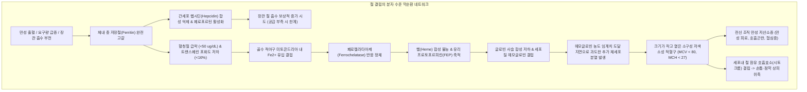

# 🩺 [[철결핍 빈혈]] (Iron Deficiency Anemia, IDA / 缺鐵性貧血, ICD-10: D50 / KCD: D50)

> **핵심 3줄 요약 (Key Summary)**:
> - 📍 **병소 부위 & 병태생리**: [[십이지장]] 및 상부 공장 점막 상피세포(DMT-1 및 페로포르틴), [[간]]세포 및 [[대식세포]] 저장철([[페리틴]]), [[골수]] 적모구 헤모글로빈([[헤모글로빈]]) 합성계. 철 섭취 부족, 흡수 장애, 체내 요구량 증가(임신·성장기), 만성 혈액 소실(월경과다, 위장관 잠혈)에 따른 저장철 고갈 → 헴(Heme) 합성 불능 → 소구성 저색소성(Microcytic hypochromic) [[적혈구]] 생성.
> - 🚩 **전형적 임상 양상 & 3대 징후**: 만성 전신 피로·운동 시 호흡곤란·안면 창백, 조직 철 결핍에 따른 스푼형 손톱(스푼형 조갑, Koilonychia) 및 구각염(Angular cheilitis)·위축성 설염, 비식용 물질을 갈망하는 이식증(Pica, 특히 얼음 갈망인 빙식증 Pagophagia) 및 [[하지불안증후군]]. 중증 진행 시 [[플러머-빈슨 증후군]](Plummer-Vinson syndrome: IDA + 식도 웹 + 연하곤란).
> - 🛠️ **핵심 감별 & 한·양방 치료 전략**: 혈청 [[페리틴]](<30 ng/mL, 만성 염증 시 <100 ng/mL), 혈청철(↓), TIBC(↑), [[트랜스페린]] 포화도(<16% 또는 <20%), 말초혈액도말 소구성 저색소성 적혈구 확인. 성인 남성 및 폐경 후 여성은 위장관 악성종양 출혈 규명 필수. 경구 철분제 격일 투여(Alternate-day dosing으로 [[헵시딘]] 반동 억제) 또는 정맥 철분제(수크로오스/카르복시말토오스) 투여. 한의학적 [[혈허]](血虛)·[[비위허약]](脾胃虛弱)·[[기혈양허]](氣血兩虛) 변증에 따른 [[당귀보혈탕]], [[귀비탕]], [[보중익기탕가미]], [[작약산]] 및 [[족삼리]], [[비수]], [[격수]], [[삼음교]] 침구 치법.
> - <font color="#fa7e7e">⚠️ **응급 의뢰 레드플래그**: 성인 남성 및 폐경 후 여성의 원인 불명 철결핍 빈혈([[위암]]·[[대장암]] 등 위장관 악성종양 출혈 의심 즉시 소화기내시경 의뢰), 헤모글로빈 심각 저하(Hb < 7 g/dL) 또는 혈역학적 불안정(실신, 기립성 저혈압, 안정 시 흉통, 허혈성 심근증), 흑색변(Melena) 또는 대량 혈변 즉시 상급 병원 응급 전원.</font>

---

## 📌 목차
1. [질환 개요 & 병태생리 (Disease Overview)](#1-질환-개요--병태생리-disease-overview)
2. [병태생리 메커니즘 & 대사·장기부전 악순환 네트워크](#2-병태생리-메커니즘--대사장기부전-악순환-네트워크)
3. [임상 증상 & 환자 소견 (Clinical Presentation)](#3-임상-증상--환자-소견-clinical-presentation)
4. [감별 진단 매트릭스 (Differential Diagnosis)](#4-감별-진단-매트릭스-differential-diagnosis)
5. [한의 통합 치료 프로토콜 (침·약침·한약)](#5-한의-통합-치료-프로토콜-침약침한약)
6. [양방 치료 & 병용·의뢰 기준 (Conventional Treatment & Referral)](#6-양방-치료--병용의뢰-기준-conventional-treatment--referral)
7. [식이·생활습관 & 자가관리 티칭 가이드](#7-식이생활습관--자가관리-티칭-가이드)
8. [💡 진료실 핵심 필기 & 임상 노하우](#8--진료실-핵심-필기--임상-노하우)
9. [출처 및 학술 참고 문헌 (References)](#9-출처-및-학술-참고-문헌-references)

---

## 1. 질환 개요 & 병태생리 (Disease Overview)

* **질환 정의 및 전 세계적 역학**:
  * 철결핍 빈혈(Iron Deficiency Anemia, IDA)은 체내 저장된 철분(Iron)이 고갈되어 [[적혈구]]의 산소 운반 핵심 단백질인 **[[헤모글로빈]](Hemoglobin)** 합성이 저해됨으로써 발생하는 질환이다.
  * 전 세계 인구의 약 25~30%가 철결핍 상태에 놓여 있으며, 임상적으로 확인되는 전 세계 빈혈 환자의 50% 이상을 차지하는 **가장 흔한 형태의 영양 결핍성 빈혈**이다.
  * 평균적혈구용적(MCV)이 80 fL 미만으로 작아지고, 평균적혈구혈색소량(MCH)이 27 pg 미만으로 감소하는 **소구성 저색소성 빈혈(Microcytic Hypochromic Anemia)**의 대표 질환이다.

* **체내 철 항상성과 3단계 결핍 진행 모델**:
  * **정상 체내 철 분포**:
    * 성인 인체의 총 철분량은 약 3~4 g(남성 3.5~4.0 g, 여성 2.5~3.0 g)이다.
    * **기능철(Functional Iron, 약 70~75%)**: 순환 [[적혈구]] 내 [[헤모글로빈]](약 65%), 근육 세포 내 미오글로빈(약 4~5%), [[미토콘드리아]] 시토크롬 및 카탈라아제 등 철 함유 호흡 효소(약 1%).
    * **저장철(Storage Iron, 약 20~30%)**: [[간]] 실질세포와 비장·골수의 [[대식세포]] 내에 **[[페리틴]](Ferritin)** 및 불용성 헤모시데린(Hemosiderin) 형태로 안전하게 격리 저장됨.
    * **수송철(Transport Iron, 약 0.1%)**: 혈청 내 아포트랜스페린과 결합된 **[[트랜스페린]](Transferrin)** 결합 철(약 3~4 mg).
  * **철 결핍의 3단계 진행 과정 (Stages of Iron Deficiency)**:
    * **1단계: 저장철 고갈기 (Storage Iron Depletion)**
      * 철 흡수량보다 소실량/요구량이 커 음성 철 균형(Negative iron balance)이 발생하여 간과 골수의 페리틴 저장고가 점진적으로 고갈된다.
      * **검사 소견**: **혈청 [[페리틴]] 저하 (< 30 ng/mL)**. 혈청철, 총철결합능(TIBC), 헤모글로빈, MCV는 모두 정상 범위를 유지하며, 환자는 무증상이다.
    * **2단계: 철결핍 조혈기 (Iron-Deficient Erythropoiesis)**
      * 저장철이 완전히 바닥나 골수 적모구로 공급되는 순환 철분이 부족해진다.
      * **검사 소견**: 혈청 페리틴 추가 저하 (< 15 ng/mL), **혈청철 감소 (< 50 $\mu$g/dL)**, **TIBC 상승 (> 380~400 $\mu$g/dL)**, **트랜스페린 포화도(TSAT) 저하 (< 16%)**, 유리 적혈구 프로토포르피린(FEP) 및 가용성 트랜스페린 수용체(sTfR) 상승. 헤모글로빈은 아직 정상 하한치이거나 경미하게 감소하며, 적혈구 형태는 정상구성을 유지한다.
    * **3단계: 현성 철결핍 빈혈기 (Frank Iron Deficiency Anemia)**
      * 철 결핍이 적혈구 생성의 절대적 제한 인자로 작용하여 헤모글로빈 합성이 급감한다.
      * **검사 소견**: **헤모글로빈(Hb) 및 헤마토크릿(Hct) 현저한 저하**, **MCV < 80 fL**, **MCH < 27 pg**, **MCHC < 32 g/dL**. 말초혈액도말상 소구성 저색소성 적혈구, 연필 모양 세포(Pencil cell), 표적세포(Target cell)가 출현하며 전신 조직 저산소증 및 상피세포 위축 증상이 발현된다.

* **인구 집단별 주요 병인 및 고위험군**:
  * **영유아 및 소아기 (생후 6개월 ~ 3세)**: 급속한 신체 성장 및 혈액량 팽창에 따른 요구량 급증, 철분이 결핍된 생우유 과다 섭취, 이유식 지연.
  * **가임기 여성 (15 ~ 49세)**: 매월 반복되는 월경 혈액 소실, 특히 [[자궁근종]], [[자궁선근증]], 기능성 자궁출혈로 인한 **월경과다(Menorrhagia)**.
  * **임신부 및 수유부**: 태아와 태반의 급격한 철 수요(임신 전 기간에 걸쳐 약 1,000 mg의 순수 철분 필요) 및 분만 시 출혈.
  * **성인 남성 및 폐경 후 여성**: <font color="#fa7e7e">**임상 제1원칙**: 이 인구 집단에서 발생하는 철결핍 빈혈은 영양 부족이 아니라 **반드시 위장관 만성 출혈, 특히 [[위암]]·[[대장암]] 등 위장관 악성종양의 신호로 간주**하고 원인을 규명해야 한다.</font> [[소화성 궤양]], 위식도 역류질환, NSAIDs 유발성 위점막 미란, 결장 게실, 혈관이형성증, [[치핵]].
  * **흡수 장애 질환군**: 위절제술(위산 감소로 $Fe^{3+} \rightarrow Fe^{2+}$ 환원 불능 및 십이지장 우회), 헬리코박터 파일로리(H. pylori) 감염, 만성 자가면역성 위염, [[셀리악병]], [[크론병]].

---

## 2. 병태생리 메커니즘 & 대사·장기부전 악순환 네트워크

```
[철 흡수·순환·조절 및 철결핍 빈혈의 병태생리 네트워크]

               식이 철분 섭취 (Heme iron / Non-heme iron Fe3+)
                                      │
                                      ▼
                      [십이지장 내강 (위산 매개 환원)]
                      Fe3+ ──(Dcytb 환원효소 / 비타민 C)──> Fe2+
                                      │
                                      ▼ (DMT-1 수송체)
                      [십이지장 장세포 (Enterocyte)]
                                      │
                         ┌────────────┴────────────┐
                         ▼                         ▼
                  세포 내 페리틴 저장       기저막 통과 방출
                                                   │ (페로포르틴 Ferroportin-1)
                                                   ▼
                                         Fe2+ ──(헤파에스틴)──> Fe3+
                                                   │
                                                   ▼
                                      [혈청 트랜스페린과 결합]
                                                   │
                      ┌────────────────────────────┼────────────────────────────┐
                      ▼                            ▼                            ▼
             [골수 조혈 적모구]             [간세포 저장고]            [비장·대식세포계]
             (CD71 수용체 결합)            (페리틴 과립 저장)           (노화 적혈구 탐식)
                      │                            │                            │
                      ▼                            └────────────┬───────────────┘
            [미토콘드리아 헴 합성]                               │
       (프로토포르피린 IX + Fe2+)                                │
                      │                                         ▼
                      ▼                             [간 헵시딘 (Hepcidin) 분비]
              [헤모글로빈 사슬 결합]                             │
                      │                        ┌────────────────┴────────────────┐
                      ▼                        ▼                                 ▼
           [정상 적혈구 성숙 방출]       [철 과잉 / 염증 시]               [철 결핍 빈혈 시]
                                         헵시딘 분비 폭증                 헵시딘 분비 차단
                                               │                                 │
                                               ▼                                 ▼
                                      페로포르틴 내재화 분해             페로포르틴 세포막 발현
                                      (장관 흡수 차단, 철 격리)          (장관 흡수 극대화, 저장철 방출)
                                               │
                                               ▼
                                      [만성질환 빈혈 (ACD)]
```



### 1) 분자·세포 수준 기전
* **장관 철 흡수 및 수송 메커니즘**:
  * 음식물 속 철분은 육류의 헴철(Heme iron, $Fe^{2+}$ 복합체)과 식물성의 비헴철(Non-heme iron, 주로 $Fe^{3+}$)로 구분된다. 비헴철은 위산의 산성 환경에서 용해된 후 십이지장 융모 솔가장자리의 십이지장 시토크롬 b(Dcytb) 및 [[비타민 C]]에 의해 $Fe^{2+}$(제일철)로 환원된다.
  * 2가 금속 수송체-1(DMT-1)을 통해 장세포 내로 능동 수송된 후, 기저측막에 존재하는 유일한 철 방출 통로인 **페로포르틴(Ferroportin-1)**을 통해 모세혈관으로 빠져나간다.
  * 방출된 $Fe^{2+}$는 막 결합 효소인 헤파에스틴(Hephaestin) 또는 혈청 세룰로플라스민에 의해 다시 $Fe^{3+}$(제이철)로 산화되어, 순환 혈장 내 트랜스페린 1분자당 2개의 $Fe^{3+}$가 결합하여 전신으로 운반된다.
* **헵시딘(Hepcidin) 중심의 철 대사 스위치**:
  * 간 실질세포에서 합성·분비되는 25개 아미노산 펩타이드인 **[[헵시딘]](Hepcidin)**은 체내 철 항상성의 핵심 지휘 호르몬이다.
  * 헵시딘은 장세포 및 [[대식세포]] 표면의 페로포르틴에 직접 결합하여 이를 세포 내로 내재화(Internalization)시킨 뒤 라이소좀에서 분해를 유도한다.
  * 철이 과잉되거나 전신 만성 염증(IL-6 자극)이 존재하면 헵시딘이 급증하여 장관 흡수를 차단하고 대식세포 내에 철을 가두어 버린다([[만성질환에 의한 빈혈]]).
  * 반대로 철결핍 상태에서는 헵시딘 합성이 강력히 억제되어 페로포르틴 발현이 극대화됨으로써 장관 흡수와 저장철 방출이 유도된다.
* **헴 합성 결손과 소구성(Microcytosis) 적혈구의 생성 원리**:
  * [[골수]] 적모구의 [[미토콘드리아]] 내에서 프로토포르피린 IX 고리에 페로켈라타아제(Ferrochelatase)가 $Fe^{2+}$를 삽입해야 비로소 헴(Heme)이 완성된다.
  * 철이 결핍되면 헴 합성이 차단되고 유리 적혈구 프로토포르피린(FEP)이 미토콘드리아에 축적된다.
  * 적모구는 세포질 내 헤모글로빈 농도가 일정 수준에 도달해야 성숙 정지 신호가 작동하여 탈핵(Enucleation) 과정을 거친다. 그러나 헤모글로빈 합성이 지연되면 정지 신호가 늦어져 **세포분열이 비정상적으로 1~2회 더 진행**된 후 분화되므로, 직경이 작고 부피가 줄어든 소구성(Microcytic, MCV < 80 fL) [[적혈구]]가 형성된다.

### 2) 장기·계통 수준 결과 및 대사 악순환
* **조직 호흡 효소 결핍과 상피세포 턴오버 붕괴**:
  * 철분은 헤모글로빈뿐만 아니라 세포질 및 미토콘드리아의 에너지 생산 효소(시토크롬 c, 시토크롬 산화효소, 숙신산 탈수소효소, 미오글로빈, 카탈라아제)의 핵심 조효소이다.
  * 철 결핍 시 적혈구 수치 저하에 따른 빈혈성 저산소증 외에도, **전신 조직의 미토콘드리아 호흡 억제와 ATP 생성 고갈**이 발생하여 환자는 빈혈 수치에 비해 훨씬 더 심한 근육 무력증과 극심한 피로를 겪는다.
  * 세포 분열과 턴오버 속도가 빠른 구강 점막, 혀 유두, 식도 상피, 조갑 기질 세포의 위축과 각화 이상이 초래되어 스푼형 손톱(Koilonychia), 구각염, 위축성 설염이 발현된다.

---

## 3. 임상 증상 & 환자 소견 (Clinical Presentation)

```
[철결핍 빈혈의 3대 전형 징후 및 조직 철 결핍 발현]
┌─────────────────────────────────────────────────────────────────────────────────┐
│ 1. 전신 저산소성 증상 : 극심한 만성 피로, 운동 시 호흡곤란, 현훈, 두통, 심계항진│
│ 2. 상피 조직 위축 징후 : 스푼형 손톱(Koilonychia), 구각염, 설 유두 위축성 설염 │
│ 3. 특이 신경행동 증상 : 이식증(Pica: 특히 얼음 갈망인 빙식증), 하지불안증후군   │
└─────────────────────────────────────────────────────────────────────────────────┘
```

### 1) 주소증 및 핵심 증상
* **전신 산소 운반 부전 증상**:
  * 가장 흔한 주소증은 점진적으로 심화되는 전신 피로감, 무기력, 지구력 저하이다.
  * 계단을 오르거나 빠르게 걸을 때 나타나는 운동 시 호흡곤란(DOE), 어지럼증, 집중력 감퇴, 두통, 귀에서 심장 박동 소리가 들리는 박동성 이명(Pulsatile tinnitus).
  * 피부 및 결막 창백(Conjunctival pallor), 입술 및 손톱밑 모세혈관층의 창백.
* **상피 및 결합조직 위축 징후 (조직 철 결핍)**:
  * **스푼형 손톱 (Koilonychia / 스푼형 조갑)**: 손톱이 얇아지고 쉽게 깨지며(Onycholysis), 손톱의 중앙부가 숟가락처럼 오목하게 파이고 가장자리가 위로 말려 올라가는 병적 변형.
  * **구각염 (Angular cheilitis)**: 양측 입꼬리가 붉게 헐고 깊게 갈라지며 통증과 가피가 형성됨.
  * **위축성 설염 (Atrophic glossitis)**: 혀 표면의 사상유두가 소실되어 반들반들하고 붉은 광택을 띠며, 매운 음식 섭취 시 혀의 작열통과 통증을 호소함.
  * **취약한 모발**: 머리카락이 가늘어지고 건조해지며 탈모가 동반됨.
* **특이 신경행동학적 증상**:
  * **이식증 (Pica)**: 영양가가 없는 비식용 물질을 강박적으로 집착하여 먹는 이상 행동.
    * **빙식증(Pagophagia)**: 얼음을 반복적으로 씹어 먹는 증상으로, 철결핍 환자에서 가장 흔하고 특이적인 이식증 소견(약 50% 이상에서 관찰).
    * 기타 흙, 분필, 종이, 전분, 생쌀(Amylophagia) 등을 갈망함. 철분 보충 즉시 수일 내로 소실되는 특징이 있다.
  * **[[하지불안증후군]](Restless Legs Syndrome, RLS)**:
    * 저녁이나 수면 전 다리에 벌레가 기어가는 듯한 불쾌한 감각과 함께 다리를 계속 움직이고 싶은 강한 충동을 느낌.
    * 뇌 흑질(Substantia nigra)의 도파민 합성 필수 효소인 티로신 수산화효소(Tyrosine hydroxylase)의 철분 조효소 결핍에 기인하며, IDA 환자의 약 25~30%에서 병발한다.
* **플러머-빈슨 증후군 ([[플러머-빈슨 증후군]], Plummer-Vinson / Paterson-Kelly Syndrome)**:
  * **철결핍 빈혈 + 식도 점막 웹(Esophageal web) + 연하곤란(Dysphagia)**의 3대 징후.
  * 중년 여성에서 호발하며, 고형 음식물 섭취 시 목에 걸리는 연하곤란을 호소함. 식도암(편평상피세포암)의 전암성 병변으로 간주되어 철저한 모니터링이 필요하다.

### 2) 객관적 소견 (Signs & Labs)
* **신체 진찰 소견**:
  * 눈 결막의 현저한 창백, 빈맥(Tachycardia), 수축기 혈류성 심잡음(Systolic flow murmur, 혈액 점도 저하로 인한 난류 발생).
* **혈액 및 철 관련 검사 진단 매트릭스**:

| 검사 항목 | 정상 참고치 | 철결핍 빈혈 (IDA) | 판독 및 임상적 의의 |
| :--- | :--- | :--- | :--- |
| **혈색소 (Hb)** | 남: 13~17, 여: 12~16 g/dL | **저하 (< 12 g/dL)** | 중증도 판정 (경증 10~12, 중등도 8~10, 중증 < 8) |
| **MCV** | 80 ~ 100 fL | **현저한 저하 (< 80 fL)** | 소구성 빈혈 (대개 60~75 fL) |
| **MCH** | 27 ~ 33 pg | **저하 (< 27 pg)** | 저색소성 빈혈 |
| **RDW** | 11.5 ~ 14.5 % | **현저한 상승 (> 15%)** | 적혈구 크기 불균일(Anisocytosis)의 조기 지표 |
| **혈청 페리틴** | 30 ~ 200 ng/mL | **급락 (< 15~30 ng/mL)** | **체내 저장철 고갈을 반영하는 최고 민감도/특이도 지표** |
| **혈청 철 (Serum Fe)** | 60 ~ 170 $\mu$g/dL | **저하 (< 50 $\mu$g/dL)** | 순환계 공급 철분 부족 |
| **총 철결합능 (TIBC)** | 250 ~ 380 $\mu$g/dL | **상승 (> 380~400 $\mu$g/dL)** | 비어있는 [[트랜스페린]] 결합 부위의 보상적 증가 |
| **트랜스페린 포화도** | 20 ~ 50 % | **급락 (< 16%)** | Serum Fe / TIBC × 100 (골수 철 공급 결핍 상태) |
| **말초혈액도말 (PBS)** | 균일한 원형 적혈구 | **중앙담색부 확대, 연필세포** | 적혈구 중앙 담색부(Central pallor)가 직경의 2/3 초과 |

---

## 4. 감별 진단 매트릭스 (Differential Diagnosis)

```
[소구성 저색소성 빈혈 (MCV < 80 fL) 감별 진단 "TAILS" 매트릭스]
┌───────────────────┬──────────────┬──────────────┬──────────────┬──────────────┬──────────────┐
│ 질환군            │ 혈청 페리틴  │ 혈청 철 (Fe) │ TIBC         │ TSAT (%)     │ RDW          │
├───────────────────┼──────────────┼──────────────┼──────────────┼──────────────┼──────────────┤
│ 철결핍 빈혈 (IDA) │ 급락 (<30)   │ 저하 (<50)   │ 상승 (>380)  │ 급락 (<16)   │ 현저한 상승  │
│ 만성질환 빈혈(ACD)│ 정상~상승    │ 저하 (<50)   │ 저하 (<250)  │ 정상~경도저하│ 정상~경도상승│
│ 지중해빈혈 소질   │ 정상~상승    │ 정상         │ 정상         │ 정상         │ 정상 (균일)  │
│ 철적모구성 빈혈   │ 현저한 상승  │ 상승 (>150)  │ 정상~저하    │ 상승 (>50)   │ 상승         │
│ 납 중독 (Lead)    │ 정상         │ 정상         │ 정상         │ 정상         │ 호염기반점   │
└───────────────────┴──────────────┴──────────────┴──────────────┴──────────────┴──────────────┘
```

| 감별 질환 | 병태생리적 차이 | 혈액 검사 감별 포인트 | 임상적 감별점 |
| :--- | :--- | :--- | :--- |
| **[[철결핍 빈혈]] (본 질환)** | 체내 절대적 철 부족, 저장철 고갈 | 페리틴 < 30 ng/mL, TIBC 상승, TSAT < 16%, sTfR 상승 | 출혈 원인 규명 필수, 철분제 투약 시 극적 호전 |
| **[[만성질환에 의한 빈혈]] (ACD)** | 염증(IL-6)으로 인한 헵시딘 증가, 대식세포 내 철 격리 | **페리틴 정상 또는 상승 (> 100 ng/mL)**, TIBC 저하, 헵시딘 상승 | 만성 감염, 자가면역질환, 악성종양 동반, 철분제 반응 없음 |
| **지중해빈혈 소질 (Thalassemia trait)** | 글로빈 사슬(알파/베타) 유전적 합성 결함 | **페리틴 정상**, **Mentzer index < 13**, 적혈구 수 정상~증가 | 가족력, 골수 철 정상, 전기영동상 $HbA_2$ 또는 HbF 증가 |
| **철적모구성 빈혈 (Sideroblastic anemia)** | 미토콘드리아 내 헴 합성 효소 장애 | **페리틴 상승**, 혈청철 상승, 골수 내 환상 철적모구(Ringed sideroblast) | 골수이형성증후군(MDS), 알코올, 납 중독, 이소니아지드 복용 |

> 🚩 **레드플래그 감별 (위장관 악성종양 출혈)**:
> - 성인 남성이나 폐경 후 여성에서 식이 결핍이나 뚜렷한 출혈 병력이 없음에도 철결핍 빈혈이 확인된 경우, 증상이 없더라도 **[[대장암]](Colorectal cancer, 특히 맹장·상행결장의 무증상 암)**이나 **진행성 [[위암]](Gastric cancer)**의 잠혈 출혈을 최우선으로 의심해야 한다.
> - 즉시 대장내시경 및 상부위장관 내시경을 시행하여 악성종양 유무를 확진해야 한다.

---

## 5. 한의 통합 치료 프로토콜 (침·약침·한약)

* **한의 병리 기전 및 변증 체계**:
  * 한의학에서 철결핍 빈혈은 수곡정미(水穀精微)를 화생(化生)하여 혈을 생성하는 비위(脾胃)의 기능 실조로 인한 **[[혈허]](血虛)**, **[[비위허약]](脾胃虛弱)**, **[[기혈양허]](氣血兩虛)**, **허로(虛勞)**로 인식한다.
  * *“비위위기혈생화지원(脾胃爲氣血生化之源)”*: 철분의 장관 흡수와 조혈 작용은 중초(中焦) 비위의 소화 운화력에 전적으로 의존하므로, 단순히 철을 공급하는 것뿐만 아니라 장관 점막의 수송 능력을 북돋우는 **건비익기(健脾益氣)**와 **보기생혈(補氣生血)**이 핵심 치법이다.

* **변증 분류 및 맞춤 처방 (Herbal Medicine)**:
  1. **비위허약(脾胃虛弱)형**:
     * **임상 양상**: 소식, 식욕 부진, 식후 복모, 사지 나태, 변비 또는 묽은 변, 면색위황, 설담태백, 맥완약.
     * **치법**: 건비화위(健脾和胃), 보기생혈(補氣生血).
     * **대표 처방**: **[[보중익기탕가미]](補中益氣湯加味)** 또는 **[[향사육군자탕]](香砂六君子湯)**.
     * **처방 구성**: [[황기]] 15g, [[인삼]] 8g, [[백출]] 10g, [[당귀]] 8g, [[진피]] 6g, [[승마]] 3g, [[시호]] 3g, [[감초]] 4g + [[숙지황]] 10g, [[백작약]] 8g, [[사인]] 4g.
  2. **기혈양허(氣血兩虛) / 혈허영체(血虛營滯)형**:
     * **임상 양상**: 안면 창백, 입술·손톱 창백, 두훈, 안화(눈앞이 아찔함), 심계, 숨참, 설담태소, 맥세약.
     * **치법**: 익기보혈(益氣補血), 자음화영(滋陰和營).
     * **대표 처방**: **[[당귀보혈탕]](當歸補血湯)** ([[황기]] 30g : [[당귀]] 6g의 5:1 보기생혈 비율), **[[팔진탕]](八珍湯)**, **[[십전대보탕]](十全大補湯)**.
     * **약리 기전**: 당귀보혈탕은 골수 조혈모세포의 증식을 자극하고 적혈구생성인자(EPO) 발현을 유도하며 장관 내 철분 흡수 수송체(DMT-1)의 활성을 촉진함.
  3. **심비양허(心脾兩虛)형**:
     * **임상 양상**: 심계항진, 불면, 다몽, 건망, 두통, 소화불량, 피로, 설담, 맥세삭.
     * **치법**: 보익심비(補益心脾), 양혈안신(養血安神).
     * **대표 처방**: **[[귀비탕]](歸脾湯)**.
     * **구성**: 당귀, 용안육, 산조인, 원지, 인삼, 황기, 백출, 복신, 목향, 감초, 생강, 대추.
  4. **비신양허(脾腎陽虛) / 붕루출혈(崩漏出血)형 (만성 월경과다 동반)**:
     * **임상 양상**: 월경량 과다 또는 부정출혈, 하지 냉감, 요슬산연, 만성 피로, 연변, 설담반흔, 맥침세.
     * **치법**: 온양익신(溫陽益腎), 고충지혈(固衝止血).
     * **대표 처방**: **[[궁귀교애탕]](芎歸膠艾湯)** 합 **[[작약산]](芍藥散)** 가감.
     * **약물 배오**: 아교 8g, 애엽 6g, 당귀 10g, 천궁 6g, 백작약 12g, 숙지황 15g, 건지황 10g, 포황(초) 8g, 오징어뼈(해표초) 10g.

* **침구 치료 (Acupuncture)**:
  * **비위 운화 및 조혈 기능 촉진 배혈**:
    * **주혈**: [[족삼리]](ST36), [[삼음교]](SP6), [[비수]](BL20), [[격수]](BL17, 팔회혈 중 혈회혈), [[중완]](CV12), [[기해]](CV6), [[혈해]](SP10).
    * **자침 기법**: 족삼리와 비수에 염전보법(捻轉補法)을 시행하며, 격수와 혈해를 배오하여 혈액 순환 및 골수 조혈을 유도. 20분간 유침.
  * **자궁 지혈 및 월경과다 조절 배혈**:
    * **특효혈**: [[은백]](SP1 - 온침 또는 직접구 3~5장), [[관원]](CV4), 자궁(EX-CA1), [[삼음교]](SP6).
  * **하지불안증후군(RLS) 동반 시 배혈**:
    * [[양릉천]](GB34), 승산(BL57), [[태충]](LR3), 곤륜(BL60)에 사법(瀉法) 또는 전침 자극(2/100Hz 혼합파)을 적용하여 국소 하지 근막 긴장 완화 및 도파민성 신경 흥분 진정.

* **약침 치료 (Pharmacopuncture)**:
  * **자하거(Hominis Placenta) 약침**:
    * 대보원기(大補元氣), 익정보혈(益精補血) 작용으로 철분 흡수 촉진 및 골수 적아구 증식 유도.
    * 격수(BL17), [[신수]](BL23), 족삼리(ST36), 혈해(SP10)에 회당 0.1~0.2 cc씩 총 1.0~1.5 cc 주입 (주 2~3회).
  * **황기 약침**: 비위 허약으로 인한 피로와 소화기 흡수 장애가 심한 환자의 중완(CV12), 비수(BL20)에 시술.

* **뜸 치료 (Moxibustion)**:
  * 중완(CV12), 관원(CV4), 족삼리(ST36)에 간접 온구 요법을 시행하여 중초 소화관 평활근의 혈류를 증가시키고 소장 융모의 DMT-1 철분 흡수 효율을 극대화.

---

## 6. 양방 치료 & 병용·의뢰 기준 (Conventional Treatment & Referral)

* **경구 철분제(Oral Iron Supplementation) 최신 프로토콜**:
  * **약제 종류 및 원소철 함량**:
    * **[[황산제일철]] (Ferrous sulfate)**: 건조황산제일철 200 mg (원소철 약 65 mg 함유). 가장 저렴하고 표준적인 2가철 제제.
    * **푸마르산제일철 (Ferrous fumarate)**: 200 mg (원소철 약 66 mg 함유).
    * **글루콘산제일철 (Ferrous gluconate)**: 300 mg (원소철 약 35 mg 함유). 위장관 자극이 상대적으로 적음.
    * **3가철 수산화폴리말토오스 복합체 (Ferric hydroxide polymaltose complex)**: 위장관 부작용이 현저히 적으나 2가철에 비해 초기 흡수율이 다소 낮음.
  * **💡 최신 가이드라인: 격일 복용법 (Alternate-Day Dosing, 60~100 mg elemental iron every other day)**:
    * **전통적 방식의 한계**: 과거에는 1일 150~200 mg의 원소철을 2~3회 분할 복용하도록 권고했으나, 과량의 철분이 간세포를 자극하여 [[헵시딘]](Hepcidin) 수치를 24~48시간 동안 급격히 치솟게 만든다.
    * 매일 복용 시 후속 투여된 철분의 흡수 분율(Fractional absorption)이 50% 이하로 급감하고, 장내에 흡수되지 못한 철분이 활성산소를 발생시켜 위점막을 자극하여 오심, 상복부 작열감, 심한 변비, 설사 등 위장관 부작용(환자의 30~50%)을 유발하여 약물 중단으로 이어진다.
    * **격일 복용의 이점**: **이틀에 한 번(격일 아침 공복) 60~100 mg의 원소철을 단일 복용**하면 헵시딘 반동 상승을 회피할 수 있어 총 흡수량이 매일 복용과 대등하거나 우수하며, **위장관 부작용을 거의 절반으로 감소시켜 순응도를 극대화**한다.
  * **복약 지도 수칙**:
    * 아침 기상 직후 공복에 물 또는 [[비타민 C]](아스코르브산 200~500 mg, 또는 감귤류 주스)와 함께 복용 (위산과 비타민 C가 $Fe^{3+} \rightarrow Fe^{2+}$ 환원을 촉진하여 흡수율 2~3배 상승).
    * 제산제, 양성자펌프억제제(PPI), 칼슘제, 우유, 커피, 녹차와는 최소 2시간 이상 분리하여 복용.

* **정맥 철분제(Intravenous Iron) 적응증 및 투여**:
  * **적응증**:
    1. 경구 철분제에 대한 극심한 위장관 불내성 또는 알레르기 반응.
    2. 흡수 장애 질환(위절제술 환자, 비만대사수술 후, 크론병, 셀리악병).
    3. 지속적인 혈액 소실량이 경구 흡수 한계량을 초과하는 경우(중증 자궁출혈, 유전성 출혈성 모세혈관확장증).
    4. 임신 2~3분기의 중증 빈혈(출산 전 신속한 헤모글로빈 교정 필요).
    5. 만성 신부전(CKD, 투석 환자) 및 조혈호르몬(ESA) 투여 환자.
  * **주요 정맥 제제**:
    * **페릭 카르복시말토오스 (Ferric carboxymaltose, 페린젝트)**: 1회 500~1,000 mg의 대용량을 15분 만에 급속 점적 주질 가능.
    * **철 수크로오스 (Iron sucrose, 베노퍼)**: 1회 100~200 mg을 생리식염수에 희석하여 분할 점적.
  * **총 필요 철분량 계산 (간조니 공식, Ganzoni Formula)**:
    $$\text{Total Iron Deficit (mg)} = \text{체중(kg)} \times (\text{목표 Hb} - \text{현재 Hb})(\text{g/dL}) \times 2.4 + \text{저장철 보충량(500 mg)}$$

* **치료 반응 판정 및 투약 기간의 대원칙**:
  * **[[망상적혈구]] 반응**: 투약 3~5일 후부터 상승하여 7~10일째 정점에 도달.
  * **헤모글로빈 회복**: 2~3주 내에 1~2 g/dL 상승하며, 대개 2개월 이내에 정상 범위로 회복된다.
  * <font color="#fa7e7e">**치료 지속의 핵심 원칙**: 헤모글로빈 수치가 정상화되었다고 해서 철분제를 즉시 중단해서는 안 된다. 골수와 간의 **저장철(혈청 페리틴 > 50 ng/mL)을 완전히 채우기 위해 혈색소 정상화 후에도 최소 3~6개월간 철분제를 추가 복용**해야 재발을 방지할 수 있다.</font>

* **한의 병용 및 전문과 의뢰 기준 (Referral Criteria)**:
  * **한양방 병용 시너지**: 경구 철분제 복용 중 변비나 소화불량을 호소하는 환자에게 [[보중익기탕가미]] 또는 [[당귀보혈탕]]을 병용하면 철분제 흡수율을 높이고 위장관 점막 손상을 방어함.
  * **🚨 즉각적 상급병원 응급실 전원**:
    * 헤모글로빈 < 7 g/dL의 중증 빈혈 환자에서 실신, 기립성 저혈압, 안정 시 흉통, 심부전 증상이 동반된 경우 (농축적혈구 수혈 요망).
    * 대량 혈변 또는 토혈, 타르성 흑색변(Melena) 등 활동성 소화관 대량 출혈 의심 시.
  * **소화기내과 의뢰**: 성인 남성 및 폐경 후 여성의 모든 신규 철결핍 빈혈 (위/대장 내시경 스크리닝).
  * **산부인과 의뢰**: 극심한 월경과다 및 골반통을 동반한 자궁근종·자궁선근증 의심 가임기 여성.

---

## 7. 식이·생활습관 & 자가관리 티칭 가이드

* **식이 지도 (Dietary Guidance)**:
  * **헴철(Heme iron) 우선 섭취**:
    * 붉은 살코기(소고기, 돼지고기), 닭고기, 생선, 굴, 조개류, 동물의 간.
    * 헴철은 장내 식사 구성 요소나 pH의 영향을 받지 않고 15~35%의 높은 흡수율을 보이므로 비헴철보다 우선 권장된다.
  * **비헴철(Non-heme iron) 섭취 및 흡수 촉진**:
    * 시금치, 케일, 깻잎, 두류(렌틸콩, 병아리콩), 견과류, 두부, 건포도.
    * 비헴철 섭취 시 반드시 **[[비타민 C]]가 풍부한 과일(오렌지, 딸기, 키위)이나 채소를 함께 섭취**하도록 지도한다.
  * **철분 흡수 저해 인자 차단**:
    * **탄닌(Tannin)**: 홍차, 녹차, 커피, 와인에 함유된 탄닌은 철분과 불용성 복합체를 형성하여 흡수율을 60~90% 떨어뜨린다.
    * **피트산(Phytate)**: 정제되지 않은 통곡물, 콩류 껍질에 다량 함유.
    * **칼슘(Calcium)**: 우유, 치즈, 칼슘 보충제는 DMT-1 경로를 경쟁적으로 억제함.
    * **수칙**: 식사 중이나 식후 1~2시간 이내에는 녹차, 커피, 우유 섭취를 엄격히 금한다.
* **생활습관 및 복약 순응도 관리**:
  * **대변 흑색화에 대한 사전 고지**:
    * 철분제 복용 시 배출되는 대변이 흑록색 또는 검은색으로 변하는 것은 장내에서 산화된 미흡수 철분에 의한 정상적인 생리 현상임을 반드시 설명하여 환자가 놀라 임의 중단하지 않도록 안심시킨다.
  * **변비 예방 티칭**:
    * 철분제 복용 중 흔히 발생하는 변비를 예방하기 위해 하루 1.5~2.0 L의 충분한 수분을 섭취하고, 차전자피 등 수용성 식이섬유 섭취를 권장한다.
* **환자 교육 스크립트**:
  * *"철결핍 빈혈 환자분들의 몸은 바닥난 통장 계좌와 같습니다. 헤모글로빈이 정상으로 올라온 것은 지갑에 당장 쓸 용돈이 생긴 것에 불과하며, 간과 골수라는 은행 금고에 비상금(저장철 페리틴)을 채워 넣지 않으면 약을 끊자마자 다시 빈혈로 곤두박질칩니다. 피 검사에서 빈혈이 다 나았다고 하더라도 의사의 안내에 따라 최소 3개월에서 6개월간 철분제를 꾸준히 더 드셔야 완치됩니다."*

---

## 8. 💡 진료실 핵심 필기 & 임상 노하우

### 1) 철분제 위장 장애 환자의 실전 극복 3단계 전략
* **1단계: 복약 주기 변경 (격일 복용으로 전환)**
  * 매일 아침 복용하던 철분제를 이틀에 한 번(격일 아침 공복)으로 변경한다. 이것만으로도 간의 헵시딘 과자극이 차단되고 장내 유리 철분 잔류량이 줄어들어 환자가 호소하던 속쓰림과 구역감이 50% 이상 즉각 호전된다.
* **2단계: 복약 시간대 변경 또는 제형 교체**
  * 공복 복용 시 속쓰림이 극심하다면 식후 즉시 또는 취침 직전 복약으로 변경한다 (흡수율은 약 30% 감소하지만 순응도를 지킬 수 있음).
  * 이온화되지 않는 3가철 착염 제제(수산화철 폴리말토오스 복합체)나 단백질 결합철 제제로 변경한다.
* **3단계: 한약(당귀보혈탕 / 보중익기탕) 복합 처방**
  * 비위 점막을 보양하고 위장관 연동 운동을 조절하는 한약을 식전 30분에 복용시키고, 철분제는 식후 2시간에 격일로 복용시키면 철분제 흡수율 상승과 위장관 부작용 소실이라는 최적의 치료 시너지를 얻을 수 있다.

### 2) 숨어있는 철결핍 (Iron Deficiency without Anemia) 감별 노하우
* **임상 현장의 흔한 오류**:
  * 만성 피로, 하지불안증후군, 탈모, 원인 모를 공황 증세나 브레인 포그를 호소하는 젊은 여성 환자에서 CBC 검사상 Hb 12.5 g/dL, MCV 84 fL로 나오면 "혈액 검사상 빈혈이 전혀 없습니다"라고 오판하기 쉽다.
  * 그러나 혈청 페리틴을 확인하면 **페리틴 수치가 8~15 ng/mL로 심각하게 고갈되어 있는 '잠재성 철결핍증(Latent iron deficiency)'**인 경우가 대단히 흔하다.
  * 헤모글로빈 수치는 정상이라도 조직 내 시토크롬 효소와 미토콘드리아의 철 결핍으로 인해 심각한 전신 피로와 뇌 신경전달물질 대사 이상이 초래되므로, 전형적인 철 결핍 증상을 호소하는 가임기 여성에서는 반드시 페리틴 검사를 루틴으로 시행하여 철분을 보충해야 한다.

---

## 9. 출처 및 학술 참고 문헌 (References)

1. **Ambreen A, Malik R, Tariq S, et al.** (2025). Assessment of Adherence to Oral Iron Supplementation Guidelines in Patients With Iron Deficiency Anemia: A Cross-Sectional Study. *Cureus*. 17(7):e87681. [PMID 40786388](https://pubmed.ncbi.nlm.nih.gov/40786388/)
   - **[연구 요약]**: 철결핍 빈혈 환자군에서 경구 철분제 보충 가이드라인 준수도와 순응도를 단면 조사하고, 위장관 부작용에 따른 자의적 약물 중단율 및 환자 복약 교육과 용량 조절이 치료 성공률에 미치는 결정적 영향을 규명함.

2. **O'Toole F, Higgins J, Smith M, et al.** (2024). Screening and treatment of iron deficiency anemia in pregnancy: A review and appraisal of current international guidelines. *Int J Gynaecol Obstet*. 166(1):214-227. [PMID 38069617](https://pubmed.ncbi.nlm.nih.gov/38069617/)
   - **[연구 요약]**: 임신부 철결핍 빈혈의 선별 검사 및 치료에 관한 국제 표준 가이드라인들을 체계적으로 비교 평가하고, 페리틴 선별 기준, 경구 철분제의 격일 복용법 이점, 중증 및 임신 후기 빈혈에서 정맥 철분제의 안전성 및 조기 치료 적응증을 종합 제시함.

3. **Camaschella C.** (2015). Iron-Deficiency Anemia. *N Engl J Med*. 372(19):1832-1843. [doi:10.1056/NEJMra1401038](https://doi.org/10.1056/NEJMra1401038)
   - **[세미나 요약]**: 철 대사의 분자 기전, 헵시딘-페로포르틴 축에 의한 철 흡수 조절, 소구성 빈혈의 감별 진단, 경구 및 정맥 철분제의 현대적 치료 프로토콜을 총망라한 뉴잉글랜드의학저널(NEJM)의 표준 임상 리뷰.

4. **MSD 매뉴얼 전문가용** — [철결핍 빈혈 (Iron Deficiency Anemia)](https://www.msdmanuals.com/professional/hematology-and-oncology/anemias-caused-by-deficient-erythropoiesis/iron-deficiency-anemia)
   - **[매뉴얼 요약]**: 철결핍 빈혈의 병기별 검사 소견, 소구성 저색소성 적혈구 판독, 성인 남성 및 폐경 후 여성의 위장관 출혈 감시 원칙, 경구 황산제일철 및 정맥 철분제 치료 지침 총괄.
