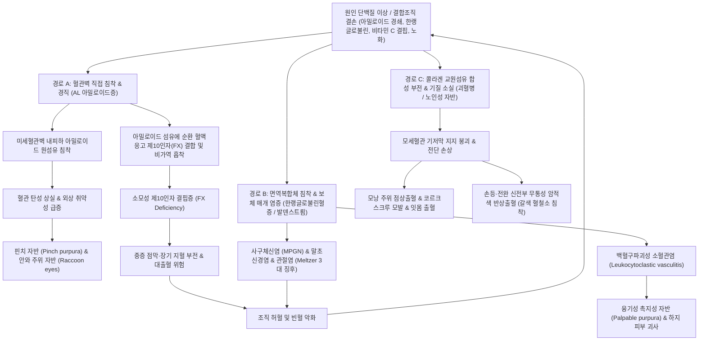

# 🩺 [[타박상 또는 출혈을 유발하는 단백질 장애]] (Bruising or Bleeding Due to Blood Vessel and Protein Disorders / 血管·異常蛋白血症性 紫斑症, ICD-10: D69.0, D69.8, E85 / KCD: D69.0, D69.8, E85)

> **핵심 3줄 요약 (Key Summary)**:
> - 📍 **병소 부위 & 해부·병태생리**: 혈소판 수 및 표준 응고 검사가 정상임에도 불구하고, 미세혈관벽 내피 손상, 진피 결합조직 지지 구조 결손, 또는 비정상 단백질(아밀로이드 경쇄, 한랭글로불린, 다클론성 면역글로불린)의 혈관벽 침착 및 혈관염으로 인해 모세혈관 취약성이 급증하여 출혈이 발생하는 혈관성·단백질성 자반 질환군.
> - 🚩 **전형적 임상 양상 & 3대 징후**: 경미한 마찰에도 발생하는 핀치 자반(Pinch purpura) 및 눈주위 자반(Periorbital purpura/Raccoon eyes), 하지 중심의 촉지성 자반(Palpable purpura)과 관절통, 모낭 주위 출혈(Perifollicular hemorrhage)과 코르크스크루 모발(Corkscrew hair).
> - 🛠️ **핵심 감별 검사 & 한·양방 다각적 치료 전략**: 혈청/소변 단백전기영동(SPEP/UPEP), 유리경쇄(FLC), 한랭글로불린 검사, 보체(C3/C4), 비타민 C 농도 측정, 혈액응고 [[제10인자]](Factor X) 활성도 평가. 기불섭혈(氣不攝血)·음허혈열(陰虛血熱)·기체혈어(氣滯血瘀) 변증에 따른 [[귀비탕]], [[서각지황탕]], [[당귀음자]], [[보중익기탕]] 투여 및 원인 단백질 제어(면역글로불린 경쇄 표적 항암화학요법, 혈장교환술, 비타민 C 보충).
> - <font color="#fa7e7e">⚠️ **응급 의뢰 레드플래그 & 악화 요인**: AL 아밀로이드증에서 아밀로이드 섬유의 순환 제10인자 비가역적 흡착에 따른 급성 소모성 제10인자 결핍성 대출혈, 한랭글로불린혈증성 급진행성 사구체신염(RPGN) 및 폐포 출혈, 장간막 혈관염 의심 시 즉시 혈액내과·신장내과 응급 전원.</font>

---

## 📌 목차
1. [질환 개요 & 병태생리 (Disease Overview)](#1-질환-개요--병태생리-disease-overview)
2. [병태생리 메커니즘 & 대사·장기부전 악순환 네트워크](#2-병태생리-메커니즘--대사장기부전-악순환-네트워크)
3. [임상 증상 & 환자 소견 (Clinical Presentation)](#3-임상-증상--환자-소견-clinical-presentation)
4. [감별 진단 매트릭스 (Differential Diagnosis)](#4-감별-진단-매트릭스-differential-diagnosis)
5. [한의 통합 치료 프로토콜 (침·약침·한약)](#5-한의-통합-치료-프로토콜-침약침한약)
6. [양방 치료 & 병용·의뢰 기준 (Conventional Treatment & Referral)](#6-양방-치료--병용의뢰-기준-conventional-treatment--referral)
7. [식이·생활습관 & 자가관리 티칭 가이드](#7-식이생활습관--자가관리-티칭-가이드)
8. [💡 진료실 핵심 필기 & 임상 노하우](#8--진료실-핵심-필기--임상-노하우)
9. [출처 및 학술 참고 문헌 (References)](#9-출처-및-학술-참고-문헌-references)

---

## 1. 질환 개요 & 병태생리 (Disease Overview)

* **질환 정의 및 병태 분류**:
  * **타박상 또는 출혈을 유발하는 단백질 장애(Bruising or Bleeding Due to Blood Vessel and Protein Disorders)**는 순환 혈소판의 수적 결손([[혈소판감소증]])이나 고전적 혈장 응고인자([[혈우병]], 간질환성 응고장애) 결핍 없이, **혈관벽 자체의 구조적 결함**, **혈관 주위 지지 결합조직의 위축**, 또는 **혈액 내 비정상 단백질의 침착 및 면역 복합체 매개 혈관염**에 의해 미세혈관이 파열되어 피부와 점막에 자반(Purpura)과 반상출혈(Ecchymosis)을 일으키는 질환군을 총칭한다.
  * 본 질환군은 크게 ① **이상단백혈증성 자반증(Dysproteinemic purpura)**, ② **결합조직 및 콜라겐 합성 결손 장애**, ③ **미세혈관염 및 면역복합체 질환**으로 분류된다:
    1. **[[아밀로이드증]](Amyloidosis, 특히 면역글로불린 경쇄 AL 아밀로이드증)**: 단클론성 형질세포 증식증으로 생성된 불안정한 면역글로불린 경쇄(Light chain)가 β-시트(β-sheet) 원섬유 형태로 미세혈관벽과 결합조직에 침착되어 혈관 취약성을 유발하고, 특이적으로 혈액응고 [[제10인자]](Factor X)를 흡착하여 소모성 결핍을 초래함.
    2. **[[한랭글로불린혈증]](Cryoglobulinemia, I~III형)**: 37℃ 미만에서 불용성 단백 응집체를 형성하고 체온 복귀 시 재용해되는 비정상 면역글로불린이 한랭 노출 시 모세혈관 및 세정맥을 폐색하고 면역복합체 침착으로 소혈관염을 촉발함.
    3. **발덴스트룀 고감마글로불린혈증 자반증(Hypergammaglobulinemic purpura of Waldenström)**: 쇼그렌 증후군 등 자가면역 질환 환자에서 다클론성 고감마글로불린(주로 IgG)과 7S-19S 순환 복합체가 하지 혈류 정체 시 백혈구파괴성 혈관염을 유발하여 재발성 촉지성 자반을 형성함.
    4. **[[괴혈병]](Scurvy / Vitamin C 결핍증)**: 아스코르브산 결핍으로 프로콜라겐의 프롤린 및 리신 수산화가 차단되어 삼중나선 콜라겐 교원섬유가 붕괴되고 미세혈관 기저막이 구조적으로 파탄됨.
    5. **노인성 자반(Senile purpura / Bateman's purpura)**: 노화 및 광노화로 진피 결합조직 기질이 소실되어 표재 혈관을 지지하지 못해 경미한 전단력에도 혈관이 전단 파열됨.

* **관련 장기 및 조직 계통**:
  * **주 이환 조직 및 장기**: 진피(Dermis) 및 피하지방층 미세순환망(모세혈관·모세혈관후 세정맥), [[피부]], [[혈관 내피세포]], 혈관 기저막(Basement membrane), 세포외 기질([[콜라겐]], 엘라스틴, 프로테오글리칸).
  * **주요 침범 표적 장기 (아밀로이드증·한랭글로불린혈증 동반 시)**:
    - [[심장]]: 심근 세포간질 아밀로이드 침착으로 인한 제한성 심근병증, 저전압 심전도, 전도장애.
    - [[신장]]: 사구체 메산지움 침착, 네프로제 증후군(단백뇨), 막증식성 사구체신염(MPGN).
    - 말초신경계: 원위부 대칭성 감각신경병증, [[수근관 증후군]](손목터널 내 아밀로이드 침착).
    - 소화기계: 혀 침범으로 인한 [[대설증]](Macroglossia), 위장관 출혈 및 운동 장애.
  * **연관 조혈·응고 단백질**:
    - [[면역글로불린]](IgG, IgM, IgA, κ/λ 경쇄), 보체계([[보체 C3]], [[보체 C4]]), 혈액응고 [[제10인자]](Factor X, Stuart-Prower factor), [[아스코르브산]](Vitamin C).

---

## 2. 병태생리 메커니즘 & 대사·장기부전 악순환 네트워크

```
[ 단백질 이상 및 혈관 기질 결손 발생 ]
  │
  ├─▶ 1. AL 아밀로이드증 : 비정상 면역글로불린 경쇄(Light chain)의 아밀로이드 섬유화
  │      └─ 진피 모세혈관벽 침착 ──▶ 혈관 탄성 상실 & 극심한 모세혈관 취약성 (Pinch purpura)
  │      └─ 순환 Factor X 흡착 ──▶ 소모성 제10인자 결핍 ──▶ PT/aPTT 동시 연장 & 대출혈
  │
  ├─▶ 2. 한랭글로불린혈증 : 저온 침전 면역글로불린 (I형: 단클론, II/III형: 면역복합체)
  │      └─ 모세혈관 폐색 & 보체 활성화(C4 격감) ──▶ 백혈구파괴성 혈관염 (촉지성 자반)
  │
  ├─▶ 3. 괴혈병 (Scurvy) : 아스코르브산(Vit C) 고갈 ──▶ Prolyl/Lysyl hydroxylase 기능 마비
  │      └─ 콜라겐 삼중나선 형성 장애 ──▶ 혈관 기저막 결손 ──▶ 모낭 주위 출혈 & 코르크스크루 모발
  │
  └─▶ 4. 노인성 자반 : 노화 및 자외선(UV) 손상 ──▶ 진피 교원섬유 위축 & 피하조직 지지 상실
         └─ 경미한 비틀림 외상 ──▶ 표재 혈관 전단 파열 ──▶ 경계 명확한 암자색 반상출혈
```



### 1) 분자·세포 수준 기전
* **AL 아밀로이드증의 혈관벽 침착 및 특이적 [[제10인자]](Factor X) 흡착 기전**:
  * 클론성 형질세포가 분비하는 단클론성 유리경쇄(주로 λ형, 75%)가 열역학적으로 불안정한 접힘 변형을 일으켜 비가용성 교차-β 판(Cross-β sheet) 구조의 아밀로이드 원섬유(Amyloid fibrils)로 자가 조립됨.
  * 아밀로이드 원섬유가 진피 및 전신 소동맥, 모세혈관의 혈관내피 기저막과 평활근층에 축적되어 혈관벽이 극도로 뻣뻣해지고 부서지기 쉬운 상태(Brittle vessels)가 됨.
  * 특히 AL 아밀로이드 원섬유의 특이적 하전 표면은 순환 혈액응고 제10인자(Factor X) 단백질에 대해 높은 결합 친화성을 가져 순환계 내의 FX을 급속도로 흡착·제거함. 이로 인해 간에서 정상적으로 FX을 합성하더라도 혈중 FX 활성도가 1~5% 미만으로 급락하여 내인성·외인성 응고 경로가 모두 차단되는 치명적 소모성 응고장애가 초래됨.
* **한랭글로불린혈증(Cryoglobulinemia)의 면역복합체 혈관염 기전**:
  * I형(단클론성 IgG/IgM): 농도가 증가하면 저온(37℃ 미만)에서 침전되어 혈액 점도를 비정상적으로 높이고 모세혈관 내 혈전성 폐색(Thrombotic occlusion)을 유발함.
  * II형/III형(혼합형): 주로 [[C형 간염]](HCV) 또는 림프증식성 질환과 연관되어, 단클론성 또는 다클론성 IgM이 자가항체로서 다클론성 IgG의 Fc 부위와 결합하여 고분자 면역복합체를 형성함.
  * 피부 및 사구체 소혈관 내피세포에 침착된 면역복합체는 고전적 보체 경로를 강력하게 활성화하여 [[보체 C4]] 및 C3를 고갈시키고(C4 저하가 매우 두드러짐), 화학주성 인자 C5a를 방출하여 중성구를 침윤시킴. 중성구 탈과립 및 리소좀 효소 방출로 혈관벽이 괴사되는 백혈구파괴성 혈관염(Leukocytoclastic vasculitis)을 일으킴.
* **괴혈병(Scurvy)의 분자 수준 콜라겐 합성 부전**:
  * 콜라겐 분자의 성숙에는 프롤린(Proline)과 리신(Lysine) 잔기가 각각 하이드록시프롤린(Hydroxyproline)과 하이드록시리신(Hydroxylysine)으로 수산화되어야 함. 이 수산화 반응은 삼중나선(Triple helix) 안정성을 유지하고 분자 간 가교(Cross-linking)를 형성하는 데 필수적임.
  * 아스코르브산은 프롤릴 4-수산화효소(Prolyl 4-hydroxylase)와 리실 수산화효소(Lysyl hydroxylase)의 활성 중심에 위치한 철 이온($Fe^{2+}$)을 환원 상태로 유지하는 조효소로 작용함.
  * 비타민 C 고갈 시 비정상적으로 약한 콜라겐이 생성되어 혈관 내피 기저막 및 모낭 지지 섬유 결합조직이 붕괴됨. 모낭 주위 미세혈관은 모발의 꼬임과 기계적 마찰을 견디지 못하고 파열되어 모낭성 각화증 및 출혈을 유발함.
* **노인성 자반(Senile purpura)의 진피 기질 위축 기전**:
  * 노화와 만성 자외선 B(UVB) 노출에 의해 기저세포의 증식 둔화와 기질금속단백질분해효소(MMP-1, MMP-8)의 만성 활성화가 발생하여 진피 내 제1형·제3형 콜라겐 및 탄력섬유망이 급격히 소실됨.
  * 혈관 주변을 감싸며 충격을 완충하던 세포외 기질(ECM)이 얇아져(Skin atrophy), 피부 표면에 가해지는 미세한 비틀림(Shearing force) 외상이 혈관벽으로 직접 전달되어 모세혈관후 세정맥이 쉽게 전단 파열됨.

---

## 3. 임상 증상 & 환자 소견 (Clinical Presentation)

### 1) 주소증 및 핵심 증상
* **핀치 자반(Pinch purpura) 및 꼬집기 유발 시험 양성**:
  * 환자가 피부를 가볍게 비틀거나 꼬집는 미세 자극만으로도 수 분 내에 선명한 자반 및 반상출혈이 형성됨.
  * AL 아밀로이드증의 20~25%에서 관찰되는 병음성적(Pathognomonic) 소견임.
* **눈주위 자반(Periorbital purpura / Raccoon eyes / 판다 눈 징후)**:
  * 눈꺼풀과 안와 주위 피부는 신체에서 가장 얇고 결합조직 지지가 약한 부위로, 기침, 구토, 발살바 조작(배변 시 힘주기), 내시경 검사 직후 모세혈관이 파열되어 양측 안와 주위에 대칭적인 보라색 멍이 번짐.
* **촉지성 자반(Palpable purpura) 및 하지 궤양**:
  * 한랭글로불린혈증 및 발덴스트룀 자반증에서 특징적으로 나타남. 단순한 편평한 멍이 아니라 손가락으로 만졌을 때 오돌토돌하게 융기되어 만져짐(Palpable).
  * 주로 중력과 정수압의 영향을 받는 하퇴부, 발목, 둔부에 호발하며, 저온 노출 시 심한 작열통(Burning pain)과 함께 자반이 돋아나고, 심하면 중심부 수포 형성 및 통증성 괴사성 궤양으로 진행함.
* **모낭 주위 출혈(Perifollicular hemorrhage)과 코르크스크루 모발(Corkscrew hair)**:
  * 괴혈병의 핵심 증상. 하지 전경골부 모낭을 중심으로 붉은 점상출혈이 나타나고, 모낭 안의 털이 비틀려 용수철 모양(Corkscrew) 또는 백조목 모양(Swan-neck)으로 꼬이며 과각화증(Follicular hyperkeratosis)이 동반됨.
  * 잇몸이 암자색으로 붓고 스치기만 해도 피가 철철 나는 비대성 치은염(Gingival hypertrophy and bleeding), 치아 동요 및 탈락.
* **노인성 반상출혈(Senile ecchymosis)**:
  * 65세 이상 노인의 손등, 전완부 신전면에 경계가 뚜렷한 암적색~자색 반점이 발생함.
  * 통증, 열감, 소양감이 전혀 없으며, 2~3주에 걸쳐 색소 흡수 과정을 거치면서 헴(Heme) 분해물질인 헤모시데린이 침착되어 영구적인 황갈색 색소침착을 남김.

### 2) 객관적 신체 소견 및 이학적 검사 (Physical Exam)
* **대설증(Macroglossia) 확인**:
  * 혀가 구강 용적을 초과할 정도로 거대화되며, 혀 가장자리가 치아에 눌려 톱니 모양 치흔(Scalloped tongue edge)이 뚜렷하게 관찰됨. 혀 실질이 단단하고 고무 같으며, 연하곤란, 구음장애, 폐쇄성 수면무호흡증을 유발함 (AL 아밀로이드증 강력 시사).
* **멜처 3대 징후(Meltzer's triad)**:
  * 혼합형 한랭글로불린혈증(II형/III형) 환자의 80% 이상에서 나타나는 3대 특징: ① **촉지성 자반(Purpura)** + ② **관절통(Arthralgia, 대칭성 비미란성)** + ③ **극심한 전신 쇠약감(Asthenia)**.
* **레이노 현상(Raynaud phenomenon) 및 말단 청색증**:
  * 한랭 노출 시 손가락과 발가락이 창백(White) → 청색(Blue) → 발적(Red)으로 변하는 3단계 색조 변화 및 한랭 유발성 디지털 허혈 괴사.
* **지혈대 검사(Tourniquet test / Rumpel-Leede test)**:
  * 혈압계 커프를 수축기 혈압과 이완기 혈압의 중간값으로 유지하며 5분간 가압했을 때, 팔오금 하방 5cm 직경 원 내에 10~20개 이상의 새로운 점상출혈이 발생하면 모세혈관 취약성(Capillary fragility) 양성으로 판정함.

### 3) 검사 소견 및 진단 수치
* **혈소판 및 고전적 응고 검사**:
  * 혈소판 수: 정상 ($150,000 \sim 450,000/\mu\text{L}$).
  * 프로트롬빈 시간([[PT/INR]]) 및 활성화 부분트롬보플라스틴 시간([[aPTT]]): 통상 정상.
  * **단, AL 아밀로이드증 환자에서 PT 및 aPTT가 모두 현저히 연장된 경우**: 순환 [[제10인자]](FX) 활성도 결핍을 의미하며, FX 활성도가 10% 미만일 경우 자발적 복강내·후복막 대출혈 위험이 급증함.
* **이상단백질 분석 (Dysproteinemia Workup)**:
  * 혈청/소변 단백전기영동(SPEP/UPEP) 및 면역고정전기영동(IFE): 단클론성 M-단백 스파이크 검출.
  * 혈청 유리경쇄(Free Light Chain, FLC) 분석: κ/λ 비정상 비율 (정상 0.26~1.65 범위를 크게 벗어남).
  * 한랭글로불린 정량 및 동정: 채혈 후 37℃를 엄격히 유지한 상태로 운반·원심분리한 후 4℃에서 72시간 냉각 침전시켜 크라이오크릿(Cryocrit, %) 측정 및 면역형광 동정.
  * 혈청 보체([[보체 C4]], [[보체 C3]]): 혼합형 한랭글로불린혈증에서 C4가 검출 한계 이하(<5~10 mg/dL)로 현저히 억제됨.
* **조직 생검 (Biopsy)**:
  * 복부 피하지방 흡인 생검, 침샘 생검, 피부 병변 생검: 콩고레드(Congo red) 염색 후 편광현미경 관찰 시 특징적인 **사과색 복굴절(Apple-green birefringence)** 확인.

---

## 4. 감별 진단 매트릭스 (Differential Diagnosis)

| 감별 질환 | 병태생리 & 호발 소견 | 피부 및 점막 특징 | 검사 소견 감별 포인트 |
| :--- | :--- | :--- | :--- |
| **[[AL 아밀로이드증]]** (본 질환군) | 형질세포 이상, 비정상 면역글로불린 경쇄 아밀로이드 섬유 침착 | 핀치 자반, 눈주위 자반(Raccoon eyes), 대설증, 수근관 증후군 | FLC 비율 이상, 콩고레드 사과색 복굴절, **FX 활성도 저하 가능** |
| **[[한랭글로불린혈증]]** (본 질환군) | 37℃ 미만 침전 면역글로불린, 백혈구파괴성 혈관염 (HCV 연관) | 하지 촉지성 자반, 레이노 현상, 피부 괴사, 관절통, 쇠약감 (Meltzer triad) | 한랭글로불린 양성, **혈청 C4 현저한 감소**, RF 양성, HCV Ab/RNA 양성 |
| **[[발덴스트룀 고감마글로불린혈증 자반증]]** | 다클론성 고감마글로불린혈증, 장시간 기립 후 면역복합체 침착 | 하지 하퇴부 작열감 후 나타나는 점상 자반, 혈철소 침착 갈색 반 | 혈청 다클론성 IgG 폭증, ESR 상승, 쇼그렌 항체(Anti-Ro/La) 양성 흔함 |
| **[[괴혈병]] (Scurvy)** | 비타민 C 결핍, 프롤린/리신 수산화 장애로 콜라겐 기저막 붕괴 | 모낭 주위 출혈, 코르크스크루 모발, 비대성 잇몸 출혈, 골막하 혈종 | 혈장 아스코르브산 농도 결핍 (<0.2 mg/dL), 콜라겐 이상 |
| **[[노인성 자반]]** | 노화 및 자외선 노출로 진피 결합조직 위축, 혈관 지지벽 상실 | 손등 및 전완 신전부의 무통성 암적색 반상출혈, 갈색 색소침착 | 혈소판·응고 검사 완전 정상, 광노화 피부 소견 |
| **[[면역성 혈소판감소증]] (ITP)** | 혈소판 막당단백(GPIIb/IIIa) 자가항체에 의한 비장 내 혈소판 파괴 | 편평한 점상출혈(Petechiae), 점막 출혈(비출혈, 잇몸 출혈, 혈뇨) | **혈소판 수 격감 (<100,000/μL, 종종 <20,000/μL)**, 골수 거핵구 증가 |
| **[[파종성 혈관내 응고]] (DIC)** | 전신 미세혈전증 및 이차성 소모성 응고장애 | 전신 광범위 자반, 천자 부위 삼출 출혈, 다발성 장기부전 | **혈소판 감소, PT/aPTT 동시 연장, Fibrinogen 저하, D-dimer 폭증** |
| **[[IgA 혈관염]] (Henoch-Schönlein)** | IgA1 면역복합체 침착에 의한 전신 백혈구파괴성 혈관염 | 둔부·하지 대칭성 촉지성 자반, 복통(장중첩), 관절통, 혈뇨 | 혈소판 정상, 혈청 IgA 상승, 피부 생검 혈관벽 IgA 침착 |

> 🚩 **레드플래그 감별 (Red Flags)**:
> 1. 자반과 함께 **호흡곤란, 저혈압, 실신, 부종**이 동반되는 경우: 심근 아밀로이드증에 의한 중증 제한성 심근병증 및 치명적 부정맥 가능성 → 즉시 심장내과 전원.
> 2. 자반과 함께 **육안적 혈뇨, 핍뇨, 급격한 혈청 크레아티닌 상승**이 발생하는 경우: 한랭글로불린혈증성 급진행성 사구체신염(RPGN) 또는 아밀로이드 신병증 → 즉시 신장내과 전원.
> 3. 자반과 함께 **토혈, 흑색변, 복부 팽만, 원인 불명의 급격한 헤모글로빈 저하**: 아밀로이드 흡착에 의한 급성 혈액응고 제10인자(Factor X) 소모성 결핍 대출혈 의심 → 즉시 혈액응고 인자 수혈 가능한 상급병원 응급실 의뢰.

---

## 5. 한의 통합 치료 프로토콜 (침·약침·한약)

* **한의학적 병인병기 및 변증 분류**:
  * 한의학에서 타박상 및 이상 출혈을 유발하는 단백질 장애는 **혈증(血證)**, **피부자반(皮膚紫斑)**, **포도역(葡萄疫)**, **혈뉵(血衄)**의 범주에 속함.
  * 병기는 크게 정기(正氣)의 쇠약으로 혈액을 통섭하지 못하는 허증(虛證)과, 사열(邪熱) 및 어혈이 혈맥을 침범하여 혈액이 밖으로 솟구치는 실증(實證)으로 대별됨:
    1. **기불섭혈(氣不攝血) / 비불통혈(脾不統血)**: 비기허약으로 통혈(統血) 기능이 실조되어 혈액이 혈관 밖으로 일탈. 경미한 접촉에도 멍이 들고 피로, 안색 창백, 식욕부진 동반 (노인성 자반, 만성 소모성 아밀로이드증 초기).
    2. **음허혈열(陰虛血熱) / 간신음허(肝腎陰虛)**: 음액이 고갈되어 허화(虛火)가 치솟아 맥락(脈絡)을 손상시킴. 잦은 안와 주위 자반, 조열(潮熱), 도한(盜汗), 구갈, 설홍소태 (이상단백질 침착증 및 혈관 취약성).
    3. **혈열망행(血熱妄行)**: 열독(熱毒)이 영혈분(營血分)으로 깊이 침입하여 혈액이 맥락을 뚫고 솟구침. 돌발적 융기성 자반, 작열감, 신열, 설강(舌絳), 맥삭 (급성 혈관염 양상).
    4. **기체혈어(氣滯血瘀) / 풍습어조(風濕瘀阻)**: 한습(寒濕)이나 사기가 기표(肌膚)에 정체되어 기혈 순환이 막히고 어혈이 맥락을 폐색. 하지 중심의 자반, 암자색 색소침착, 찌르는 듯한 통증, 한랭 시 악화 (한랭글로불린혈증, 발덴스트룀 자반증).

* **침구 치료 (Acupuncture Protocol)**:
  * **치료 원칙**: 익기건비(益氣健脾)로 통혈 기능을 회복하고, 양혈청열(凉血淸熱) 및 활혈통락(活血通絡)으로 혈관벽을 안정화시킴.
  * **주혈(主穴)**:
    - [[격수]](BL17, 팔회혈 중 혈회): 혈액의 생성 및 운행 총괄, 출혈 제어.
    - [[혈해]](SP10, 족태음비경): 양혈(凉血), 화어(化瘀), 지혈의 요혈.
    - [[비수]](BL20) & [[족삼리]](ST36): 건비익기(健脾益氣)하여 비통혈(脾統血) 기전 회복.
    - [[삼음교]](SP6, 간·비·신 삼음경 교회혈): 보음익혈(補陰益血), 혈행 조절.
  * **변증 배혈**:
    - 기불섭혈: [[백회]](GV20), [[기해]](CV6) 보법(補法) 및 간접구(뜸).
    - 음허혈열: [[태계]](KI3), [[태충]](LR3), [[곡지]](LI11) 평보평사 또는 사법(瀉法).
    - 혈어어체 / 하지 자반: [[음릉천]](SP9), [[위중]](BL40, 점자출혈 사혈은 자반 부위가 아닌 원위부 정혈이나 요배부에 국한), [[현종]](GB39).
  * **자침 수기 및 주의**: 혈관 취약성이 극심한 환자이므로 자침 시 **극도로 섬세한 무통 자침(0.20~0.25mm 세침)**을 사용하며, 심부 자침을 피하고 유침 후 발침 시 **최소 3~5분간 직압 지혈**하여 의원성 혈종 생성을 철저히 방지함.

* **약침 치료 (Pharmacopuncture)**:
  * **제제 선택**:
    - 혈열·혈관염 우세형: **[[황련해독탕]] 약침** (청열해독, 모세혈관 투과성 정상화, 항염증 작용).
    - 기혈양허·결합조직 위축형: **[[자하거]] 약침** (보기보혈, 조직 재생 촉진, 콜라겐 기질 회복 지원).
    - 어혈 정체형: **[[중성어혈]] 약침** (활혈화어, 미세순환 정체 개선).
  * **시술 부위 및 용량**:
    - 양측 비수(BL20), 격수(BL17), 족삼리(ST36)에 각 0.1~0.2cc씩 피내 또는 얕은 근막하 주입 (총량 0.5~1.0cc).
    - ⚠️ **주의**: 자반이 호발하는 피하 취약 부위(안와 주위, 전완 신전부)에는 국소 혈종 유발 위험이 있으므로 직접 자입을 절대 금지함.

* **변증별 한약 처방 (Herbal Medicine)**:
  * **1) 기불섭혈형 (비불통혈) — [[귀비탕]](歸脾湯) 또는 [[보중익기탕]](補中益氣湯)**:
    - 처방 구성: [[당귀]](6g), [[용안육]](6g), [[산조인]](6g), [[원지]](4g), [[인삼]](6g), [[황기]](8g), [[백출]](6g), [[복신]](6g), [[목향]](3g), [[감초]](2g), [[생강]](3조각), [[대조]](2개).
    - 기전 및 근거: 황기·인삼·백출이 비기를 북돋아 비통혈 기능을 회복시키고, 당귀·용안육이 영혈을 보충함. 모세혈관 내피세포의 투과성을 억제하고 혈관 긴장도를 유지함.
  * **2) 음허혈열형 — [[서각지황탕]](犀角地黃湯, 현대 임상에서는 우각(牛角) 또는 수우각(水牛角)으로 대체) 가감**:
    - 처방 구성: [[수우각]](30g, 선전), [[생지황]](20g), [[적작약]](10g), [[목단피]](10g), 가 [[지모]](8g), [[황백]](8g), [[아교]](8g, 용화).
    - 기전 및 근거: 청열양혈(淸熱凉血), 지혈화어(止血化瘀). 생지황과 목단피의 배당체 성분(Paeonol, Catalpol)이 혈관 내피 염증성 사이토카인 분비를 차단하고 혈관 파열을 억제함.
  * **3) 풍열습어 / 만성 자반형 — [[당귀음자]](當歸飮子) 합 [[통도산]](通導散)**:
    - 처방 구성: [[당귀]](8g), [[백작약]](8g), [[천궁]](6g), [[숙지황]](10g), [[백질려]](6g), [[방풍]](6g), [[형개]](6g), [[황기]](8g), [[하수오]](8g), [[감초]](3g).
    - 기전 및 근거: 양혈식풍(養血熄風), 윤조통락(潤燥通絡). 하지 모세혈관후 세정맥의 면역복합체 울혈을 해소하고 진피 결합조직의 영양 상태를 개선함.
  * **4) 지혈 보조 특효 본초**:
    - 출혈 경향이 지속될 경우 **[[삼칠근]](三七根, 3~5g 분말 복용)** 또는 **[[포황]](蒲黃, 초흑 6g)**을 방제에 가미하여 화어지혈(化瘀止血, 혈액 응고를 방해하지 않으면서 국소 누출을 멎게 함) 효과를 유도함.

---

## 6. 양방 치료 & 병용·의뢰 기준 (Conventional Treatment & Referral)

* **원인 질환별 양방 표준 치료 (Targeted Therapy)**:
  * **1) AL 아밀로이드증**:
    - 표적 화학요법: 단클론성 형질세포 클론을 제거하기 위해 **Daratumumab(항-CD38 단클론항체) + CyBorD (Cyclophosphamide + Bortezomib + Dexamethasone)** 복합 요법을 1차 표준 치료로 시행.
    - 적격 환자에서 고용량 Melphalan 투여 후 자가조혈모세포이식(ASCT) 고려.
    - 순환 제10인자 결핍에 의한 급성 출혈 시: 신선동결혈장(FFP) 수혈은 아밀로이드 섬유에 즉각 재흡착되므로 효과가 제한적이며, **프로트롬빈 복합체 농축액(PCC)** 투여 또는 재조합 활성화 제7인자(rFVIIa) 투여를 응급 고려.
  * **2) 한랭글로불린혈증**:
    - C형 간염 바이러스(HCV) 연관 혼합형: **직접작용 항바이러스제(DAA - Sofosbuvir, Velpatasvir 등)**로 HCV 박멸 시 80% 이상에서 관해 달성.
    - 중증 혈관염(신장 침범, 진행성 신경병증): **고용량 코르티코스테로이드(Methylprednisolone 펄스) + Rituximab (항-CD20 단클론항체)** 투여.
    - 초급성 중증 폐출혈 또는 과점도 증후군: **혈장교환술(Plasmapheresis)** 시행 (단, 체외 순환 라인 냉각 방지를 위해 교환액을 37℃로 보온 유지 필수).
  * **3) 괴혈병**:
    - **아스코르브산(Vitamin C)** 경구 투여: 1일 300~1,000mg을 분복하며 1~2주간 집중 보충 후 1일 100mg 유지 요법 전환. 투여 24~48시간 내에 출혈 경향과 잇몸 부종이 극적으로 호전됨.
  * **4) 노인성 자반**:
    - 특별한 전신 약물 요법은 없으며, 외상 방지, 보습제 및 자외선 차단제 도포, 국소 비타민 A/K 크림 도포 고려. 불필요한 항혈소판제·항응고제 및 경구/국소 스테로이드 감량 검토.

* **한·양방 병용 판단 및 상호작용 (Combination Therapy)**:
  * **병용 가능 (Synergy)**:
    - 괴혈병 및 노인성 자반 환자에서 비타민 C 보충 및 피부 보호와 함께 [[귀비탕]], [[보중익기탕]]을 병용하면 진피 미세순환과 기력 회복 속도를 현저히 앞당길 수 있음.
    - AL 아밀로이드증의 보르테조밉(Bortezomib) 유발 말초신경병증(CIPN)에 대해 전침 및 황기 기반 보기 활혈 한약을 병용하여 신경 독성 완화 도모.
  * **병용 주의 (Caution)**:
    - 강한 활혈거어약([[도인]], [[홍화]], [[수질]], [[거머리]]) 과량 투여는 이미 혈관벽이 취약해진 상태에서 모세혈관 누출을 조장할 수 있으므로 절대 다량 처방을 피하고, 활혈지혈제인 [[삼칠근]]을 위주로 구성함.
  * **병용 금기 (Contraindication)**:
    - AL 아밀로이드증 환자에서 제10인자(Factor X) 활성도가 20% 이하로 급감해 있는 상태에서 항응고 작용이 있는 본초를 배합하는 것은 금기임.

* **전문과 의뢰 및 전원 기준 (Referral Criteria)**:
  * **혈액내과 응급 의뢰**:
    - 핀치 자반, 대설증, 원인 불명의 단백뇨, 심근비후가 동반되어 AL 아밀로이드증이 의심되는 즉시 상급병원 혈액내과로 의뢰.
    - 응고 검사 상 PT/aPTT가 동반 연장되며 출혈이 멎지 않는 경우(제10인자 결핍 대출혈 위험).
  * **신장내과·류마티스내과 의뢰**:
    - 촉지성 자반과 함께 혈청 크레아티닌 상승, 현미경적 혈뇨, 단백뇨(사구체신염 의심 소견), 한랭 시 괴사성 피부 궤양 발생 시.

---

## 7. 식이·생활습관 & 자가관리 티칭 가이드

* **식이 지도 (Dietary Management)**:
  * **비타민 C 및 바이오플라보노이드(Bioflavonoids) 섭취 강화**:
    - 신선한 파프리카, 브로콜리, 키위, 딸기, 감귤류 섭취를 일상화하여 프로콜라겐 수산화 기질을 지속 공급함.
    - 모세혈관 투과성을 억제하고 혈관벽 탄성을 돕는 루틴(Rutin), 퀘르세틴(Quercetin) 풍부 식품(메밀, 양파) 권장.
  * **음식의 성미(性味) 조절**:
    - 혈열망행형 환자: 맵고 기름진 음식, 알코올, 훈제육 등 습열(濕熱)을 조장하는 음식을 엄격히 금하고 연근, 오이, 미나리 등 청열양혈 식품 권장.
    - 기불섭혈형 환자: 차가운 생냉(生冷) 음식을 금하고 대추, 찹쌀, 단호박 등 건비익기 식품 온복.

* **생활습관 및 물리적 환경 관리**:
  * **철저한 보온 및 한랭 노출 차단 (한랭글로불린혈증 환자)**:
    - 실내 온도를 항상 22~24℃ 이상으로 유지하고, 외출 시 장갑, 두꺼운 양말, 모자 착용 필수.
    - 찬물에 손발을 담그거나 냉동식품을 맨손으로 만지는 행위를 철저히 차단함.
  * **피부 마찰 및 외상 방지 (노인성 자반 & 아밀로이드증)**:
    - 꽉 끼는 의복이나 고무줄이 강한 양말 착용 금지 (발덴스트룀 자반 유발 억제).
    - 세안 및 목욕 시 피부를 거칠게 문지르거나 때밀이 타월 사용 절대 금지.
    - 전완부 보호용 부드러운 면 슬리브(Arm protector) 착용 권장.

* **환자 교육 스크립트**:
  * *"어르신, 지금 손등과 팔에 드는 멍은 피가 모자라거나 피가 굳지 않아서 생기는 것이 아닙니다. 나이가 드시면서 피부를 받쳐주는 쿠션 같은 콜라겐 기질이 얇아져서, 살짝 스치거나 옷에 비틀리기만 해도 혈관이 터져서 생기는 '노인성 자반'입니다. 전혀 위험한 악성 질환은 아니니 안심하시되, 거친 타월로 문지르지 마시고 보습제를 듬뿍 발라 피부 장벽을 지켜주셔야 합니다."*
  * *"혹시 눈 주위에 판다처럼 시퍼렇게 멍이 번지거나, 혀가 붓고 단단해지며, 가볍게 피부를 꼬집기만 해도 멍이 바로 솟구치는 증상이 나타난다면 이것은 단순한 노화가 아니라 혈관에 특수한 단백질이 쌓이는 질환일 수 있으므로 즉시 정밀 혈액 검사를 받으셔야 합니다."*

---

## 8. 💡 진료실 핵심 필기 & 임상 노하우

* **임상 문진 시 필수 체크리스트**:
  * [ ] 멍이 만져지는가? (촉지성 자반 Palpable purpura → 백혈구파괴성 혈관염, 한랭글로불린혈증 확인 필수)
  * [ ] 가볍게 꼬집거나 문질렀을 때 멍이 발생하는가? (Pinch purpura → AL 아밀로이드증 의심)
  * [ ] 기침, 구토, 무거운 짐을 든 후 눈 주위에 멍이 생겼는가? (Raccoon eyes 확인)
  * [ ] 혀가 커지고 둔마해져 밥을 먹거나 말하기 힘든가? (대설증 진찰)
  * [ ] 털구멍 주변으로 피가 나며 털이 용수철처럼 꼬여 있는가? (독거 노인, 알코올 중독자의 괴혈병 확인)
  * [ ] 최근 복용한 약물 중 아스피린, 소염진통제(NSAIDs), 스테로이드제가 있는가?

* **진료실 이학적 검진 노하우 (Pinch Test 시행법)**:
  * 쇄골 상부 또는 목 측면의 얇은 피부를 엄지와 검지로 가볍게 꼬집어 살짝 비틀어 올림(약 3~5초간 유지).
  * 정상인은 경미한 홍반만 발생 후 수십 초 내에 소퇴하나, AL 아밀로이드증 환자는 수 분 내에 즉각적인 암적색 점상출혈 또는 자반이 관찰됨.

* **한의 1차 진료 시 침구 시술 안전 수칙**:
  * 이상단백혈증 의심 환자에게 습부항(사혈요법)은 절대 금기임. 과도한 피부 흡착 음압만으로도 광범위한 피하 박리와 대형 혈종이 유발될 수 있음.
  * 건부항 역시 흡착력을 최저로 낮추고 유관 시간을 1~2분 이내로 극히 단축해야 함.

---

## 9. 출처 및 학술 참고 문헌 (References)

1. **MSD 매뉴얼 전문가용** — 타박상 또는 출혈을 유발하는 혈관 및 단백질 장애 (Bruising or Bleeding Due to Abnormalities of Blood Vessels and Proteins). [MSD Manual Professional Edition](https://www.msdmanuals.com/professional/hematology-and-oncology/bleeding-due-to-abnormal-blood-vessels/bruising-or-bleeding-due-to-abnormalities-of-blood-vessels-and-proteins)

2. **질병관리청 국가건강정보포털** — 자반증 및 이상단백혈증성 혈관 질환. [KDCA Health Portal](https://health.kdca.go.kr)

3. Sonsz MR, Miller A, Adams C, et al. (2026). Periorbital Purpura and Fatigue in a Man Aged 57 Years. *JAMA Cardiol*. 11(3):280-285. [PMID: 42873523](https://pubmed.ncbi.nlm.nih.gov/42873523/)
   - **[연구 요약]**: 57세 남성에서 피로감과 안와 주위 자반(Raccoon eyes)을 주소로 내원하여 경쇄(AL) 아밀로이드증 및 이로 인한 제한성 심근병증을 진단한 임상 증례 보고. 모세혈관벽 아밀로이드 침착에 따른 혈관 취약성과 심장 침범의 조기 임상 징후로서의 안와 자반의 진단적 가치를 규명함.

4. Wang Y, Chen H, Lin Z, et al. (2026). Periorbital purpura and macroglossia in immunoglobulinlight-chain amyloidosis. *Br J Dermatol*. 194(4):e45. [PMID: 42736716](https://pubmed.ncbi.nlm.nih.gov/42736716/)
   - **[연구 요약]**: 면역글로불린 경쇄 아밀로이드증(AL amyloidosis) 환자에서 나타난 눈주위 자반(Periorbital purpura)과 대설증(Macroglossia)의 임상병리학적 특징을 분석함. 진피 및 설근부 미세혈관 주위 아밀로이드 침착과 혈액응고 인자 결합 기전, 조기 의뢰의 중요성을 보고함.

---

## 관련 노트

- [[타박상과 출혈]]
- [[혈소판감소증]]
- [[파종성 혈관내 응고]]
- [[면역성 혈소판감소증]]
- [[혈소판 기능 장애]]
