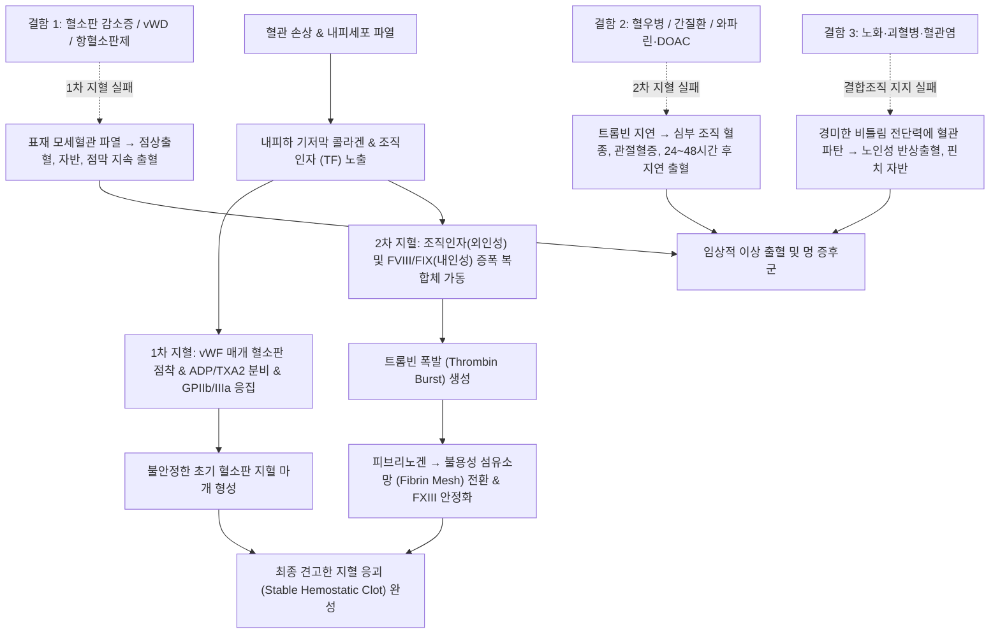

# 🩺 [[타박상과 출혈]] (Clinical Evaluation of Bruising and Bleeding / 異常出血·打撲傷 臨床評價, ICD-10: R58, D69 / KCD: R58, D69)

> **핵심 3줄 요약 (Key Summary)**:
> - 📍 **병소 부위 & 해부·병태생리**: 혈관 손상 후 지혈 마개(Hemostatic plug)를 형성하는 1차 지혈계(혈관 내피세포, [[혈소판]], [[폰빌레브란트인자]](vWF))와 섬유소 응괴(Fibrin clot)를 생성하는 2차 지혈계([[응고인자]] 연쇄 반응계)의 정밀한 조절 파탄, 또는 혈관 지지 결합조직 위축으로 인해 경미한 외상이나 자발적으로 피하·점막·심부 조직 출혈이 발생하는 병태.
> - 🚩 **전형적 임상 양상 & 3대 징후**: 1차 지혈 장애 시 발생하는 점상출혈(Petechiae, <2mm), 자반(Purpura) 및 잦은 점막 출혈(비출혈, 잇몸 출혈, 과다월경) vs 2차 지혈 장애 시 발생하는 심부 혈종(Hematoma), 관절혈증(Hemarthrosis) 및 외상 후 지연 출혈(Delayed rebleeding).
> - 🛠️ **핵심 감별 검사 & 한·양방 다각적 치료 전략**: 일반혈액검사([[CBC]]), 말초혈액도말([[PB smear]]), [[PT/INR]], [[aPTT]], 믹싱 테스트(Mixing study), vWF 항원/활성도, 소아 신체적 학대 감별([[TEN-4-FACES]] 룰). 기허불섭(氣虛不攝)·혈열망행(血熱妄行)·어혈조락(瘀血阻絡) 변증에 따른 [[귀비탕]], [[십회산]], [[당귀보혈탕]], [[삼칠근]] 화어지혈(化瘀止血) 치법 및 결핍 인자 보충, 약인성 항응고제 모니터링.
> - <font color="#fa7e7e">⚠️ **응급 의뢰 레드플래그 & 악화 요인**: 두부 외상 없는 급격한 신경학적 결손(두개내출혈 ICH 의심), 활력징후 불안정(혈압 저하, 빈맥)을 동반한 대량 위장관·복강내 출혈, 파종성 혈관내 응고([[파종성 혈관내 응고]](DIC)) 의심 시 즉시 상급병원 응급실 전원.</font>

---

## 📌 목차
1. [질환 개요 & 병태생리 (Disease Overview)](#1-질환-개요--병태생리-disease-overview)
2. [병태생리 메커니즘 & 대사·장기부전 악순환 네트워크](#2-병태생리-메커니즘--대사장기부전-악순환-네트워크)
3. [임상 증상 & 환자 소견 (Clinical Presentation)](#3-임상-증상--환자-소견-clinical-presentation)
4. [감별 진단 매트릭스 (Differential Diagnosis)](#4-감별-진단-매트릭스-differential-diagnosis)
5. [한의 통합 치료 프로토콜 (침·약침·한약)](#5-한의-통합-치료-프로토콜-침약침한약)
6. [양방 치료 & 병용·의뢰 기준 (Conventional Treatment & Referral)](#6-양방-치료--병용의뢰-기준-conventional-treatment--referral)
7. [식이·생활습관 & 자가관리 티칭 가이드](#7-식이생활습관--자가관리-티칭-가이드)
8. [💡 진료실 핵심 필기 & 임상 노하우](#8--진료실-핵심-필기--임상-노하우)
9. [출처 및 학술 참고 문헌 (References)](#9-출처-및-학술-참고-문헌-references)

---

## 1. 질환 개요 & 병태생리 (Disease Overview)

* **임상적 정의 및 중요성**:
  * **타박상과 출혈(Bruising and Bleeding)**은 1차 의료기관 진료실에서 흔히 접하는 주소증으로, 환자가 호소하는 "쉽게 멍이 든다(Easy bruising)", "코피나 잇몸 출혈이 자주 난다", "발치나 수술 후 피가 잘 멎지 않는다" 등의 증상은 양성 단순성 자반증부터 생명을 위협하는 악성 혈액 질환 및 선천성 중증 응고장애까지 극히 다양한 스펙트럼을 내포한다.
  * 출혈 장애의 평가는 크게 **1차 지혈계(Primary Hemostasis)**, **2차 지혈계(Secondary Hemostasis)**, **혈관 및 결합조직 지지 구조(Vascular/Connective Tissue)**의 세 축으로 분류하여 접근한다:
    1. **1차 지혈 장애 (Primary Hemostatic Disorders)**:
       - 결함 부위: [[혈소판]] 수적 결손([[혈소판감소증]]), 혈소판 기능 부전([[혈소판 기능 장애]]), 또는 혈관 내피 기저막과 혈소판을 연결하는 접착 단백질인 [[폰빌레브란트인자]](vWF) 결함([[폰빌레브란트병]]).
       - 발현 특징: 모세혈관 및 세정맥 파열로 인한 **피부 점막 출혈(Mucocutaneous bleeding)** 우세. 점상출혈(Petechiae), 자반(Purpura), 잦은 비출혈(Epistaxis), 치은 출혈, 과다 월경(Menorrhagia), 창상 직후 즉각적인 출혈.
    2. **2차 지혈 장애 (Secondary Hemostatic Disorders)**:
       - 결함 부위: 혈장 응고 인자(Coagulation factors) 결핍 또는 억제 인자(Inhibitors) 존재. 선천성 혈우병 A([[제8인자]] 결핍), 혈우병 B([[제9인자]] 결핍), 간질환성 응고인자 합성 부전, [[비타민 K]] 결핍증, 약인성 항응고제 복용([[와파린]], DOAC).
       - 발현 특징: 중소혈관 손상 후 피브린 응괴 형성 부전으로 인한 **심부 조직 출혈(Deep tissue bleeding)** 우세. 관절강내 출혈([[관절혈증]]), 근육내 대형 혈종(Hematoma), 후복막 출혈, 외상 수 시간~수일 후 발생하는 **지연성 재출혈(Delayed rebleeding)**.
    3. **혈관성 및 결합조직 장애 (Vascular/Connective Tissue Disorders)**:
       - 결함 부위: 혈소판과 응고인자는 정상이나 혈관벽 및 혈관외 진피 결합조직의 구조적 취약성. 노인성 자반, 스테로이드성 자반, [[괴혈병]], 엘러스-단로스 증후군, 면역복합체성 혈관염.

* **관련 조직 및 조혈·지혈 계통**:
  * **핵심 세포 및 조직**: [[혈관 내피세포]](Endothelial cells), 골수 거핵구 유래 [[혈소판]](Platelets), 간 실질세포(대부분의 혈장 응고인자 합성 장소), 혈관외 결합조직([[콜라겐]], 피브로넥틴).
  * **주요 분자 및 응고 캐스케이드**:
    - 1차 지혈 매개체: [[폰빌레브란트인자]](vWF), 혈소판 표면 당단백 복합체([[GPIb-IX-V]], [[GPIIb/IIIa]]), 아데노신이인산([[ADP]]), 트롬복산 A2([[TXA2]]).
    - 2차 지혈 매개체: 내인성 경로 인자(FXII, FXI, FIX, FVIII), 외인성 경로 인자(조직인자 Tissue Factor, FVII), 공통 경로 인자(FX, FV, 프로트롬빈 FII, 섬유소원 Fibrinogen FI).
    - 항응고 및 섬유소 용해계: [[안티트롬빈]](Antithrombin), [[단백질 C]](Protein C), [[단백질 S]](Protein S), 플라스미노겐(Plasminogen), D-이량체([[D-dimer]]).

---

## 2. 병태생리 메커니즘 & 대사·장기부전 악순환 네트워크

```
[ 혈관벽 손상 발생 (Vascular Injury) ]
  │
  ├─▶ [ 1단계: 1차 지혈 (Primary Hemostasis) ] ──▶ 결함 시 : 피부 점막 출혈, 점상출혈, 즉시 출혈
  │      ├─ 혈관 연축 (Endothelin)
  │      ├─ vWF 매개 내피하 콜라겐-혈소판 점착 (GPIb-IX-V)
  │      ├─ 혈소판 활성화 & 형태 변화 & 과립 분비 (ADP, TXA2)
  │      └─ GPIIb/IIIa - Fibrinogen 교차 결합 ──▶ 초기 혈소판 마개 (Platelet Plug)
  │
  ├─▶ [ 2단계: 2차 지혈 (Secondary Hemostasis) ] ──▶ 결함 시 : 관절혈증, 근육 혈종, 지연 출혈
  │      ├─ 조직인자(TF) + FVIIa (외인성) ─┐
  │      ├─ FXIIa ─▶ FXIa ─▶ FIXa + FVIIIa (내인성) ┴─▶ FX 활성화 (FXa + FVa)
  │      └─ Prothrombin(FII) ──▶ Thrombin(FIIa) ──▶ Fibrinogen ──▶ 안정화 Fibrin Mesh Clot
  │
  └─▶ [ 3단계: 섬유소 용해 & 조직 치유 ]
         └─ tPA 매개 Plasmin 활성화 ──▶ Clot 용해 & D-dimer 생성
```



### 1) 분자·세포 수준 지혈 메커니즘
* **1차 지혈 반응의 3단계 (점착, 활성화, 응집)**:
  * **점착(Adhesion)**: 혈관 내피 손상 시 내피하 콜라겐이 노출되고, 혈관벽 내피세포와 거핵구에서 분비된 초고분자량 [[폰빌레브란트인자]](vWF) 다량체가 높은 전단 응력(Shear stress) 하에서 콜라겐 섬유에 결합함. 혈소판 막의 [[GPIb-IX-V]] 수용체가 vWF의 A1 도메인과 결합하여 혈소판을 손상 부위에 결속시킴.
  * **활성화(Activation)**: 결합된 혈소판은 세포내 칼슘 농도 급증과 함께 위족(Pseudopodia)을 뻗으며 형태가 구형으로 변하고, 조밀 과립(Dense granules: [[ADP]], 세로토닌, $Ca^{2+}$)과 알파 과립(Alpha granules: vWF, Fibrinogen, PDGF)을 외포작용(Exocytosis)으로 분비함. 아라키돈산 대사를 통해 [[트롬복산 A2]](TXA2)가 합성 분비되어 주변 혈소판을 강력하게 동원함.
  * **응집(Aggregation)**: 활성화된 신호 전달은 혈소판 표면의 인테그린 [[GPIIb/IIIa]] 수용체의 입체 구조를 고친화성 상태로 전환시킴(Inside-out signaling). 하나의 피브리노겐(Fibrinogen) 분자가 두 개의 인접한 혈소판 GPIIb/IIIa 수용체를 가교 연결(Cross-linking)하여 비가역적인 1차 혈소판 마개(Platelet plug)를 형성함.
* **2차 지혈 응고 연쇄 반응 (세포 기반 모델, Cell-Based Model)**:
  * 전통적 폭포수 모델(내인성/외인성)을 넘어 현대 지혈학에서는 3단계 세포 기반 모델로 설명됨:
    1. **개시(Initiation)**: 조직인자(Tissue Factor, TF)를 발현하는 혈관벽 외피세포 표면에서 극소량의 활성화된 [[제7인자]](FVIIa)와 TF가 복합체를 이루어 [[제10인자]](FX)와 [[제9인자]](FIX)를 활성화하고, 소량의 트롬빈(FIIa)을 생성함.
    2. **증폭(Amplification)**: 개시 단계에서 생성된 소량의 트롬빈이 손상 부위에 점착된 혈소판 표면으로 이동하여, 혈소판을 추가 활성화하고 보조 인자인 [[제5인자]](FV)와 [[제8인자]](FVIII), 그리고 [[제11인자]](FXI)를 활성화함.
    3. **증폭 및 전파(Propagation)**: 활성화된 혈소판의 음전하 인지질(Phosphatidylserine) 표면에서 FIXa와 FVIIIa가 테나아제 복합체(Tenease complex)를, FXa와 FVa가 프로트롬비나아제 복합체(Prothrombinase complex)를 형성함. 이 복합체는 유리 상태에 비해 300,000배 빠른 속도로 프로트롬빈을 트롬빈으로 전환시키는 **트롬빈 폭발(Thrombin burst)**을 유도함. 대량의 트롬빈은 피브리노겐을 섬유소 단량체로 자르고, [[제13인자]](FXIIIa)가 섬유소 간 공유결합 가교를 형성하여 기계적으로 견고한 피브린 응괴(Fibrin clot)를 완성함.

### 2) 계통 수준 결과 및 임상 출혈 양상의 차이
* **1차 지혈 결함의 병리적 귀결**:
  * 모세혈관 및 미세 세정맥의 직경은 적혈구 1~2개 크기(5~10μm)에 불과하므로, 혈소판 마개가 즉각적으로 형성되지 않으면 혈압에 의해 적혈구가 모세혈관벽을 뚫고 혈관 밖으로 유출됨(Diapedesis).
  * 이로 인해 압박 시 탈색되지 않는 붉은색~자색의 작은 점상출혈(Petechiae, <2mm)과 자반(Purpura, 2~10mm)이 호발하며, 특히 얇은 점막(비강, 치은, 구강 점막, 위장관, 자궁 내막)에서 지혈이 되지 않고 지속적인 삼출 출혈이 일어남.
* **2차 지혈 결함의 병리적 귀결**:
  * 1차 혈소판 마개는 정상이므로 찰과상이나 얕은 자상 직후에는 출혈이 일시적으로 멈추는 것처럼 보임.
  * 그러나 고압의 동맥계 혈류와 기계적 관절 운동을 견디기 위한 섬유소(Fibrin) 보강이 이루어지지 않으므로, 외상 수 시간~24시간 후에 약해진 혈소판 마개가 수압에 밀려 터지면서 광범위한 피하 근육내 대형 혈종(Hematoma) 및 활막 관절강내 출혈([[관절혈증]])로 진행함.

---

## 3. 임상 증상 & 환자 소견 (Clinical Presentation)

### 1) 출혈 병력 문진 및 위험도 평가
* **출혈 성향의 핵심 문진 7대 항목**:
  1. **출혈의 발현 시점**: 유아기/소아기부터 반복된 출혈인가(선천성 혈우병, vWD), 최근 성인기에 발생한 돌발적 출혈인가(후천성 ITP, 약인성, 골수 질환)?
  2. **출혈의 유발 외상 정도**: 뚜렷한 외상 후 발생한 멍인가, 아니면 스치지도 않았는데 저절로 생기는 자발성 멍(Spontaneous bruising)인가?
  3. **출혈의 부위와 크기**: 멍이 팔다리의 뼈 돌출부(정강이, 무릎)에만 국한되는가, 아니면 몸통(복부, 등), 얼굴, 목, 둔부 등 비돌출 부위에 다발하는가? 멍의 크기가 5cm 이상(동전 500원 크기 초과)인가?
  4. **지혈 소요 시간**: 가벼운 손가락 베임, 면도 상처, 코피 발생 시 10~15분 이상 지혈 압박을 해도 멈추지 않는가?
  5. **과거 지혈 유발 사건(Hemostatic challenge)**: 과거 발치, 편도절제술, 충수절제술, 포경수술, 제왕절개, 출산 시 비정상적인 수혈이나 재봉합이 필요했는가?
  6. **복용 약물 및 건강기능식품**: 아스피린, 클로피도그렐, 와파린, DOAC, 소염진통제(NSAIDs), 은행잎 추출물, 고용량 오메가-3, 비타민 E 등 지혈을 방해하는 물질 복용 여부.
  7. **가족력**: 부모, 형제, 외삼촌 중 비정상적인 출혈이나 관절 장애로 치료받은 병력이 있는가?

### 2) 객관적 신체 소견 (Physical Signs)
* **피부 출혈 병변의 형태학적 구분**:
  * **점상출혈(Petechiae)**: 크기 1~2mm의 편평한 점상의 붉은 출혈 반점. 유리판이나 손가락으로 눌러도 퇴색(Blanching)되지 않음. 혈관염의 촉지성 자반과 달리 만져지지 않음(Non-palpable). 혈소판 감소증(<20,000~30,000/μL)의 강력한 징후.
  * **자반(Purpura)**: 크기 2~10mm의 자색 출혈 반점. 1차 지혈 장애 또는 혈관벽 이상.
  * **반상출혈(Ecchymosis)**: 통상 10mm(1cm) 이상의 광범위한 피하 출혈(멍). 시간에 따라 헤모글로빈 분해로 자색(초기) → 청록색(빌리베르딘) → 황갈색(빌리루빈·헤모시데린)으로 색조 변화.
  * **혈종(Hematoma)**: 단순 피하 변색을 넘어 조직 내에 혈액이 고여 만져지는 종괴성(Palpable, fluctuant) 출혈 병소. 근육내, 후복막, 관절 주위 호발 (2차 지혈 장애 시사).
* **소아 신체적 학대(Child Abuse / Nonaccidental Trauma NAT) 감별: [[TEN-4-FACES]] 선별 룰**:
  * 소아 환자에서 멍이 발견되었을 때 기질적 출혈 장애와 신체적 학대를 명확히 감별해야 함.
  * **TEN-4-FACES 양성 기준**:
    - **T (Torso)**: 몸통(흉부, 복부, 등)의 멍.
    - **E (Ears)**: 귓바퀴 및 귀 뒤 유양돌기 부위의 멍.
    - **N (Neck)**: 목 부위의 멍.
    - **4 (4 Months or younger)**: **생후 4개월 이하 영아에서 관찰되는 어떠한 멍(Any bruise)** (영아는 아직 뒤집거나 기어 다니지 못하므로 "Those who don't cruise rarely bruise" 원칙 적용).
    - **F (Frenulum)**: 구강 순소대(Lip frenulum) 파열 및 멍.
    - **A (Angle of jaw)**: 하악각(턱뼈 각진 부위)의 멍.
    - **C (Cheeks)**: 양 볼(Cheeks)의 멍.
    - **E (Eyelids)**: 눈꺼풀의 멍.
    - **S (Subconjunctiva)**: 공막·결막하 출혈.
  * 위 부위의 멍은 단순 낙상이나 일상 외상으로 발생하기 극히 어려우며, 손자국, 벨트 자국 등 특이 형태가 동반될 경우 즉시 학대 의심 하에 다학제 평가 및 아동보호 전문기관 통보 필요.

### 3) 1차 진료 검사 판독 및 단계적 알고리즘
* **1단계 선별 검사 패널 (Initial Screening Panel)**:
  * **일반혈액검사([[CBC]]) & 혈소판 수**:
    - 정상: $150,000 \sim 450,000/\mu\text{L}$.
    - $50,000 \sim 100,000/\mu\text{L}$: 경미한 외상 후 멍 증가, 수술 시 주의.
    - $20,000 \sim 50,000/\mu\text{L}$: 경미한 자극에도 반상출혈, 발치 후 지혈 지연.
    - $<20,000/\mu\text{L}$: 자발적 점상출혈, 점막 출혈, 중추신경계 두개내출혈 위험 급증.
  * **말초혈액도말검사([[PB smear]])**:
    - EDTA 의존성 가성 혈소판감소증(Pseudothrombocytopenia, 혈소판 뭉침 현상) 배제.
    - 분열적혈구(Schistocyte) 관찰 시 [[혈전성 혈소판감소성 자반증]](TTP) 또는 [[파종성 혈관내 응고]](DIC) 강력 의심.
    - 백혈병 모세포(Blast) 관찰 시 급성 백혈병 배제.
  * **프로트롬빈 시간([[PT/INR]])**: 외인성 및 공통 응고 경로(FVII, FX, FV, FII, Fibrinogen) 평가.
  * **활성화 부분트롬보플라스틴 시간([[aPTT]])**: 내인성 및 공통 응고 경로(FXII, FXI, FIX, FVIII, FX, FV, FII, Fibrinogen) 평가.
* **2단계 검사 이상 패턴별 감별 알고리즘**:
  1. **혈소판 수만 단독 감소 (PT/aPTT 정상)**:
     - [[면역성 혈소판감소증]](ITP), 약물 유발 혈소판감소증(DITP), 간경변에 의한 비장기능항진증, 바이러스 감염(HIV, HCV, EBV, 헬리코박터 파일로리).
  2. **[[PT/INR]] 단독 연장 (혈소판, aPTT 정상)**:
     - 반감기가 가장 짧은(4~6시간) [[제7인자]](FVII)의 단독 결핍 또는 초기 저하.
     - 경구 [[와파린]] 복용 초기, 경증 [[비타민 K]] 결핍, 조기 간질환.
  3. **[[aPTT]] 단독 연장 (혈소판, PT 정상)**:
     - 내인성 응고인자 결핍: [[혈우병 A]](FVIII 결핍), [[혈우병 B]](FIX 결핍), [[제11인자]](FXI) 결핍, 중증 [[폰빌레브란트병]](vWD 2N형 또는 3형 - FVIII 수송 장애).
     - 임상적 출혈 증상이 전혀 없는 FXII 결핍증(Hageman factor 결핍).
     - **믹싱 테스트 (Mixing Study, 1:1 혼합 검사) 필수 시행**:
       * 환자 혈장과 정상 혈장을 1:1로 섞었을 때 aPTT가 정상으로 **교정(Correction)됨** → **응고인자 결핍(FVIII, FIX, FXI)**.
       * 1:1 혼합 후에도 aPTT가 **교정되지 않음(No correction)** → **순환 응고 억제인자(Inhibitor)** 존재. 항인지질항체 증후군([[루푸스 항응고인자]]), 또는 후천성 혈우병 A(FVIII 자가항체).
  4. **PT와 aPTT가 모두 동시 연장 (혈소판 감소 동반 흔함)**:
     - 공통 경로 인자(FX, FV, FII, Fibrinogen) 결핍.
     - 진행된 중증 [[간경변]](모든 응고인자 합성 부전), 중증 [[비타민 K]] 결핍증, 대량 출혈 후 희석성 응고장애.
     - [[파종성 혈관내 응고]](DIC): 섬유소원(Fibrinogen) 감소 및 [[D-dimer]] 폭증 동반.
     - DOAC 과다 복용 (Xabans, Dabigatran).
  5. **혈소판 수, PT, aPTT 모두 완전 정상인데 출혈 증상이 뚜렷한 경우**:
     - [[혈소판 기능 장애]](아스피린 복용, 요독증, 혈소판무력증).
     - 경증~중등도 [[폰빌레브란트병]](vWD 1형 또는 2형) → vWF 항원(vWF:Ag) 및 활성도(vWF:RCo) 정밀 검사 필수.
     - 혈관 및 결합조직 이상: [[노인성 자반]], [[괴혈병]], [[아밀로이드증]], 혈관염.

---

## 4. 감별 진단 매트릭스 (Differential Diagnosis)

| 감별 질환 | 주요 출혈 기전 | 대표적 임상 소견 | 진단 검사 핵심 소견 |
| :--- | :--- | :--- | :--- |
| **[[면역성 혈소판감소증]] (ITP)** | 항혈소판 자가항체에 의한 비장 내 혈소판 파괴 (1차 지혈) | 피부 점상출혈, 자반, 잦은 비출혈, 잇몸 출혈, 관절혈증 없음 | **혈소판 단독 격감 (<20,000~50,000/μL)**, PT/aPTT 완전 정상 |
| **[[폰빌레브란트병]] (vWD)** | vWF 결함으로 혈소판 점착 장애 + FVIII 안정화 실패 (1+2차 복합) | 잦은 점막 출혈, 발치 후 출혈, 과다월경, 가족력 흔함 | 혈소판 정상(2B형 제외), **vWF:Ag 및 vWF:RCo 저하**, aPTT 정상 또는 지연 |
| **[[혈우병 A]] / [[혈우병 B]]** | FVIII 또는 FIX 결핍에 의한 트롬빈 증폭 파탄 (2차 지혈) | 무릎·발목 통증성 관절혈증(Hemarthrosis), 심부 근육 혈종, 지연 출혈 | **aPTT 단독 연장 (믹싱 테스트 교정)**, FVIII/FIX 활성도 결핍 (<1~5%) |
| **[[간질환성 응고장애]]** | 간 실질 파괴로 응고인자(FII, VII, IX, X 등) 합성 급감 | 복수, 황달, 거미상 혈관종, 비장비대에 의한 멍, 위식도정맥류 출혈 | **PT/INR 연장 선행 후 aPTT 연장**, 혈소판 감소(비장 격리), 알부민 저하 |
| **[[파종성 혈관내 응고]] (DIC)** | 전신 미세혈전증 및 이차성 소모성 응고인자/혈소판 고갈 | 다발성 장기부전, 자반, 정맥천자 부위 지속 삼출 출혈 | **혈소판 감소 + PT/aPTT 동시 연장 + Fibrinogen 저하 + D-dimer 폭증** |
| **[[신체적 학대]] (NAT)** | 둔상 외력에 의한 피하 혈관 기계적 파열 | **TEN-4-FACES 양성** (몸통, 귀, 목, 4개월 이하 영아의 멍), 특이 손자국 | 혈소판 및 응고 검사(PT/aPTT/vWF) 완전 정상, 골격 방사선상 다발 골절 |
| **[[약인성 출혈 경향]]** | 항응고제/항혈소판제 약물에 의한 지혈 차단 | 약물 복용력, 자발성 피하 멍, 잇몸 출혈, 혈뇨 | 와파린(PT/INR 상승), 헤파린(aPTT 상승), DOAC(항-Xa 활성도 상승) |

> 🚩 **레드플래그 감별 (Red Flags)**:
> 1. **두개내출혈(ICH) 의심**: 멍이나 출혈 성향이 있는 환자에서 갑작스러운 극심한 두통, 구토, 기면, 시야 장애, 일측 위약감 발생 시 → 즉시 119 구급대를 통한 응급 뇌 CT/MRI 및 응고인자 투여 의뢰.
> 2. **쇼크 및 대량 내출혈 의심**: 수축기 혈압 90mmHg 미만, 맥박수 100회/분 이상, 어지럼증, 식은땀, 흑색변(Melena), 혈변(Hematochezia) → 대량 수액 소생술 및 농축적혈구/응고인자 수혈 가능 병원 응급 전원.
> 3. **초응급 파종성 혈관내 응고(DIC) 및 혈전성 혈소판감소성 자반증(TTP)**: 발열, 의식 변화, 급격한 빈혈, 황달, 핍뇨가 급속 진행하는 경우 → 즉시 혈액내과 응급실 전원.

---

## 5. 한의 통합 치료 프로토콜 (침·약침·한약)

* **한의학적 병인병기 및 출혈 총론**:
  * 한의학에서 출혈 질환은 **혈증(血證)**, **실혈(失血)**, **피부자반(皮膚紫斑)**, **토혈(吐血)**, **비뉵(鼻衄)**의 범주로 다룸.
  * 혈액이 정상적으로 혈맥(血脈) 안을 운행하는 원리는 비(脾)의 통섭(統攝)과 심·간(心·肝)의 주재(主宰)에 의존함. 혈액이 맥 밖으로 넘쳐흐르는 기전은 "혈불순경(血不循經), 일탈어외(溢脫於外)"로 총괄되며, 3대 핵심 병기는 다음과 같음:
    1. **혈열망행(血熱妄行)**: 화열(火熱)이 영혈분(營血分)을 핍박하여 혈액이 비등하듯 솟구쳐 맥락을 뚫고 나옴. 돌발적이고 양이 많은 선홍색 출혈, 신열, 구갈, 번조, 설홍태황, 맥삭 (급성 면역성 혈소판감소증, 급성 혈관염).
    2. **기허불섭(氣虛不攝) / 비불통혈(脾不統血)**: 중기(中氣)가 허약하여 기(氣)가 혈(血)을 통솔하고 붙잡아두는 통혈(統血) 기전을 상실함. 만성적이고 반복되는 담홍색 출혈, 쉽게 멍이 듦, 만성 피로, 식소변당, 안색 위황, 설담태백, 맥세약 (만성 특발성 자반, 영양결핍성 출혈 경향).
    3. **어혈조락(瘀血阻絡) / 혈어치혈(血瘀致血)**: 병리적 어혈이 혈맥을 막아 정상 혈류의 흐름을 방해하므로, 혈액이 정상 궤도를 돌지 못하고 측부 맥락을 뚫고 밖으로 넘침. "어혈을 없애지 않으면 출혈을 멎게 할 수 없다(去瘀止血)". 암자색 혈괴(피떡) 동반, 국소 찌르는 듯한 고정 통증, 설자암 유어반, 맥삽 (간질환성 혈어, 만성 결합조직 출혈).

* **침구 치료 (Acupuncture Protocol)**:
  * **주혈(主穴)**:
    - [[격수]](BL17, 팔회혈 중 혈회): 혈의 병증 총괄, 활혈양혈 및 거어지혈.
    - [[혈해]](SP10, 족태음비경): 양혈화어, 비경의 낙맥을 조절하여 혈액 누출 방지.
    - [[비수]](BL20) & [[족삼리]](ST36): 건비보기(健脾益氣), 비통혈 기전 강화.
    - [[은백]](SP1, 정목혈): **출혈성 질환의 특효혈**. 비경의 정혈로 은백혈 뜸(간접구 3~5장) 또는 세침 점자는 붕루, 변혈, 비출혈, 피하 자반을 멎게 하는 강력한 지혈 효과 발휘.
    - [[삼음교]](SP6): 족삼음경 교회혈로 비·간·신 기능 동시 조절.
  * **변증 배혈**:
    - 기허불섭형: [[백회]](GV20, 제양지회 승제거함), [[기해]](CV6), [[관원]](CV4).
    - 혈열망행형: [[곡지]](LI11), [[행간]](LR2, 간화 청강), [[태충]](LR3), [[상성]](GV23, 비출혈 시).
    - 어혈조락형: [[내관]](PC6), [[삼음교]](SP6), [[합곡]](LI4).
  * ⚠️ **자침 안전 가이드**:
    - 혈소판 감소 환자(<50,000/μL) 또는 항응고제 복용 환자는 침 치료 시 **0.20mm 이하 극세침(호침)**을 사용하고 사침(Oblique insertion) 또는 천자(Superficial insertion) 원칙 준수.
    - **심부 근육 자침(예: 이상근, 장요근 침자) 절대 금기** (근육내 거대 혈종 유발 방지).
    - 발침 후 최소 **3~5분간 멸균 압박 지혈대**로 문지르지 말고 꾹 눌러 직압 지혈할 것.

* **약침 치료 (Pharmacopuncture)**:
  * **제제 선택**:
    - 혈열형: **[[황련해독탕]] 약침** (항염증, 혈관 투과성 억제).
    - 기허형: **[[자하거]] 약침** 또는 **황기 약침** (조혈 자극, 면역 조절, 기력 보충).
    - 혈어형: **[[중성어혈]] 약침** (미세순환 정체 해소).
  * **시술 부위 및 주의**:
    - 양측 비수(BL20), 격수(BL17), 족삼리(ST36)에 각 0.1cc씩 극소량 피내 주입.
    - 혈소판 <30,000/μL 또는 심한 응고장애 시에는 약침 시술을 보류함.

* **변증별 한약 처방 (Herbal Medicine)**:
  * **1) 기허불섭형 (비불통혈) — [[귀비탕]](歸脾湯) 또는 [[당귀보혈탕]](當歸補血湯) 합 [[사군자탕]](四君子湯)**:
    - 처방 구성: [[황기]](15g), [[당귀]](6g), [[인삼]](8g), [[백출]](8g), [[복신]](8g), [[산조인]](8g), [[용안육]](8g), [[원지]](4g), [[목향]](4g), [[감초]](3g), [[생강]](3조각), [[대조]](2개).
    - 약리 기전: 황기의 다당류 성분이 거핵구 증식 및 혈소판 생성을 자극하고, 혈관 내피세포의 긴장도를 회복시켜 모세혈관 누출을 억제함.
  * **2) 혈열망행형 — [[십회산]](十灰散) 또는 [[서각지황탕]](犀角地黃湯) 가감**:
    - 처방 구성: [[대계]](초탄 8g), [[소계]](초탄 8g), [[하엽]](초탄 8g), [[측백엽]](초탄 8g), [[백모근]](초탄 8g), [[천초근]](초탄 8g), [[산치자]](초탄 6g), [[대황]](초탄 6g), [[모단피]](초탄 6g), [[종려피]](초탄 6g).
    - 약리 기전: '초탄지혈(炒炭止血)' 원리를 응용하여 본초를 탄화시켜 지혈 활성 물질(탄닌 및 활성 탄소 복합체)을 극대화함. 칼슘 채널 및 응고 캐스케이드를 보조하여 급성 출혈을 신속히 지혈함.
  * **3) 어혈조락형 및 활혈지혈(化瘀止血) — [[삼칠근]](三七根) 단독 또는 방제 배합**:
    - 처방 구성: [[삼칠근]](3~5g, 미세분말을 온수로 1일 2~3회 분복) 또는 복방 배합([[포황]](초탄 8g), [[오령지]](8g), [[단삼]](10g), [[익모초]](10g)).
    - 약리 기전: 삼칠근의 주요 사포닌 성분인 노토진세노사이드(Noto-ginsenoside)와 진세노사이드 Rg1, Rb1, 그리고 덴시신(Dencichine) 성분은 **"지혈하되 어혈을 남기지 않고, 어혈을 풀되 정상 출혈을 조장하지 않는다(止血不留瘀, 化瘀不傷正)"**는 독보적인 지혈-항혈전 양방향 조절 특성을 지님. 모세혈관 취약성 개선과 혈소판 활성화 조절에 탁월함.

---

## 6. 양방 치료 & 병용·의뢰 기준 (Conventional Treatment & Referral)

* **원인별 양방 표준 치료 (Conventional Therapeutics)**:
  * **1) 면역성 혈소판감소증(ITP)**:
    - 1차 치료: **경구 프레드니손(Prednisone 1mg/kg/일)** 또는 **고용량 덱사메타손(Dexamethasone 40mg/일 4일간)**. 응급 출혈 시 **면역글로불린 정맥주사(IVIG 1g/kg/일 1~2일간)**.
    - 2차 치료: 트롬보포이에틴 수용체 작용제(TPO-RA - Romiplostim, Eltrombopag), Rituximab, 비장절제술(Splenectomy).
  * **2) 폰빌레브란트병(vWD)**:
    - 경증 (1형): **Desmopressin(DDAVP)** 투여로 내피세포 바이블-팔라데 소체(Weibel-Palade bodies) 내 저장된 내인성 vWF 및 FVIII 방출 유도.
    - 중증 (2형, 3형): vWF 함유 고순도 FVIII/vWF 복합 농축제제 정맥 투여. 항섬유소용해제(Tranexamic acid) 병용.
  * **3) 혈우병 (Hemophilia A & B)**:
    - 유전자 재조합 제8인자 또는 제9인자 농축제제 보충 요법 (예방적 투여 Prophylaxis).
    - 혈우병 A 비인자 치료제: Emicizumab (FVIII 모방 이중특이항체, 피하주사).
  * **4) 약인성 항응고제 출혈 시 역전제(Reversal Agents)**:
    - 와파린: 비타민 K1(Phytonadione) 정주 + 4인자 프로트롬빈 복합체 농축액(4F-PCC).
    - 다비가트란(Pradaxa): Idarucizumab (Praxbind).
    - FXa 억제제 (Rivaroxaban, Apixaban): Andexanet alfa 또는 4F-PCC.

* **한의 치료와의 상호작용 및 안전 관리 (Safety Criteria)**:
  * **부항 요법 절대 금기**:
    - **습부항(자락관법 / 사혈요법)은 혈소판 <100,000/μL이거나 항응고제(와파린, DOAC)를 복용 중인 환자에게 절대 금기**임. 광범위한 피하 혈종, 구획증후군, 지혈 불능을 초래할 수 있음.
    - 건부항 역시 피부 출혈 반점이나 모세혈관 파열을 유발할 수 있으므로 약압(Weak suction)으로 제한하거나 삼가야 함.
  * **활혈거어약 병용 주의**:
    - 와파린 복용 환자에게 비타민 K를 함유하거나 쿠마린 유사 작용을 하는 본초([[단삼]], [[당귀]], [[백화사설초]])를 다량 투여할 경우 INR 변동이 발생하므로 INR 모니터링 필수.
    - 아스피린/클로피도그렐 복용자에게 [[도인]], [[홍화]], [[수질]] 과량 투여는 위장관 출혈 위험을 증가시키므로 지혈 작용이 병행된 [[삼칠근]]을 위주로 선택함.

* **전문과 의뢰 및 전원 기준 (Referral Criteria)**:
  * **응급실(ER) 즉시 전원**:
    - 혈소판 <20,000/μL이면서 구강 점막 출혈(Wet purpura), 혈뇨, 토혈, 흑색변 동반 시.
    - 두부 외상 후 출혈 경향 환자.
    - 관절혈증으로 인한 관절의 급격한 열감, 종창, 극심한 가동통.
  * **혈액내과 정밀 의뢰**:
    - 뚜렷한 유발 요인 없이 혈소판 수 <100,000/μL이 지속되는 경우.
    - aPTT 또는 PT가 설명되지 않게 1.5배 이상 연장되어 있는 경우.
    - 상처 지혈 지연 및 과다월경 병력이 반복되며 vWD 또는 경증 혈우병이 의심되는 경우.

---

## 7. 식이·생활습관 & 자가관리 티칭 가이드

* **출혈 예방을 위한 식이 지도**:
  * **혈관벽 강화 및 조혈 영양소 섭취**:
    - 모세혈관 내피 기저막 콜라겐 합성을 돕는 [[아스코르브산]](Vitamin C)과 플라보노이드가 풍부한 과일·채소 섭취.
    - 혈액 응고인자 합성을 지원하는 [[비타민 K]] 풍부 식품(시금치, 케일, 브로콜리 등 녹색 잎채소)의 균형 잡힌 섭취 (단, 와파린 복용 환자는 섭취량을 급격히 늘리거나 줄이지 않고 매일 일정하게 유지해야 함).
  * **피해야 할 음식**:
    - 과도한 알코올 섭취 금지 (간 실질 손상 및 혈소판 생성 억제).
    - 생강, 은행잎, 마늘 농축액, 고용량 오메가-3 등 혈소판 응집을 억제하는 건강기능식품의 무분별한 과량 복용 제한.

* **일상생활 외상 방지 및 자가관리**:
  * **부드러운 구강 위생 관리**:
    - 칫솔모가 매우 부드러운 미세모 칫솔을 사용하고, 치실 사용 시 잇몸 손상에 주의함.
  * **비출혈 예방 및 응급 지혈법**:
    - 비강 점막 건조를 막기 위해 바셀린이나 식염수 비강 분무제를 사용하고, 실내 습도를 50~60%로 유지함.
    - 코를 세게 풀거나 손가락으로 후비지 말 것.
    - 코피 발생 시 머리를 뒤로 젖히지 말고(혈액의 식도·기도 흡인 방지), **고개를 약간 앞으로 숙인 상태에서 양 콧볼(비익)을 엄지와 검지로 10~15분간 단단히 압박**함.
  * **운동 및 신체 활동 지도**:
    - 신체 접촉이 격렬한 운동(축구, 농구, 유도, 복싱)은 피하고, 수영, 평지 걷기, 실내 자전거 등 관절과 혈관에 충격이 덜한 유산소 운동 권장.

* **환자 교육 스크립트**:
  * *"환자분, 몸에 생기는 멍과 잇몸 출혈은 우리 몸의 지혈 시스템 어딘가에 신호가 켜졌다는 뜻입니다. 피가 멈추려면 혈소판이라는 일차 마개가 막아주고, 그 위에 단백질로 된 그물이 덮여야 하는데, 이 과정 중 어디에 문제가 생겼는지 피검사로 정확히 밝혀내는 것이 가장 중요합니다."*
  * *"병원에서 정밀 검사를 받기 전까지는 피를 묽게 만들 수 있는 진통제나 혈액순환제를 임의로 드시면 안 되며, 코피가 날 때는 고개를 숙이고 콧볼을 10분 이상 지그시 눌러주십시오. 만약 머리를 부딪치거나, 소변이나 대변에 붉은 피가 섞여 나오고, 숨이 차거나 어지러우시면 지체 없이 응급실로 가셔야 합니다."*

---

## 8. 💡 진료실 핵심 필기 & 임상 노하우

* **멍(Bruise) 환자 첫 진료 시 3분 문진 공식**:
  * **1분**: "멍이 언제부터, 어디에, 얼마나 크게 생겼습니까?" (몸통/얼굴 멍, 5cm 이상 대형 멍은 병적 출혈).
  * **2분**: "양치질할 때 피가 철철 나거나, 코피가 15분 이상 안 멎거나, 생리량이 갑자기 패드를 1시간마다 갈 정도로 폭증했습니까?" (1차 지혈 장애 감별).
  * **3분**: "최근 드시기 시작한 약(소염진통제, 심장약, 뇌졸중약, 건기식)이 있습니까?" (약인성 출혈 배제).

* **진료실 지혈대 검사(Tourniquet Test) 실전 팁**:
  * 상완에 혈압계를 감고 $(수축기 + 이완기)/2$ mmHg로 5분간 유지.
  * 5분 후 커프를 풀고 2분 대기 후 전완부 5cm 원 내에 점상출혈 수를 셈.
  * 10~20개 이상 발생 시 모세혈관 취약성 또는 혈소판 기능 부전 강력 시사.

* **한의 1차 진료에서 부항·침술 시술 시 주의점**:
  * 원인 불명의 자반 환자에게 "어혈을 뺀다"며 사혈침으로 피를 뽑는 행위는 의료사고의 지름길임.
  * 응고 검사 수치가 확인되지 않은 멍 환자에게는 절대 사혈 요법을 하지 말고, 보법 위주의 가벼운 호침 시술과 지혈 압박을 철저히 해야 함.

---

## 9. 출처 및 학술 참고 문헌 (References)

1. **MSD 매뉴얼 전문가용** — 타박상 및 출혈에 대한 평가 (Evaluation of the Patient with Bruising or Bleeding). [MSD Manual Professional Edition](https://www.msdmanuals.com/professional/hematology-and-oncology/approach-to-the-patient-with-bleeding/evaluation-of-the-patient-with-bruising-or-bleeding)

2. **질병관리청 국가건강정보포털** — 이상 출혈 및 멍의 진단적 접근. [KDCA Health Portal](https://health.kdca.go.kr)

3. Rungjirajittranon T, Cuker A, Shatzel JJ, et al. (2026). Approach to Thrombocytopenia. *Hematology/Oncology Clinics of North America*. 40(2):215-230. [PMID: 42881034](https://pubmed.ncbi.nlm.nih.gov/42881034/)

   - **[연구 요약]**: 1차 및 2차 지혈 장애 평가에서 혈소판감소증의 임상적 접근 알고리즘, 가성 혈소판감소증 배제, 면역성 혈소판감소증 및 혈전미세혈관병증의 감별 진단 및 단계별 검사 해석 가이드라인을 제시함.

4. Elsbernd A, Barnes C, Carpenter S, et al. (2026). Evaluation for Nonaccidental Trauma and Bleeding Disorders in Infants Referred to Pediatric Hematology. *J Pediatr Hematol Oncol*. 48(3):145-152. [PMID: 42820974](https://pubmed.ncbi.nlm.nih.gov/42820974/)

   - **[연구 요약]**: 소아 혈액학 클리닉에 의뢰된 영유아 환자에서 비기질성 신체적 외상(Nonaccidental trauma NAT / 아동 학대)과 기질성 출혈 질환(vWD, 혈우병 등)의 감별 진단 프로토콜 및 TEN-4-FACES 룰의 임상적 유용성을 검증함.

---

## 관련 노트

- [[타박상 또는 출혈을 유발하는 단백질 장애]]
- [[혈소판감소증]]
- [[면역성 혈소판감소증]]
- [[폰빌레브란트병]]
- [[파종성 혈관내 응고]]
- [[혈소판 기능 장애]]
