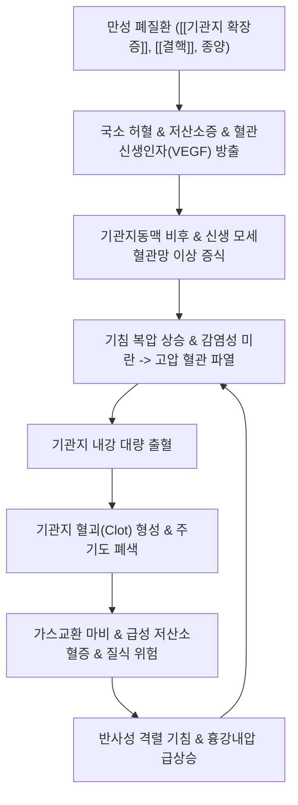

# 🩺 객혈 (Hemoptysis / 喀血, R04.2 / U20.2)

> **핵심 3줄 요약 (Key Summary)**:
> - 📍 **병소 부위 & 해부·병태생리**: 성문(Vocal cord) 하부의 호흡기계(기관, 기관지, 폐실질). 대동맥 분지의 **고압 기관지동맥(Bronchial artery, 약 90%)** 비후 및 신생혈관 파열, 또는 저압 폐동맥(Pulmonary artery, 약 10%) 혈관 침식.
> - 🚩 **전형적 임상 양상 & 3대 징후**: [[기침]]과 함께 선홍색 거품 섞인 혈액 또는 혈담 배출(알칼리성 pH, SpO2 저하 가능). 소화기계 [[토혈]](암적색, 음식물 잔사, 산성 pH)과의 즉각적 감별 필수.
> - 🛠️ **핵심 감별 검사 & 한·양방 다각적 치료 전략**: 흉부 조영 CT 및 기관지내시경. 중증 시 기도 확보 및 응급 **기관지동맥색전술(Bronchial Artery Embolization, BAE)**, 한의 지혈제([[백급]], [[삼칠]], [[십회산]], [[해혈방]]) 및 수태음폐경 극혈 [[공최]] 응급 자침.
> - ⚠️ **응급 의뢰 레드플래그 & 악화 요인**: 대량 객혈(Massive hemoptysis, >100~200mL/24h 또는 시간당 >50mL), 질식(Asphyxiation) 징후, 산소포화도 급락 시 즉시 환측 하와위 유지 및 3차 상급병원 응급 전원의뢰.

---

## 📌 목차
1. [질환 개요 & 해부학적 병태생리](#1-질환-개요--해부학적-병태생리)
2. [병태생리 메커니즘 & 생체역학적 악순환 네트워크](#2-병태생리-메커니즘--생체역학적-악순환-네트워크)
3. [임상 증상 & 이학적 검사(Physical Exam) 알고리즘](#3-임상-증상--이학적-검사physical-exam-알고리즘)
4. [감별 진단 매트릭스 (Differential Diagnosis)](#4-감별-진단-매트릭스-differential-diagnosis)
5. [한의 통합 치료 프로토콜 (침·약침·추나·한약)](#5-한의-통합-치료-프로토콜-침약침추나한약)
6. [양방 치료 & 병용·의뢰 기준 (Conventional Treatment & Referral)](#6-양방-치료--병용의뢰-기준-conventional-treatment--referral)
7. [재활 운동 & 생활습관 티칭 가이드](#7-재활-운동--생활습관-티칭-가이드)
8. [💡 사용자 진료실 핵심 필기 & 임상 노하우 (Melt-In 잔여 심화 집약)](#8--사용자-진료실-핵심-필기--임상-노하우-melt-in-잔여-심화-집약)
9. [출처 및 학술 참고 문헌 (References)](#9-출처-및-학술-참고-문헌--references)

---

## 1. 질환 개요 & 해부학적 병태생리

**객혈(Hemoptysis, 각혈)**은 성문(Vocal cord) 하부의 기도(후두 하부, 기관, 기관지, 폐실질)로부터 유래한 혈액이나 혈액이 섞인 분비물을 기침과 함께 배출하는 병태이다. 한의학에서는 해혈(咳血), 수혈(嗽血), 각혈(咯血)의 범주로 구분하며, 혈열망행(血熱妄行), 간화범폐(肝火犯肺), 음허화왕(陰虛火旺)으로 변증한다.

### 1) 출혈량에 따른 중증도 분류
- **경도 객혈 (Mild)**: 점액에 피가 실처럼 묻어 나오는 혈담(Blood-streaked sputum, 24시간 출혈량 $< 20\sim 30\text{ mL}$).
- **중등도 객혈 (Moderate)**: 24시간 동안 약 $30\sim 100\text{ mL}$의 순수 혈액 배출.
- **대량 객혈 (Massive / Life-threatening)**: 24시간 동안 **$100\sim 600\text{ mL}$ 이상 출혈**하거나 시간당 $>50\text{ mL}$ 이상의 속도로 급속 출혈하여 기도 폐쇄 및 질식(Asphyxiation)을 초래하는 초응급 상태.

### 2) 폐의 이중 혈액 순환계와 병태생리적 기원
- **기관지순환 (Bronchial Circulation, 약 90%의 기원)**:
  - 흉부 대동맥(Thoracic aorta) 또는 늑간동맥에서 분지하는 전신 고압계(수축기압 약 $100\sim 120\text{ mmHg}$). 기관지벽, 결합조직, 림프절에 산소와 영양을 공급함.
  - [[기관지 확장증]], 결핵, 만성 기관지염 등 만성 염증 시 혈관신생인자(VEGF) 분비로 기관지동맥이 정상 직경(1.5mm)의 2~3배 이상으로 비후되고 신생 혈관망이 뒤엉켜 높은 압력을 이기지 못하고 파열되어 대량 출혈을 일으킴.
- **폐순환 (Pulmonary Circulation, 약 10%의 기원)**:
  - 우심실에서 기원하는 저압계(수축기압 약 $15\sim 25\text{ mmHg}$). 가스 교환을 담당함.
  - 결핵의 공동성 괴사에 의해 폐동맥 분지가 침식되어 가성동맥류를 형성하는 **라스무센 동맥류(Rasmussen Aneurysm)**의 파열, 괴사성 폐암, 폐경색 시 치명적 출혈 유발.

---

## 2. 병태생리 메커니즘 & 생체역학적 악순환 네트워크

---

## 3. 임상 증상 & 이학적 검사(Physical Exam) 알고리즘

### 1) 주요 임상 증상
- 기침과 함께 배출되는 선홍색(Bright red) 혈액, 공기 방울이 섞인 거품성 객담.
- 목 뒤가 간질거리거나 흉부에서 끓는 듯한 소리(Bubbling sensation)가 선행됨.
- 대량 객혈 시 호흡곤란, 청색증, 식은땀, 빈맥, 혈압 강하, 질식 징후.

### 2) 객혈(Hemoptysis) vs 토혈(Hematemesis) 1분 감별 진단
객혈 환자 내원 시 가장 먼저 상부위장관 출혈에 의한 [[토혈]]과의 감별이 절대적이다.

| 감별 항목 | 객혈 (Hemoptysis) | 토혈 (Hematemesis) |
| :--- | :--- | :--- |
| **선행 증상** | 기침, 흉통, 흉부 끓는 느낌 | 오심, 구토, 상복부 불쾌감, 복통 |
| **혈액의 색조** | **선홍색 (Bright red)** | **암적색, 흑갈색 (Coffee-ground)** |
| **거품 혼재 여부** | **기포(거품) 흔히 혼재** | 거품 없음 |
| **이물질 혼입** | 점액, 농성 가래 섞임 | **음식물 찌꺼기 섞임** |
| **pH 측정 (리트머스)** | **알칼리성 (pH > 7.0)** | **산성 (pH < 7.0, 위산 영향)** |
| **배변 양상** | 흑색변 드묾 (삼켰을 때 소량 가능) | **흑색변(Melena) 흔히 동반** |

---

## 4. 감별 진단 매트릭스 (Differential Diagnosis)

| 원인 질환 | 전형적 병력 및 특이 소견 | 영상 소견 (Chest CT) | 객혈의 양상 |
| :--- | :--- | :--- | :--- |
| **[[기관지 확장증]]** | 만성적인 다량의 화농성 객담, 반복 폐렴 | 기도 확장 (Signet ring sign), 기관지벽 비후 | 간헐적 재발성 혈담, 비후 혈관 파열 시 대량 객혈 |
| **[[결핵]]** | 2주 이상 기침, 미열, 야간 도한, 체중 감소 | 상엽 폐첨부 공동(Cavity), 결핵결절, 섬유화 | 초기 혈담, 라스무센 동맥류 파열 시 전격성 대량 객혈 |
| **[[폐암]] (Bronchogenic Ca)** | 고령, 장기 흡연력, 애성(목쉼), 체중 감소 | 폐문부 또는 말초 종괴, 기관지 내강 침식 | 지속적인 소~중등도 혈담, 원통형 혈괴 |
| **폐색전증 (Pulmonary Embolism)** | 장기 부동, 심부정맥혈전증(DVT), 급성 흉통 | 폐동맥 조영 CT상 충만 결손, 쐐기형 음영 | 급성 흉통 및 호흡곤란과 동반된 소량 혈담 |
| **아스페르길루스종 (Mycetoma)** | 과거 결핵 공동 병력 | 기존 공동 내부의 둥근 균구(Fungus ball) | 간헐적 대량 객혈의 대표적 원인 |

---

## 5. 한의 통합 치료 프로토콜 (침·약침·추나·한약)

> ⚠️ **객혈 환자 한의 시술 절대 안전 수칙**: 활동성 객혈 환자에게 흉추 관절교정 추나요법이나 흉곽 압박 수기는 흉강내압을 급상승시켜 혈관을 재파열시키므로 **절대 금기**이다. 급성기에는 환측 하와위 침상 안정을 취하고, 지혈 극혈 자침 및 지혈 특효 한약 제제를 신속히 투여한다.

### 1) 침구 치료 (Acupuncture)
- **수태음폐경 극혈(郄穴) 응급 자침**: [[공최]](LU6) — 급성기 장부 출혈을 지혈시키는 절대적 요혈. 전완 요측 척택과 태연 연결선상 상부 7촌, 직자 0.8~1.2촌 강자극 사법.
- **청열강화 지혈 혈위**:
  - [[어제]](LU10, 형화혈 청폐강화), [[척택]](LU5, 합수혈), [[소상]](LU11, 정혈 삼릉침 점자출혈 2~3방울).
  - [[태연]](LU9, 맥회혈), [[백회]](GV20, 승제기혈), [[행간]](LR2, 간화범폐 사화).
- **안정기 뜸 치료**: 활동성 출혈 소실 후 [[폐수]](BL13), [[고황]](BL43)에 온화구(溫和灸)를 시행하여 폐기(肺氣) 보강.

### 2) 한약 치료 (Herbal Medicine)
- **1) 조열상폐 (초기 미열 및 혈담)**:
  - **[[상국음]](桑菊飮) 가감방**: 상엽 10g, 국화 10g, 행인 10g, 연교 10g, [[백급]] 10g, [[삼칠]] 4g, 한련초 15g.
- **2) 간화범폐 (격노 후 발작성 선홍색 대량 객혈 — 화어지혈)**:
  - **[[해혈방]](咳血方)**: 청대 6g, 과루인 12g, 치자 10g, 가자 6g, 해부석 15g. 청간영폐, 청열지혈.
  - **[[황련해독탕]](黃連解毒湯) 합 [[삼황사심탕]](三黃瀉心湯)**: 황련, 황금, 황백, 치자, 대황 각 8~10g (혈열망행성 폭발적 출혈 제어).
- **3) 음허화왕 (만성 결핵성 객혈, 오후 조열, 도한)**:
  - **[[백합고금탕]](百合固金湯)**: 백합 15g, 맥문동 12g, 생지황 15g, 숙지황 15g, 현삼 10g, 길경 8g, 패모 10g, 당귀 10g, 백작약 10g, 감초 6g.
  - **[[월화환]](月華丸) / [[자음강화탕]](滋陰降火湯)**: 폐음 보충 및 허화 하강.
- **4) 지혈 특효 본초의 분자생물학적 배합**:
  - **[[백급]](白芨, 6~12g)**: 점액질(Polysaccharide) 성분이 파열된 점막 표면에 피복막을 형성하고 혈소판 응집을 촉진하여 혈전을 신속히 형성시키는 폐출혈 제일의 성약.
  - **[[삼칠]](三七 / 삼칠근, 분말 3~6g 온복)**: 노토긴세노사이드(Notoginsenoside) 성분이 트롬복산 A2 생성을 촉진하여 지혈하되 전신 색전증을 유발하지 않는 **지혈이불유어(止血而不留瘀)**의 명약.

---

## 6. 양방 치료 & 병용·의뢰 기준 (Conventional Treatment & Referral)

### 1) 응급 소생 및 기도 확보 프로토콜
- **기도 확보 (Airway Management) - 제1원칙**: 객혈의 사망 원인은 실혈성 쇼크가 아니라 **기도 폐쇄에 의한 질식(Asphyxiation)**이다. 산소 공급, 대구경 카테터 흡인(Suction), 대량 객혈 시 기관내삽관(대구경 8.0mm 이상 튜브 또는 이중강 튜브를 통한 건측 폐 선택적 환기).
- **출혈 폐 하와위 체위**: 출혈측을 아래로 두어 건측 폐로 혈액이 유입되는 흡인성 질식을 방지.
- **약물 요법**: 트라넥삼산(Tranexamic acid, $1\text{ g}$ IV q8h) 투여로 섬유소 분해 억제.

### 2) 중재적 시술 (Interventional Procedures)
- **기관지내시경 (Flexible / Rigid Bronchoscopy)**:
  - 출혈 부위 확인, 혈괴 흡인, 냉식염수 세척(Cold saline lavage), 국소 에피네프린 도포, 풍선 카테터(Fogarty balloon)를 이용한 분지 폐색 지혈.
- **기관지동맥색전술 (Bronchial Artery Embolization, BAE) - 골드 스탠다드**:
  - 혈관조영술로 비후된 기관지동맥 및 신생혈관을 확인한 후 PVA(Polyvinyl alcohol) 입자나 젤폼, 미세 코일을 주입하여 영양 혈관을 폐색. 지혈 성공률 85~90%.
  - *주의 합병증*: 전척수동맥(Anterior spinal artery, Adamkiewicz artery) 오색전 시 하반신 마비(Paraplegia) 위험.

### 3) 응급 및 상급병원 의뢰 기준 (Referral Criteria)
- 종이컵 반 컵($>50\text{ mL}$) 이상의 순수 혈액을 뱉어내는 경우.
- 산소포화도(SpO2)가 90% 이하로 떨어지며 천명음, 천촉, 청색증 등 질식 전조 징후 발생 시.
- 혈액학적 불안정(혈압 $<90/60\text{ mmHg}$, 맥박 $>120$회/분) 동반 시 119 구급대를 통해 흉부외과/호흡기내과 응급센터 즉각 이송.

---

## 7. 재활 운동 & 생활습관 티칭 가이드

1. **출혈 시 응급 안전 체위 (Lateral Decubitus Position)**:
   - 병변 부위를 알고 있는 경우 반드시 **출혈측 폐를 아래로 향하게 하는 측와위(Dependent position)**를 취하게 함.
   - 출혈측을 아래로 두어야 중력에 의해 혈액이 정상측 폐로 흘러들어가지 않아 건측 폐의 가스 교환 면적을 보존하고 질식을 방지할 수 있음.
2. **절대 침상 안정(Bed Rest)**: 최소 24~48시간 동안 말을 하지 말고 침상 안정을 취하며, 기침이 유발될 때는 무리하게 힘을 주어 억제하거나 세게 뱉지 말고 조용히 배출하도록 유도.
3. **음식 및 온열 자극 차단**:
   - 뜨거운 국물, 매운 자극성 음식, 카페인, 알코올 섭취 절대 금지 (식도 및 기관지 혈관 확장 유발).
   - 서늘하거나 미지근한 유동식 섭취, 얼음 조각을 입에 물고 천천히 녹여 먹어 반사적 혈관 수축 유도.
4. **배변 관리**: 배변 시 과도하게 힘을 주는 발살바 조작(Valsalva maneuver)은 흉강내압을 급상승시켜 혈관을 재파열시키므로 완하제(마자인, 락툴로오스) 투여.

---

## 8. 💡 사용자 진료실 핵심 필기 & 임상 노하우 (Melt-In 잔여 심화 집약)

- **상부 섹션에 미처 다 담지 못한 고유 원문 필기**:
  - "토혈은 색이 검붉고 산성을 띠지만, 객혈은 붉은 혈액 색이다."
  - "원인: 기관지 확장증, 악성 종양, 만성 기관지염, 결핵, 폐 동정맥 기형, 미만성 폐포내 출혈"
  - 객혈 환자 치료에서 가장 중요한 것은 **출혈량보다 기도 환기(질식 방지)**이다. 아무리 적은 양의 피라도 기도를 막으면 3분 안에 사망한다.
- **진료실 실전 감별 & 치료 노하우**:
  - 1. **실전 30초 문진 & 육안 감별 포인트**:
    - "기침하면서 튀어나왔습니까, 토하면서 나왔습니까?"
    - 뱉어낸 휴지/용기 확인: **미세한 기포(거품)가 부글부글 끓어오르고 선홍색이면 100% 호흡기 객혈**. 커피 찌꺼기 같은 검붉은 덩어리와 음식물이 섞여 있으면 상부위장관 토혈.
    - 종이컵에 뱉게 하여 시간당 배출량 측정(종이컵 1/3 이상 차면 지체 없이 상급병원 119 전원).
  - 2. **치료 순서 및 손맛 노하우**:
    - **지혈 극혈 응급 자침**: 환자를 반좌위 또는 환측 하와위로 눕힌 후, **양측 공최(LU6)에 2촌 침을 1촌 이상 깊이 찔러 넣고 강자극 염전**. 환자가 뻐근한 득기감을 강하게 느끼는 순간 격렬한 기침과 출혈이 진정된다.
    - **백급-삼칠 분말 응급 첩포 요법**: 활동성 출혈이 지속될 때 **백급 분말 6g + 삼칠 분말 3g**을 미지근한 물 반 컵에 타서 천천히 목을 적시듯 삼키게 한다. 위장관 점막과 인후부 표면에 끈적한 피복막이 형성되며 놀라울 정도로 신속하게 지혈된다.
  - 3. **환자 티칭 스크립트**:
    - "피가 나온다고 해서 목을 조이고 억지로 기침을 참으면 피가 굳어 숨길을 막아버립니다. 나오는 피는 놀라지 마시고 종이컵에 부드럽게 뱉어내시되, 가슴에 힘을 주어 억지로 기침을 터뜨리지 마세요."

---

## 9. 출처 및 학술 참고 문헌 (References)

- Thomson R et al. (2026). Management of Adult Bronchiectasis: An American College of Chest Physicians Clinical Practice Guideline. *Chest*. 170(4):1060-1073. PMID: 42480819.

- Chinese Thoracic Society, Chinese Medical Association et al. (2026). Chinese expert recommendations on the standardized establishment of hemoptysis centers. *Zhonghua Jie He He Hu Xi Za Zhi*. 49(9):984-991. PMID: 42706205.

- Tuo J et al. (2026). Pulmonary Sequestration Masquerading as Bronchiectasis in an Adult: A Case of Diagnostic Dilemma and Literature Review. *Ann Ital Chir*. 97(9):1536-1543. PMID: 42755320.
