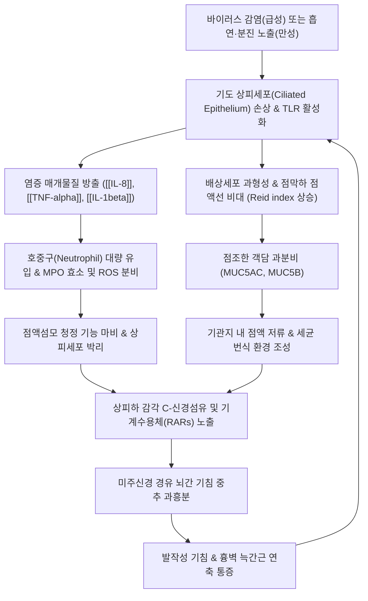

# 🩺 기관지염 (Bronchitis, 급·만성 기관지염)

> **핵심 3줄 요약 (Key Summary)**:
> - 📍 **병소 부위 & 해부·병태생리**: 하기도 주기관지 및 중간 기관지 점막의 감염성 또는 비감염성 자극에 의한 염증. 급성은 90~95% 바이러스 감염에 의한 상피세포 일과성 손상과 점액 분비; 만성은 흡연·유해 분진 노출에 의한 점막하 점액선 비대(Reid index $>0.5$) 및 비가역적 기류 폐쇄.
> - 🚩 **전형적 임상 양상**: 1~3주 지속되는 발작성 [[기침]], 화농성 또는 점액성 객담(가래), 흉골하 작열통 및 천명; 폐렴과의 감별(발열 $>38^\circ\text{C}$, 빈호흡, 국소 수포음 부재) 및 만성 기침 3대 원인(UACS, 기침이형천식, GERD) 감별 필수.
> - 🛠️ **핵심 검사 & 치료 전략**: 급성기는 **항생제 불필요 원칙**(대증적 진해거담제, 수분 공급), 만성기는 **철저한 금연**, LAMA/LABA 흡입 기관지확장제; 한의학적 해수(咳嗽)·담음(痰飮) 변증 하에 풍한속폐 [[소청룡탕]], 담열울폐 [[청폐탕]]/[[마행감석탕]], 비허습담 [[이진탕]], 폐음부족 [[맥문동탕]] 및 폐수·대추·풍륭 자침.
> - ⚠️ **응급 의뢰 레드플래그**: 심박수 $>100$회/분, 호흡수 $>24$회/분, 체온 $>38^\circ\text{C}$, 흉부 청진상 수포음(폐렴 의심) 청진 시 즉시 흉부 X선 촬영 및 내과 의뢰; 만성 기관지염 급성 악화로 $\text{SpO}_2 < 90\%$ 저하 시 응급실 전원.

---

## 📌 목차
1. [질환 개요 & 해부학적 병태생리](#1-질환-개요--해부학적-병태생리)
2. [병태생리 메커니즘 & 생체역학적 악순환 네트워크](#2-병태생리-메커니즘--생체역학적-악순환-네트워크)
3. [임상 증상 & 이학적 검사(Physical Exam) 알고리즘](#3-임상-증상--이학적-검사physical-exam-알고리즘)
4. [감별 진단 매트릭스 (Differential Diagnosis)](#4-감별-진단-매트릭스-differential-diagnosis)
5. [한의 통합 치료 프로토콜 (침·약침·추나·한약)](#5-한의-통합-치료-프로토콜-침약침추나한약)
6. [양방 치료 & 병용·의뢰 기준 (Conventional Treatment & Referral)](#6-양방-치료--병용의뢰-기준-conventional-treatment--referral)
7. [재활 운동 & 생활습관 티칭 가이드](#7-재활-운동--생활습관-티칭-가이드)
8. [💡 사용자 진료실 핵심 필기 & 임상 노하우 (Melt-In 잔여 심화 집약)](#8--사용자-진료실-핵심-필기--임상-노하우-melt-in-잔여-심화-집약)
9. [출처 및 학술 참고 문헌 (References)](#9-출처-및-학술-참고-문헌--references)

---

## 1. 질환 개요 & 해부학적 병태생리

**기관지염(Bronchitis)**은 하기도의 주기관지(Main bronchi) 및 분지 기관지 점막 상피에 발생하는 염증성 질환으로, 기도 점액 과분비, 점액섬모 청정 기능 장애, 기관지 평활근 연축을 수반하여 기침과 가래를 주증상으로 유발한다.

### 1) 급성 기관지염 vs 만성 기관지염 비교

| 항목 | 급성 기관지염 (Acute Bronchitis) | 만성 기관지염 (Chronic Bronchitis) |
| :--- | :--- | :--- |
| **정의** | 기관지 점막의 급성 일과성 염증 | **연속 2년 이상, 연 3개월 이상** 기침·객담 지속 |
| **주요 병인** | **호흡기 바이러스 (90~95%)** (Rhinovirus, Influenza, Parainfluenza, RSV) | **흡연 (85~90%)**, 대기오염, 직업성 분진·화학물질 |
| **세균성 원인** | 비전형균($<5\%$: *M. pneumoniae*, *C. pneumoniae*) | 2차 세균성 급성 악화(*H. influenzae*, *S. pneumoniae*) |
| **병리 소견** | 상피세포의 일시적 탈락, 점막 부종, 점액 분비 | 점막하선 비대(**Reid index $> 0.5$**), 배상세포 화생, 섬유화 |
| **기류 제한** | 일시적 기도 과민성에 의한 가역적 연축 | **비가역적 지속성 기류 폐쇄** ([[만성 폐쇄성 폐질환]]) |
| **경과 및 예후** | $1\sim3$주 내 완전 회복, 후유증 없음 | 점진적 폐기능 감퇴, 폐성심(Cor pulmonale) 합병 가능 |

### 2) 관련 해부학적 구조물
- **기관지 상피 및 점액섬모 에스컬레이터 (Mucociliary Escalator)**: 1개 세포당 수백 개의 섬모(Cilia)가 분당 약 1,000회의 조화로운 파동 운동으로 하기도의 점액과 포획된 이물질을 인두부로 밀어올림. 배상세포(Goblet cell)와 점막하선(Submucosal gland)이 방어 점액(MUC5AC, MUC5B)을 분비함.
- **기관지 평활근 및 자율신경계**: 미주신경(CN X) 부교감신경 분지가 평활근 수축과 점액 분비를 촉진하며, 교감신경 $\beta_2$-아드레날린 수용체가 평활근 이완을 매개함.

---

## 2. 병태생리 메커니즘 & 생체역학적 악순환 네트워크

---

## 3. 임상 증상 & 이학적 검사(Physical Exam) 알고리즘

### 1) 주요 임상 증상
- **발작성 기침**: 초기에는 자극성 마른기침으로 시작하여 수일 내 점액성 또는 화농성 객담을 동반하는 습성 기침으로 전환됨. 평균 지속 기간은 약 18일(1~3주)이며, 기도 과민성으로 인해 최대 4~6주까지 지속 가능.
- **객담 (가래)**: 맑은 점액성에서 누렇거나 녹색을 띠는 화농성 객담으로 변화(이는 세균 감염의 증거가 아니라 호중구의 MPO 방출에 의한 정상 세포성 반응임).
- **호흡기 불쾌감**: 심호흡이나 기침 시 흉골 후면의 작열통(Substernal burning pain), 천명(Wheezing), 미열, 전신 피로.

### 2) 급성 기관지염 vs 폐렴 감별 알고리즘 (Red Flags)
외래 진료실에서 급성 기관지염 의심 환자 내원 시, 항생제 투여와 입원이 필요한 **폐렴(Pneumonia)**을 선별하는 것이 가장 중요하다. 다음 5대 위험 신호 중 하나라도 해당하면 단순 기관지염으로 진단할 수 없으며 즉시 단순 흉부 방사선(Chest X-ray) 촬영을 시행해야 한다:
1. **심박수 $> 100\text{회/분}$ (빈맥)**
2. **호흡수 $> 24\text{회/분}$ (빈호흡)**
3. **구강 체온 $> 38^\circ\text{C}$ (고열)**
4. **흉부 청진 상 국소 악설음(Crackles), 수포음, 또는 기관지 호흡음**
5. **65세 이상 고령자, 만성 심부전, 면역저하자**
- *결과 해석*: 흉부 X선상 폐실질 침윤(Consolidation)이 없고 활력징후가 정상이면 '급성 기관지염'으로 확진.

---

## 4. 감별 진단 매트릭스 (Differential Diagnosis)

| 감별 질환 | 주요 병태 및 병인 | 기침의 임상 특징 | 흉부 X선 / 검사 소견 | 주요 감별 단서 |
| :--- | :--- | :--- | :--- | :--- |
| **[[기관지염]] (급성)** | 상기도 바이러스 하향 전파 | 1~3주 지속, 화농성 가래 흔함 | **정상 (폐실질 침윤 없음)** | 활력징후 정상, 폐포 수포음 부재 |
| **[[폐렴]] (Pneumonia)** | 폐포 실질의 세균/바이러스 감염 | 발열과 오한을 동반한 기침, 흉통 | **폐실질 경화·침윤(Consolidation)** | 고열($>38^\circ\text{C}$), 빈호흡, 국소 수포음 |
| **상기도 기침 증후군 (UACS)** | 비염, 부비동염 분비물 후비루 | 목 안의 이물감, 헛기침(Throat clearing) | 부비동 Waters view 공기액체층 | 인두 후벽 자갈 모양(Cobblestone), 코막힘 |
| **기침 이형 천식 (CVA)** | 호산구성 기도 과민성 염증 | **야간/새벽 악화되는 마른기침** | 정상 (메타콜린 기도유발시험 양성) | 가래 없음, 찬 공기 노출 시 악화, SABA 호전 |
| **위식도 역류 질환 (GERD)** | 위산의 미주신경 자극 및 흡인 | **식후 또는 앙와위(누울 때) 기침** | 정상 (24시간 식도 pH 모니터링) | 가슴 쓰림, 산역류, 제산제/PPI 투여 시 완화 |
| **[[기관지 확장증]]** | 영구적 기관지 확장 및 파괴 | 수개월~수년간 다량의 삼층 객담 | 흉부 CT상 기도 확장 (Signet ring) | 만성 대량 농성 객담, 빈번한 [[객혈]] |

---

## 5. 한의 통합 치료 프로토콜 (침·약침·추나·한약)

### 1) 변증 분형 및 한약 처방 (Herbal Medicine)
- **1) 풍한속폐 (風寒束肺, 급성 초기 풍한형)**:
  - *증상*: 맑고 묽은 흰색 가래, 쉰 목소리, 인후 간지러움, 오한, 미열, 무한, 두통, 설태박백, 맥부긴.
  - *치법*: 소풍산한(疏風散寒), 선폐지해(宣肺止咳).
  - *처방*: **[[소청룡탕]](小靑龍湯)** 또는 **[[삼소음]](參蘇飮)**. 마황·계지로 표한을 풀고 폐기를 열며, 반하·세신·건강으로 담음을 삭이고 수양성 분비를 제어.
- **2) 담열울폐 (痰熱鬱肺, 급성기 화농성 객담형)**:
  - *증상*: 누렇고 점조한 화농성 가래, 흉격 번민, 발열, 구갈, 인두 발적, 설질홍, 설태황니, 맥활삭.
  - *치법*: 청열선폐(淸熱宣肺), 화담지해(化痰止咳).
  - *처방*: **[[청폐탕]](淸肺湯)** 또는 **[[마행감석탕]](麻杏甘石湯)** 합 위경탕. 황금·치자로 점막 염증 충혈을 끄고, 패모·과루인으로 점조 가래를 묽혀 배출 촉진.
- **3) 풍조상폐 (風燥傷肺, 환절기 마른기침형)**:
  - *증상*: 가래가 적고 끈끈함, 인후 건조 및 작열통, 마른기침 발작, 설홍태소, 맥삭.
  - *치법*: 청폐윤조(淸肺潤燥), 양음지해(養陰止咳).
  - *처방*: **[[청조구폐탕]](淸燥救肺湯)** 또는 **[[상국음]](桑菊飮)** 가 [[맥문동]], [[사삼]], [[아교]].
- **4) 비허습담 (脾虛濕痰, 만성 기관지염 표준형)**:
  - *증상*: 아침 기상 시 대량의 백색 점액성 가래 배출, 식욕 부진, 복부 팽만, 피로감, 설담태백니, 맥활.
  - *치법*: 건비조습(健脾燥濕), 강기화담(降氣化痰).
  - *처방*: **[[이진탕]](二陳湯)** 합 **[[삼자양친탕]](三子養親湯)**. 반하·진피로 비습을 말리고, 백개자·자소자·나복자로 흉중 정체된 노담을 삭여 배출.
- **5) 폐음부족 (肺陰不足, 만성 기관지염 회복기)**:
  - *증상*: 쌕쌕거리는 마른기침, 인후 건조, 오후 미열, 손발바닥 번열, 설홍유열문, 맥세삭.
  - *치법*: 자음윤폐(滋陰潤肺), 지해거담(止咳祛痰).
  - *처방*: **[[맥문동탕]](麥門冬湯)** 가 [[사삼]], [[백합]]. 기관지 점액 분비 세포를 자극하여 건조한 상피를 복원.

### 2) 침구 치료 및 혈위 자침 프로토콜
- **배수혈 및 흉곽 국소혈**:
  - [[폐수]](BL13): T3 극돌기 하연 외방 1.5촌. 폐기를 직접 조절하고 기침 반사 중추 과흥분 억제.
  - [[대추]](GV14): C7 극돌기 하연. 체표 면역계 활성화 및 전신 염증 완화.
  - [[천돌]](CV22): 흉골병 상연 함요처. 기관지 평활근 연축 및 인후부 이물감 즉각 해소.
- **원격 사지혈**:
  - [[척택]](LU5): 주관절 횡문 상 상완이두근건 외측. 폐열을 사하고 해수를 멎게 함.
  - [[열결]](LU7): 요골경상돌기 상방 1.5촌. 두항부와 폐계 질환을 소통.
  - [[풍륭]](ST40): 외과첨 상방 8촌. 전신 담음(痰飮)을 제거하는 최고 요혈.

---

## 6. 양방 치료 & 병용·의뢰 기준 (Conventional Treatment & Referral)

### 1) 급성 기관지염의 치료: 항생제 불필요 원칙 (Antibiotic Stewardship)
- 질병관리청 및 미국 CDC 가이드라인: **합병증이 없는 성인 급성 기관지염 환자에게 일상적인 항생제 처방을 강력히 금지**함.
- 90% 이상이 바이러스 감염이므로 항생제는 기침 기간을 단축시키지 못하며, 장내 유익균 파괴, 설사 및 내성균(C. difficile 등) 발생 위험만 증가시킴.
- **대증 약물 요법**:
  - 진해제: 덱스트로메토르판(Dextromethorphan), 디히드로코데인(Dihydrocodeine).
  - 거담제·점액용해제: N-아세틸시스테인(NAC), 에르도스테인(Erdosteine), 암브록솔(Ambroxol).
  - 기관지확장제: 기관지 과민성 및 천명음 동반 시 흡입형 $\beta_2$-작용제([[알부테롤]]) 단기 흡입.

### 2) 만성 기관지염의 치료 전략
- **금연 (Smoking Cessation)**: 폐기능 저하 속도를 늦추는 유일한 근본 치료.
- **지속형 흡입 기관지확장제**:
  - LAMA(티오트로피움 등) 또는 LABA(인디카테롤 등) 단독 혹은 LAMA/LABA 복합제.
  - 잦은 악화 시 흡입 스테로이드(ICS) 병용 고려.
- **PDE4 억제제 (Roflumilast)**: $\text{FEV}_1 < 50\%$이고 만성 기관지염 표현형을 가진 빈번한 악화 환자에서 염증 세포 억제.

### 3) 응급 및 상급병원 의뢰 기준 (Referral Criteria)
- 38.0℃ 이상의 고열, 빈맥, 호흡곤란, 흉부 청진상 수포음 동반 시 (폐렴 배제 위해 즉시 흉부 X선 및 내과 의뢰).
- 만성 기관지염 환자에서 기침, 가래량, 호흡곤란이 급격히 악화되거나 $\text{SpO}_2 < 90\%$ 저하 시 (급성 악화 AECOPD로 응급실 전원).
- 4주 이상 진해제 복용에도 지속되는 기침 (흉부 CT 및 기관지내시경 검사를 통한 폐암, 결핵, 기관지 확장증 감별 필요).

---

## 7. 재활 운동 & 생활습관 티칭 가이드

1. **수분 공급 및 점액 희석**:
   - 하루 $1.5\sim2\text{ L}$의 미온수를 수시로 섭취하도록 지도. 수분 섭취는 기관지 점액의 점도를 낮추어 섬모 운동에 의한 가래 배출을 용이하게 하는 가장 안전하고 강력한 천연 거담제.
   - 카페인 음료나 알코올은 이뇨 작용을 촉진하여 점막을 건조하게 하므로 섭취 제한.
2. **흡연 및 간접흡연의 완벽한 차단**:
   - 흡연자는 즉시 금연을 시작해야 하며, 금연 1개월 차부터 기관지 섬모 기능이 재생되어 점액섬모 청정 기능이 회복되기 시작함.
   - 금연 초기 일시적으로 가래와 기침이 늘어날 수 있으나 이는 정체된 타르와 점액을 배출하는 정상적인 자정 작용임을 사전 안심 설명.
3. **실내 온·습도 조절**:
   - 실내 온도는 $20\sim22^\circ\text{C}$, 습도는 $50\sim60\%$ 유지. 가습기 사용 시 세균 및 곰팡이 오염을 방지하기 위해 매일 물을 교체하고 세척하도록 교육.

---

## 8. 💡 사용자 진료실 핵심 필기 & 임상 노하우 (Melt-In 잔여 심화 집약)

- **화농성 객담(누런 가래)의 오해와 진실**:
  - 환자들은 가래 색깔이 누렇거나 초록색으로 변하면 "세균에 감염되었으니 항생제를 먹어야 한다"고 확신하며 내원하는 경우가 많다.
  - 그러나 객담의 황색·녹색 변화는 세균 자체의 색이 아니라, 바이러스성 염증에 반응하여 유입된 호중구(Neutrophil)가 분비하는 **미엘로퍼옥시다아제(Myeloperoxidase, MPO) 효소**의 녹색 색소 때문이다. 따라서 단순 가래 색깔의 변화는 항생제 투여의 적응증이 되지 않음을 환자에게 명확히 교육해야 한다.
- **항생제를 강력히 요구하는 환자 설득 프로토콜**:
  - 단순한 거절은 환자의 치료 순응도를 떨어뜨리고 다른 의료기관으로의 전전을 유발한다.
  - "현재 감염은 90% 이상의 확률로 바이러스성 기관지염이며, 항생제는 바이러스를 죽이지 못하고 장내 유익균만 파괴하여 설사와 내성을 유발합니다. 대신 기관지 점막의 부종을 가라앉히고 가래를 삭이는 한약 처방([[소청룡탕]], [[청폐탕]])과 거담 침치료로 증상을 빠르게 완화시켜 드리겠습니다"라고 설명하며 대체 치료를 적극 제시한다.
- **만성 기관지염에서의 복진(腹診) 연계**:
  - 만성 기관지염 환자에서 심하비(心下痞, 명치 답답함)와 복모혈인 중완(CV12)의 압통, 복부 연약이 관찰되는 경우, 이는 비위(脾胃) 기능 저하로 인한 담음 정체를 시사하므로 폐 질환이라 하더라도 비위를 보강하는 육군자탕이나 이진탕을 반드시 합방해야 효과를 볼 수 있다.

---

## 9. 출처 및 학술 참고 문헌 (References)

- Pawlowska AM et al. (2026). From Traditional Remedy to Evidence-Based Phytotherapeutic Agent: Hedera helix L. in Respiratory Medicine. *Plants (Basel)*. 15(17):. PMID: 42739377.

- Bourqui A et al. (2026). Pelargonium sidoides extract (EPs® 7630) versus usual care for acute bronchitis in Swiss primary care (PHYTOBRONCH): a pragmatic, open-label, randomised controlled trial. *NPJ Prim Care Respir Med*. 36(1):. PMID: 42014704.

- Annunziata A et al. (2026). Focus on Rare Tracheal Pathologies You Should Not Miss. *J Clin Med*. 15(14):. PMID: 42513388.
