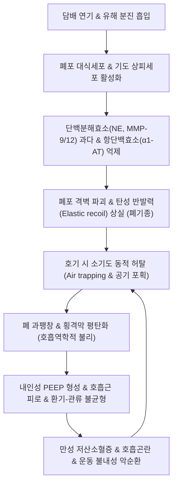

# 🩺 만성 폐쇄성 폐질환 (COPD, J44 / U20.4)

> **핵심 3줄 요약 (Key Summary)**:
> - 📍 **병소 부위 & 해부·병태생리**: 말초 소기도(Small airways, 직경 $<2\text{ mm}$)의 만성 세기관지염 및 폐포벽 파괴에 의한 **폐기종(Emphysema)**. 흡연·유해 분진 흡입으로 유발되는 완전히 가역적이지 않은 진행성 기류 제한(Airflow limitation).
> - 🚩 **전형적 임상 양상 & 3대 징후**: 점진적으로 악화되는 **노작성 호흡곤란(Dyspnea on exertion)**, 만성 [[기침]](해수), 이른 아침 끈적한 객담 배출. 질환 진행 시 술통형 흉곽(Barrel chest), 호흡보조근 사용, 체중 감소(악액질).
> - 🛠️ **핵심 감별 검사 & 한·양방 다각적 치료 전략**: 기관지확장제 흡입 후 **폐기능검사(PFT)상 FEV1/FVC < 0.70 (70%)** 확진. GOLD ABE군 분류 및 LAMA/LABA 흡입기 유지요법 병행, 한의 보폐익신(補肺益腎)·신불납기(腎不納氣) 다스리는 [[보폐탕]], [[신기환]], [[맥문동탕]], [[삼소음]] 및 단중·폐수·정천 침구 치료.
> - ⚠️ **응급 의뢰 레드플래그 & 악화 요인**: 급성 악화(Acute exacerbation), 안정 시 산소포화도(SpO2) < 88%, 고이산화탄소혈증(PaCO2 > 50mmHg)에 의한 기면·착란(CO2 narcosis), 폐성심(Cor pulmonale) 심부전 시 즉시 비침습적양압환기(NIV) 및 입원 의뢰.

---

## 📌 목차
1. [질환 개요 & 해부학적 병태생리](#1-질환-개요--해부학적-병태생리)
2. [병태생리 메커니즘 & 생체역학적 악순환 네트워크](#2-병태생리-메커니즘--생체역학적-악순환-네트워크)
3. [임상 증상 & 이학적 검사(Physical Exam) 알고리즘](#3-임상-증상--이학적-검사physical-exam-알고리즘)
4. [감별 진단 매트릭스 (Differential Diagnosis)](#4-감별-진단-매트릭스-differential-diagnosis)
5. [한의 통합 치료 프로토콜 (침·약침·추나·한약)](#5-한의-통합-치료-프로토콜-침약침추나한약)
6. [양방 치료 & 병용·의뢰 기준 (Conventional Treatment & Referral)](#6-양방-치료--병용의뢰-기준-conventional-treatment--referral)
7. [재활 운동 & 생활습관 티칭 가이드](#7-재활-운동--생활습관-티칭-가이드)
8. [💡 사용자 진료실 핵심 필기 & 임상 노하우 (Melt-In 잔여 심화 집약)](#8--사용자-진료실-핵심-필기--임상-노하우-melt-in-잔여-심화-집약)
9. [출처 및 학술 참고 문헌 (References)](#9-출처-및-학술-참고-문헌--references)

---

## 1. 질환 개요 & 해부학적 병태생리

**만성 폐쇄성 폐질환(Chronic Obstructive Pulmonary Disease, COPD)**은 유해한 미립자나 가스(특히 담배 연기, 미세먼지, 바이오매스 연소 가스)의 만성적 흡입 노출에 의해 기도와 폐실질에 비정상적인 만성 염증 반응이 발생하여, 완전히 가역적이지 않은 **지속적인 기류 제한(Persistent Airflow Limitation)**과 호흡기 증상을 초래하는 예방 및 치료 가능한 만성 폐질환이다.

### 1) 병리학적 2대 구성 요소
- **폐기종 (Emphysema)**: 종말세기관지(Terminal bronchiole) 원위부의 폐포벽이 영구적으로 파괴되고 폐포강이 비정상적으로 확장되어 가스 교환 표면적이 소실되고 탄성 반발력(Elastic recoil)이 상실된 상태.
- **만성 세기관지염 (Small airway disease / [[만성 기관지염]])**: 직경 2mm 미만의 소기도에서 배상세포 증식, 점액 과다 분비, 평활근 비후, 만성 염증성 섬유화로 내강이 좁아진 상태.

### 2) 역학 및 위험 인자
- 전 세계 사망 원인 3위, 국내 40세 이상 성인 유병률 약 13~14% (남성 >20%).
- **흡연(Cigarette smoking, 80~90%)**이 압도적 1위 위험 인자 (누적 흡연량 >20갑년). 비흡연자에서는 직업성 분진, 실내 바이오매스 연소 가스, 결핵 후유증, $\alpha_1$-항트립신(AAT) 결핍증.

### 3) 관련 해부학적 구조물
- **말초 소기도 및 폐포 모세혈관망**: 0.2mm 크기의 3억 개 폐포, 가스 교환 면적(약 70~100m²), 탄성섬유 지지망.
- **호흡 펌프 근육**: **횡격막(Diaphragm)**, 늑간근, 사각근, [[흉쇄유돌근]].
- **흉곽 골격**: 흉추 후만 및 늑골 주행 각도(폐 과팽창으로 수평화).

---

## 2. 병태생리 메커니즘 & 생체역학적 악순환 네트워크

### 1) 단백분해효소-항단백분해효소 불균형
- 흡연 연기 속 산화 스트레스와 화학 독소는 폐포 대식세포와 CD8+ T 림프구를 활성화시켜 호중구 화학주성 인자([[IL-8]], LTB4)를 방출함.
- 유입된 호중구는 **호중구 엘라스타제(Neutrophil elastase, NE)** 및 기질금속단백분해효소(MMP-9, MMP-12)를 대량 방출하여 폐포벽의 엘라스틴(Elastin)과 콜라겐 결합조직을 파괴함.
- 동시에 폐포를 보호하는 내인성 $\alpha_1$-항트립신(AAT)이 활성산소에 의해 산화 불활성화되어 폐기종이 급격히 진행됨.

### 2) 호기 시 소기도 동적 허탈(Dynamic Airway Collapse)과 폐 과팽창
- 정상 폐는 주위 탄성 섬유망이 기관지를 바깥쪽으로 당겨주는 방사상 견인력(Radial traction)을 발휘하여 호기 시에도 기도가 열려 있음.
- 폐기종 환자에서는 탄성 지지망이 파괴되어 숨을 내쉴 때 흉강 내압이 기도 내압보다 높아지는 역전 현상이 발생하여 **소기도가 조기에 허탈(Collapse)**됨.
- 공기가 폐포 밖으로 빠져나가지 못하고 갇히는 **공기 포획(Air trapping)**이 발생하며, 이는 폐 용적의 영구적 팽창(**폐 과팽창, Hyperinflation**)을 초래함.
- 과팽창된 폐는 돔 형태의 횡격막을 편평하게 아래로 짓눌러(Flattening), 횡격막의 수축 효율을 급격히 떨어뜨리고 환자는 흉쇄유돌근, 사각근 등 목 주변 호흡보조근에 의존해 호흡하게 되어 극심한 근막통과 피로를 겪음.

---

## 3. 임상 증상 & 이학적 검사(Physical Exam) 알고리즘

### 1) 주요 임상 증상
- **노작성 호흡곤란 (Dyspnea on exertion)**: 가장 중요한 핵심 증상. 초기에는 계단을 오르거나 무거운 짐을 들 때만 숨이 차다가, 진행되면 평지를 걷거나 옷을 입는 일상 활동에서도 숨이 차서 멈춰 서게 됨.
- **만성 기침 및 객담**: 대개 아침 기상 시 끈적하고 점조한 백색 가래 배출(급성 악화 시 황록색 농성 가래로 변화).
- **진행기 징후**: 술통형 흉곽(Barrel chest), 호기 시간의 연장, 호기말 천명음(Wheezing), 입술을 오므리고 숨을 내쉬는 구순호흡(Pursed-lip breathing), 하지 부종 및 경정맥 분노(우심부전, 폐성심 징후).

### 2) 폐기능 검사(Spirometry) 진단 기준 (GOLD 가이드라인)
- 속효성 기관지확장제(살부타몰 등) 흡입 후 측정한 **$\text{FEV}_1/\text{FVC} < 0.70$ (70% 미만)**: 완전히 가역적이지 않은 지속적 기류 제한의 필수 확진 기준.
- **기류 제한 중증도 분류 (FEV1 예측치 대비)**:
  - GOLD 1 (경증): $\text{FEV}_1 \ge 80\%$
  - GOLD 2 (중등증): $50\% \le \text{FEV}_1 < 80\%$
  - GOLD 3 (중증): $30\% \le \text{FEV}_1 < 50\%$
  - GOLD 4 (고도 중증): $\text{FEV}_1 < 30\%$
- **GOLD ABE군 분류 (치료 전략 결정 도구)**:
  - **A군**: 악화력 0~1회(입원 없음), 증상 경미 (mMRC 0~1점 또는 CAT < 10점).
  - **B군**: 악화력 0~1회(입원 없음), 증상 현저 (mMRC $\ge 2$점 또는 CAT $\ge 10$점).
  - **E군 (Exacerbation)**: 지난 1년간 악화 $\ge 2$회 또는 입원을 초래한 중증 악화 $\ge 1$회.

---

## 4. 감별 진단 매트릭스 (Differential Diagnosis)

| 감별 질환 | 호발 연령 및 병력 | 발병 양상 | 기류 제한 가역성 (스피로메트리) | 가래 양상 및 방사선 소견 |
| :--- | :--- | :--- | :--- | :--- |
| **[[만성 폐쇄성 폐질환]] (COPD)** | 40세 이상, 흡연력 ($>20$갑년) | 서서히 진행성 악화 | **기관지확장제 후에도 $\text{FEV}_1/\text{FVC} < 0.70$ (비가역적)** | 아침 소량 점액담, 흉부 X선상 과팽창·횡격막 평탄화 |
| **[[천식]] (Asthma)** | 소아기 또는 성인 전 연령, 아토피 | 발작성, 야간/새벽 악화 | **기관지확장제 후 $\text{FEV}_1 > 12\%$ 및 $200\text{ mL}$ 호전 (가역적)** | 가래 적거나 맑음, X선 대개 정상 |
| **[[기관지 확장증]]** | 전 연령, 반복된 호흡기 감염력 | 만성적 재발 | 가역성 다양함 | **다량의 삼층 화농성 객담, 빈번한 [[객혈]], HRCT상 기도 확장** |
| **만성 심부전 (CHF)** | 고령, 고혈압, 허혈성 심질환 | 기좌호흡, 야간발작성호흡곤란 | 제한성 환기장애 또는 정상 | 심초음파상 EF 저하, 혈청 BNP 급상승, 폐울혈 X선 |
| **특발성 폐섬유증 (IPF)** | 50세 이상, 흡연자 흔함 | 만성 마른기침, 진행성 숨참 | **제한성 패턴 ($\text{FEV}_1/\text{FVC} \ge 0.70$, FVC 저하)** | 양측 폐 기저부 흡기말 벨크로 수포음, 벌집폐(Honeycomb) |

---

## 5. 한의 통합 치료 프로토콜 (침·약침·추나·한약)

### 1) 변증 분형 체계 (Pattern Identification)
- **폐기허증 (肺氣虛證)**: 경도 기류 제한, 가벼운 활동 시 숨참, 기침에 힘이 없음, 맑은 가래, 피로, 자한, 설담태박백(舌淡苔薄白), 맥세약(脈細弱).
- **담탁조폐증 (痰濁阻肺證)**: 기침이 잦고 가래가 끓으며 배출이 어려움, 흉민, 천명, 설태백니(舌苔白膩), 맥활(脈滑).
- **폐신양허증 / 신불납기 (肺腎兩虛 / 腎不納氣)**: 중증 호흡곤란, 숨을 들이쉬기 어렵고 헐떡임, 기동 시 숨이 턱 끝까지 참, 요슬산연, 사지 냉감, 설담반유치흔, 맥침세무력.

### 2) 한약 치료 처방 (Herbal Medicine)
- **폐기허형**: [[보폐탕]](補肺湯) 합 [[옥병풍산]](玉屛風散) 가감 ([[황기]], [[백출]], [[방풍]], [[인삼]], [[숙지황]], [[오미자]], [[자완]], [[상백피]]).
  - *기전*: 호흡근 항산화능 강화, 기도 점막 방어벽 보강 및 잦은 감모 예방.
- **담탁조폐형**: [[이진탕]](二陳湯) 합 [[삼소음]](參蘇飮) 가감 ([[반하]], [[진피]], [[복령]], [[자소엽]], [[갈근]], [[전호]], [[행인]], [[길경]]).
  - *기전*: 점액 과분비 유전자 발현 억제 및 객담 배출 촉진.
- **폐신양허 / 신불납기형**: 금궤[[신기환]](金匱腎氣丸) 또는 맥미지황환(麥味地黃丸) 가 [[숙지황]], [[산약]], [[산수유]], [[복령]], [[택사]], [[목단피]], [[육계]], [[포부자]], [[맥문동]], [[오미자]].
  - *기전*: 신양(腎陽)을 북돋워 횡격막 수축력을 보조하고 숨을 단전으로 끌어내리는 납기평천(納氣平喘) 작용. 만성 노인성 COPD의 장기 투약에는 [[청상보하환]](淸上補下丸) 활용.

### 3) 침구 치료 혈위 (Acupuncture Protocol)
- **보폐익신 & 납기평천 핵심 혈위**:
  - 배수혈 및 흉부 모혈: [[폐수]](BL13), [[신수]](BL23), [[고황]](BL43), [[단중]](CV17, 흉골체 평자), [[기해]](CV6), [[관원]](CV4).
  - 선폐평천 요혈: **정천(EX-B1)**, [[천돌]](CV22), [[척택]](LU5), [[태연]](LU9).
  - 하지 보익 혈위: [[족삼리]](ST36), [[태계]](KI3).
- **뜸(온구) 요법**: 폐신양허 환자의 신수, 관원, 족삼리에 뜸(간접구)을 지속 시술하여 하초의 원양을 북돋워 횡격막 근력과 호흡 효율 개선.
- **약침 요법**: 자하거(인태반) 약침을 폐수, 신수에 주입하여 만성 소모성 근감소증 및 호흡근 위축 방지.

---

## 6. 양방 치료 & 병용·의뢰 기준 (Conventional Treatment & Referral)

### 1) GOLD 가이드라인 기반 단계별 흡입기 치료
- **초기 유지요법**:
  - **A군**: 단기 또는 장기지속형 기관지확장제(SABA 또는 LAMA/LABA).
  - **B군**: **LAMA + LABA 2제 복합 흡입기** (티오트로피움+올로다테롤, 유메클리디늄+빌란테롤 등) 우선 권고.
  - **E군 (악화 위험군)**: **LAMA + LABA 복합제**로 시작하며, 혈중 호산구 수치가 $\ge 300/\mu\text{L}$인 경우 흡입 스테로이드(ICS)를 추가한 **3제 복합제 (LAMA + LABA + ICS)** 투여.
- **포스포디에스테라제-4(PDE4) 억제제**: 로플루밀라스트(Roflumilast) — 만성 기관지염 표현형 및 $\text{FEV}_1 < 50\%$ 환자의 악화 감소.
- **장기 산소 요법 (LTOT)**: 안정 시 동맥혈 $\text{PaO}_2 \le 55\text{ mmHg}$ 또는 $\text{SpO}_2 \le 88\%$인 경우 하루 15시간 이상 지속 산소 공급(생존율 향상 입증).

### 2) 한·양방 병용 판단 기준
- 양방의 LAMA/LABA/ICS 흡입제는 기도 국소에 작용하므로 한약(보폐탕, 신기환)과 상호작용 없이 안전하게 병용 가능함. 임의로 흡입제를 중단하면 급성 악화가 초래되므로 흡입제는 유지하면서 한의 치료로 전신 체력과 횡격막 호흡근을 강화하도록 지도.

### 3) 응급실 전원 및 상급병원 의뢰 기준 (Referral Criteria)
- 호흡곤란이 급격히 악화되어 평소 약물로 조절되지 않는 급성 악화(AECOPD).
- $\text{SpO}_2 < 88\%$ 저하, 청색증, 보조호흡근 심한 함몰.
- 고이산화탄소혈증으로 인한 두통, 기면, 의식 혼돈(CO2 Narcosis) 발생 시 (즉시 119를 통해 중환자실/NIV 설비 병원으로 후송).

---

## 7. 재활 운동 & 생활습관 티칭 가이드

1. **호흡 재활 훈련 (Pulmonary Rehabilitation - 호흡역학의 핵심)**:
   - **구순포호흡 (Pursed-Lip Breathing, 입술 오므리기 호흡)**: 코로 2초간 들이마신 후, 입술을 촛불 끄듯 동그랗게 오므리고 **4~6초에 걸쳐 천천히 길게 내쉼**. 입술 저항으로 기도 내 양압($5\sim 10\text{ cmH}_2\text{O}$)을 형성하여 소기도 허탈을 방지하고 갇힌 공기를 배출.
   - **복식 횡격막 호흡 (Diaphragmatic Breathing)**: 가슴의 움직임을 줄이고 복부를 팽창시키며 천천히 흡기하여 편평해진 횡격막의 가동성을 회복.
2. **절대 금연 (Smoking Cessation)**:
   - 금연은 FEV1의 급격한 매년 감소 기울기를 정상 수준으로 둔화시키는 유일한 치료법.
3. **유산소 운동 및 영양 관리**:
   - 주 3~5회, 1회 20~30분간 평지 걷기. 상체 지지 걷기(보행기나 쇼핑카트 밀기: 상지를 고정하면 대흉근이 보조 흡기근으로 작용하여 호흡 부담 경감).
   - 호흡 노력으로 정상인의 10배 이상 칼로리가 소모되므로 고단백 영양식을 소량씩 자주 섭취.

---

## 8. 💡 사용자 진료실 핵심 필기 & 임상 노하우 (Melt-In 잔여 심화 집약)

- **상부 섹션에 미처 다 담지 못한 고유 원문 필기**:
  - "만성 폐쇄성 폐질환 (COPD)"
  - 기침과 가래로 내원한 노인 환자가 "감기가 몇 달째 안 떨어진다"고 호소할 때, 단순 감모가 아니라 **COPD의 비가역적 기류 폐색**을 반드시 의심해야 한다.
- **진료실 실전 감별 & 치료 노하우**:
  - 1. **실전 문진 3대 체크포인트**:
    - "담배를 평생 얼마나 피우셨습니까?" (20갑년 이상 시 COPD 의심도 90%).
    - "동년배 친구들과 평지를 걸을 때 뒤처지거나 숨이 차서 멈춰 서십니까?" (mMRC 2점 이상 판정).
    - "숨을 들이쉬는 게 힘듭니까, 내쉬는 게 힘듭니까?" (COPD는 전형적인 **호기 곤란** 질환).
  - 2. **치료 순서 및 손맛 노하우**:
    - **신불납기(腎不納氣)의 뜸 요법**: 숨이 턱 끝까지 차오르고 단전까지 내려가지 않는 말기 COPD 환자에게 **관원(CV4), 기해(CV6), 신수(BL23) 왕뜸을 30분간 시행**하면 호흡보조근의 과긴장이 풀리고 횡격막 하강이 유도되어 호흡수가 분당 24회에서 16회로 현저히 안정된다.
    - **정천(EX-B1)의 즉각적 기관지 연축 완화**: 경추 7번 극돌기 하 양측 0.5촌 정천혈에 1.5촌 침을 내측으로 45° 사자하여 뻐근한 감각을 유도하면 천명음과 흉부 답답함이 신속히 경감된다.
  - 3. **환자 티칭 스크립트**:
    - "어르신, 숨이 차다고 해서 가만히 누워만 계시면 다리 근육과 호흡 근육이 다 말라버려 나중에는 화장실도 못 가시게 됩니다. 입술을 촛불 끄듯이 모으고 천천히 숨을 끝까지 내쉬는 '입술 호흡'을 연습하시면서, 매일 하루 20분씩 평지를 천천히 걸으셔야 폐가 굳지 않습니다."

---

## 9. 출처 및 학술 참고 문헌 (References)

- Xu M et al. (2026). Progress on the Anti-inflammatory Mechanisms of Moxibustion in Chronic Obstructive Pulmonary Disease: A Narrative Review of Current Evidence. *J Vis Exp*. (236):. PMID: 42921797.

- D'Urzo AD et al. (2026). Implementing the 2023 Canadian Thoracic Society guideline on pharmacotherapy in patients with stable chronic obstructive pulmonary disease in primary care. *Can Fam Physician*. 72(10):610-617. PMID: 42875068.

- Santiworakul A et al. (2026). Effects of complementary therapies on physiological and psychological outcomes in chronic obstructive pulmonary disease patients: A systematic review and meta-analysis of randomized controlled trials. *Respir Med*. 263():109204. PMID: 42855085.
