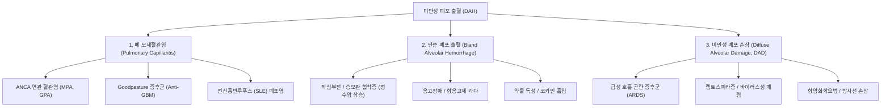
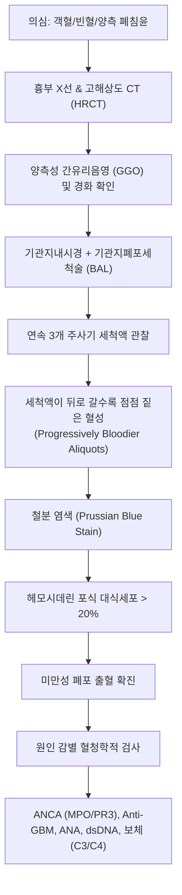

# 🩺 미만성 폐포 출혈 (Diffuse Alveolar Hemorrhage, DAH)

> **핵심 3줄 요약 (Key Summary)**:
> - 📍 병소 부위 & 해부·병태생리: 폐 미세혈관상(폐포 모세혈관, 세동맥, 세정맥)의 광범위한 손상 및 기저막 파괴로 인해 혈액이 폐포강(alveolar space) 내로 지속 유출되는 치명적 호흡기 증후군.
> - 🚩 전형적 임상 양상: 객혈(hemoptysis, 약 30%에서는 결여될 수 있음), 급격한 헤모글로빈/헤마토크릿 저하(철분결핍성 빈혈), 흉부 영상상 양측성 미만성 폐포 침윤의 전형적 3대 징후.
> - 🛠️ 핵심 검사 & 치료 전략: 기관지폐포세척술(BAL) 시 연속 3개 분획에서 점점 혈성(bloodier)으로 짙어지는 세척액 및 헤모시데린 포식 대식세포(hemosiderin-laden macrophages) 확인이 확진 표준; 고용량 메틸프레드니솔론 충격요법(Pulse Methylprednisolone) 및 혈장교환술(Plasmapheresis) 즉각 투여.
> - <font color="#fa7e7e">⚠️ 응급 의뢰 레드플래그: 객혈 동반 급성 저산소혈증, 호흡곤란, 양측성 광범위 폐침윤, 급격한 빈혈 진행 및 신기능 악화(폐-신 증후군) 발견 즉시 100% 3차 대학병원 응급실/중환자실 전원 의뢰.</font>

---

## 📌 목차
1. [질환 개요 & 해부학적 병태생리](#1-질환-개요--해부학적-병태생리)
2. [병태생리 메커니즘 & 원인 분류](#2-병태생리-메커니즘--원인-분류)
3. [임상 증상 & 진단 평가 알고리즘](#3-임상-증상--진단-평가-알고리즘)
4. [감별 진단 매트릭스 (Differential Diagnosis)](#4-감별-진단-매트릭스-differential-diagnosis)
5. [한의학적 변증 & 회복기 보조 프로토콜](#5-한의학적-변증--회복기-보조-프로토콜)
6. [양방 치료 & 응급 전원 기준 (Conventional Treatment & Referral)](#6-양방-치료--응급-전원-기준-conventional-treatment--referral)
7. [환자 관리 & 생활습관 티칭 가이드](#7-환자-관리--생활습관-티칭-가이드)
8. [💡 진료실 핵심 필기 & 임상 노하우 (Melt-In 심화 집약)](#8--진료실-핵심-필기--임상-노하우-melt-in-심화-집약)
9. [출처 및 학술 참고 문헌 (References)](#9-출처-및-학술-참고-문헌-references)

---

## 1. 질환 개요 & 해부학적 병태생리

### 1) 정의 및 해부학적 병소
**미만성 폐포 출혈(Diffuse Alveolar Hemorrhage, DAH)** 은 단일 질환명이 아니라, 폐포벽을 형성하는 폐 모세혈관, 소동맥, 소정맥 등 폐 미세순환계(microvasculature)의 광범위한 손상으로 인해 적혈구가 폐포강(alveolar spaces) 내로 쏟아져 들어오는 급성 임상-병리학적 증후군(syndrome)이다.

* **해부학적 병소 부위**: 폐포-모세혈관 기저막(alveolocapillary basement membrane) 및 폐 간질(pulmonary interstitium).
* **폐포 내 유출의 병태생리적 영향**:
  1. **가스교환 장애**: 폐포강 내부가 적혈구와 피브린, 혈장 삼출물로 채워지면서 환기-관류 불균형(V/Q mismatch)과 폐포-동맥 산소분압차($\text{P(A-a)O}_2$)의 극단적 증가, 심각한 생리학적 우-좌 단락(intrapulmonary shunt) 및 급성 저산소혈증 유발.
  2. **폐 확산능(DLCO)의 역설적 증가**: 유출된 유리 헤모글로빈이 폐포 표면에 노출되어 흡입된 일산화탄소를 결합하기 때문에 초기 DLCO가 기저치 대비 30% 이상 급격히 상승(수일 후 소멸).
  3. **폐포 대식세포 활성화**: 누출된 적혈구는 약 48~72시간 이내에 폐포 대식세포에 의해 탐식되어 헤모시데린(hemosiderin)으로 분해되며, 프러시안 블루(Prussian blue) 염색상 양성을 보이는 **헤모시데린 포식 대식세포(siderophage)** 로 변환됨.

### 2) 역학 및 원인 스펙트럼
DAH는 모든 연령에서 발생할 수 있으나, 원인 기저질환에 따라 호발 연령이 갈린다:
* **전신 자가면역질환 및 혈관염 관련**: 20~50대에 호발.
  * [[현미경적 다발혈관염]](MPA), 육아종증 다발혈관염(GPA, 이전의 Wegener 육아종증), 호산구성 육아종증 다발혈관염(EGPA) 등 **ANCA 연관 혈관염(AAV)**.
  * 항사구체기저막 항체병(Anti-GBM disease, Goodpasture 증후군).
  * [[전신홍반루푸스]](SLE): 루푸스 환자의 치명적 폐 합병증 중 하나.
* **비혈관염성 / 감염 / 약물 원인**:
  * 렙토스피라증(Leptospirosis, Weil 병), 한타바이러스 폐증후군.
  * 항응고제 과다 투여, 혈전용해제, 코카인 흡입("crack lung"), 조혈모세포이식(HSCT) 후 합병증.

---

## 2. 병태생리 메커니즘 & 원인 분류

미만성 폐포 출혈은 조직병리학적 기전에 따라 크게 세 가지 범주로 분류된다.



### 1) 폐 모세혈관염 (Pulmonary Capillaritis)
가장 흔하고 치명적인 형태이다.
* **기전**: 호중구(neutrophil)가 폐포 중격 모세혈관벽에 집중 침윤하여 효소 분비 및 활성산소를 방출함으로써 혈관벽의 백혈구파괴성 괴사(leukocytoclastic necrosis), 핵먼지(nuclear dust), 피브린 침착을 초래함.
* **대표 원인**:
  * [[현미경적 다발혈관염]](p-ANCA/MPO 양성) 및 GPA(c-ANCA/PR3 양성).
  * Goodpasture 증후군: 제4형 콜라겐 알파-3 사슬에 대한 자가항체 공격.
  * [[전신홍반루푸스]](SLE): 면역복합체 매개 모세혈관염.

### 2) 단순 폐포 출혈 (Bland Alveolar Hemorrhage)
모세혈관벽의 염증성 파괴나 괴사 소견 없이 적혈구가 폐포강 내로 누출되는 형태이다.
* **기전**: 폐 모세혈관 내 정수압의 급격한 상승 또는 전신 지혈 기전의 파탄.
* **대표 원인**:
  * 승모판 협착증(Mitral stenosis), 중증 좌심실 수축기 기능부전으로 인한 폐정맥 고혈압.
  * 혈소판감소증, 응고인자 결손, 와파린·DOAC 과다 복용.
  * 특발성 폐 헤모시데린 침착증(Idiopathic pulmonary hemosiderosis, 주로 소아).

### 3) 미만성 폐포 손상 동반 출혈 (Diffuse Alveolar Damage, DAD)
* **기전**: 폐포 상피세포와 내피세포의 전반적 괴사로 초자양막(hyaline membrane)이 형성되며 2차적 출혈이 동반되는 병변.
* **대표 원인**: [[급성 호흡 곤란 증후군]](ARDS), 중증 패혈증, 렙토스피라 감염증, 중증 흡인 손상.

---

## 3. 임상 증상 & 진단 평가 알고리즘

### 1) 전형적 임상 증상 (Classic Clinical Triad)
1. **객혈 (Hemoptysis)**:
   * 선홍색 또는 암적색의 가래, 분출성 객혈까지 다양함.
   * **주의**: 환자의 약 **30~33%에서는 객혈이 전혀 나타나지 않는다.** 폐포의 용적이 방대하여 대량의 혈액이 폐포강 내에 고여 있어도 기도로 배출되지 않을 수 있기 때문이다.
2. **급성 호흡곤란 및 기침 (Dyspnea & Cough)**:
   * 급격히 진행되는 빈호흡(tachypnea), 산소포화도 급락.
3. **진행성 빈혈 (Unexplained Drop in Hemoglobin)**:
   * 외견상 출혈 부위가 없음에도 Hb 수치가 수일 내에 2~4 g/dL 이상 급격히 하강.

### 2) 이학적 검사 소견
* **호흡기계 진찰**: 양측 폐 하엽 및 중엽 전반에서 미세 수포음(fine crackles) 청진.
* **전신 징후**: 창백(pallor), 빈맥, 핍뇨(oliguria, 신침범 시), 관절통, 피부 자반증(palpable purpura: 혈관염 의심).

### 3) 진단 확진 알고리즘 (Diagnostic Gold Standard)



* **기관지폐포세척술(BAL)**:
  * 첫 번째 주사기 흡인액보다 두 번째, 세 번째 주사기 흡인액이 **점점 더 짙은 혈색(bloodier)** 을 띨 때 진단적 가치가 확립됨(상기도나 대기관지 출혈은 뒤로 갈수록 옅어짐).
  * 세포진 검사에서 골만 스코어(Golde score) 계산 또는 **헤모시데린 포식 대식세포(siderophage) 비율이 20% 초과** 시 과거 수일 전부터 지속된 폐포 출혈을 증명.

---

## 4. 감별 진단 매트릭스 (Differential Diagnosis)

| 감별 질환 | 주 임상 양상 | BAL 소견 | 혈청학 및 감별 포인트 |
| :--- | :--- | :--- | :--- |
| **[[미만성 폐포 출혈]] (DAH)** | 객혈, 미만성 폐침윤, 급격한 빈혈 진행 | **연속 분획 갈수록 짙은 혈성**, Siderophage > 20% | ANCA (+), Anti-GBM (+), DLCO 일시적 급증 |
| **[[급성 호흡 곤란 증후군]] (ARDS)** | 패혈증/외상 후 저산소혈증, 폐부종 양상 | 비혈성 또는 맑은 단백질성 삼출액 | 출혈 소견 없음, DLCO 저하, 명확한 유발 인자 선행 |
| **심원성 폐부종 (좌심부전)** | 기좌호흡, 분홍빛 거품 가래, 심비대 | 묽은 분홍빛 장액성 액체 | NT-proBNP 급상승, 심초음파상 EF 저하 및 E/e' 증가 |
| **세균성/바이러스성 중증 폐렴** | 고열, 화농성 가래, 분절성 침윤 | 호중구/림프구 우세, 세균/바이러스 PCR (+) | 염증성 백혈구 분획 우세, 배양 검사 양성 |
| **기관지확장증 출혈** | 반복적인 대량 객혈, 만성 객담 | 기관지 점막의 국소 출혈 관찰 (BAL 미만성 출혈 아님) | HRCT상 확장된 기도 및 점액 매복 관찰 |

---

## 5. 한의학적 변증 & 회복기 보조 프로토콜

> ⚠️ **급성기 치료 원칙**: 급성 DAH는 초응급 중환자실 질환이므로 한의원 단독 치료는 절대 금기이다. 아래의 한의학적 변증 및 치법은 양방의 면역억제요법 및 혈장교환술을 통해 **출혈이 완전 지혈되고 환자의 활력징후가 안정화된 아급성기~만성 회복기**에 폐 기능 회복, 골수 조혈 기능 촉진, 스테로이드 부작용 경감을 목적으로 한 병용 보조 프로토콜이다.

### 1) 한의학적 변증 분류
* **혈열망행(血熱妄行)**:
  * 원인: 열독(熱毒)이 폐락(肺絡)을 침범하여 혈액이 맥외로 넘쳐남(AAV, 급성 혈관염 양상).
  * 증상: 객혈, 번갈, 설홍태황, 맥삭.
  * 치법: 청열양혈(淸熱凉血), 지혈화어(止血化瘀).
  * 대표 처방: [[서각지황탕]](犀角地黃湯, 대용 수우각) 합 [[십회산]](十灰散).
* **기음양허(氣陰兩虛) 및 폐신음허(肺腎陰虛)**:
  * 원인: 장기간의 출혈과 스테로이드 투여로 폐와 신장의 진액과 정기가 고갈됨.
  * 증상: 마른기침, 미열, 도한, 숨참, 설홍소태, 맥세삭.
  * 치법: 익기양음(益氣養陰), 보폐윤조(補肺潤燥).
  * 대표 처방: [[백합고금탕]](百合固金湯) 또는 [[맥문동탕]](麥門冬湯) 가감.
* **기혈양허(氣血兩虛)**:
  * 원인: 대량 출혈 후 골수 조혈 저하 및 쇠약.
  * 증상: 안색 창백, 극심한 피로, 현훈, 설담태백, 맥세약.
  * 치법: 보기양혈(補氣養血).
  * 대표 처방: [[당귀보혈탕]](當歸補血湯) 합 [[사물탕]](四物湯).

### 2) 회복기 침구 치료
* **혈위 선정**:
  * 폐경 및 지혈 요혈: [[척택]](LU5), [[공최]](LU6, 극혈 - 지혈 특효혈), [[폐수]](BL13), [[격수]](BL17, 혈회).
  * 보기양혈 혈위: [[족삼리]](ST36), [[삼음교]](SP6), [[태계]](KI3), [[관원]](CV4).
* **자침 기법**: 유침 15~20분, 굵지 않은 침(0.20~0.25mm)으로 부드러운 평보평사 또는 보법 적용.

---

## 6. 양방 치료 & 응급 전원 기준 (Conventional Treatment & Referral)

### 1) 양방 급성기 치료 (Conventional Management)
1. **호흡 보조 및 기도 확보**:
   * 침범 부위가 국소적인 경우 병변 폐를 아래로 위치시켜 정상 폐로의 혈액 흡인 방지.
   * 고유량 비강 캐뉴러(HFNC) 또는 기계환기(Mechanical ventilation). PEEP을 적절히 적용하여 미세혈관 압박 지혈 유도.
2. **고용량 스테로이드 충격요법 (Pulse Corticosteroid Therapy)**:
   * **Methylprednisolone 500~1000 mg/day 정맥 투여** (3일간 연속 투여).
   * 이후 경구 프레드니손(Prednisone) 1 mg/kg/day로 전환 후 점진적 감량.
3. **면역억제제 병용**:
   * **Cyclophosphamide (CYC)** 정맥 충격요법 또는 **Rituximab (RTX)** 투여(ANCA 연관 혈관염 표준 요법).
4. **혈장교환술 (Plasmapheresis)**:
   * Anti-GBM 질환, 중증 ANCA 연관 혈관염, 전신홍반루푸스 신염 동반 DAH 시 순환 자가항체 및 면역복합체 제거를 위해 즉각 시행.

### 2) 한양방 병용 시 주의사항
* **항응고제 및 항혈소판제 상호작용**: 출혈 소인이 있는 환자에게 혈액순환 촉진 목적의 강한 활혈거어약(도인, 홍화, 삼칠 과량) 투여 시 재출혈 위험 주의.
* **면역억제 상태 감염 위험**: 고용량 스테로이드 및 면역억제제 복용 환자는 기회감염(뉴모시스티스 폐렴, 아스페르길루스증)에 극도로 취약하므로 한약 투약 시 간/신 독성 모니터링 필수.

### 3) 🚨 전문과 전원 및 응급 의뢰 기준 (Referral Criteria)

```
[🚨 100% 응급 전원 레드플래그 체크리스트]
1. 갑작스러운 객혈과 함께 안정 시 호흡곤란 및 SpO2 < 93% 저하
2. 흉부 영상(X-ray)에서 양측 폐문 주위 및 폐포의 미만성 침윤 관찰
3. 원인 불명의 급격한 헤모글로빈 강하 (빈혈 쇼크 전구 증상)
4. 소변 검사상 단백뇨/혈뇨 동반 (폐-신 증후군: AAV, Goodpasture 강력 의심)
5. 전신 결합조직 질환(SLE, 혈관염) 기저환자의 급성 호흡곤란 발생

=> 상기 소견 중 단 하나라도 해당할 경우, 어떠한 한의 치료도 지체하지 말고
   산소 투여 및 119 구급대를 통한 3차 상급병원 응급의료센터로 즉각 전원한다.
```

---

## 7. 환자 관리 & 생활습관 티칭 가이드

### 1) 퇴원 후 회복기 모니터링
* **객혈 자가 모니터링**: 기침 시 피가 섞여 나오거나 가래 색깔이 녹슨 쇠 색(rust-colored) 또는 분홍빛으로 변하는지 매일 확인.
* **산소포화도 및 맥박 측정**: 가정용 펄스 옥시미터를 구비하여 안정 시 산소포화도 95% 이상 유지 여부 확인.
* **신기능 추적**: 정기적인 소변 검사(단백뇨, 잠혈) 및 eGFR 혈액검사 준수 교육.

### 2) 생활습관 및 호흡 재활
* **절대 금연 및 호흡기 자극원 차단**: 간접흡연, 미세먼지, 유기용제, 화학 스프레이 노출 엄격 차단.
* **호흡근 재활 운동**: 횡격막 호흡(diaphragmatic breathing) 및 입술 오므리기 호흡(pursed-lip breathing)을 통해 폐포 허탈 방지 및 가스교환 효율 증진.
* **감염 예방**: 면역억제 치료 중이므로 인플루엔자 및 폐렴구균 예방접종, 마스크 착용, 손 씻기 철저.

---

## 8. 💡 진료실 핵심 필기 & 임상 노하우 (Melt-In 심화 집약)

### 1) 임상에서 절대 놓쳐선 안 되는 역설적 징후 2가지
1. **"객혈 없는 폐포 출혈"의 함정**:
   * DAH 환자의 3명 중 1명은 객혈을 하지 않는다. "피를 토하지 않으니 폐출혈이 아니다"라고 속단하면 치명적이다. 전신 혈관염이나 루푸스 환자가 호흡곤란과 함께 빈혈이 심해지면 반드시 DAH를 의심해야 한다.
2. **폐 확산능(DLCO)의 역설적 상승**:
   * 대부분의 간질성 폐질환이나 폐렴에서는 DLCO가 감소한다. 그러나 급성 DAH에서는 폐포 내로 쏟아진 적혈구의 헤모글로빈이 검사용 CO 가스를 흡수해 버리므로 **DLCO가 기저치의 130% 이상으로 급상승**한다. 이는 DAH의 결정적 진단 단서 중 하나이다.

### 2) 폐-신 증후군(Pulmonary-Renal Syndrome)의 조기 감지
* 객혈과 호흡곤란을 호소하는 환자에게 즉석 뇨시험지봉 검사(dipstick)를 시행했을 때 **단백뇨(2+ 이상)와 혈뇨(RBC 3+ 이상)** 가 동시에 검출된다면 90% 이상 AAV 또는 Anti-GBM 질환이다.
* 이 상태는 수일 내에 급성 신부전(투석 필요) 및 호흡부전으로 사망할 수 있는 초응급이므로 지체 없는 혈장교환술 및 펄스 스테로이드 의뢰가 환자의 생명을 구한다.

---

## 9. 출처 및 학술 참고 문헌 (References)

1. Diffuse alveolar hemorrhage in ANCA-associated vasculitis: Current evidence and multimodal treatment approaches. (2026). *Am J Med Sci*, 372(4):316-328. PMID: 42537793.
2. Early Diffuse Alveolar Hemorrhage Revealing Leptospirosis Without Multiorgan Failure: A Case Report and Literature Review. (2024). *Am J Case Rep*, 25:e942512. PMID: 42831055.
3. Systemic Lupus Erythematosus-related Lung Disease. (2024). *Rheum Dis Clin North Am*, 50(2):285-301. PMID: 38547915.

---

## 관련 노트

- [[현미경적 다발혈관염]]
- [[혼합 결합 조직병 mctd]]
- [[급성 호흡 곤란 증후군]]
- [[기도 흡인증후군]]
- [[무기폐]]
