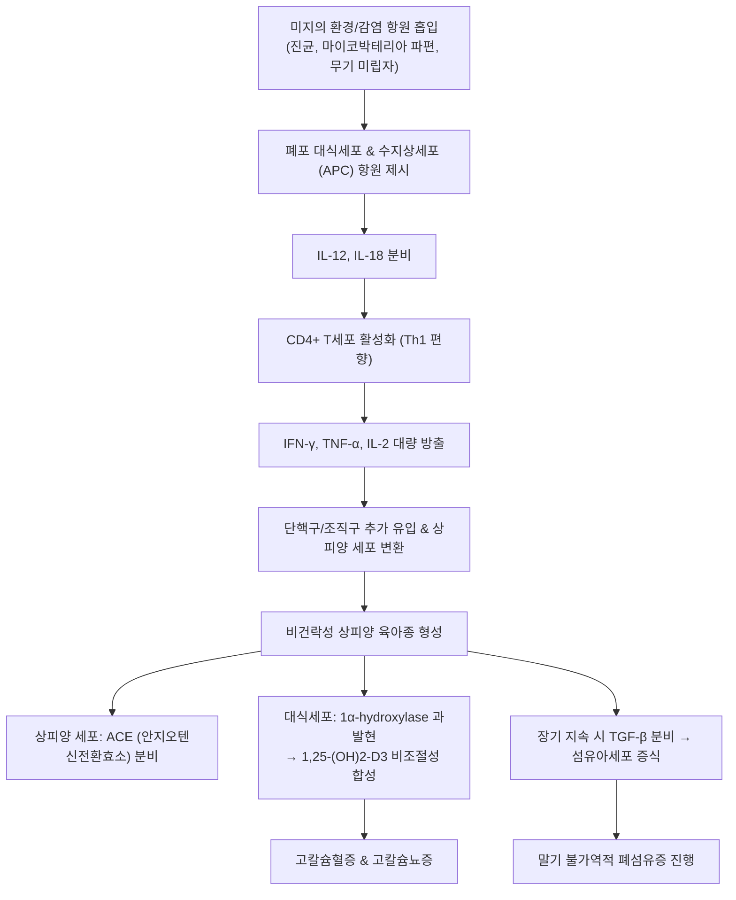

# 🩺 사르코이도증 (Sarcoidosis)

> **핵심 3줄 요약 (Key Summary)**:
> - 📍 병소 부위 & 해부·병태생리: 원인 미상의 면역학적 이상으로 인해 전신 장기에 비건락성 상피양 세포 육아종(non-caseating epithelioid granuloma)이 형성되는 다발성 전신 질환; 90% 이상에서 폐 실질 및 흉곽 내 림프절 침범.
> - 🚩 전형적 임상 양상: 무증상 또는 마른기침·호흡곤란·피로, 흉부 X선상 양측 폐문 림프절 비대(BHL), 결절성 홍반(erythema nodosum), 포도막염(uveitis), 고칼슘혈증 및 고칼슘뇨증.
> - 🛠️ 핵심 검사 & 치료 전략: 흉부 CT 및 기관지초음파 내시경 유도하 세침흡인술(EBUS-TBNA)을 통한 조직학적 비건락성 육아종 증명, 혈청 ACE 및 칼슘 측정; 전신 증상 및 장기 기능 저하 시 1차 전신 코르티코스테로이드 및 스테로이드 감량제(메토트렉세이트, 아자티오프린) 투여.
> - <font color="#fa7e7e">⚠️ 응급 의뢰 레드플래그: 심장 침범 징후(실신, 고도 방실차단, 심실빈맥), 신경계 사르코이도증(급성 뇌신경 마비, 뇌압 상승), 급격한 시력 저하(중증 포도막염) 발견 즉시 상급병원 응급 전원.</font>

---

## 📌 목차
1. [질환 개요 & 해부학적 병태생리](#1-질환-개요--해부학적-병태생리)
2. [병태생리 메커니즘 & 면역 육아종 형성 네트워크](#2-병태생리-메커니즘--면역-육아종-형성-네트워크)
3. [임상 증상 & 이학적 검사 알고리즘](#3-임상-증상--이학적-검사-알고리즘)
4. [감별 진단 매트릭스 (Differential Diagnosis)](#4-감별-진단-매트릭스-differential-diagnosis)
5. [한의학적 변증 & 보조 치료 프로토콜](#5-한의학적-변증--보조-치료-프로토콜)
6. [양방 치료 & 병용·의뢰 기준 (Conventional Treatment & Referral)](#6-양방-치료--병용의뢰-기준-conventional-treatment--referral)
7. [환자 관리 & 생활습관 티칭 가이드](#7-환자-관리--생활습관-티칭-가이드)
8. [💡 진료실 핵심 필기 & 임상 노하우 (Melt-In 심화 집약)](#8--진료실-핵심-필기--임상-노하우-melt-in-심화-집약)
9. [출처 및 학술 참고 문헌 (References)](#9-출처-및-학술-참고-문헌-references)

---

## 1. 질환 개요 & 해부학적 병태생리

### 1) 정의 및 병리학적 특징
**사르코이도증(Sarcoidosis)** 은 유전적 소인을 가진 개체에서 미상의 외인성 항원에 노출된 후 과도한 세포 매개 면역 반응이 촉발되어, 전신 다발 장기에 **비건락성 육아종(non-caseating granuloma)** 이 형성되는 특발성 만성 염증성 질환이다.

* **병리학적 특징**:
  * 결핵과 달리 중심부 건락성 괴사(caseous necrosis)가 없는 것이 감별의 핵심 기준이다.
  * 육아종의 중심부는 다핵 거대세포(Langhans multinucleated giant cells)와 상피양 조직구(epithelioid histiocytes)로 구성되며, 그 외곽을 CD4+ 헬퍼 T 림프구와 소수의 B 세포, 섬유아세포 띠가 둘러싼다.
  * 거대세포 세포질 내에서 **성상체(asteroid bodies)** 또는 칼슘-단백 침착물인 **샤우만체(Schaumann bodies)** 가 흔히 관찰된다.

### 2) 호발 부위 및 역학
* **주 침범 장기**:
  1. **폐 및 흉곽 내 림프절 (90% 이상)**: 양측 폐문 및 종격동 림프절, 기관지혈관속(bronchovascular bundle) 주변 간질.
  2. **피부 (20~35%)**: [[결절성 홍반]](erythema nodosum), 동창양 루푸스(lupus pernio), 피하 결절.
  3. **안구 (20~25%)**: 전방/후방 포도막염(uveitis), 결막염, 건성안.
  4. **간 및 비장 (10~20%)**: 간비대, 비장종대.
  5. **심장 (5~10%) 및 신경계 (5%)**: 치명률을 결정하는 고위험 침범 장기.
* **역학**: 20~40대의 젊은 성인에게 호발하며, 여성에서 다소 높음. 스칸디나비아 국가 및 아프리카계 미국인에서 유병률과 중증도가 높게 보고됨.

---

![[사르코이도증_01_흉부X선_양측폐문비대.png|450]]
> [그림 1: 사르코이도증 환자의 흉부 X선 — 양쪽 폐문이 대칭으로 커져 있고 폐야에는 가는 결절성 음영이 퍼져 있다. 양측 폐문 림프절 비대는 2기 사르코이도증의 전형적 소견이다 — 출처: Wikimedia Commons — File:Chest X-ray of sarcoidosis nodules.png (CC0)]

![[사르코이도증_02_폐육안_벌집변화.jpg|450]]
> [그림 2: 사르코이도증 폐 육안표본(전두면 절단) — 기관지 분지 주변으로 흰 섬유화 띠가 따라가고 말초 폐에 벌집 모양 낭성 변화가 퍼져 있다. 진행기 섬유화를 단면으로 보여준다 — 출처: Wikimedia Commons — File:Sarcoidosis - Honeycombing.jpg (CC BY-SA 2.0)]

## 2. 병태생리 메커니즘 & 면역 육아종 형성 네트워크

사르코이도증의 육아종 형성은 유전-환경 상호작용과 Th1/Th17 면역계의 지속적 활성화로 발생한다.



### 1) 육아종 형성 및 면역 조절 장애
* **Th1/Th17 사이토카인 연쇄**: IFN-$\gamma$와 TNF-$\alpha$가 상피양 조직구 융합 및 육아종 유지를 유도한다.
* **조절 T세포(Treg)의 기능 부전**: 육아종 주변부에 Treg 세포가 존재하나 면역 억제 기능이 저하되어 자가 영속적 염증이 유지됨.
* **칼슘 대사 이상 메커니즘**:
  * 사르코이드 육아종 내 활성화된 대식세포는 부갑상선호르몬(PTH)의 피드백 조절을 무시하고 **$1\alpha$-수산화효소($1\alpha$-hydroxylase)** 를 자율적으로 과발현함.
  * 이는 활성형 비타민 D인 $1,25\text{-(OH)}_2\text{-D}_3$ 생성을 급증시켜 장관 내 칼슘 흡수 증가 및 골 흡수를 촉진, **고칼슘혈증(10~15%) 및 고칼슘뇨증(30~40%)** 을 유발하여 요로결석과 신석회증의 원인이 됨.

---

![[사르코이도증_03_비건락육아종_저배율.jpg|450]]
> [그림 3: 사르코이도증 육아종 H&E — 경계가 뚜렷한 결절 안에 상피모양 조직구가 모여 있고 중심부는 유리질 섬유화로 분홍빛을 띠며 주변을 림프구가 둘러싼다. 건락괴사가 없는(non-caseating) 것이 결핵성 육아종과의 핵심 감별점이다 — 출처: Wikimedia Commons — File:Sarcoidosis with central fibrosis of granulomas Case 219 (7261951682).jpg (CC BY-SA 2.0)]

![[사르코이도증_04_기관지주위육아종.jpg|450]]
> [그림 4: 폐 조직 H&E — 기관지혈관주위(peribronchovascular)로 육아종성 염증이 따라 붙어 있고 주변 폐포는 비교적 보존돼 있다. 사르코이도증이 림프관 주행을 따라 퍼지는 방식을 보여준다 — 출처: Wikimedia Commons — File:Asteroid body intermed mag.jpg (CC BY-SA 3.0)]

## 3. 임상 증상 & 이학적 검사 알고리즘

### 1) 전형적 임상 증상 및 증후군
1. **호흡기 증상**: 3분의 1에서 마른기침, 점진적 호흡곤란, 흉부 불쾌감 호소.
2. **뢰프그렌 증후군 (Löfgren Syndrome)**:
   * **3대 징후**: 양측 폐문 림프절 비대(BHL) + [[결절성 홍반]](하지 전면부의 압통성 결절) + 급성 관절염(주로 발목 관절) 및 발열.
   * 급성 양성 아형으로, 80~90%에서 2년 이내 자연 관해되는 양호한 예후를 보임.
3. **헤어포르트 증후군 (Heerfordt Syndrome, 포도막이하선열)**:
   * 포도막염 + 이하선 종대 + 안면신경(제7 뇌신경) 마비 + 발열의 4대 징후.
4. **동창양 루푸스 (Lupus Pernio)**:
   * 코, 뺨, 귓불에 발생하는 자홍색의 침윤성 판 또는 결절로 만성 섬유화 사르코이도증의 강력한 지표.

### 2) 방사선학적 병기 분류 (Scadding 병기)
* **0기**: 흉부 X선 정상 (5~10%).
* **I기**: **양측 폐문 림프절 비대(BHL) 단독** (폐 실질 침윤 없음, 50% 발생, 자연 소퇴율 높음).
* **II기**: **BHL + 폐 실질 침윤** 동반 (25~30%).
* **III기**: **폐 실질 침윤 단독** (BHL 소실, 15%).
* **IV기**: 상엽 우세의 비가역적 **폐섬유화, 벌집폐, 폐기종성 낭종** (5~10%).

---

![[사르코이도증_05_거대세포육아종_고배율.jpg|450]]
> [그림 5: 육아종 고배율 — 여러 개의 핵이 테두리에 배열된 다핵거대세포와 상피모양 조직구가 한 덩어리를 이루고 주변에 림프구가 밀집해 있다 — 출처: Wikimedia Commons — File:Granuloma mac.jpg (Public domain)]

![[사르코이도증_06_폐문림프절비대_화살표.png|450]]
> [그림 6: 흉부 X선에서 빨간 화살표가 가리키는 왼쪽 폐문의 종괴성 확대 — 폐문 림프절 비대가 사르코이도증의 첫 영상 소견인 경우가 많다. 결핵·림프종과의 감별이 필요하다 — 출처: Wikimedia Commons — File:HilarAdenopathy.png (CC BY-SA 4.0)]

## 4. 감별 진단 매트릭스 (Differential Diagnosis)

| 감별 질환 | 육아종 병리 소견 | 영상 및 임상 양상 | 결정적 감별 포인트 |
| :--- | :--- | :--- | :--- |
| [[사르코이도증]] | **비건락성 육아종**, Schaumann/Asteroid 소체 | 양측 대칭성 폐문 비대(BHL), 결절성 홍반, 포도막염 | 배양 음성, ACE 상승, EBUS-TBNA 조직 검사 |
| **폐결핵 (Tuberculosis)** | **건락성 괴사(Caseous necrosis)** 동반 육아종 | 상엽 첨부 공동(cavity), 비대칭성 림프절 종대 | AFB 염색 (+), 결핵균 PCR/배양 (+), IGRA 양성 |
| **만성 베릴륨병 (CBD)** | 비건락성 육아종 (사르코이도증과 병리학적 구별 불가) | 항공/우주/합금/전자 산업 노출력, 폐 섬유화 | **베릴륨 림프구 증식 검사 (BeLPT) 양성** |
| **림프종 (Lymphoma)** | 비정형 악성 림프구 증식, 육아종 부재 | 비대칭성 전종격동 종괴, B 증상(고열, 야간 발한, 체중감소) | 림프절 절제 생검상 악성 세포 증명, LDH 급상승 |
| **과민성 폐렴 (HP)** | 저발달된 비건락성 육아종, 세기관지 중심 림프구 침윤 | 깃털/조류, 곰팡이 노출력, 소엽 중심성 결절 및 모자이크 관류 | 노출원 회피 시 호전, 기관지폐포세척 CD4/CD8 비율 역전(<1) |

---

## 5. 한의학적 변증 & 보조 치료 프로토콜

> 🎯 **치료 접근 원칙**: 사르코이도증은 전신 결합조직 및 폐 간질에 '담탁(痰濁)'과 '어혈(瘀血)', '기체(氣滯)'가 얽혀 무형의 병리적 산물이 유형의 결절(육아종)로 결집된 질환으로 인식한다. 양방의 스테로이드 요법 중 발생하는 부작용(골다공증, 부종, 소화장애)을 완화하고, 만성 섬유화로의 이행을 방지하는 보조적 접근을 적용한다.

### 1) 한의학적 변증 분류
* **담어호결증 (痰瘀互結證)**:
  * 주증: 흉부 답답함, 마른기침, 흉곽 내 및 피하의 결절성 덩어리, 설자암 태백니, 맥현활 또는 삽.
  * 치법: 화담연견(化痰軟堅), 활혈소결(活血消結).
  * 대표 처방: [[해조옥호탕]](海藻玉壺湯) 또는 [[소라환]](消瘰丸) 합 [[이진탕]](二陳湯) 가감.
    * 하고초, 패모, 모려, 현삼, 해조, 곤포, 삼릉, 아출 배합으로 비정상적 결절 소퇴 유도.
* **폐음휴손증 (肺陰虧損證)**:
  * 주증: 마른기침, 소량의 끈끈한 가래, 오후 미열, 구갈, 도한, 설홍소태, 맥세삭.
  * 치법: 양음청폐(養陰淸肺), 윤폐지해(潤肺止咳).
  * 대표 처방: [[사삼맥문동탕]](沙參麥門冬湯) 또는 [[월국환]](越鞠丸) 가감.
* **기음양허증 (氣陰兩虛證)**:
  * 주증: 만성 피로, 기운 없음, 호흡 촉박, 식은땀, 안색 창백, 설담홍 맥세약.
  * 치법: 익기양음(益氣養陰), 보폐건비(補肺健脾).
  * 대표 처방: [[생맥산]](生脈散) 합 [[보중익기탕]](補中益氣湯).

### 2) 침구 치료
* **혈위**: [[폐수]](BL13), [[비수]](BL20), [[단중]](CV17), [[중완]](CV12), [[족삼리]](ST36), [[풍륭]](ST40, 화담 요혈), [[태충]](LR3, 이기 활혈).
* **침법**: 평보평사법 또는 보법으로 주 2~3회 유침.

---

## 6. 양방 치료 & 병용·의뢰 기준 (Conventional Treatment & Referral)

### 1) 양방 치료 프로토콜 (Conventional Therapy)
* **경과 관찰 (No Treatment)**:
  * 무증상 Scadding I기 및 경증 II기 환자는 2년간 자연 관해율이 60~80%에 달하므로 즉각적인 약물 치료 없이 3~6개월 간격 모니터링.
* **1차 약물 치료: 전신 코르티코스테로이드**:
  * 적응증: 진행성 폐기능 저하, 흉부 영상 악화, 심장/신경/안구 침범, 고칼슘혈증.
  * 용량: **Oral Prednisone 20~40 mg/day** (또는 0.5 mg/kg)로 시작하여 4~6주 후 호전 시 수개월에 걸쳐 5~10 mg/day로 점진적 감량. 총 6~12개월 유지.
* **2차 약물 치료: 스테로이드 감량제 (Steroid-sparing agents)**:
  * 메토트렉세이트(Methotrexate, MTX 10~20 mg/주), 아자티오프린(Azathioprine), 레플루노마이드(Leflunomide).
* **3차 약물 치료: 생물학적 제제 (TNF-$\alpha$ 억제제)**:
  * 불응성 중증 질환, 동창양 루푸스, 신경 사르코이도증 시 **Infliximab** 또는 **Adalimumab** 투여.

### 2) 🚨 전문과 전원 및 응급 의뢰 기준 (Referral Criteria)

```
[🚨 심장·신경 사르코이도증 레드플래그 체크리스트]
1. 원인 불명의 실신(syncope), 심계항진, 서맥, 흉통 (심장 사르코이도증: 돌연사 위험)
2. 심전도상 방실차단(AV block), 각차단, 심실조기수축(VPC) 또는 심실빈맥(VT) 관찰
3. 안면신경 마비, 복시, 구음장애, 간질 발작, 뇌압 상승 두통 (신경 사르코이도증)
4. 급격한 안구 통증, 충혈, 시력 저하 (전방/후방 포도막염)
5. 다뇨, 극심한 갈증, 오심·구토, 기면 상태 (중증 고칼슘혈증 의심)

=> 상기 증상 발현 시 즉시 상급종합병원(류마티스내과/호흡기내과/순환기내과)으로 응급 전원한다.
```

---

## 7. 환자 관리 & 생활습관 티칭 가이드

### 1) 칼슘 및 비타민 D 섭취 주의
* 육아종의 자율적 비타민 D 활성화로 고칼슘혈증이 유발되므로, **고용량 비타민 D 보충제 및 칼슘 제제의 복용을 피해야 한다.**
* 과도한 일광욕 및 자외선 노출을 제한하여 피부에서의 비타민 D 내인성 합성을 억제함.
* 하루 2L 이상의 충분한 수분 섭취로 신결석 및 고칼슘뇨증 예방.

### 2) 정기적 전신 모니터링 교육
* 최소 연 1회 **안과 정밀 검진**(세극등 현미경 검사)을 통한 무증상 포도막염 조기 발견.
* 연 1회 **표준 12유도 심전도(ECG) 및 24시간 홀터 모니터링**, 심초음파 검사 권고.
* 금연 및 호흡기 감염 예방(독감, 폐렴구균 백신 접종).

---

## 8. 💡 진료실 핵심 필기 & 임상 노하우 (Melt-In 심화 집약)

### 1) 흉부 영상에서 BHL(양측 폐문 림프절 비대)을 보았을 때의 접근법
* 건강검진 X-ray에서 우연히 발견된 대칭성 BHL은 환자가 증상이 없고 젊은 층이라면 공포를 유발하는 림프종보다는 **사르코이도증(Löfgren 증후군 포함)** 의 가능성이 훨씬 높다.
* 하지만 반드시 결핵, 림프종, 진폐증과의 감별을 위해 흉부 조영 CT 및 류마티스/호흡기 전문의 진료가 선행되어야 함을 설명하여 불필요한 과불안을 진정시킨다.

### 2) 안과와 피부과 증상 연계의 중요성
* 진료실에서 원인 모를 만성 재발성 포도막염이나 하지의 압통성 결절성 홍반 환자를 진료할 때, 흉부 호흡기 증상이 없더라도 반드시 흉부 X-ray 촬영을 권고해야 한다. 안구와 피부는 사르코이도증의 훌륭한 '조기 발견 창문' 역할을 한다.

---

## 9. 출처 및 학술 참고 문헌 (References)

1. Steroid-sparing strategies in respiratory diseases: efficacy and safety of current therapeutic options. (2026). *Pulm Pharmacol Ther*, 95:102451. PMID: 42777937.

2. Hidden burden of female genital tract sarcoidosis: A systematic review. (2026). *Int J Gynaecol Obstet*, epub. PMID: 42834678.

3. A paradigm shift in corticosteroid therapy for sarcoidosis: a World Association of Sarcoidosis and Other Granulomatous Disorders Position Paper, endorsed by the Americas Association of Sarcoidosis and Other Granulomatous Disorders. (2026). *Lancet Respir Med*, 14(4):363-374. PMID: 41207318.

---

## 관련 노트

- [[결절성 홍반]]
- [[현미경적 다발혈관염]]
- [[규폐증]]
- [[석면증]]
- [[자극성 가스 흡입 손상]]
