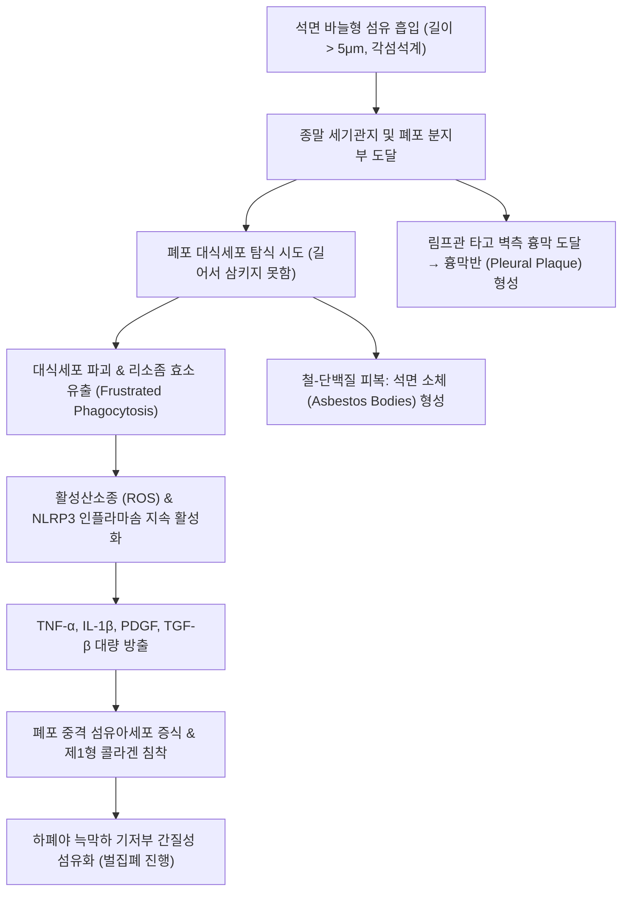

# 🩺 석면증 (Asbestosis)

> **핵심 3줄 요약 (Key Summary)**:
> - 📍 병소 부위 & 해부·병태생리: 흡입된 석면 섬유(asbestos fibers)가 폐포 대식세포에 의해 불완전 포식되면서 유발되는 만성 폐포염 및 하폐야 기저부·늑막하(subpleural) 중심의 비가역적 간질성 폐섬유증.
> - 🚩 전형적 임상 양상: 20~40년의 긴 잠복기 후 나타나는 진행성 운동성 호흡곤란, 마른기침, 양측 하폐야 벨크로 수포음(Velcro crackles), 곤봉지(clubbing), 흉막반(pleural plaque) 형성.
> - 🛠️ 핵심 검사 & 치료 전략: 고해상도 CT(HRCT)상 양측 하폐야 늑막하 망상형 음영 및 흉막 석회화 확인, 폐활량 검사상 제한성 환기장애 및 DLCO 저하; 완치 약제 부재로 철저한 금연, 호흡 재활, 저산소혈증 시 산소요법 및 석면피해구제법 판정 지원.
> - <font color="#fa7e7e">⚠️ 응급 의뢰 레드플래그: 흡연 동반 환자의 급격한 체중 감소·객혈(원발성 폐암 의심), 편측성 흉통 및 다량의 혈성 흉수(악성 흉막 중피종 의심) 발견 시 즉시 상급병원 호흡기/종양내과 응급 전원.</font>

---

## 📌 목차
1. [질환 개요 & 해부학적 병태생리](#1-질환-개요--해부학적-병태생리)
2. [병태생리 메커니즘 & 섬유화 진행 네트워크](#2-병태생리-메커니즘--섬유화-진행-네트워크)
3. [임상 증상 & 이학적 검사 알고리즘](#3-임상-증상--이학적-검사-알고리즘)
4. [감별 진단 매트릭스 (Differential Diagnosis)](#4-감별-진단-매트릭스-differential-diagnosis)
5. [한의학적 변증 & 완화 보조 프로토콜](#5-한의학적-변증--완화-보조-프로토콜)
6. [양방 치료 & 보상·의뢰 기준 (Conventional Treatment & Referral)](#6-양방-치료--보상의뢰-기준-conventional-treatment--referral)
7. [호흡 재활 & 생활습관 티칭 가이드](#7-호흡-재활--생활습관-티칭-가이드)
8. [💡 진료실 핵심 필기 & 임상 노하우 (Melt-In 심화 집약)](#8--진료실-핵심-필기--임상-노하우-melt-in-심화-집약)
9. [출처 및 학술 참고 문헌 (References)](#9-출처-및-학술-참고-문헌-references)

---

## 1. 질환 개요 & 해부학적 병태생리

![[석면증_01_폐육안섬유화.png|450]]
> [그림 1: 석면증 폐의 육안 소견 — 광범위한 섬유화로 경화·수축된 폐 실질(삼색염색 표본) — 출처: Wikimedia Commons — File:Asbestosis (7468458838).jpg (CC BY-SA 2.0)]

![[석면증_01_흉막반육안.png|450]]
> [그림 2: 흉막면을 따라 다발성으로 융기한 섬유성 흉막반(pleural plaque)의 육안 소견 — 출처: Wikimedia Commons — File:Asbestosis - Fibrous pleural plaque (7468458430).jpg (CC BY-SA 2.0)]


### 1) 정의 및 역학적 특징
**석면증(Asbestosis)** 은 천연 광물 규산염인 석면(Asbestos) 분진을 장기간 흡입하여 발생하는 대표적인 직업성 진폐증(Pneumoconiosis)의 일종으로, 미만성 간질성 폐섬유증(diffuse interstitial pulmonary fibrosis)을 주병변으로 한다.

* **원인 광물질 분류**:
  * **사문석계(Serpentine)**: 백석면(Chrysotile) - 구불구불한 섬유로 비교적 상기도 점막 섬모에 의해 청소율이 높음.
  * **각섬석계(Amphibole)**: 청석면(Crocidolite), 갈석면(Amosite) - 바늘 모양의 직선형 섬유로 폐포 깊숙이 침투하여 폐포벽과 흉막을 뚫고 들어가며 발암성 및 섬유화 유발능이 훨씬 강력함.
* **노출 직력 및 잠복기**:
  * 조선소 배관, 건축 해체, 슬레이트 지붕 제조, 단열재 시공, 자동차 브레이크 라이닝 정비 등.
  * **잠복기**: 노출 시작 후 발병까지 보통 **20~40년**이 소요되므로, 60~70대 이상 고령에서 과거 청장년기 노출력이 뒤늦게 임상 증상으로 발현함.

---

## 2. 병태생리 메커니즘 & 섬유화 진행 네트워크

![[석면증_02_석면소체사례.png|450]]
> [그림 6: 석면소체가 다수 관찰되는 증례 — 노출력이 확인된 환자에서 석면소체 수는 노출량의 대리 지표가 된다 — 출처: Wikimeda Commons — File:Asbestosis- Asbestos bodies Case 194 (5926330470).jpg (CC BY-SA 2.0)]


![[석면증_02_석면소체.png|450]]
> [그림 3: 객담·기관지폐포세척액에서 관찰되는 석면소체(asbestos body) — 섬유를 둘러싼 철 함유 단백 피막이 곤봉 모양을 만든다 — 출처: Wikimedia Commons — File:Asbestosis - Asbestos bodies (7468457674).jpg (CC BY-SA 2.0)]

![[석면증_02_조직고배율섬유화.png|450]]
> [그림 4: 폐 조직 고배율 — 석면소체 주변으로 대식세포 반응과 콜라겐 침착이 진행된 모습 — 출처: Wikimedia Commons — File:Asbestosis high mag.jpg (CC BY-SA 3.0)]

![[석면증_02_비피복섬유분절.png|450]]
> [그림 5: 석면섬유의 피복되지 않은(uncoated) 분절 — 화살표가 가리키는 부위로, 피막 형성 전 섬유 자체가 남아 있다 — 출처: Wikimedia Commons — File:Lung - Asbestosis - Asbestos body.jpg (CC BY-SA 2.0)]


석면 섬유의 독특한 물리화학적 특성(난분해성, 긴 종횡비)으로 인해 폐포 대식세포의 '좌절된 포식(frustrated phagocytosis)'이 발생한다.



### 1) 석면 소체 (Asbestos Bodies / Ferruginous Bodies)
* 폐포 대식세포가 석면 섬유를 완전히 소화하지 못하면, 섬유 주위에 페리틴(ferritin)과 헤모시데린 단백질이 침착되어 양 끝이 아령 모양(dumbbell-shaped)으로 굵어진 황갈색의 **석면 소체**가 형성된다.
* 가래나 기관지폐포세척액, 폐 조직 생검에서 석면 소체가 확인되면 과거 상당량의 석면 노출이 있었음을 입증하는 객관적 생체 지표가 된다.

### 2) 흉막 침범 양상
* 석면은 폐 실질 섬유화뿐 아니라 흉막에 특이적 병변을 유발한다:
  1. **흉막반 (Pleural Plaque)**: 벽측 흉막(특히 횡격막 건막 및 하부 늑골 흉막)에 국소적으로 발생하는 무증상의 건성 섬유화/석회화 병변. 석면 노출의 가장 흔한 지표.
  2. **양성 석면 흉수 (Benign Asbestos Pleural Effusion, BAPE)**: 노출 후 10~20년 내 발생하는 재발성 삼출성 흉수.
  3. **미만성 흉막 비후 (Diffuse Pleural Thickening)**: 흉막 유착으로 인한 흉곽 팽창 제한 및 폐기능 저하.

---

## 3. 임상 증상 & 이학적 검사 알고리즘

### 1) 전형적 임상 증상
* **진행성 운동성 호흡곤란**: 초기에는 계단 보행 시 숨참으로 시작하여 수년에 걸쳐 평지 보행, 안정 시 호흡곤란으로 악화.
* **만성 건성 기침**: 가래가 거의 없는 마른기침.
* **전신 쇠약 및 체중 감소**: 섬유화 진행 및 호흡근 소모증에 기인.

### 2) 이학적 검사 소견
* **청진**: 양측 등 하부 폐 기저부에서 흡기 말기에 청진되는 바스락거리는 **벨크로형 건성 수포음(Velcro crackles)** (초기부터 출현).
* **시진**: 손가락 말단의 **곤봉지(Digital clubbing)** (환자의 약 30~40%에서 관찰).
* **폐성심(Cor pulmonale) 징후**: 말기 폐동맥 고혈압 합병 시 경정맥 확장, 간비대, 하지 함요부종.

### 3) 폐기능 검사(PFT) 및 영상학적 소견
* **폐활량 검사**:
  * 노력성 폐활량(FVC)과 총폐용량(TLC)이 동반 감소하는 **제한성 환기장애(Restrictive pattern)** ($FEV_1/FVC \ge 70\%$).
  * 폐포-모세혈관막 비후로 인한 **일산화탄소 확산능(DLCO) 조기 급감**.
* **흉부 HRCT**:
  * 양측 대칭성의 하폐야(lower lobes) 및 늑막하(subpleural) 망상 음영(reticular opacities), 소엽간 중격 비후.
  * 늑골 흉막 및 횡격막을 따라 관찰되는 **석회화된 흉막반(calcified pleural plaques)**.
  * 진행 시 소엽 중심성 낭종 및 말기 벌집폐(honeycombing).

---

## 4. 감별 진단 매트릭스 (Differential Diagnosis)

| 감별 질환 | 호발 연령 및 직력 | 영상 소견 (HRCT) | 결정적 감별 포인트 |
| :--- | :--- | :--- | :--- |
| [[석면증]] | **석면 노출 직력(20년 이상)** | **하폐야 늑막하 망상 음영 + 흉막반(Plaque)** | 흉막반 동반, 석면 소체 확인, 직업력 필수 |
| [[특발성 폐섬유증]] (IPF) | 60대 이상, 원인 미상 | 하폐야 늑막하 벌집폐(UIP 패턴) | **흉막반(Plaque) 절대 없음**, 원인 불명, 진행 훨씬 급격 |
| [[규폐증]] | 석영/모래/터널 굴착 직력 | **상폐야 결절성 음영**, 난각상 림프절 석회화 | 상폐야 우세 병변, 흉막 비후 드묾 |
| **악성 중피종 (Mesothelioma)** | 석면 노출력 (소량 노출도 가능) | **편측성 흉막의 소결절상 비후, 엽간열 침범, 혈성 흉수** | 극심한 흉통, 흉막 박리술/조직검사상 악성 암세포 |
| **만성 과민성 폐렴 (HP)** | 유기 항원(조류, 곰팡이) 노출 | 중-상폐야 결절, 공기 포획(air trapping) | 항원 노출 회피 시 안정화, 조류 항체 양성 |

---

## 5. 한의학적 변증 & 완화 보조 프로토콜

> 🎯 **치료 접근 원칙**: 석면증은 폐 실질이 딱딱하게 굳어버린 '폐위(肺痿)' 및 '폐비(肺痺)'의 범주에 속한다. 서양의학적으로 불가역적 섬유화를 되돌릴 수는 없으나, 한의학적 치료는 남아있는 정상 폐 조직의 가스교환을 돕고, 가래 배출을 촉진하며, 호흡근 피로와 기력 저하를 개선하는 완화 의료(Palliative care)에 중점을 둔다.

### 1) 한의학적 변증 분류
* **폐신양허증 (肺腎兩虛證)**:
  * 주증: 조금만 움직여도 숨이 차고 헐떡임, 말하기 힘듦(단기), 요슬산연(허리·무릎 시림), 사지 냉감, 안색 회암, 설담 태백, 맥침세약.
  * 치법: 보폐익신(補肺益腎), 납기평천(納氣平喘).
  * 대표 처방: [[삼개산]](蔘蛤散) 또는 [[인삼호도탕]](人蔘胡桃湯) 합 [[금궤신기환]](金匱腎氣丸) 가감.
* **폐음휴허증 (肺陰虧虛證)**:
  * 주증: 마른기침, 끈적하고 적은 가래, 인후 건조감, 오후 조열, 설홍 소태 건조, 맥세삭.
  * 치법: 자음윤폐(滋陰潤肺), 진해화담(鎭咳化痰).
  * 대표 처방: [[백합고금탕]](百合固金湯) 또는 [[월국환]](越鞠丸) 가감.
* **담어조폐증 (痰瘀阻肺證)**:
  * 주증: 흉부 결림 및 통증, 잦은 기침과 배출이 어려운 점조한 객담, 청자색 입술 및 손톱, 설자 어반, 맥삽.
  * 치법: 활혈화어(活血化瘀), 화담통락(化痰通絡).
  * 대표 처방: [[단삼음]](丹參飮) 합 [[삼소음]](三蘇飮) 가감 (단삼, 도인, 울금, 지각, 길경).

### 2) 침구 치료
* **혈위**: [[폐수]](BL13), [[고황]](BL43, 만성 소모성 폐질환 특효혈), [[신수]](BL23), [[단중]](CV17), [[기해]](CV6), [[족삼리]](ST36), [[태연]](LU9, 맥회).
* **시술법**: 뜸(구법) 병용(고황, 폐수, 신수에 온구기 적용하여 양기 회복), 약침(자하거 약침으로 보신익정).

---

## 6. 양방 치료 & 보상·의뢰 기준 (Conventional Treatment & Referral)

### 1) 양방 보존 치료 (Conventional Management)
* **특이적 완치 치료제 부재**:
  * 폐 섬유화를 역전시키는 치료제는 없으며, 항섬유화제(Pirfenidone, Nintedanib)는 IPF 외 석면증에서의 급여 및 효능 근거가 제한적임.
* **증상 조절 및 합병증 예방**:
  * 안정 시 $PaO_2 \le 55\text{ mmHg}$ 또는 $SpO_2 \le 88\%$ 시 **가정 산소요법(LTOT)** 처방.
  * 호흡기 감염 시 신속한 광범위 항생제 투여.
  * 인플루엔자, 폐렴구균, 코로나19 백신 필수 접종.

### 2) 직업병 판정 및 석면피해구제법 연계
* **국내 법적 보상 체계**:
  * 과거 산재보험 대상자: 근로복지공단 직업성 진폐증 요양 판정.
  * 환경성 노출 피해자: 한국환경산업기술원 **석면피해구제법**에 따른 구제급여 신청(흉부 CT 영상, 폐기능검사 성적표 제출). 1차 진료 한의사는 환자의 직력을 청취하여 국가 구제 지원을 받을 수 있도록 공공 의료기관 안내.

### 3) 🚨 악성 종양 레드플래그 및 전문과 의뢰 기준

```
[🚨 석면 관련 악성 종양 레드플래그 체크리스트]
1. 담배를 피우는 석면 노출 환자의 3주 이상 지속되는 기침, 혈담, 급격한 체중 감소
   => 폐암(원발성 폐암) 발생 위험이 비노출-비흡연자 대비 50~100배 증가
2. 지속적인 둔한 편측성 흉벽 통증 및 원인 불명의 호흡곤란 악화
   => 악성 흉막 중피종(Malignant Pleural Mesothelioma) 강력 의심
3. 흉부 영상상 새로운 국소 폐결절(nodule), 종괴(mass), 또는 급격한 흉수 증가 관찰

=> 상기 소견 발견 즉시 흉부 CT 조영술 및 조직검사가 가능한 3차 상급병원 호흡기/종양내과로 전원한다.
```

---

## 7. 호흡 재활 & 생활습관 티칭 가이드

### 1) 절대 금연 교육 (최우선 과제)
* 석면 노출과 흡연은 폐암 발생에 있어 단순 합산이 아닌 **상승 작용(Multiplicative effect)** 을 일으킨다.
* 즉각적이고 철저한 금연이 환자의 잔여 생존율을 보존하는 가장 강력한 단일 중재법이다.

### 2) 호흡 재활 트레이닝
* **입술 오므리기 호흡 (Pursed-lip breathing)**: 숨을 들이마신 후 입술을 오므리고 2배 긴 시간 동안 천천히 내쉬어 소기도 허탈을 방지함.
* **횡격막 복식호흡**: 흉곽 보조근(사각근, 흉쇄유돌근)의 과도한 긴장을 낮추고 호흡 에너지 소모 경감.
* **유산소 운동 유지**: 걷기 운동을 통해 호흡근 및 하지 골격근 위축 예방.

---

## 8. 💡 진료실 핵심 필기 & 임상 노하우 (Melt-In 심화 집약)

### 1) 환자 직업력(Occupational History) 문진의 3대 핵심 질문
* 고령 남성 환자가 "원인 모를 기침과 숨참"으로 내원했을 때 반드시 물어야 할 세 가지:
  1. "젊었을 때 건설 현장, 조선소, 배관, 단열재 관련 일을 하신 적이 있습니까?"
  2. "슬레이트 지붕을 얹거나 철거하는 작업을 하신 적이 있습니까?"
  3. "군 복무 시절이나 정비창에서 브레이크 패드 교체나 엔진 단열재를 만지셨습니까?"
* 30년 전 단 1~2년의 노출력도 결정적 단서가 된다.

### 2) 흉막반(Pleural Plaque)의 임상적 의미 설명
* 환자가 건강검진 CT에서 "폐에 석회화된 흉막반이 있다"는 말을 듣고 암에 걸린 것으로 오인하여 공포에 질려 내원하는 경우가 많다.
* 흉막반 자체는 **암으로 변하지 않는 양성 섬유화 흉터**임을 설명하여 안심시키되, 석면에 노출되었다는 명백한 증거이므로 정기적인 저선량 폐암 검진이 필수임을 강조해야 한다.

---

## 9. 출처 및 학술 참고 문헌 (References)

1. Genetic variability of immune checkpoints in asbestos-related diseases. (2026). *Radiol Oncol*, 60(2):271-281. PMID: 42359755.

2. Emerging Digital Technologies for Monitoring and Rehabilitation Support in Chronic Dust-Induced Lung Diseases: A Scoping Review. (2026). *J Pers Med*, 16(8):e. PMID: 42645901.

3. CT Characteristics of Pleural Plaques Related to Occupational or Environmental Asbestos Exposure from South Korean Asbestos Mines. (2015). *Korean J Radiol*, 16(5):1142-1152. PMID: 26357506.

---

## 관련 노트

- [[규폐증]]
- [[사르코이도증]]
- [[특발성 폐섬유증]]
- [[탄광부 진폐증]]
- [[자극성 가스 흡입 손상]]
