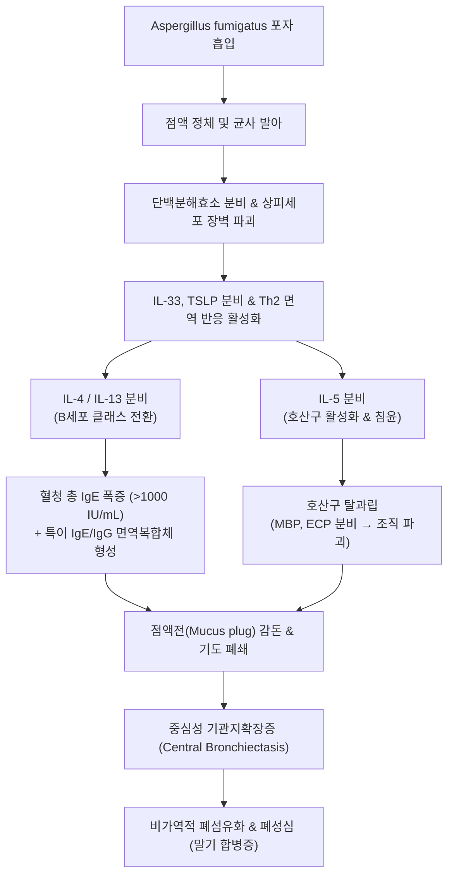

# 🩺 알레르기성 기관지폐 아스페르길루스증 (Allergic Bronchopulmonary Aspergillosis, ABPA)

> **핵심 3줄 요약 (Key Summary)**:
> - 📍 병소 부위 & 해부·병태생리: 기관지 내강에 정착한 *Aspergillus fumigatus*에 대한 복합 면역 과민반응(제1형 IgE 매개 및 제3형 면역복합체 반응)으로 근위부 기관지 점액 감돈, 호산구성 염증, 중심성 기관지확장증 및 비가역적 폐섬유화를 초래함.
> - 🚩 전형적 임상 양상: 기존 [[천식]] 또는 낭포성 섬유증(Cystic Fibrosis) 환자에서 악화되는 난치성 천식 증상(천명, 호흡곤란), 갈색 점액전(Brownish mucous plugs) 객담 배출, 미열, 체중 감소, 반복적인 폐 침윤.
> - 🛠️ 핵심 검사 & 치료 전략: 혈청 총 IgE 현저한 상승($> 1000\text{ IU/mL}$), *A. fumigatus* 특이 IgE 및 IgG 양성, 말초혈액 호산구 증다증, 고해상도 흉부 CT(중심성 기관지확장증, High-attenuation mucus). 치료는 전신 경구 코르티코스테로이드와 항진균제(이트라코나졸) 병용.
> - ⚠️ 응급 의뢰 레드플래그: 급성 호흡부전(산소포화도 저하), 대량 객혈(중심성 혈관 침범), 고열과 농흉 의심 소견, 장기적인 스테로이드 불응성 천식 발작, 중심성 기도 완전 폐쇄.

---

## 📌 목차
1. [질환 개요 & 해부학적 병태생리](#1-질환-개요--해부학적-병태생리)
2. [병태생리 메커니즘 & 생체역학적 악순환 네트워크](#2-병태생리-메커니즘--생체역학적-악순환-네트워크)
3. [임상 증상 & 이학적 검사(Physical Exam) 알고리즘](#3-임상-증상--이학적-검사physical-exam-알고리즘)
4. [감별 진단 매트릭스 (Differential Diagnosis)](#4-감별-진단-매트릭스-differential-diagnosis)
5. [한의 통합 치료 프로토콜 (침·약침·추나·한약)](#5-한의-통합-치료-프로토콜-침약침추나한약)
6. [양방 치료 & 병용·의뢰 기준 (Conventional Treatment & Referral)](#6-양방-치료--병용의뢰-기준-conventional-treatment--referral)
7. [재활 운동 & 생활습관 티칭 가이드](#7-재활-운동--생활습관-티칭-가이드)
8. [💡 사용자 진료실 핵심 필기 & 임상 노하우 (Melt-In 잔여 심화 집약)](#8--사용자-진료실-핵심-필기--임상-노하우-melt-in-잔여-심화-집약)
9. [출처 및 학술 참고 문헌 (References)](#9-출처-및-학술-참고-문헌-references)

---

## 1. 질환 개요 & 해부학적 병태생리

알레르기성 기관지폐 아스페르길루스증(ABPA, Allergic Bronchopulmonary Aspergillosis)은 만성 기도 질환인 [[천식]](Asthma)이나 낭포성 섬유증(Cystic Fibrosis)을 기저 질환으로 가진 환자에서 흔한 진균 포자인 *Aspergillus fumigatus*(아스페르길루스 푸미가투스)에 대한 비정상적인 면역 과민반응으로 인해 발생하는 알레르기성 폐질환이다. 진균이 실질 조직을 직접 침범·파괴하는 침습성 아스페르길루스증(Invasive aspergillosis)과 달리, 기도의 분비물 내에 서식하는 진균 항원에 대한 제1형(IgE 매개 즉시형) 및 제3형(면역복합체 매개), 제4형(세포 매개) 과민반응이 복합적으로 관여한다.

### 병변의 해부학적 위치 및 특징
- **근위부 기도(Proximal / Central Airways)**: 말초 세기관지가 아닌 4~5차 분지의 중심 기관지에 병변이 집중된다.
- **점액 감돈(Mucoid Impaction)**: 진균 균사, 호산구, 탈락된 상피세포, 샤르코-라이덴 결정(Charcot-Leyden crystals)으로 구성된 끈적하고 짙은 갈색 또는 회색의 점액전(Mucus plug)이 기관지 내강을 폐쇄한다.
- **중심성 기관지확장증(Central Bronchiectasis)**: 만성적인 호산구성 염증과 점액전에 의해 연골과 평활근이 파괴되어, 말초 기도는 정상인데 근위부 기도만 꽈리 모양으로 늘어나는 중심성 기관지확장증이 발생한다.
- **폐 실질 손상 및 섬유화**: 반복되는 염증과 침윤으로 호산구성 폐렴, 육아종 형성, 결국 비가역적인 상엽 우세 폐섬유화와 폐성심으로 진행할 수 있다.

---

## 2. 병태생리 메커니즘 & 생체역학적 악순환 네트워크

### 1) 면역학적 염증 연쇄 반응
1. **진균 흡입 및 집락화**: 공기 중에 부유하는 아스페르길루스 포자가 천식 기도의 점액층에 포착되어 발아하고 균사를 형성함.
2. **단백분해효소 분비**: 균사에서 분비되는 단백분해효소(Protease)가 기도 상피 장벽을 손상시키고 알라민(Alarmin: IL-33, IL-25, TSLP) 분비를 촉발함.
3. **Th2 편향 면역 반응**:
   - 수지상세포에 의해 제시된 진균 항원이 나이브 T세포를 Th2 세포로 분화시킴.
   - IL-4 및 IL-13: B세포의 클래스 전환을 유도하여 **혈청 총 IgE 및 진균 특이 IgE**의 대량 생산 촉진.
   - IL-5: 골수에서 호산구 분화·증식 및 기도 내 대량 침윤(말초혈액 및 기도 내 현저한 호산구 증다증) 유도.
4. **제3형 면역복합체 형성**: 진균 항원과 특이 IgG 항체가 결합하여 보체계를 활성화하고 혈관염성 손상 및 조직 괴사를 초래함.

---

## 3. 임상 증상 & 이학적 검사(Physical Exam) 알고리즘

### 1) 주요 임상 증상
- **난치성 천식 증상**: 흡입용 스테로이드나 기관지확장제에 잘 반응하지 않는 기침, 천명(Wheezing), 호흡곤란.
- **특이적 객담 배출**: 고무 조각이나 나뭇가지 모양의 끈적하고 단단한 갈색/암갈색 점액전(Brownish mucous plug) 배출.
- **전신 증상**: 간헐적 미열, 전신 쇠약감, 야간 발한, 식욕 부진 및 체중 감소.
- **객혈(Hemoptysis)**: 기관지확장증 부위의 기관지 동맥 비후 및 미세혈관 파열로 인한 혈담 또는 객혈.

### 2) 이학적 검사 및 진단 검사 알고리즘
1. **흉부 청진**: 양측 폐 전반의 천명음(Wheezing) 및 점액 정체 부위의 악설음(Coarse crackles).
2. **혈액 및 면역학적 검사 (ISHAM 진단 기준)**:
   - **혈청 총 IgE(Total IgE)**: 통상 $1,000\text{ IU/mL}$ 이상 (질환 활동성의 대표 지표, 관해 시 50% 이상 감소).
   - **진균 특이 항체**: *A. fumigatus* 특이 IgE 양성 및 특이 IgG(침강항체 Precipitin) 양성.
   - **말초혈액 호산구 수(AEC)**: 통상 $> 500\text{ cells/}\mu\text{L}$ (대개 $1,000\text{ cells/}\mu\text{L}$ 이상).
3. **영상 검사**:
   - **흉부 단순 촬영(X-ray)**: 일과성 또는 이동성 폐 침윤, 무기폐, 손가락 장갑 징후(Glove-finger shadow: 점액전에 확장된 기관지 음영).
   - **고해상도 흉부 CT(HRCT)**: 근위부 낭성/원주상 기관지확장증(Central bronchiectasis), 고감쇠 점액(High-attenuation mucus, HAM sign: 뼈보다 짙은 점액 음영은 치료 저항성 및 재발을 시사).

---

## 4. 감별 진단 매트릭스 (Differential Diagnosis)

| 감별 질환 | 기저 질환 및 병인 | 혈청 IgE 및 호산구 수치 | 영상학적 특이 소견 | 감별 핵심 포인트 |
| :--- | :--- | :--- | :--- | :--- |
| **알레르기성 기관지폐 아스페르길루스증 (ABPA)** | 천식 / 낭포성 섬유증, *A. fumigatus* 과민반응 | 총 IgE $> 1000\text{ IU/mL}$, 특이 IgE/IgG 양성, 호산구 증다 | 중심성 기관지확장증, 점액전 감돈, 고감쇠 점액(HAM) | 갈색 점액전 배출, 특이 IgE 양성, 전신 스테로이드+항진균제 반응 |
| **중증 난치성 [[천식]]** | 비특이적 기도 과민성, 알레르기/비알레르기 | 총 IgE 정상~경도 상승, 진균 특이 항체 음성 | 기관지벽 비후 외 중심성 기관지확장증 없음 | 점액전 배출 없음, 진균 특이 감작 음성 |
| **특발성 기관지확장증** | 과거 홍역·백일해·[[폐렴]] 등 기도 손상 | 총 IgE 대개 정상, 호산구 정상 | 말초 기관지에 주로 분포하는 인환 징후(Signet-ring) | 진균 알레르기 면역 표지자 음성, 반복 세균 감염 위주 |
| **호산구성 육아종증 다발혈관염 (EGPA / Churg-Strauss)** | 전신 괴사성 소혈관염 | 호산구 극심한 증가, p-ANCA (MPO) 양성 (40~50%) | 유주성 폐 침윤, 부비동염, 심근염, 다발성 단신경염 | 신경병증, 자반증, 신장 등 폐 외 전신 혈관염 징후 |
| **폐 아스페르길루스종 (Aspergilloma)** | 기존 결핵 공동(Cavity) 내 진균 덩어리 형성 | 총 IgE 정상 또는 경도 상승, 침강항체 양성 | 기존 공동 내 이동성 진균구(Monod sign, 공기 초승달 징후) | 천식 병력 없음, 다량 객혈 흔함, 면역반응보다 단순 집락 |

---

## 5. 한의 통합 치료 프로토콜 (침·약침·추나·한약)

> ⚠️ **한의 1차 진료 원칙 및 안전 수칙**:
> ABPA는 진균 감작에 의한 급격한 면역 반응으로 중심 기도가 파괴되어 비가역적 폐손상을 남기는 진행성 질환이다. **확진 및 급성기 염증 제어(전신 스테로이드 및 항진균제 요법)는 반드시 호흡기내과 전문의와의 협진 하에 진행**되어야 한다.
> 한의 치료는 **양방 치료와의 병용을 통해 스테로이드 감량(Sparing)을 돕고, 점액 분비 과다 및 담음(痰飮) 정체를 해소하며, 면역 조절 기능을 강화하는 완화기·유지기 보조 요법**으로 접근한다.

### 1) 침구 치료 프로토콜
- **통폐화담(通肺化痰) 및 해천(咳喘) 평천**:
  - [[폐수]](BL13), [[대저]](BL11), [[풍문]](BL12): 폐기(肺氣)를 소통시키고 외사(外邪)를 배출하며 기관지 연축 완화.
  - [[단중]](CV17), [[중완]](CV12): 흉격의 기체(氣滯)를 풀어 호흡곤란 및 흉민(胸悶) 개선.
  - [[정천]](EX-B1), [[천돌]](CV22): 기관지 평활근 긴장 완화, 기침 발작 진정.
  - [[풍륭]](ST40), [[열결]](LU7): 담음(痰飮) 배출 촉진, 점액전 저류 완화.
- **시술 기법**: 염전보사법을 활용하여 급성기 호흡 곤란 시에는 사법(瀉法)을, 만성 쇠약기에는 평보평사 또는 보법(補法)을 적용함.

### 2) 약침 치료 (점막 면역 안정화 및 항염증)
- **적용 혈위**: [[폐수]](BL13), [[고황]](BL43), [[단중]](CV17).
- **처방 약침**:
  - 황련해독탕 약침 또는 소염약침: 기도 국소 염증 완화 및 폐열(肺熱) 제어를 위해 부위당 0.3~0.5cc 주입.
  - 태반(자하거) 약침: 만성기 폐신음허(肺腎陰虛) 및 체력 저하, 스테로이드 장기 복용으로 인한 부신피질 기능 저하 보완을 위해 폐수, [[신수]](BL23)에 각 0.5cc 주입.

### 3) 추나 및 호흡근 수기 요법
- **흉곽 가동성 회복 추나**: 만성 기침과 천명으로 경직된 늑간근, 사각근, 흉쇄유돌근을 이완하는 근막이완술(Myofascial Release) 시행.
- **체위 배액(Postural Drainage) 보조**: 기관지 내 점액전 배출을 돕기 위해 흉곽 타진법(Chest percussion) 및 호흡 보조 수기 병행.

### 4) 한약 처방 (변증별 가감)
- **담열옹폐(痰熱壅肺)형 (급성 악화기, 황갈색 점액전 배출, 발열, 천명)**:
  - **정천탕(定喘湯)** 또는 **소청룡탕(小靑龍湯) 가감**:
  - 처방 구성: [[마황]], [[백과]], [[상백피]], [[황금]], [[반하]], [[행인]], [[자소자]], [[감초]].
  - 담열이 심하고 점액이 끈적하면 어성초(魚腥草), 황금(黃芩), 과루인(瓜蔞仁)을 증량하여 청열화담(淸熱化痰) 강화.
- **비폐기허·담습저폐(脾肺氣虛·痰濕沮肺)형 (만성기, 다량의 객담, 피로, 소화불량)**:
  - **육군자탕(六君子湯)** 합 **삼자양친탕(三子養親湯)**:
  - 비위 기능을 강화하여 수습(水濕)의 담음화를 차단하고 폐기를 북돋움.
  - 구성: [[백출]], [[복령]], [[인삼]], [[진피]], [[반하]], [[자소자]], [[백개자]], [[나복자]].
- **폐신음허(肺腎陰虛)형 (관해기 및 스테로이드 감량기, 마른 기침, 조열, 체중 감소)**:
  - **맥문동탕(麥門冬湯)** 또는 **백합고금탕(百合固金湯) 가감**:
  - 점막 건조를 방지하고 기도 과민도를 낮춤.
  - 구성: [[맥문동]], [[반하]], [[인삼]], [[감초]], [[멥쌀]], [[대추]], [[백합]], [[생지황]].

---

## 6. 양방 치료 & 병용·의뢰 기준 (Conventional Treatment & Referral)

### 1) 약물 치료 (Medication)
- **전신 경구 코르티코스테로이드 (Systemic Corticosteroids)**:
  - **치료의 근간(First-line)**: Prednisolone 0.5~0.75 mg/kg/day로 시작하여 2~4주간 투여 후, 임상 반응과 혈청 IgE 감소에 따라 수개월에 걸쳐 점진적 감량(Tapering).
  - 작용 기전: 호산구 염증과 과민 면역 반응을 강력하게 억제하여 조직 파괴와 섬유화를 차단.
- **항진균제 (Antifungal Agents)**:
  - **이트라코나졸(Itraconazole)**: 200 mg 1일 2회 식후 복용, 통상 4~6개월간 유지 (혈중 농도 모니터링 필요).
  - 2차 약제: 보리코나졸(Voriconazole) 또는 포사코나졸(Posaconazole) (이트라코나졸 불내성 또는 치료 실패 시).
  - 작용 기전: 기도 내 진균 집락(Fungal burden)을 감소시켜 지속적인 항원 자극을 차단하고 스테로이드 감량을 도움.
- **생물학적 제제 (Biologics)**:
  - 오말리주맙(Omalizumab, 항-IgE 항체), 메폴리주맙/벤라리주맙(Mepolizumab/Benralizumab, 항-IL-5), 두필루맙(Dupilumab, 항-IL-4R$\alpha$): 빈번한 재발 또는 스테로이드 의존성 ABPA 환자에서 유망한 치료 옵션.

### 2) 비약물 치료 및 시술
- **기관지경 치료(Therapeutic Bronchoscopy)**: 점액전이 주기관지를 완전 폐쇄하여 심한 무기폐를 초래하거나 약물로 배출되지 않을 때 내시경적 세척 및 흡인 제거술 시행.

### 3) 한의 병용 판단 및 상호작용
- **스테로이드 병용 시**: 스테로이드 복용 환자에게 보음(補陰)·보기(補氣) 한약을 병용하면 스테로이드 장기 투여에 따른 골다공증, 근위축, 소화기 궤양 등의 부작용을 완화하고 성공적인 감량을 도울 수 있음.
- **주의사항**: 이트라코나졸은 간대사(CYP3A4) 약물이므로 간기능 모니터링(AST/ALT)이 필수적이며, 간독성 위험이 있는 약초의 무분별한 병용을 금함.

### 4) 양방·전문과 응급 의뢰 기준 (Referral Criteria)
- 🚨 **즉각적인 호흡기내과 전원 트리거**:
  - 천식 환자에서 짙은 갈색 점액 가래가 지속 배출되거나 흉부 X선상 새로운 이동성 폐 침윤이 관찰될 때.
  - 혈청 총 IgE 수치가 $1,000\text{ IU/mL}$를 초과하고 호산구 증다증이 동반된 경우 (조기 진단이 중심성 기관지확장증 영구 손상을 예방함).
  - 대량 객혈, 급성 저산소혈증, 호흡곤란 악화로 산소 공급이 필요한 경우.

---

## 7. 재활 운동 & 생활습관 티칭 가이드

### 1) 환경 관리 및 진균 포자 회피
- **주거 환경 제습**: 실내 습도를 40~50% 이하로 유지하고, 벽지 곰팡이, 에어컨 필터, 가습기를 철저히 살균·청소.
- **원예 및 흙 만지기 금기**: 낙엽 더미, 퇴비, 화분 흙, 정원 가꾸기 작업은 고농도의 아스페르길루스 포자가 비산하므로 환자가 직접 관여하지 않도록 지도.
- **외출 시 N95 마스크 착용**: 공사 현장, 오래된 건물, 농장 주변 방문 시 필터 마스크 착용 필수.

### 2) 호흡 재활 및 기도 청결 기법
- **능동적 호흡 순환 기법 (ACBT, Active Cycle of Breathing Techniques)**:
  - 호흡 조절(Breathing control) $\rightarrow$ 흉곽 확장 운동(Thoracic expansion) $\rightarrow$ 강제 호기 기법(Huffing)을 통해 기관지 내 점액전을 무리 없는 기침으로 자발 배출하도록 유도.
- **수분 섭취 장려**: 탈수가 되면 기도의 점액전이 단단해져 배출이 불가능해지므로, 심장·신장 질환이 없는 한 충분한 미온수(하루 1.5~2L) 섭취 지도.

---

## 8. 💡 사용자 진료실 핵심 필기 & 임상 노하우 (Melt-In 잔여 심화 집약)

### 1) "천식 환자가 뱉는 갈색 젤리 같은 가래"의 결정적 의미
- 일반적인 천식 환자는 투명하거나 흰색의 끈적한 가래를 뱉는다. 만약 환자가 "가끔씩 짙은 갈색이나 흑갈색의 단단한 고무줄, 젤리 같은 덩어리가 기침할 때 튀어나온다"고 말한다면, 다른 검사 결과를 보기 전이라도 **알레르기성 기관지폐 아스페르길루스증(ABPA)을 1순위로 의심**해야 한다.
- 이 점액전(Mucus plug)은 단순한 가래가 아니라 진균 균사와 호산구가 뭉쳐진 주형(Cast)이다.

### 2) 혈청 IgE 수치 추적의 중요성
- ABPA 치료의 성공 여부는 증상뿐만 아니라 **혈청 총 IgE 수치의 변화(최소 25~50% 감소 달성 여부)**로 평가한다.
- 임상 증상이 좋아졌다고 해서 스테로이드를 급격히 중단하면 6개월 내에 다시 재발하여 비가역적인 중심성 기관지확장증으로 진행하므로, 양방 호흡기내과의 IgE 추적 일정을 반드시 지키도록 환자에게 티칭해야 한다.

---

## 9. 출처 및 학술 참고 문헌 (References)

1. Asano, K., et al. (2026). Advances in the Diagnosis and Management of Allergic Bronchopulmonary Aspergillosis/Mycosis. *Allergy Asthma Immunol Res*, 18(5):626-639. PMID: 42845221.

2. Mansouri, I., et al. (2026). [Bronchiectasis in children: An underdiagnosed disease with accessible screening and etiological assessment]. *Rev Mal Respir*, ():. PMID: 42767897.

3. Li, Y., et al. (2026). A Case Report of Refractory Allergic Bronchopulmonary Aspergillosis: The Art of Selection, Discontinuation and Switching Biologics. *J Inflamm Res*, 19:631869. PMID: 42765085.

---

## 관련 노트

- [[천식]]
- [[폐렴]]
- [[폐수]]
- [[대저]]
- [[풍문]]
- [[단중]]
- [[중완]]
- [[정천]]
- [[천돌]]
- [[풍륭]]
- [[열결]]
- [[고황]]
- [[신수]]
- [[마황]]
- [[백과]]
- [[상백피]]
- [[황금]]
- [[반하]]
- [[행인]]
- [[자소자]]
- [[감초]]
- [[백출]]
- [[복령]]
- [[인삼]]
- [[진피]]
- [[맥문동]]
- [[정천탕]]
- [[소청룡탕]]
- [[육군자탕]]
- [[맥문동탕]]
