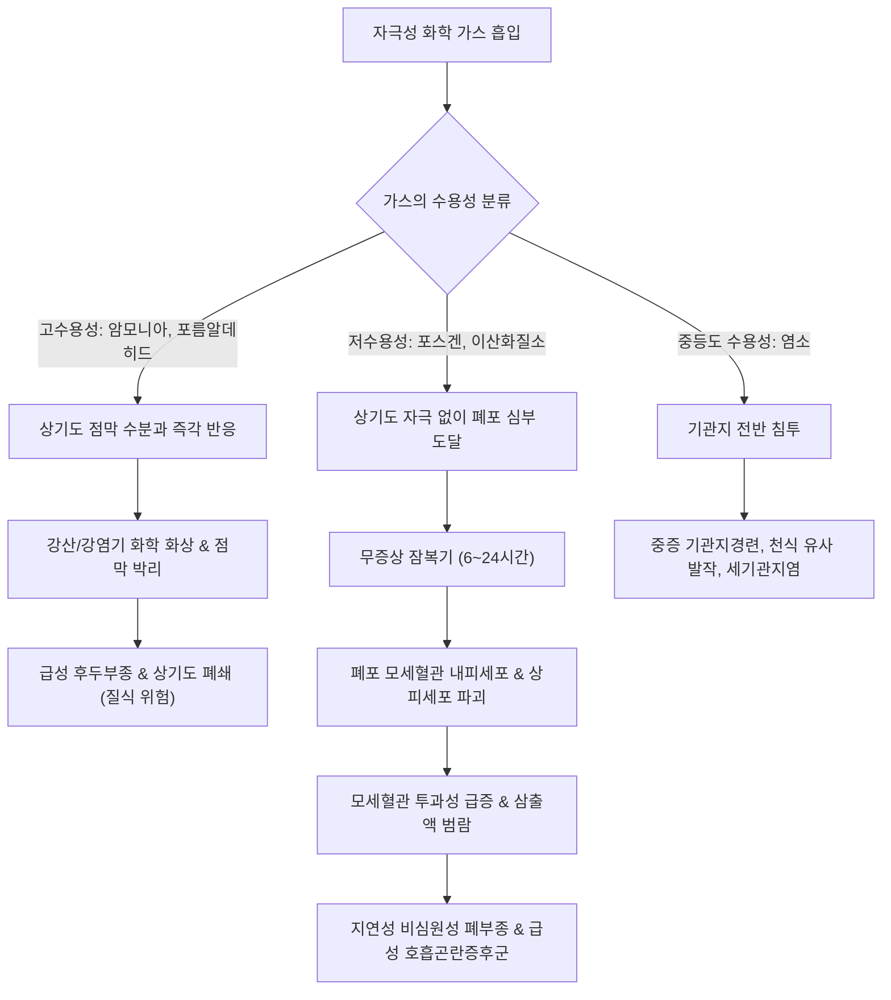

# 🩺 자극성 가스 흡입 손상 (Irritant Gas Inhalation Injury)

> **핵심 3줄 요약 (Key Summary)**:
> - 📍 병소 부위 & 해부·병태생리: 유독성·부식성 화학 가스 흡입으로 인한 기도 점막 및 폐포 상피세포의 급성 화학적 화상; 수용성에 따라 고수용성 가스(암모니아, 염소)는 상기도 점막 괴사 및 후두부종, 저수용성 가스(포스겐, 이산화질소)는 심부 소기도 및 폐포 손상 유발.
> - 🚩 전형적 임상 양상: 상기도 화상(결막 충혈, 인후통, 애성, 천명, 흡기성 협착음) 및 저수용성 가스 노출 후 6~24시간 지연되어 나타나는 비심원성 급성 폐부종, 기침, 혈담, 급격한 저산소혈증.
> - 🛠️ 핵심 검사 & 치료 전략: 즉각적인 오염 지역 이탈 및 기도 확보, 산소 투여 및 흡입 기관지확장제; 지연성 폐부종 위험 가스 노출자는 초기 무증상이어도 최소 24시간 입원 관찰 필수.
> - <font color="#fa7e7e">⚠️ 응급 의뢰 레드플래그: 흡기성 협착음(stridor, 후두부종에 의한 기도 폐쇄 임박), 쉰소리, 급격한 호흡곤란, SpO2 < 90% 저하 발견 즉시 119 구급대를 통한 응급실 이송 및 조기 기관내삽관 의뢰.</font>

---

## 📌 목차
1. [질환 개요 & 해부학적 병태생리](#1-질환-개요--해부학적-병태생리)
2. [병태생리 메커니즘 & 가스 수용성별 손상 네트워크](#2-병태생리-메커니즘--가스-수용성별-손상-네트워크)
3. [임상 증상 & 이학적 검사 알고리즘](#3-임상-증상--이학적-검사-알고리즘)
4. [감별 진단 매트릭스 (Differential Diagnosis)](#4-감별-진단-매트릭스-differential-diagnosis)
5. [한의학적 변증 & 아급성 회복기 프로토콜](#5-한의학적-변증--아급성-회복기-프로토콜)
6. [양방 치료 & 응급 의뢰 기준 (Conventional Treatment & Referral)](#6-양방-치료--응급-의뢰-기준-conventional-treatment--referral)
7. [환자 관리 & 생활습관 티칭 가이드](#7-환자-관리--생활습관-티칭-가이드)
8. [💡 진료실 핵심 필기 & 임상 노하우 (Melt-In 심화 집약)](#8--진료실-핵심-필기--임상-노하우-melt-in-심화-집약)
9. [출처 및 학술 참고 문헌 (References)](#9-출처-및-학술-참고-문헌-references)

---

## 1. 질환 개요 & 해부학적 병태생리

### 1) 정의 및 임상적 중요성
**자극성 가스 흡입 손상(Irritant Gas Inhalation Injury)** 은 산업 사고, 화학물질 누출, 화재 연기, 가정 내 세제 혼합(락스와 산성 세제 혼합 등) 등으로 인해 자극성 독성 가스를 흡입하여 발생하는 호흡기계의 급성 화학적 염증 및 점막 괴사 손상이다.

* **손상 부위를 결정하는 핵심 물리화학적 특성: 수용성 (Water Solubility)**:
  1. **고수용성 가스 (High water solubility)**: 암모니아($NH_3$), 포름알데히드, 염화수소($HCl$).
     * 흡입 즉시 상기도(비강, 인후두, 기관)의 수분에 신속히 용해되어 강산 또는 강알칼리로 변환. 즉각적인 눈물, 재채기, 인후 작열감, **급성 후두부종(Laryngeal edema)** 및 상기도 폐쇄 유발.
  2. **중등도 수용성 가스 (Intermediate water solubility)**: 염소($Cl_2$).
     * 상기도뿐 아니라 주기관지, 소기관지까지 침투하여 심한 기관지경련 및 화상 유발.
  3. **저수용성 / 지용성 가스 (Low water solubility)**: 포스겐($COCl_2$), 이산화질소($NO_2$, 사일로 충전 가스), 오존($O_3$).
     * 상기도 자극 증상이 미약하여 경고 신호 없이 깊숙이 흡입됨. 종말 세기관지 및 폐포에 도달하여 수시간(6~24시간)의 잠복기 후 치명적인 **화학성 폐렴 및 비심원성 폐부종(ARDS)** 유발.

---

## 2. 병태생리 메커니즘 & 가스 수용성별 손상 네트워크



### 1) 산-염기 화학 손상 기전
* **알칼리 손상 (예: 암모니아)**: 조직 단백질을 비누화(saponification)하고 세포막 지질을 용해하여 액화 괴사(liquefactive necrosis)를 유발함으로써 심부 조직으로 깊숙이 침투함.
* **산 손상 (예: 염화수소, 황화수소)**: 응고 괴사(coagulative necrosis)를 일으켜 가피를 형성하나, 고농도 흡입 시 광범위한 기도 점막 탈락 및 기도 폐쇄 유발.

### 2) 후기 합병증: 반응성 기도 기능장애 증후군 (RADS)
* 고농도 자극성 가스 노출 후 단 1회 노출만으로도 기관지 과민성이 영구적으로 획득되어 천식과 유사한 기침, 천명, 호흡곤란이 수개월~수년간 지속되는 **RADS(Reactive Airways Dysfunction Syndrome)** 또는 폐쇄성 세기관지염(Bronchiolitis obliterans)으로 이행할 수 있음.

---

## 3. 임상 증상 & 이학적 검사 알고리즘

### 1) 노출 즉시 나타나는 상기도 증상 (고수용성 가스)
* **안구 및 안면**: 결막 충혈, 심한 최루(tearing), 각막 화상, 안면 작열감.
* **상기도**: 비출혈, 인후통, 쉰소리(애성), 삼킴곤란, 기침.
* **위험 징후**: **흡기성 협착음(Stridor)** 및 흉골상부 함몰 — 기도 완전 폐쇄의 임박 신호.

### 2) 지연되어 나타나는 하기도 증상 (저수용성 가스: 포스겐, $NO_2$)
* 사고 당일 초기에는 가벼운 기침 외에 특이 증상이 없어 귀가하는 경우가 많음.
* **6~24시간 후**: 갑작스러운 가슴 답답함, 진행성 호흡곤란, 분홍빛 거품 가래(frothy sputum), 청색증(cyanosis) 및 급격한 저산소혈증 발현.

### 3) 이학적 진찰 및 검사
* **청진**: 상기도 천명(wheezing) 및 양측 폐 전야의 거친 수포음(rhonchi, coarse crackles).
* **동맥혈가스분석(ABGA)**: 심각한 저산소혈증($PaO_2 < 60\text{ mmHg}$) 및 폐포-동맥 산소분압차 증가.
* **흉부 X선 및 CT**: 초기 정상일 수 있으나, 지연성 폐부종 발생 시 양측성 나비 모양의 폐포 침윤(Bat-wing appearance) 및 간유리음영 관찰.

---

## 4. 감별 진단 매트릭스 (Differential Diagnosis)

| 감별 질환 | 노출 물질 및 병력 | 주 임상 양상 | 결정적 감별 포인트 |
| :--- | :--- | :--- | :--- |
| **[[자극성 가스 흡입 손상]]** | 암모니아, 염소, 포스겐, 질소산화물 | 급성 점막 화상, 후두부종, **지연성 폐부종** | 화학물질 흡입 직력 명확, 독성 가스 노출력 |
| **단순 일산화탄소(CO) 중독** | 화재, 밀폐 공간 보일러/연탄 | 두통, 어지럼증, 의식 소실, 체리 레드 피부 | **점막 자극 증상 없음**, 혈중 HbCO 농도 급상승 |
| **급성 천식 악화** | 알레르기 유발원, 감기 후 악화 | 호기성 천명음, 호흡곤란 | 화학물질 노출력 없음, 과거 기관지천식 병력 |
| **[[기도 흡인증후군]]** | 의식 저하, 구토, 위 내용물 역류 | 우하엽 중심의 흡인성 폐렴 | 위산/음식물 구토 선행, 연하장애 동반 |
| **심원성 급성 폐부종** | 심근경색, 만성 심부전 악화 | 기좌호흡, 심비대, 경정맥 확장 | NT-proBNP 급상승, 심초음파상 좌심실 기능부전 |

---

## 5. 한의학적 변증 & 아급성 회복기 프로토콜

> ⚠️ **급성기 치료 원칙**: 가스 흡입 직후의 급성 후두부종 및 화학성 폐부종은 기도 삽관과 기계환기가 필요한 초응급 중환자실 질환이다. 한의학적 치료는 중환자 치료 후 활력징후가 안정되고 퇴원한 환자의 **아급성기 기관지 염증 잔류, 만성 마른기침, RADS 증상, 점막 손상 회복**을 돕는 보조 프로토콜로 적용한다.

### 1) 한의학적 변증 분류
* **열독상폐증 (熱毒傷肺證)**:
  * 원인: 독성 화학 화기가 폐기를 손상시키고 점막에 열독이 남아있음.
  * 증상: 인후 작열감, 목소리 쉼, 가슴 답답함과 통증, 누런 가래 또는 혈담, 설홍태황, 맥삭.
  * 치법: 청열해독(淸熱解毒), 청폐지해(淸肺止咳).
  * 대표 처방: [[황련해독탕]](黃連解毒湯) 합 [[청폐화담탕]](淸肺化痰湯) 가감.
* **폐음휴손 및 점막 건조증 (肺陰虧損證)**:
  * 원인: 화학 화상 후 기관지 진액이 고갈되어 기관지 과민성(RADS) 지속.
  * 증상: 발작성 마른기침, 인후 건조 및 간지러움, 찬 공기나 자극에 극도로 민감, 설홍소태, 맥세삭.
  * 치법: 양음윤폐(養陰潤肺), 진해지경(鎭咳止痙).
  * 대표 처방: [[맥문동탕]](麥門冬湯) 또는 [[백합고금탕]](百合固金湯) 가감 (맥문동, 사삼, 천문동, 백합, 패모).
* **폐비기허증 (肺脾氣虛證)**:
  * 원인: 중증 급성 폐손상 후 전신 기력 소모.
  * 증상: 조금만 움직여도 숨참, 만성 피로, 맑은 가래, 식욕 부진, 설담태백, 맥세약.
  * 치법: 익기건비(益氣健脾), 보폐평천(補肺平喘).
  * 대표 처방: [[보중익기탕]](補中益氣湯) 합 [[생맥산]](生脈散).

### 2) 침구 치료
* **혈위**: [[천돌]](CV22, 인후부 자극 완화), [[척택]](LU5), [[열결]](LU7), [[폐수]](BL13), [[대추]](GV14), [[합곡]](LI4), [[족삼리]](ST36).
* **치법**: 천돌혈은 하향 사자(0.3~0.5촌)하여 인후 점막의 기침 반사 완화, 폐수와 척택혈 유침 15분.

---

## 6. 양방 치료 & 응급 의뢰 기준 (Conventional Treatment & Referral)

### 1) 현장 응급 처치 (Pre-hospital Care)
1. **오염 지역 즉각 이탈 및 제독**: 구조자는 보호 장구를 착용하고 환자를 신선한 공기가 있는 곳으로 이동, 오염된 의복 탈의 및 피부/안구 생리식염수 대량 세척.
2. **고유량 산소 투여**: 100% 산소 공급을 통해 저산소혈증 교정.

### 2) 병원 응급실 치료 (Hospital Management)
* **기도 조기 확보 (Early Intubation)**:
  * 쉰소리, 흡기성 천명, 구강 화상이 관찰되면 **후두부종이 급속히 진행되어 기관삽관이 불가능해지기 전에 선제적 기관내삽관** 시행.
* **흡입 기관지확장제**:
  * 기관지경련 완화를 위해 Albuterol/Ipratropium 네뷸라이저 투여.
* **흡입 스테로이드 (Inhaled Corticosteroids)**:
  * 부데소니드(Budesonide) 네뷸라이저를 통해 화학성 기도 염증 억제.
* **중증 급성 호흡곤란증후군(ARDS) 시**:
  * 폐보호 기계환기 전략(저일회호흡용량, 적정 PEEP 적용), 불응성 저산소혈증 시 정맥-정맥 에크모(VV-ECMO) 적용.

### 3) 🚨 1차 진료실 내원 시 100% 응급 전원 레드플래그

```
[🚨 화학 가스 흡입 환자 응급 전원 체크리스트]
1. 가스 흡입 후 쉰목소리, 숨쉴 때 쌕쌕거림(흡기성 협착음 Stridor)이 들릴 때
2. 산소포화도(SpO2) 측정 시 94% 미만으로 저하되거나 입술 청색증이 관찰될 때
3. 포스겐, 이산화질소, 미지의 화학 가스 흡입 환자가 "현재는 멀쩡하다"고 할 때
   => 지연성 치명적 폐부종 위험으로 최소 24시간 입원 감시 필수
4. 각혈(혈담) 또는 다량의 분홍빛 거품 가래가 뿜어져 나올 때

=> 상기 환자는 한의원 접수 즉시 119 구급대를 호출하여 산소 투여 하에
   응급의료센터로 직송해야 한다 (원내 관찰 절대 불가).
```

---

## 7. 환자 관리 & 생활습관 티칭 가이드

### 1) 가정 내 위험한 화학물질 혼합 절대 금지
* 욕실 청소 시 **염소계 표백제(락스)와 산성 세제(변기 세정제, 식초)를 혼합하면 치명적인 염소 가스($Cl_2$)가 즉각 발생**하므로 절대 섞지 말 것.
* 락스와 암모니아 세제 혼합 시 유독한 클로라민 가스 발생 경고.

### 2) 만성 기도 과민성(RADS) 환자의 생활 수칙
* 향수, 방향제, 모기향, 페인트 냄새, 담배 연기 등 모든 자극성 냄새원 회피.
* 조리 시 반드시 환풍기를 켜고 미세먼지가 심한 날 외출 시 방진 마스크 착용.

---

## 8. 💡 진료실 핵심 필기 & 임상 노하우 (Melt-In 심화 집약)

### 1) "락스 섞어 청소하다가 기침이 안 멈춰요" 환자의 진찰법
* 가정주부가 락스 청소 후 마른기침과 흉부 답답함으로 한의원에 내원하는 경우가 종종 있다.
* **즉시 확인 3단계**:
  1. 목소리 청취: 목소리가 쉬었는가? (후두 침범 여부)
  2. SpO2 및 청진: 산소포화도가 정상인가? 하폐야 수포음이 들리는가?
  3. 혼합 물질 확인: 락스 단독인가, 다른 산성 세제를 섞었는가? (염소 가스 발생 여부)
* SpO2 저하나 천명음이 있다면 즉시 양방 응급실로 보내고, 단순 상기도 자극성 인후염 단계라면 맥문동탕 계열과 천돌혈 자침으로 신속히 진정시킬 수 있다.

### 2) 저수용성 가스의 '침묵의 살인자' 특성
* 산업체 근로자가 질소산화물이나 포스겐 계열 가스에 노출된 경우, "지금은 아무렇지도 않다"며 진료실을 나가려 해도 절대로 귀가시켜선 안 된다. 12시간 후 자택에서 자다가 폐부종으로 질식사할 수 있음을 엄중히 고지해야 한다.

---

## 9. 출처 및 학술 참고 문헌 (References)

1. VV-ECMO Support in Acute Respiratory Failure from Occupational Phosgene Gas Exposure: A Case Report. (2026). *J Occup Environ Med*, epub. PMID: 42647741.

2. Phosgene inhalation injury in mice: Modeling human pathophysiology, biomarker discovery, and therapeutic target identification. (2026). *Toxicol Appl Pharmacol*, 515:117985. PMID: 42575345.

3. Industrial Chlorine Gas Leak: Combined Ocular and Respiratory Injury in 2 Patients - A Case Report. (2026). *Case Rep Ophthalmol*, 17(1):485-497. PMID: 42292705.

---

## 관련 노트

- [[급성 호흡 곤란 증후군]]
- [[기도 흡인증후군]]
- [[공기 오염 관련 질병]]
- [[건물 관련 질병]]
- [[규폐증]]
